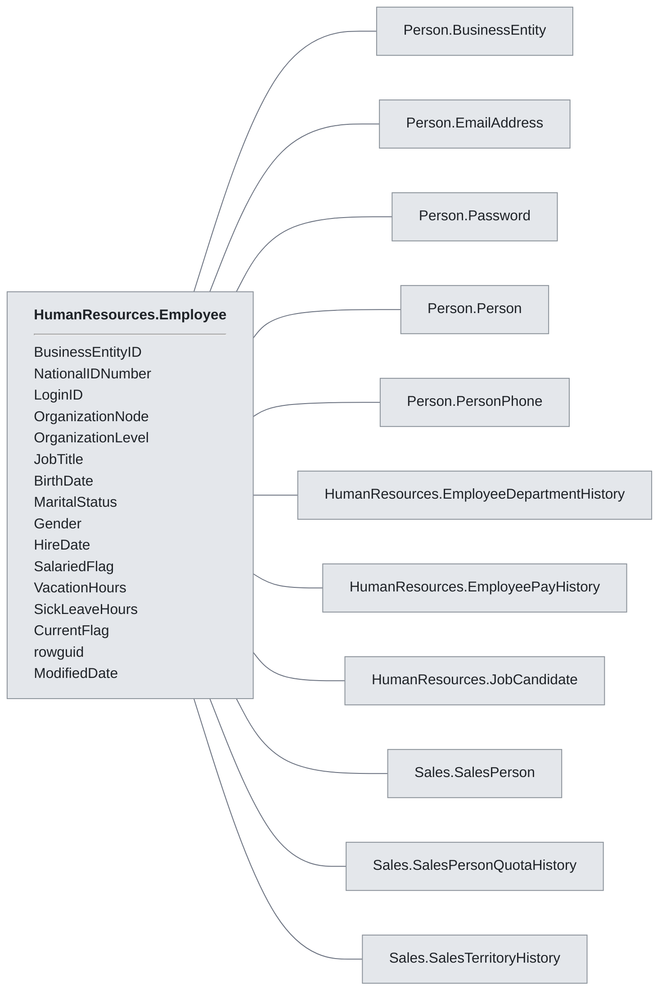

<div style="background:#f4f5f7;color:#1f2328;padding:16px 22px;border-radius:8px;">

<a href="../index.md" style="color:#0b5cad">← AdventureWorks2025 Overview</a> · <a href="../beam-annotations.md" style="color:#0b5cad">BEAM✲ Annotations</a> · <a href="../how-to-read.md" style="color:#0b5cad">How to Read This Wiki</a>

# HumanResources.Employee

<table style="border-collapse:collapse;margin:8px 0;">
<tr><th scope="row" align="left" style="text-align:left;vertical-align:top;white-space:nowrap;font-weight:600;padding:6px 16px 6px 10px;background:#e4e7eb;color:#1f2328;border-bottom:1px solid #d0d4da;">Description</th><td style="text-align:left;vertical-align:top;padding:6px 10px;background:#ffffff;color:#1f2328;border-bottom:1px solid #d0d4da;">Employee information such as salary, department, and title.</td></tr>
<tr><th scope="row" align="left" style="text-align:left;vertical-align:top;white-space:nowrap;font-weight:600;padding:6px 16px 6px 10px;background:#e4e7eb;color:#1f2328;border-bottom:1px solid #d0d4da;">Grain</th><td style="text-align:left;vertical-align:top;padding:6px 10px;background:#ffffff;color:#1f2328;border-bottom:1px solid #d0d4da;">One row for each person who works or has worked for the company as an employee; BusinessEntityID is unique across the 290 rows, and NationalIDNumber, LoginID and OrganizationNode are each unique too.</td></tr>
<tr><th scope="row" align="left" style="text-align:left;vertical-align:top;white-space:nowrap;font-weight:600;padding:6px 16px 6px 10px;background:#e4e7eb;color:#1f2328;border-bottom:1px solid #d0d4da;">BEAM✲</th><td style="text-align:left;vertical-align:top;padding:6px 10px;background:#ffffff;color:#1f2328;border-bottom:1px solid #d0d4da;"><a href="../beam-annotations.md#t-cv" style="color:#0b5cad" title="Current Value: Keeps only the current value of each attribute. Changes overwrite the old value. Also called a type 1 slowly changing dimension.">[CV]</a> <i>(suggested by AI)</i></td></tr>
<tr><th scope="row" align="left" style="text-align:left;vertical-align:top;white-space:nowrap;font-weight:600;padding:6px 16px 6px 10px;background:#e4e7eb;color:#1f2328;border-bottom:1px solid #d0d4da;">Why <a href="../beam-annotations.md#t-cv" style="color:#0b5cad" title="Current Value: Keeps only the current value of each attribute. Changes overwrite the old value. Also called a type 1 slowly changing dimension.">[CV]</a></th><td style="text-align:left;vertical-align:top;padding:6px 10px;background:#ffffff;color:#1f2328;border-bottom:1px solid #d0d4da;">One row per employee with the current job, flags and leave balances and no validity dates or versions, so only current values are held <a href="../beam-annotations.md#t-cv" style="color:#0b5cad" title="Current Value: Keeps only the current value of each attribute. Changes overwrite the old value. Also called a type 1 slowly changing dimension.">[CV]</a>.</td></tr>
<tr><th scope="row" align="left" style="text-align:left;vertical-align:top;white-space:nowrap;font-weight:600;padding:6px 16px 6px 10px;background:#e4e7eb;color:#1f2328;border-bottom:1px solid #d0d4da;">Source</th><td style="text-align:left;vertical-align:top;padding:6px 10px;background:#ffffff;color:#1f2328;border-bottom:1px solid #d0d4da;"><a href="../beam-annotations.md#t-source" style="color:#0b5cad" title="Data source: The source system table or file the table comes from.">{HumanResources.Employee}</a> <i>(measured)</i></td></tr>
<tr><th scope="row" align="left" style="text-align:left;vertical-align:top;white-space:nowrap;font-weight:600;padding:6px 16px 6px 10px;background:#e4e7eb;color:#1f2328;border-bottom:1px solid #d0d4da;">Sampled Rows</th><td style="text-align:left;vertical-align:top;padding:6px 10px;background:#ffffff;color:#1f2328;border-bottom:1px solid #d0d4da;">290</td></tr>
<tr><th scope="row" align="left" style="text-align:left;vertical-align:top;white-space:nowrap;font-weight:600;padding:6px 16px 6px 10px;background:#e4e7eb;color:#1f2328;border-bottom:1px solid #d0d4da;">Columns</th><td style="text-align:left;vertical-align:top;padding:6px 10px;background:#ffffff;color:#1f2328;border-bottom:1px solid #d0d4da;">16</td></tr>
<tr><th scope="row" align="left" style="text-align:left;vertical-align:top;white-space:nowrap;font-weight:600;padding:6px 16px 6px 10px;background:#e4e7eb;color:#1f2328;border-bottom:1px solid #d0d4da;">Description Source</th><td style="text-align:left;vertical-align:top;padding:6px 10px;background:#ffffff;color:#1f2328;border-bottom:1px solid #d0d4da;">Source system metadata, quoted word for word</td></tr>
</table>

## Columns

<div style="overflow-x:auto;max-width:100%;">
<table style="border-collapse:separate;border-spacing:0;font-size:90%;">
<tr><td rowspan="3" style="position:sticky;left:0;z-index:2;box-sizing:border-box;width:34px;min-width:34px;max-width:34px;padding:0;border:0;background:transparent;"></td><th style="position:sticky;left:34px;z-index:2;border:0 solid #d0d4da;border-width:0 1px 1px 0;background:#cfd5dd;color:#1f2328;padding:3px 8px;white-space:nowrap;text-align:left;vertical-align:top;font-weight:700;border-top:1px solid #d0d4da;border-left:1px solid #d0d4da;cursor:help;" title="The column as it is named in the data. Each column of the table is one column in this matrix.">Column Name</th><th style="border:0 solid #d0d4da;border-width:0 1px 1px 0;padding:3px 8px;white-space:nowrap;text-align:left;vertical-align:top;background:#ffffff;color:#1f2328;font-weight:600;background:#cfd5dd;color:#1f2328;border-top:1px solid #d0d4da;">BusinessEntityID</th><th style="border:0 solid #d0d4da;border-width:0 1px 1px 0;padding:3px 8px;white-space:nowrap;text-align:left;vertical-align:top;background:#ffffff;color:#1f2328;font-weight:600;background:#cfd5dd;color:#1f2328;border-top:1px solid #d0d4da;">NationalIDNumber</th><th style="border:0 solid #d0d4da;border-width:0 1px 1px 0;padding:3px 8px;white-space:nowrap;text-align:left;vertical-align:top;background:#ffffff;color:#1f2328;font-weight:600;background:#cfd5dd;color:#1f2328;border-top:1px solid #d0d4da;">LoginID</th><th style="border:0 solid #d0d4da;border-width:0 1px 1px 0;padding:3px 8px;white-space:nowrap;text-align:left;vertical-align:top;background:#ffffff;color:#1f2328;font-weight:600;background:#cfd5dd;color:#1f2328;border-top:1px solid #d0d4da;">OrganizationNode</th><th style="border:0 solid #d0d4da;border-width:0 1px 1px 0;padding:3px 8px;white-space:nowrap;text-align:left;vertical-align:top;background:#ffffff;color:#1f2328;font-weight:600;background:#cfd5dd;color:#1f2328;border-top:1px solid #d0d4da;">OrganizationLevel</th><th style="border:0 solid #d0d4da;border-width:0 1px 1px 0;padding:3px 8px;white-space:nowrap;text-align:left;vertical-align:top;background:#ffffff;color:#1f2328;font-weight:600;background:#cfd5dd;color:#1f2328;border-top:1px solid #d0d4da;">JobTitle</th><th style="border:0 solid #d0d4da;border-width:0 1px 1px 0;padding:3px 8px;white-space:nowrap;text-align:left;vertical-align:top;background:#ffffff;color:#1f2328;font-weight:600;background:#cfd5dd;color:#1f2328;border-top:1px solid #d0d4da;">BirthDate</th><th style="border:0 solid #d0d4da;border-width:0 1px 1px 0;padding:3px 8px;white-space:nowrap;text-align:left;vertical-align:top;background:#ffffff;color:#1f2328;font-weight:600;background:#cfd5dd;color:#1f2328;border-top:1px solid #d0d4da;">MaritalStatus</th><th style="border:0 solid #d0d4da;border-width:0 1px 1px 0;padding:3px 8px;white-space:nowrap;text-align:left;vertical-align:top;background:#ffffff;color:#1f2328;font-weight:600;background:#cfd5dd;color:#1f2328;border-top:1px solid #d0d4da;">Gender</th><th style="border:0 solid #d0d4da;border-width:0 1px 1px 0;padding:3px 8px;white-space:nowrap;text-align:left;vertical-align:top;background:#ffffff;color:#1f2328;font-weight:600;background:#cfd5dd;color:#1f2328;border-top:1px solid #d0d4da;">HireDate</th><th style="border:0 solid #d0d4da;border-width:0 1px 1px 0;padding:3px 8px;white-space:nowrap;text-align:left;vertical-align:top;background:#ffffff;color:#1f2328;font-weight:600;background:#cfd5dd;color:#1f2328;border-top:1px solid #d0d4da;">SalariedFlag</th><th style="border:0 solid #d0d4da;border-width:0 1px 1px 0;padding:3px 8px;white-space:nowrap;text-align:left;vertical-align:top;background:#ffffff;color:#1f2328;font-weight:600;background:#cfd5dd;color:#1f2328;border-top:1px solid #d0d4da;">VacationHours</th><th style="border:0 solid #d0d4da;border-width:0 1px 1px 0;padding:3px 8px;white-space:nowrap;text-align:left;vertical-align:top;background:#ffffff;color:#1f2328;font-weight:600;background:#cfd5dd;color:#1f2328;border-top:1px solid #d0d4da;">SickLeaveHours</th><th style="border:0 solid #d0d4da;border-width:0 1px 1px 0;padding:3px 8px;white-space:nowrap;text-align:left;vertical-align:top;background:#ffffff;color:#1f2328;font-weight:600;background:#cfd5dd;color:#1f2328;border-top:1px solid #d0d4da;">CurrentFlag</th><th style="border:0 solid #d0d4da;border-width:0 1px 1px 0;padding:3px 8px;white-space:nowrap;text-align:left;vertical-align:top;background:#ffffff;color:#1f2328;font-weight:600;background:#cfd5dd;color:#1f2328;border-top:1px solid #d0d4da;">rowguid</th><th style="border:0 solid #d0d4da;border-width:0 1px 1px 0;padding:3px 8px;white-space:nowrap;text-align:left;vertical-align:top;background:#ffffff;color:#1f2328;font-weight:600;background:#cfd5dd;color:#1f2328;border-top:1px solid #d0d4da;">ModifiedDate</th></tr>
<tr><td style="position:sticky;left:34px;z-index:2;border:0 solid #d0d4da;border-width:0 1px 1px 0;background:#e4e7eb;color:#1f2328;padding:3px 8px;white-space:nowrap;text-align:left;vertical-align:top;font-weight:600;border-left:1px solid #d0d4da;cursor:help;" title="The kind of values found in the data, which may differ from what the source declares. The short code is a BEAM annotation, for example C9 is text with a longest value of 9 characters.">Data Type</td><td style="border:0 solid #d0d4da;border-width:0 1px 1px 0;padding:3px 8px;white-space:nowrap;text-align:left;vertical-align:top;background:#ffffff;color:#1f2328;"><a href="../beam-annotations.md#c-i" style="color:#0b5cad" title="Integer: A whole number. (Measured from the data.)">I</a> whole number</td><td style="border:0 solid #d0d4da;border-width:0 1px 1px 0;padding:3px 8px;white-space:nowrap;text-align:left;vertical-align:top;background:#ffffff;color:#1f2328;"><a href="../beam-annotations.md#c-i" style="color:#0b5cad" title="Integer: A whole number. (Measured from the data.)">I</a> whole number <span title="Personal data. The engine measured this column but never saved or shows its values, so neither the AI agent nor the reader sees them." style="white-space:nowrap">🔒 national id</span></td><td style="border:0 solid #d0d4da;border-width:0 1px 1px 0;padding:3px 8px;white-space:nowrap;text-align:left;vertical-align:top;background:#ffffff;color:#1f2328;"><a href="../beam-annotations.md#c-c" style="color:#0b5cad" title="Character: Short text, with n = the longest value seen. (Measured from the data.)">C28</a> text</td><td style="border:0 solid #d0d4da;border-width:0 1px 1px 0;padding:3px 8px;white-space:nowrap;text-align:left;vertical-align:top;background:#ffffff;color:#1f2328;"><a href="../beam-annotations.md#c-c" style="color:#0b5cad" title="Character: Short text, with n = the longest value seen. (Measured from the data.)">C11</a> text</td><td style="border:0 solid #d0d4da;border-width:0 1px 1px 0;padding:3px 8px;white-space:nowrap;text-align:left;vertical-align:top;background:#ffffff;color:#1f2328;"><a href="../beam-annotations.md#c-i" style="color:#0b5cad" title="Integer: A whole number. (Measured from the data.)">I</a> whole number</td><td style="border:0 solid #d0d4da;border-width:0 1px 1px 0;padding:3px 8px;white-space:nowrap;text-align:left;vertical-align:top;background:#ffffff;color:#1f2328;"><a href="../beam-annotations.md#c-c" style="color:#0b5cad" title="Character: Short text, with n = the longest value seen. (Measured from the data.)">C40</a> text</td><td style="border:0 solid #d0d4da;border-width:0 1px 1px 0;padding:3px 8px;white-space:nowrap;text-align:left;vertical-align:top;background:#ffffff;color:#1f2328;"><a href="../beam-annotations.md#c-d" style="color:#0b5cad" title="Date: A calendar date. Numbers order milestones, e.g. D1 → D2. (Measured from the data.)">D</a> date <span title="Personal data. The engine measured this column but never saved or shows its values, so neither the AI agent nor the reader sees them." style="white-space:nowrap">🔒 birth date</span></td><td style="border:0 solid #d0d4da;border-width:0 1px 1px 0;padding:3px 8px;white-space:nowrap;text-align:left;vertical-align:top;background:#ffffff;color:#1f2328;"><a href="../beam-annotations.md#c-c" style="color:#0b5cad" title="Character: Short text, with n = the longest value seen. (Measured from the data.)">C1</a> text</td><td style="border:0 solid #d0d4da;border-width:0 1px 1px 0;padding:3px 8px;white-space:nowrap;text-align:left;vertical-align:top;background:#ffffff;color:#1f2328;"><a href="../beam-annotations.md#c-c" style="color:#0b5cad" title="Character: Short text, with n = the longest value seen. (Measured from the data.)">C1</a> text</td><td style="border:0 solid #d0d4da;border-width:0 1px 1px 0;padding:3px 8px;white-space:nowrap;text-align:left;vertical-align:top;background:#ffffff;color:#1f2328;"><a href="../beam-annotations.md#c-d" style="color:#0b5cad" title="Date: A calendar date. Numbers order milestones, e.g. D1 → D2. (Measured from the data.)">D</a> date</td><td style="border:0 solid #d0d4da;border-width:0 1px 1px 0;padding:3px 8px;white-space:nowrap;text-align:left;vertical-align:top;background:#ffffff;color:#1f2328;">yes/no</td><td style="border:0 solid #d0d4da;border-width:0 1px 1px 0;padding:3px 8px;white-space:nowrap;text-align:left;vertical-align:top;background:#ffffff;color:#1f2328;"><a href="../beam-annotations.md#c-i" style="color:#0b5cad" title="Integer: A whole number. (Measured from the data.)">I</a> whole number</td><td style="border:0 solid #d0d4da;border-width:0 1px 1px 0;padding:3px 8px;white-space:nowrap;text-align:left;vertical-align:top;background:#ffffff;color:#1f2328;"><a href="../beam-annotations.md#c-i" style="color:#0b5cad" title="Integer: A whole number. (Measured from the data.)">I</a> whole number</td><td style="border:0 solid #d0d4da;border-width:0 1px 1px 0;padding:3px 8px;white-space:nowrap;text-align:left;vertical-align:top;background:#ffffff;color:#1f2328;">yes/no</td><td style="border:0 solid #d0d4da;border-width:0 1px 1px 0;padding:3px 8px;white-space:nowrap;text-align:left;vertical-align:top;background:#ffffff;color:#1f2328;"><a href="../beam-annotations.md#c-c" style="color:#0b5cad" title="Character: Short text, with n = the longest value seen. (Measured from the data.)">C36</a> text</td><td style="border:0 solid #d0d4da;border-width:0 1px 1px 0;padding:3px 8px;white-space:nowrap;text-align:left;vertical-align:top;background:#ffffff;color:#1f2328;"><a href="../beam-annotations.md#c-d" style="color:#0b5cad" title="Date: A calendar date. Numbers order milestones, e.g. D1 → D2. (Measured from the data.)">D</a> date</td></tr>
<tr><td style="position:sticky;left:34px;z-index:2;border:0 solid #d0d4da;border-width:0 1px 1px 0;background:#e4e7eb;color:#1f2328;padding:3px 8px;white-space:nowrap;text-align:left;vertical-align:top;font-weight:600;border-left:1px solid #d0d4da;cursor:help;" title="Short BEAM annotations. Plain codes are measured from the data. Codes in italics are suggested by AI and should be checked. Click a code to read what it means.">BEAM✲</td><td style="border:0 solid #d0d4da;border-width:0 1px 1px 0;padding:3px 8px;white-space:nowrap;text-align:left;vertical-align:top;background:#ffffff;color:#1f2328;"><a href="../beam-annotations.md#c-pk" style="color:#0b5cad" title="Primary Key: Declared by the source system as the identifier of a row of this table. (Measured from the data.)">PK</a> <a href="../beam-annotations.md#c-fk" style="color:#0b5cad" title="Foreign Key: Points to the key of another table. In this wiki measured: every value was found in the other table. (Measured from the data.)">FK</a> <i><a href="../beam-annotations.md#c-bk" style="color:#0b5cad" title="Business Key: The source system&#x27;s own identifier for the thing the table is about, e.g. the customer number in a customers table. It identifies a row of this table. (Suggested by AI.)">BK</a></i> <i><a href="../beam-annotations.md#c-md" style="color:#0b5cad" title="Mandatory: The value should always be there under normal conditions. Shown as MD when the data has gaps. (Suggested by AI.)">MD</a></i> <i><a href="../beam-annotations.md#c-dim" style="color:#0b5cad" title="Dimension or role: The dimension a detail refers to, e.g. PreferredStoreID [Stores] when the preferred store is a role of the store dimension. (Suggested by AI.)">[Person.Person]</a></i></td><td style="border:0 solid #d0d4da;border-width:0 1px 1px 0;padding:3px 8px;white-space:nowrap;text-align:left;vertical-align:top;background:#ffffff;color:#1f2328;"><a href="../beam-annotations.md#c-nn" style="color:#0b5cad" title="Not Null: The source system does not allow empty values. (Measured from the data.)">NN</a> <a href="../beam-annotations.md#c-nd" style="color:#0b5cad" title="No Duplicates: Every value is different. The numbered form marks columns that are unique in combination. In this wiki measured: no duplicates were found in the text or whole-number values profiled. (Measured from the data.)">ND</a> <i><a href="../beam-annotations.md#c-nk" style="color:#0b5cad" title="Natural Key: An identifier people use in the real world for the thing the table is about, e.g. the SKU in a products table. (Suggested by AI.)">NK</a></i> <i><a href="../beam-annotations.md#c-md" style="color:#0b5cad" title="Mandatory: The value should always be there under normal conditions. Shown as MD when the data has gaps. (Suggested by AI.)">MD</a></i></td><td style="border:0 solid #d0d4da;border-width:0 1px 1px 0;padding:3px 8px;white-space:nowrap;text-align:left;vertical-align:top;background:#ffffff;color:#1f2328;"><a href="../beam-annotations.md#c-nn" style="color:#0b5cad" title="Not Null: The source system does not allow empty values. (Measured from the data.)">NN</a> <a href="../beam-annotations.md#c-nd" style="color:#0b5cad" title="No Duplicates: Every value is different. The numbered form marks columns that are unique in combination. In this wiki measured: no duplicates were found in the text or whole-number values profiled. (Measured from the data.)">ND</a> <i><a href="../beam-annotations.md#c-nk" style="color:#0b5cad" title="Natural Key: An identifier people use in the real world for the thing the table is about, e.g. the SKU in a products table. (Suggested by AI.)">NK</a></i> <i><a href="../beam-annotations.md#c-md" style="color:#0b5cad" title="Mandatory: The value should always be there under normal conditions. Shown as MD when the data has gaps. (Suggested by AI.)">MD</a></i></td><td style="border:0 solid #d0d4da;border-width:0 1px 1px 0;padding:3px 8px;white-space:nowrap;text-align:left;vertical-align:top;background:#ffffff;color:#1f2328;"></td><td style="border:0 solid #d0d4da;border-width:0 1px 1px 0;padding:3px 8px;white-space:nowrap;text-align:left;vertical-align:top;background:#ffffff;color:#1f2328;"><i><a href="../beam-annotations.md#c-suspect" style="color:#0b5cad" title="Suspect: The column still needs clarifying. See the open questions on its page. (Suggested by AI.)">?</a></i></td><td style="border:0 solid #d0d4da;border-width:0 1px 1px 0;padding:3px 8px;white-space:nowrap;text-align:left;vertical-align:top;background:#ffffff;color:#1f2328;"><a href="../beam-annotations.md#c-nn" style="color:#0b5cad" title="Not Null: The source system does not allow empty values. (Measured from the data.)">NN</a> <i><a href="../beam-annotations.md#c-md" style="color:#0b5cad" title="Mandatory: The value should always be there under normal conditions. Shown as MD when the data has gaps. (Suggested by AI.)">MD</a></i></td><td style="border:0 solid #d0d4da;border-width:0 1px 1px 0;padding:3px 8px;white-space:nowrap;text-align:left;vertical-align:top;background:#ffffff;color:#1f2328;"><a href="../beam-annotations.md#c-nn" style="color:#0b5cad" title="Not Null: The source system does not allow empty values. (Measured from the data.)">NN</a> <i><a href="../beam-annotations.md#c-fv" style="color:#0b5cad" title="Fixed Value: Shouldn&#x27;t change, e.g. a date of birth. Corrections overwrite it. (Suggested by AI.)">FV</a></i> <i><a href="../beam-annotations.md#c-md" style="color:#0b5cad" title="Mandatory: The value should always be there under normal conditions. Shown as MD when the data has gaps. (Suggested by AI.)">MD</a></i></td><td style="border:0 solid #d0d4da;border-width:0 1px 1px 0;padding:3px 8px;white-space:nowrap;text-align:left;vertical-align:top;background:#ffffff;color:#1f2328;"><a href="../beam-annotations.md#c-nn" style="color:#0b5cad" title="Not Null: The source system does not allow empty values. (Measured from the data.)">NN</a></td><td style="border:0 solid #d0d4da;border-width:0 1px 1px 0;padding:3px 8px;white-space:nowrap;text-align:left;vertical-align:top;background:#ffffff;color:#1f2328;"><a href="../beam-annotations.md#c-nn" style="color:#0b5cad" title="Not Null: The source system does not allow empty values. (Measured from the data.)">NN</a></td><td style="border:0 solid #d0d4da;border-width:0 1px 1px 0;padding:3px 8px;white-space:nowrap;text-align:left;vertical-align:top;background:#ffffff;color:#1f2328;"><a href="../beam-annotations.md#c-nn" style="color:#0b5cad" title="Not Null: The source system does not allow empty values. (Measured from the data.)">NN</a> <i><a href="../beam-annotations.md#c-fv" style="color:#0b5cad" title="Fixed Value: Shouldn&#x27;t change, e.g. a date of birth. Corrections overwrite it. (Suggested by AI.)">FV</a></i> <i><a href="../beam-annotations.md#c-md" style="color:#0b5cad" title="Mandatory: The value should always be there under normal conditions. Shown as MD when the data has gaps. (Suggested by AI.)">MD</a></i></td><td style="border:0 solid #d0d4da;border-width:0 1px 1px 0;padding:3px 8px;white-space:nowrap;text-align:left;vertical-align:top;background:#ffffff;color:#1f2328;"><a href="../beam-annotations.md#c-nn" style="color:#0b5cad" title="Not Null: The source system does not allow empty values. (Measured from the data.)">NN</a></td><td style="border:0 solid #d0d4da;border-width:0 1px 1px 0;padding:3px 8px;white-space:nowrap;text-align:left;vertical-align:top;background:#ffffff;color:#1f2328;"><a href="../beam-annotations.md#c-nn" style="color:#0b5cad" title="Not Null: The source system does not allow empty values. (Measured from the data.)">NN</a> <i><a href="../beam-annotations.md#c-sa" style="color:#0b5cad" title="Semi-Additive fact: Can be summed across some details but not others, e.g. a stock level can&#x27;t be summed over time. (Suggested by AI.)">SA</a></i> <i><a href="../beam-annotations.md#c-uom" style="color:#0b5cad" title="Unit of measure: The unit a fact is stored in, e.g. [USD] or [days]. Several units list the standard one first. (Suggested by AI.)">[hours]</a></i></td><td style="border:0 solid #d0d4da;border-width:0 1px 1px 0;padding:3px 8px;white-space:nowrap;text-align:left;vertical-align:top;background:#ffffff;color:#1f2328;"><a href="../beam-annotations.md#c-nn" style="color:#0b5cad" title="Not Null: The source system does not allow empty values. (Measured from the data.)">NN</a> <i><a href="../beam-annotations.md#c-sa" style="color:#0b5cad" title="Semi-Additive fact: Can be summed across some details but not others, e.g. a stock level can&#x27;t be summed over time. (Suggested by AI.)">SA</a></i> <i><a href="../beam-annotations.md#c-uom" style="color:#0b5cad" title="Unit of measure: The unit a fact is stored in, e.g. [USD] or [days]. Several units list the standard one first. (Suggested by AI.)">[hours]</a></i></td><td style="border:0 solid #d0d4da;border-width:0 1px 1px 0;padding:3px 8px;white-space:nowrap;text-align:left;vertical-align:top;background:#ffffff;color:#1f2328;"><a href="../beam-annotations.md#c-nn" style="color:#0b5cad" title="Not Null: The source system does not allow empty values. (Measured from the data.)">NN</a> <i><a href="../beam-annotations.md#c-suspect" style="color:#0b5cad" title="Suspect: The column still needs clarifying. See the open questions on its page. (Suggested by AI.)">?</a></i></td><td style="border:0 solid #d0d4da;border-width:0 1px 1px 0;padding:3px 8px;white-space:nowrap;text-align:left;vertical-align:top;background:#ffffff;color:#1f2328;"><a href="../beam-annotations.md#c-nn" style="color:#0b5cad" title="Not Null: The source system does not allow empty values. (Measured from the data.)">NN</a> <a href="../beam-annotations.md#c-nd" style="color:#0b5cad" title="No Duplicates: Every value is different. The numbered form marks columns that are unique in combination. In this wiki measured: no duplicates were found in the text or whole-number values profiled. (Measured from the data.)">ND</a></td><td style="border:0 solid #d0d4da;border-width:0 1px 1px 0;padding:3px 8px;white-space:nowrap;text-align:left;vertical-align:top;background:#ffffff;color:#1f2328;"><a href="../beam-annotations.md#c-nn" style="color:#0b5cad" title="Not Null: The source system does not allow empty values. (Measured from the data.)">NN</a></td></tr>
<tr><td rowspan="9" style="position:sticky;left:0;z-index:2;box-sizing:border-box;width:34px;min-width:34px;max-width:34px;border:0 solid #d0d4da;border-width:0 1px 1px 0;background:#c5dcee;color:#12405f;padding:4px 0;text-align:center;vertical-align:middle;border-left:1px solid #d0d4da;cursor:help;" title="Counts and extremes measured from the rows that were read. They are facts, not opinions."><div style="writing-mode:vertical-rl;transform:rotate(180deg);white-space:nowrap;margin:0 auto;font-weight:600;">Data Profiling Results</div></td><td style="position:sticky;left:34px;z-index:2;border:0 solid #d0d4da;border-width:0 1px 1px 0;background:#e4e7eb;color:#1f2328;padding:3px 8px;white-space:nowrap;text-align:left;vertical-align:top;font-weight:600;cursor:help;" title="How many rows were read for these numbers. Every percentage in this group is based on it, so check it first: on very large tables it can be fewer than all rows.">Sample Count</td><td style="border:0 solid #d0d4da;border-width:0 1px 1px 0;padding:3px 8px;white-space:nowrap;text-align:right;vertical-align:top;background:#ffffff;color:#1f2328;background:#f3f8fc;">290</td><td style="border:0 solid #d0d4da;border-width:0 1px 1px 0;padding:3px 8px;white-space:nowrap;text-align:right;vertical-align:top;background:#ffffff;color:#1f2328;background:#f3f8fc;">290</td><td style="border:0 solid #d0d4da;border-width:0 1px 1px 0;padding:3px 8px;white-space:nowrap;text-align:right;vertical-align:top;background:#ffffff;color:#1f2328;background:#f3f8fc;">290</td><td style="border:0 solid #d0d4da;border-width:0 1px 1px 0;padding:3px 8px;white-space:nowrap;text-align:right;vertical-align:top;background:#ffffff;color:#1f2328;background:#f3f8fc;">290</td><td style="border:0 solid #d0d4da;border-width:0 1px 1px 0;padding:3px 8px;white-space:nowrap;text-align:right;vertical-align:top;background:#ffffff;color:#1f2328;background:#f3f8fc;">290</td><td style="border:0 solid #d0d4da;border-width:0 1px 1px 0;padding:3px 8px;white-space:nowrap;text-align:right;vertical-align:top;background:#ffffff;color:#1f2328;background:#f3f8fc;">290</td><td style="border:0 solid #d0d4da;border-width:0 1px 1px 0;padding:3px 8px;white-space:nowrap;text-align:right;vertical-align:top;background:#ffffff;color:#1f2328;background:#f3f8fc;">290</td><td style="border:0 solid #d0d4da;border-width:0 1px 1px 0;padding:3px 8px;white-space:nowrap;text-align:right;vertical-align:top;background:#ffffff;color:#1f2328;background:#f3f8fc;">290</td><td style="border:0 solid #d0d4da;border-width:0 1px 1px 0;padding:3px 8px;white-space:nowrap;text-align:right;vertical-align:top;background:#ffffff;color:#1f2328;background:#f3f8fc;">290</td><td style="border:0 solid #d0d4da;border-width:0 1px 1px 0;padding:3px 8px;white-space:nowrap;text-align:right;vertical-align:top;background:#ffffff;color:#1f2328;background:#f3f8fc;">290</td><td style="border:0 solid #d0d4da;border-width:0 1px 1px 0;padding:3px 8px;white-space:nowrap;text-align:right;vertical-align:top;background:#ffffff;color:#1f2328;background:#f3f8fc;">290</td><td style="border:0 solid #d0d4da;border-width:0 1px 1px 0;padding:3px 8px;white-space:nowrap;text-align:right;vertical-align:top;background:#ffffff;color:#1f2328;background:#f3f8fc;">290</td><td style="border:0 solid #d0d4da;border-width:0 1px 1px 0;padding:3px 8px;white-space:nowrap;text-align:right;vertical-align:top;background:#ffffff;color:#1f2328;background:#f3f8fc;">290</td><td style="border:0 solid #d0d4da;border-width:0 1px 1px 0;padding:3px 8px;white-space:nowrap;text-align:right;vertical-align:top;background:#ffffff;color:#1f2328;background:#f3f8fc;">290</td><td style="border:0 solid #d0d4da;border-width:0 1px 1px 0;padding:3px 8px;white-space:nowrap;text-align:right;vertical-align:top;background:#ffffff;color:#1f2328;background:#f3f8fc;">290</td><td style="border:0 solid #d0d4da;border-width:0 1px 1px 0;padding:3px 8px;white-space:nowrap;text-align:right;vertical-align:top;background:#ffffff;color:#1f2328;background:#f3f8fc;">290</td></tr>
<tr><td style="position:sticky;left:34px;z-index:2;border:0 solid #d0d4da;border-width:0 1px 1px 0;background:#e4e7eb;color:#1f2328;padding:3px 8px;white-space:nowrap;text-align:left;vertical-align:top;font-weight:600;cursor:help;" title="Rows where the column is empty or blank, with the share of rows. It matters because gaps break joins and totals, and a column that should always be filled in should show 0.">Missing</td><td style="border:0 solid #d0d4da;border-width:0 1px 1px 0;padding:3px 8px;white-space:nowrap;text-align:left;vertical-align:top;background:#ffffff;color:#1f2328;background:#f3f8fc;">0 (0%)</td><td style="border:0 solid #d0d4da;border-width:0 1px 1px 0;padding:3px 8px;white-space:nowrap;text-align:left;vertical-align:top;background:#ffffff;color:#1f2328;background:#f3f8fc;">0 (0%)</td><td style="border:0 solid #d0d4da;border-width:0 1px 1px 0;padding:3px 8px;white-space:nowrap;text-align:left;vertical-align:top;background:#ffffff;color:#1f2328;background:#f3f8fc;">0 (0%)</td><td style="border:0 solid #d0d4da;border-width:0 1px 1px 0;padding:3px 8px;white-space:nowrap;text-align:left;vertical-align:top;background:#ffffff;color:#1f2328;background:#f3f8fc;">1 (0.345%)</td><td style="border:0 solid #d0d4da;border-width:0 1px 1px 0;padding:3px 8px;white-space:nowrap;text-align:left;vertical-align:top;background:#ffffff;color:#1f2328;background:#f3f8fc;">1 (0.345%)</td><td style="border:0 solid #d0d4da;border-width:0 1px 1px 0;padding:3px 8px;white-space:nowrap;text-align:left;vertical-align:top;background:#ffffff;color:#1f2328;background:#f3f8fc;">0 (0%)</td><td style="border:0 solid #d0d4da;border-width:0 1px 1px 0;padding:3px 8px;white-space:nowrap;text-align:left;vertical-align:top;background:#ffffff;color:#1f2328;background:#f3f8fc;">0 (0%)</td><td style="border:0 solid #d0d4da;border-width:0 1px 1px 0;padding:3px 8px;white-space:nowrap;text-align:left;vertical-align:top;background:#ffffff;color:#1f2328;background:#f3f8fc;">0 (0%)</td><td style="border:0 solid #d0d4da;border-width:0 1px 1px 0;padding:3px 8px;white-space:nowrap;text-align:left;vertical-align:top;background:#ffffff;color:#1f2328;background:#f3f8fc;">0 (0%)</td><td style="border:0 solid #d0d4da;border-width:0 1px 1px 0;padding:3px 8px;white-space:nowrap;text-align:left;vertical-align:top;background:#ffffff;color:#1f2328;background:#f3f8fc;">0 (0%)</td><td style="border:0 solid #d0d4da;border-width:0 1px 1px 0;padding:3px 8px;white-space:nowrap;text-align:left;vertical-align:top;background:#ffffff;color:#1f2328;background:#f3f8fc;">0 (0%)</td><td style="border:0 solid #d0d4da;border-width:0 1px 1px 0;padding:3px 8px;white-space:nowrap;text-align:left;vertical-align:top;background:#ffffff;color:#1f2328;background:#f3f8fc;">0 (0%)</td><td style="border:0 solid #d0d4da;border-width:0 1px 1px 0;padding:3px 8px;white-space:nowrap;text-align:left;vertical-align:top;background:#ffffff;color:#1f2328;background:#f3f8fc;">0 (0%)</td><td style="border:0 solid #d0d4da;border-width:0 1px 1px 0;padding:3px 8px;white-space:nowrap;text-align:left;vertical-align:top;background:#ffffff;color:#1f2328;background:#f3f8fc;">0 (0%)</td><td style="border:0 solid #d0d4da;border-width:0 1px 1px 0;padding:3px 8px;white-space:nowrap;text-align:left;vertical-align:top;background:#ffffff;color:#1f2328;background:#f3f8fc;">0 (0%)</td><td style="border:0 solid #d0d4da;border-width:0 1px 1px 0;padding:3px 8px;white-space:nowrap;text-align:left;vertical-align:top;background:#ffffff;color:#1f2328;background:#f3f8fc;">0 (0%)</td></tr>
<tr><td style="position:sticky;left:34px;z-index:2;border:0 solid #d0d4da;border-width:0 1px 1px 0;background:#e4e7eb;color:#1f2328;padding:3px 8px;white-space:nowrap;text-align:left;vertical-align:top;font-weight:600;cursor:help;" title="How many different values occur, with the share of rows. 100% means every value is different, so the column could identify a row. A low share means the column holds categories or codes.">Unique Values</td><td style="border:0 solid #d0d4da;border-width:0 1px 1px 0;padding:3px 8px;white-space:nowrap;text-align:left;vertical-align:top;background:#ffffff;color:#1f2328;background:#f3f8fc;">290 (100%)</td><td style="border:0 solid #d0d4da;border-width:0 1px 1px 0;padding:3px 8px;white-space:nowrap;text-align:left;vertical-align:top;background:#ffffff;color:#1f2328;background:#f3f8fc;">290 (100%)</td><td style="border:0 solid #d0d4da;border-width:0 1px 1px 0;padding:3px 8px;white-space:nowrap;text-align:left;vertical-align:top;background:#ffffff;color:#1f2328;background:#f3f8fc;">290 (100%)</td><td style="border:0 solid #d0d4da;border-width:0 1px 1px 0;padding:3px 8px;white-space:nowrap;text-align:left;vertical-align:top;background:#ffffff;color:#1f2328;background:#f3f8fc;">289 (99.7%)</td><td style="border:0 solid #d0d4da;border-width:0 1px 1px 0;padding:3px 8px;white-space:nowrap;text-align:left;vertical-align:top;background:#ffffff;color:#1f2328;background:#f3f8fc;">4 (1.38%)</td><td style="border:0 solid #d0d4da;border-width:0 1px 1px 0;padding:3px 8px;white-space:nowrap;text-align:left;vertical-align:top;background:#ffffff;color:#1f2328;background:#f3f8fc;">67 (23.1%)</td><td style="border:0 solid #d0d4da;border-width:0 1px 1px 0;padding:3px 8px;white-space:nowrap;text-align:left;vertical-align:top;background:#ffffff;color:#1f2328;background:#f3f8fc;">275 (94.8%)</td><td style="border:0 solid #d0d4da;border-width:0 1px 1px 0;padding:3px 8px;white-space:nowrap;text-align:left;vertical-align:top;background:#ffffff;color:#1f2328;background:#f3f8fc;">2 (0.69%)</td><td style="border:0 solid #d0d4da;border-width:0 1px 1px 0;padding:3px 8px;white-space:nowrap;text-align:left;vertical-align:top;background:#ffffff;color:#1f2328;background:#f3f8fc;">2 (0.69%)</td><td style="border:0 solid #d0d4da;border-width:0 1px 1px 0;padding:3px 8px;white-space:nowrap;text-align:left;vertical-align:top;background:#ffffff;color:#1f2328;background:#f3f8fc;">164 (56.6%)</td><td style="border:0 solid #d0d4da;border-width:0 1px 1px 0;padding:3px 8px;white-space:nowrap;text-align:left;vertical-align:top;background:#ffffff;color:#1f2328;background:#f3f8fc;">2 (0.69%)</td><td style="border:0 solid #d0d4da;border-width:0 1px 1px 0;padding:3px 8px;white-space:nowrap;text-align:left;vertical-align:top;background:#ffffff;color:#1f2328;background:#f3f8fc;">100 (34.5%)</td><td style="border:0 solid #d0d4da;border-width:0 1px 1px 0;padding:3px 8px;white-space:nowrap;text-align:left;vertical-align:top;background:#ffffff;color:#1f2328;background:#f3f8fc;">51 (17.6%)</td><td style="border:0 solid #d0d4da;border-width:0 1px 1px 0;padding:3px 8px;white-space:nowrap;text-align:left;vertical-align:top;background:#ffffff;color:#1f2328;background:#f3f8fc;">1 (0.345%)</td><td style="border:0 solid #d0d4da;border-width:0 1px 1px 0;padding:3px 8px;white-space:nowrap;text-align:left;vertical-align:top;background:#ffffff;color:#1f2328;background:#f3f8fc;">290 (100%)</td><td style="border:0 solid #d0d4da;border-width:0 1px 1px 0;padding:3px 8px;white-space:nowrap;text-align:left;vertical-align:top;background:#ffffff;color:#1f2328;background:#f3f8fc;">2 (0.69%)</td></tr>
<tr><td style="position:sticky;left:34px;z-index:2;border:0 solid #d0d4da;border-width:0 1px 1px 0;background:#e4e7eb;color:#1f2328;padding:3px 8px;white-space:nowrap;text-align:left;vertical-align:top;font-weight:600;cursor:help;" title="The smallest value: the lowest number, the earliest date, or the first in alphabetical order. It matters because it shows the start of the range and catches impossible values such as a negative quantity.">Min Value</td><td style="border:0 solid #d0d4da;border-width:0 1px 1px 0;padding:3px 8px;white-space:nowrap;text-align:left;vertical-align:top;background:#ffffff;color:#1f2328;background:#f3f8fc;">1</td><td style="border:0 solid #d0d4da;border-width:0 1px 1px 0;padding:3px 8px;white-space:nowrap;text-align:left;vertical-align:top;background:#ffffff;color:#1f2328;background:#f3f8fc;"><i title="Personal data. The engine measured this column but never saved or shows its values, so neither the AI agent nor the reader sees them.">masked</i></td><td style="border:0 solid #d0d4da;border-width:0 1px 1px 0;padding:3px 8px;white-space:nowrap;text-align:left;vertical-align:top;background:#ffffff;color:#1f2328;background:#f3f8fc;">adventure-works\alan0</td><td style="border:0 solid #d0d4da;border-width:0 1px 1px 0;padding:3px 8px;white-space:nowrap;text-align:left;vertical-align:top;background:#ffffff;color:#1f2328;background:#f3f8fc;">/1/</td><td style="border:0 solid #d0d4da;border-width:0 1px 1px 0;padding:3px 8px;white-space:nowrap;text-align:left;vertical-align:top;background:#ffffff;color:#1f2328;background:#f3f8fc;">1</td><td style="border:0 solid #d0d4da;border-width:0 1px 1px 0;padding:3px 8px;white-space:nowrap;text-align:left;vertical-align:top;background:#ffffff;color:#1f2328;background:#f3f8fc;">Accountant</td><td style="border:0 solid #d0d4da;border-width:0 1px 1px 0;padding:3px 8px;white-space:nowrap;text-align:left;vertical-align:top;background:#ffffff;color:#1f2328;background:#f3f8fc;">1951</td><td style="border:0 solid #d0d4da;border-width:0 1px 1px 0;padding:3px 8px;white-space:nowrap;text-align:left;vertical-align:top;background:#ffffff;color:#1f2328;background:#f3f8fc;">M</td><td style="border:0 solid #d0d4da;border-width:0 1px 1px 0;padding:3px 8px;white-space:nowrap;text-align:left;vertical-align:top;background:#ffffff;color:#1f2328;background:#f3f8fc;">F</td><td style="border:0 solid #d0d4da;border-width:0 1px 1px 0;padding:3px 8px;white-space:nowrap;text-align:left;vertical-align:top;background:#ffffff;color:#1f2328;background:#f3f8fc;">2006-06-30</td><td style="border:0 solid #d0d4da;border-width:0 1px 1px 0;padding:3px 8px;white-space:nowrap;text-align:left;vertical-align:top;background:#ffffff;color:#1f2328;background:#f3f8fc;">False</td><td style="border:0 solid #d0d4da;border-width:0 1px 1px 0;padding:3px 8px;white-space:nowrap;text-align:left;vertical-align:top;background:#ffffff;color:#1f2328;background:#f3f8fc;">0</td><td style="border:0 solid #d0d4da;border-width:0 1px 1px 0;padding:3px 8px;white-space:nowrap;text-align:left;vertical-align:top;background:#ffffff;color:#1f2328;background:#f3f8fc;">20</td><td style="border:0 solid #d0d4da;border-width:0 1px 1px 0;padding:3px 8px;white-space:nowrap;text-align:left;vertical-align:top;background:#ffffff;color:#1f2328;background:#f3f8fc;">True</td><td style="border:0 solid #d0d4da;border-width:0 1px 1px 0;padding:3px 8px;white-space:nowrap;text-align:left;vertical-align:top;background:#ffffff;color:#1f2328;background:#f3f8fc;">00027a8c-c2f8-4a31-aba8-…</td><td style="border:0 solid #d0d4da;border-width:0 1px 1px 0;padding:3px 8px;white-space:nowrap;text-align:left;vertical-align:top;background:#ffffff;color:#1f2328;background:#f3f8fc;">2014-06-30</td></tr>
<tr><td style="position:sticky;left:34px;z-index:2;border:0 solid #d0d4da;border-width:0 1px 1px 0;background:#e4e7eb;color:#1f2328;padding:3px 8px;white-space:nowrap;text-align:left;vertical-align:top;font-weight:600;cursor:help;" title="How many rows have the smallest value. On a unique column it is 1. A high count suggests a default or a stand-in value, such as 0 or 1900-01-01, rather than a real minimum.">Min Count</td><td style="border:0 solid #d0d4da;border-width:0 1px 1px 0;padding:3px 8px;white-space:nowrap;text-align:left;vertical-align:top;background:#ffffff;color:#1f2328;background:#f3f8fc;">1 (0.345%)</td><td style="border:0 solid #d0d4da;border-width:0 1px 1px 0;padding:3px 8px;white-space:nowrap;text-align:left;vertical-align:top;background:#ffffff;color:#1f2328;background:#f3f8fc;">—</td><td style="border:0 solid #d0d4da;border-width:0 1px 1px 0;padding:3px 8px;white-space:nowrap;text-align:left;vertical-align:top;background:#ffffff;color:#1f2328;background:#f3f8fc;">1 (0.345%)</td><td style="border:0 solid #d0d4da;border-width:0 1px 1px 0;padding:3px 8px;white-space:nowrap;text-align:left;vertical-align:top;background:#ffffff;color:#1f2328;background:#f3f8fc;">1 (0.345%)</td><td style="border:0 solid #d0d4da;border-width:0 1px 1px 0;padding:3px 8px;white-space:nowrap;text-align:left;vertical-align:top;background:#ffffff;color:#1f2328;background:#f3f8fc;">6 (2.07%)</td><td style="border:0 solid #d0d4da;border-width:0 1px 1px 0;padding:3px 8px;white-space:nowrap;text-align:left;vertical-align:top;background:#ffffff;color:#1f2328;background:#f3f8fc;">2 (0.69%)</td><td style="border:0 solid #d0d4da;border-width:0 1px 1px 0;padding:3px 8px;white-space:nowrap;text-align:left;vertical-align:top;background:#ffffff;color:#1f2328;background:#f3f8fc;">—</td><td style="border:0 solid #d0d4da;border-width:0 1px 1px 0;padding:3px 8px;white-space:nowrap;text-align:left;vertical-align:top;background:#ffffff;color:#1f2328;background:#f3f8fc;">146 (50.3%)</td><td style="border:0 solid #d0d4da;border-width:0 1px 1px 0;padding:3px 8px;white-space:nowrap;text-align:left;vertical-align:top;background:#ffffff;color:#1f2328;background:#f3f8fc;">84 (29%)</td><td style="border:0 solid #d0d4da;border-width:0 1px 1px 0;padding:3px 8px;white-space:nowrap;text-align:left;vertical-align:top;background:#ffffff;color:#1f2328;background:#f3f8fc;">1 (0.345%)</td><td style="border:0 solid #d0d4da;border-width:0 1px 1px 0;padding:3px 8px;white-space:nowrap;text-align:left;vertical-align:top;background:#ffffff;color:#1f2328;background:#f3f8fc;">238 (82.1%)</td><td style="border:0 solid #d0d4da;border-width:0 1px 1px 0;padding:3px 8px;white-space:nowrap;text-align:left;vertical-align:top;background:#ffffff;color:#1f2328;background:#f3f8fc;">3 (1.03%)</td><td style="border:0 solid #d0d4da;border-width:0 1px 1px 0;padding:3px 8px;white-space:nowrap;text-align:left;vertical-align:top;background:#ffffff;color:#1f2328;background:#f3f8fc;">6 (2.07%)</td><td style="border:0 solid #d0d4da;border-width:0 1px 1px 0;padding:3px 8px;white-space:nowrap;text-align:left;vertical-align:top;background:#ffffff;color:#1f2328;background:#f3f8fc;">290 (100%)</td><td style="border:0 solid #d0d4da;border-width:0 1px 1px 0;padding:3px 8px;white-space:nowrap;text-align:left;vertical-align:top;background:#ffffff;color:#1f2328;background:#f3f8fc;">1 (0.345%)</td><td style="border:0 solid #d0d4da;border-width:0 1px 1px 0;padding:3px 8px;white-space:nowrap;text-align:left;vertical-align:top;background:#ffffff;color:#1f2328;background:#f3f8fc;">287 (99%)</td></tr>
<tr><td style="position:sticky;left:34px;z-index:2;border:0 solid #d0d4da;border-width:0 1px 1px 0;background:#e4e7eb;color:#1f2328;padding:3px 8px;white-space:nowrap;text-align:left;vertical-align:top;font-weight:600;cursor:help;" title="The largest value: the highest number, the latest date, or the last in alphabetical order. It matters because it shows the end of the range and catches outliers or future dates.">Max Value</td><td style="border:0 solid #d0d4da;border-width:0 1px 1px 0;padding:3px 8px;white-space:nowrap;text-align:left;vertical-align:top;background:#ffffff;color:#1f2328;background:#f3f8fc;">290</td><td style="border:0 solid #d0d4da;border-width:0 1px 1px 0;padding:3px 8px;white-space:nowrap;text-align:left;vertical-align:top;background:#ffffff;color:#1f2328;background:#f3f8fc;"><i title="Personal data. The engine measured this column but never saved or shows its values, so neither the AI agent nor the reader sees them.">masked</i></td><td style="border:0 solid #d0d4da;border-width:0 1px 1px 0;padding:3px 8px;white-space:nowrap;text-align:left;vertical-align:top;background:#ffffff;color:#1f2328;background:#f3f8fc;">adventure-works\zheng0</td><td style="border:0 solid #d0d4da;border-width:0 1px 1px 0;padding:3px 8px;white-space:nowrap;text-align:left;vertical-align:top;background:#ffffff;color:#1f2328;background:#f3f8fc;">/6/3/3/</td><td style="border:0 solid #d0d4da;border-width:0 1px 1px 0;padding:3px 8px;white-space:nowrap;text-align:left;vertical-align:top;background:#ffffff;color:#1f2328;background:#f3f8fc;">4</td><td style="border:0 solid #d0d4da;border-width:0 1px 1px 0;padding:3px 8px;white-space:nowrap;text-align:left;vertical-align:top;background:#ffffff;color:#1f2328;background:#f3f8fc;">Vice President of Sales</td><td style="border:0 solid #d0d4da;border-width:0 1px 1px 0;padding:3px 8px;white-space:nowrap;text-align:left;vertical-align:top;background:#ffffff;color:#1f2328;background:#f3f8fc;">1991</td><td style="border:0 solid #d0d4da;border-width:0 1px 1px 0;padding:3px 8px;white-space:nowrap;text-align:left;vertical-align:top;background:#ffffff;color:#1f2328;background:#f3f8fc;">S</td><td style="border:0 solid #d0d4da;border-width:0 1px 1px 0;padding:3px 8px;white-space:nowrap;text-align:left;vertical-align:top;background:#ffffff;color:#1f2328;background:#f3f8fc;">M</td><td style="border:0 solid #d0d4da;border-width:0 1px 1px 0;padding:3px 8px;white-space:nowrap;text-align:left;vertical-align:top;background:#ffffff;color:#1f2328;background:#f3f8fc;">2013-05-30</td><td style="border:0 solid #d0d4da;border-width:0 1px 1px 0;padding:3px 8px;white-space:nowrap;text-align:left;vertical-align:top;background:#ffffff;color:#1f2328;background:#f3f8fc;">True</td><td style="border:0 solid #d0d4da;border-width:0 1px 1px 0;padding:3px 8px;white-space:nowrap;text-align:left;vertical-align:top;background:#ffffff;color:#1f2328;background:#f3f8fc;">99</td><td style="border:0 solid #d0d4da;border-width:0 1px 1px 0;padding:3px 8px;white-space:nowrap;text-align:left;vertical-align:top;background:#ffffff;color:#1f2328;background:#f3f8fc;">80</td><td style="border:0 solid #d0d4da;border-width:0 1px 1px 0;padding:3px 8px;white-space:nowrap;text-align:left;vertical-align:top;background:#ffffff;color:#1f2328;background:#f3f8fc;">True</td><td style="border:0 solid #d0d4da;border-width:0 1px 1px 0;padding:3px 8px;white-space:nowrap;text-align:left;vertical-align:top;background:#ffffff;color:#1f2328;background:#f3f8fc;">fd53c4c8-b34e-460f-9ee5-…</td><td style="border:0 solid #d0d4da;border-width:0 1px 1px 0;padding:3px 8px;white-space:nowrap;text-align:left;vertical-align:top;background:#ffffff;color:#1f2328;background:#f3f8fc;">2014-12-26 09:17:08.6370…</td></tr>
<tr><td style="position:sticky;left:34px;z-index:2;border:0 solid #d0d4da;border-width:0 1px 1px 0;background:#e4e7eb;color:#1f2328;padding:3px 8px;white-space:nowrap;text-align:left;vertical-align:top;font-weight:600;cursor:help;" title="How many rows have the largest value. A high count suggests a cap or a stand-in value, such as 9999-12-31, rather than a real maximum.">Max Count</td><td style="border:0 solid #d0d4da;border-width:0 1px 1px 0;padding:3px 8px;white-space:nowrap;text-align:left;vertical-align:top;background:#ffffff;color:#1f2328;background:#f3f8fc;">1 (0.345%)</td><td style="border:0 solid #d0d4da;border-width:0 1px 1px 0;padding:3px 8px;white-space:nowrap;text-align:left;vertical-align:top;background:#ffffff;color:#1f2328;background:#f3f8fc;">—</td><td style="border:0 solid #d0d4da;border-width:0 1px 1px 0;padding:3px 8px;white-space:nowrap;text-align:left;vertical-align:top;background:#ffffff;color:#1f2328;background:#f3f8fc;">1 (0.345%)</td><td style="border:0 solid #d0d4da;border-width:0 1px 1px 0;padding:3px 8px;white-space:nowrap;text-align:left;vertical-align:top;background:#ffffff;color:#1f2328;background:#f3f8fc;">1 (0.345%)</td><td style="border:0 solid #d0d4da;border-width:0 1px 1px 0;padding:3px 8px;white-space:nowrap;text-align:left;vertical-align:top;background:#ffffff;color:#1f2328;background:#f3f8fc;">190 (65.5%)</td><td style="border:0 solid #d0d4da;border-width:0 1px 1px 0;padding:3px 8px;white-space:nowrap;text-align:left;vertical-align:top;background:#ffffff;color:#1f2328;background:#f3f8fc;">1 (0.345%)</td><td style="border:0 solid #d0d4da;border-width:0 1px 1px 0;padding:3px 8px;white-space:nowrap;text-align:left;vertical-align:top;background:#ffffff;color:#1f2328;background:#f3f8fc;">—</td><td style="border:0 solid #d0d4da;border-width:0 1px 1px 0;padding:3px 8px;white-space:nowrap;text-align:left;vertical-align:top;background:#ffffff;color:#1f2328;background:#f3f8fc;">144 (49.7%)</td><td style="border:0 solid #d0d4da;border-width:0 1px 1px 0;padding:3px 8px;white-space:nowrap;text-align:left;vertical-align:top;background:#ffffff;color:#1f2328;background:#f3f8fc;">206 (71%)</td><td style="border:0 solid #d0d4da;border-width:0 1px 1px 0;padding:3px 8px;white-space:nowrap;text-align:left;vertical-align:top;background:#ffffff;color:#1f2328;background:#f3f8fc;">2 (0.69%)</td><td style="border:0 solid #d0d4da;border-width:0 1px 1px 0;padding:3px 8px;white-space:nowrap;text-align:left;vertical-align:top;background:#ffffff;color:#1f2328;background:#f3f8fc;">52 (17.9%)</td><td style="border:0 solid #d0d4da;border-width:0 1px 1px 0;padding:3px 8px;white-space:nowrap;text-align:left;vertical-align:top;background:#ffffff;color:#1f2328;background:#f3f8fc;">3 (1.03%)</td><td style="border:0 solid #d0d4da;border-width:0 1px 1px 0;padding:3px 8px;white-space:nowrap;text-align:left;vertical-align:top;background:#ffffff;color:#1f2328;background:#f3f8fc;">1 (0.345%)</td><td style="border:0 solid #d0d4da;border-width:0 1px 1px 0;padding:3px 8px;white-space:nowrap;text-align:left;vertical-align:top;background:#ffffff;color:#1f2328;background:#f3f8fc;">290 (100%)</td><td style="border:0 solid #d0d4da;border-width:0 1px 1px 0;padding:3px 8px;white-space:nowrap;text-align:left;vertical-align:top;background:#ffffff;color:#1f2328;background:#f3f8fc;">1 (0.345%)</td><td style="border:0 solid #d0d4da;border-width:0 1px 1px 0;padding:3px 8px;white-space:nowrap;text-align:left;vertical-align:top;background:#ffffff;color:#1f2328;background:#f3f8fc;">3 (1.03%)</td></tr>
<tr><td style="position:sticky;left:34px;z-index:2;border:0 solid #d0d4da;border-width:0 1px 1px 0;background:#e4e7eb;color:#1f2328;padding:3px 8px;white-space:nowrap;text-align:left;vertical-align:top;font-weight:600;cursor:help;" title="The shortest text, counted in characters. If it differs a lot from the longest, the column may mix formats, or have values that were cut off.">Min Length</td><td style="border:0 solid #d0d4da;border-width:0 1px 1px 0;padding:3px 8px;white-space:nowrap;text-align:right;vertical-align:top;background:#ffffff;color:#1f2328;background:#f3f8fc;">—</td><td style="border:0 solid #d0d4da;border-width:0 1px 1px 0;padding:3px 8px;white-space:nowrap;text-align:right;vertical-align:top;background:#ffffff;color:#1f2328;background:#f3f8fc;">5</td><td style="border:0 solid #d0d4da;border-width:0 1px 1px 0;padding:3px 8px;white-space:nowrap;text-align:right;vertical-align:top;background:#ffffff;color:#1f2328;background:#f3f8fc;">19</td><td style="border:0 solid #d0d4da;border-width:0 1px 1px 0;padding:3px 8px;white-space:nowrap;text-align:right;vertical-align:top;background:#ffffff;color:#1f2328;background:#f3f8fc;">3</td><td style="border:0 solid #d0d4da;border-width:0 1px 1px 0;padding:3px 8px;white-space:nowrap;text-align:right;vertical-align:top;background:#ffffff;color:#1f2328;background:#f3f8fc;">—</td><td style="border:0 solid #d0d4da;border-width:0 1px 1px 0;padding:3px 8px;white-space:nowrap;text-align:right;vertical-align:top;background:#ffffff;color:#1f2328;background:#f3f8fc;">5</td><td style="border:0 solid #d0d4da;border-width:0 1px 1px 0;padding:3px 8px;white-space:nowrap;text-align:right;vertical-align:top;background:#ffffff;color:#1f2328;background:#f3f8fc;">—</td><td style="border:0 solid #d0d4da;border-width:0 1px 1px 0;padding:3px 8px;white-space:nowrap;text-align:right;vertical-align:top;background:#ffffff;color:#1f2328;background:#f3f8fc;">1</td><td style="border:0 solid #d0d4da;border-width:0 1px 1px 0;padding:3px 8px;white-space:nowrap;text-align:right;vertical-align:top;background:#ffffff;color:#1f2328;background:#f3f8fc;">1</td><td style="border:0 solid #d0d4da;border-width:0 1px 1px 0;padding:3px 8px;white-space:nowrap;text-align:right;vertical-align:top;background:#ffffff;color:#1f2328;background:#f3f8fc;">—</td><td style="border:0 solid #d0d4da;border-width:0 1px 1px 0;padding:3px 8px;white-space:nowrap;text-align:right;vertical-align:top;background:#ffffff;color:#1f2328;background:#f3f8fc;">—</td><td style="border:0 solid #d0d4da;border-width:0 1px 1px 0;padding:3px 8px;white-space:nowrap;text-align:right;vertical-align:top;background:#ffffff;color:#1f2328;background:#f3f8fc;">—</td><td style="border:0 solid #d0d4da;border-width:0 1px 1px 0;padding:3px 8px;white-space:nowrap;text-align:right;vertical-align:top;background:#ffffff;color:#1f2328;background:#f3f8fc;">—</td><td style="border:0 solid #d0d4da;border-width:0 1px 1px 0;padding:3px 8px;white-space:nowrap;text-align:right;vertical-align:top;background:#ffffff;color:#1f2328;background:#f3f8fc;">—</td><td style="border:0 solid #d0d4da;border-width:0 1px 1px 0;padding:3px 8px;white-space:nowrap;text-align:right;vertical-align:top;background:#ffffff;color:#1f2328;background:#f3f8fc;">36</td><td style="border:0 solid #d0d4da;border-width:0 1px 1px 0;padding:3px 8px;white-space:nowrap;text-align:right;vertical-align:top;background:#ffffff;color:#1f2328;background:#f3f8fc;">—</td></tr>
<tr><td style="position:sticky;left:34px;z-index:2;border:0 solid #d0d4da;border-width:0 1px 1px 0;background:#e4e7eb;color:#1f2328;padding:3px 8px;white-space:nowrap;text-align:left;vertical-align:top;font-weight:600;cursor:help;" title="The longest text, counted in characters. It matters when you load the data elsewhere, because the target column must be wide enough.">Max Length</td><td style="border:0 solid #d0d4da;border-width:0 1px 1px 0;padding:3px 8px;white-space:nowrap;text-align:right;vertical-align:top;background:#ffffff;color:#1f2328;background:#f3f8fc;">—</td><td style="border:0 solid #d0d4da;border-width:0 1px 1px 0;padding:3px 8px;white-space:nowrap;text-align:right;vertical-align:top;background:#ffffff;color:#1f2328;background:#f3f8fc;">9</td><td style="border:0 solid #d0d4da;border-width:0 1px 1px 0;padding:3px 8px;white-space:nowrap;text-align:right;vertical-align:top;background:#ffffff;color:#1f2328;background:#f3f8fc;">28</td><td style="border:0 solid #d0d4da;border-width:0 1px 1px 0;padding:3px 8px;white-space:nowrap;text-align:right;vertical-align:top;background:#ffffff;color:#1f2328;background:#f3f8fc;">11</td><td style="border:0 solid #d0d4da;border-width:0 1px 1px 0;padding:3px 8px;white-space:nowrap;text-align:right;vertical-align:top;background:#ffffff;color:#1f2328;background:#f3f8fc;">—</td><td style="border:0 solid #d0d4da;border-width:0 1px 1px 0;padding:3px 8px;white-space:nowrap;text-align:right;vertical-align:top;background:#ffffff;color:#1f2328;background:#f3f8fc;">40</td><td style="border:0 solid #d0d4da;border-width:0 1px 1px 0;padding:3px 8px;white-space:nowrap;text-align:right;vertical-align:top;background:#ffffff;color:#1f2328;background:#f3f8fc;">—</td><td style="border:0 solid #d0d4da;border-width:0 1px 1px 0;padding:3px 8px;white-space:nowrap;text-align:right;vertical-align:top;background:#ffffff;color:#1f2328;background:#f3f8fc;">1</td><td style="border:0 solid #d0d4da;border-width:0 1px 1px 0;padding:3px 8px;white-space:nowrap;text-align:right;vertical-align:top;background:#ffffff;color:#1f2328;background:#f3f8fc;">1</td><td style="border:0 solid #d0d4da;border-width:0 1px 1px 0;padding:3px 8px;white-space:nowrap;text-align:right;vertical-align:top;background:#ffffff;color:#1f2328;background:#f3f8fc;">—</td><td style="border:0 solid #d0d4da;border-width:0 1px 1px 0;padding:3px 8px;white-space:nowrap;text-align:right;vertical-align:top;background:#ffffff;color:#1f2328;background:#f3f8fc;">—</td><td style="border:0 solid #d0d4da;border-width:0 1px 1px 0;padding:3px 8px;white-space:nowrap;text-align:right;vertical-align:top;background:#ffffff;color:#1f2328;background:#f3f8fc;">—</td><td style="border:0 solid #d0d4da;border-width:0 1px 1px 0;padding:3px 8px;white-space:nowrap;text-align:right;vertical-align:top;background:#ffffff;color:#1f2328;background:#f3f8fc;">—</td><td style="border:0 solid #d0d4da;border-width:0 1px 1px 0;padding:3px 8px;white-space:nowrap;text-align:right;vertical-align:top;background:#ffffff;color:#1f2328;background:#f3f8fc;">—</td><td style="border:0 solid #d0d4da;border-width:0 1px 1px 0;padding:3px 8px;white-space:nowrap;text-align:right;vertical-align:top;background:#ffffff;color:#1f2328;background:#f3f8fc;">36</td><td style="border:0 solid #d0d4da;border-width:0 1px 1px 0;padding:3px 8px;white-space:nowrap;text-align:right;vertical-align:top;background:#ffffff;color:#1f2328;background:#f3f8fc;">—</td></tr>
<tr><td rowspan="6" style="position:sticky;left:0;z-index:2;box-sizing:border-box;width:34px;min-width:34px;max-width:34px;border:0 solid #d0d4da;border-width:0 1px 1px 0;background:#d9cdee;color:#40286b;padding:4px 0;text-align:center;vertical-align:middle;border-left:1px solid #d0d4da;cursor:help;" title="Examples taken from the measured values, to show how varied the column is and what odd values look like."><div style="writing-mode:vertical-rl;transform:rotate(180deg);white-space:nowrap;margin:0 auto;font-weight:600;">Variation</div></td><td style="position:sticky;left:34px;z-index:2;border:0 solid #d0d4da;border-width:0 1px 1px 0;background:#e4e7eb;color:#1f2328;padding:3px 8px;white-space:nowrap;text-align:left;vertical-align:top;font-weight:600;cursor:help;" title="The most common value, so you can see what a normal row looks like. In a column where every value is different, this is just the first of them.">Typical</td><td style="border:0 solid #d0d4da;border-width:0 1px 1px 0;padding:3px 8px;white-space:nowrap;text-align:left;vertical-align:top;background:#ffffff;color:#1f2328;background:#f7f3fc;">1</td><td style="border:0 solid #d0d4da;border-width:0 1px 1px 0;padding:3px 8px;white-space:nowrap;text-align:left;vertical-align:top;background:#ffffff;color:#1f2328;background:#f7f3fc;"><i title="Personal data. The engine measured this column but never saved or shows its values, so neither the AI agent nor the reader sees them.">masked</i></td><td style="border:0 solid #d0d4da;border-width:0 1px 1px 0;padding:3px 8px;white-space:nowrap;text-align:left;vertical-align:top;background:#ffffff;color:#1f2328;background:#f7f3fc;">adventure-works\ken0</td><td style="border:0 solid #d0d4da;border-width:0 1px 1px 0;padding:3px 8px;white-space:nowrap;text-align:left;vertical-align:top;background:#ffffff;color:#1f2328;background:#f7f3fc;">/1/</td><td style="border:0 solid #d0d4da;border-width:0 1px 1px 0;padding:3px 8px;white-space:nowrap;text-align:left;vertical-align:top;background:#ffffff;color:#1f2328;background:#f7f3fc;">4</td><td style="border:0 solid #d0d4da;border-width:0 1px 1px 0;padding:3px 8px;white-space:nowrap;text-align:left;vertical-align:top;background:#ffffff;color:#1f2328;background:#f7f3fc;">Production Technician - …</td><td style="border:0 solid #d0d4da;border-width:0 1px 1px 0;padding:3px 8px;white-space:nowrap;text-align:left;vertical-align:top;background:#ffffff;color:#1f2328;background:#f7f3fc;"><i title="Personal data. The engine measured this column but never saved or shows its values, so neither the AI agent nor the reader sees them.">masked</i></td><td style="border:0 solid #d0d4da;border-width:0 1px 1px 0;padding:3px 8px;white-space:nowrap;text-align:left;vertical-align:top;background:#ffffff;color:#1f2328;background:#f7f3fc;">M</td><td style="border:0 solid #d0d4da;border-width:0 1px 1px 0;padding:3px 8px;white-space:nowrap;text-align:left;vertical-align:top;background:#ffffff;color:#1f2328;background:#f7f3fc;">M</td><td style="border:0 solid #d0d4da;border-width:0 1px 1px 0;padding:3px 8px;white-space:nowrap;text-align:left;vertical-align:top;background:#ffffff;color:#1f2328;background:#f7f3fc;">2011-05-31</td><td style="border:0 solid #d0d4da;border-width:0 1px 1px 0;padding:3px 8px;white-space:nowrap;text-align:left;vertical-align:top;background:#ffffff;color:#1f2328;background:#f7f3fc;">False</td><td style="border:0 solid #d0d4da;border-width:0 1px 1px 0;padding:3px 8px;white-space:nowrap;text-align:left;vertical-align:top;background:#ffffff;color:#1f2328;background:#f7f3fc;">48</td><td style="border:0 solid #d0d4da;border-width:0 1px 1px 0;padding:3px 8px;white-space:nowrap;text-align:left;vertical-align:top;background:#ffffff;color:#1f2328;background:#f7f3fc;">64</td><td style="border:0 solid #d0d4da;border-width:0 1px 1px 0;padding:3px 8px;white-space:nowrap;text-align:left;vertical-align:top;background:#ffffff;color:#1f2328;background:#f7f3fc;">True</td><td style="border:0 solid #d0d4da;border-width:0 1px 1px 0;padding:3px 8px;white-space:nowrap;text-align:left;vertical-align:top;background:#ffffff;color:#1f2328;background:#f7f3fc;">f01251e5-96a3-448d-981e-…</td><td style="border:0 solid #d0d4da;border-width:0 1px 1px 0;padding:3px 8px;white-space:nowrap;text-align:left;vertical-align:top;background:#ffffff;color:#1f2328;background:#f7f3fc;">2014-06-30</td></tr>
<tr><td style="position:sticky;left:34px;z-index:2;border:0 solid #d0d4da;border-width:0 1px 1px 0;background:#e4e7eb;color:#1f2328;padding:3px 8px;white-space:nowrap;text-align:left;vertical-align:top;font-weight:600;cursor:help;" title="A rare value, one of the least common. Odd values are often special cases or mistakes, so they are worth a look.">Different</td><td style="border:0 solid #d0d4da;border-width:0 1px 1px 0;padding:3px 8px;white-space:nowrap;text-align:left;vertical-align:top;background:#ffffff;color:#1f2328;background:#f7f3fc;">2</td><td style="border:0 solid #d0d4da;border-width:0 1px 1px 0;padding:3px 8px;white-space:nowrap;text-align:left;vertical-align:top;background:#ffffff;color:#1f2328;background:#f7f3fc;"><i title="Personal data. The engine measured this column but never saved or shows its values, so neither the AI agent nor the reader sees them.">masked</i></td><td style="border:0 solid #d0d4da;border-width:0 1px 1px 0;padding:3px 8px;white-space:nowrap;text-align:left;vertical-align:top;background:#ffffff;color:#1f2328;background:#f7f3fc;">adventure-works\alan0</td><td style="border:0 solid #d0d4da;border-width:0 1px 1px 0;padding:3px 8px;white-space:nowrap;text-align:left;vertical-align:top;background:#ffffff;color:#1f2328;background:#f7f3fc;">/1/1/</td><td style="border:0 solid #d0d4da;border-width:0 1px 1px 0;padding:3px 8px;white-space:nowrap;text-align:left;vertical-align:top;background:#ffffff;color:#1f2328;background:#f7f3fc;">1</td><td style="border:0 solid #d0d4da;border-width:0 1px 1px 0;padding:3px 8px;white-space:nowrap;text-align:left;vertical-align:top;background:#ffffff;color:#1f2328;background:#f7f3fc;">Accounts Manager</td><td style="border:0 solid #d0d4da;border-width:0 1px 1px 0;padding:3px 8px;white-space:nowrap;text-align:left;vertical-align:top;background:#ffffff;color:#1f2328;background:#f7f3fc;"><i title="Personal data. The engine measured this column but never saved or shows its values, so neither the AI agent nor the reader sees them.">masked</i></td><td style="border:0 solid #d0d4da;border-width:0 1px 1px 0;padding:3px 8px;white-space:nowrap;text-align:left;vertical-align:top;background:#ffffff;color:#1f2328;background:#f7f3fc;">S</td><td style="border:0 solid #d0d4da;border-width:0 1px 1px 0;padding:3px 8px;white-space:nowrap;text-align:left;vertical-align:top;background:#ffffff;color:#1f2328;background:#f7f3fc;">F</td><td style="border:0 solid #d0d4da;border-width:0 1px 1px 0;padding:3px 8px;white-space:nowrap;text-align:left;vertical-align:top;background:#ffffff;color:#1f2328;background:#f7f3fc;">2006-06-30</td><td style="border:0 solid #d0d4da;border-width:0 1px 1px 0;padding:3px 8px;white-space:nowrap;text-align:left;vertical-align:top;background:#ffffff;color:#1f2328;background:#f7f3fc;">True</td><td style="border:0 solid #d0d4da;border-width:0 1px 1px 0;padding:3px 8px;white-space:nowrap;text-align:left;vertical-align:top;background:#ffffff;color:#1f2328;background:#f7f3fc;">11</td><td style="border:0 solid #d0d4da;border-width:0 1px 1px 0;padding:3px 8px;white-space:nowrap;text-align:left;vertical-align:top;background:#ffffff;color:#1f2328;background:#f7f3fc;">80</td><td style="border:0 solid #d0d4da;border-width:0 1px 1px 0;padding:3px 8px;white-space:nowrap;text-align:left;vertical-align:top;background:#ffffff;color:#1f2328;background:#f7f3fc;">—</td><td style="border:0 solid #d0d4da;border-width:0 1px 1px 0;padding:3px 8px;white-space:nowrap;text-align:left;vertical-align:top;background:#ffffff;color:#1f2328;background:#f7f3fc;">00027a8c-c2f8-4a31-aba8-…</td><td style="border:0 solid #d0d4da;border-width:0 1px 1px 0;padding:3px 8px;white-space:nowrap;text-align:left;vertical-align:top;background:#ffffff;color:#1f2328;background:#f7f3fc;">2014-12-26 09:17:08.6370…</td></tr>
<tr><td style="position:sticky;left:34px;z-index:2;border:0 solid #d0d4da;border-width:0 1px 1px 0;background:#e4e7eb;color:#1f2328;padding:3px 8px;white-space:nowrap;text-align:left;vertical-align:top;font-weight:600;cursor:help;" title="A value that occurs more than once, and how many times (x3 means three rows). &#x27;No repeats&#x27; means every value is different.">Repeat</td><td style="border:0 solid #d0d4da;border-width:0 1px 1px 0;padding:3px 8px;white-space:nowrap;text-align:left;vertical-align:top;background:#ffffff;color:#1f2328;background:#f7f3fc;">no repeats</td><td style="border:0 solid #d0d4da;border-width:0 1px 1px 0;padding:3px 8px;white-space:nowrap;text-align:left;vertical-align:top;background:#ffffff;color:#1f2328;background:#f7f3fc;"><i title="Personal data. The engine measured this column but never saved or shows its values, so neither the AI agent nor the reader sees them.">masked</i></td><td style="border:0 solid #d0d4da;border-width:0 1px 1px 0;padding:3px 8px;white-space:nowrap;text-align:left;vertical-align:top;background:#ffffff;color:#1f2328;background:#f7f3fc;">no repeats</td><td style="border:0 solid #d0d4da;border-width:0 1px 1px 0;padding:3px 8px;white-space:nowrap;text-align:left;vertical-align:top;background:#ffffff;color:#1f2328;background:#f7f3fc;">no repeats</td><td style="border:0 solid #d0d4da;border-width:0 1px 1px 0;padding:3px 8px;white-space:nowrap;text-align:left;vertical-align:top;background:#ffffff;color:#1f2328;background:#f7f3fc;">3 ×66</td><td style="border:0 solid #d0d4da;border-width:0 1px 1px 0;padding:3px 8px;white-space:nowrap;text-align:left;vertical-align:top;background:#ffffff;color:#1f2328;background:#f7f3fc;">Production Technician - … ×26</td><td style="border:0 solid #d0d4da;border-width:0 1px 1px 0;padding:3px 8px;white-space:nowrap;text-align:left;vertical-align:top;background:#ffffff;color:#1f2328;background:#f7f3fc;"><i title="Personal data. The engine measured this column but never saved or shows its values, so neither the AI agent nor the reader sees them.">masked</i></td><td style="border:0 solid #d0d4da;border-width:0 1px 1px 0;padding:3px 8px;white-space:nowrap;text-align:left;vertical-align:top;background:#ffffff;color:#1f2328;background:#f7f3fc;">S ×144</td><td style="border:0 solid #d0d4da;border-width:0 1px 1px 0;padding:3px 8px;white-space:nowrap;text-align:left;vertical-align:top;background:#ffffff;color:#1f2328;background:#f7f3fc;">F ×84</td><td style="border:0 solid #d0d4da;border-width:0 1px 1px 0;padding:3px 8px;white-space:nowrap;text-align:left;vertical-align:top;background:#ffffff;color:#1f2328;background:#f7f3fc;">2009-02-08 ×5</td><td style="border:0 solid #d0d4da;border-width:0 1px 1px 0;padding:3px 8px;white-space:nowrap;text-align:left;vertical-align:top;background:#ffffff;color:#1f2328;background:#f7f3fc;">True ×52</td><td style="border:0 solid #d0d4da;border-width:0 1px 1px 0;padding:3px 8px;white-space:nowrap;text-align:left;vertical-align:top;background:#ffffff;color:#1f2328;background:#f7f3fc;">99 ×3</td><td style="border:0 solid #d0d4da;border-width:0 1px 1px 0;padding:3px 8px;white-space:nowrap;text-align:left;vertical-align:top;background:#ffffff;color:#1f2328;background:#f7f3fc;">69 ×6</td><td style="border:0 solid #d0d4da;border-width:0 1px 1px 0;padding:3px 8px;white-space:nowrap;text-align:left;vertical-align:top;background:#ffffff;color:#1f2328;background:#f7f3fc;">True ×290</td><td style="border:0 solid #d0d4da;border-width:0 1px 1px 0;padding:3px 8px;white-space:nowrap;text-align:left;vertical-align:top;background:#ffffff;color:#1f2328;background:#f7f3fc;">no repeats</td><td style="border:0 solid #d0d4da;border-width:0 1px 1px 0;padding:3px 8px;white-space:nowrap;text-align:left;vertical-align:top;background:#ffffff;color:#1f2328;background:#f7f3fc;">2014-12-26 09:17:08.6370… ×3</td></tr>
<tr><td style="position:sticky;left:34px;z-index:2;border:0 solid #d0d4da;border-width:0 1px 1px 0;background:#e4e7eb;color:#1f2328;padding:3px 8px;white-space:nowrap;text-align:left;vertical-align:top;font-weight:600;cursor:help;" title="What stands in for &#x27;no value&#x27;: empty cells and stand-in words such as N/A or unknown, with how many of each. Stand-ins are easy to mistake for real values.">Missing</td><td style="border:0 solid #d0d4da;border-width:0 1px 1px 0;padding:3px 8px;white-space:nowrap;text-align:left;vertical-align:top;background:#ffffff;color:#1f2328;background:#f7f3fc;">—</td><td style="border:0 solid #d0d4da;border-width:0 1px 1px 0;padding:3px 8px;white-space:nowrap;text-align:left;vertical-align:top;background:#ffffff;color:#1f2328;background:#f7f3fc;">—</td><td style="border:0 solid #d0d4da;border-width:0 1px 1px 0;padding:3px 8px;white-space:nowrap;text-align:left;vertical-align:top;background:#ffffff;color:#1f2328;background:#f7f3fc;">—</td><td style="border:0 solid #d0d4da;border-width:0 1px 1px 0;padding:3px 8px;white-space:nowrap;text-align:left;vertical-align:top;background:#ffffff;color:#1f2328;background:#f7f3fc;">empty ×1</td><td style="border:0 solid #d0d4da;border-width:0 1px 1px 0;padding:3px 8px;white-space:nowrap;text-align:left;vertical-align:top;background:#ffffff;color:#1f2328;background:#f7f3fc;">empty ×1</td><td style="border:0 solid #d0d4da;border-width:0 1px 1px 0;padding:3px 8px;white-space:nowrap;text-align:left;vertical-align:top;background:#ffffff;color:#1f2328;background:#f7f3fc;">—</td><td style="border:0 solid #d0d4da;border-width:0 1px 1px 0;padding:3px 8px;white-space:nowrap;text-align:left;vertical-align:top;background:#ffffff;color:#1f2328;background:#f7f3fc;">—</td><td style="border:0 solid #d0d4da;border-width:0 1px 1px 0;padding:3px 8px;white-space:nowrap;text-align:left;vertical-align:top;background:#ffffff;color:#1f2328;background:#f7f3fc;">—</td><td style="border:0 solid #d0d4da;border-width:0 1px 1px 0;padding:3px 8px;white-space:nowrap;text-align:left;vertical-align:top;background:#ffffff;color:#1f2328;background:#f7f3fc;">—</td><td style="border:0 solid #d0d4da;border-width:0 1px 1px 0;padding:3px 8px;white-space:nowrap;text-align:left;vertical-align:top;background:#ffffff;color:#1f2328;background:#f7f3fc;">—</td><td style="border:0 solid #d0d4da;border-width:0 1px 1px 0;padding:3px 8px;white-space:nowrap;text-align:left;vertical-align:top;background:#ffffff;color:#1f2328;background:#f7f3fc;">—</td><td style="border:0 solid #d0d4da;border-width:0 1px 1px 0;padding:3px 8px;white-space:nowrap;text-align:left;vertical-align:top;background:#ffffff;color:#1f2328;background:#f7f3fc;">—</td><td style="border:0 solid #d0d4da;border-width:0 1px 1px 0;padding:3px 8px;white-space:nowrap;text-align:left;vertical-align:top;background:#ffffff;color:#1f2328;background:#f7f3fc;">—</td><td style="border:0 solid #d0d4da;border-width:0 1px 1px 0;padding:3px 8px;white-space:nowrap;text-align:left;vertical-align:top;background:#ffffff;color:#1f2328;background:#f7f3fc;">—</td><td style="border:0 solid #d0d4da;border-width:0 1px 1px 0;padding:3px 8px;white-space:nowrap;text-align:left;vertical-align:top;background:#ffffff;color:#1f2328;background:#f7f3fc;">—</td><td style="border:0 solid #d0d4da;border-width:0 1px 1px 0;padding:3px 8px;white-space:nowrap;text-align:left;vertical-align:top;background:#ffffff;color:#1f2328;background:#f7f3fc;">—</td></tr>
<tr><td style="position:sticky;left:34px;z-index:2;border:0 solid #d0d4da;border-width:0 1px 1px 0;background:#e4e7eb;color:#1f2328;padding:3px 8px;white-space:nowrap;text-align:left;vertical-align:top;font-weight:600;cursor:help;" title="From the smallest to the largest value in one line, to show the spread at a glance.">Range</td><td style="border:0 solid #d0d4da;border-width:0 1px 1px 0;padding:3px 8px;white-space:nowrap;text-align:left;vertical-align:top;background:#ffffff;color:#1f2328;background:#f7f3fc;">1 → 290</td><td style="border:0 solid #d0d4da;border-width:0 1px 1px 0;padding:3px 8px;white-space:nowrap;text-align:left;vertical-align:top;background:#ffffff;color:#1f2328;background:#f7f3fc;"><i title="Personal data. The engine measured this column but never saved or shows its values, so neither the AI agent nor the reader sees them.">masked</i></td><td style="border:0 solid #d0d4da;border-width:0 1px 1px 0;padding:3px 8px;white-space:nowrap;text-align:left;vertical-align:top;background:#ffffff;color:#1f2328;background:#f7f3fc;">adventure-works\alan0 → adventure-works\zheng0</td><td style="border:0 solid #d0d4da;border-width:0 1px 1px 0;padding:3px 8px;white-space:nowrap;text-align:left;vertical-align:top;background:#ffffff;color:#1f2328;background:#f7f3fc;">/1/ → /6/3/3/</td><td style="border:0 solid #d0d4da;border-width:0 1px 1px 0;padding:3px 8px;white-space:nowrap;text-align:left;vertical-align:top;background:#ffffff;color:#1f2328;background:#f7f3fc;">1 → 4</td><td style="border:0 solid #d0d4da;border-width:0 1px 1px 0;padding:3px 8px;white-space:nowrap;text-align:left;vertical-align:top;background:#ffffff;color:#1f2328;background:#f7f3fc;">Accountant → Vice President of Sales</td><td style="border:0 solid #d0d4da;border-width:0 1px 1px 0;padding:3px 8px;white-space:nowrap;text-align:left;vertical-align:top;background:#ffffff;color:#1f2328;background:#f7f3fc;"><i title="Personal data. The engine measured this column but never saved or shows its values, so neither the AI agent nor the reader sees them.">masked</i></td><td style="border:0 solid #d0d4da;border-width:0 1px 1px 0;padding:3px 8px;white-space:nowrap;text-align:left;vertical-align:top;background:#ffffff;color:#1f2328;background:#f7f3fc;">M → S</td><td style="border:0 solid #d0d4da;border-width:0 1px 1px 0;padding:3px 8px;white-space:nowrap;text-align:left;vertical-align:top;background:#ffffff;color:#1f2328;background:#f7f3fc;">F → M</td><td style="border:0 solid #d0d4da;border-width:0 1px 1px 0;padding:3px 8px;white-space:nowrap;text-align:left;vertical-align:top;background:#ffffff;color:#1f2328;background:#f7f3fc;">2006-06-30 → 2013-05-30</td><td style="border:0 solid #d0d4da;border-width:0 1px 1px 0;padding:3px 8px;white-space:nowrap;text-align:left;vertical-align:top;background:#ffffff;color:#1f2328;background:#f7f3fc;">False → True</td><td style="border:0 solid #d0d4da;border-width:0 1px 1px 0;padding:3px 8px;white-space:nowrap;text-align:left;vertical-align:top;background:#ffffff;color:#1f2328;background:#f7f3fc;">0 → 99</td><td style="border:0 solid #d0d4da;border-width:0 1px 1px 0;padding:3px 8px;white-space:nowrap;text-align:left;vertical-align:top;background:#ffffff;color:#1f2328;background:#f7f3fc;">20 → 80</td><td style="border:0 solid #d0d4da;border-width:0 1px 1px 0;padding:3px 8px;white-space:nowrap;text-align:left;vertical-align:top;background:#ffffff;color:#1f2328;background:#f7f3fc;">—</td><td style="border:0 solid #d0d4da;border-width:0 1px 1px 0;padding:3px 8px;white-space:nowrap;text-align:left;vertical-align:top;background:#ffffff;color:#1f2328;background:#f7f3fc;">00027a8c-c2f8-4a31-aba8-… → fd53c4c8-b34e-460f-9ee5-…</td><td style="border:0 solid #d0d4da;border-width:0 1px 1px 0;padding:3px 8px;white-space:nowrap;text-align:left;vertical-align:top;background:#ffffff;color:#1f2328;background:#f7f3fc;">2014-06-30 → 2014-12-26 09:17:08.6370…</td></tr>
<tr><td style="position:sticky;left:34px;z-index:2;border:0 solid #d0d4da;border-width:0 1px 1px 0;background:#e4e7eb;color:#1f2328;padding:3px 8px;white-space:nowrap;text-align:left;vertical-align:top;font-weight:600;cursor:help;" title="How values change over time cannot be seen in a single snapshot. Profile the same data again later and compare to see it.">Change</td><td style="border:0 solid #d0d4da;border-width:0 1px 1px 0;padding:3px 8px;white-space:nowrap;text-align:left;vertical-align:top;background:#ffffff;color:#1f2328;background:#f7f3fc;">—</td><td style="border:0 solid #d0d4da;border-width:0 1px 1px 0;padding:3px 8px;white-space:nowrap;text-align:left;vertical-align:top;background:#ffffff;color:#1f2328;background:#f7f3fc;">—</td><td style="border:0 solid #d0d4da;border-width:0 1px 1px 0;padding:3px 8px;white-space:nowrap;text-align:left;vertical-align:top;background:#ffffff;color:#1f2328;background:#f7f3fc;">—</td><td style="border:0 solid #d0d4da;border-width:0 1px 1px 0;padding:3px 8px;white-space:nowrap;text-align:left;vertical-align:top;background:#ffffff;color:#1f2328;background:#f7f3fc;">—</td><td style="border:0 solid #d0d4da;border-width:0 1px 1px 0;padding:3px 8px;white-space:nowrap;text-align:left;vertical-align:top;background:#ffffff;color:#1f2328;background:#f7f3fc;">—</td><td style="border:0 solid #d0d4da;border-width:0 1px 1px 0;padding:3px 8px;white-space:nowrap;text-align:left;vertical-align:top;background:#ffffff;color:#1f2328;background:#f7f3fc;">—</td><td style="border:0 solid #d0d4da;border-width:0 1px 1px 0;padding:3px 8px;white-space:nowrap;text-align:left;vertical-align:top;background:#ffffff;color:#1f2328;background:#f7f3fc;">—</td><td style="border:0 solid #d0d4da;border-width:0 1px 1px 0;padding:3px 8px;white-space:nowrap;text-align:left;vertical-align:top;background:#ffffff;color:#1f2328;background:#f7f3fc;">—</td><td style="border:0 solid #d0d4da;border-width:0 1px 1px 0;padding:3px 8px;white-space:nowrap;text-align:left;vertical-align:top;background:#ffffff;color:#1f2328;background:#f7f3fc;">—</td><td style="border:0 solid #d0d4da;border-width:0 1px 1px 0;padding:3px 8px;white-space:nowrap;text-align:left;vertical-align:top;background:#ffffff;color:#1f2328;background:#f7f3fc;">—</td><td style="border:0 solid #d0d4da;border-width:0 1px 1px 0;padding:3px 8px;white-space:nowrap;text-align:left;vertical-align:top;background:#ffffff;color:#1f2328;background:#f7f3fc;">—</td><td style="border:0 solid #d0d4da;border-width:0 1px 1px 0;padding:3px 8px;white-space:nowrap;text-align:left;vertical-align:top;background:#ffffff;color:#1f2328;background:#f7f3fc;">—</td><td style="border:0 solid #d0d4da;border-width:0 1px 1px 0;padding:3px 8px;white-space:nowrap;text-align:left;vertical-align:top;background:#ffffff;color:#1f2328;background:#f7f3fc;">—</td><td style="border:0 solid #d0d4da;border-width:0 1px 1px 0;padding:3px 8px;white-space:nowrap;text-align:left;vertical-align:top;background:#ffffff;color:#1f2328;background:#f7f3fc;">—</td><td style="border:0 solid #d0d4da;border-width:0 1px 1px 0;padding:3px 8px;white-space:nowrap;text-align:left;vertical-align:top;background:#ffffff;color:#1f2328;background:#f7f3fc;">—</td><td style="border:0 solid #d0d4da;border-width:0 1px 1px 0;padding:3px 8px;white-space:nowrap;text-align:left;vertical-align:top;background:#ffffff;color:#1f2328;background:#f7f3fc;">—</td></tr>
<tr><td rowspan="6" style="position:sticky;left:0;z-index:2;box-sizing:border-box;width:34px;min-width:34px;max-width:34px;border:0 solid #d0d4da;border-width:0 1px 1px 0;background:#cfe6d3;color:#1d4d2b;padding:4px 0;text-align:center;vertical-align:middle;border-left:1px solid #d0d4da;cursor:help;" title="How the values are spread: a small histogram, its shape, the middle value, the spread, and any outliers and gaps. Counted from the rows that were read."><div style="writing-mode:vertical-rl;transform:rotate(180deg);white-space:nowrap;margin:0 auto;font-weight:600;">Distribution</div></td><td style="position:sticky;left:34px;z-index:2;border:0 solid #d0d4da;border-width:0 1px 1px 0;background:#e4e7eb;color:#1f2328;padding:3px 8px;white-space:nowrap;text-align:left;vertical-align:top;font-weight:600;cursor:help;" title="How the rows are spread over ranges of values (bins). Each bar is one bin and its height is the number of rows. Hover a bar for its range and count. Orange bars are outliers, dashed boxes are gaps with no rows. Categories show the most frequent values. Keys, names and other personal data are not charted.">Histogram</td><td style="border:0 solid #d0d4da;border-width:0 1px 1px 0;padding:3px 8px;white-space:nowrap;text-align:left;vertical-align:top;background:#ffffff;color:#1f2328;background:#f4faf5;">—</td><td style="border:0 solid #d0d4da;border-width:0 1px 1px 0;padding:3px 8px;white-space:nowrap;text-align:left;vertical-align:top;background:#ffffff;color:#1f2328;background:#f4faf5;"><i title="Personal data. The engine measured this column but never saved or shows its values, so neither the AI agent nor the reader sees them.">not charted: personal data</i><span style="font-size:80%;opacity:.75"><br>most common value: 0.3% of rows</span></td><td style="border:0 solid #d0d4da;border-width:0 1px 1px 0;padding:3px 8px;white-space:nowrap;text-align:left;vertical-align:top;background:#ffffff;color:#1f2328;background:#f4faf5;">—</td><td style="border:0 solid #d0d4da;border-width:0 1px 1px 0;padding:3px 8px;white-space:nowrap;text-align:left;vertical-align:top;background:#ffffff;color:#1f2328;background:#f4faf5;">—</td><td style="border:0 solid #d0d4da;border-width:0 1px 1px 0;padding:3px 8px;white-space:nowrap;text-align:left;vertical-align:top;background:#ffffff;color:#1f2328;background:#f4faf5;"><table style="border-collapse:collapse;border:0;margin:0;background:transparent;"><tr style="vertical-align:bottom"><td title="1: 6 rows (2.08%)" style="padding:0 1px;border:0;background:transparent;vertical-align:bottom;"><div style="width:9px;height:2px;background:#2f7ea3;"></div></td><td title="2: 27 rows (9.34%)" style="padding:0 1px;border:0;background:transparent;vertical-align:bottom;"><div style="width:9px;height:5px;background:#2f7ea3;"></div></td><td title="3: 66 rows (22.84%)" style="padding:0 1px;border:0;background:transparent;vertical-align:bottom;"><div style="width:9px;height:12px;background:#2f7ea3;"></div></td><td title="4: 190 rows (65.74%)" style="padding:0 1px;border:0;background:transparent;vertical-align:bottom;"><div style="width:9px;height:34px;background:#2f7ea3;"></div></td></tr></table><div style="font-size:75%;opacity:.75;white-space:nowrap;">1 → 4</div></td><td style="border:0 solid #d0d4da;border-width:0 1px 1px 0;padding:3px 8px;white-space:nowrap;text-align:left;vertical-align:top;background:#ffffff;color:#1f2328;background:#f4faf5;">—</td><td style="border:0 solid #d0d4da;border-width:0 1px 1px 0;padding:3px 8px;white-space:nowrap;text-align:left;vertical-align:top;background:#ffffff;color:#1f2328;background:#f4faf5;"><table style="border-collapse:collapse;border:0;margin:0;background:transparent;"><tr style="vertical-align:bottom"><td title="1950s: 20 rows (6.9%)" style="padding:0 1px;border:0;background:transparent;vertical-align:bottom;"><div style="width:9px;height:6px;background:#2f7ea3;"></div></td><td title="1960s: 18 rows (6.21%)" style="padding:0 1px;border:0;background:transparent;vertical-align:bottom;"><div style="width:9px;height:5px;background:#2f7ea3;"></div></td><td title="1970s: 118 rows (40.69%)" style="padding:0 1px;border:0;background:transparent;vertical-align:bottom;"><div style="width:9px;height:33px;background:#2f7ea3;"></div></td><td title="1980s: 122 rows (42.07%)" style="padding:0 1px;border:0;background:transparent;vertical-align:bottom;"><div style="width:9px;height:34px;background:#2f7ea3;"></div></td><td title="1990s: 12 rows (4.14%)" style="padding:0 1px;border:0;background:transparent;vertical-align:bottom;"><div style="width:9px;height:3px;background:#2f7ea3;"></div></td></tr></table><div style="font-size:75%;opacity:.75;white-space:nowrap;">1950s → 1990s</div></td><td style="border:0 solid #d0d4da;border-width:0 1px 1px 0;padding:3px 8px;white-space:nowrap;text-align:left;vertical-align:top;background:#ffffff;color:#1f2328;background:#f4faf5;"><table style="border-collapse:collapse;border:0;margin:0;background:transparent;"><tr style="vertical-align:bottom"><td title="M: 146 rows (50.34%)" style="padding:0 1px;border:0;background:transparent;vertical-align:bottom;"><div style="width:9px;height:34px;background:#2f7ea3;"></div></td><td title="S: 144 rows (49.66%)" style="padding:0 1px;border:0;background:transparent;vertical-align:bottom;"><div style="width:9px;height:34px;background:#2f7ea3;"></div></td></tr></table><div style="font-size:75%;opacity:.75;white-space:nowrap;">M 50.34%</div></td><td style="border:0 solid #d0d4da;border-width:0 1px 1px 0;padding:3px 8px;white-space:nowrap;text-align:left;vertical-align:top;background:#ffffff;color:#1f2328;background:#f4faf5;"><table style="border-collapse:collapse;border:0;margin:0;background:transparent;"><tr style="vertical-align:bottom"><td title="M: 206 rows (71.03%)" style="padding:0 1px;border:0;background:transparent;vertical-align:bottom;"><div style="width:9px;height:34px;background:#2f7ea3;"></div></td><td title="F: 84 rows (28.97%)" style="padding:0 1px;border:0;background:transparent;vertical-align:bottom;"><div style="width:9px;height:14px;background:#2f7ea3;"></div></td></tr></table><div style="font-size:75%;opacity:.75;white-space:nowrap;">M 71.03%</div></td><td style="border:0 solid #d0d4da;border-width:0 1px 1px 0;padding:3px 8px;white-space:nowrap;text-align:left;vertical-align:top;background:#ffffff;color:#1f2328;background:#f4faf5;"><table style="border-collapse:collapse;border:0;margin:0;background:transparent;"><tr style="vertical-align:bottom"><td title="2006 Q2: 1 rows (0.34%)" style="padding:0 1px;border:0;background:transparent;vertical-align:bottom;"><div style="width:5px;height:2px;background:#2f7ea3;"></div></td><td title="2006 Q3: 0 rows (0%) (gap: no rows in this range)" style="padding:0 1px;border:0;background:transparent;vertical-align:bottom;"><div style="width:5px;height:8px;box-sizing:border-box;border:1px dashed #9aa0a6;"></div></td><td title="2006 Q4: 0 rows (0%) (gap: no rows in this range)" style="padding:0 1px;border:0;background:transparent;vertical-align:bottom;"><div style="width:5px;height:8px;box-sizing:border-box;border:1px dashed #9aa0a6;"></div></td><td title="2007 Q1: 1 rows (0.34%)" style="padding:0 1px;border:0;background:transparent;vertical-align:bottom;"><div style="width:5px;height:2px;background:#2f7ea3;"></div></td><td title="2007 Q2: 0 rows (0%) (gap: no rows in this range)" style="padding:0 1px;border:0;background:transparent;vertical-align:bottom;"><div style="width:5px;height:8px;box-sizing:border-box;border:1px dashed #9aa0a6;"></div></td><td title="2007 Q3: 0 rows (0%) (gap: no rows in this range)" style="padding:0 1px;border:0;background:transparent;vertical-align:bottom;"><div style="width:5px;height:8px;box-sizing:border-box;border:1px dashed #9aa0a6;"></div></td><td title="2007 Q4: 5 rows (1.72%)" style="padding:0 1px;border:0;background:transparent;vertical-align:bottom;"><div style="width:5px;height:2px;background:#2f7ea3;"></div></td><td title="2008 Q1: 12 rows (4.14%)" style="padding:0 1px;border:0;background:transparent;vertical-align:bottom;"><div style="width:5px;height:3px;background:#2f7ea3;"></div></td><td title="2008 Q2: 0 rows (0%) (gap: no rows in this range)" style="padding:0 1px;border:0;background:transparent;vertical-align:bottom;"><div style="width:5px;height:8px;box-sizing:border-box;border:1px dashed #9aa0a6;"></div></td><td title="2008 Q3: 0 rows (0%) (gap: no rows in this range)" style="padding:0 1px;border:0;background:transparent;vertical-align:bottom;"><div style="width:5px;height:8px;box-sizing:border-box;border:1px dashed #9aa0a6;"></div></td><td title="2008 Q4: 62 rows (21.38%)" style="padding:0 1px;border:0;background:transparent;vertical-align:bottom;"><div style="width:5px;height:16px;background:#2f7ea3;"></div></td><td title="2009 Q1: 135 rows (46.55%)" style="padding:0 1px;border:0;background:transparent;vertical-align:bottom;"><div style="width:5px;height:34px;background:#2f7ea3;"></div></td><td title="2009 Q2: 1 rows (0.34%)" style="padding:0 1px;border:0;background:transparent;vertical-align:bottom;"><div style="width:5px;height:2px;background:#2f7ea3;"></div></td><td title="2009 Q3: 0 rows (0%) (gap: no rows in this range)" style="padding:0 1px;border:0;background:transparent;vertical-align:bottom;"><div style="width:5px;height:8px;box-sizing:border-box;border:1px dashed #9aa0a6;"></div></td><td title="2009 Q4: 12 rows (4.14%)" style="padding:0 1px;border:0;background:transparent;vertical-align:bottom;"><div style="width:5px;height:3px;background:#2f7ea3;"></div></td><td title="2010 Q1: 33 rows (11.38%)" style="padding:0 1px;border:0;background:transparent;vertical-align:bottom;"><div style="width:5px;height:8px;background:#2f7ea3;"></div></td><td title="2010 Q2: 0 rows (0%) (gap: no rows in this range)" style="padding:0 1px;border:0;background:transparent;vertical-align:bottom;"><div style="width:5px;height:8px;box-sizing:border-box;border:1px dashed #9aa0a6;"></div></td><td title="2010 Q3: 0 rows (0%) (gap: no rows in this range)" style="padding:0 1px;border:0;background:transparent;vertical-align:bottom;"><div style="width:5px;height:8px;box-sizing:border-box;border:1px dashed #9aa0a6;"></div></td><td title="2010 Q4: 5 rows (1.72%)" style="padding:0 1px;border:0;background:transparent;vertical-align:bottom;"><div style="width:5px;height:2px;background:#2f7ea3;"></div></td><td title="2011 Q1: 7 rows (2.41%)" style="padding:0 1px;border:0;background:transparent;vertical-align:bottom;"><div style="width:5px;height:2px;background:#2f7ea3;"></div></td><td title="2011 Q2: 9 rows (3.1%)" style="padding:0 1px;border:0;background:transparent;vertical-align:bottom;"><div style="width:5px;height:2px;background:#2f7ea3;"></div></td><td title="2011 Q3: 0 rows (0%) (gap: no rows in this range)" style="padding:0 1px;border:0;background:transparent;vertical-align:bottom;"><div style="width:5px;height:8px;box-sizing:border-box;border:1px dashed #9aa0a6;"></div></td><td title="2011 Q4: 0 rows (0%) (gap: no rows in this range)" style="padding:0 1px;border:0;background:transparent;vertical-align:bottom;"><div style="width:5px;height:8px;box-sizing:border-box;border:1px dashed #9aa0a6;"></div></td><td title="2012 Q1: 0 rows (0%) (gap: no rows in this range)" style="padding:0 1px;border:0;background:transparent;vertical-align:bottom;"><div style="width:5px;height:8px;box-sizing:border-box;border:1px dashed #9aa0a6;"></div></td><td title="2012 Q2: 3 rows (1.03%)" style="padding:0 1px;border:0;background:transparent;vertical-align:bottom;"><div style="width:5px;height:2px;background:#2f7ea3;"></div></td><td title="2012 Q3: 1 rows (0.34%)" style="padding:0 1px;border:0;background:transparent;vertical-align:bottom;"><div style="width:5px;height:2px;background:#2f7ea3;"></div></td><td title="2012 Q4: 0 rows (0%) (gap: no rows in this range)" style="padding:0 1px;border:0;background:transparent;vertical-align:bottom;"><div style="width:5px;height:8px;box-sizing:border-box;border:1px dashed #9aa0a6;"></div></td><td title="2013 Q1: 1 rows (0.34%)" style="padding:0 1px;border:0;background:transparent;vertical-align:bottom;"><div style="width:5px;height:2px;background:#2f7ea3;"></div></td><td title="2013 Q2: 2 rows (0.69%)" style="padding:0 1px;border:0;background:transparent;vertical-align:bottom;"><div style="width:5px;height:2px;background:#2f7ea3;"></div></td></tr></table><div style="font-size:75%;opacity:.75;white-space:nowrap;">2006 Q2 → 2013 Q2</div></td><td style="border:0 solid #d0d4da;border-width:0 1px 1px 0;padding:3px 8px;white-space:nowrap;text-align:left;vertical-align:top;background:#ffffff;color:#1f2328;background:#f4faf5;"><table style="border-collapse:collapse;border:0;margin:0;background:transparent;"><tr style="vertical-align:bottom"><td title="False: 238 rows (82.07%)" style="padding:0 1px;border:0;background:transparent;vertical-align:bottom;"><div style="width:9px;height:34px;background:#2f7ea3;"></div></td><td title="True: 52 rows (17.93%)" style="padding:0 1px;border:0;background:transparent;vertical-align:bottom;"><div style="width:9px;height:7px;background:#2f7ea3;"></div></td></tr></table><div style="font-size:75%;opacity:.75;white-space:nowrap;">False 82.07%</div></td><td style="border:0 solid #d0d4da;border-width:0 1px 1px 0;padding:3px 8px;white-space:nowrap;text-align:left;vertical-align:top;background:#ffffff;color:#1f2328;background:#f4faf5;"><table style="border-collapse:collapse;border:0;margin:0;background:transparent;"><tr style="vertical-align:bottom"><td title="0–19: 53 rows (18.28%)" style="padding:0 1px;border:0;background:transparent;vertical-align:bottom;"><div style="width:9px;height:30px;background:#2f7ea3;"></div></td><td title="20–39: 56 rows (19.31%)" style="padding:0 1px;border:0;background:transparent;vertical-align:bottom;"><div style="width:9px;height:31px;background:#2f7ea3;"></div></td><td title="40–59: 61 rows (21.03%)" style="padding:0 1px;border:0;background:transparent;vertical-align:bottom;"><div style="width:9px;height:34px;background:#2f7ea3;"></div></td><td title="60–79: 60 rows (20.69%)" style="padding:0 1px;border:0;background:transparent;vertical-align:bottom;"><div style="width:9px;height:33px;background:#2f7ea3;"></div></td><td title="80–99: 60 rows (20.69%)" style="padding:0 1px;border:0;background:transparent;vertical-align:bottom;"><div style="width:9px;height:33px;background:#2f7ea3;"></div></td></tr></table><div style="font-size:75%;opacity:.75;white-space:nowrap;">0 → 99</div></td><td style="border:0 solid #d0d4da;border-width:0 1px 1px 0;padding:3px 8px;white-space:nowrap;text-align:left;vertical-align:top;background:#ffffff;color:#1f2328;background:#f4faf5;"><table style="border-collapse:collapse;border:0;margin:0;background:transparent;"><tr style="vertical-align:bottom"><td title="20–29: 52 rows (17.93%)" style="padding:0 1px;border:0;background:transparent;vertical-align:bottom;"><div style="width:9px;height:29px;background:#2f7ea3;"></div></td><td title="30–39: 56 rows (19.31%)" style="padding:0 1px;border:0;background:transparent;vertical-align:bottom;"><div style="width:9px;height:31px;background:#2f7ea3;"></div></td><td title="40–49: 60 rows (20.69%)" style="padding:0 1px;border:0;background:transparent;vertical-align:bottom;"><div style="width:9px;height:33px;background:#2f7ea3;"></div></td><td title="50–59: 60 rows (20.69%)" style="padding:0 1px;border:0;background:transparent;vertical-align:bottom;"><div style="width:9px;height:33px;background:#2f7ea3;"></div></td><td title="60–69: 61 rows (21.03%)" style="padding:0 1px;border:0;background:transparent;vertical-align:bottom;"><div style="width:9px;height:34px;background:#2f7ea3;"></div></td><td title="70–79: 1 rows (0.34%)" style="padding:0 1px;border:0;background:transparent;vertical-align:bottom;"><div style="width:9px;height:2px;background:#2f7ea3;"></div></td></tr></table><div style="font-size:75%;opacity:.75;white-space:nowrap;">20 → 79</div></td><td style="border:0 solid #d0d4da;border-width:0 1px 1px 0;padding:3px 8px;white-space:nowrap;text-align:left;vertical-align:top;background:#ffffff;color:#1f2328;background:#f4faf5;">—</td><td style="border:0 solid #d0d4da;border-width:0 1px 1px 0;padding:3px 8px;white-space:nowrap;text-align:left;vertical-align:top;background:#ffffff;color:#1f2328;background:#f4faf5;">—</td><td style="border:0 solid #d0d4da;border-width:0 1px 1px 0;padding:3px 8px;white-space:nowrap;text-align:left;vertical-align:top;background:#ffffff;color:#1f2328;background:#f4faf5;"><table style="border-collapse:collapse;border:0;margin:0;background:transparent;"><tr style="vertical-align:bottom"><td title="2014-06: 287 rows (98.97%)" style="padding:0 1px;border:0;background:transparent;vertical-align:bottom;"><div style="width:9px;height:34px;background:#2f7ea3;"></div></td><td title="2014-07: 0 rows (0%) (gap: no rows in this range)" style="padding:0 1px;border:0;background:transparent;vertical-align:bottom;"><div style="width:9px;height:8px;box-sizing:border-box;border:1px dashed #9aa0a6;"></div></td><td title="2014-08: 0 rows (0%) (gap: no rows in this range)" style="padding:0 1px;border:0;background:transparent;vertical-align:bottom;"><div style="width:9px;height:8px;box-sizing:border-box;border:1px dashed #9aa0a6;"></div></td><td title="2014-09: 0 rows (0%) (gap: no rows in this range)" style="padding:0 1px;border:0;background:transparent;vertical-align:bottom;"><div style="width:9px;height:8px;box-sizing:border-box;border:1px dashed #9aa0a6;"></div></td><td title="2014-10: 0 rows (0%) (gap: no rows in this range)" style="padding:0 1px;border:0;background:transparent;vertical-align:bottom;"><div style="width:9px;height:8px;box-sizing:border-box;border:1px dashed #9aa0a6;"></div></td><td title="2014-11: 0 rows (0%) (gap: no rows in this range)" style="padding:0 1px;border:0;background:transparent;vertical-align:bottom;"><div style="width:9px;height:8px;box-sizing:border-box;border:1px dashed #9aa0a6;"></div></td><td title="2014-12: 3 rows (1.03%)" style="padding:0 1px;border:0;background:transparent;vertical-align:bottom;"><div style="width:9px;height:2px;background:#2f7ea3;"></div></td></tr></table><div style="font-size:75%;opacity:.75;white-space:nowrap;">2014-06 → 2014-12</div></td></tr>
<tr><td style="position:sticky;left:34px;z-index:2;border:0 solid #d0d4da;border-width:0 1px 1px 0;background:#e4e7eb;color:#1f2328;padding:3px 8px;white-space:nowrap;text-align:left;vertical-align:top;font-weight:600;cursor:help;" title="The overall form of the histogram: symmetric, right-skewed, left-skewed, uniform, bimodal or one dominant value. It matters because a skewed column has an average that misleads, and two peaks often mean two groups mixed together.">Shape</td><td style="border:0 solid #d0d4da;border-width:0 1px 1px 0;padding:3px 8px;white-space:nowrap;text-align:left;vertical-align:top;background:#ffffff;color:#1f2328;background:#f4faf5;">—</td><td style="border:0 solid #d0d4da;border-width:0 1px 1px 0;padding:3px 8px;white-space:nowrap;text-align:left;vertical-align:top;background:#ffffff;color:#1f2328;background:#f4faf5;">—</td><td style="border:0 solid #d0d4da;border-width:0 1px 1px 0;padding:3px 8px;white-space:nowrap;text-align:left;vertical-align:top;background:#ffffff;color:#1f2328;background:#f4faf5;">—</td><td style="border:0 solid #d0d4da;border-width:0 1px 1px 0;padding:3px 8px;white-space:nowrap;text-align:left;vertical-align:top;background:#ffffff;color:#1f2328;background:#f4faf5;">—</td><td style="border:0 solid #d0d4da;border-width:0 1px 1px 0;padding:3px 8px;white-space:nowrap;text-align:left;vertical-align:top;background:#ffffff;color:#1f2328;background:#f4faf5;"><span title="One dominant value: at least half of the rows share the same value.">One dominant value</span></td><td style="border:0 solid #d0d4da;border-width:0 1px 1px 0;padding:3px 8px;white-space:nowrap;text-align:left;vertical-align:top;background:#ffffff;color:#1f2328;background:#f4faf5;">—</td><td style="border:0 solid #d0d4da;border-width:0 1px 1px 0;padding:3px 8px;white-space:nowrap;text-align:left;vertical-align:top;background:#ffffff;color:#1f2328;background:#f4faf5;"><span title="Left-skewed: most values are high, with a long tail of a few low ones. The average is pulled below the median.">Left-skewed</span></td><td style="border:0 solid #d0d4da;border-width:0 1px 1px 0;padding:3px 8px;white-space:nowrap;text-align:left;vertical-align:top;background:#ffffff;color:#1f2328;background:#f4faf5;"><span title="One dominant value: at least half of the rows share the same value.">One dominant value</span></td><td style="border:0 solid #d0d4da;border-width:0 1px 1px 0;padding:3px 8px;white-space:nowrap;text-align:left;vertical-align:top;background:#ffffff;color:#1f2328;background:#f4faf5;"><span title="One dominant value: at least half of the rows share the same value.">One dominant value</span></td><td style="border:0 solid #d0d4da;border-width:0 1px 1px 0;padding:3px 8px;white-space:nowrap;text-align:left;vertical-align:top;background:#ffffff;color:#1f2328;background:#f4faf5;"><span title="Right-skewed: most values are low, with a long tail of a few high ones. The average is pulled above the median.">Right-skewed</span></td><td style="border:0 solid #d0d4da;border-width:0 1px 1px 0;padding:3px 8px;white-space:nowrap;text-align:left;vertical-align:top;background:#ffffff;color:#1f2328;background:#f4faf5;"><span title="One dominant value: at least half of the rows share the same value.">One dominant value</span></td><td style="border:0 solid #d0d4da;border-width:0 1px 1px 0;padding:3px 8px;white-space:nowrap;text-align:left;vertical-align:top;background:#ffffff;color:#1f2328;background:#f4faf5;"><span title="Uniform: every range holds about the same number of rows, so no value or range is favoured.">Uniform</span></td><td style="border:0 solid #d0d4da;border-width:0 1px 1px 0;padding:3px 8px;white-space:nowrap;text-align:left;vertical-align:top;background:#ffffff;color:#1f2328;background:#f4faf5;"><span title="Symmetric: values cluster around the middle and thin out evenly on both sides.">Symmetric</span></td><td style="border:0 solid #d0d4da;border-width:0 1px 1px 0;padding:3px 8px;white-space:nowrap;text-align:left;vertical-align:top;background:#ffffff;color:#1f2328;background:#f4faf5;">—</td><td style="border:0 solid #d0d4da;border-width:0 1px 1px 0;padding:3px 8px;white-space:nowrap;text-align:left;vertical-align:top;background:#ffffff;color:#1f2328;background:#f4faf5;">—</td><td style="border:0 solid #d0d4da;border-width:0 1px 1px 0;padding:3px 8px;white-space:nowrap;text-align:left;vertical-align:top;background:#ffffff;color:#1f2328;background:#f4faf5;"><span title="Right-skewed: most values are low, with a long tail of a few high ones. The average is pulled above the median.">Right-skewed</span></td></tr>
<tr><td style="position:sticky;left:34px;z-index:2;border:0 solid #d0d4da;border-width:0 1px 1px 0;background:#e4e7eb;color:#1f2328;padding:3px 8px;white-space:nowrap;text-align:left;vertical-align:top;font-weight:600;cursor:help;" title="The middle value: half of the rows are below it and half above. Compare it with the average. A big difference means the data is skewed or has outliers.">Median</td><td style="border:0 solid #d0d4da;border-width:0 1px 1px 0;padding:3px 8px;white-space:nowrap;text-align:left;vertical-align:top;background:#ffffff;color:#1f2328;background:#f4faf5;">—</td><td style="border:0 solid #d0d4da;border-width:0 1px 1px 0;padding:3px 8px;white-space:nowrap;text-align:left;vertical-align:top;background:#ffffff;color:#1f2328;background:#f4faf5;">—</td><td style="border:0 solid #d0d4da;border-width:0 1px 1px 0;padding:3px 8px;white-space:nowrap;text-align:left;vertical-align:top;background:#ffffff;color:#1f2328;background:#f4faf5;">—</td><td style="border:0 solid #d0d4da;border-width:0 1px 1px 0;padding:3px 8px;white-space:nowrap;text-align:left;vertical-align:top;background:#ffffff;color:#1f2328;background:#f4faf5;">—</td><td style="border:0 solid #d0d4da;border-width:0 1px 1px 0;padding:3px 8px;white-space:nowrap;text-align:left;vertical-align:top;background:#ffffff;color:#1f2328;background:#f4faf5;">4</td><td style="border:0 solid #d0d4da;border-width:0 1px 1px 0;padding:3px 8px;white-space:nowrap;text-align:left;vertical-align:top;background:#ffffff;color:#1f2328;background:#f4faf5;">—</td><td style="border:0 solid #d0d4da;border-width:0 1px 1px 0;padding:3px 8px;white-space:nowrap;text-align:left;vertical-align:top;background:#ffffff;color:#1f2328;background:#f4faf5;">—</td><td style="border:0 solid #d0d4da;border-width:0 1px 1px 0;padding:3px 8px;white-space:nowrap;text-align:left;vertical-align:top;background:#ffffff;color:#1f2328;background:#f4faf5;">—</td><td style="border:0 solid #d0d4da;border-width:0 1px 1px 0;padding:3px 8px;white-space:nowrap;text-align:left;vertical-align:top;background:#ffffff;color:#1f2328;background:#f4faf5;">—</td><td style="border:0 solid #d0d4da;border-width:0 1px 1px 0;padding:3px 8px;white-space:nowrap;text-align:left;vertical-align:top;background:#ffffff;color:#1f2328;background:#f4faf5;">—</td><td style="border:0 solid #d0d4da;border-width:0 1px 1px 0;padding:3px 8px;white-space:nowrap;text-align:left;vertical-align:top;background:#ffffff;color:#1f2328;background:#f4faf5;">—</td><td style="border:0 solid #d0d4da;border-width:0 1px 1px 0;padding:3px 8px;white-space:nowrap;text-align:left;vertical-align:top;background:#ffffff;color:#1f2328;background:#f4faf5;">51</td><td style="border:0 solid #d0d4da;border-width:0 1px 1px 0;padding:3px 8px;white-space:nowrap;text-align:left;vertical-align:top;background:#ffffff;color:#1f2328;background:#f4faf5;">46</td><td style="border:0 solid #d0d4da;border-width:0 1px 1px 0;padding:3px 8px;white-space:nowrap;text-align:left;vertical-align:top;background:#ffffff;color:#1f2328;background:#f4faf5;">—</td><td style="border:0 solid #d0d4da;border-width:0 1px 1px 0;padding:3px 8px;white-space:nowrap;text-align:left;vertical-align:top;background:#ffffff;color:#1f2328;background:#f4faf5;">—</td><td style="border:0 solid #d0d4da;border-width:0 1px 1px 0;padding:3px 8px;white-space:nowrap;text-align:left;vertical-align:top;background:#ffffff;color:#1f2328;background:#f4faf5;">—</td></tr>
<tr><td style="position:sticky;left:34px;z-index:2;border:0 solid #d0d4da;border-width:0 1px 1px 0;background:#e4e7eb;color:#1f2328;padding:3px 8px;white-space:nowrap;text-align:left;vertical-align:top;font-weight:600;cursor:help;" title="The range holding the middle half of the rows (first to third quartile). A narrow spread means similar values, a wide one means high variability.">Spread</td><td style="border:0 solid #d0d4da;border-width:0 1px 1px 0;padding:3px 8px;white-space:nowrap;text-align:left;vertical-align:top;background:#ffffff;color:#1f2328;background:#f4faf5;">—</td><td style="border:0 solid #d0d4da;border-width:0 1px 1px 0;padding:3px 8px;white-space:nowrap;text-align:left;vertical-align:top;background:#ffffff;color:#1f2328;background:#f4faf5;">—</td><td style="border:0 solid #d0d4da;border-width:0 1px 1px 0;padding:3px 8px;white-space:nowrap;text-align:left;vertical-align:top;background:#ffffff;color:#1f2328;background:#f4faf5;">—</td><td style="border:0 solid #d0d4da;border-width:0 1px 1px 0;padding:3px 8px;white-space:nowrap;text-align:left;vertical-align:top;background:#ffffff;color:#1f2328;background:#f4faf5;">—</td><td style="border:0 solid #d0d4da;border-width:0 1px 1px 0;padding:3px 8px;white-space:nowrap;text-align:left;vertical-align:top;background:#ffffff;color:#1f2328;background:#f4faf5;">3 – 4</td><td style="border:0 solid #d0d4da;border-width:0 1px 1px 0;padding:3px 8px;white-space:nowrap;text-align:left;vertical-align:top;background:#ffffff;color:#1f2328;background:#f4faf5;">—</td><td style="border:0 solid #d0d4da;border-width:0 1px 1px 0;padding:3px 8px;white-space:nowrap;text-align:left;vertical-align:top;background:#ffffff;color:#1f2328;background:#f4faf5;">—</td><td style="border:0 solid #d0d4da;border-width:0 1px 1px 0;padding:3px 8px;white-space:nowrap;text-align:left;vertical-align:top;background:#ffffff;color:#1f2328;background:#f4faf5;">—</td><td style="border:0 solid #d0d4da;border-width:0 1px 1px 0;padding:3px 8px;white-space:nowrap;text-align:left;vertical-align:top;background:#ffffff;color:#1f2328;background:#f4faf5;">—</td><td style="border:0 solid #d0d4da;border-width:0 1px 1px 0;padding:3px 8px;white-space:nowrap;text-align:left;vertical-align:top;background:#ffffff;color:#1f2328;background:#f4faf5;">—</td><td style="border:0 solid #d0d4da;border-width:0 1px 1px 0;padding:3px 8px;white-space:nowrap;text-align:left;vertical-align:top;background:#ffffff;color:#1f2328;background:#f4faf5;">—</td><td style="border:0 solid #d0d4da;border-width:0 1px 1px 0;padding:3px 8px;white-space:nowrap;text-align:left;vertical-align:top;background:#ffffff;color:#1f2328;background:#f4faf5;">26.2 – 75</td><td style="border:0 solid #d0d4da;border-width:0 1px 1px 0;padding:3px 8px;white-space:nowrap;text-align:left;vertical-align:top;background:#ffffff;color:#1f2328;background:#f4faf5;">33 – 58</td><td style="border:0 solid #d0d4da;border-width:0 1px 1px 0;padding:3px 8px;white-space:nowrap;text-align:left;vertical-align:top;background:#ffffff;color:#1f2328;background:#f4faf5;">—</td><td style="border:0 solid #d0d4da;border-width:0 1px 1px 0;padding:3px 8px;white-space:nowrap;text-align:left;vertical-align:top;background:#ffffff;color:#1f2328;background:#f4faf5;">—</td><td style="border:0 solid #d0d4da;border-width:0 1px 1px 0;padding:3px 8px;white-space:nowrap;text-align:left;vertical-align:top;background:#ffffff;color:#1f2328;background:#f4faf5;">—</td></tr>
<tr><td style="position:sticky;left:34px;z-index:2;border:0 solid #d0d4da;border-width:0 1px 1px 0;background:#e4e7eb;color:#1f2328;padding:3px 8px;white-space:nowrap;text-align:left;vertical-align:top;font-weight:600;cursor:help;" title="Values far outside the usual range (more than 1.5 times the middle spread beyond the quartiles). They may be mistakes or real extremes, so they are worth checking. The count is shown with the limit it passed.">Outliers</td><td style="border:0 solid #d0d4da;border-width:0 1px 1px 0;padding:3px 8px;white-space:nowrap;text-align:left;vertical-align:top;background:#ffffff;color:#1f2328;background:#f4faf5;">—</td><td style="border:0 solid #d0d4da;border-width:0 1px 1px 0;padding:3px 8px;white-space:nowrap;text-align:left;vertical-align:top;background:#ffffff;color:#1f2328;background:#f4faf5;">—</td><td style="border:0 solid #d0d4da;border-width:0 1px 1px 0;padding:3px 8px;white-space:nowrap;text-align:left;vertical-align:top;background:#ffffff;color:#1f2328;background:#f4faf5;">—</td><td style="border:0 solid #d0d4da;border-width:0 1px 1px 0;padding:3px 8px;white-space:nowrap;text-align:left;vertical-align:top;background:#ffffff;color:#1f2328;background:#f4faf5;">—</td><td style="border:0 solid #d0d4da;border-width:0 1px 1px 0;padding:3px 8px;white-space:nowrap;text-align:left;vertical-align:top;background:#ffffff;color:#1f2328;background:#f4faf5;">6 below 1.5</td><td style="border:0 solid #d0d4da;border-width:0 1px 1px 0;padding:3px 8px;white-space:nowrap;text-align:left;vertical-align:top;background:#ffffff;color:#1f2328;background:#f4faf5;">—</td><td style="border:0 solid #d0d4da;border-width:0 1px 1px 0;padding:3px 8px;white-space:nowrap;text-align:left;vertical-align:top;background:#ffffff;color:#1f2328;background:#f4faf5;">—</td><td style="border:0 solid #d0d4da;border-width:0 1px 1px 0;padding:3px 8px;white-space:nowrap;text-align:left;vertical-align:top;background:#ffffff;color:#1f2328;background:#f4faf5;">—</td><td style="border:0 solid #d0d4da;border-width:0 1px 1px 0;padding:3px 8px;white-space:nowrap;text-align:left;vertical-align:top;background:#ffffff;color:#1f2328;background:#f4faf5;">—</td><td style="border:0 solid #d0d4da;border-width:0 1px 1px 0;padding:3px 8px;white-space:nowrap;text-align:left;vertical-align:top;background:#ffffff;color:#1f2328;background:#f4faf5;">—</td><td style="border:0 solid #d0d4da;border-width:0 1px 1px 0;padding:3px 8px;white-space:nowrap;text-align:left;vertical-align:top;background:#ffffff;color:#1f2328;background:#f4faf5;">—</td><td style="border:0 solid #d0d4da;border-width:0 1px 1px 0;padding:3px 8px;white-space:nowrap;text-align:left;vertical-align:top;background:#ffffff;color:#1f2328;background:#f4faf5;">none</td><td style="border:0 solid #d0d4da;border-width:0 1px 1px 0;padding:3px 8px;white-space:nowrap;text-align:left;vertical-align:top;background:#ffffff;color:#1f2328;background:#f4faf5;">none</td><td style="border:0 solid #d0d4da;border-width:0 1px 1px 0;padding:3px 8px;white-space:nowrap;text-align:left;vertical-align:top;background:#ffffff;color:#1f2328;background:#f4faf5;">—</td><td style="border:0 solid #d0d4da;border-width:0 1px 1px 0;padding:3px 8px;white-space:nowrap;text-align:left;vertical-align:top;background:#ffffff;color:#1f2328;background:#f4faf5;">—</td><td style="border:0 solid #d0d4da;border-width:0 1px 1px 0;padding:3px 8px;white-space:nowrap;text-align:left;vertical-align:top;background:#ffffff;color:#1f2328;background:#f4faf5;">—</td></tr>
<tr><td style="position:sticky;left:34px;z-index:2;border:0 solid #d0d4da;border-width:0 1px 1px 0;background:#e4e7eb;color:#1f2328;padding:3px 8px;white-space:nowrap;text-align:left;vertical-align:top;font-weight:600;cursor:help;" title="Ranges between filled bins where no rows exist at all. In dates they show periods with no activity or missing data, which a total or an average would hide.">Gaps</td><td style="border:0 solid #d0d4da;border-width:0 1px 1px 0;padding:3px 8px;white-space:nowrap;text-align:left;vertical-align:top;background:#ffffff;color:#1f2328;background:#f4faf5;">—</td><td style="border:0 solid #d0d4da;border-width:0 1px 1px 0;padding:3px 8px;white-space:nowrap;text-align:left;vertical-align:top;background:#ffffff;color:#1f2328;background:#f4faf5;">—</td><td style="border:0 solid #d0d4da;border-width:0 1px 1px 0;padding:3px 8px;white-space:nowrap;text-align:left;vertical-align:top;background:#ffffff;color:#1f2328;background:#f4faf5;">—</td><td style="border:0 solid #d0d4da;border-width:0 1px 1px 0;padding:3px 8px;white-space:nowrap;text-align:left;vertical-align:top;background:#ffffff;color:#1f2328;background:#f4faf5;">—</td><td style="border:0 solid #d0d4da;border-width:0 1px 1px 0;padding:3px 8px;white-space:nowrap;text-align:left;vertical-align:top;background:#ffffff;color:#1f2328;background:#f4faf5;">none</td><td style="border:0 solid #d0d4da;border-width:0 1px 1px 0;padding:3px 8px;white-space:nowrap;text-align:left;vertical-align:top;background:#ffffff;color:#1f2328;background:#f4faf5;">—</td><td style="border:0 solid #d0d4da;border-width:0 1px 1px 0;padding:3px 8px;white-space:nowrap;text-align:left;vertical-align:top;background:#ffffff;color:#1f2328;background:#f4faf5;">none</td><td style="border:0 solid #d0d4da;border-width:0 1px 1px 0;padding:3px 8px;white-space:nowrap;text-align:left;vertical-align:top;background:#ffffff;color:#1f2328;background:#f4faf5;">—</td><td style="border:0 solid #d0d4da;border-width:0 1px 1px 0;padding:3px 8px;white-space:nowrap;text-align:left;vertical-align:top;background:#ffffff;color:#1f2328;background:#f4faf5;">—</td><td style="border:0 solid #d0d4da;border-width:0 1px 1px 0;padding:3px 8px;white-space:nowrap;text-align:left;vertical-align:top;background:#ffffff;color:#1f2328;background:#f4faf5;">7 gaps (13 empty quarters)</td><td style="border:0 solid #d0d4da;border-width:0 1px 1px 0;padding:3px 8px;white-space:nowrap;text-align:left;vertical-align:top;background:#ffffff;color:#1f2328;background:#f4faf5;">—</td><td style="border:0 solid #d0d4da;border-width:0 1px 1px 0;padding:3px 8px;white-space:nowrap;text-align:left;vertical-align:top;background:#ffffff;color:#1f2328;background:#f4faf5;">none</td><td style="border:0 solid #d0d4da;border-width:0 1px 1px 0;padding:3px 8px;white-space:nowrap;text-align:left;vertical-align:top;background:#ffffff;color:#1f2328;background:#f4faf5;">none</td><td style="border:0 solid #d0d4da;border-width:0 1px 1px 0;padding:3px 8px;white-space:nowrap;text-align:left;vertical-align:top;background:#ffffff;color:#1f2328;background:#f4faf5;">—</td><td style="border:0 solid #d0d4da;border-width:0 1px 1px 0;padding:3px 8px;white-space:nowrap;text-align:left;vertical-align:top;background:#ffffff;color:#1f2328;background:#f4faf5;">—</td><td style="border:0 solid #d0d4da;border-width:0 1px 1px 0;padding:3px 8px;white-space:nowrap;text-align:left;vertical-align:top;background:#ffffff;color:#1f2328;background:#f4faf5;">1 gap (5 empty months)</td></tr>
<tr><td rowspan="5" style="position:sticky;left:0;z-index:2;box-sizing:border-box;width:34px;min-width:34px;max-width:34px;border:0 solid #d0d4da;border-width:0 1px 1px 0;background:#f2dcb6;color:#6b4208;padding:4px 0;text-align:center;vertical-align:middle;border-left:1px solid #d0d4da;cursor:help;" title="Five random rows from the table, shown side by side so you can see real values together."><div style="writing-mode:vertical-rl;transform:rotate(180deg);white-space:nowrap;margin:0 auto;font-weight:600;">Sample Data</div></td><td style="position:sticky;left:34px;z-index:2;border:0 solid #d0d4da;border-width:0 1px 1px 0;background:#e4e7eb;color:#1f2328;padding:3px 8px;white-space:nowrap;text-align:left;vertical-align:top;font-weight:600;cursor:help;"></td><td style="border:0 solid #d0d4da;border-width:0 1px 1px 0;padding:3px 8px;white-space:nowrap;text-align:left;vertical-align:top;background:#ffffff;color:#1f2328;background:#fcf8f0;">10</td><td style="border:0 solid #d0d4da;border-width:0 1px 1px 0;padding:3px 8px;white-space:nowrap;text-align:left;vertical-align:top;background:#ffffff;color:#1f2328;background:#fcf8f0;">••••</td><td style="border:0 solid #d0d4da;border-width:0 1px 1px 0;padding:3px 8px;white-space:nowrap;text-align:left;vertical-align:top;background:#ffffff;color:#1f2328;background:#fcf8f0;">adventure-works\michael6</td><td style="border:0 solid #d0d4da;border-width:0 1px 1px 0;padding:3px 8px;white-space:nowrap;text-align:left;vertical-align:top;background:#ffffff;color:#1f2328;background:#fcf8f0;">/1/1/4/3/</td><td style="border:0 solid #d0d4da;border-width:0 1px 1px 0;padding:3px 8px;white-space:nowrap;text-align:left;vertical-align:top;background:#ffffff;color:#1f2328;background:#fcf8f0;">4</td><td style="border:0 solid #d0d4da;border-width:0 1px 1px 0;padding:3px 8px;white-space:nowrap;text-align:left;vertical-align:top;background:#ffffff;color:#1f2328;background:#fcf8f0;">Research and Development…</td><td style="border:0 solid #d0d4da;border-width:0 1px 1px 0;padding:3px 8px;white-space:nowrap;text-align:left;vertical-align:top;background:#ffffff;color:#1f2328;background:#fcf8f0;">••••</td><td style="border:0 solid #d0d4da;border-width:0 1px 1px 0;padding:3px 8px;white-space:nowrap;text-align:left;vertical-align:top;background:#ffffff;color:#1f2328;background:#fcf8f0;">M</td><td style="border:0 solid #d0d4da;border-width:0 1px 1px 0;padding:3px 8px;white-space:nowrap;text-align:left;vertical-align:top;background:#ffffff;color:#1f2328;background:#fcf8f0;">M</td><td style="border:0 solid #d0d4da;border-width:0 1px 1px 0;padding:3px 8px;white-space:nowrap;text-align:left;vertical-align:top;background:#ffffff;color:#1f2328;background:#fcf8f0;">2009-05-03</td><td style="border:0 solid #d0d4da;border-width:0 1px 1px 0;padding:3px 8px;white-space:nowrap;text-align:left;vertical-align:top;background:#ffffff;color:#1f2328;background:#fcf8f0;">True</td><td style="border:0 solid #d0d4da;border-width:0 1px 1px 0;padding:3px 8px;white-space:nowrap;text-align:left;vertical-align:top;background:#ffffff;color:#1f2328;background:#fcf8f0;">16</td><td style="border:0 solid #d0d4da;border-width:0 1px 1px 0;padding:3px 8px;white-space:nowrap;text-align:left;vertical-align:top;background:#ffffff;color:#1f2328;background:#fcf8f0;">64</td><td style="border:0 solid #d0d4da;border-width:0 1px 1px 0;padding:3px 8px;white-space:nowrap;text-align:left;vertical-align:top;background:#ffffff;color:#1f2328;background:#fcf8f0;">True</td><td style="border:0 solid #d0d4da;border-width:0 1px 1px 0;padding:3px 8px;white-space:nowrap;text-align:left;vertical-align:top;background:#ffffff;color:#1f2328;background:#fcf8f0;">eaa43680-5571-40cb-ab1a-…</td><td style="border:0 solid #d0d4da;border-width:0 1px 1px 0;padding:3px 8px;white-space:nowrap;text-align:left;vertical-align:top;background:#ffffff;color:#1f2328;background:#fcf8f0;">2014-06-30</td></tr>
<tr><td style="position:sticky;left:34px;z-index:2;border:0 solid #d0d4da;border-width:0 1px 1px 0;background:#e4e7eb;color:#1f2328;padding:3px 8px;white-space:nowrap;text-align:left;vertical-align:top;font-weight:600;cursor:help;"></td><td style="border:0 solid #d0d4da;border-width:0 1px 1px 0;padding:3px 8px;white-space:nowrap;text-align:left;vertical-align:top;background:#ffffff;color:#1f2328;background:#fcf8f0;">19</td><td style="border:0 solid #d0d4da;border-width:0 1px 1px 0;padding:3px 8px;white-space:nowrap;text-align:left;vertical-align:top;background:#ffffff;color:#1f2328;background:#fcf8f0;">••••</td><td style="border:0 solid #d0d4da;border-width:0 1px 1px 0;padding:3px 8px;white-space:nowrap;text-align:left;vertical-align:top;background:#ffffff;color:#1f2328;background:#fcf8f0;">adventure-works\mary2</td><td style="border:0 solid #d0d4da;border-width:0 1px 1px 0;padding:3px 8px;white-space:nowrap;text-align:left;vertical-align:top;background:#ffffff;color:#1f2328;background:#fcf8f0;">/2/3/</td><td style="border:0 solid #d0d4da;border-width:0 1px 1px 0;padding:3px 8px;white-space:nowrap;text-align:left;vertical-align:top;background:#ffffff;color:#1f2328;background:#fcf8f0;">2</td><td style="border:0 solid #d0d4da;border-width:0 1px 1px 0;padding:3px 8px;white-space:nowrap;text-align:left;vertical-align:top;background:#ffffff;color:#1f2328;background:#fcf8f0;">Marketing Assistant</td><td style="border:0 solid #d0d4da;border-width:0 1px 1px 0;padding:3px 8px;white-space:nowrap;text-align:left;vertical-align:top;background:#ffffff;color:#1f2328;background:#fcf8f0;">••••</td><td style="border:0 solid #d0d4da;border-width:0 1px 1px 0;padding:3px 8px;white-space:nowrap;text-align:left;vertical-align:top;background:#ffffff;color:#1f2328;background:#fcf8f0;">S</td><td style="border:0 solid #d0d4da;border-width:0 1px 1px 0;padding:3px 8px;white-space:nowrap;text-align:left;vertical-align:top;background:#ffffff;color:#1f2328;background:#fcf8f0;">F</td><td style="border:0 solid #d0d4da;border-width:0 1px 1px 0;padding:3px 8px;white-space:nowrap;text-align:left;vertical-align:top;background:#ffffff;color:#1f2328;background:#fcf8f0;">2011-02-14</td><td style="border:0 solid #d0d4da;border-width:0 1px 1px 0;padding:3px 8px;white-space:nowrap;text-align:left;vertical-align:top;background:#ffffff;color:#1f2328;background:#fcf8f0;">False</td><td style="border:0 solid #d0d4da;border-width:0 1px 1px 0;padding:3px 8px;white-space:nowrap;text-align:left;vertical-align:top;background:#ffffff;color:#1f2328;background:#fcf8f0;">43</td><td style="border:0 solid #d0d4da;border-width:0 1px 1px 0;padding:3px 8px;white-space:nowrap;text-align:left;vertical-align:top;background:#ffffff;color:#1f2328;background:#fcf8f0;">41</td><td style="border:0 solid #d0d4da;border-width:0 1px 1px 0;padding:3px 8px;white-space:nowrap;text-align:left;vertical-align:top;background:#ffffff;color:#1f2328;background:#fcf8f0;">True</td><td style="border:0 solid #d0d4da;border-width:0 1px 1px 0;padding:3px 8px;white-space:nowrap;text-align:left;vertical-align:top;background:#ffffff;color:#1f2328;background:#fcf8f0;">1f6da901-c7f7-48a8-8eef-…</td><td style="border:0 solid #d0d4da;border-width:0 1px 1px 0;padding:3px 8px;white-space:nowrap;text-align:left;vertical-align:top;background:#ffffff;color:#1f2328;background:#fcf8f0;">2014-06-30</td></tr>
<tr><td style="position:sticky;left:34px;z-index:2;border:0 solid #d0d4da;border-width:0 1px 1px 0;background:#e4e7eb;color:#1f2328;padding:3px 8px;white-space:nowrap;text-align:left;vertical-align:top;font-weight:600;cursor:help;"></td><td style="border:0 solid #d0d4da;border-width:0 1px 1px 0;padding:3px 8px;white-space:nowrap;text-align:left;vertical-align:top;background:#ffffff;color:#1f2328;background:#fcf8f0;">113</td><td style="border:0 solid #d0d4da;border-width:0 1px 1px 0;padding:3px 8px;white-space:nowrap;text-align:left;vertical-align:top;background:#ffffff;color:#1f2328;background:#fcf8f0;">••••</td><td style="border:0 solid #d0d4da;border-width:0 1px 1px 0;padding:3px 8px;white-space:nowrap;text-align:left;vertical-align:top;background:#ffffff;color:#1f2328;background:#fcf8f0;">adventure-works\linda0</td><td style="border:0 solid #d0d4da;border-width:0 1px 1px 0;padding:3px 8px;white-space:nowrap;text-align:left;vertical-align:top;background:#ffffff;color:#1f2328;background:#fcf8f0;">/3/1/11/5/</td><td style="border:0 solid #d0d4da;border-width:0 1px 1px 0;padding:3px 8px;white-space:nowrap;text-align:left;vertical-align:top;background:#ffffff;color:#1f2328;background:#fcf8f0;">4</td><td style="border:0 solid #d0d4da;border-width:0 1px 1px 0;padding:3px 8px;white-space:nowrap;text-align:left;vertical-align:top;background:#ffffff;color:#1f2328;background:#fcf8f0;">Production Technician - …</td><td style="border:0 solid #d0d4da;border-width:0 1px 1px 0;padding:3px 8px;white-space:nowrap;text-align:left;vertical-align:top;background:#ffffff;color:#1f2328;background:#fcf8f0;">••••</td><td style="border:0 solid #d0d4da;border-width:0 1px 1px 0;padding:3px 8px;white-space:nowrap;text-align:left;vertical-align:top;background:#ffffff;color:#1f2328;background:#fcf8f0;">M</td><td style="border:0 solid #d0d4da;border-width:0 1px 1px 0;padding:3px 8px;white-space:nowrap;text-align:left;vertical-align:top;background:#ffffff;color:#1f2328;background:#fcf8f0;">F</td><td style="border:0 solid #d0d4da;border-width:0 1px 1px 0;padding:3px 8px;white-space:nowrap;text-align:left;vertical-align:top;background:#ffffff;color:#1f2328;background:#fcf8f0;">2008-12-25</td><td style="border:0 solid #d0d4da;border-width:0 1px 1px 0;padding:3px 8px;white-space:nowrap;text-align:left;vertical-align:top;background:#ffffff;color:#1f2328;background:#fcf8f0;">False</td><td style="border:0 solid #d0d4da;border-width:0 1px 1px 0;padding:3px 8px;white-space:nowrap;text-align:left;vertical-align:top;background:#ffffff;color:#1f2328;background:#fcf8f0;">96</td><td style="border:0 solid #d0d4da;border-width:0 1px 1px 0;padding:3px 8px;white-space:nowrap;text-align:left;vertical-align:top;background:#ffffff;color:#1f2328;background:#fcf8f0;">68</td><td style="border:0 solid #d0d4da;border-width:0 1px 1px 0;padding:3px 8px;white-space:nowrap;text-align:left;vertical-align:top;background:#ffffff;color:#1f2328;background:#fcf8f0;">True</td><td style="border:0 solid #d0d4da;border-width:0 1px 1px 0;padding:3px 8px;white-space:nowrap;text-align:left;vertical-align:top;background:#ffffff;color:#1f2328;background:#fcf8f0;">fb84759c-b687-43b2-8727-…</td><td style="border:0 solid #d0d4da;border-width:0 1px 1px 0;padding:3px 8px;white-space:nowrap;text-align:left;vertical-align:top;background:#ffffff;color:#1f2328;background:#fcf8f0;">2014-06-30</td></tr>
<tr><td style="position:sticky;left:34px;z-index:2;border:0 solid #d0d4da;border-width:0 1px 1px 0;background:#e4e7eb;color:#1f2328;padding:3px 8px;white-space:nowrap;text-align:left;vertical-align:top;font-weight:600;cursor:help;"></td><td style="border:0 solid #d0d4da;border-width:0 1px 1px 0;padding:3px 8px;white-space:nowrap;text-align:left;vertical-align:top;background:#ffffff;color:#1f2328;background:#fcf8f0;">183</td><td style="border:0 solid #d0d4da;border-width:0 1px 1px 0;padding:3px 8px;white-space:nowrap;text-align:left;vertical-align:top;background:#ffffff;color:#1f2328;background:#fcf8f0;">••••</td><td style="border:0 solid #d0d4da;border-width:0 1px 1px 0;padding:3px 8px;white-space:nowrap;text-align:left;vertical-align:top;background:#ffffff;color:#1f2328;background:#fcf8f0;">adventure-works\barbara0</td><td style="border:0 solid #d0d4da;border-width:0 1px 1px 0;padding:3px 8px;white-space:nowrap;text-align:left;vertical-align:top;background:#ffffff;color:#1f2328;background:#fcf8f0;">/3/1/19/3/</td><td style="border:0 solid #d0d4da;border-width:0 1px 1px 0;padding:3px 8px;white-space:nowrap;text-align:left;vertical-align:top;background:#ffffff;color:#1f2328;background:#fcf8f0;">4</td><td style="border:0 solid #d0d4da;border-width:0 1px 1px 0;padding:3px 8px;white-space:nowrap;text-align:left;vertical-align:top;background:#ffffff;color:#1f2328;background:#fcf8f0;">Production Technician - …</td><td style="border:0 solid #d0d4da;border-width:0 1px 1px 0;padding:3px 8px;white-space:nowrap;text-align:left;vertical-align:top;background:#ffffff;color:#1f2328;background:#fcf8f0;">••••</td><td style="border:0 solid #d0d4da;border-width:0 1px 1px 0;padding:3px 8px;white-space:nowrap;text-align:left;vertical-align:top;background:#ffffff;color:#1f2328;background:#fcf8f0;">M</td><td style="border:0 solid #d0d4da;border-width:0 1px 1px 0;padding:3px 8px;white-space:nowrap;text-align:left;vertical-align:top;background:#ffffff;color:#1f2328;background:#fcf8f0;">F</td><td style="border:0 solid #d0d4da;border-width:0 1px 1px 0;padding:3px 8px;white-space:nowrap;text-align:left;vertical-align:top;background:#ffffff;color:#1f2328;background:#fcf8f0;">2009-01-22</td><td style="border:0 solid #d0d4da;border-width:0 1px 1px 0;padding:3px 8px;white-space:nowrap;text-align:left;vertical-align:top;background:#ffffff;color:#1f2328;background:#fcf8f0;">False</td><td style="border:0 solid #d0d4da;border-width:0 1px 1px 0;padding:3px 8px;white-space:nowrap;text-align:left;vertical-align:top;background:#ffffff;color:#1f2328;background:#fcf8f0;">17</td><td style="border:0 solid #d0d4da;border-width:0 1px 1px 0;padding:3px 8px;white-space:nowrap;text-align:left;vertical-align:top;background:#ffffff;color:#1f2328;background:#fcf8f0;">28</td><td style="border:0 solid #d0d4da;border-width:0 1px 1px 0;padding:3px 8px;white-space:nowrap;text-align:left;vertical-align:top;background:#ffffff;color:#1f2328;background:#fcf8f0;">True</td><td style="border:0 solid #d0d4da;border-width:0 1px 1px 0;padding:3px 8px;white-space:nowrap;text-align:left;vertical-align:top;background:#ffffff;color:#1f2328;background:#fcf8f0;">045c9cbb-3448-4599-9fa9-…</td><td style="border:0 solid #d0d4da;border-width:0 1px 1px 0;padding:3px 8px;white-space:nowrap;text-align:left;vertical-align:top;background:#ffffff;color:#1f2328;background:#fcf8f0;">2014-06-30</td></tr>
<tr><td style="position:sticky;left:34px;z-index:2;border:0 solid #d0d4da;border-width:0 1px 1px 0;background:#e4e7eb;color:#1f2328;padding:3px 8px;white-space:nowrap;text-align:left;vertical-align:top;font-weight:600;cursor:help;"></td><td style="border:0 solid #d0d4da;border-width:0 1px 1px 0;padding:3px 8px;white-space:nowrap;text-align:left;vertical-align:top;background:#ffffff;color:#1f2328;background:#fcf8f0;">194</td><td style="border:0 solid #d0d4da;border-width:0 1px 1px 0;padding:3px 8px;white-space:nowrap;text-align:left;vertical-align:top;background:#ffffff;color:#1f2328;background:#fcf8f0;">••••</td><td style="border:0 solid #d0d4da;border-width:0 1px 1px 0;padding:3px 8px;white-space:nowrap;text-align:left;vertical-align:top;background:#ffffff;color:#1f2328;background:#fcf8f0;">adventure-works\fred0</td><td style="border:0 solid #d0d4da;border-width:0 1px 1px 0;padding:3px 8px;white-space:nowrap;text-align:left;vertical-align:top;background:#ffffff;color:#1f2328;background:#fcf8f0;">/3/1/21/2/</td><td style="border:0 solid #d0d4da;border-width:0 1px 1px 0;padding:3px 8px;white-space:nowrap;text-align:left;vertical-align:top;background:#ffffff;color:#1f2328;background:#fcf8f0;">4</td><td style="border:0 solid #d0d4da;border-width:0 1px 1px 0;padding:3px 8px;white-space:nowrap;text-align:left;vertical-align:top;background:#ffffff;color:#1f2328;background:#fcf8f0;">Production Technician - …</td><td style="border:0 solid #d0d4da;border-width:0 1px 1px 0;padding:3px 8px;white-space:nowrap;text-align:left;vertical-align:top;background:#ffffff;color:#1f2328;background:#fcf8f0;">••••</td><td style="border:0 solid #d0d4da;border-width:0 1px 1px 0;padding:3px 8px;white-space:nowrap;text-align:left;vertical-align:top;background:#ffffff;color:#1f2328;background:#fcf8f0;">S</td><td style="border:0 solid #d0d4da;border-width:0 1px 1px 0;padding:3px 8px;white-space:nowrap;text-align:left;vertical-align:top;background:#ffffff;color:#1f2328;background:#fcf8f0;">M</td><td style="border:0 solid #d0d4da;border-width:0 1px 1px 0;padding:3px 8px;white-space:nowrap;text-align:left;vertical-align:top;background:#ffffff;color:#1f2328;background:#fcf8f0;">2008-12-12</td><td style="border:0 solid #d0d4da;border-width:0 1px 1px 0;padding:3px 8px;white-space:nowrap;text-align:left;vertical-align:top;background:#ffffff;color:#1f2328;background:#fcf8f0;">False</td><td style="border:0 solid #d0d4da;border-width:0 1px 1px 0;padding:3px 8px;white-space:nowrap;text-align:left;vertical-align:top;background:#ffffff;color:#1f2328;background:#fcf8f0;">47</td><td style="border:0 solid #d0d4da;border-width:0 1px 1px 0;padding:3px 8px;white-space:nowrap;text-align:left;vertical-align:top;background:#ffffff;color:#1f2328;background:#fcf8f0;">43</td><td style="border:0 solid #d0d4da;border-width:0 1px 1px 0;padding:3px 8px;white-space:nowrap;text-align:left;vertical-align:top;background:#ffffff;color:#1f2328;background:#fcf8f0;">True</td><td style="border:0 solid #d0d4da;border-width:0 1px 1px 0;padding:3px 8px;white-space:nowrap;text-align:left;vertical-align:top;background:#ffffff;color:#1f2328;background:#fcf8f0;">45358ae8-0b0e-4c11-90bb-…</td><td style="border:0 solid #d0d4da;border-width:0 1px 1px 0;padding:3px 8px;white-space:nowrap;text-align:left;vertical-align:top;background:#ffffff;color:#1f2328;background:#fcf8f0;">2014-06-30</td></tr>
</table>
</div>

<i>BEAM✲ codes in plain text are measured from the data; codes in italics are suggested by AI. Change can't be seen in a single snapshot of the data. <a href="../beam-annotations.md" style="color:#0b5cad">What do the codes mean?</a></i>

## Relationships (Measured)



## Additional Context (Written by AI)

BusinessEntityID runs from 1 to 290, and all 290 are in Person.Person, where 273 people have type EM and 17 have the type that equals Sales.SalesPerson, together 290. Every employee also has department history (290 distinct IDs in HumanResources.EmployeeDepartmentHistory) and pay history (290 in HumanResources.EmployeePayHistory). Four columns identify a row on their own and map one-to-one: BusinessEntityID, NationalIDNumber, LoginID and rowguid. OrganizationNode is unique among its 289 filled values and is a path such as /1/1/2/; one row has no path and no OrganizationLevel (0.34%). Levels: 4 on 190 rows (65.5%), 3 on 66, 2 on 27 and 1 on 6; the 6 level 1 rows lie below the measured lower limit of 1.5. JobTitle has 67 values and the five biggest are all Production Technician with a suffix such as WC60 (together 125 rows, 43%); if the suffix is a place of work, the title mixes two facts. HireDate has 164 different dates over 2006-06-30 to 2013-05-30, with 9 hires on 2011-05-31 and 7 quarters with no hires; the same top dates occur as the first StartDate in the department history. CurrentFlag is true on all 290 rows. SalariedFlag is true on 52 rows (17.9%) and false on 238 (hourly, per the comment). Gender is M on 206 rows (71.0%) and F on 84; MaritalStatus is M on 146 and S on 144. VacationHours is spread evenly from 0 to 99 (median 51) and SickLeaveHours from 20 to 80 (median 46); both are balances without a stated date. ModifiedDate is 2014-06-30 on 287 rows and 2014-12-26 09:17:08.637 on 3 rows. Birth dates and national ID numbers are masked.

## Open Questions for the Data Owner

- CurrentFlag: why is every employee marked active? Are former employees removed from this table or never flagged?
- OrganizationNode and OrganizationLevel: which employee has no position in the hierarchy, and is that the top of the company?
- JobTitle: does the suffix such as WC60 after Production Technician identify a work place, and should it be split from the title?
- VacationHours and SickLeaveHours: as of what date are these balances, given ModifiedDate is 2014-06-30 for 287 rows?
- SalariedFlag: the comment defines salaried as exempt from collective bargaining; how does it relate to the pay frequency in HumanResources.EmployeePayHistory?

<i>Profiled in 0.1 s.</i>

---

## Metadata

_Machine-readable facts about this page, for tools and AI agents._

```yaml
bijoe: "data-story"
schema_version: 2
dataset: "AdventureWorks2025"
table: "HumanResources.Employee"
grain: "One row for each person who works or has worked for the company as an employee; BusinessEntityID is unique across the 290 rows, and NationalIDNumber, LoginID and OrganizationNode are each unique too."
sampled_rows: 290
columns: 16
description_source: "system_metadata"
confidence: "high"
beam_table_codes:
  - "[CV]"
beam_source: "{HumanResources.Employee}"
beam_reasons:
  - "[CV]: One row per employee with the current job, flags and leave balances and no validity dates or versions, so only current values are held [CV]."
  - "BusinessEntityID BK MD [Person.Person]: The source system's own identifier of an employee: unique, 1 to 290 with no gaps, and all values are found in Person.Person (measured)."
  - "NationalIDNumber NK MD: A real-world identifier people use for an employee; unique across 290 rows and never empty. The values are masked."
  - "LoginID NK MD: The network login people use to identify an employee; unique and never empty (19 to 28 characters)."
  - "OrganizationLevel ?: Empty on exactly one row, the same row that has no OrganizationNode, so the top of the hierarchy is not marked."
  - "JobTitle MD: Always given: 0% missing; 67 different titles for 290 employees."
  - "BirthDate FV MD: A date of birth should not change; filled for every row. The values are masked."
  - "HireDate FV MD: The hire date should not change; filled for every row, from 2006-06-30 to 2013-05-30."
  - "CurrentFlag ?: True on all 290 rows, so no row is marked inactive and the flag separates nothing."
  - "VacationHours SA [hours]: A balance of available vacation hours, which cannot be summed over time; the unit hours is stated in the system comment."
  - "SickLeaveHours SA [hours]: A balance of available sick leave hours, which cannot be summed over time; the unit hours is stated in the system comment."
evidence:
  - "Table comment stored in the source system"
profile_seconds: 0.101
relationships:
  - "HumanResources.Employee.BusinessEntityID -> Person.BusinessEntity.BusinessEntityID: 290/290 values found (100%)"
  - "HumanResources.Employee.BusinessEntityID -> Person.EmailAddress.BusinessEntityID: 290/290 values found (100%)"
  - "HumanResources.Employee.BusinessEntityID -> Person.Password.BusinessEntityID: 290/290 values found (100%)"
  - "HumanResources.Employee.BusinessEntityID -> Person.Person.BusinessEntityID: 290/290 values found (100%)"
  - "HumanResources.Employee.BusinessEntityID -> Person.PersonPhone.BusinessEntityID: 290/290 values found (100%)"
  - "HumanResources.EmployeeDepartmentHistory.BusinessEntityID -> HumanResources.Employee.BusinessEntityID: 296/296 values found (100%)"
  - "HumanResources.EmployeePayHistory.BusinessEntityID -> HumanResources.Employee.BusinessEntityID: 316/316 values found (100%)"
  - "HumanResources.JobCandidate.BusinessEntityID -> HumanResources.Employee.BusinessEntityID: 2/2 values found (100%)"
  - "Sales.SalesPerson.BusinessEntityID -> HumanResources.Employee.BusinessEntityID: 17/17 values found (100%)"
  - "Sales.SalesPersonQuotaHistory.BusinessEntityID -> HumanResources.Employee.BusinessEntityID: 163/163 values found (100%)"
  - "Sales.SalesTerritoryHistory.BusinessEntityID -> HumanResources.Employee.BusinessEntityID: 17/17 values found (100%)"
generated_at: "2026-11-22T22:15:39+00:00"
```

</div>
