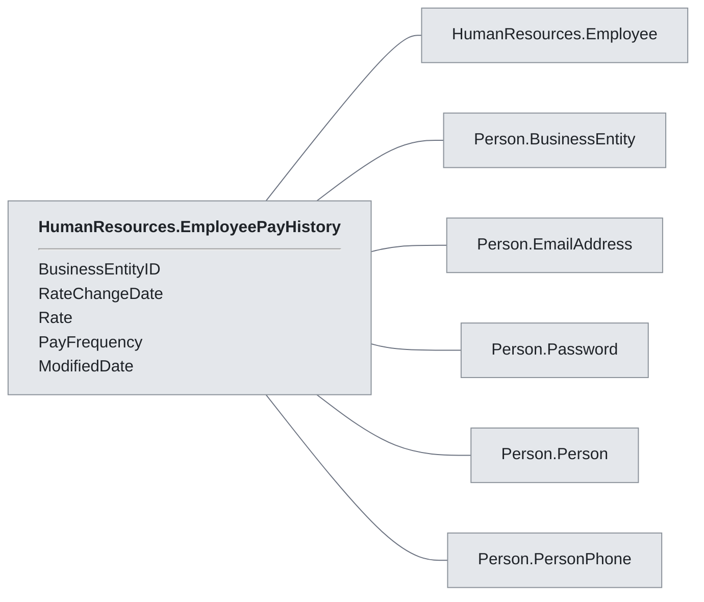

<div style="background:#f4f5f7;color:#1f2328;padding:16px 22px;border-radius:8px;">

<a href="../index.md" style="color:#0b5cad">← AdventureWorks2025 Overview</a> · <a href="../beam-annotations.md" style="color:#0b5cad">BEAM✲ Annotations</a> · <a href="../how-to-read.md" style="color:#0b5cad">How to Read This Wiki</a>

# HumanResources.EmployeePayHistory

<table style="border-collapse:collapse;margin:8px 0;">
<tr><th scope="row" align="left" style="text-align:left;vertical-align:top;white-space:nowrap;font-weight:600;padding:6px 16px 6px 10px;background:#e4e7eb;color:#1f2328;border-bottom:1px solid #d0d4da;">Description</th><td style="text-align:left;vertical-align:top;padding:6px 10px;background:#ffffff;color:#1f2328;border-bottom:1px solid #d0d4da;">Employee pay history.</td></tr>
<tr><th scope="row" align="left" style="text-align:left;vertical-align:top;white-space:nowrap;font-weight:600;padding:6px 16px 6px 10px;background:#e4e7eb;color:#1f2328;border-bottom:1px solid #d0d4da;">Grain</th><td style="text-align:left;vertical-align:top;padding:6px 10px;background:#ffffff;color:#1f2328;border-bottom:1px solid #d0d4da;">One row for each pay rate that takes effect for an employee on a given date; an employee and the rate change date together identify a row</td></tr>
<tr><th scope="row" align="left" style="text-align:left;vertical-align:top;white-space:nowrap;font-weight:600;padding:6px 16px 6px 10px;background:#e4e7eb;color:#1f2328;border-bottom:1px solid #d0d4da;">BEAM✲</th><td style="text-align:left;vertical-align:top;padding:6px 10px;background:#ffffff;color:#1f2328;border-bottom:1px solid #d0d4da;"><a href="../beam-annotations.md#t-hv" style="color:#0b5cad" title="Historic Value: Keeps history for at least one attribute, so a change adds a new version of the row. Also called a type 2 slowly changing dimension.">[HV]</a> <i>(suggested by AI)</i></td></tr>
<tr><th scope="row" align="left" style="text-align:left;vertical-align:top;white-space:nowrap;font-weight:600;padding:6px 16px 6px 10px;background:#e4e7eb;color:#1f2328;border-bottom:1px solid #d0d4da;">Why <a href="../beam-annotations.md#t-hv" style="color:#0b5cad" title="Historic Value: Keeps history for at least one attribute, so a change adds a new version of the row. Also called a type 2 slowly changing dimension.">[HV]</a></th><td style="text-align:left;vertical-align:top;padding:6px 10px;background:#ffffff;color:#1f2328;border-bottom:1px solid #d0d4da;">BusinessEntityID repeats (316 rows for 290 employees), each row with the date its rate took effect, so earlier rates are kept.</td></tr>
<tr><th scope="row" align="left" style="text-align:left;vertical-align:top;white-space:nowrap;font-weight:600;padding:6px 16px 6px 10px;background:#e4e7eb;color:#1f2328;border-bottom:1px solid #d0d4da;">Source</th><td style="text-align:left;vertical-align:top;padding:6px 10px;background:#ffffff;color:#1f2328;border-bottom:1px solid #d0d4da;"><a href="../beam-annotations.md#t-source" style="color:#0b5cad" title="Data source: The source system table or file the table comes from.">{HumanResources.EmployeePayHistory}</a> <i>(measured)</i></td></tr>
<tr><th scope="row" align="left" style="text-align:left;vertical-align:top;white-space:nowrap;font-weight:600;padding:6px 16px 6px 10px;background:#e4e7eb;color:#1f2328;border-bottom:1px solid #d0d4da;">Sampled Rows</th><td style="text-align:left;vertical-align:top;padding:6px 10px;background:#ffffff;color:#1f2328;border-bottom:1px solid #d0d4da;">316</td></tr>
<tr><th scope="row" align="left" style="text-align:left;vertical-align:top;white-space:nowrap;font-weight:600;padding:6px 16px 6px 10px;background:#e4e7eb;color:#1f2328;border-bottom:1px solid #d0d4da;">Columns</th><td style="text-align:left;vertical-align:top;padding:6px 10px;background:#ffffff;color:#1f2328;border-bottom:1px solid #d0d4da;">5</td></tr>
<tr><th scope="row" align="left" style="text-align:left;vertical-align:top;white-space:nowrap;font-weight:600;padding:6px 16px 6px 10px;background:#e4e7eb;color:#1f2328;border-bottom:1px solid #d0d4da;">Description Source</th><td style="text-align:left;vertical-align:top;padding:6px 10px;background:#ffffff;color:#1f2328;border-bottom:1px solid #d0d4da;">Source system metadata, quoted word for word</td></tr>
</table>

## Columns

<div style="overflow-x:auto;max-width:100%;">
<table style="border-collapse:separate;border-spacing:0;font-size:90%;">
<tr><td rowspan="3" style="position:sticky;left:0;z-index:2;box-sizing:border-box;width:34px;min-width:34px;max-width:34px;padding:0;border:0;background:transparent;"></td><th style="position:sticky;left:34px;z-index:2;border:0 solid #d0d4da;border-width:0 1px 1px 0;background:#cfd5dd;color:#1f2328;padding:3px 8px;white-space:nowrap;text-align:left;vertical-align:top;font-weight:700;border-top:1px solid #d0d4da;border-left:1px solid #d0d4da;cursor:help;" title="The column as it is named in the data. Each column of the table is one column in this matrix.">Column Name</th><th style="border:0 solid #d0d4da;border-width:0 1px 1px 0;padding:3px 8px;white-space:nowrap;text-align:left;vertical-align:top;background:#ffffff;color:#1f2328;font-weight:600;background:#cfd5dd;color:#1f2328;border-top:1px solid #d0d4da;">BusinessEntityID</th><th style="border:0 solid #d0d4da;border-width:0 1px 1px 0;padding:3px 8px;white-space:nowrap;text-align:left;vertical-align:top;background:#ffffff;color:#1f2328;font-weight:600;background:#cfd5dd;color:#1f2328;border-top:1px solid #d0d4da;">RateChangeDate</th><th style="border:0 solid #d0d4da;border-width:0 1px 1px 0;padding:3px 8px;white-space:nowrap;text-align:left;vertical-align:top;background:#ffffff;color:#1f2328;font-weight:600;background:#cfd5dd;color:#1f2328;border-top:1px solid #d0d4da;">Rate</th><th style="border:0 solid #d0d4da;border-width:0 1px 1px 0;padding:3px 8px;white-space:nowrap;text-align:left;vertical-align:top;background:#ffffff;color:#1f2328;font-weight:600;background:#cfd5dd;color:#1f2328;border-top:1px solid #d0d4da;">PayFrequency</th><th style="border:0 solid #d0d4da;border-width:0 1px 1px 0;padding:3px 8px;white-space:nowrap;text-align:left;vertical-align:top;background:#ffffff;color:#1f2328;font-weight:600;background:#cfd5dd;color:#1f2328;border-top:1px solid #d0d4da;">ModifiedDate</th></tr>
<tr><td style="position:sticky;left:34px;z-index:2;border:0 solid #d0d4da;border-width:0 1px 1px 0;background:#e4e7eb;color:#1f2328;padding:3px 8px;white-space:nowrap;text-align:left;vertical-align:top;font-weight:600;border-left:1px solid #d0d4da;cursor:help;" title="The kind of values found in the data, which may differ from what the source declares. The short code is a BEAM annotation, for example C9 is text with a longest value of 9 characters.">Data Type</td><td style="border:0 solid #d0d4da;border-width:0 1px 1px 0;padding:3px 8px;white-space:nowrap;text-align:left;vertical-align:top;background:#ffffff;color:#1f2328;"><a href="../beam-annotations.md#c-i" style="color:#0b5cad" title="Integer: A whole number. (Measured from the data.)">I</a> whole number</td><td style="border:0 solid #d0d4da;border-width:0 1px 1px 0;padding:3px 8px;white-space:nowrap;text-align:left;vertical-align:top;background:#ffffff;color:#1f2328;"><a href="../beam-annotations.md#c-d" style="color:#0b5cad" title="Date: A calendar date. Numbers order milestones, e.g. D1 → D2. (Measured from the data.)">D</a> date</td><td style="border:0 solid #d0d4da;border-width:0 1px 1px 0;padding:3px 8px;white-space:nowrap;text-align:left;vertical-align:top;background:#ffffff;color:#1f2328;"><a href="../beam-annotations.md#c-n" style="color:#0b5cad" title="Numeric: A number with decimals: p digits in total, s of them after the decimal point. (Measured from the data.)">N7.4</a> number</td><td style="border:0 solid #d0d4da;border-width:0 1px 1px 0;padding:3px 8px;white-space:nowrap;text-align:left;vertical-align:top;background:#ffffff;color:#1f2328;"><a href="../beam-annotations.md#c-i" style="color:#0b5cad" title="Integer: A whole number. (Measured from the data.)">I</a> whole number</td><td style="border:0 solid #d0d4da;border-width:0 1px 1px 0;padding:3px 8px;white-space:nowrap;text-align:left;vertical-align:top;background:#ffffff;color:#1f2328;"><a href="../beam-annotations.md#c-d" style="color:#0b5cad" title="Date: A calendar date. Numbers order milestones, e.g. D1 → D2. (Measured from the data.)">D</a> date</td></tr>
<tr><td style="position:sticky;left:34px;z-index:2;border:0 solid #d0d4da;border-width:0 1px 1px 0;background:#e4e7eb;color:#1f2328;padding:3px 8px;white-space:nowrap;text-align:left;vertical-align:top;font-weight:600;border-left:1px solid #d0d4da;cursor:help;" title="Short BEAM annotations. Plain codes are measured from the data. Codes in italics are suggested by AI and should be checked. Click a code to read what it means.">BEAM✲</td><td style="border:0 solid #d0d4da;border-width:0 1px 1px 0;padding:3px 8px;white-space:nowrap;text-align:left;vertical-align:top;background:#ffffff;color:#1f2328;"><a href="../beam-annotations.md#c-pk" style="color:#0b5cad" title="Primary Key: Declared by the source system as the identifier of a row of this table. (Measured from the data.)">PK</a> <a href="../beam-annotations.md#c-fk" style="color:#0b5cad" title="Foreign Key: Points to the key of another table. In this wiki measured: every value was found in the other table. (Measured from the data.)">FK</a> <i><a href="../beam-annotations.md#c-dim" style="color:#0b5cad" title="Dimension or role: The dimension a detail refers to, e.g. PreferredStoreID [Stores] when the preferred store is a role of the store dimension. (Suggested by AI.)">[HumanResources.Employee]</a></i></td><td style="border:0 solid #d0d4da;border-width:0 1px 1px 0;padding:3px 8px;white-space:nowrap;text-align:left;vertical-align:top;background:#ffffff;color:#1f2328;"><a href="../beam-annotations.md#c-pk" style="color:#0b5cad" title="Primary Key: Declared by the source system as the identifier of a row of this table. (Measured from the data.)">PK</a> <i><a href="../beam-annotations.md#c-md" style="color:#0b5cad" title="Mandatory: The value should always be there under normal conditions. Shown as MD when the data has gaps. (Suggested by AI.)">MD</a></i> <i><a href="../beam-annotations.md#w-when" style="color:#0b5cad" title="[when]: When did it happen? For example order date, ship date. (Suggested by AI.)">[when]</a></i></td><td style="border:0 solid #d0d4da;border-width:0 1px 1px 0;padding:3px 8px;white-space:nowrap;text-align:left;vertical-align:top;background:#ffffff;color:#1f2328;"><a href="../beam-annotations.md#c-nn" style="color:#0b5cad" title="Not Null: The source system does not allow empty values. (Measured from the data.)">NN</a> <i><a href="../beam-annotations.md#c-na" style="color:#0b5cad" title="Non-Additive fact: Can&#x27;t be summed at all, e.g. unit prices, percentages, temperatures. Use min, max or average. (Suggested by AI.)">NA</a></i> <i><a href="../beam-annotations.md#c-uom" style="color:#0b5cad" title="Unit of measure: The unit a fact is stored in, e.g. [USD] or [days]. Several units list the standard one first. (Suggested by AI.)">[per hour]</a></i></td><td style="border:0 solid #d0d4da;border-width:0 1px 1px 0;padding:3px 8px;white-space:nowrap;text-align:left;vertical-align:top;background:#ffffff;color:#1f2328;"><a href="../beam-annotations.md#c-nn" style="color:#0b5cad" title="Not Null: The source system does not allow empty values. (Measured from the data.)">NN</a></td><td style="border:0 solid #d0d4da;border-width:0 1px 1px 0;padding:3px 8px;white-space:nowrap;text-align:left;vertical-align:top;background:#ffffff;color:#1f2328;"><a href="../beam-annotations.md#c-nn" style="color:#0b5cad" title="Not Null: The source system does not allow empty values. (Measured from the data.)">NN</a></td></tr>
<tr><td rowspan="9" style="position:sticky;left:0;z-index:2;box-sizing:border-box;width:34px;min-width:34px;max-width:34px;border:0 solid #d0d4da;border-width:0 1px 1px 0;background:#c5dcee;color:#12405f;padding:4px 0;text-align:center;vertical-align:middle;border-left:1px solid #d0d4da;cursor:help;" title="Counts and extremes measured from the rows that were read. They are facts, not opinions."><div style="writing-mode:vertical-rl;transform:rotate(180deg);white-space:nowrap;margin:0 auto;font-weight:600;">Data Profiling Results</div></td><td style="position:sticky;left:34px;z-index:2;border:0 solid #d0d4da;border-width:0 1px 1px 0;background:#e4e7eb;color:#1f2328;padding:3px 8px;white-space:nowrap;text-align:left;vertical-align:top;font-weight:600;cursor:help;" title="How many rows were read for these numbers. Every percentage in this group is based on it, so check it first: on very large tables it can be fewer than all rows.">Sample Count</td><td style="border:0 solid #d0d4da;border-width:0 1px 1px 0;padding:3px 8px;white-space:nowrap;text-align:right;vertical-align:top;background:#ffffff;color:#1f2328;background:#f3f8fc;">316</td><td style="border:0 solid #d0d4da;border-width:0 1px 1px 0;padding:3px 8px;white-space:nowrap;text-align:right;vertical-align:top;background:#ffffff;color:#1f2328;background:#f3f8fc;">316</td><td style="border:0 solid #d0d4da;border-width:0 1px 1px 0;padding:3px 8px;white-space:nowrap;text-align:right;vertical-align:top;background:#ffffff;color:#1f2328;background:#f3f8fc;">316</td><td style="border:0 solid #d0d4da;border-width:0 1px 1px 0;padding:3px 8px;white-space:nowrap;text-align:right;vertical-align:top;background:#ffffff;color:#1f2328;background:#f3f8fc;">316</td><td style="border:0 solid #d0d4da;border-width:0 1px 1px 0;padding:3px 8px;white-space:nowrap;text-align:right;vertical-align:top;background:#ffffff;color:#1f2328;background:#f3f8fc;">316</td></tr>
<tr><td style="position:sticky;left:34px;z-index:2;border:0 solid #d0d4da;border-width:0 1px 1px 0;background:#e4e7eb;color:#1f2328;padding:3px 8px;white-space:nowrap;text-align:left;vertical-align:top;font-weight:600;cursor:help;" title="Rows where the column is empty or blank, with the share of rows. It matters because gaps break joins and totals, and a column that should always be filled in should show 0.">Missing</td><td style="border:0 solid #d0d4da;border-width:0 1px 1px 0;padding:3px 8px;white-space:nowrap;text-align:left;vertical-align:top;background:#ffffff;color:#1f2328;background:#f3f8fc;">0 (0%)</td><td style="border:0 solid #d0d4da;border-width:0 1px 1px 0;padding:3px 8px;white-space:nowrap;text-align:left;vertical-align:top;background:#ffffff;color:#1f2328;background:#f3f8fc;">0 (0%)</td><td style="border:0 solid #d0d4da;border-width:0 1px 1px 0;padding:3px 8px;white-space:nowrap;text-align:left;vertical-align:top;background:#ffffff;color:#1f2328;background:#f3f8fc;">0 (0%)</td><td style="border:0 solid #d0d4da;border-width:0 1px 1px 0;padding:3px 8px;white-space:nowrap;text-align:left;vertical-align:top;background:#ffffff;color:#1f2328;background:#f3f8fc;">0 (0%)</td><td style="border:0 solid #d0d4da;border-width:0 1px 1px 0;padding:3px 8px;white-space:nowrap;text-align:left;vertical-align:top;background:#ffffff;color:#1f2328;background:#f3f8fc;">0 (0%)</td></tr>
<tr><td style="position:sticky;left:34px;z-index:2;border:0 solid #d0d4da;border-width:0 1px 1px 0;background:#e4e7eb;color:#1f2328;padding:3px 8px;white-space:nowrap;text-align:left;vertical-align:top;font-weight:600;cursor:help;" title="How many different values occur, with the share of rows. 100% means every value is different, so the column could identify a row. A low share means the column holds categories or codes.">Unique Values</td><td style="border:0 solid #d0d4da;border-width:0 1px 1px 0;padding:3px 8px;white-space:nowrap;text-align:left;vertical-align:top;background:#ffffff;color:#1f2328;background:#f3f8fc;">290 (91.8%)</td><td style="border:0 solid #d0d4da;border-width:0 1px 1px 0;padding:3px 8px;white-space:nowrap;text-align:left;vertical-align:top;background:#ffffff;color:#1f2328;background:#f3f8fc;">177 (56%)</td><td style="border:0 solid #d0d4da;border-width:0 1px 1px 0;padding:3px 8px;white-space:nowrap;text-align:left;vertical-align:top;background:#ffffff;color:#1f2328;background:#f3f8fc;">66 (20.9%)</td><td style="border:0 solid #d0d4da;border-width:0 1px 1px 0;padding:3px 8px;white-space:nowrap;text-align:left;vertical-align:top;background:#ffffff;color:#1f2328;background:#f3f8fc;">2 (0.633%)</td><td style="border:0 solid #d0d4da;border-width:0 1px 1px 0;padding:3px 8px;white-space:nowrap;text-align:left;vertical-align:top;background:#ffffff;color:#1f2328;background:#f3f8fc;">26 (8.23%)</td></tr>
<tr><td style="position:sticky;left:34px;z-index:2;border:0 solid #d0d4da;border-width:0 1px 1px 0;background:#e4e7eb;color:#1f2328;padding:3px 8px;white-space:nowrap;text-align:left;vertical-align:top;font-weight:600;cursor:help;" title="The smallest value: the lowest number, the earliest date, or the first in alphabetical order. It matters because it shows the start of the range and catches impossible values such as a negative quantity.">Min Value</td><td style="border:0 solid #d0d4da;border-width:0 1px 1px 0;padding:3px 8px;white-space:nowrap;text-align:left;vertical-align:top;background:#ffffff;color:#1f2328;background:#f3f8fc;">1</td><td style="border:0 solid #d0d4da;border-width:0 1px 1px 0;padding:3px 8px;white-space:nowrap;text-align:left;vertical-align:top;background:#ffffff;color:#1f2328;background:#f3f8fc;">2006-06-30</td><td style="border:0 solid #d0d4da;border-width:0 1px 1px 0;padding:3px 8px;white-space:nowrap;text-align:left;vertical-align:top;background:#ffffff;color:#1f2328;background:#f3f8fc;">6.5000</td><td style="border:0 solid #d0d4da;border-width:0 1px 1px 0;padding:3px 8px;white-space:nowrap;text-align:left;vertical-align:top;background:#ffffff;color:#1f2328;background:#f3f8fc;">1</td><td style="border:0 solid #d0d4da;border-width:0 1px 1px 0;padding:3px 8px;white-space:nowrap;text-align:left;vertical-align:top;background:#ffffff;color:#1f2328;background:#f3f8fc;">2007-11-21</td></tr>
<tr><td style="position:sticky;left:34px;z-index:2;border:0 solid #d0d4da;border-width:0 1px 1px 0;background:#e4e7eb;color:#1f2328;padding:3px 8px;white-space:nowrap;text-align:left;vertical-align:top;font-weight:600;cursor:help;" title="How many rows have the smallest value. On a unique column it is 1. A high count suggests a default or a stand-in value, such as 0 or 1900-01-01, rather than a real minimum.">Min Count</td><td style="border:0 solid #d0d4da;border-width:0 1px 1px 0;padding:3px 8px;white-space:nowrap;text-align:left;vertical-align:top;background:#ffffff;color:#1f2328;background:#f3f8fc;">1 (0.316%)</td><td style="border:0 solid #d0d4da;border-width:0 1px 1px 0;padding:3px 8px;white-space:nowrap;text-align:left;vertical-align:top;background:#ffffff;color:#1f2328;background:#f3f8fc;">1 (0.316%)</td><td style="border:0 solid #d0d4da;border-width:0 1px 1px 0;padding:3px 8px;white-space:nowrap;text-align:left;vertical-align:top;background:#ffffff;color:#1f2328;background:#f3f8fc;">7 (2.22%)</td><td style="border:0 solid #d0d4da;border-width:0 1px 1px 0;padding:3px 8px;white-space:nowrap;text-align:left;vertical-align:top;background:#ffffff;color:#1f2328;background:#f3f8fc;">180 (57%)</td><td style="border:0 solid #d0d4da;border-width:0 1px 1px 0;padding:3px 8px;white-space:nowrap;text-align:left;vertical-align:top;background:#ffffff;color:#1f2328;background:#f3f8fc;">1 (0.316%)</td></tr>
<tr><td style="position:sticky;left:34px;z-index:2;border:0 solid #d0d4da;border-width:0 1px 1px 0;background:#e4e7eb;color:#1f2328;padding:3px 8px;white-space:nowrap;text-align:left;vertical-align:top;font-weight:600;cursor:help;" title="The largest value: the highest number, the latest date, or the last in alphabetical order. It matters because it shows the end of the range and catches outliers or future dates.">Max Value</td><td style="border:0 solid #d0d4da;border-width:0 1px 1px 0;padding:3px 8px;white-space:nowrap;text-align:left;vertical-align:top;background:#ffffff;color:#1f2328;background:#f3f8fc;">290</td><td style="border:0 solid #d0d4da;border-width:0 1px 1px 0;padding:3px 8px;white-space:nowrap;text-align:left;vertical-align:top;background:#ffffff;color:#1f2328;background:#f3f8fc;">2013-07-14</td><td style="border:0 solid #d0d4da;border-width:0 1px 1px 0;padding:3px 8px;white-space:nowrap;text-align:left;vertical-align:top;background:#ffffff;color:#1f2328;background:#f3f8fc;">125.5000</td><td style="border:0 solid #d0d4da;border-width:0 1px 1px 0;padding:3px 8px;white-space:nowrap;text-align:left;vertical-align:top;background:#ffffff;color:#1f2328;background:#f3f8fc;">2</td><td style="border:0 solid #d0d4da;border-width:0 1px 1px 0;padding:3px 8px;white-space:nowrap;text-align:left;vertical-align:top;background:#ffffff;color:#1f2328;background:#f3f8fc;">2014-06-30</td></tr>
<tr><td style="position:sticky;left:34px;z-index:2;border:0 solid #d0d4da;border-width:0 1px 1px 0;background:#e4e7eb;color:#1f2328;padding:3px 8px;white-space:nowrap;text-align:left;vertical-align:top;font-weight:600;cursor:help;" title="How many rows have the largest value. A high count suggests a cap or a stand-in value, such as 9999-12-31, rather than a real maximum.">Max Count</td><td style="border:0 solid #d0d4da;border-width:0 1px 1px 0;padding:3px 8px;white-space:nowrap;text-align:left;vertical-align:top;background:#ffffff;color:#1f2328;background:#f3f8fc;">1 (0.316%)</td><td style="border:0 solid #d0d4da;border-width:0 1px 1px 0;padding:3px 8px;white-space:nowrap;text-align:left;vertical-align:top;background:#ffffff;color:#1f2328;background:#f3f8fc;">8 (2.53%)</td><td style="border:0 solid #d0d4da;border-width:0 1px 1px 0;padding:3px 8px;white-space:nowrap;text-align:left;vertical-align:top;background:#ffffff;color:#1f2328;background:#f3f8fc;">1 (0.316%)</td><td style="border:0 solid #d0d4da;border-width:0 1px 1px 0;padding:3px 8px;white-space:nowrap;text-align:left;vertical-align:top;background:#ffffff;color:#1f2328;background:#f3f8fc;">136 (43%)</td><td style="border:0 solid #d0d4da;border-width:0 1px 1px 0;padding:3px 8px;white-space:nowrap;text-align:left;vertical-align:top;background:#ffffff;color:#1f2328;background:#f3f8fc;">277 (87.7%)</td></tr>
<tr><td style="position:sticky;left:34px;z-index:2;border:0 solid #d0d4da;border-width:0 1px 1px 0;background:#e4e7eb;color:#1f2328;padding:3px 8px;white-space:nowrap;text-align:left;vertical-align:top;font-weight:600;cursor:help;" title="The shortest text, counted in characters. If it differs a lot from the longest, the column may mix formats, or have values that were cut off.">Min Length</td><td style="border:0 solid #d0d4da;border-width:0 1px 1px 0;padding:3px 8px;white-space:nowrap;text-align:right;vertical-align:top;background:#ffffff;color:#1f2328;background:#f3f8fc;">—</td><td style="border:0 solid #d0d4da;border-width:0 1px 1px 0;padding:3px 8px;white-space:nowrap;text-align:right;vertical-align:top;background:#ffffff;color:#1f2328;background:#f3f8fc;">—</td><td style="border:0 solid #d0d4da;border-width:0 1px 1px 0;padding:3px 8px;white-space:nowrap;text-align:right;vertical-align:top;background:#ffffff;color:#1f2328;background:#f3f8fc;">—</td><td style="border:0 solid #d0d4da;border-width:0 1px 1px 0;padding:3px 8px;white-space:nowrap;text-align:right;vertical-align:top;background:#ffffff;color:#1f2328;background:#f3f8fc;">—</td><td style="border:0 solid #d0d4da;border-width:0 1px 1px 0;padding:3px 8px;white-space:nowrap;text-align:right;vertical-align:top;background:#ffffff;color:#1f2328;background:#f3f8fc;">—</td></tr>
<tr><td style="position:sticky;left:34px;z-index:2;border:0 solid #d0d4da;border-width:0 1px 1px 0;background:#e4e7eb;color:#1f2328;padding:3px 8px;white-space:nowrap;text-align:left;vertical-align:top;font-weight:600;cursor:help;" title="The longest text, counted in characters. It matters when you load the data elsewhere, because the target column must be wide enough.">Max Length</td><td style="border:0 solid #d0d4da;border-width:0 1px 1px 0;padding:3px 8px;white-space:nowrap;text-align:right;vertical-align:top;background:#ffffff;color:#1f2328;background:#f3f8fc;">—</td><td style="border:0 solid #d0d4da;border-width:0 1px 1px 0;padding:3px 8px;white-space:nowrap;text-align:right;vertical-align:top;background:#ffffff;color:#1f2328;background:#f3f8fc;">—</td><td style="border:0 solid #d0d4da;border-width:0 1px 1px 0;padding:3px 8px;white-space:nowrap;text-align:right;vertical-align:top;background:#ffffff;color:#1f2328;background:#f3f8fc;">—</td><td style="border:0 solid #d0d4da;border-width:0 1px 1px 0;padding:3px 8px;white-space:nowrap;text-align:right;vertical-align:top;background:#ffffff;color:#1f2328;background:#f3f8fc;">—</td><td style="border:0 solid #d0d4da;border-width:0 1px 1px 0;padding:3px 8px;white-space:nowrap;text-align:right;vertical-align:top;background:#ffffff;color:#1f2328;background:#f3f8fc;">—</td></tr>
<tr><td rowspan="6" style="position:sticky;left:0;z-index:2;box-sizing:border-box;width:34px;min-width:34px;max-width:34px;border:0 solid #d0d4da;border-width:0 1px 1px 0;background:#d9cdee;color:#40286b;padding:4px 0;text-align:center;vertical-align:middle;border-left:1px solid #d0d4da;cursor:help;" title="Examples taken from the measured values, to show how varied the column is and what odd values look like."><div style="writing-mode:vertical-rl;transform:rotate(180deg);white-space:nowrap;margin:0 auto;font-weight:600;">Variation</div></td><td style="position:sticky;left:34px;z-index:2;border:0 solid #d0d4da;border-width:0 1px 1px 0;background:#e4e7eb;color:#1f2328;padding:3px 8px;white-space:nowrap;text-align:left;vertical-align:top;font-weight:600;cursor:help;" title="The most common value, so you can see what a normal row looks like. In a column where every value is different, this is just the first of them.">Typical</td><td style="border:0 solid #d0d4da;border-width:0 1px 1px 0;padding:3px 8px;white-space:nowrap;text-align:left;vertical-align:top;background:#ffffff;color:#1f2328;background:#f7f3fc;">4</td><td style="border:0 solid #d0d4da;border-width:0 1px 1px 0;padding:3px 8px;white-space:nowrap;text-align:left;vertical-align:top;background:#ffffff;color:#1f2328;background:#f7f3fc;">2011-05-31</td><td style="border:0 solid #d0d4da;border-width:0 1px 1px 0;padding:3px 8px;white-space:nowrap;text-align:left;vertical-align:top;background:#ffffff;color:#1f2328;background:#f7f3fc;">9.5000</td><td style="border:0 solid #d0d4da;border-width:0 1px 1px 0;padding:3px 8px;white-space:nowrap;text-align:left;vertical-align:top;background:#ffffff;color:#1f2328;background:#f7f3fc;">1</td><td style="border:0 solid #d0d4da;border-width:0 1px 1px 0;padding:3px 8px;white-space:nowrap;text-align:left;vertical-align:top;background:#ffffff;color:#1f2328;background:#f7f3fc;">2014-06-30</td></tr>
<tr><td style="position:sticky;left:34px;z-index:2;border:0 solid #d0d4da;border-width:0 1px 1px 0;background:#e4e7eb;color:#1f2328;padding:3px 8px;white-space:nowrap;text-align:left;vertical-align:top;font-weight:600;cursor:help;" title="A rare value, one of the least common. Odd values are often special cases or mistakes, so they are worth a look.">Different</td><td style="border:0 solid #d0d4da;border-width:0 1px 1px 0;padding:3px 8px;white-space:nowrap;text-align:left;vertical-align:top;background:#ffffff;color:#1f2328;background:#f7f3fc;">1</td><td style="border:0 solid #d0d4da;border-width:0 1px 1px 0;padding:3px 8px;white-space:nowrap;text-align:left;vertical-align:top;background:#ffffff;color:#1f2328;background:#f7f3fc;">2006-06-30</td><td style="border:0 solid #d0d4da;border-width:0 1px 1px 0;padding:3px 8px;white-space:nowrap;text-align:left;vertical-align:top;background:#ffffff;color:#1f2328;background:#f7f3fc;">125.5000</td><td style="border:0 solid #d0d4da;border-width:0 1px 1px 0;padding:3px 8px;white-space:nowrap;text-align:left;vertical-align:top;background:#ffffff;color:#1f2328;background:#f7f3fc;">2</td><td style="border:0 solid #d0d4da;border-width:0 1px 1px 0;padding:3px 8px;white-space:nowrap;text-align:left;vertical-align:top;background:#ffffff;color:#1f2328;background:#f7f3fc;">2007-11-21</td></tr>
<tr><td style="position:sticky;left:34px;z-index:2;border:0 solid #d0d4da;border-width:0 1px 1px 0;background:#e4e7eb;color:#1f2328;padding:3px 8px;white-space:nowrap;text-align:left;vertical-align:top;font-weight:600;cursor:help;" title="A value that occurs more than once, and how many times (x3 means three rows). &#x27;No repeats&#x27; means every value is different.">Repeat</td><td style="border:0 solid #d0d4da;border-width:0 1px 1px 0;padding:3px 8px;white-space:nowrap;text-align:left;vertical-align:top;background:#ffffff;color:#1f2328;background:#f7f3fc;">16 ×3</td><td style="border:0 solid #d0d4da;border-width:0 1px 1px 0;padding:3px 8px;white-space:nowrap;text-align:left;vertical-align:top;background:#ffffff;color:#1f2328;background:#f7f3fc;">2011-12-01 ×8</td><td style="border:0 solid #d0d4da;border-width:0 1px 1px 0;padding:3px 8px;white-space:nowrap;text-align:left;vertical-align:top;background:#ffffff;color:#1f2328;background:#f7f3fc;">12.4500 ×26</td><td style="border:0 solid #d0d4da;border-width:0 1px 1px 0;padding:3px 8px;white-space:nowrap;text-align:left;vertical-align:top;background:#ffffff;color:#1f2328;background:#f7f3fc;">2 ×136</td><td style="border:0 solid #d0d4da;border-width:0 1px 1px 0;padding:3px 8px;white-space:nowrap;text-align:left;vertical-align:top;background:#ffffff;color:#1f2328;background:#f7f3fc;">2011-11-17 ×8</td></tr>
<tr><td style="position:sticky;left:34px;z-index:2;border:0 solid #d0d4da;border-width:0 1px 1px 0;background:#e4e7eb;color:#1f2328;padding:3px 8px;white-space:nowrap;text-align:left;vertical-align:top;font-weight:600;cursor:help;" title="What stands in for &#x27;no value&#x27;: empty cells and stand-in words such as N/A or unknown, with how many of each. Stand-ins are easy to mistake for real values.">Missing</td><td style="border:0 solid #d0d4da;border-width:0 1px 1px 0;padding:3px 8px;white-space:nowrap;text-align:left;vertical-align:top;background:#ffffff;color:#1f2328;background:#f7f3fc;">—</td><td style="border:0 solid #d0d4da;border-width:0 1px 1px 0;padding:3px 8px;white-space:nowrap;text-align:left;vertical-align:top;background:#ffffff;color:#1f2328;background:#f7f3fc;">—</td><td style="border:0 solid #d0d4da;border-width:0 1px 1px 0;padding:3px 8px;white-space:nowrap;text-align:left;vertical-align:top;background:#ffffff;color:#1f2328;background:#f7f3fc;">—</td><td style="border:0 solid #d0d4da;border-width:0 1px 1px 0;padding:3px 8px;white-space:nowrap;text-align:left;vertical-align:top;background:#ffffff;color:#1f2328;background:#f7f3fc;">—</td><td style="border:0 solid #d0d4da;border-width:0 1px 1px 0;padding:3px 8px;white-space:nowrap;text-align:left;vertical-align:top;background:#ffffff;color:#1f2328;background:#f7f3fc;">—</td></tr>
<tr><td style="position:sticky;left:34px;z-index:2;border:0 solid #d0d4da;border-width:0 1px 1px 0;background:#e4e7eb;color:#1f2328;padding:3px 8px;white-space:nowrap;text-align:left;vertical-align:top;font-weight:600;cursor:help;" title="From the smallest to the largest value in one line, to show the spread at a glance.">Range</td><td style="border:0 solid #d0d4da;border-width:0 1px 1px 0;padding:3px 8px;white-space:nowrap;text-align:left;vertical-align:top;background:#ffffff;color:#1f2328;background:#f7f3fc;">1 → 290</td><td style="border:0 solid #d0d4da;border-width:0 1px 1px 0;padding:3px 8px;white-space:nowrap;text-align:left;vertical-align:top;background:#ffffff;color:#1f2328;background:#f7f3fc;">2006-06-30 → 2013-07-14</td><td style="border:0 solid #d0d4da;border-width:0 1px 1px 0;padding:3px 8px;white-space:nowrap;text-align:left;vertical-align:top;background:#ffffff;color:#1f2328;background:#f7f3fc;">6.5000 → 125.5000</td><td style="border:0 solid #d0d4da;border-width:0 1px 1px 0;padding:3px 8px;white-space:nowrap;text-align:left;vertical-align:top;background:#ffffff;color:#1f2328;background:#f7f3fc;">1 → 2</td><td style="border:0 solid #d0d4da;border-width:0 1px 1px 0;padding:3px 8px;white-space:nowrap;text-align:left;vertical-align:top;background:#ffffff;color:#1f2328;background:#f7f3fc;">2007-11-21 → 2014-06-30</td></tr>
<tr><td style="position:sticky;left:34px;z-index:2;border:0 solid #d0d4da;border-width:0 1px 1px 0;background:#e4e7eb;color:#1f2328;padding:3px 8px;white-space:nowrap;text-align:left;vertical-align:top;font-weight:600;cursor:help;" title="How values change over time cannot be seen in a single snapshot. Profile the same data again later and compare to see it.">Change</td><td style="border:0 solid #d0d4da;border-width:0 1px 1px 0;padding:3px 8px;white-space:nowrap;text-align:left;vertical-align:top;background:#ffffff;color:#1f2328;background:#f7f3fc;">—</td><td style="border:0 solid #d0d4da;border-width:0 1px 1px 0;padding:3px 8px;white-space:nowrap;text-align:left;vertical-align:top;background:#ffffff;color:#1f2328;background:#f7f3fc;">—</td><td style="border:0 solid #d0d4da;border-width:0 1px 1px 0;padding:3px 8px;white-space:nowrap;text-align:left;vertical-align:top;background:#ffffff;color:#1f2328;background:#f7f3fc;">—</td><td style="border:0 solid #d0d4da;border-width:0 1px 1px 0;padding:3px 8px;white-space:nowrap;text-align:left;vertical-align:top;background:#ffffff;color:#1f2328;background:#f7f3fc;">—</td><td style="border:0 solid #d0d4da;border-width:0 1px 1px 0;padding:3px 8px;white-space:nowrap;text-align:left;vertical-align:top;background:#ffffff;color:#1f2328;background:#f7f3fc;">—</td></tr>
<tr><td rowspan="6" style="position:sticky;left:0;z-index:2;box-sizing:border-box;width:34px;min-width:34px;max-width:34px;border:0 solid #d0d4da;border-width:0 1px 1px 0;background:#cfe6d3;color:#1d4d2b;padding:4px 0;text-align:center;vertical-align:middle;border-left:1px solid #d0d4da;cursor:help;" title="How the values are spread: a small histogram, its shape, the middle value, the spread, and any outliers and gaps. Counted from the rows that were read."><div style="writing-mode:vertical-rl;transform:rotate(180deg);white-space:nowrap;margin:0 auto;font-weight:600;">Distribution</div></td><td style="position:sticky;left:34px;z-index:2;border:0 solid #d0d4da;border-width:0 1px 1px 0;background:#e4e7eb;color:#1f2328;padding:3px 8px;white-space:nowrap;text-align:left;vertical-align:top;font-weight:600;cursor:help;" title="How the rows are spread over ranges of values (bins). Each bar is one bin and its height is the number of rows. Hover a bar for its range and count. Orange bars are outliers, dashed boxes are gaps with no rows. Categories show the most frequent values. Keys, names and other personal data are not charted.">Histogram</td><td style="border:0 solid #d0d4da;border-width:0 1px 1px 0;padding:3px 8px;white-space:nowrap;text-align:left;vertical-align:top;background:#ffffff;color:#1f2328;background:#f4faf5;">—</td><td style="border:0 solid #d0d4da;border-width:0 1px 1px 0;padding:3px 8px;white-space:nowrap;text-align:left;vertical-align:top;background:#ffffff;color:#1f2328;background:#f4faf5;"><table style="border-collapse:collapse;border:0;margin:0;background:transparent;"><tr style="vertical-align:bottom"><td title="2006 Q2: 1 rows (0.32%)" style="padding:0 1px;border:0;background:transparent;vertical-align:bottom;"><div style="width:5px;height:2px;background:#2f7ea3;"></div></td><td title="2006 Q3: 0 rows (0%) (gap: no rows in this range)" style="padding:0 1px;border:0;background:transparent;vertical-align:bottom;"><div style="width:5px;height:8px;box-sizing:border-box;border:1px dashed #9aa0a6;"></div></td><td title="2006 Q4: 0 rows (0%) (gap: no rows in this range)" style="padding:0 1px;border:0;background:transparent;vertical-align:bottom;"><div style="width:5px;height:8px;box-sizing:border-box;border:1px dashed #9aa0a6;"></div></td><td title="2007 Q1: 1 rows (0.32%)" style="padding:0 1px;border:0;background:transparent;vertical-align:bottom;"><div style="width:5px;height:2px;background:#2f7ea3;"></div></td><td title="2007 Q2: 0 rows (0%) (gap: no rows in this range)" style="padding:0 1px;border:0;background:transparent;vertical-align:bottom;"><div style="width:5px;height:8px;box-sizing:border-box;border:1px dashed #9aa0a6;"></div></td><td title="2007 Q3: 0 rows (0%) (gap: no rows in this range)" style="padding:0 1px;border:0;background:transparent;vertical-align:bottom;"><div style="width:5px;height:8px;box-sizing:border-box;border:1px dashed #9aa0a6;"></div></td><td title="2007 Q4: 5 rows (1.58%)" style="padding:0 1px;border:0;background:transparent;vertical-align:bottom;"><div style="width:5px;height:2px;background:#2f7ea3;"></div></td><td title="2008 Q1: 13 rows (4.11%)" style="padding:0 1px;border:0;background:transparent;vertical-align:bottom;"><div style="width:5px;height:3px;background:#2f7ea3;"></div></td><td title="2008 Q2: 0 rows (0%) (gap: no rows in this range)" style="padding:0 1px;border:0;background:transparent;vertical-align:bottom;"><div style="width:5px;height:8px;box-sizing:border-box;border:1px dashed #9aa0a6;"></div></td><td title="2008 Q3: 0 rows (0%) (gap: no rows in this range)" style="padding:0 1px;border:0;background:transparent;vertical-align:bottom;"><div style="width:5px;height:8px;box-sizing:border-box;border:1px dashed #9aa0a6;"></div></td><td title="2008 Q4: 62 rows (19.62%)" style="padding:0 1px;border:0;background:transparent;vertical-align:bottom;"><div style="width:5px;height:16px;background:#2f7ea3;"></div></td><td title="2009 Q1: 134 rows (42.41%)" style="padding:0 1px;border:0;background:transparent;vertical-align:bottom;"><div style="width:5px;height:34px;background:#2f7ea3;"></div></td><td title="2009 Q2: 1 rows (0.32%)" style="padding:0 1px;border:0;background:transparent;vertical-align:bottom;"><div style="width:5px;height:2px;background:#2f7ea3;"></div></td><td title="2009 Q3: 1 rows (0.32%)" style="padding:0 1px;border:0;background:transparent;vertical-align:bottom;"><div style="width:5px;height:2px;background:#2f7ea3;"></div></td><td title="2009 Q4: 12 rows (3.8%)" style="padding:0 1px;border:0;background:transparent;vertical-align:bottom;"><div style="width:5px;height:3px;background:#2f7ea3;"></div></td><td title="2010 Q1: 33 rows (10.44%)" style="padding:0 1px;border:0;background:transparent;vertical-align:bottom;"><div style="width:5px;height:8px;background:#2f7ea3;"></div></td><td title="2010 Q2: 1 rows (0.32%)" style="padding:0 1px;border:0;background:transparent;vertical-align:bottom;"><div style="width:5px;height:2px;background:#2f7ea3;"></div></td><td title="2010 Q3: 0 rows (0%) (gap: no rows in this range)" style="padding:0 1px;border:0;background:transparent;vertical-align:bottom;"><div style="width:5px;height:8px;box-sizing:border-box;border:1px dashed #9aa0a6;"></div></td><td title="2010 Q4: 5 rows (1.58%)" style="padding:0 1px;border:0;background:transparent;vertical-align:bottom;"><div style="width:5px;height:2px;background:#2f7ea3;"></div></td><td title="2011 Q1: 7 rows (2.22%)" style="padding:0 1px;border:0;background:transparent;vertical-align:bottom;"><div style="width:5px;height:2px;background:#2f7ea3;"></div></td><td title="2011 Q2: 9 rows (2.85%)" style="padding:0 1px;border:0;background:transparent;vertical-align:bottom;"><div style="width:5px;height:2px;background:#2f7ea3;"></div></td><td title="2011 Q3: 2 rows (0.63%)" style="padding:0 1px;border:0;background:transparent;vertical-align:bottom;"><div style="width:5px;height:2px;background:#2f7ea3;"></div></td><td title="2011 Q4: 10 rows (3.16%)" style="padding:0 1px;border:0;background:transparent;vertical-align:bottom;"><div style="width:5px;height:3px;background:#2f7ea3;"></div></td><td title="2012 Q1: 2 rows (0.63%)" style="padding:0 1px;border:0;background:transparent;vertical-align:bottom;"><div style="width:5px;height:2px;background:#2f7ea3;"></div></td><td title="2012 Q2: 4 rows (1.27%)" style="padding:0 1px;border:0;background:transparent;vertical-align:bottom;"><div style="width:5px;height:2px;background:#2f7ea3;"></div></td><td title="2012 Q3: 2 rows (0.63%)" style="padding:0 1px;border:0;background:transparent;vertical-align:bottom;"><div style="width:5px;height:2px;background:#2f7ea3;"></div></td><td title="2012 Q4: 0 rows (0%) (gap: no rows in this range)" style="padding:0 1px;border:0;background:transparent;vertical-align:bottom;"><div style="width:5px;height:8px;box-sizing:border-box;border:1px dashed #9aa0a6;"></div></td><td title="2013 Q1: 1 rows (0.32%)" style="padding:0 1px;border:0;background:transparent;vertical-align:bottom;"><div style="width:5px;height:2px;background:#2f7ea3;"></div></td><td title="2013 Q2: 2 rows (0.63%)" style="padding:0 1px;border:0;background:transparent;vertical-align:bottom;"><div style="width:5px;height:2px;background:#2f7ea3;"></div></td><td title="2013 Q3: 8 rows (2.53%)" style="padding:0 1px;border:0;background:transparent;vertical-align:bottom;"><div style="width:5px;height:2px;background:#2f7ea3;"></div></td></tr></table><div style="font-size:75%;opacity:.75;white-space:nowrap;">2006 Q2 → 2013 Q3</div></td><td style="border:0 solid #d0d4da;border-width:0 1px 1px 0;padding:3px 8px;white-space:nowrap;text-align:left;vertical-align:top;background:#ffffff;color:#1f2328;background:#f4faf5;"><table style="border-collapse:collapse;border:0;margin:0;background:transparent;"><tr style="vertical-align:bottom"><td title="5–10: 54 rows (17.09%)" style="padding:0 1px;border:0;background:transparent;vertical-align:bottom;"><div style="width:9px;height:15px;background:#2f7ea3;"></div></td><td title="10–15: 126 rows (39.87%)" style="padding:0 1px;border:0;background:transparent;vertical-align:bottom;"><div style="width:9px;height:34px;background:#2f7ea3;"></div></td><td title="15–20: 51 rows (16.14%)" style="padding:0 1px;border:0;background:transparent;vertical-align:bottom;"><div style="width:9px;height:14px;background:#2f7ea3;"></div></td><td title="20–25: 22 rows (6.96%)" style="padding:0 1px;border:0;background:transparent;vertical-align:bottom;"><div style="width:9px;height:6px;background:#2f7ea3;"></div></td><td title="25–30: 34 rows (10.76%)" style="padding:0 1px;border:0;background:transparent;vertical-align:bottom;"><div style="width:9px;height:9px;background:#2f7ea3;"></div></td><td title="30–35: 7 rows (2.22%)" style="padding:0 1px;border:0;background:transparent;vertical-align:bottom;"><div style="width:9px;height:2px;background:#2f7ea3;"></div></td><td title="35–40: 6 rows (1.9%)" style="padding:0 1px;border:0;background:transparent;vertical-align:bottom;"><div style="width:9px;height:2px;background:#2f7ea3;"></div></td><td title="40–45: 2 rows (0.63%)" style="padding:0 1px;border:0;background:transparent;vertical-align:bottom;"><div style="width:9px;height:2px;background:#2f7ea3;"></div></td><td title="above 45: 14 rows (4.43%) (outliers: far outside the usual range)" style="padding:0 1px;border:0;background:transparent;vertical-align:bottom;"><div style="width:9px;height:4px;background:#d9822b;"></div></td></tr></table><div style="font-size:75%;opacity:.75;white-space:nowrap;">5 → 45</div></td><td style="border:0 solid #d0d4da;border-width:0 1px 1px 0;padding:3px 8px;white-space:nowrap;text-align:left;vertical-align:top;background:#ffffff;color:#1f2328;background:#f4faf5;"><table style="border-collapse:collapse;border:0;margin:0;background:transparent;"><tr style="vertical-align:bottom"><td title="1: 180 rows (56.96%)" style="padding:0 1px;border:0;background:transparent;vertical-align:bottom;"><div style="width:9px;height:34px;background:#2f7ea3;"></div></td><td title="2: 136 rows (43.04%)" style="padding:0 1px;border:0;background:transparent;vertical-align:bottom;"><div style="width:9px;height:26px;background:#2f7ea3;"></div></td></tr></table><div style="font-size:75%;opacity:.75;white-space:nowrap;">1 → 2</div></td><td style="border:0 solid #d0d4da;border-width:0 1px 1px 0;padding:3px 8px;white-space:nowrap;text-align:left;vertical-align:top;background:#ffffff;color:#1f2328;background:#f4faf5;"><table style="border-collapse:collapse;border:0;margin:0;background:transparent;"><tr style="vertical-align:bottom"><td title="2007 Q4: 3 rows (0.95%)" style="padding:0 1px;border:0;background:transparent;vertical-align:bottom;"><div style="width:5px;height:2px;background:#2f7ea3;"></div></td><td title="2008 Q1: 0 rows (0%) (gap: no rows in this range)" style="padding:0 1px;border:0;background:transparent;vertical-align:bottom;"><div style="width:5px;height:8px;box-sizing:border-box;border:1px dashed #9aa0a6;"></div></td><td title="2008 Q2: 0 rows (0%) (gap: no rows in this range)" style="padding:0 1px;border:0;background:transparent;vertical-align:bottom;"><div style="width:5px;height:8px;box-sizing:border-box;border:1px dashed #9aa0a6;"></div></td><td title="2008 Q3: 0 rows (0%) (gap: no rows in this range)" style="padding:0 1px;border:0;background:transparent;vertical-align:bottom;"><div style="width:5px;height:8px;box-sizing:border-box;border:1px dashed #9aa0a6;"></div></td><td title="2008 Q4: 2 rows (0.63%)" style="padding:0 1px;border:0;background:transparent;vertical-align:bottom;"><div style="width:5px;height:2px;background:#2f7ea3;"></div></td><td title="2009 Q1: 7 rows (2.22%)" style="padding:0 1px;border:0;background:transparent;vertical-align:bottom;"><div style="width:5px;height:2px;background:#2f7ea3;"></div></td><td title="2009 Q2: 0 rows (0%) (gap: no rows in this range)" style="padding:0 1px;border:0;background:transparent;vertical-align:bottom;"><div style="width:5px;height:8px;box-sizing:border-box;border:1px dashed #9aa0a6;"></div></td><td title="2009 Q3: 1 rows (0.32%)" style="padding:0 1px;border:0;background:transparent;vertical-align:bottom;"><div style="width:5px;height:2px;background:#2f7ea3;"></div></td><td title="2009 Q4: 0 rows (0%) (gap: no rows in this range)" style="padding:0 1px;border:0;background:transparent;vertical-align:bottom;"><div style="width:5px;height:8px;box-sizing:border-box;border:1px dashed #9aa0a6;"></div></td><td title="2010 Q1: 0 rows (0%) (gap: no rows in this range)" style="padding:0 1px;border:0;background:transparent;vertical-align:bottom;"><div style="width:5px;height:8px;box-sizing:border-box;border:1px dashed #9aa0a6;"></div></td><td title="2010 Q2: 1 rows (0.32%)" style="padding:0 1px;border:0;background:transparent;vertical-align:bottom;"><div style="width:5px;height:2px;background:#2f7ea3;"></div></td><td title="2010 Q3: 0 rows (0%) (gap: no rows in this range)" style="padding:0 1px;border:0;background:transparent;vertical-align:bottom;"><div style="width:5px;height:8px;box-sizing:border-box;border:1px dashed #9aa0a6;"></div></td><td title="2010 Q4: 0 rows (0%) (gap: no rows in this range)" style="padding:0 1px;border:0;background:transparent;vertical-align:bottom;"><div style="width:5px;height:8px;box-sizing:border-box;border:1px dashed #9aa0a6;"></div></td><td title="2011 Q1: 1 rows (0.32%)" style="padding:0 1px;border:0;background:transparent;vertical-align:bottom;"><div style="width:5px;height:2px;background:#2f7ea3;"></div></td><td title="2011 Q2: 0 rows (0%) (gap: no rows in this range)" style="padding:0 1px;border:0;background:transparent;vertical-align:bottom;"><div style="width:5px;height:8px;box-sizing:border-box;border:1px dashed #9aa0a6;"></div></td><td title="2011 Q3: 2 rows (0.63%)" style="padding:0 1px;border:0;background:transparent;vertical-align:bottom;"><div style="width:5px;height:2px;background:#2f7ea3;"></div></td><td title="2011 Q4: 11 rows (3.48%)" style="padding:0 1px;border:0;background:transparent;vertical-align:bottom;"><div style="width:5px;height:2px;background:#2f7ea3;"></div></td><td title="2012 Q1: 1 rows (0.32%)" style="padding:0 1px;border:0;background:transparent;vertical-align:bottom;"><div style="width:5px;height:2px;background:#2f7ea3;"></div></td><td title="2012 Q2: 2 rows (0.63%)" style="padding:0 1px;border:0;background:transparent;vertical-align:bottom;"><div style="width:5px;height:2px;background:#2f7ea3;"></div></td><td title="2012 Q3: 0 rows (0%) (gap: no rows in this range)" style="padding:0 1px;border:0;background:transparent;vertical-align:bottom;"><div style="width:5px;height:8px;box-sizing:border-box;border:1px dashed #9aa0a6;"></div></td><td title="2012 Q4: 0 rows (0%) (gap: no rows in this range)" style="padding:0 1px;border:0;background:transparent;vertical-align:bottom;"><div style="width:5px;height:8px;box-sizing:border-box;border:1px dashed #9aa0a6;"></div></td><td title="2013 Q1: 0 rows (0%) (gap: no rows in this range)" style="padding:0 1px;border:0;background:transparent;vertical-align:bottom;"><div style="width:5px;height:8px;box-sizing:border-box;border:1px dashed #9aa0a6;"></div></td><td title="2013 Q2: 8 rows (2.53%)" style="padding:0 1px;border:0;background:transparent;vertical-align:bottom;"><div style="width:5px;height:2px;background:#2f7ea3;"></div></td><td title="2013 Q3: 0 rows (0%) (gap: no rows in this range)" style="padding:0 1px;border:0;background:transparent;vertical-align:bottom;"><div style="width:5px;height:8px;box-sizing:border-box;border:1px dashed #9aa0a6;"></div></td><td title="2013 Q4: 0 rows (0%) (gap: no rows in this range)" style="padding:0 1px;border:0;background:transparent;vertical-align:bottom;"><div style="width:5px;height:8px;box-sizing:border-box;border:1px dashed #9aa0a6;"></div></td><td title="2014 Q1: 0 rows (0%) (gap: no rows in this range)" style="padding:0 1px;border:0;background:transparent;vertical-align:bottom;"><div style="width:5px;height:8px;box-sizing:border-box;border:1px dashed #9aa0a6;"></div></td><td title="2014 Q2: 277 rows (87.66%)" style="padding:0 1px;border:0;background:transparent;vertical-align:bottom;"><div style="width:5px;height:34px;background:#2f7ea3;"></div></td></tr></table><div style="font-size:75%;opacity:.75;white-space:nowrap;">2007 Q4 → 2014 Q2</div></td></tr>
<tr><td style="position:sticky;left:34px;z-index:2;border:0 solid #d0d4da;border-width:0 1px 1px 0;background:#e4e7eb;color:#1f2328;padding:3px 8px;white-space:nowrap;text-align:left;vertical-align:top;font-weight:600;cursor:help;" title="The overall form of the histogram: symmetric, right-skewed, left-skewed, uniform, bimodal or one dominant value. It matters because a skewed column has an average that misleads, and two peaks often mean two groups mixed together.">Shape</td><td style="border:0 solid #d0d4da;border-width:0 1px 1px 0;padding:3px 8px;white-space:nowrap;text-align:left;vertical-align:top;background:#ffffff;color:#1f2328;background:#f4faf5;">—</td><td style="border:0 solid #d0d4da;border-width:0 1px 1px 0;padding:3px 8px;white-space:nowrap;text-align:left;vertical-align:top;background:#ffffff;color:#1f2328;background:#f4faf5;"><span title="Right-skewed: most values are low, with a long tail of a few high ones. The average is pulled above the median.">Right-skewed</span></td><td style="border:0 solid #d0d4da;border-width:0 1px 1px 0;padding:3px 8px;white-space:nowrap;text-align:left;vertical-align:top;background:#ffffff;color:#1f2328;background:#f4faf5;"><span title="Right-skewed: most values are low, with a long tail of a few high ones. The average is pulled above the median.">Right-skewed</span></td><td style="border:0 solid #d0d4da;border-width:0 1px 1px 0;padding:3px 8px;white-space:nowrap;text-align:left;vertical-align:top;background:#ffffff;color:#1f2328;background:#f4faf5;"><span title="One dominant value: at least half of the rows share the same value.">One dominant value</span></td><td style="border:0 solid #d0d4da;border-width:0 1px 1px 0;padding:3px 8px;white-space:nowrap;text-align:left;vertical-align:top;background:#ffffff;color:#1f2328;background:#f4faf5;"><span title="Left-skewed: most values are high, with a long tail of a few low ones. The average is pulled below the median.">Left-skewed</span></td></tr>
<tr><td style="position:sticky;left:34px;z-index:2;border:0 solid #d0d4da;border-width:0 1px 1px 0;background:#e4e7eb;color:#1f2328;padding:3px 8px;white-space:nowrap;text-align:left;vertical-align:top;font-weight:600;cursor:help;" title="The middle value: half of the rows are below it and half above. Compare it with the average. A big difference means the data is skewed or has outliers.">Median</td><td style="border:0 solid #d0d4da;border-width:0 1px 1px 0;padding:3px 8px;white-space:nowrap;text-align:left;vertical-align:top;background:#ffffff;color:#1f2328;background:#f4faf5;">—</td><td style="border:0 solid #d0d4da;border-width:0 1px 1px 0;padding:3px 8px;white-space:nowrap;text-align:left;vertical-align:top;background:#ffffff;color:#1f2328;background:#f4faf5;">—</td><td style="border:0 solid #d0d4da;border-width:0 1px 1px 0;padding:3px 8px;white-space:nowrap;text-align:left;vertical-align:top;background:#ffffff;color:#1f2328;background:#f4faf5;">14</td><td style="border:0 solid #d0d4da;border-width:0 1px 1px 0;padding:3px 8px;white-space:nowrap;text-align:left;vertical-align:top;background:#ffffff;color:#1f2328;background:#f4faf5;">1</td><td style="border:0 solid #d0d4da;border-width:0 1px 1px 0;padding:3px 8px;white-space:nowrap;text-align:left;vertical-align:top;background:#ffffff;color:#1f2328;background:#f4faf5;">—</td></tr>
<tr><td style="position:sticky;left:34px;z-index:2;border:0 solid #d0d4da;border-width:0 1px 1px 0;background:#e4e7eb;color:#1f2328;padding:3px 8px;white-space:nowrap;text-align:left;vertical-align:top;font-weight:600;cursor:help;" title="The range holding the middle half of the rows (first to third quartile). A narrow spread means similar values, a wide one means high variability.">Spread</td><td style="border:0 solid #d0d4da;border-width:0 1px 1px 0;padding:3px 8px;white-space:nowrap;text-align:left;vertical-align:top;background:#ffffff;color:#1f2328;background:#f4faf5;">—</td><td style="border:0 solid #d0d4da;border-width:0 1px 1px 0;padding:3px 8px;white-space:nowrap;text-align:left;vertical-align:top;background:#ffffff;color:#1f2328;background:#f4faf5;">—</td><td style="border:0 solid #d0d4da;border-width:0 1px 1px 0;padding:3px 8px;white-space:nowrap;text-align:left;vertical-align:top;background:#ffffff;color:#1f2328;background:#f4faf5;">11 – 23.1</td><td style="border:0 solid #d0d4da;border-width:0 1px 1px 0;padding:3px 8px;white-space:nowrap;text-align:left;vertical-align:top;background:#ffffff;color:#1f2328;background:#f4faf5;">1 – 2</td><td style="border:0 solid #d0d4da;border-width:0 1px 1px 0;padding:3px 8px;white-space:nowrap;text-align:left;vertical-align:top;background:#ffffff;color:#1f2328;background:#f4faf5;">—</td></tr>
<tr><td style="position:sticky;left:34px;z-index:2;border:0 solid #d0d4da;border-width:0 1px 1px 0;background:#e4e7eb;color:#1f2328;padding:3px 8px;white-space:nowrap;text-align:left;vertical-align:top;font-weight:600;cursor:help;" title="Values far outside the usual range (more than 1.5 times the middle spread beyond the quartiles). They may be mistakes or real extremes, so they are worth checking. The count is shown with the limit it passed.">Outliers</td><td style="border:0 solid #d0d4da;border-width:0 1px 1px 0;padding:3px 8px;white-space:nowrap;text-align:left;vertical-align:top;background:#ffffff;color:#1f2328;background:#f4faf5;">—</td><td style="border:0 solid #d0d4da;border-width:0 1px 1px 0;padding:3px 8px;white-space:nowrap;text-align:left;vertical-align:top;background:#ffffff;color:#1f2328;background:#f4faf5;">—</td><td style="border:0 solid #d0d4da;border-width:0 1px 1px 0;padding:3px 8px;white-space:nowrap;text-align:left;vertical-align:top;background:#ffffff;color:#1f2328;background:#f4faf5;">14 above 41.2</td><td style="border:0 solid #d0d4da;border-width:0 1px 1px 0;padding:3px 8px;white-space:nowrap;text-align:left;vertical-align:top;background:#ffffff;color:#1f2328;background:#f4faf5;">none</td><td style="border:0 solid #d0d4da;border-width:0 1px 1px 0;padding:3px 8px;white-space:nowrap;text-align:left;vertical-align:top;background:#ffffff;color:#1f2328;background:#f4faf5;">—</td></tr>
<tr><td style="position:sticky;left:34px;z-index:2;border:0 solid #d0d4da;border-width:0 1px 1px 0;background:#e4e7eb;color:#1f2328;padding:3px 8px;white-space:nowrap;text-align:left;vertical-align:top;font-weight:600;cursor:help;" title="Ranges between filled bins where no rows exist at all. In dates they show periods with no activity or missing data, which a total or an average would hide.">Gaps</td><td style="border:0 solid #d0d4da;border-width:0 1px 1px 0;padding:3px 8px;white-space:nowrap;text-align:left;vertical-align:top;background:#ffffff;color:#1f2328;background:#f4faf5;">—</td><td style="border:0 solid #d0d4da;border-width:0 1px 1px 0;padding:3px 8px;white-space:nowrap;text-align:left;vertical-align:top;background:#ffffff;color:#1f2328;background:#f4faf5;">5 gaps (8 empty quarters)</td><td style="border:0 solid #d0d4da;border-width:0 1px 1px 0;padding:3px 8px;white-space:nowrap;text-align:left;vertical-align:top;background:#ffffff;color:#1f2328;background:#f4faf5;">none</td><td style="border:0 solid #d0d4da;border-width:0 1px 1px 0;padding:3px 8px;white-space:nowrap;text-align:left;vertical-align:top;background:#ffffff;color:#1f2328;background:#f4faf5;">none</td><td style="border:0 solid #d0d4da;border-width:0 1px 1px 0;padding:3px 8px;white-space:nowrap;text-align:left;vertical-align:top;background:#ffffff;color:#1f2328;background:#f4faf5;">7 gaps (15 empty quarters)</td></tr>
<tr><td rowspan="5" style="position:sticky;left:0;z-index:2;box-sizing:border-box;width:34px;min-width:34px;max-width:34px;border:0 solid #d0d4da;border-width:0 1px 1px 0;background:#f2dcb6;color:#6b4208;padding:4px 0;text-align:center;vertical-align:middle;border-left:1px solid #d0d4da;cursor:help;" title="Five random rows from the table, shown side by side so you can see real values together."><div style="writing-mode:vertical-rl;transform:rotate(180deg);white-space:nowrap;margin:0 auto;font-weight:600;">Sample Data</div></td><td style="position:sticky;left:34px;z-index:2;border:0 solid #d0d4da;border-width:0 1px 1px 0;background:#e4e7eb;color:#1f2328;padding:3px 8px;white-space:nowrap;text-align:left;vertical-align:top;font-weight:600;cursor:help;"></td><td style="border:0 solid #d0d4da;border-width:0 1px 1px 0;padding:3px 8px;white-space:nowrap;text-align:left;vertical-align:top;background:#ffffff;color:#1f2328;background:#fcf8f0;">141</td><td style="border:0 solid #d0d4da;border-width:0 1px 1px 0;padding:3px 8px;white-space:nowrap;text-align:left;vertical-align:top;background:#ffffff;color:#1f2328;background:#fcf8f0;">2010-01-24</td><td style="border:0 solid #d0d4da;border-width:0 1px 1px 0;padding:3px 8px;white-space:nowrap;text-align:left;vertical-align:top;background:#ffffff;color:#1f2328;background:#fcf8f0;">14.0000</td><td style="border:0 solid #d0d4da;border-width:0 1px 1px 0;padding:3px 8px;white-space:nowrap;text-align:left;vertical-align:top;background:#ffffff;color:#1f2328;background:#fcf8f0;">1</td><td style="border:0 solid #d0d4da;border-width:0 1px 1px 0;padding:3px 8px;white-space:nowrap;text-align:left;vertical-align:top;background:#ffffff;color:#1f2328;background:#fcf8f0;">2014-06-30</td></tr>
<tr><td style="position:sticky;left:34px;z-index:2;border:0 solid #d0d4da;border-width:0 1px 1px 0;background:#e4e7eb;color:#1f2328;padding:3px 8px;white-space:nowrap;text-align:left;vertical-align:top;font-weight:600;cursor:help;"></td><td style="border:0 solid #d0d4da;border-width:0 1px 1px 0;padding:3px 8px;white-space:nowrap;text-align:left;vertical-align:top;background:#ffffff;color:#1f2328;background:#fcf8f0;">172</td><td style="border:0 solid #d0d4da;border-width:0 1px 1px 0;padding:3px 8px;white-space:nowrap;text-align:left;vertical-align:top;background:#ffffff;color:#1f2328;background:#fcf8f0;">2013-07-14</td><td style="border:0 solid #d0d4da;border-width:0 1px 1px 0;padding:3px 8px;white-space:nowrap;text-align:left;vertical-align:top;background:#ffffff;color:#1f2328;background:#fcf8f0;">9.5000</td><td style="border:0 solid #d0d4da;border-width:0 1px 1px 0;padding:3px 8px;white-space:nowrap;text-align:left;vertical-align:top;background:#ffffff;color:#1f2328;background:#fcf8f0;">1</td><td style="border:0 solid #d0d4da;border-width:0 1px 1px 0;padding:3px 8px;white-space:nowrap;text-align:left;vertical-align:top;background:#ffffff;color:#1f2328;background:#fcf8f0;">2013-06-30</td></tr>
<tr><td style="position:sticky;left:34px;z-index:2;border:0 solid #d0d4da;border-width:0 1px 1px 0;background:#e4e7eb;color:#1f2328;padding:3px 8px;white-space:nowrap;text-align:left;vertical-align:top;font-weight:600;cursor:help;"></td><td style="border:0 solid #d0d4da;border-width:0 1px 1px 0;padding:3px 8px;white-space:nowrap;text-align:left;vertical-align:top;background:#ffffff;color:#1f2328;background:#fcf8f0;">193</td><td style="border:0 solid #d0d4da;border-width:0 1px 1px 0;padding:3px 8px;white-space:nowrap;text-align:left;vertical-align:top;background:#ffffff;color:#1f2328;background:#fcf8f0;">2008-12-06</td><td style="border:0 solid #d0d4da;border-width:0 1px 1px 0;padding:3px 8px;white-space:nowrap;text-align:left;vertical-align:top;background:#ffffff;color:#1f2328;background:#fcf8f0;">15.0000</td><td style="border:0 solid #d0d4da;border-width:0 1px 1px 0;padding:3px 8px;white-space:nowrap;text-align:left;vertical-align:top;background:#ffffff;color:#1f2328;background:#fcf8f0;">1</td><td style="border:0 solid #d0d4da;border-width:0 1px 1px 0;padding:3px 8px;white-space:nowrap;text-align:left;vertical-align:top;background:#ffffff;color:#1f2328;background:#fcf8f0;">2014-06-30</td></tr>
<tr><td style="position:sticky;left:34px;z-index:2;border:0 solid #d0d4da;border-width:0 1px 1px 0;background:#e4e7eb;color:#1f2328;padding:3px 8px;white-space:nowrap;text-align:left;vertical-align:top;font-weight:600;cursor:help;"></td><td style="border:0 solid #d0d4da;border-width:0 1px 1px 0;padding:3px 8px;white-space:nowrap;text-align:left;vertical-align:top;background:#ffffff;color:#1f2328;background:#fcf8f0;">270</td><td style="border:0 solid #d0d4da;border-width:0 1px 1px 0;padding:3px 8px;white-space:nowrap;text-align:left;vertical-align:top;background:#ffffff;color:#1f2328;background:#fcf8f0;">2009-01-17</td><td style="border:0 solid #d0d4da;border-width:0 1px 1px 0;padding:3px 8px;white-space:nowrap;text-align:left;vertical-align:top;background:#ffffff;color:#1f2328;background:#fcf8f0;">38.4615</td><td style="border:0 solid #d0d4da;border-width:0 1px 1px 0;padding:3px 8px;white-space:nowrap;text-align:left;vertical-align:top;background:#ffffff;color:#1f2328;background:#fcf8f0;">2</td><td style="border:0 solid #d0d4da;border-width:0 1px 1px 0;padding:3px 8px;white-space:nowrap;text-align:left;vertical-align:top;background:#ffffff;color:#1f2328;background:#fcf8f0;">2014-06-30</td></tr>
<tr><td style="position:sticky;left:34px;z-index:2;border:0 solid #d0d4da;border-width:0 1px 1px 0;background:#e4e7eb;color:#1f2328;padding:3px 8px;white-space:nowrap;text-align:left;vertical-align:top;font-weight:600;cursor:help;"></td><td style="border:0 solid #d0d4da;border-width:0 1px 1px 0;padding:3px 8px;white-space:nowrap;text-align:left;vertical-align:top;background:#ffffff;color:#1f2328;background:#fcf8f0;">274</td><td style="border:0 solid #d0d4da;border-width:0 1px 1px 0;padding:3px 8px;white-space:nowrap;text-align:left;vertical-align:top;background:#ffffff;color:#1f2328;background:#fcf8f0;">2011-01-04</td><td style="border:0 solid #d0d4da;border-width:0 1px 1px 0;padding:3px 8px;white-space:nowrap;text-align:left;vertical-align:top;background:#ffffff;color:#1f2328;background:#fcf8f0;">48.1010</td><td style="border:0 solid #d0d4da;border-width:0 1px 1px 0;padding:3px 8px;white-space:nowrap;text-align:left;vertical-align:top;background:#ffffff;color:#1f2328;background:#fcf8f0;">2</td><td style="border:0 solid #d0d4da;border-width:0 1px 1px 0;padding:3px 8px;white-space:nowrap;text-align:left;vertical-align:top;background:#ffffff;color:#1f2328;background:#fcf8f0;">2014-06-30</td></tr>
</table>
</div>

<i>BEAM✲ codes in plain text are measured from the data; codes in italics are suggested by AI. Change can't be seen in a single snapshot of the data. <a href="../beam-annotations.md" style="color:#0b5cad">What do the codes mean?</a></i>

## Relationships (Measured)



## Additional Context (Written by AI)

The comment on Rate calls it an hourly rate, and the values (6.50 to 125.50, median 14) fit an hourly amount. 14 values are above the upper limit of 41.19 measured for outliers. PayFrequency has only the values 1 (180 rows) and 2 (136 rows), described in the source as monthly and every two weeks.

## Open Questions for the Data Owner

- Which currency is Rate in?
- PayFrequency says salary is paid monthly or every two weeks, but Rate is described as hourly. Is the rate of a salaried employee converted to an hourly amount?

---

## Metadata

_Machine-readable facts about this page, for tools and AI agents._

```yaml
bijoe: "data-story"
schema_version: 2
dataset: "AdventureWorks2025"
table: "HumanResources.EmployeePayHistory"
grain: "One row for each pay rate that takes effect for an employee on a given date; an employee and the rate change date together identify a row"
sampled_rows: 316
columns: 5
description_source: "system_metadata"
confidence: "high"
beam_table_codes:
  - "[HV]"
beam_source: "{HumanResources.EmployeePayHistory}"
beam_reasons:
  - "[HV]: BusinessEntityID repeats (316 rows for 290 employees), each row with the date its rate took effect, so earlier rates are kept."
  - "BusinessEntityID [HumanResources.Employee]: Measured relationship: 316 of 316 values found."
  - "RateChangeDate MD [when]: The date the rate starts; part of the key and never empty."
  - "Rate NA [per hour]: A rate, so it cannot be added up. The source comment calls it an hourly rate."
evidence:
  - "Table comment stored in the source system"
relationships:
  - "HumanResources.EmployeePayHistory.BusinessEntityID -> HumanResources.Employee.BusinessEntityID: 316/316 values found (100%)"
  - "HumanResources.EmployeePayHistory.BusinessEntityID -> Person.BusinessEntity.BusinessEntityID: 316/316 values found (100%)"
  - "HumanResources.EmployeePayHistory.BusinessEntityID -> Person.EmailAddress.BusinessEntityID: 316/316 values found (100%)"
  - "HumanResources.EmployeePayHistory.BusinessEntityID -> Person.Password.BusinessEntityID: 316/316 values found (100%)"
  - "HumanResources.EmployeePayHistory.BusinessEntityID -> Person.Person.BusinessEntityID: 316/316 values found (100%)"
  - "HumanResources.EmployeePayHistory.BusinessEntityID -> Person.PersonPhone.BusinessEntityID: 316/316 values found (100%)"
generated_at: "2026-11-22T20:13:24+00:00"
```

</div>
