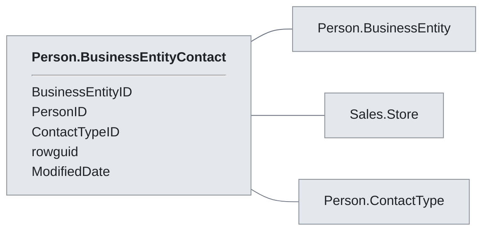

<div style="background:#f4f5f7;color:#1f2328;padding:16px 22px;border-radius:8px;">

<a href="../index.md" style="color:#0b5cad">← AdventureWorks2025 Overview</a> · <a href="../beam-annotations.md" style="color:#0b5cad">BEAM✲ Annotations</a> · <a href="../how-to-read.md" style="color:#0b5cad">How to Read This Wiki</a>

# Person.BusinessEntityContact

<table style="border-collapse:collapse;margin:8px 0;">
<tr><th scope="row" align="left" style="text-align:left;vertical-align:top;white-space:nowrap;font-weight:600;padding:6px 16px 6px 10px;background:#e4e7eb;color:#1f2328;border-bottom:1px solid #d0d4da;">Description</th><td style="text-align:left;vertical-align:top;padding:6px 10px;background:#ffffff;color:#1f2328;border-bottom:1px solid #d0d4da;">Cross-reference table mapping stores, vendors, and employees to people</td></tr>
<tr><th scope="row" align="left" style="text-align:left;vertical-align:top;white-space:nowrap;font-weight:600;padding:6px 16px 6px 10px;background:#e4e7eb;color:#1f2328;border-bottom:1px solid #d0d4da;">Grain</th><td style="text-align:left;vertical-align:top;padding:6px 10px;background:#ffffff;color:#1f2328;border-bottom:1px solid #d0d4da;">One row for each person who acts as a contact of a given type for a store or vendor; a person appears only once</td></tr>
<tr><th scope="row" align="left" style="text-align:left;vertical-align:top;white-space:nowrap;font-weight:600;padding:6px 16px 6px 10px;background:#e4e7eb;color:#1f2328;border-bottom:1px solid #d0d4da;">BEAM✲</th><td style="text-align:left;vertical-align:top;padding:6px 10px;background:#ffffff;color:#1f2328;border-bottom:1px solid #d0d4da;"><a href="../beam-annotations.md#t-mv" style="color:#0b5cad" title="Multi-Valued: A bridge table that links a fact to several values of a dimension at once (many-to-many), often with a weighting factor.">[MV]</a> <i>(suggested by AI)</i></td></tr>
<tr><th scope="row" align="left" style="text-align:left;vertical-align:top;white-space:nowrap;font-weight:600;padding:6px 16px 6px 10px;background:#e4e7eb;color:#1f2328;border-bottom:1px solid #d0d4da;">Why <a href="../beam-annotations.md#t-mv" style="color:#0b5cad" title="Multi-Valued: A bridge table that links a fact to several values of a dimension at once (many-to-many), often with a weighting factor.">[MV]</a></th><td style="text-align:left;vertical-align:top;padding:6px 10px;background:#ffffff;color:#1f2328;border-bottom:1px solid #d0d4da;">A link between BusinessEntityID (the store or vendor) and PersonID with a contact type; 82 entities have more than one contact (805 entities, 909 rows).</td></tr>
<tr><th scope="row" align="left" style="text-align:left;vertical-align:top;white-space:nowrap;font-weight:600;padding:6px 16px 6px 10px;background:#e4e7eb;color:#1f2328;border-bottom:1px solid #d0d4da;">Source</th><td style="text-align:left;vertical-align:top;padding:6px 10px;background:#ffffff;color:#1f2328;border-bottom:1px solid #d0d4da;"><a href="../beam-annotations.md#t-source" style="color:#0b5cad" title="Data source: The source system table or file the table comes from.">{Person.BusinessEntityContact}</a> <i>(measured)</i></td></tr>
<tr><th scope="row" align="left" style="text-align:left;vertical-align:top;white-space:nowrap;font-weight:600;padding:6px 16px 6px 10px;background:#e4e7eb;color:#1f2328;border-bottom:1px solid #d0d4da;">Sampled Rows</th><td style="text-align:left;vertical-align:top;padding:6px 10px;background:#ffffff;color:#1f2328;border-bottom:1px solid #d0d4da;">909</td></tr>
<tr><th scope="row" align="left" style="text-align:left;vertical-align:top;white-space:nowrap;font-weight:600;padding:6px 16px 6px 10px;background:#e4e7eb;color:#1f2328;border-bottom:1px solid #d0d4da;">Columns</th><td style="text-align:left;vertical-align:top;padding:6px 10px;background:#ffffff;color:#1f2328;border-bottom:1px solid #d0d4da;">5</td></tr>
<tr><th scope="row" align="left" style="text-align:left;vertical-align:top;white-space:nowrap;font-weight:600;padding:6px 16px 6px 10px;background:#e4e7eb;color:#1f2328;border-bottom:1px solid #d0d4da;">Description Source</th><td style="text-align:left;vertical-align:top;padding:6px 10px;background:#ffffff;color:#1f2328;border-bottom:1px solid #d0d4da;">Source system metadata, quoted word for word</td></tr>
</table>

## Columns

<div style="overflow-x:auto;max-width:100%;">
<table style="border-collapse:separate;border-spacing:0;font-size:90%;">
<tr><td rowspan="3" style="position:sticky;left:0;z-index:2;box-sizing:border-box;width:34px;min-width:34px;max-width:34px;padding:0;border:0;background:transparent;"></td><th style="position:sticky;left:34px;z-index:2;border:0 solid #d0d4da;border-width:0 1px 1px 0;background:#cfd5dd;color:#1f2328;padding:3px 8px;white-space:nowrap;text-align:left;vertical-align:top;font-weight:700;border-top:1px solid #d0d4da;border-left:1px solid #d0d4da;cursor:help;" title="The column as it is named in the data. Each column of the table is one column in this matrix.">Column Name</th><th style="border:0 solid #d0d4da;border-width:0 1px 1px 0;padding:3px 8px;white-space:nowrap;text-align:left;vertical-align:top;background:#ffffff;color:#1f2328;font-weight:600;background:#cfd5dd;color:#1f2328;border-top:1px solid #d0d4da;">BusinessEntityID</th><th style="border:0 solid #d0d4da;border-width:0 1px 1px 0;padding:3px 8px;white-space:nowrap;text-align:left;vertical-align:top;background:#ffffff;color:#1f2328;font-weight:600;background:#cfd5dd;color:#1f2328;border-top:1px solid #d0d4da;">PersonID</th><th style="border:0 solid #d0d4da;border-width:0 1px 1px 0;padding:3px 8px;white-space:nowrap;text-align:left;vertical-align:top;background:#ffffff;color:#1f2328;font-weight:600;background:#cfd5dd;color:#1f2328;border-top:1px solid #d0d4da;">ContactTypeID</th><th style="border:0 solid #d0d4da;border-width:0 1px 1px 0;padding:3px 8px;white-space:nowrap;text-align:left;vertical-align:top;background:#ffffff;color:#1f2328;font-weight:600;background:#cfd5dd;color:#1f2328;border-top:1px solid #d0d4da;">rowguid</th><th style="border:0 solid #d0d4da;border-width:0 1px 1px 0;padding:3px 8px;white-space:nowrap;text-align:left;vertical-align:top;background:#ffffff;color:#1f2328;font-weight:600;background:#cfd5dd;color:#1f2328;border-top:1px solid #d0d4da;">ModifiedDate</th></tr>
<tr><td style="position:sticky;left:34px;z-index:2;border:0 solid #d0d4da;border-width:0 1px 1px 0;background:#e4e7eb;color:#1f2328;padding:3px 8px;white-space:nowrap;text-align:left;vertical-align:top;font-weight:600;border-left:1px solid #d0d4da;cursor:help;" title="The kind of values found in the data, which may differ from what the source declares. The short code is a BEAM annotation, for example C9 is text with a longest value of 9 characters.">Data Type</td><td style="border:0 solid #d0d4da;border-width:0 1px 1px 0;padding:3px 8px;white-space:nowrap;text-align:left;vertical-align:top;background:#ffffff;color:#1f2328;"><a href="../beam-annotations.md#c-i" style="color:#0b5cad" title="Integer: A whole number. (Measured from the data.)">I</a> whole number</td><td style="border:0 solid #d0d4da;border-width:0 1px 1px 0;padding:3px 8px;white-space:nowrap;text-align:left;vertical-align:top;background:#ffffff;color:#1f2328;"><a href="../beam-annotations.md#c-i" style="color:#0b5cad" title="Integer: A whole number. (Measured from the data.)">I</a> whole number</td><td style="border:0 solid #d0d4da;border-width:0 1px 1px 0;padding:3px 8px;white-space:nowrap;text-align:left;vertical-align:top;background:#ffffff;color:#1f2328;"><a href="../beam-annotations.md#c-i" style="color:#0b5cad" title="Integer: A whole number. (Measured from the data.)">I</a> whole number</td><td style="border:0 solid #d0d4da;border-width:0 1px 1px 0;padding:3px 8px;white-space:nowrap;text-align:left;vertical-align:top;background:#ffffff;color:#1f2328;"><a href="../beam-annotations.md#c-c" style="color:#0b5cad" title="Character: Short text, with n = the longest value seen. (Measured from the data.)">C36</a> text</td><td style="border:0 solid #d0d4da;border-width:0 1px 1px 0;padding:3px 8px;white-space:nowrap;text-align:left;vertical-align:top;background:#ffffff;color:#1f2328;"><a href="../beam-annotations.md#c-dt" style="color:#0b5cad" title="Date/time: A date with a time of day. (Measured from the data.)">DT</a> date/time</td></tr>
<tr><td style="position:sticky;left:34px;z-index:2;border:0 solid #d0d4da;border-width:0 1px 1px 0;background:#e4e7eb;color:#1f2328;padding:3px 8px;white-space:nowrap;text-align:left;vertical-align:top;font-weight:600;border-left:1px solid #d0d4da;cursor:help;" title="Short BEAM annotations. Plain codes are measured from the data. Codes in italics are suggested by AI and should be checked. Click a code to read what it means.">BEAM✲</td><td style="border:0 solid #d0d4da;border-width:0 1px 1px 0;padding:3px 8px;white-space:nowrap;text-align:left;vertical-align:top;background:#ffffff;color:#1f2328;"><a href="../beam-annotations.md#c-pk" style="color:#0b5cad" title="Primary Key: Declared by the source system as the identifier of a row of this table. (Measured from the data.)">PK</a> <a href="../beam-annotations.md#c-fk" style="color:#0b5cad" title="Foreign Key: Points to the key of another table. In this wiki measured: every value was found in the other table. (Measured from the data.)">FK</a> <i><a href="../beam-annotations.md#c-dim" style="color:#0b5cad" title="Dimension or role: The dimension a detail refers to, e.g. PreferredStoreID [Stores] when the preferred store is a role of the store dimension. (Suggested by AI.)">[Person.BusinessEntity]</a></i></td><td style="border:0 solid #d0d4da;border-width:0 1px 1px 0;padding:3px 8px;white-space:nowrap;text-align:left;vertical-align:top;background:#ffffff;color:#1f2328;"><a href="../beam-annotations.md#c-pk" style="color:#0b5cad" title="Primary Key: Declared by the source system as the identifier of a row of this table. (Measured from the data.)">PK</a></td><td style="border:0 solid #d0d4da;border-width:0 1px 1px 0;padding:3px 8px;white-space:nowrap;text-align:left;vertical-align:top;background:#ffffff;color:#1f2328;"><a href="../beam-annotations.md#c-pk" style="color:#0b5cad" title="Primary Key: Declared by the source system as the identifier of a row of this table. (Measured from the data.)">PK</a> <a href="../beam-annotations.md#c-fk" style="color:#0b5cad" title="Foreign Key: Points to the key of another table. In this wiki measured: every value was found in the other table. (Measured from the data.)">FK</a> <i><a href="../beam-annotations.md#c-dim" style="color:#0b5cad" title="Dimension or role: The dimension a detail refers to, e.g. PreferredStoreID [Stores] when the preferred store is a role of the store dimension. (Suggested by AI.)">[Person.ContactType]</a></i></td><td style="border:0 solid #d0d4da;border-width:0 1px 1px 0;padding:3px 8px;white-space:nowrap;text-align:left;vertical-align:top;background:#ffffff;color:#1f2328;"><a href="../beam-annotations.md#c-nn" style="color:#0b5cad" title="Not Null: The source system does not allow empty values. (Measured from the data.)">NN</a> <a href="../beam-annotations.md#c-nd" style="color:#0b5cad" title="No Duplicates: Every value is different. The numbered form marks columns that are unique in combination. In this wiki measured: no duplicates were found in the text or whole-number values profiled. (Measured from the data.)">ND</a></td><td style="border:0 solid #d0d4da;border-width:0 1px 1px 0;padding:3px 8px;white-space:nowrap;text-align:left;vertical-align:top;background:#ffffff;color:#1f2328;"><a href="../beam-annotations.md#c-nn" style="color:#0b5cad" title="Not Null: The source system does not allow empty values. (Measured from the data.)">NN</a></td></tr>
<tr><td rowspan="9" style="position:sticky;left:0;z-index:2;box-sizing:border-box;width:34px;min-width:34px;max-width:34px;border:0 solid #d0d4da;border-width:0 1px 1px 0;background:#c5dcee;color:#12405f;padding:4px 0;text-align:center;vertical-align:middle;border-left:1px solid #d0d4da;cursor:help;" title="Counts and extremes measured from the rows that were read. They are facts, not opinions."><div style="writing-mode:vertical-rl;transform:rotate(180deg);white-space:nowrap;margin:0 auto;font-weight:600;">Data Profiling Results</div></td><td style="position:sticky;left:34px;z-index:2;border:0 solid #d0d4da;border-width:0 1px 1px 0;background:#e4e7eb;color:#1f2328;padding:3px 8px;white-space:nowrap;text-align:left;vertical-align:top;font-weight:600;cursor:help;" title="How many rows were read for these numbers. Every percentage in this group is based on it, so check it first: on very large tables it can be fewer than all rows.">Sample Count</td><td style="border:0 solid #d0d4da;border-width:0 1px 1px 0;padding:3px 8px;white-space:nowrap;text-align:right;vertical-align:top;background:#ffffff;color:#1f2328;background:#f3f8fc;">909</td><td style="border:0 solid #d0d4da;border-width:0 1px 1px 0;padding:3px 8px;white-space:nowrap;text-align:right;vertical-align:top;background:#ffffff;color:#1f2328;background:#f3f8fc;">909</td><td style="border:0 solid #d0d4da;border-width:0 1px 1px 0;padding:3px 8px;white-space:nowrap;text-align:right;vertical-align:top;background:#ffffff;color:#1f2328;background:#f3f8fc;">909</td><td style="border:0 solid #d0d4da;border-width:0 1px 1px 0;padding:3px 8px;white-space:nowrap;text-align:right;vertical-align:top;background:#ffffff;color:#1f2328;background:#f3f8fc;">909</td><td style="border:0 solid #d0d4da;border-width:0 1px 1px 0;padding:3px 8px;white-space:nowrap;text-align:right;vertical-align:top;background:#ffffff;color:#1f2328;background:#f3f8fc;">909</td></tr>
<tr><td style="position:sticky;left:34px;z-index:2;border:0 solid #d0d4da;border-width:0 1px 1px 0;background:#e4e7eb;color:#1f2328;padding:3px 8px;white-space:nowrap;text-align:left;vertical-align:top;font-weight:600;cursor:help;" title="Rows where the column is empty or blank, with the share of rows. It matters because gaps break joins and totals, and a column that should always be filled in should show 0.">Missing</td><td style="border:0 solid #d0d4da;border-width:0 1px 1px 0;padding:3px 8px;white-space:nowrap;text-align:left;vertical-align:top;background:#ffffff;color:#1f2328;background:#f3f8fc;">0 (0%)</td><td style="border:0 solid #d0d4da;border-width:0 1px 1px 0;padding:3px 8px;white-space:nowrap;text-align:left;vertical-align:top;background:#ffffff;color:#1f2328;background:#f3f8fc;">0 (0%)</td><td style="border:0 solid #d0d4da;border-width:0 1px 1px 0;padding:3px 8px;white-space:nowrap;text-align:left;vertical-align:top;background:#ffffff;color:#1f2328;background:#f3f8fc;">0 (0%)</td><td style="border:0 solid #d0d4da;border-width:0 1px 1px 0;padding:3px 8px;white-space:nowrap;text-align:left;vertical-align:top;background:#ffffff;color:#1f2328;background:#f3f8fc;">0 (0%)</td><td style="border:0 solid #d0d4da;border-width:0 1px 1px 0;padding:3px 8px;white-space:nowrap;text-align:left;vertical-align:top;background:#ffffff;color:#1f2328;background:#f3f8fc;">0 (0%)</td></tr>
<tr><td style="position:sticky;left:34px;z-index:2;border:0 solid #d0d4da;border-width:0 1px 1px 0;background:#e4e7eb;color:#1f2328;padding:3px 8px;white-space:nowrap;text-align:left;vertical-align:top;font-weight:600;cursor:help;" title="How many different values occur, with the share of rows. 100% means every value is different, so the column could identify a row. A low share means the column holds categories or codes.">Unique Values</td><td style="border:0 solid #d0d4da;border-width:0 1px 1px 0;padding:3px 8px;white-space:nowrap;text-align:left;vertical-align:top;background:#ffffff;color:#1f2328;background:#f3f8fc;">805 (88.6%)</td><td style="border:0 solid #d0d4da;border-width:0 1px 1px 0;padding:3px 8px;white-space:nowrap;text-align:left;vertical-align:top;background:#ffffff;color:#1f2328;background:#f3f8fc;">909 (100%)</td><td style="border:0 solid #d0d4da;border-width:0 1px 1px 0;padding:3px 8px;white-space:nowrap;text-align:left;vertical-align:top;background:#ffffff;color:#1f2328;background:#f3f8fc;">7 (0.77%)</td><td style="border:0 solid #d0d4da;border-width:0 1px 1px 0;padding:3px 8px;white-space:nowrap;text-align:left;vertical-align:top;background:#ffffff;color:#1f2328;background:#f3f8fc;">909 (100%)</td><td style="border:0 solid #d0d4da;border-width:0 1px 1px 0;padding:3px 8px;white-space:nowrap;text-align:left;vertical-align:top;background:#ffffff;color:#1f2328;background:#f3f8fc;">763 (83.9%)</td></tr>
<tr><td style="position:sticky;left:34px;z-index:2;border:0 solid #d0d4da;border-width:0 1px 1px 0;background:#e4e7eb;color:#1f2328;padding:3px 8px;white-space:nowrap;text-align:left;vertical-align:top;font-weight:600;cursor:help;" title="The smallest value: the lowest number, the earliest date, or the first in alphabetical order. It matters because it shows the start of the range and catches impossible values such as a negative quantity.">Min Value</td><td style="border:0 solid #d0d4da;border-width:0 1px 1px 0;padding:3px 8px;white-space:nowrap;text-align:left;vertical-align:top;background:#ffffff;color:#1f2328;background:#f3f8fc;">292</td><td style="border:0 solid #d0d4da;border-width:0 1px 1px 0;padding:3px 8px;white-space:nowrap;text-align:left;vertical-align:top;background:#ffffff;color:#1f2328;background:#f3f8fc;">291</td><td style="border:0 solid #d0d4da;border-width:0 1px 1px 0;padding:3px 8px;white-space:nowrap;text-align:left;vertical-align:top;background:#ffffff;color:#1f2328;background:#f3f8fc;">2</td><td style="border:0 solid #d0d4da;border-width:0 1px 1px 0;padding:3px 8px;white-space:nowrap;text-align:left;vertical-align:top;background:#ffffff;color:#1f2328;background:#f3f8fc;">0022434c-e325-47b0-92a0-…</td><td style="border:0 solid #d0d4da;border-width:0 1px 1px 0;padding:3px 8px;white-space:nowrap;text-align:left;vertical-align:top;background:#ffffff;color:#1f2328;background:#f3f8fc;">2017-12-13 13:21:02.2430…</td></tr>
<tr><td style="position:sticky;left:34px;z-index:2;border:0 solid #d0d4da;border-width:0 1px 1px 0;background:#e4e7eb;color:#1f2328;padding:3px 8px;white-space:nowrap;text-align:left;vertical-align:top;font-weight:600;cursor:help;" title="How many rows have the smallest value. On a unique column it is 1. A high count suggests a default or a stand-in value, such as 0 or 1900-01-01, rather than a real minimum.">Min Count</td><td style="border:0 solid #d0d4da;border-width:0 1px 1px 0;padding:3px 8px;white-space:nowrap;text-align:left;vertical-align:top;background:#ffffff;color:#1f2328;background:#f3f8fc;">1 (0.11%)</td><td style="border:0 solid #d0d4da;border-width:0 1px 1px 0;padding:3px 8px;white-space:nowrap;text-align:left;vertical-align:top;background:#ffffff;color:#1f2328;background:#f3f8fc;">1 (0.11%)</td><td style="border:0 solid #d0d4da;border-width:0 1px 1px 0;padding:3px 8px;white-space:nowrap;text-align:left;vertical-align:top;background:#ffffff;color:#1f2328;background:#f3f8fc;">18 (1.98%)</td><td style="border:0 solid #d0d4da;border-width:0 1px 1px 0;padding:3px 8px;white-space:nowrap;text-align:left;vertical-align:top;background:#ffffff;color:#1f2328;background:#f3f8fc;">1 (0.11%)</td><td style="border:0 solid #d0d4da;border-width:0 1px 1px 0;padding:3px 8px;white-space:nowrap;text-align:left;vertical-align:top;background:#ffffff;color:#1f2328;background:#f3f8fc;">1 (0.11%)</td></tr>
<tr><td style="position:sticky;left:34px;z-index:2;border:0 solid #d0d4da;border-width:0 1px 1px 0;background:#e4e7eb;color:#1f2328;padding:3px 8px;white-space:nowrap;text-align:left;vertical-align:top;font-weight:600;cursor:help;" title="The largest value: the highest number, the latest date, or the last in alphabetical order. It matters because it shows the end of the range and catches outliers or future dates.">Max Value</td><td style="border:0 solid #d0d4da;border-width:0 1px 1px 0;padding:3px 8px;white-space:nowrap;text-align:left;vertical-align:top;background:#ffffff;color:#1f2328;background:#f3f8fc;">2051</td><td style="border:0 solid #d0d4da;border-width:0 1px 1px 0;padding:3px 8px;white-space:nowrap;text-align:left;vertical-align:top;background:#ffffff;color:#1f2328;background:#f3f8fc;">2090</td><td style="border:0 solid #d0d4da;border-width:0 1px 1px 0;padding:3px 8px;white-space:nowrap;text-align:left;vertical-align:top;background:#ffffff;color:#1f2328;background:#f3f8fc;">19</td><td style="border:0 solid #d0d4da;border-width:0 1px 1px 0;padding:3px 8px;white-space:nowrap;text-align:left;vertical-align:top;background:#ffffff;color:#1f2328;background:#f3f8fc;">ff407da9-018c-4726-a8fc-…</td><td style="border:0 solid #d0d4da;border-width:0 1px 1px 0;padding:3px 8px;white-space:nowrap;text-align:left;vertical-align:top;background:#ffffff;color:#1f2328;background:#f3f8fc;">2023-02-17</td></tr>
<tr><td style="position:sticky;left:34px;z-index:2;border:0 solid #d0d4da;border-width:0 1px 1px 0;background:#e4e7eb;color:#1f2328;padding:3px 8px;white-space:nowrap;text-align:left;vertical-align:top;font-weight:600;cursor:help;" title="How many rows have the largest value. A high count suggests a cap or a stand-in value, such as 9999-12-31, rather than a real maximum.">Max Count</td><td style="border:0 solid #d0d4da;border-width:0 1px 1px 0;padding:3px 8px;white-space:nowrap;text-align:left;vertical-align:top;background:#ffffff;color:#1f2328;background:#f3f8fc;">1 (0.11%)</td><td style="border:0 solid #d0d4da;border-width:0 1px 1px 0;padding:3px 8px;white-space:nowrap;text-align:left;vertical-align:top;background:#ffffff;color:#1f2328;background:#f3f8fc;">1 (0.11%)</td><td style="border:0 solid #d0d4da;border-width:0 1px 1px 0;padding:3px 8px;white-space:nowrap;text-align:left;vertical-align:top;background:#ffffff;color:#1f2328;background:#f3f8fc;">40 (4.4%)</td><td style="border:0 solid #d0d4da;border-width:0 1px 1px 0;padding:3px 8px;white-space:nowrap;text-align:left;vertical-align:top;background:#ffffff;color:#1f2328;background:#f3f8fc;">1 (0.11%)</td><td style="border:0 solid #d0d4da;border-width:0 1px 1px 0;padding:3px 8px;white-space:nowrap;text-align:left;vertical-align:top;background:#ffffff;color:#1f2328;background:#f3f8fc;">7 (0.77%)</td></tr>
<tr><td style="position:sticky;left:34px;z-index:2;border:0 solid #d0d4da;border-width:0 1px 1px 0;background:#e4e7eb;color:#1f2328;padding:3px 8px;white-space:nowrap;text-align:left;vertical-align:top;font-weight:600;cursor:help;" title="The shortest text, counted in characters. If it differs a lot from the longest, the column may mix formats, or have values that were cut off.">Min Length</td><td style="border:0 solid #d0d4da;border-width:0 1px 1px 0;padding:3px 8px;white-space:nowrap;text-align:right;vertical-align:top;background:#ffffff;color:#1f2328;background:#f3f8fc;">—</td><td style="border:0 solid #d0d4da;border-width:0 1px 1px 0;padding:3px 8px;white-space:nowrap;text-align:right;vertical-align:top;background:#ffffff;color:#1f2328;background:#f3f8fc;">—</td><td style="border:0 solid #d0d4da;border-width:0 1px 1px 0;padding:3px 8px;white-space:nowrap;text-align:right;vertical-align:top;background:#ffffff;color:#1f2328;background:#f3f8fc;">—</td><td style="border:0 solid #d0d4da;border-width:0 1px 1px 0;padding:3px 8px;white-space:nowrap;text-align:right;vertical-align:top;background:#ffffff;color:#1f2328;background:#f3f8fc;">36</td><td style="border:0 solid #d0d4da;border-width:0 1px 1px 0;padding:3px 8px;white-space:nowrap;text-align:right;vertical-align:top;background:#ffffff;color:#1f2328;background:#f3f8fc;">—</td></tr>
<tr><td style="position:sticky;left:34px;z-index:2;border:0 solid #d0d4da;border-width:0 1px 1px 0;background:#e4e7eb;color:#1f2328;padding:3px 8px;white-space:nowrap;text-align:left;vertical-align:top;font-weight:600;cursor:help;" title="The longest text, counted in characters. It matters when you load the data elsewhere, because the target column must be wide enough.">Max Length</td><td style="border:0 solid #d0d4da;border-width:0 1px 1px 0;padding:3px 8px;white-space:nowrap;text-align:right;vertical-align:top;background:#ffffff;color:#1f2328;background:#f3f8fc;">—</td><td style="border:0 solid #d0d4da;border-width:0 1px 1px 0;padding:3px 8px;white-space:nowrap;text-align:right;vertical-align:top;background:#ffffff;color:#1f2328;background:#f3f8fc;">—</td><td style="border:0 solid #d0d4da;border-width:0 1px 1px 0;padding:3px 8px;white-space:nowrap;text-align:right;vertical-align:top;background:#ffffff;color:#1f2328;background:#f3f8fc;">—</td><td style="border:0 solid #d0d4da;border-width:0 1px 1px 0;padding:3px 8px;white-space:nowrap;text-align:right;vertical-align:top;background:#ffffff;color:#1f2328;background:#f3f8fc;">36</td><td style="border:0 solid #d0d4da;border-width:0 1px 1px 0;padding:3px 8px;white-space:nowrap;text-align:right;vertical-align:top;background:#ffffff;color:#1f2328;background:#f3f8fc;">—</td></tr>
<tr><td rowspan="6" style="position:sticky;left:0;z-index:2;box-sizing:border-box;width:34px;min-width:34px;max-width:34px;border:0 solid #d0d4da;border-width:0 1px 1px 0;background:#d9cdee;color:#40286b;padding:4px 0;text-align:center;vertical-align:middle;border-left:1px solid #d0d4da;cursor:help;" title="Examples taken from the measured values, to show how varied the column is and what odd values look like."><div style="writing-mode:vertical-rl;transform:rotate(180deg);white-space:nowrap;margin:0 auto;font-weight:600;">Variation</div></td><td style="position:sticky;left:34px;z-index:2;border:0 solid #d0d4da;border-width:0 1px 1px 0;background:#e4e7eb;color:#1f2328;padding:3px 8px;white-space:nowrap;text-align:left;vertical-align:top;font-weight:600;cursor:help;" title="The most common value, so you can see what a normal row looks like. In a column where every value is different, this is just the first of them.">Typical</td><td style="border:0 solid #d0d4da;border-width:0 1px 1px 0;padding:3px 8px;white-space:nowrap;text-align:left;vertical-align:top;background:#ffffff;color:#1f2328;background:#f7f3fc;">1492</td><td style="border:0 solid #d0d4da;border-width:0 1px 1px 0;padding:3px 8px;white-space:nowrap;text-align:left;vertical-align:top;background:#ffffff;color:#1f2328;background:#f7f3fc;">291</td><td style="border:0 solid #d0d4da;border-width:0 1px 1px 0;padding:3px 8px;white-space:nowrap;text-align:left;vertical-align:top;background:#ffffff;color:#1f2328;background:#f7f3fc;">11</td><td style="border:0 solid #d0d4da;border-width:0 1px 1px 0;padding:3px 8px;white-space:nowrap;text-align:left;vertical-align:top;background:#ffffff;color:#1f2328;background:#f7f3fc;">7d4d2dbc-4a44-48f5-911d-…</td><td style="border:0 solid #d0d4da;border-width:0 1px 1px 0;padding:3px 8px;white-space:nowrap;text-align:left;vertical-align:top;background:#ffffff;color:#1f2328;background:#f7f3fc;">2023-01-24</td></tr>
<tr><td style="position:sticky;left:34px;z-index:2;border:0 solid #d0d4da;border-width:0 1px 1px 0;background:#e4e7eb;color:#1f2328;padding:3px 8px;white-space:nowrap;text-align:left;vertical-align:top;font-weight:600;cursor:help;" title="A rare value, one of the least common. Odd values are often special cases or mistakes, so they are worth a look.">Different</td><td style="border:0 solid #d0d4da;border-width:0 1px 1px 0;padding:3px 8px;white-space:nowrap;text-align:left;vertical-align:top;background:#ffffff;color:#1f2328;background:#f7f3fc;">1030</td><td style="border:0 solid #d0d4da;border-width:0 1px 1px 0;padding:3px 8px;white-space:nowrap;text-align:left;vertical-align:top;background:#ffffff;color:#1f2328;background:#f7f3fc;">1001</td><td style="border:0 solid #d0d4da;border-width:0 1px 1px 0;padding:3px 8px;white-space:nowrap;text-align:left;vertical-align:top;background:#ffffff;color:#1f2328;background:#f7f3fc;">2</td><td style="border:0 solid #d0d4da;border-width:0 1px 1px 0;padding:3px 8px;white-space:nowrap;text-align:left;vertical-align:top;background:#ffffff;color:#1f2328;background:#f7f3fc;">0022434c-e325-47b0-92a0-…</td><td style="border:0 solid #d0d4da;border-width:0 1px 1px 0;padding:3px 8px;white-space:nowrap;text-align:left;vertical-align:top;background:#ffffff;color:#1f2328;background:#f7f3fc;">2017-12-13 13:21:02.2430…</td></tr>
<tr><td style="position:sticky;left:34px;z-index:2;border:0 solid #d0d4da;border-width:0 1px 1px 0;background:#e4e7eb;color:#1f2328;padding:3px 8px;white-space:nowrap;text-align:left;vertical-align:top;font-weight:600;cursor:help;" title="A value that occurs more than once, and how many times (x3 means three rows). &#x27;No repeats&#x27; means every value is different.">Repeat</td><td style="border:0 solid #d0d4da;border-width:0 1px 1px 0;padding:3px 8px;white-space:nowrap;text-align:left;vertical-align:top;background:#ffffff;color:#1f2328;background:#f7f3fc;">1496 ×3</td><td style="border:0 solid #d0d4da;border-width:0 1px 1px 0;padding:3px 8px;white-space:nowrap;text-align:left;vertical-align:top;background:#ffffff;color:#1f2328;background:#f7f3fc;">no repeats</td><td style="border:0 solid #d0d4da;border-width:0 1px 1px 0;padding:3px 8px;white-space:nowrap;text-align:left;vertical-align:top;background:#ffffff;color:#1f2328;background:#f7f3fc;">15 ×245</td><td style="border:0 solid #d0d4da;border-width:0 1px 1px 0;padding:3px 8px;white-space:nowrap;text-align:left;vertical-align:top;background:#ffffff;color:#1f2328;background:#f7f3fc;">no repeats</td><td style="border:0 solid #d0d4da;border-width:0 1px 1px 0;padding:3px 8px;white-space:nowrap;text-align:left;vertical-align:top;background:#ffffff;color:#1f2328;background:#f7f3fc;">2022-12-23 ×24</td></tr>
<tr><td style="position:sticky;left:34px;z-index:2;border:0 solid #d0d4da;border-width:0 1px 1px 0;background:#e4e7eb;color:#1f2328;padding:3px 8px;white-space:nowrap;text-align:left;vertical-align:top;font-weight:600;cursor:help;" title="What stands in for &#x27;no value&#x27;: empty cells and stand-in words such as N/A or unknown, with how many of each. Stand-ins are easy to mistake for real values.">Missing</td><td style="border:0 solid #d0d4da;border-width:0 1px 1px 0;padding:3px 8px;white-space:nowrap;text-align:left;vertical-align:top;background:#ffffff;color:#1f2328;background:#f7f3fc;">—</td><td style="border:0 solid #d0d4da;border-width:0 1px 1px 0;padding:3px 8px;white-space:nowrap;text-align:left;vertical-align:top;background:#ffffff;color:#1f2328;background:#f7f3fc;">—</td><td style="border:0 solid #d0d4da;border-width:0 1px 1px 0;padding:3px 8px;white-space:nowrap;text-align:left;vertical-align:top;background:#ffffff;color:#1f2328;background:#f7f3fc;">—</td><td style="border:0 solid #d0d4da;border-width:0 1px 1px 0;padding:3px 8px;white-space:nowrap;text-align:left;vertical-align:top;background:#ffffff;color:#1f2328;background:#f7f3fc;">—</td><td style="border:0 solid #d0d4da;border-width:0 1px 1px 0;padding:3px 8px;white-space:nowrap;text-align:left;vertical-align:top;background:#ffffff;color:#1f2328;background:#f7f3fc;">—</td></tr>
<tr><td style="position:sticky;left:34px;z-index:2;border:0 solid #d0d4da;border-width:0 1px 1px 0;background:#e4e7eb;color:#1f2328;padding:3px 8px;white-space:nowrap;text-align:left;vertical-align:top;font-weight:600;cursor:help;" title="From the smallest to the largest value in one line, to show the spread at a glance.">Range</td><td style="border:0 solid #d0d4da;border-width:0 1px 1px 0;padding:3px 8px;white-space:nowrap;text-align:left;vertical-align:top;background:#ffffff;color:#1f2328;background:#f7f3fc;">292 → 2051</td><td style="border:0 solid #d0d4da;border-width:0 1px 1px 0;padding:3px 8px;white-space:nowrap;text-align:left;vertical-align:top;background:#ffffff;color:#1f2328;background:#f7f3fc;">291 → 2090</td><td style="border:0 solid #d0d4da;border-width:0 1px 1px 0;padding:3px 8px;white-space:nowrap;text-align:left;vertical-align:top;background:#ffffff;color:#1f2328;background:#f7f3fc;">2 → 19</td><td style="border:0 solid #d0d4da;border-width:0 1px 1px 0;padding:3px 8px;white-space:nowrap;text-align:left;vertical-align:top;background:#ffffff;color:#1f2328;background:#f7f3fc;">0022434c-e325-47b0-92a0-… → ff407da9-018c-4726-a8fc-…</td><td style="border:0 solid #d0d4da;border-width:0 1px 1px 0;padding:3px 8px;white-space:nowrap;text-align:left;vertical-align:top;background:#ffffff;color:#1f2328;background:#f7f3fc;">2017-12-13 13:21:02.2430… → 2023-02-17</td></tr>
<tr><td style="position:sticky;left:34px;z-index:2;border:0 solid #d0d4da;border-width:0 1px 1px 0;background:#e4e7eb;color:#1f2328;padding:3px 8px;white-space:nowrap;text-align:left;vertical-align:top;font-weight:600;cursor:help;" title="How values change over time cannot be seen in a single snapshot. Profile the same data again later and compare to see it.">Change</td><td style="border:0 solid #d0d4da;border-width:0 1px 1px 0;padding:3px 8px;white-space:nowrap;text-align:left;vertical-align:top;background:#ffffff;color:#1f2328;background:#f7f3fc;">—</td><td style="border:0 solid #d0d4da;border-width:0 1px 1px 0;padding:3px 8px;white-space:nowrap;text-align:left;vertical-align:top;background:#ffffff;color:#1f2328;background:#f7f3fc;">—</td><td style="border:0 solid #d0d4da;border-width:0 1px 1px 0;padding:3px 8px;white-space:nowrap;text-align:left;vertical-align:top;background:#ffffff;color:#1f2328;background:#f7f3fc;">—</td><td style="border:0 solid #d0d4da;border-width:0 1px 1px 0;padding:3px 8px;white-space:nowrap;text-align:left;vertical-align:top;background:#ffffff;color:#1f2328;background:#f7f3fc;">—</td><td style="border:0 solid #d0d4da;border-width:0 1px 1px 0;padding:3px 8px;white-space:nowrap;text-align:left;vertical-align:top;background:#ffffff;color:#1f2328;background:#f7f3fc;">—</td></tr>
<tr><td rowspan="6" style="position:sticky;left:0;z-index:2;box-sizing:border-box;width:34px;min-width:34px;max-width:34px;border:0 solid #d0d4da;border-width:0 1px 1px 0;background:#cfe6d3;color:#1d4d2b;padding:4px 0;text-align:center;vertical-align:middle;border-left:1px solid #d0d4da;cursor:help;" title="How the values are spread: a small histogram, its shape, the middle value, the spread, and any outliers and gaps. Counted from the rows that were read."><div style="writing-mode:vertical-rl;transform:rotate(180deg);white-space:nowrap;margin:0 auto;font-weight:600;">Distribution</div></td><td style="position:sticky;left:34px;z-index:2;border:0 solid #d0d4da;border-width:0 1px 1px 0;background:#e4e7eb;color:#1f2328;padding:3px 8px;white-space:nowrap;text-align:left;vertical-align:top;font-weight:600;cursor:help;" title="How the rows are spread over ranges of values (bins). Each bar is one bin and its height is the number of rows. Hover a bar for its range and count. Orange bars are outliers, dashed boxes are gaps with no rows. Categories show the most frequent values. Keys, names and other personal data are not charted.">Histogram</td><td style="border:0 solid #d0d4da;border-width:0 1px 1px 0;padding:3px 8px;white-space:nowrap;text-align:left;vertical-align:top;background:#ffffff;color:#1f2328;background:#f4faf5;">—</td><td style="border:0 solid #d0d4da;border-width:0 1px 1px 0;padding:3px 8px;white-space:nowrap;text-align:left;vertical-align:top;background:#ffffff;color:#1f2328;background:#f4faf5;">—</td><td style="border:0 solid #d0d4da;border-width:0 1px 1px 0;padding:3px 8px;white-space:nowrap;text-align:left;vertical-align:top;background:#ffffff;color:#1f2328;background:#f4faf5;">—</td><td style="border:0 solid #d0d4da;border-width:0 1px 1px 0;padding:3px 8px;white-space:nowrap;text-align:left;vertical-align:top;background:#ffffff;color:#1f2328;background:#f4faf5;">—</td><td style="border:0 solid #d0d4da;border-width:0 1px 1px 0;padding:3px 8px;white-space:nowrap;text-align:left;vertical-align:top;background:#ffffff;color:#1f2328;background:#f4faf5;"><table style="border-collapse:collapse;border:0;margin:0;background:transparent;"><tr style="vertical-align:bottom"><td title="2017 Q4: 753 rows (82.84%)" style="padding:0 1px;border:0;background:transparent;vertical-align:bottom;"><div style="width:5px;height:34px;background:#2f7ea3;"></div></td><td title="2018 Q1: 0 rows (0%) (gap: no rows in this range)" style="padding:0 1px;border:0;background:transparent;vertical-align:bottom;"><div style="width:5px;height:8px;box-sizing:border-box;border:1px dashed #9aa0a6;"></div></td><td title="2018 Q2: 0 rows (0%) (gap: no rows in this range)" style="padding:0 1px;border:0;background:transparent;vertical-align:bottom;"><div style="width:5px;height:8px;box-sizing:border-box;border:1px dashed #9aa0a6;"></div></td><td title="2018 Q3: 0 rows (0%) (gap: no rows in this range)" style="padding:0 1px;border:0;background:transparent;vertical-align:bottom;"><div style="width:5px;height:8px;box-sizing:border-box;border:1px dashed #9aa0a6;"></div></td><td title="2018 Q4: 0 rows (0%) (gap: no rows in this range)" style="padding:0 1px;border:0;background:transparent;vertical-align:bottom;"><div style="width:5px;height:8px;box-sizing:border-box;border:1px dashed #9aa0a6;"></div></td><td title="2019 Q1: 0 rows (0%) (gap: no rows in this range)" style="padding:0 1px;border:0;background:transparent;vertical-align:bottom;"><div style="width:5px;height:8px;box-sizing:border-box;border:1px dashed #9aa0a6;"></div></td><td title="2019 Q2: 0 rows (0%) (gap: no rows in this range)" style="padding:0 1px;border:0;background:transparent;vertical-align:bottom;"><div style="width:5px;height:8px;box-sizing:border-box;border:1px dashed #9aa0a6;"></div></td><td title="2019 Q3: 0 rows (0%) (gap: no rows in this range)" style="padding:0 1px;border:0;background:transparent;vertical-align:bottom;"><div style="width:5px;height:8px;box-sizing:border-box;border:1px dashed #9aa0a6;"></div></td><td title="2019 Q4: 0 rows (0%) (gap: no rows in this range)" style="padding:0 1px;border:0;background:transparent;vertical-align:bottom;"><div style="width:5px;height:8px;box-sizing:border-box;border:1px dashed #9aa0a6;"></div></td><td title="2020 Q1: 0 rows (0%) (gap: no rows in this range)" style="padding:0 1px;border:0;background:transparent;vertical-align:bottom;"><div style="width:5px;height:8px;box-sizing:border-box;border:1px dashed #9aa0a6;"></div></td><td title="2020 Q2: 0 rows (0%) (gap: no rows in this range)" style="padding:0 1px;border:0;background:transparent;vertical-align:bottom;"><div style="width:5px;height:8px;box-sizing:border-box;border:1px dashed #9aa0a6;"></div></td><td title="2020 Q3: 0 rows (0%) (gap: no rows in this range)" style="padding:0 1px;border:0;background:transparent;vertical-align:bottom;"><div style="width:5px;height:8px;box-sizing:border-box;border:1px dashed #9aa0a6;"></div></td><td title="2020 Q4: 0 rows (0%) (gap: no rows in this range)" style="padding:0 1px;border:0;background:transparent;vertical-align:bottom;"><div style="width:5px;height:8px;box-sizing:border-box;border:1px dashed #9aa0a6;"></div></td><td title="2021 Q1: 0 rows (0%) (gap: no rows in this range)" style="padding:0 1px;border:0;background:transparent;vertical-align:bottom;"><div style="width:5px;height:8px;box-sizing:border-box;border:1px dashed #9aa0a6;"></div></td><td title="2021 Q2: 0 rows (0%) (gap: no rows in this range)" style="padding:0 1px;border:0;background:transparent;vertical-align:bottom;"><div style="width:5px;height:8px;box-sizing:border-box;border:1px dashed #9aa0a6;"></div></td><td title="2021 Q3: 0 rows (0%) (gap: no rows in this range)" style="padding:0 1px;border:0;background:transparent;vertical-align:bottom;"><div style="width:5px;height:8px;box-sizing:border-box;border:1px dashed #9aa0a6;"></div></td><td title="2021 Q4: 0 rows (0%) (gap: no rows in this range)" style="padding:0 1px;border:0;background:transparent;vertical-align:bottom;"><div style="width:5px;height:8px;box-sizing:border-box;border:1px dashed #9aa0a6;"></div></td><td title="2022 Q1: 0 rows (0%) (gap: no rows in this range)" style="padding:0 1px;border:0;background:transparent;vertical-align:bottom;"><div style="width:5px;height:8px;box-sizing:border-box;border:1px dashed #9aa0a6;"></div></td><td title="2022 Q2: 18 rows (1.98%)" style="padding:0 1px;border:0;background:transparent;vertical-align:bottom;"><div style="width:5px;height:2px;background:#2f7ea3;"></div></td><td title="2022 Q3: 0 rows (0%) (gap: no rows in this range)" style="padding:0 1px;border:0;background:transparent;vertical-align:bottom;"><div style="width:5px;height:8px;box-sizing:border-box;border:1px dashed #9aa0a6;"></div></td><td title="2022 Q4: 45 rows (4.95%)" style="padding:0 1px;border:0;background:transparent;vertical-align:bottom;"><div style="width:5px;height:2px;background:#2f7ea3;"></div></td><td title="2023 Q1: 93 rows (10.23%)" style="padding:0 1px;border:0;background:transparent;vertical-align:bottom;"><div style="width:5px;height:4px;background:#2f7ea3;"></div></td></tr></table><div style="font-size:75%;opacity:.75;white-space:nowrap;">2017 Q4 → 2023 Q1</div></td></tr>
<tr><td style="position:sticky;left:34px;z-index:2;border:0 solid #d0d4da;border-width:0 1px 1px 0;background:#e4e7eb;color:#1f2328;padding:3px 8px;white-space:nowrap;text-align:left;vertical-align:top;font-weight:600;cursor:help;" title="The overall form of the histogram: symmetric, right-skewed, left-skewed, uniform, bimodal or one dominant value. It matters because a skewed column has an average that misleads, and two peaks often mean two groups mixed together.">Shape</td><td style="border:0 solid #d0d4da;border-width:0 1px 1px 0;padding:3px 8px;white-space:nowrap;text-align:left;vertical-align:top;background:#ffffff;color:#1f2328;background:#f4faf5;">—</td><td style="border:0 solid #d0d4da;border-width:0 1px 1px 0;padding:3px 8px;white-space:nowrap;text-align:left;vertical-align:top;background:#ffffff;color:#1f2328;background:#f4faf5;">—</td><td style="border:0 solid #d0d4da;border-width:0 1px 1px 0;padding:3px 8px;white-space:nowrap;text-align:left;vertical-align:top;background:#ffffff;color:#1f2328;background:#f4faf5;">—</td><td style="border:0 solid #d0d4da;border-width:0 1px 1px 0;padding:3px 8px;white-space:nowrap;text-align:left;vertical-align:top;background:#ffffff;color:#1f2328;background:#f4faf5;">—</td><td style="border:0 solid #d0d4da;border-width:0 1px 1px 0;padding:3px 8px;white-space:nowrap;text-align:left;vertical-align:top;background:#ffffff;color:#1f2328;background:#f4faf5;"><span title="Right-skewed: most values are low, with a long tail of a few high ones. The average is pulled above the median.">Right-skewed</span></td></tr>
<tr><td style="position:sticky;left:34px;z-index:2;border:0 solid #d0d4da;border-width:0 1px 1px 0;background:#e4e7eb;color:#1f2328;padding:3px 8px;white-space:nowrap;text-align:left;vertical-align:top;font-weight:600;cursor:help;" title="The middle value: half of the rows are below it and half above. Compare it with the average. A big difference means the data is skewed or has outliers.">Median</td><td style="border:0 solid #d0d4da;border-width:0 1px 1px 0;padding:3px 8px;white-space:nowrap;text-align:left;vertical-align:top;background:#ffffff;color:#1f2328;background:#f4faf5;">—</td><td style="border:0 solid #d0d4da;border-width:0 1px 1px 0;padding:3px 8px;white-space:nowrap;text-align:left;vertical-align:top;background:#ffffff;color:#1f2328;background:#f4faf5;">—</td><td style="border:0 solid #d0d4da;border-width:0 1px 1px 0;padding:3px 8px;white-space:nowrap;text-align:left;vertical-align:top;background:#ffffff;color:#1f2328;background:#f4faf5;">—</td><td style="border:0 solid #d0d4da;border-width:0 1px 1px 0;padding:3px 8px;white-space:nowrap;text-align:left;vertical-align:top;background:#ffffff;color:#1f2328;background:#f4faf5;">—</td><td style="border:0 solid #d0d4da;border-width:0 1px 1px 0;padding:3px 8px;white-space:nowrap;text-align:left;vertical-align:top;background:#ffffff;color:#1f2328;background:#f4faf5;">—</td></tr>
<tr><td style="position:sticky;left:34px;z-index:2;border:0 solid #d0d4da;border-width:0 1px 1px 0;background:#e4e7eb;color:#1f2328;padding:3px 8px;white-space:nowrap;text-align:left;vertical-align:top;font-weight:600;cursor:help;" title="The range holding the middle half of the rows (first to third quartile). A narrow spread means similar values, a wide one means high variability.">Spread</td><td style="border:0 solid #d0d4da;border-width:0 1px 1px 0;padding:3px 8px;white-space:nowrap;text-align:left;vertical-align:top;background:#ffffff;color:#1f2328;background:#f4faf5;">—</td><td style="border:0 solid #d0d4da;border-width:0 1px 1px 0;padding:3px 8px;white-space:nowrap;text-align:left;vertical-align:top;background:#ffffff;color:#1f2328;background:#f4faf5;">—</td><td style="border:0 solid #d0d4da;border-width:0 1px 1px 0;padding:3px 8px;white-space:nowrap;text-align:left;vertical-align:top;background:#ffffff;color:#1f2328;background:#f4faf5;">—</td><td style="border:0 solid #d0d4da;border-width:0 1px 1px 0;padding:3px 8px;white-space:nowrap;text-align:left;vertical-align:top;background:#ffffff;color:#1f2328;background:#f4faf5;">—</td><td style="border:0 solid #d0d4da;border-width:0 1px 1px 0;padding:3px 8px;white-space:nowrap;text-align:left;vertical-align:top;background:#ffffff;color:#1f2328;background:#f4faf5;">—</td></tr>
<tr><td style="position:sticky;left:34px;z-index:2;border:0 solid #d0d4da;border-width:0 1px 1px 0;background:#e4e7eb;color:#1f2328;padding:3px 8px;white-space:nowrap;text-align:left;vertical-align:top;font-weight:600;cursor:help;" title="Values far outside the usual range (more than 1.5 times the middle spread beyond the quartiles). They may be mistakes or real extremes, so they are worth checking. The count is shown with the limit it passed.">Outliers</td><td style="border:0 solid #d0d4da;border-width:0 1px 1px 0;padding:3px 8px;white-space:nowrap;text-align:left;vertical-align:top;background:#ffffff;color:#1f2328;background:#f4faf5;">—</td><td style="border:0 solid #d0d4da;border-width:0 1px 1px 0;padding:3px 8px;white-space:nowrap;text-align:left;vertical-align:top;background:#ffffff;color:#1f2328;background:#f4faf5;">—</td><td style="border:0 solid #d0d4da;border-width:0 1px 1px 0;padding:3px 8px;white-space:nowrap;text-align:left;vertical-align:top;background:#ffffff;color:#1f2328;background:#f4faf5;">—</td><td style="border:0 solid #d0d4da;border-width:0 1px 1px 0;padding:3px 8px;white-space:nowrap;text-align:left;vertical-align:top;background:#ffffff;color:#1f2328;background:#f4faf5;">—</td><td style="border:0 solid #d0d4da;border-width:0 1px 1px 0;padding:3px 8px;white-space:nowrap;text-align:left;vertical-align:top;background:#ffffff;color:#1f2328;background:#f4faf5;">—</td></tr>
<tr><td style="position:sticky;left:34px;z-index:2;border:0 solid #d0d4da;border-width:0 1px 1px 0;background:#e4e7eb;color:#1f2328;padding:3px 8px;white-space:nowrap;text-align:left;vertical-align:top;font-weight:600;cursor:help;" title="Ranges between filled bins where no rows exist at all. In dates they show periods with no activity or missing data, which a total or an average would hide.">Gaps</td><td style="border:0 solid #d0d4da;border-width:0 1px 1px 0;padding:3px 8px;white-space:nowrap;text-align:left;vertical-align:top;background:#ffffff;color:#1f2328;background:#f4faf5;">—</td><td style="border:0 solid #d0d4da;border-width:0 1px 1px 0;padding:3px 8px;white-space:nowrap;text-align:left;vertical-align:top;background:#ffffff;color:#1f2328;background:#f4faf5;">—</td><td style="border:0 solid #d0d4da;border-width:0 1px 1px 0;padding:3px 8px;white-space:nowrap;text-align:left;vertical-align:top;background:#ffffff;color:#1f2328;background:#f4faf5;">—</td><td style="border:0 solid #d0d4da;border-width:0 1px 1px 0;padding:3px 8px;white-space:nowrap;text-align:left;vertical-align:top;background:#ffffff;color:#1f2328;background:#f4faf5;">—</td><td style="border:0 solid #d0d4da;border-width:0 1px 1px 0;padding:3px 8px;white-space:nowrap;text-align:left;vertical-align:top;background:#ffffff;color:#1f2328;background:#f4faf5;">2 gaps (18 empty quarters)</td></tr>
<tr><td rowspan="5" style="position:sticky;left:0;z-index:2;box-sizing:border-box;width:34px;min-width:34px;max-width:34px;border:0 solid #d0d4da;border-width:0 1px 1px 0;background:#f2dcb6;color:#6b4208;padding:4px 0;text-align:center;vertical-align:middle;border-left:1px solid #d0d4da;cursor:help;" title="Five random rows from the table, shown side by side so you can see real values together."><div style="writing-mode:vertical-rl;transform:rotate(180deg);white-space:nowrap;margin:0 auto;font-weight:600;">Sample Data</div></td><td style="position:sticky;left:34px;z-index:2;border:0 solid #d0d4da;border-width:0 1px 1px 0;background:#e4e7eb;color:#1f2328;padding:3px 8px;white-space:nowrap;text-align:left;vertical-align:top;font-weight:600;cursor:help;"></td><td style="border:0 solid #d0d4da;border-width:0 1px 1px 0;padding:3px 8px;white-space:nowrap;text-align:left;vertical-align:top;background:#ffffff;color:#1f2328;background:#fcf8f0;">776</td><td style="border:0 solid #d0d4da;border-width:0 1px 1px 0;padding:3px 8px;white-space:nowrap;text-align:left;vertical-align:top;background:#ffffff;color:#1f2328;background:#fcf8f0;">775</td><td style="border:0 solid #d0d4da;border-width:0 1px 1px 0;padding:3px 8px;white-space:nowrap;text-align:left;vertical-align:top;background:#ffffff;color:#1f2328;background:#fcf8f0;">14</td><td style="border:0 solid #d0d4da;border-width:0 1px 1px 0;padding:3px 8px;white-space:nowrap;text-align:left;vertical-align:top;background:#ffffff;color:#1f2328;background:#fcf8f0;">a87e6b07-4205-4a06-8efb-…</td><td style="border:0 solid #d0d4da;border-width:0 1px 1px 0;padding:3px 8px;white-space:nowrap;text-align:left;vertical-align:top;background:#ffffff;color:#1f2328;background:#fcf8f0;">2017-12-13T13:21:17.4470…</td></tr>
<tr><td style="position:sticky;left:34px;z-index:2;border:0 solid #d0d4da;border-width:0 1px 1px 0;background:#e4e7eb;color:#1f2328;padding:3px 8px;white-space:nowrap;text-align:left;vertical-align:top;font-weight:600;cursor:help;"></td><td style="border:0 solid #d0d4da;border-width:0 1px 1px 0;padding:3px 8px;white-space:nowrap;text-align:left;vertical-align:top;background:#ffffff;color:#1f2328;background:#fcf8f0;">818</td><td style="border:0 solid #d0d4da;border-width:0 1px 1px 0;padding:3px 8px;white-space:nowrap;text-align:left;vertical-align:top;background:#ffffff;color:#1f2328;background:#fcf8f0;">817</td><td style="border:0 solid #d0d4da;border-width:0 1px 1px 0;padding:3px 8px;white-space:nowrap;text-align:left;vertical-align:top;background:#ffffff;color:#1f2328;background:#fcf8f0;">11</td><td style="border:0 solid #d0d4da;border-width:0 1px 1px 0;padding:3px 8px;white-space:nowrap;text-align:left;vertical-align:top;background:#ffffff;color:#1f2328;background:#fcf8f0;">2a8a9977-1ce2-4f2f-9278-…</td><td style="border:0 solid #d0d4da;border-width:0 1px 1px 0;padding:3px 8px;white-space:nowrap;text-align:left;vertical-align:top;background:#ffffff;color:#1f2328;background:#fcf8f0;">2017-12-13T13:21:18.7570…</td></tr>
<tr><td style="position:sticky;left:34px;z-index:2;border:0 solid #d0d4da;border-width:0 1px 1px 0;background:#e4e7eb;color:#1f2328;padding:3px 8px;white-space:nowrap;text-align:left;vertical-align:top;font-weight:600;cursor:help;"></td><td style="border:0 solid #d0d4da;border-width:0 1px 1px 0;padding:3px 8px;white-space:nowrap;text-align:left;vertical-align:top;background:#ffffff;color:#1f2328;background:#fcf8f0;">1302</td><td style="border:0 solid #d0d4da;border-width:0 1px 1px 0;padding:3px 8px;white-space:nowrap;text-align:left;vertical-align:top;background:#ffffff;color:#1f2328;background:#fcf8f0;">1301</td><td style="border:0 solid #d0d4da;border-width:0 1px 1px 0;padding:3px 8px;white-space:nowrap;text-align:left;vertical-align:top;background:#ffffff;color:#1f2328;background:#fcf8f0;">14</td><td style="border:0 solid #d0d4da;border-width:0 1px 1px 0;padding:3px 8px;white-space:nowrap;text-align:left;vertical-align:top;background:#ffffff;color:#1f2328;background:#fcf8f0;">8f5a34a6-5eb9-4221-bd08-…</td><td style="border:0 solid #d0d4da;border-width:0 1px 1px 0;padding:3px 8px;white-space:nowrap;text-align:left;vertical-align:top;background:#ffffff;color:#1f2328;background:#fcf8f0;">2017-12-13T13:21:34.4900…</td></tr>
<tr><td style="position:sticky;left:34px;z-index:2;border:0 solid #d0d4da;border-width:0 1px 1px 0;background:#e4e7eb;color:#1f2328;padding:3px 8px;white-space:nowrap;text-align:left;vertical-align:top;font-weight:600;cursor:help;"></td><td style="border:0 solid #d0d4da;border-width:0 1px 1px 0;padding:3px 8px;white-space:nowrap;text-align:left;vertical-align:top;background:#ffffff;color:#1f2328;background:#fcf8f0;">1528</td><td style="border:0 solid #d0d4da;border-width:0 1px 1px 0;padding:3px 8px;white-space:nowrap;text-align:left;vertical-align:top;background:#ffffff;color:#1f2328;background:#fcf8f0;">2076</td><td style="border:0 solid #d0d4da;border-width:0 1px 1px 0;padding:3px 8px;white-space:nowrap;text-align:left;vertical-align:top;background:#ffffff;color:#1f2328;background:#fcf8f0;">19</td><td style="border:0 solid #d0d4da;border-width:0 1px 1px 0;padding:3px 8px;white-space:nowrap;text-align:left;vertical-align:top;background:#ffffff;color:#1f2328;background:#fcf8f0;">e09409d8-fa97-4997-baf5-…</td><td style="border:0 solid #d0d4da;border-width:0 1px 1px 0;padding:3px 8px;white-space:nowrap;text-align:left;vertical-align:top;background:#ffffff;color:#1f2328;background:#fcf8f0;">2023-02-02</td></tr>
<tr><td style="position:sticky;left:34px;z-index:2;border:0 solid #d0d4da;border-width:0 1px 1px 0;background:#e4e7eb;color:#1f2328;padding:3px 8px;white-space:nowrap;text-align:left;vertical-align:top;font-weight:600;cursor:help;"></td><td style="border:0 solid #d0d4da;border-width:0 1px 1px 0;padding:3px 8px;white-space:nowrap;text-align:left;vertical-align:top;background:#ffffff;color:#1f2328;background:#fcf8f0;">1638</td><td style="border:0 solid #d0d4da;border-width:0 1px 1px 0;padding:3px 8px;white-space:nowrap;text-align:left;vertical-align:top;background:#ffffff;color:#1f2328;background:#fcf8f0;">1637</td><td style="border:0 solid #d0d4da;border-width:0 1px 1px 0;padding:3px 8px;white-space:nowrap;text-align:left;vertical-align:top;background:#ffffff;color:#1f2328;background:#fcf8f0;">17</td><td style="border:0 solid #d0d4da;border-width:0 1px 1px 0;padding:3px 8px;white-space:nowrap;text-align:left;vertical-align:top;background:#ffffff;color:#1f2328;background:#fcf8f0;">2cedcb06-6574-4192-9aef-…</td><td style="border:0 solid #d0d4da;border-width:0 1px 1px 0;padding:3px 8px;white-space:nowrap;text-align:left;vertical-align:top;background:#ffffff;color:#1f2328;background:#fcf8f0;">2023-01-24</td></tr>
</table>
</div>

<i>BEAM✲ codes in plain text are measured from the data; codes in italics are suggested by AI. Change can't be seen in a single snapshot of the data. <a href="../beam-annotations.md" style="color:#0b5cad">What do the codes mean?</a></i>

## Relationships (Measured)



## Additional Context (Written by AI)

753 of the 909 rows (82.84%) have a BusinessEntityID that is a store; the other rows presumably belong to vendors. PersonID is unique across all rows, so no person is a contact for two entities. The relationship from PersonID to the person table was not detected by the engine, but its source comment names the person table.

---

## Metadata

_Machine-readable facts about this page, for tools and AI agents._

```yaml
bijoe: "data-story"
schema_version: 2
dataset: "AdventureWorks2025"
table: "Person.BusinessEntityContact"
grain: "One row for each person who acts as a contact of a given type for a store or vendor; a person appears only once"
sampled_rows: 909
columns: 5
description_source: "system_metadata"
confidence: "high"
beam_table_codes:
  - "[MV]"
beam_source: "{Person.BusinessEntityContact}"
beam_reasons:
  - "[MV]: A link between BusinessEntityID (the store or vendor) and PersonID with a contact type; 82 entities have more than one contact (805 entities, 909 rows)."
  - "BusinessEntityID [Person.BusinessEntity]: Measured relationship: 909 of 909 values found."
  - "ContactTypeID [Person.ContactType]: Measured relationship: 909 of 909 values found."
evidence:
  - "Table comment stored in the source system"
relationships:
  - "Person.BusinessEntityContact.BusinessEntityID -> Person.BusinessEntity.BusinessEntityID: 909/909 values found (100%)"
  - "Person.BusinessEntityContact.BusinessEntityID -> Sales.Store.BusinessEntityID: 753/909 values found (82.84%)"
  - "Person.BusinessEntityContact.ContactTypeID -> Person.ContactType.ContactTypeID: 909/909 values found (100%)"
generated_at: "2026-11-22T20:13:24+00:00"
```

</div>
