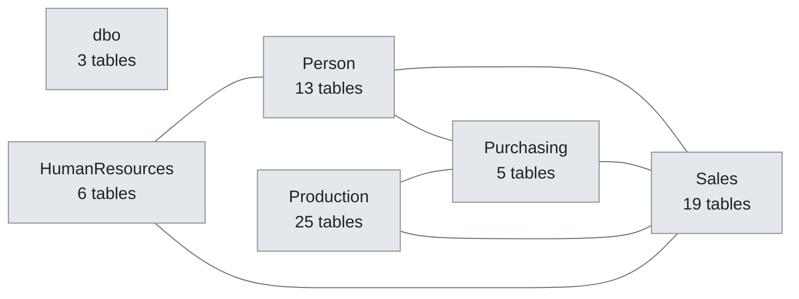

<div style="background:#f4f5f7;color:#1f2328;padding:16px 22px;border-radius:8px;">

# AdventureWorks2025: Data Profile

## At a Glance

<table style="border-collapse:collapse;margin:8px 0;">
<tr><th scope="row" align="left" style="text-align:left;vertical-align:top;white-space:nowrap;font-weight:600;padding:6px 16px 6px 10px;background:#e4e7eb;color:#1f2328;border-bottom:1px solid #d0d4da;">About</th><td style="text-align:left;vertical-align:top;padding:6px 10px;background:#ffffff;color:#1f2328;border-bottom:1px solid #d0d4da;">Operational data of a company that manufactures and sells bicycles, parts and accessories. It covers its customers and stores, sales and purchasing, production work, products and employees. The orders and transactions run from the middle of 2022 to the middle of 2025. <i>(written by AI)</i></td></tr>
<tr><th scope="row" align="left" style="text-align:left;vertical-align:top;white-space:nowrap;font-weight:600;padding:6px 16px 6px 10px;background:#e4e7eb;color:#1f2328;border-bottom:1px solid #d0d4da;">Source</th><td style="text-align:left;vertical-align:top;padding:6px 10px;background:#ffffff;color:#1f2328;border-bottom:1px solid #d0d4da;">mssql://localhost/AdventureWorks2025 (sqlalchemy)</td></tr>
<tr><th scope="row" align="left" style="text-align:left;vertical-align:top;white-space:nowrap;font-weight:600;padding:6px 16px 6px 10px;background:#e4e7eb;color:#1f2328;border-bottom:1px solid #d0d4da;">Tables</th><td style="text-align:left;vertical-align:top;padding:6px 10px;background:#ffffff;color:#1f2328;border-bottom:1px solid #d0d4da;">71</td></tr>
<tr><th scope="row" align="left" style="text-align:left;vertical-align:top;white-space:nowrap;font-weight:600;padding:6px 16px 6px 10px;background:#e4e7eb;color:#1f2328;border-bottom:1px solid #d0d4da;">Sampled Rows</th><td style="text-align:left;vertical-align:top;padding:6px 10px;background:#ffffff;color:#1f2328;border-bottom:1px solid #d0d4da;">725,407</td></tr>
<tr><th scope="row" align="left" style="text-align:left;vertical-align:top;white-space:nowrap;font-weight:600;padding:6px 16px 6px 10px;background:#e4e7eb;color:#1f2328;border-bottom:1px solid #d0d4da;">Profiled</th><td style="text-align:left;vertical-align:top;padding:6px 10px;background:#ffffff;color:#1f2328;border-bottom:1px solid #d0d4da;">2026-11-22 20:13 UTC</td></tr>
<tr><th scope="row" align="left" style="text-align:left;vertical-align:top;white-space:nowrap;font-weight:600;padding:6px 16px 6px 10px;background:#e4e7eb;color:#1f2328;border-bottom:1px solid #d0d4da;">How to Read</th><td style="text-align:left;vertical-align:top;padding:6px 10px;background:#ffffff;color:#1f2328;border-bottom:1px solid #d0d4da;"><a href="how-to-read.md">How to Read This Wiki</a> · <a href="beam-annotations.md">BEAM✲ Annotations</a></td></tr>
</table>

## Data Stories

<i>A data story describes one table: what the thing is, what one row is, and what to watch out for.</i>

### dbo (3 tables)

<table style="border-collapse:collapse;margin:8px 0;width:100%;">
<tr><th style="padding:6px 10px;border:1px solid #d0d4da;background:#ffffff;color:#1f2328;text-align:left;vertical-align:top;background:#cfd5dd;color:#1f2328;font-weight:600;vertical-align:bottom;">Table</th><th style="padding:6px 10px;border:1px solid #d0d4da;background:#ffffff;color:#1f2328;text-align:left;vertical-align:top;background:#cfd5dd;color:#1f2328;font-weight:600;vertical-align:bottom;">BEAM✲</th><th style="padding:6px 10px;border:1px solid #d0d4da;background:#ffffff;color:#1f2328;text-align:left;vertical-align:top;background:#cfd5dd;color:#1f2328;font-weight:600;vertical-align:bottom;">Grain</th><th style="padding:6px 10px;border:1px solid #d0d4da;background:#ffffff;color:#1f2328;text-align:left;vertical-align:top;background:#cfd5dd;color:#1f2328;font-weight:600;vertical-align:bottom;">Description</th><th style="padding:6px 10px;border:1px solid #d0d4da;background:#ffffff;color:#1f2328;text-align:right;vertical-align:top;background:#cfd5dd;color:#1f2328;font-weight:600;vertical-align:bottom;">Sampled Rows</th><th style="padding:6px 10px;border:1px solid #d0d4da;background:#ffffff;color:#1f2328;text-align:right;vertical-align:top;background:#cfd5dd;color:#1f2328;font-weight:600;vertical-align:bottom;">Columns</th></tr>
<tr><td style="padding:6px 10px;border:1px solid #d0d4da;background:#ffffff;color:#1f2328;text-align:left;vertical-align:top;"><a href="data-stories/dbo-awbuildversion.md" style="color:#0b5cad">dbo.AWBuildVersion</a></td><td style="padding:6px 10px;border:1px solid #d0d4da;background:#ffffff;color:#1f2328;text-align:left;vertical-align:top;"><a href="beam-annotations.md#t-cv" style="color:#0b5cad" title="Current Value: Keeps only the current value of each attribute. Changes overwrite the old value. Also called a type 1 slowly changing dimension.">[CV]</a></td><td style="padding:6px 10px;border:1px solid #d0d4da;background:#ffffff;color:#1f2328;text-align:left;vertical-align:top;">One row for each recorded version of this sample database; the table holds a single row, so it only describes the version that is installed</td><td style="padding:6px 10px;border:1px solid #d0d4da;background:#ffffff;color:#1f2328;text-align:left;vertical-align:top;">Current version number of the AdventureWorks 2025 sample database.</td><td style="padding:6px 10px;border:1px solid #d0d4da;background:#ffffff;color:#1f2328;text-align:right;vertical-align:top;">1</td><td style="padding:6px 10px;border:1px solid #d0d4da;background:#ffffff;color:#1f2328;text-align:right;vertical-align:top;">4</td></tr>
<tr><td style="padding:6px 10px;border:1px solid #d0d4da;background:#ffffff;color:#1f2328;text-align:left;vertical-align:top;"><a href="data-stories/dbo-databaselog.md" style="color:#0b5cad">dbo.DatabaseLog</a></td><td style="padding:6px 10px;border:1px solid #d0d4da;background:#ffffff;color:#1f2328;text-align:left;vertical-align:top;"><a href="beam-annotations.md#t-de" style="color:#0b5cad" title="Discrete Event: Something that happens at one moment, or over a short time, and is then finished, e.g. a sale or a payment. Becomes a transaction fact table [TF].">[DE]</a></td><td style="padding:6px 10px;border:1px solid #d0d4da;background:#ffffff;color:#1f2328;text-align:left;vertical-align:top;">One row for each change made to the structure of the database, such as creating a table or index, with the exact statement that was run</td><td style="padding:6px 10px;border:1px solid #d0d4da;background:#ffffff;color:#1f2328;text-align:left;vertical-align:top;">Audit table tracking all DDL changes made to the AdventureWorks database. Data is captured by the database trigger ddlDatabaseTriggerLog.</td><td style="padding:6px 10px;border:1px solid #d0d4da;background:#ffffff;color:#1f2328;text-align:right;vertical-align:top;">927</td><td style="padding:6px 10px;border:1px solid #d0d4da;background:#ffffff;color:#1f2328;text-align:right;vertical-align:top;">8</td></tr>
<tr><td style="padding:6px 10px;border:1px solid #d0d4da;background:#ffffff;color:#1f2328;text-align:left;vertical-align:top;"><a href="data-stories/dbo-errorlog.md" style="color:#0b5cad">dbo.ErrorLog</a></td><td style="padding:6px 10px;border:1px solid #d0d4da;background:#ffffff;color:#1f2328;text-align:left;vertical-align:top;"><a href="beam-annotations.md#t-de" style="color:#0b5cad" title="Discrete Event: Something that happens at one moment, or over a short time, and is then finished, e.g. a sale or a payment. Becomes a transaction fact table [TF].">[DE]</a></td><td style="padding:6px 10px;border:1px solid #d0d4da;background:#ffffff;color:#1f2328;text-align:left;vertical-align:top;">One row for each error that was caught and logged by the database's error handling, with the time, user, error number and message</td><td style="padding:6px 10px;border:1px solid #d0d4da;background:#ffffff;color:#1f2328;text-align:left;vertical-align:top;">Audit table tracking errors in the the AdventureWorks database that are caught by the CATCH block of a TRY...CATCH construct. Data is inserted by stored procedure dbo.uspLogError when it is executed from inside the CATCH block of a TRY...CATCH construct.</td><td style="padding:6px 10px;border:1px solid #d0d4da;background:#ffffff;color:#1f2328;text-align:right;vertical-align:top;">0</td><td style="padding:6px 10px;border:1px solid #d0d4da;background:#ffffff;color:#1f2328;text-align:right;vertical-align:top;">9</td></tr>
</table>

### HumanResources (6 tables)

<table style="border-collapse:collapse;margin:8px 0;width:100%;">
<tr><th style="padding:6px 10px;border:1px solid #d0d4da;background:#ffffff;color:#1f2328;text-align:left;vertical-align:top;background:#cfd5dd;color:#1f2328;font-weight:600;vertical-align:bottom;">Table</th><th style="padding:6px 10px;border:1px solid #d0d4da;background:#ffffff;color:#1f2328;text-align:left;vertical-align:top;background:#cfd5dd;color:#1f2328;font-weight:600;vertical-align:bottom;">BEAM✲</th><th style="padding:6px 10px;border:1px solid #d0d4da;background:#ffffff;color:#1f2328;text-align:left;vertical-align:top;background:#cfd5dd;color:#1f2328;font-weight:600;vertical-align:bottom;">Grain</th><th style="padding:6px 10px;border:1px solid #d0d4da;background:#ffffff;color:#1f2328;text-align:left;vertical-align:top;background:#cfd5dd;color:#1f2328;font-weight:600;vertical-align:bottom;">Description</th><th style="padding:6px 10px;border:1px solid #d0d4da;background:#ffffff;color:#1f2328;text-align:right;vertical-align:top;background:#cfd5dd;color:#1f2328;font-weight:600;vertical-align:bottom;">Sampled Rows</th><th style="padding:6px 10px;border:1px solid #d0d4da;background:#ffffff;color:#1f2328;text-align:right;vertical-align:top;background:#cfd5dd;color:#1f2328;font-weight:600;vertical-align:bottom;">Columns</th></tr>
<tr><td style="padding:6px 10px;border:1px solid #d0d4da;background:#ffffff;color:#1f2328;text-align:left;vertical-align:top;"><a href="data-stories/humanresources-department.md" style="color:#0b5cad">HumanResources.Department</a></td><td style="padding:6px 10px;border:1px solid #d0d4da;background:#ffffff;color:#1f2328;text-align:left;vertical-align:top;"><a href="beam-annotations.md#t-cv" style="color:#0b5cad" title="Current Value: Keeps only the current value of each attribute. Changes overwrite the old value. Also called a type 1 slowly changing dimension.">[CV]</a></td><td style="padding:6px 10px;border:1px solid #d0d4da;background:#ffffff;color:#1f2328;text-align:left;vertical-align:top;">One row for each department of the company; the 16 departments are placed into 6 department groups</td><td style="padding:6px 10px;border:1px solid #d0d4da;background:#ffffff;color:#1f2328;text-align:left;vertical-align:top;">Lookup table containing the departments within the Adventure Works Cycles company.</td><td style="padding:6px 10px;border:1px solid #d0d4da;background:#ffffff;color:#1f2328;text-align:right;vertical-align:top;">16</td><td style="padding:6px 10px;border:1px solid #d0d4da;background:#ffffff;color:#1f2328;text-align:right;vertical-align:top;">4</td></tr>
<tr><td style="padding:6px 10px;border:1px solid #d0d4da;background:#ffffff;color:#1f2328;text-align:left;vertical-align:top;"><a href="data-stories/humanresources-employee.md" style="color:#0b5cad">HumanResources.Employee</a></td><td style="padding:6px 10px;border:1px solid #d0d4da;background:#ffffff;color:#1f2328;text-align:left;vertical-align:top;"><a href="beam-annotations.md#t-cv" style="color:#0b5cad" title="Current Value: Keeps only the current value of each attribute. Changes overwrite the old value. Also called a type 1 slowly changing dimension.">[CV]</a></td><td style="padding:6px 10px;border:1px solid #d0d4da;background:#ffffff;color:#1f2328;text-align:left;vertical-align:top;">One row for each person who works or has worked for the company; all 290 rows are marked as currently active</td><td style="padding:6px 10px;border:1px solid #d0d4da;background:#ffffff;color:#1f2328;text-align:left;vertical-align:top;">Employee information such as salary, department, and title.</td><td style="padding:6px 10px;border:1px solid #d0d4da;background:#ffffff;color:#1f2328;text-align:right;vertical-align:top;">290</td><td style="padding:6px 10px;border:1px solid #d0d4da;background:#ffffff;color:#1f2328;text-align:right;vertical-align:top;">16</td></tr>
<tr><td style="padding:6px 10px;border:1px solid #d0d4da;background:#ffffff;color:#1f2328;text-align:left;vertical-align:top;"><a href="data-stories/humanresources-employeedepartmenthistory.md" style="color:#0b5cad">HumanResources.EmployeeDepartmentHistory</a></td><td style="padding:6px 10px;border:1px solid #d0d4da;background:#ffffff;color:#1f2328;text-align:left;vertical-align:top;"><a href="beam-annotations.md#t-hv" style="color:#0b5cad" title="Historic Value: Keeps history for at least one attribute, so a change adds a new version of the row. Also called a type 2 slowly changing dimension.">[HV]</a></td><td style="padding:6px 10px;border:1px solid #d0d4da;background:#ffffff;color:#1f2328;text-align:left;vertical-align:top;">One row for each period an employee spent in a department on a given shift; an employee and a start date together identify a row</td><td style="padding:6px 10px;border:1px solid #d0d4da;background:#ffffff;color:#1f2328;text-align:left;vertical-align:top;">Employee department transfers.</td><td style="padding:6px 10px;border:1px solid #d0d4da;background:#ffffff;color:#1f2328;text-align:right;vertical-align:top;">296</td><td style="padding:6px 10px;border:1px solid #d0d4da;background:#ffffff;color:#1f2328;text-align:right;vertical-align:top;">6</td></tr>
<tr><td style="padding:6px 10px;border:1px solid #d0d4da;background:#ffffff;color:#1f2328;text-align:left;vertical-align:top;"><a href="data-stories/humanresources-employeepayhistory.md" style="color:#0b5cad">HumanResources.EmployeePayHistory</a></td><td style="padding:6px 10px;border:1px solid #d0d4da;background:#ffffff;color:#1f2328;text-align:left;vertical-align:top;"><a href="beam-annotations.md#t-hv" style="color:#0b5cad" title="Historic Value: Keeps history for at least one attribute, so a change adds a new version of the row. Also called a type 2 slowly changing dimension.">[HV]</a></td><td style="padding:6px 10px;border:1px solid #d0d4da;background:#ffffff;color:#1f2328;text-align:left;vertical-align:top;">One row for each pay rate that takes effect for an employee on a given date; an employee and the rate change date together identify a row</td><td style="padding:6px 10px;border:1px solid #d0d4da;background:#ffffff;color:#1f2328;text-align:left;vertical-align:top;">Employee pay history.</td><td style="padding:6px 10px;border:1px solid #d0d4da;background:#ffffff;color:#1f2328;text-align:right;vertical-align:top;">316</td><td style="padding:6px 10px;border:1px solid #d0d4da;background:#ffffff;color:#1f2328;text-align:right;vertical-align:top;">5</td></tr>
<tr><td style="padding:6px 10px;border:1px solid #d0d4da;background:#ffffff;color:#1f2328;text-align:left;vertical-align:top;"><a href="data-stories/humanresources-jobcandidate.md" style="color:#0b5cad">HumanResources.JobCandidate</a></td><td style="padding:6px 10px;border:1px solid #d0d4da;background:#ffffff;color:#1f2328;text-align:left;vertical-align:top;"><a href="beam-annotations.md#t-cv" style="color:#0b5cad" title="Current Value: Keeps only the current value of each attribute. Changes overwrite the old value. Also called a type 1 slowly changing dimension.">[CV]</a></td><td style="padding:6px 10px;border:1px solid #d0d4da;background:#ffffff;color:#1f2328;text-align:left;vertical-align:top;">One row for each résumé submitted by a job applicant; the few applicants who were hired also carry the number of the employee they became</td><td style="padding:6px 10px;border:1px solid #d0d4da;background:#ffffff;color:#1f2328;text-align:left;vertical-align:top;">Résumés submitted to Human Resources by job applicants.</td><td style="padding:6px 10px;border:1px solid #d0d4da;background:#ffffff;color:#1f2328;text-align:right;vertical-align:top;">13</td><td style="padding:6px 10px;border:1px solid #d0d4da;background:#ffffff;color:#1f2328;text-align:right;vertical-align:top;">4</td></tr>
<tr><td style="padding:6px 10px;border:1px solid #d0d4da;background:#ffffff;color:#1f2328;text-align:left;vertical-align:top;"><a href="data-stories/humanresources-shift.md" style="color:#0b5cad">HumanResources.Shift</a></td><td style="padding:6px 10px;border:1px solid #d0d4da;background:#ffffff;color:#1f2328;text-align:left;vertical-align:top;"><a href="beam-annotations.md#t-cv" style="color:#0b5cad" title="Current Value: Keeps only the current value of each attribute. Changes overwrite the old value. Also called a type 1 slowly changing dimension.">[CV]</a></td><td style="padding:6px 10px;border:1px solid #d0d4da;background:#ffffff;color:#1f2328;text-align:left;vertical-align:top;">One row for each work shift, defined by a start time and an end time; the three 8-hour shifts together cover the whole day</td><td style="padding:6px 10px;border:1px solid #d0d4da;background:#ffffff;color:#1f2328;text-align:left;vertical-align:top;">Work shift lookup table.</td><td style="padding:6px 10px;border:1px solid #d0d4da;background:#ffffff;color:#1f2328;text-align:right;vertical-align:top;">3</td><td style="padding:6px 10px;border:1px solid #d0d4da;background:#ffffff;color:#1f2328;text-align:right;vertical-align:top;">5</td></tr>
</table>

### Person (13 tables)

<table style="border-collapse:collapse;margin:8px 0;width:100%;">
<tr><th style="padding:6px 10px;border:1px solid #d0d4da;background:#ffffff;color:#1f2328;text-align:left;vertical-align:top;background:#cfd5dd;color:#1f2328;font-weight:600;vertical-align:bottom;">Table</th><th style="padding:6px 10px;border:1px solid #d0d4da;background:#ffffff;color:#1f2328;text-align:left;vertical-align:top;background:#cfd5dd;color:#1f2328;font-weight:600;vertical-align:bottom;">BEAM✲</th><th style="padding:6px 10px;border:1px solid #d0d4da;background:#ffffff;color:#1f2328;text-align:left;vertical-align:top;background:#cfd5dd;color:#1f2328;font-weight:600;vertical-align:bottom;">Grain</th><th style="padding:6px 10px;border:1px solid #d0d4da;background:#ffffff;color:#1f2328;text-align:left;vertical-align:top;background:#cfd5dd;color:#1f2328;font-weight:600;vertical-align:bottom;">Description</th><th style="padding:6px 10px;border:1px solid #d0d4da;background:#ffffff;color:#1f2328;text-align:right;vertical-align:top;background:#cfd5dd;color:#1f2328;font-weight:600;vertical-align:bottom;">Sampled Rows</th><th style="padding:6px 10px;border:1px solid #d0d4da;background:#ffffff;color:#1f2328;text-align:right;vertical-align:top;background:#cfd5dd;color:#1f2328;font-weight:600;vertical-align:bottom;">Columns</th></tr>
<tr><td style="padding:6px 10px;border:1px solid #d0d4da;background:#ffffff;color:#1f2328;text-align:left;vertical-align:top;"><a href="data-stories/person-address.md" style="color:#0b5cad">Person.Address</a></td><td style="padding:6px 10px;border:1px solid #d0d4da;background:#ffffff;color:#1f2328;text-align:left;vertical-align:top;"><a href="beam-annotations.md#t-cv" style="color:#0b5cad" title="Current Value: Keeps only the current value of each attribute. Changes overwrite the old value. Also called a type 1 slowly changing dimension.">[CV]</a> <a href="beam-annotations.md#t-rp" style="color:#0b5cad" title="Role-Playing: One dimension used in several roles, e.g. Employee as both salesperson and manager. Calendar is the most common one.">[RP]</a></td><td style="padding:6px 10px;border:1px solid #d0d4da;background:#ffffff;color:#1f2328;text-align:left;vertical-align:top;">One row for each street address, with the city, state or province and postal code it belongs to</td><td style="padding:6px 10px;border:1px solid #d0d4da;background:#ffffff;color:#1f2328;text-align:left;vertical-align:top;">Street address information for customers, employees, and vendors.</td><td style="padding:6px 10px;border:1px solid #d0d4da;background:#ffffff;color:#1f2328;text-align:right;vertical-align:top;">19,614</td><td style="padding:6px 10px;border:1px solid #d0d4da;background:#ffffff;color:#1f2328;text-align:right;vertical-align:top;">9</td></tr>
<tr><td style="padding:6px 10px;border:1px solid #d0d4da;background:#ffffff;color:#1f2328;text-align:left;vertical-align:top;"><a href="data-stories/person-addresstype.md" style="color:#0b5cad">Person.AddressType</a></td><td style="padding:6px 10px;border:1px solid #d0d4da;background:#ffffff;color:#1f2328;text-align:left;vertical-align:top;"><a href="beam-annotations.md#t-cv" style="color:#0b5cad" title="Current Value: Keeps only the current value of each attribute. Changes overwrite the old value. Also called a type 1 slowly changing dimension.">[CV]</a></td><td style="padding:6px 10px;border:1px solid #d0d4da;background:#ffffff;color:#1f2328;text-align:left;vertical-align:top;">One row for each purpose an address can have for a person, store or vendor, such as billing, shipping or home</td><td style="padding:6px 10px;border:1px solid #d0d4da;background:#ffffff;color:#1f2328;text-align:left;vertical-align:top;">Types of addresses stored in the Address table.</td><td style="padding:6px 10px;border:1px solid #d0d4da;background:#ffffff;color:#1f2328;text-align:right;vertical-align:top;">6</td><td style="padding:6px 10px;border:1px solid #d0d4da;background:#ffffff;color:#1f2328;text-align:right;vertical-align:top;">4</td></tr>
<tr><td style="padding:6px 10px;border:1px solid #d0d4da;background:#ffffff;color:#1f2328;text-align:left;vertical-align:top;"><a href="data-stories/person-businessentity.md" style="color:#0b5cad">Person.BusinessEntity</a></td><td style="padding:6px 10px;border:1px solid #d0d4da;background:#ffffff;color:#1f2328;text-align:left;vertical-align:top;"><a href="beam-annotations.md#t-cv" style="color:#0b5cad" title="Current Value: Keeps only the current value of each attribute. Changes overwrite the old value. Also called a type 1 slowly changing dimension.">[CV]</a></td><td style="padding:6px 10px;border:1px solid #d0d4da;background:#ffffff;color:#1f2328;text-align:left;vertical-align:top;">One row for each identifier issued to a person, a store or a vendor, so that they can all share address and contact tables; no other facts are held</td><td style="padding:6px 10px;border:1px solid #d0d4da;background:#ffffff;color:#1f2328;text-align:left;vertical-align:top;">Source of the ID that connects vendors, customers, and employees with address and contact information.</td><td style="padding:6px 10px;border:1px solid #d0d4da;background:#ffffff;color:#1f2328;text-align:right;vertical-align:top;">20,777</td><td style="padding:6px 10px;border:1px solid #d0d4da;background:#ffffff;color:#1f2328;text-align:right;vertical-align:top;">3</td></tr>
<tr><td style="padding:6px 10px;border:1px solid #d0d4da;background:#ffffff;color:#1f2328;text-align:left;vertical-align:top;"><a href="data-stories/person-businessentityaddress.md" style="color:#0b5cad">Person.BusinessEntityAddress</a></td><td style="padding:6px 10px;border:1px solid #d0d4da;background:#ffffff;color:#1f2328;text-align:left;vertical-align:top;"><a href="beam-annotations.md#t-mv" style="color:#0b5cad" title="Multi-Valued: A bridge table that links a fact to several values of a dimension at once (many-to-many), often with a weighting factor.">[MV]</a></td><td style="padding:6px 10px;border:1px solid #d0d4da;background:#ffffff;color:#1f2328;text-align:left;vertical-align:top;">One row for each address that a person, store or vendor has for one purpose, such as billing or shipping; an entity and an address type together identify a row</td><td style="padding:6px 10px;border:1px solid #d0d4da;background:#ffffff;color:#1f2328;text-align:left;vertical-align:top;">Cross-reference table mapping customers, vendors, and employees to their addresses.</td><td style="padding:6px 10px;border:1px solid #d0d4da;background:#ffffff;color:#1f2328;text-align:right;vertical-align:top;">19,614</td><td style="padding:6px 10px;border:1px solid #d0d4da;background:#ffffff;color:#1f2328;text-align:right;vertical-align:top;">5</td></tr>
<tr><td style="padding:6px 10px;border:1px solid #d0d4da;background:#ffffff;color:#1f2328;text-align:left;vertical-align:top;"><a href="data-stories/person-businessentitycontact.md" style="color:#0b5cad">Person.BusinessEntityContact</a></td><td style="padding:6px 10px;border:1px solid #d0d4da;background:#ffffff;color:#1f2328;text-align:left;vertical-align:top;"><a href="beam-annotations.md#t-mv" style="color:#0b5cad" title="Multi-Valued: A bridge table that links a fact to several values of a dimension at once (many-to-many), often with a weighting factor.">[MV]</a></td><td style="padding:6px 10px;border:1px solid #d0d4da;background:#ffffff;color:#1f2328;text-align:left;vertical-align:top;">One row for each person who acts as a contact of a given type for a store or vendor; a person appears only once</td><td style="padding:6px 10px;border:1px solid #d0d4da;background:#ffffff;color:#1f2328;text-align:left;vertical-align:top;">Cross-reference table mapping stores, vendors, and employees to people</td><td style="padding:6px 10px;border:1px solid #d0d4da;background:#ffffff;color:#1f2328;text-align:right;vertical-align:top;">909</td><td style="padding:6px 10px;border:1px solid #d0d4da;background:#ffffff;color:#1f2328;text-align:right;vertical-align:top;">5</td></tr>
<tr><td style="padding:6px 10px;border:1px solid #d0d4da;background:#ffffff;color:#1f2328;text-align:left;vertical-align:top;"><a href="data-stories/person-contacttype.md" style="color:#0b5cad">Person.ContactType</a></td><td style="padding:6px 10px;border:1px solid #d0d4da;background:#ffffff;color:#1f2328;text-align:left;vertical-align:top;"><a href="beam-annotations.md#t-cv" style="color:#0b5cad" title="Current Value: Keeps only the current value of each attribute. Changes overwrite the old value. Also called a type 1 slowly changing dimension.">[CV]</a></td><td style="padding:6px 10px;border:1px solid #d0d4da;background:#ffffff;color:#1f2328;text-align:left;vertical-align:top;">One row for each role a contact person can have at a store or vendor, such as Accounting Manager or Export Administrator</td><td style="padding:6px 10px;border:1px solid #d0d4da;background:#ffffff;color:#1f2328;text-align:left;vertical-align:top;">Lookup table containing the types of business entity contacts.</td><td style="padding:6px 10px;border:1px solid #d0d4da;background:#ffffff;color:#1f2328;text-align:right;vertical-align:top;">20</td><td style="padding:6px 10px;border:1px solid #d0d4da;background:#ffffff;color:#1f2328;text-align:right;vertical-align:top;">3</td></tr>
<tr><td style="padding:6px 10px;border:1px solid #d0d4da;background:#ffffff;color:#1f2328;text-align:left;vertical-align:top;"><a href="data-stories/person-countryregion.md" style="color:#0b5cad">Person.CountryRegion</a></td><td style="padding:6px 10px;border:1px solid #d0d4da;background:#ffffff;color:#1f2328;text-align:left;vertical-align:top;"><a href="beam-annotations.md#t-cv" style="color:#0b5cad" title="Current Value: Keeps only the current value of each attribute. Changes overwrite the old value. Also called a type 1 slowly changing dimension.">[CV]</a></td><td style="padding:6px 10px;border:1px solid #d0d4da;background:#ffffff;color:#1f2328;text-align:left;vertical-align:top;">One row for each country or region, identified by its two-letter ISO code</td><td style="padding:6px 10px;border:1px solid #d0d4da;background:#ffffff;color:#1f2328;text-align:left;vertical-align:top;">Lookup table containing the ISO standard codes for countries and regions.</td><td style="padding:6px 10px;border:1px solid #d0d4da;background:#ffffff;color:#1f2328;text-align:right;vertical-align:top;">238</td><td style="padding:6px 10px;border:1px solid #d0d4da;background:#ffffff;color:#1f2328;text-align:right;vertical-align:top;">3</td></tr>
<tr><td style="padding:6px 10px;border:1px solid #d0d4da;background:#ffffff;color:#1f2328;text-align:left;vertical-align:top;"><a href="data-stories/person-emailaddress.md" style="color:#0b5cad">Person.EmailAddress</a></td><td style="padding:6px 10px;border:1px solid #d0d4da;background:#ffffff;color:#1f2328;text-align:left;vertical-align:top;"><a href="beam-annotations.md#t-cv" style="color:#0b5cad" title="Current Value: Keeps only the current value of each attribute. Changes overwrite the old value. Also called a type 1 slowly changing dimension.">[CV]</a></td><td style="padding:6px 10px;border:1px solid #d0d4da;background:#ffffff;color:#1f2328;text-align:left;vertical-align:top;">One row for each e-mail address of a person; every person has exactly one, because the number of rows equals the number of people</td><td style="padding:6px 10px;border:1px solid #d0d4da;background:#ffffff;color:#1f2328;text-align:left;vertical-align:top;">Where to send a person email.</td><td style="padding:6px 10px;border:1px solid #d0d4da;background:#ffffff;color:#1f2328;text-align:right;vertical-align:top;">19,972</td><td style="padding:6px 10px;border:1px solid #d0d4da;background:#ffffff;color:#1f2328;text-align:right;vertical-align:top;">5</td></tr>
<tr><td style="padding:6px 10px;border:1px solid #d0d4da;background:#ffffff;color:#1f2328;text-align:left;vertical-align:top;"><a href="data-stories/person-password.md" style="color:#0b5cad">Person.Password</a></td><td style="padding:6px 10px;border:1px solid #d0d4da;background:#ffffff;color:#1f2328;text-align:left;vertical-align:top;"><a href="beam-annotations.md#t-cv" style="color:#0b5cad" title="Current Value: Keeps only the current value of each attribute. Changes overwrite the old value. Also called a type 1 slowly changing dimension.">[CV]</a></td><td style="padding:6px 10px;border:1px solid #d0d4da;background:#ffffff;color:#1f2328;text-align:left;vertical-align:top;">One row for each person who has sign-in credentials, holding a salted hash of the password and the salt</td><td style="padding:6px 10px;border:1px solid #d0d4da;background:#ffffff;color:#1f2328;text-align:left;vertical-align:top;">One way hashed authentication information</td><td style="padding:6px 10px;border:1px solid #d0d4da;background:#ffffff;color:#1f2328;text-align:right;vertical-align:top;">19,972</td><td style="padding:6px 10px;border:1px solid #d0d4da;background:#ffffff;color:#1f2328;text-align:right;vertical-align:top;">5</td></tr>
<tr><td style="padding:6px 10px;border:1px solid #d0d4da;background:#ffffff;color:#1f2328;text-align:left;vertical-align:top;"><a href="data-stories/person-person.md" style="color:#0b5cad">Person.Person</a></td><td style="padding:6px 10px;border:1px solid #d0d4da;background:#ffffff;color:#1f2328;text-align:left;vertical-align:top;"><a href="beam-annotations.md#t-cv" style="color:#0b5cad" title="Current Value: Keeps only the current value of each attribute. Changes overwrite the old value. Also called a type 1 slowly changing dimension.">[CV]</a></td><td style="padding:6px 10px;border:1px solid #d0d4da;background:#ffffff;color:#1f2328;text-align:left;vertical-align:top;">One row for each human being known to the company, whether employee, customer, store contact or vendor contact; PersonType tells which</td><td style="padding:6px 10px;border:1px solid #d0d4da;background:#ffffff;color:#1f2328;text-align:left;vertical-align:top;">Human beings involved with AdventureWorks: employees, customer contacts, and vendor contacts.</td><td style="padding:6px 10px;border:1px solid #d0d4da;background:#ffffff;color:#1f2328;text-align:right;vertical-align:top;">19,972</td><td style="padding:6px 10px;border:1px solid #d0d4da;background:#ffffff;color:#1f2328;text-align:right;vertical-align:top;">13</td></tr>
<tr><td style="padding:6px 10px;border:1px solid #d0d4da;background:#ffffff;color:#1f2328;text-align:left;vertical-align:top;"><a href="data-stories/person-personphone.md" style="color:#0b5cad">Person.PersonPhone</a></td><td style="padding:6px 10px;border:1px solid #d0d4da;background:#ffffff;color:#1f2328;text-align:left;vertical-align:top;"><a href="beam-annotations.md#t-cv" style="color:#0b5cad" title="Current Value: Keeps only the current value of each attribute. Changes overwrite the old value. Also called a type 1 slowly changing dimension.">[CV]</a></td><td style="padding:6px 10px;border:1px solid #d0d4da;background:#ffffff;color:#1f2328;text-align:left;vertical-align:top;">One row for each telephone number of a person, with the type of number (cell, home or work); each person has exactly one number</td><td style="padding:6px 10px;border:1px solid #d0d4da;background:#ffffff;color:#1f2328;text-align:left;vertical-align:top;">Telephone number and type of a person.</td><td style="padding:6px 10px;border:1px solid #d0d4da;background:#ffffff;color:#1f2328;text-align:right;vertical-align:top;">19,972</td><td style="padding:6px 10px;border:1px solid #d0d4da;background:#ffffff;color:#1f2328;text-align:right;vertical-align:top;">4</td></tr>
<tr><td style="padding:6px 10px;border:1px solid #d0d4da;background:#ffffff;color:#1f2328;text-align:left;vertical-align:top;"><a href="data-stories/person-phonenumbertype.md" style="color:#0b5cad">Person.PhoneNumberType</a></td><td style="padding:6px 10px;border:1px solid #d0d4da;background:#ffffff;color:#1f2328;text-align:left;vertical-align:top;"><a href="beam-annotations.md#t-cv" style="color:#0b5cad" title="Current Value: Keeps only the current value of each attribute. Changes overwrite the old value. Also called a type 1 slowly changing dimension.">[CV]</a></td><td style="padding:6px 10px;border:1px solid #d0d4da;background:#ffffff;color:#1f2328;text-align:left;vertical-align:top;">One row for each kind of telephone number a person can have; the three kinds are cell, home and work</td><td style="padding:6px 10px;border:1px solid #d0d4da;background:#ffffff;color:#1f2328;text-align:left;vertical-align:top;">Type of phone number of a person.</td><td style="padding:6px 10px;border:1px solid #d0d4da;background:#ffffff;color:#1f2328;text-align:right;vertical-align:top;">3</td><td style="padding:6px 10px;border:1px solid #d0d4da;background:#ffffff;color:#1f2328;text-align:right;vertical-align:top;">3</td></tr>
<tr><td style="padding:6px 10px;border:1px solid #d0d4da;background:#ffffff;color:#1f2328;text-align:left;vertical-align:top;"><a href="data-stories/person-stateprovince.md" style="color:#0b5cad">Person.StateProvince</a></td><td style="padding:6px 10px;border:1px solid #d0d4da;background:#ffffff;color:#1f2328;text-align:left;vertical-align:top;"><a href="beam-annotations.md#t-cv" style="color:#0b5cad" title="Current Value: Keeps only the current value of each attribute. Changes overwrite the old value. Also called a type 1 slowly changing dimension.">[CV]</a></td><td style="padding:6px 10px;border:1px solid #d0d4da;background:#ffffff;color:#1f2328;text-align:left;vertical-align:top;">One row for each state or province of a country or region, with the sales territory it belongs to</td><td style="padding:6px 10px;border:1px solid #d0d4da;background:#ffffff;color:#1f2328;text-align:left;vertical-align:top;">State and province lookup table.</td><td style="padding:6px 10px;border:1px solid #d0d4da;background:#ffffff;color:#1f2328;text-align:right;vertical-align:top;">181</td><td style="padding:6px 10px;border:1px solid #d0d4da;background:#ffffff;color:#1f2328;text-align:right;vertical-align:top;">8</td></tr>
</table>

### Production (25 tables)

<table style="border-collapse:collapse;margin:8px 0;width:100%;">
<tr><th style="padding:6px 10px;border:1px solid #d0d4da;background:#ffffff;color:#1f2328;text-align:left;vertical-align:top;background:#cfd5dd;color:#1f2328;font-weight:600;vertical-align:bottom;">Table</th><th style="padding:6px 10px;border:1px solid #d0d4da;background:#ffffff;color:#1f2328;text-align:left;vertical-align:top;background:#cfd5dd;color:#1f2328;font-weight:600;vertical-align:bottom;">BEAM✲</th><th style="padding:6px 10px;border:1px solid #d0d4da;background:#ffffff;color:#1f2328;text-align:left;vertical-align:top;background:#cfd5dd;color:#1f2328;font-weight:600;vertical-align:bottom;">Grain</th><th style="padding:6px 10px;border:1px solid #d0d4da;background:#ffffff;color:#1f2328;text-align:left;vertical-align:top;background:#cfd5dd;color:#1f2328;font-weight:600;vertical-align:bottom;">Description</th><th style="padding:6px 10px;border:1px solid #d0d4da;background:#ffffff;color:#1f2328;text-align:right;vertical-align:top;background:#cfd5dd;color:#1f2328;font-weight:600;vertical-align:bottom;">Sampled Rows</th><th style="padding:6px 10px;border:1px solid #d0d4da;background:#ffffff;color:#1f2328;text-align:right;vertical-align:top;background:#cfd5dd;color:#1f2328;font-weight:600;vertical-align:bottom;">Columns</th></tr>
<tr><td style="padding:6px 10px;border:1px solid #d0d4da;background:#ffffff;color:#1f2328;text-align:left;vertical-align:top;"><a href="data-stories/production-billofmaterials.md" style="color:#0b5cad">Production.BillOfMaterials</a></td><td style="padding:6px 10px;border:1px solid #d0d4da;background:#ffffff;color:#1f2328;text-align:left;vertical-align:top;"><a href="beam-annotations.md#t-hm" style="color:#0b5cad" title="Hierarchy Map: A helper table for a hierarchy of varying depth, e.g. a company structure.">[HM]</a></td><td style="padding:6px 10px;border:1px solid #d0d4da;background:#ffffff;color:#1f2328;text-align:left;vertical-align:top;">One row for each component used in a parent product during a period, with the quantity needed; the parent, the component and the start date together identify a row</td><td style="padding:6px 10px;border:1px solid #d0d4da;background:#ffffff;color:#1f2328;text-align:left;vertical-align:top;">Items required to make bicycles and bicycle subassemblies. It identifies the heirarchical relationship between a parent product and its components.</td><td style="padding:6px 10px;border:1px solid #d0d4da;background:#ffffff;color:#1f2328;text-align:right;vertical-align:top;">2,679</td><td style="padding:6px 10px;border:1px solid #d0d4da;background:#ffffff;color:#1f2328;text-align:right;vertical-align:top;">9</td></tr>
<tr><td style="padding:6px 10px;border:1px solid #d0d4da;background:#ffffff;color:#1f2328;text-align:left;vertical-align:top;"><a href="data-stories/production-culture.md" style="color:#0b5cad">Production.Culture</a></td><td style="padding:6px 10px;border:1px solid #d0d4da;background:#ffffff;color:#1f2328;text-align:left;vertical-align:top;"><a href="beam-annotations.md#t-cv" style="color:#0b5cad" title="Current Value: Keeps only the current value of each attribute. Changes overwrite the old value. Also called a type 1 slowly changing dimension.">[CV]</a></td><td style="padding:6px 10px;border:1px solid #d0d4da;background:#ffffff;color:#1f2328;text-align:left;vertical-align:top;">One row for each language (with an optional country) in which product descriptions are stored; one row is the neutral language</td><td style="padding:6px 10px;border:1px solid #d0d4da;background:#ffffff;color:#1f2328;text-align:left;vertical-align:top;">Lookup table containing the languages in which some AdventureWorks data is stored.</td><td style="padding:6px 10px;border:1px solid #d0d4da;background:#ffffff;color:#1f2328;text-align:right;vertical-align:top;">8</td><td style="padding:6px 10px;border:1px solid #d0d4da;background:#ffffff;color:#1f2328;text-align:right;vertical-align:top;">3</td></tr>
<tr><td style="padding:6px 10px;border:1px solid #d0d4da;background:#ffffff;color:#1f2328;text-align:left;vertical-align:top;"><a href="data-stories/production-document.md" style="color:#0b5cad">Production.Document</a></td><td style="padding:6px 10px;border:1px solid #d0d4da;background:#ffffff;color:#1f2328;text-align:left;vertical-align:top;"><a href="beam-annotations.md#t-cv" style="color:#0b5cad" title="Current Value: Keeps only the current value of each attribute. Changes overwrite the old value. Also called a type 1 slowly changing dimension.">[CV]</a></td><td style="padding:6px 10px;border:1px solid #d0d4da;background:#ffffff;color:#1f2328;text-align:left;vertical-align:top;">One row for each folder or document in the product maintenance document tree, placed in the tree by DocumentNode</td><td style="padding:6px 10px;border:1px solid #d0d4da;background:#ffffff;color:#1f2328;text-align:left;vertical-align:top;">Product maintenance documents.</td><td style="padding:6px 10px;border:1px solid #d0d4da;background:#ffffff;color:#1f2328;text-align:right;vertical-align:top;">12</td><td style="padding:6px 10px;border:1px solid #d0d4da;background:#ffffff;color:#1f2328;text-align:right;vertical-align:top;">14</td></tr>
<tr><td style="padding:6px 10px;border:1px solid #d0d4da;background:#ffffff;color:#1f2328;text-align:left;vertical-align:top;"><a href="data-stories/production-illustration.md" style="color:#0b5cad">Production.Illustration</a></td><td style="padding:6px 10px;border:1px solid #d0d4da;background:#ffffff;color:#1f2328;text-align:left;vertical-align:top;"><a href="beam-annotations.md#t-cv" style="color:#0b5cad" title="Current Value: Keeps only the current value of each attribute. Changes overwrite the old value. Also called a type 1 slowly changing dimension.">[CV]</a></td><td style="padding:6px 10px;border:1px solid #d0d4da;background:#ffffff;color:#1f2328;text-align:left;vertical-align:top;">One row for each drawing that shows how part of a bicycle is assembled, stored as XML</td><td style="padding:6px 10px;border:1px solid #d0d4da;background:#ffffff;color:#1f2328;text-align:left;vertical-align:top;">Bicycle assembly diagrams.</td><td style="padding:6px 10px;border:1px solid #d0d4da;background:#ffffff;color:#1f2328;text-align:right;vertical-align:top;">5</td><td style="padding:6px 10px;border:1px solid #d0d4da;background:#ffffff;color:#1f2328;text-align:right;vertical-align:top;">3</td></tr>
<tr><td style="padding:6px 10px;border:1px solid #d0d4da;background:#ffffff;color:#1f2328;text-align:left;vertical-align:top;"><a href="data-stories/production-location.md" style="color:#0b5cad">Production.Location</a></td><td style="padding:6px 10px;border:1px solid #d0d4da;background:#ffffff;color:#1f2328;text-align:left;vertical-align:top;"><a href="beam-annotations.md#t-cv" style="color:#0b5cad" title="Current Value: Keeps only the current value of each attribute. Changes overwrite the old value. Also called a type 1 slowly changing dimension.">[CV]</a></td><td style="padding:6px 10px;border:1px solid #d0d4da;background:#ffffff;color:#1f2328;text-align:left;vertical-align:top;">One row for each place in the factory where products are made or stored, with the hourly cost and the working hours it has available</td><td style="padding:6px 10px;border:1px solid #d0d4da;background:#ffffff;color:#1f2328;text-align:left;vertical-align:top;">Product inventory and manufacturing locations.</td><td style="padding:6px 10px;border:1px solid #d0d4da;background:#ffffff;color:#1f2328;text-align:right;vertical-align:top;">14</td><td style="padding:6px 10px;border:1px solid #d0d4da;background:#ffffff;color:#1f2328;text-align:right;vertical-align:top;">5</td></tr>
<tr><td style="padding:6px 10px;border:1px solid #d0d4da;background:#ffffff;color:#1f2328;text-align:left;vertical-align:top;"><a href="data-stories/production-product.md" style="color:#0b5cad">Production.Product</a></td><td style="padding:6px 10px;border:1px solid #d0d4da;background:#ffffff;color:#1f2328;text-align:left;vertical-align:top;"><a href="beam-annotations.md#t-cv" style="color:#0b5cad" title="Current Value: Keeps only the current value of each attribute. Changes overwrite the old value. Also called a type 1 slowly changing dimension.">[CV]</a></td><td style="padding:6px 10px;border:1px solid #d0d4da;background:#ffffff;color:#1f2328;text-align:left;vertical-align:top;">One row for each product, whether a finished item the company sells, a part it makes itself or a part it buys</td><td style="padding:6px 10px;border:1px solid #d0d4da;background:#ffffff;color:#1f2328;text-align:left;vertical-align:top;">Products sold or used in the manfacturing of sold products.</td><td style="padding:6px 10px;border:1px solid #d0d4da;background:#ffffff;color:#1f2328;text-align:right;vertical-align:top;">504</td><td style="padding:6px 10px;border:1px solid #d0d4da;background:#ffffff;color:#1f2328;text-align:right;vertical-align:top;">25</td></tr>
<tr><td style="padding:6px 10px;border:1px solid #d0d4da;background:#ffffff;color:#1f2328;text-align:left;vertical-align:top;"><a href="data-stories/production-productcategory.md" style="color:#0b5cad">Production.ProductCategory</a></td><td style="padding:6px 10px;border:1px solid #d0d4da;background:#ffffff;color:#1f2328;text-align:left;vertical-align:top;"><a href="beam-annotations.md#t-cv" style="color:#0b5cad" title="Current Value: Keeps only the current value of each attribute. Changes overwrite the old value. Also called a type 1 slowly changing dimension.">[CV]</a></td><td style="padding:6px 10px;border:1px solid #d0d4da;background:#ffffff;color:#1f2328;text-align:left;vertical-align:top;">One row for each top-level product category; the four categories are Bikes, Components, Clothing and Accessories</td><td style="padding:6px 10px;border:1px solid #d0d4da;background:#ffffff;color:#1f2328;text-align:left;vertical-align:top;">High-level product categorization.</td><td style="padding:6px 10px;border:1px solid #d0d4da;background:#ffffff;color:#1f2328;text-align:right;vertical-align:top;">4</td><td style="padding:6px 10px;border:1px solid #d0d4da;background:#ffffff;color:#1f2328;text-align:right;vertical-align:top;">4</td></tr>
<tr><td style="padding:6px 10px;border:1px solid #d0d4da;background:#ffffff;color:#1f2328;text-align:left;vertical-align:top;"><a href="data-stories/production-productcosthistory.md" style="color:#0b5cad">Production.ProductCostHistory</a></td><td style="padding:6px 10px;border:1px solid #d0d4da;background:#ffffff;color:#1f2328;text-align:left;vertical-align:top;"><a href="beam-annotations.md#t-hv" style="color:#0b5cad" title="Historic Value: Keeps history for at least one attribute, so a change adds a new version of the row. Also called a type 2 slowly changing dimension.">[HV]</a></td><td style="padding:6px 10px;border:1px solid #d0d4da;background:#ffffff;color:#1f2328;text-align:left;vertical-align:top;">One row for each standard cost a product had during a period; a product and a start date together identify a row</td><td style="padding:6px 10px;border:1px solid #d0d4da;background:#ffffff;color:#1f2328;text-align:left;vertical-align:top;">Changes in the cost of a product over time.</td><td style="padding:6px 10px;border:1px solid #d0d4da;background:#ffffff;color:#1f2328;text-align:right;vertical-align:top;">395</td><td style="padding:6px 10px;border:1px solid #d0d4da;background:#ffffff;color:#1f2328;text-align:right;vertical-align:top;">5</td></tr>
<tr><td style="padding:6px 10px;border:1px solid #d0d4da;background:#ffffff;color:#1f2328;text-align:left;vertical-align:top;"><a href="data-stories/production-productdescription.md" style="color:#0b5cad">Production.ProductDescription</a></td><td style="padding:6px 10px;border:1px solid #d0d4da;background:#ffffff;color:#1f2328;text-align:left;vertical-align:top;"><a href="beam-annotations.md#t-cv" style="color:#0b5cad" title="Current Value: Keeps only the current value of each attribute. Changes overwrite the old value. Also called a type 1 slowly changing dimension.">[CV]</a></td><td style="padding:6px 10px;border:1px solid #d0d4da;background:#ffffff;color:#1f2328;text-align:left;vertical-align:top;">One row for each piece of description text for a product, written in one language; the product model and the language are in a separate link table</td><td style="padding:6px 10px;border:1px solid #d0d4da;background:#ffffff;color:#1f2328;text-align:left;vertical-align:top;">Product descriptions in several languages.</td><td style="padding:6px 10px;border:1px solid #d0d4da;background:#ffffff;color:#1f2328;text-align:right;vertical-align:top;">762</td><td style="padding:6px 10px;border:1px solid #d0d4da;background:#ffffff;color:#1f2328;text-align:right;vertical-align:top;">4</td></tr>
<tr><td style="padding:6px 10px;border:1px solid #d0d4da;background:#ffffff;color:#1f2328;text-align:left;vertical-align:top;"><a href="data-stories/production-productdocument.md" style="color:#0b5cad">Production.ProductDocument</a></td><td style="padding:6px 10px;border:1px solid #d0d4da;background:#ffffff;color:#1f2328;text-align:left;vertical-align:top;"><a href="beam-annotations.md#t-mv" style="color:#0b5cad" title="Multi-Valued: A bridge table that links a fact to several values of a dimension at once (many-to-many), often with a weighting factor.">[MV]</a></td><td style="padding:6px 10px;border:1px solid #d0d4da;background:#ffffff;color:#1f2328;text-align:left;vertical-align:top;">One row for each document that is linked to a product; a product can have several documents and a document can serve several products</td><td style="padding:6px 10px;border:1px solid #d0d4da;background:#ffffff;color:#1f2328;text-align:left;vertical-align:top;">Cross-reference table mapping products to related product documents.</td><td style="padding:6px 10px;border:1px solid #d0d4da;background:#ffffff;color:#1f2328;text-align:right;vertical-align:top;">32</td><td style="padding:6px 10px;border:1px solid #d0d4da;background:#ffffff;color:#1f2328;text-align:right;vertical-align:top;">3</td></tr>
<tr><td style="padding:6px 10px;border:1px solid #d0d4da;background:#ffffff;color:#1f2328;text-align:left;vertical-align:top;"><a href="data-stories/production-productinventory.md" style="color:#0b5cad">Production.ProductInventory</a></td><td style="padding:6px 10px;border:1px solid #d0d4da;background:#ffffff;color:#1f2328;text-align:left;vertical-align:top;"><a href="beam-annotations.md#t-cv" style="color:#0b5cad" title="Current Value: Keeps only the current value of each attribute. Changes overwrite the old value. Also called a type 1 slowly changing dimension.">[CV]</a></td><td style="padding:6px 10px;border:1px solid #d0d4da;background:#ffffff;color:#1f2328;text-align:left;vertical-align:top;">One row for each product stored in a location, with the shelf, the bin and the quantity on hand; a product and a location together identify a row</td><td style="padding:6px 10px;border:1px solid #d0d4da;background:#ffffff;color:#1f2328;text-align:left;vertical-align:top;">Product inventory information.</td><td style="padding:6px 10px;border:1px solid #d0d4da;background:#ffffff;color:#1f2328;text-align:right;vertical-align:top;">1,069</td><td style="padding:6px 10px;border:1px solid #d0d4da;background:#ffffff;color:#1f2328;text-align:right;vertical-align:top;">7</td></tr>
<tr><td style="padding:6px 10px;border:1px solid #d0d4da;background:#ffffff;color:#1f2328;text-align:left;vertical-align:top;"><a href="data-stories/production-productlistpricehistory.md" style="color:#0b5cad">Production.ProductListPriceHistory</a></td><td style="padding:6px 10px;border:1px solid #d0d4da;background:#ffffff;color:#1f2328;text-align:left;vertical-align:top;"><a href="beam-annotations.md#t-hv" style="color:#0b5cad" title="Historic Value: Keeps history for at least one attribute, so a change adds a new version of the row. Also called a type 2 slowly changing dimension.">[HV]</a></td><td style="padding:6px 10px;border:1px solid #d0d4da;background:#ffffff;color:#1f2328;text-align:left;vertical-align:top;">One row for each list price a product had during a period; a product and a start date together identify a row</td><td style="padding:6px 10px;border:1px solid #d0d4da;background:#ffffff;color:#1f2328;text-align:left;vertical-align:top;">Changes in the list price of a product over time.</td><td style="padding:6px 10px;border:1px solid #d0d4da;background:#ffffff;color:#1f2328;text-align:right;vertical-align:top;">395</td><td style="padding:6px 10px;border:1px solid #d0d4da;background:#ffffff;color:#1f2328;text-align:right;vertical-align:top;">5</td></tr>
<tr><td style="padding:6px 10px;border:1px solid #d0d4da;background:#ffffff;color:#1f2328;text-align:left;vertical-align:top;"><a href="data-stories/production-productmodel.md" style="color:#0b5cad">Production.ProductModel</a></td><td style="padding:6px 10px;border:1px solid #d0d4da;background:#ffffff;color:#1f2328;text-align:left;vertical-align:top;"><a href="beam-annotations.md#t-cv" style="color:#0b5cad" title="Current Value: Keeps only the current value of each attribute. Changes overwrite the old value. Also called a type 1 slowly changing dimension.">[CV]</a></td><td style="padding:6px 10px;border:1px solid #d0d4da;background:#ffffff;color:#1f2328;text-align:left;vertical-align:top;">One row for each product model, a design shared by one or more products, with catalogue and manufacturing instructions in XML where they exist</td><td style="padding:6px 10px;border:1px solid #d0d4da;background:#ffffff;color:#1f2328;text-align:left;vertical-align:top;">Product model classification.</td><td style="padding:6px 10px;border:1px solid #d0d4da;background:#ffffff;color:#1f2328;text-align:right;vertical-align:top;">128</td><td style="padding:6px 10px;border:1px solid #d0d4da;background:#ffffff;color:#1f2328;text-align:right;vertical-align:top;">6</td></tr>
<tr><td style="padding:6px 10px;border:1px solid #d0d4da;background:#ffffff;color:#1f2328;text-align:left;vertical-align:top;"><a href="data-stories/production-productmodelillustration.md" style="color:#0b5cad">Production.ProductModelIllustration</a></td><td style="padding:6px 10px;border:1px solid #d0d4da;background:#ffffff;color:#1f2328;text-align:left;vertical-align:top;"><a href="beam-annotations.md#t-mv" style="color:#0b5cad" title="Multi-Valued: A bridge table that links a fact to several values of a dimension at once (many-to-many), often with a weighting factor.">[MV]</a></td><td style="padding:6px 10px;border:1px solid #d0d4da;background:#ffffff;color:#1f2328;text-align:left;vertical-align:top;">One row for each illustration that belongs to a product model; a model and an illustration together identify a row</td><td style="padding:6px 10px;border:1px solid #d0d4da;background:#ffffff;color:#1f2328;text-align:left;vertical-align:top;">Cross-reference table mapping product models and illustrations.</td><td style="padding:6px 10px;border:1px solid #d0d4da;background:#ffffff;color:#1f2328;text-align:right;vertical-align:top;">7</td><td style="padding:6px 10px;border:1px solid #d0d4da;background:#ffffff;color:#1f2328;text-align:right;vertical-align:top;">3</td></tr>
<tr><td style="padding:6px 10px;border:1px solid #d0d4da;background:#ffffff;color:#1f2328;text-align:left;vertical-align:top;"><a href="data-stories/production-productmodelproductdescriptionculture.md" style="color:#0b5cad">Production.ProductModelProductDescriptionCulture</a></td><td style="padding:6px 10px;border:1px solid #d0d4da;background:#ffffff;color:#1f2328;text-align:left;vertical-align:top;"><a href="beam-annotations.md#t-mv" style="color:#0b5cad" title="Multi-Valued: A bridge table that links a fact to several values of a dimension at once (many-to-many), often with a weighting factor.">[MV]</a></td><td style="padding:6px 10px;border:1px solid #d0d4da;background:#ffffff;color:#1f2328;text-align:left;vertical-align:top;">One row for each description text a product model has in one language; a model and a language together identify a row</td><td style="padding:6px 10px;border:1px solid #d0d4da;background:#ffffff;color:#1f2328;text-align:left;vertical-align:top;">Cross-reference table mapping product descriptions and the language the description is written in.</td><td style="padding:6px 10px;border:1px solid #d0d4da;background:#ffffff;color:#1f2328;text-align:right;vertical-align:top;">762</td><td style="padding:6px 10px;border:1px solid #d0d4da;background:#ffffff;color:#1f2328;text-align:right;vertical-align:top;">4</td></tr>
<tr><td style="padding:6px 10px;border:1px solid #d0d4da;background:#ffffff;color:#1f2328;text-align:left;vertical-align:top;"><a href="data-stories/production-productphoto.md" style="color:#0b5cad">Production.ProductPhoto</a></td><td style="padding:6px 10px;border:1px solid #d0d4da;background:#ffffff;color:#1f2328;text-align:left;vertical-align:top;"><a href="beam-annotations.md#t-cv" style="color:#0b5cad" title="Current Value: Keeps only the current value of each attribute. Changes overwrite the old value. Also called a type 1 slowly changing dimension.">[CV]</a></td><td style="padding:6px 10px;border:1px solid #d0d4da;background:#ffffff;color:#1f2328;text-align:left;vertical-align:top;">One row for each product picture, held as a small thumbnail and a large image together with their file names</td><td style="padding:6px 10px;border:1px solid #d0d4da;background:#ffffff;color:#1f2328;text-align:left;vertical-align:top;">Product images.</td><td style="padding:6px 10px;border:1px solid #d0d4da;background:#ffffff;color:#1f2328;text-align:right;vertical-align:top;">101</td><td style="padding:6px 10px;border:1px solid #d0d4da;background:#ffffff;color:#1f2328;text-align:right;vertical-align:top;">6</td></tr>
<tr><td style="padding:6px 10px;border:1px solid #d0d4da;background:#ffffff;color:#1f2328;text-align:left;vertical-align:top;"><a href="data-stories/production-productproductphoto.md" style="color:#0b5cad">Production.ProductProductPhoto</a></td><td style="padding:6px 10px;border:1px solid #d0d4da;background:#ffffff;color:#1f2328;text-align:left;vertical-align:top;"><a href="beam-annotations.md#t-mv" style="color:#0b5cad" title="Multi-Valued: A bridge table that links a fact to several values of a dimension at once (many-to-many), often with a weighting factor.">[MV]</a></td><td style="padding:6px 10px;border:1px solid #d0d4da;background:#ffffff;color:#1f2328;text-align:left;vertical-align:top;">One row for each product with the photo that is its main picture</td><td style="padding:6px 10px;border:1px solid #d0d4da;background:#ffffff;color:#1f2328;text-align:left;vertical-align:top;">Cross-reference table mapping products and product photos.</td><td style="padding:6px 10px;border:1px solid #d0d4da;background:#ffffff;color:#1f2328;text-align:right;vertical-align:top;">504</td><td style="padding:6px 10px;border:1px solid #d0d4da;background:#ffffff;color:#1f2328;text-align:right;vertical-align:top;">4</td></tr>
<tr><td style="padding:6px 10px;border:1px solid #d0d4da;background:#ffffff;color:#1f2328;text-align:left;vertical-align:top;"><a href="data-stories/production-productreview.md" style="color:#0b5cad">Production.ProductReview</a></td><td style="padding:6px 10px;border:1px solid #d0d4da;background:#ffffff;color:#1f2328;text-align:left;vertical-align:top;"><a href="beam-annotations.md#t-de" style="color:#0b5cad" title="Discrete Event: Something that happens at one moment, or over a short time, and is then finished, e.g. a sale or a payment. Becomes a transaction fact table [TF].">[DE]</a></td><td style="padding:6px 10px;border:1px solid #d0d4da;background:#ffffff;color:#1f2328;text-align:left;vertical-align:top;">One row for each review a customer wrote about a product</td><td style="padding:6px 10px;border:1px solid #d0d4da;background:#ffffff;color:#1f2328;text-align:left;vertical-align:top;">Customer reviews of products they have purchased.</td><td style="padding:6px 10px;border:1px solid #d0d4da;background:#ffffff;color:#1f2328;text-align:right;vertical-align:top;">4</td><td style="padding:6px 10px;border:1px solid #d0d4da;background:#ffffff;color:#1f2328;text-align:right;vertical-align:top;">8</td></tr>
<tr><td style="padding:6px 10px;border:1px solid #d0d4da;background:#ffffff;color:#1f2328;text-align:left;vertical-align:top;"><a href="data-stories/production-productsubcategory.md" style="color:#0b5cad">Production.ProductSubcategory</a></td><td style="padding:6px 10px;border:1px solid #d0d4da;background:#ffffff;color:#1f2328;text-align:left;vertical-align:top;"><a href="beam-annotations.md#t-cv" style="color:#0b5cad" title="Current Value: Keeps only the current value of each attribute. Changes overwrite the old value. Also called a type 1 slowly changing dimension.">[CV]</a></td><td style="padding:6px 10px;border:1px solid #d0d4da;background:#ffffff;color:#1f2328;text-align:left;vertical-align:top;">One row for each product subcategory, such as Mountain Bikes or Handlebars, that belongs to one product category</td><td style="padding:6px 10px;border:1px solid #d0d4da;background:#ffffff;color:#1f2328;text-align:left;vertical-align:top;">Product subcategories. See ProductCategory table.</td><td style="padding:6px 10px;border:1px solid #d0d4da;background:#ffffff;color:#1f2328;text-align:right;vertical-align:top;">37</td><td style="padding:6px 10px;border:1px solid #d0d4da;background:#ffffff;color:#1f2328;text-align:right;vertical-align:top;">5</td></tr>
<tr><td style="padding:6px 10px;border:1px solid #d0d4da;background:#ffffff;color:#1f2328;text-align:left;vertical-align:top;"><a href="data-stories/production-scrapreason.md" style="color:#0b5cad">Production.ScrapReason</a></td><td style="padding:6px 10px;border:1px solid #d0d4da;background:#ffffff;color:#1f2328;text-align:left;vertical-align:top;"><a href="beam-annotations.md#t-cv" style="color:#0b5cad" title="Current Value: Keeps only the current value of each attribute. Changes overwrite the old value. Also called a type 1 slowly changing dimension.">[CV]</a></td><td style="padding:6px 10px;border:1px solid #d0d4da;background:#ffffff;color:#1f2328;text-align:left;vertical-align:top;">One row for each reason a manufactured item can fail inspection and be scrapped, such as incorrect color</td><td style="padding:6px 10px;border:1px solid #d0d4da;background:#ffffff;color:#1f2328;text-align:left;vertical-align:top;">Manufacturing failure reasons lookup table.</td><td style="padding:6px 10px;border:1px solid #d0d4da;background:#ffffff;color:#1f2328;text-align:right;vertical-align:top;">16</td><td style="padding:6px 10px;border:1px solid #d0d4da;background:#ffffff;color:#1f2328;text-align:right;vertical-align:top;">3</td></tr>
<tr><td style="padding:6px 10px;border:1px solid #d0d4da;background:#ffffff;color:#1f2328;text-align:left;vertical-align:top;"><a href="data-stories/production-transactionhistory.md" style="color:#0b5cad">Production.TransactionHistory</a></td><td style="padding:6px 10px;border:1px solid #d0d4da;background:#ffffff;color:#1f2328;text-align:left;vertical-align:top;"><a href="beam-annotations.md#t-de" style="color:#0b5cad" title="Discrete Event: Something that happens at one moment, or over a short time, and is then finished, e.g. a sale or a payment. Becomes a transaction fact table [TF].">[DE]</a></td><td style="padding:6px 10px;border:1px solid #d0d4da;background:#ffffff;color:#1f2328;text-align:left;vertical-align:top;">One row for each transaction that moved a product: a line on a sales order, purchase order or work order, shown by TransactionType</td><td style="padding:6px 10px;border:1px solid #d0d4da;background:#ffffff;color:#1f2328;text-align:left;vertical-align:top;">Record of each purchase order, sales order, or work order transaction year to date.</td><td style="padding:6px 10px;border:1px solid #d0d4da;background:#ffffff;color:#1f2328;text-align:right;vertical-align:top;">100,000</td><td style="padding:6px 10px;border:1px solid #d0d4da;background:#ffffff;color:#1f2328;text-align:right;vertical-align:top;">9</td></tr>
<tr><td style="padding:6px 10px;border:1px solid #d0d4da;background:#ffffff;color:#1f2328;text-align:left;vertical-align:top;"><a href="data-stories/production-transactionhistoryarchive.md" style="color:#0b5cad">Production.TransactionHistoryArchive</a></td><td style="padding:6px 10px;border:1px solid #d0d4da;background:#ffffff;color:#1f2328;text-align:left;vertical-align:top;"><a href="beam-annotations.md#t-de" style="color:#0b5cad" title="Discrete Event: Something that happens at one moment, or over a short time, and is then finished, e.g. a sale or a payment. Becomes a transaction fact table [TF].">[DE]</a></td><td style="padding:6px 10px;border:1px solid #d0d4da;background:#ffffff;color:#1f2328;text-align:left;vertical-align:top;">One row for each older transaction that moved a product: a line on a sales order, purchase order or work order, shown by TransactionType</td><td style="padding:6px 10px;border:1px solid #d0d4da;background:#ffffff;color:#1f2328;text-align:left;vertical-align:top;">Transactions for previous years.</td><td style="padding:6px 10px;border:1px solid #d0d4da;background:#ffffff;color:#1f2328;text-align:right;vertical-align:top;">89,253</td><td style="padding:6px 10px;border:1px solid #d0d4da;background:#ffffff;color:#1f2328;text-align:right;vertical-align:top;">9</td></tr>
<tr><td style="padding:6px 10px;border:1px solid #d0d4da;background:#ffffff;color:#1f2328;text-align:left;vertical-align:top;"><a href="data-stories/production-unitmeasure.md" style="color:#0b5cad">Production.UnitMeasure</a></td><td style="padding:6px 10px;border:1px solid #d0d4da;background:#ffffff;color:#1f2328;text-align:left;vertical-align:top;"><a href="beam-annotations.md#t-cv" style="color:#0b5cad" title="Current Value: Keeps only the current value of each attribute. Changes overwrite the old value. Also called a type 1 slowly changing dimension.">[CV]</a></td><td style="padding:6px 10px;border:1px solid #d0d4da;background:#ffffff;color:#1f2328;text-align:left;vertical-align:top;">One row for each unit used to measure a quantity, size or weight, such as box, bottle, inch or pound, identified by a short code</td><td style="padding:6px 10px;border:1px solid #d0d4da;background:#ffffff;color:#1f2328;text-align:left;vertical-align:top;">Unit of measure lookup table.</td><td style="padding:6px 10px;border:1px solid #d0d4da;background:#ffffff;color:#1f2328;text-align:right;vertical-align:top;">38</td><td style="padding:6px 10px;border:1px solid #d0d4da;background:#ffffff;color:#1f2328;text-align:right;vertical-align:top;">3</td></tr>
<tr><td style="padding:6px 10px;border:1px solid #d0d4da;background:#ffffff;color:#1f2328;text-align:left;vertical-align:top;"><a href="data-stories/production-workorder.md" style="color:#0b5cad">Production.WorkOrder</a></td><td style="padding:6px 10px;border:1px solid #d0d4da;background:#ffffff;color:#1f2328;text-align:left;vertical-align:top;"><a href="beam-annotations.md#t-ee" style="color:#0b5cad" title="Evolving Event: A process that takes time to complete and passes through milestones, e.g. order → ship → deliver. Becomes an accumulating snapshot [AS].">[EE]</a></td><td style="padding:6px 10px;border:1px solid #d0d4da;background:#ffffff;color:#1f2328;text-align:left;vertical-align:top;">One row for each manufacturing job for one product</td><td style="padding:6px 10px;border:1px solid #d0d4da;background:#ffffff;color:#1f2328;text-align:left;vertical-align:top;">A manufacturing job to make a quantity of one product, with its start, due and end dates, how many items were finished and put into stock, and how many were scrapped and why.</td><td style="padding:6px 10px;border:1px solid #d0d4da;background:#ffffff;color:#1f2328;text-align:right;vertical-align:top;">72,591</td><td style="padding:6px 10px;border:1px solid #d0d4da;background:#ffffff;color:#1f2328;text-align:right;vertical-align:top;">10</td></tr>
<tr><td style="padding:6px 10px;border:1px solid #d0d4da;background:#ffffff;color:#1f2328;text-align:left;vertical-align:top;"><a href="data-stories/production-workorderrouting.md" style="color:#0b5cad">Production.WorkOrderRouting</a></td><td style="padding:6px 10px;border:1px solid #d0d4da;background:#ffffff;color:#1f2328;text-align:left;vertical-align:top;"><a href="beam-annotations.md#t-ee" style="color:#0b5cad" title="Evolving Event: A process that takes time to complete and passes through milestones, e.g. order → ship → deliver. Becomes an accumulating snapshot [AS].">[EE]</a></td><td style="padding:6px 10px;border:1px solid #d0d4da;background:#ffffff;color:#1f2328;text-align:left;vertical-align:top;">One row for each operation a product goes through at a location within a work order, in the order given by OperationSequence</td><td style="padding:6px 10px;border:1px solid #d0d4da;background:#ffffff;color:#1f2328;text-align:left;vertical-align:top;">The steps a manufacturing job goes through: for each work order and product, one operation at a location, with the planned and the actual dates, the hours used and the planned and actual cost.</td><td style="padding:6px 10px;border:1px solid #d0d4da;background:#ffffff;color:#1f2328;text-align:right;vertical-align:top;">67,131</td><td style="padding:6px 10px;border:1px solid #d0d4da;background:#ffffff;color:#1f2328;text-align:right;vertical-align:top;">12</td></tr>
</table>

### Purchasing (5 tables)

<table style="border-collapse:collapse;margin:8px 0;width:100%;">
<tr><th style="padding:6px 10px;border:1px solid #d0d4da;background:#ffffff;color:#1f2328;text-align:left;vertical-align:top;background:#cfd5dd;color:#1f2328;font-weight:600;vertical-align:bottom;">Table</th><th style="padding:6px 10px;border:1px solid #d0d4da;background:#ffffff;color:#1f2328;text-align:left;vertical-align:top;background:#cfd5dd;color:#1f2328;font-weight:600;vertical-align:bottom;">BEAM✲</th><th style="padding:6px 10px;border:1px solid #d0d4da;background:#ffffff;color:#1f2328;text-align:left;vertical-align:top;background:#cfd5dd;color:#1f2328;font-weight:600;vertical-align:bottom;">Grain</th><th style="padding:6px 10px;border:1px solid #d0d4da;background:#ffffff;color:#1f2328;text-align:left;vertical-align:top;background:#cfd5dd;color:#1f2328;font-weight:600;vertical-align:bottom;">Description</th><th style="padding:6px 10px;border:1px solid #d0d4da;background:#ffffff;color:#1f2328;text-align:right;vertical-align:top;background:#cfd5dd;color:#1f2328;font-weight:600;vertical-align:bottom;">Sampled Rows</th><th style="padding:6px 10px;border:1px solid #d0d4da;background:#ffffff;color:#1f2328;text-align:right;vertical-align:top;background:#cfd5dd;color:#1f2328;font-weight:600;vertical-align:bottom;">Columns</th></tr>
<tr><td style="padding:6px 10px;border:1px solid #d0d4da;background:#ffffff;color:#1f2328;text-align:left;vertical-align:top;"><a href="data-stories/purchasing-productvendor.md" style="color:#0b5cad">Purchasing.ProductVendor</a></td><td style="padding:6px 10px;border:1px solid #d0d4da;background:#ffffff;color:#1f2328;text-align:left;vertical-align:top;"><a href="beam-annotations.md#t-cv" style="color:#0b5cad" title="Current Value: Keeps only the current value of each attribute. Changes overwrite the old value. Also called a type 1 slowly changing dimension.">[CV]</a></td><td style="padding:6px 10px;border:1px solid #d0d4da;background:#ffffff;color:#1f2328;text-align:left;vertical-align:top;">One row for each product that a vendor supplies, with that vendor's price, lead time and order quantity limits; a product and a vendor together identify a row</td><td style="padding:6px 10px;border:1px solid #d0d4da;background:#ffffff;color:#1f2328;text-align:left;vertical-align:top;">Cross-reference table mapping vendors with the products they supply.</td><td style="padding:6px 10px;border:1px solid #d0d4da;background:#ffffff;color:#1f2328;text-align:right;vertical-align:top;">460</td><td style="padding:6px 10px;border:1px solid #d0d4da;background:#ffffff;color:#1f2328;text-align:right;vertical-align:top;">11</td></tr>
<tr><td style="padding:6px 10px;border:1px solid #d0d4da;background:#ffffff;color:#1f2328;text-align:left;vertical-align:top;"><a href="data-stories/purchasing-purchaseorderdetail.md" style="color:#0b5cad">Purchasing.PurchaseOrderDetail</a></td><td style="padding:6px 10px;border:1px solid #d0d4da;background:#ffffff;color:#1f2328;text-align:left;vertical-align:top;"><a href="beam-annotations.md#t-de" style="color:#0b5cad" title="Discrete Event: Something that happens at one moment, or over a short time, and is then finished, e.g. a sale or a payment. Becomes a transaction fact table [TF].">[DE]</a></td><td style="padding:6px 10px;border:1px solid #d0d4da;background:#ffffff;color:#1f2328;text-align:left;vertical-align:top;">One row for each product line on a purchase order, which is one product ordered from the vendor with a quantity and a price</td><td style="padding:6px 10px;border:1px solid #d0d4da;background:#ffffff;color:#1f2328;text-align:left;vertical-align:top;">Individual products associated with a specific purchase order. See PurchaseOrderHeader.</td><td style="padding:6px 10px;border:1px solid #d0d4da;background:#ffffff;color:#1f2328;text-align:right;vertical-align:top;">8,845</td><td style="padding:6px 10px;border:1px solid #d0d4da;background:#ffffff;color:#1f2328;text-align:right;vertical-align:top;">11</td></tr>
<tr><td style="padding:6px 10px;border:1px solid #d0d4da;background:#ffffff;color:#1f2328;text-align:left;vertical-align:top;"><a href="data-stories/purchasing-purchaseorderheader.md" style="color:#0b5cad">Purchasing.PurchaseOrderHeader</a></td><td style="padding:6px 10px;border:1px solid #d0d4da;background:#ffffff;color:#1f2328;text-align:left;vertical-align:top;"><a href="beam-annotations.md#t-ee" style="color:#0b5cad" title="Evolving Event: A process that takes time to complete and passes through milestones, e.g. order → ship → deliver. Becomes an accumulating snapshot [AS].">[EE]</a></td><td style="padding:6px 10px;border:1px solid #d0d4da;background:#ffffff;color:#1f2328;text-align:left;vertical-align:top;">One row for each purchase order an employee places with a vendor</td><td style="padding:6px 10px;border:1px solid #d0d4da;background:#ffffff;color:#1f2328;text-align:left;vertical-align:top;">General purchase order information. See PurchaseOrderDetail.</td><td style="padding:6px 10px;border:1px solid #d0d4da;background:#ffffff;color:#1f2328;text-align:right;vertical-align:top;">4,012</td><td style="padding:6px 10px;border:1px solid #d0d4da;background:#ffffff;color:#1f2328;text-align:right;vertical-align:top;">13</td></tr>
<tr><td style="padding:6px 10px;border:1px solid #d0d4da;background:#ffffff;color:#1f2328;text-align:left;vertical-align:top;"><a href="data-stories/purchasing-shipmethod.md" style="color:#0b5cad">Purchasing.ShipMethod</a></td><td style="padding:6px 10px;border:1px solid #d0d4da;background:#ffffff;color:#1f2328;text-align:left;vertical-align:top;"><a href="beam-annotations.md#t-cv" style="color:#0b5cad" title="Current Value: Keeps only the current value of each attribute. Changes overwrite the old value. Also called a type 1 slowly changing dimension.">[CV]</a></td><td style="padding:6px 10px;border:1px solid #d0d4da;background:#ffffff;color:#1f2328;text-align:left;vertical-align:top;">One row for each shipping option a carrier offers, with a base charge and a charge for each pound</td><td style="padding:6px 10px;border:1px solid #d0d4da;background:#ffffff;color:#1f2328;text-align:left;vertical-align:top;">Shipping company lookup table.</td><td style="padding:6px 10px;border:1px solid #d0d4da;background:#ffffff;color:#1f2328;text-align:right;vertical-align:top;">5</td><td style="padding:6px 10px;border:1px solid #d0d4da;background:#ffffff;color:#1f2328;text-align:right;vertical-align:top;">6</td></tr>
<tr><td style="padding:6px 10px;border:1px solid #d0d4da;background:#ffffff;color:#1f2328;text-align:left;vertical-align:top;"><a href="data-stories/purchasing-vendor.md" style="color:#0b5cad">Purchasing.Vendor</a></td><td style="padding:6px 10px;border:1px solid #d0d4da;background:#ffffff;color:#1f2328;text-align:left;vertical-align:top;"><a href="beam-annotations.md#t-cv" style="color:#0b5cad" title="Current Value: Keeps only the current value of each attribute. Changes overwrite the old value. Also called a type 1 slowly changing dimension.">[CV]</a></td><td style="padding:6px 10px;border:1px solid #d0d4da;background:#ffffff;color:#1f2328;text-align:left;vertical-align:top;">One row for each company the business buys goods or parts from, with its credit rating and whether it is preferred</td><td style="padding:6px 10px;border:1px solid #d0d4da;background:#ffffff;color:#1f2328;text-align:left;vertical-align:top;">Companies from whom Adventure Works Cycles purchases parts or other goods.</td><td style="padding:6px 10px;border:1px solid #d0d4da;background:#ffffff;color:#1f2328;text-align:right;vertical-align:top;">104</td><td style="padding:6px 10px;border:1px solid #d0d4da;background:#ffffff;color:#1f2328;text-align:right;vertical-align:top;">8</td></tr>
</table>

### Sales (19 tables)

<table style="border-collapse:collapse;margin:8px 0;width:100%;">
<tr><th style="padding:6px 10px;border:1px solid #d0d4da;background:#ffffff;color:#1f2328;text-align:left;vertical-align:top;background:#cfd5dd;color:#1f2328;font-weight:600;vertical-align:bottom;">Table</th><th style="padding:6px 10px;border:1px solid #d0d4da;background:#ffffff;color:#1f2328;text-align:left;vertical-align:top;background:#cfd5dd;color:#1f2328;font-weight:600;vertical-align:bottom;">BEAM✲</th><th style="padding:6px 10px;border:1px solid #d0d4da;background:#ffffff;color:#1f2328;text-align:left;vertical-align:top;background:#cfd5dd;color:#1f2328;font-weight:600;vertical-align:bottom;">Grain</th><th style="padding:6px 10px;border:1px solid #d0d4da;background:#ffffff;color:#1f2328;text-align:left;vertical-align:top;background:#cfd5dd;color:#1f2328;font-weight:600;vertical-align:bottom;">Description</th><th style="padding:6px 10px;border:1px solid #d0d4da;background:#ffffff;color:#1f2328;text-align:right;vertical-align:top;background:#cfd5dd;color:#1f2328;font-weight:600;vertical-align:bottom;">Sampled Rows</th><th style="padding:6px 10px;border:1px solid #d0d4da;background:#ffffff;color:#1f2328;text-align:right;vertical-align:top;background:#cfd5dd;color:#1f2328;font-weight:600;vertical-align:bottom;">Columns</th></tr>
<tr><td style="padding:6px 10px;border:1px solid #d0d4da;background:#ffffff;color:#1f2328;text-align:left;vertical-align:top;"><a href="data-stories/sales-countryregioncurrency.md" style="color:#0b5cad">Sales.CountryRegionCurrency</a></td><td style="padding:6px 10px;border:1px solid #d0d4da;background:#ffffff;color:#1f2328;text-align:left;vertical-align:top;"><a href="beam-annotations.md#t-mv" style="color:#0b5cad" title="Multi-Valued: A bridge table that links a fact to several values of a dimension at once (many-to-many), often with a weighting factor.">[MV]</a></td><td style="padding:6px 10px;border:1px solid #d0d4da;background:#ffffff;color:#1f2328;text-align:left;vertical-align:top;">One row for each currency that is used in a country or region; a country and a currency together identify a row</td><td style="padding:6px 10px;border:1px solid #d0d4da;background:#ffffff;color:#1f2328;text-align:left;vertical-align:top;">Cross-reference table mapping ISO currency codes to a country or region.</td><td style="padding:6px 10px;border:1px solid #d0d4da;background:#ffffff;color:#1f2328;text-align:right;vertical-align:top;">109</td><td style="padding:6px 10px;border:1px solid #d0d4da;background:#ffffff;color:#1f2328;text-align:right;vertical-align:top;">3</td></tr>
<tr><td style="padding:6px 10px;border:1px solid #d0d4da;background:#ffffff;color:#1f2328;text-align:left;vertical-align:top;"><a href="data-stories/sales-creditcard.md" style="color:#0b5cad">Sales.CreditCard</a></td><td style="padding:6px 10px;border:1px solid #d0d4da;background:#ffffff;color:#1f2328;text-align:left;vertical-align:top;"><a href="beam-annotations.md#t-cv" style="color:#0b5cad" title="Current Value: Keeps only the current value of each attribute. Changes overwrite the old value. Also called a type 1 slowly changing dimension.">[CV]</a></td><td style="padding:6px 10px;border:1px solid #d0d4da;background:#ffffff;color:#1f2328;text-align:left;vertical-align:top;">One row for each payment card that customers have on file, with its type and expiry month and year</td><td style="padding:6px 10px;border:1px solid #d0d4da;background:#ffffff;color:#1f2328;text-align:left;vertical-align:top;">Customer credit card information.</td><td style="padding:6px 10px;border:1px solid #d0d4da;background:#ffffff;color:#1f2328;text-align:right;vertical-align:top;">19,118</td><td style="padding:6px 10px;border:1px solid #d0d4da;background:#ffffff;color:#1f2328;text-align:right;vertical-align:top;">6</td></tr>
<tr><td style="padding:6px 10px;border:1px solid #d0d4da;background:#ffffff;color:#1f2328;text-align:left;vertical-align:top;"><a href="data-stories/sales-currency.md" style="color:#0b5cad">Sales.Currency</a></td><td style="padding:6px 10px;border:1px solid #d0d4da;background:#ffffff;color:#1f2328;text-align:left;vertical-align:top;"><a href="beam-annotations.md#t-cv" style="color:#0b5cad" title="Current Value: Keeps only the current value of each attribute. Changes overwrite the old value. Also called a type 1 slowly changing dimension.">[CV]</a> <a href="beam-annotations.md#t-rp" style="color:#0b5cad" title="Role-Playing: One dimension used in several roles, e.g. Employee as both salesperson and manager. Calendar is the most common one.">[RP]</a></td><td style="padding:6px 10px;border:1px solid #d0d4da;background:#ffffff;color:#1f2328;text-align:left;vertical-align:top;">One row for each currency, identified by its three-letter ISO code</td><td style="padding:6px 10px;border:1px solid #d0d4da;background:#ffffff;color:#1f2328;text-align:left;vertical-align:top;">Lookup table containing standard ISO currencies.</td><td style="padding:6px 10px;border:1px solid #d0d4da;background:#ffffff;color:#1f2328;text-align:right;vertical-align:top;">105</td><td style="padding:6px 10px;border:1px solid #d0d4da;background:#ffffff;color:#1f2328;text-align:right;vertical-align:top;">3</td></tr>
<tr><td style="padding:6px 10px;border:1px solid #d0d4da;background:#ffffff;color:#1f2328;text-align:left;vertical-align:top;"><a href="data-stories/sales-currencyrate.md" style="color:#0b5cad">Sales.CurrencyRate</a></td><td style="padding:6px 10px;border:1px solid #d0d4da;background:#ffffff;color:#1f2328;text-align:left;vertical-align:top;"><a href="beam-annotations.md#t-re" style="color:#0b5cad" title="Recurring Event: A measurement taken at regular intervals, e.g. daily stock levels or month-end balances. Becomes a periodic snapshot [PS].">[RE]</a></td><td style="padding:6px 10px;border:1px solid #d0d4da;background:#ffffff;color:#1f2328;text-align:left;vertical-align:top;">One row for each target currency on each day, with the average and the end-of-day exchange rate from the source currency, which is always USD in this data</td><td style="padding:6px 10px;border:1px solid #d0d4da;background:#ffffff;color:#1f2328;text-align:left;vertical-align:top;">Currency exchange rates.</td><td style="padding:6px 10px;border:1px solid #d0d4da;background:#ffffff;color:#1f2328;text-align:right;vertical-align:top;">13,532</td><td style="padding:6px 10px;border:1px solid #d0d4da;background:#ffffff;color:#1f2328;text-align:right;vertical-align:top;">7</td></tr>
<tr><td style="padding:6px 10px;border:1px solid #d0d4da;background:#ffffff;color:#1f2328;text-align:left;vertical-align:top;"><a href="data-stories/sales-customer.md" style="color:#0b5cad">Sales.Customer</a></td><td style="padding:6px 10px;border:1px solid #d0d4da;background:#ffffff;color:#1f2328;text-align:left;vertical-align:top;"><a href="beam-annotations.md#t-cv" style="color:#0b5cad" title="Current Value: Keeps only the current value of each attribute. Changes overwrite the old value. Also called a type 1 slowly changing dimension.">[CV]</a></td><td style="padding:6px 10px;border:1px solid #d0d4da;background:#ffffff;color:#1f2328;text-align:left;vertical-align:top;">One row for each customer account, which belongs either to an individual person or to a store that buys for resale</td><td style="padding:6px 10px;border:1px solid #d0d4da;background:#ffffff;color:#1f2328;text-align:left;vertical-align:top;">Current customer information. Also see the Person and Store tables.</td><td style="padding:6px 10px;border:1px solid #d0d4da;background:#ffffff;color:#1f2328;text-align:right;vertical-align:top;">19,820</td><td style="padding:6px 10px;border:1px solid #d0d4da;background:#ffffff;color:#1f2328;text-align:right;vertical-align:top;">7</td></tr>
<tr><td style="padding:6px 10px;border:1px solid #d0d4da;background:#ffffff;color:#1f2328;text-align:left;vertical-align:top;"><a href="data-stories/sales-personcreditcard.md" style="color:#0b5cad">Sales.PersonCreditCard</a></td><td style="padding:6px 10px;border:1px solid #d0d4da;background:#ffffff;color:#1f2328;text-align:left;vertical-align:top;"><a href="beam-annotations.md#t-mv" style="color:#0b5cad" title="Multi-Valued: A bridge table that links a fact to several values of a dimension at once (many-to-many), often with a weighting factor.">[MV]</a></td><td style="padding:6px 10px;border:1px solid #d0d4da;background:#ffffff;color:#1f2328;text-align:left;vertical-align:top;">One row for each payment card that a person owns; every person and every card appears at most once</td><td style="padding:6px 10px;border:1px solid #d0d4da;background:#ffffff;color:#1f2328;text-align:left;vertical-align:top;">Cross-reference table mapping people to their credit card information in the CreditCard table.</td><td style="padding:6px 10px;border:1px solid #d0d4da;background:#ffffff;color:#1f2328;text-align:right;vertical-align:top;">19,118</td><td style="padding:6px 10px;border:1px solid #d0d4da;background:#ffffff;color:#1f2328;text-align:right;vertical-align:top;">3</td></tr>
<tr><td style="padding:6px 10px;border:1px solid #d0d4da;background:#ffffff;color:#1f2328;text-align:left;vertical-align:top;"><a href="data-stories/sales-salesorderdetail.md" style="color:#0b5cad">Sales.SalesOrderDetail</a></td><td style="padding:6px 10px;border:1px solid #d0d4da;background:#ffffff;color:#1f2328;text-align:left;vertical-align:top;"><a href="beam-annotations.md#t-de" style="color:#0b5cad" title="Discrete Event: Something that happens at one moment, or over a short time, and is then finished, e.g. a sale or a payment. Becomes a transaction fact table [TF].">[DE]</a></td><td style="padding:6px 10px;border:1px solid #d0d4da;background:#ffffff;color:#1f2328;text-align:left;vertical-align:top;">One row for each product sold on a sales order, with its quantity, price and discount; an order and a product together were unique in the rows measured</td><td style="padding:6px 10px;border:1px solid #d0d4da;background:#ffffff;color:#1f2328;text-align:left;vertical-align:top;">Individual products associated with a specific sales order. See SalesOrderHeader.</td><td style="padding:6px 10px;border:1px solid #d0d4da;background:#ffffff;color:#1f2328;text-align:right;vertical-align:top;">100,000</td><td style="padding:6px 10px;border:1px solid #d0d4da;background:#ffffff;color:#1f2328;text-align:right;vertical-align:top;">11</td></tr>
<tr><td style="padding:6px 10px;border:1px solid #d0d4da;background:#ffffff;color:#1f2328;text-align:left;vertical-align:top;"><a href="data-stories/sales-salesorderheader.md" style="color:#0b5cad">Sales.SalesOrderHeader</a></td><td style="padding:6px 10px;border:1px solid #d0d4da;background:#ffffff;color:#1f2328;text-align:left;vertical-align:top;"><a href="beam-annotations.md#t-ee" style="color:#0b5cad" title="Evolving Event: A process that takes time to complete and passes through milestones, e.g. order → ship → deliver. Becomes an accumulating snapshot [AS].">[EE]</a></td><td style="padding:6px 10px;border:1px solid #d0d4da;background:#ffffff;color:#1f2328;text-align:left;vertical-align:top;">One row for each sales order a customer places, either online or through a sales person</td><td style="padding:6px 10px;border:1px solid #d0d4da;background:#ffffff;color:#1f2328;text-align:left;vertical-align:top;">General sales order information.</td><td style="padding:6px 10px;border:1px solid #d0d4da;background:#ffffff;color:#1f2328;text-align:right;vertical-align:top;">31,465</td><td style="padding:6px 10px;border:1px solid #d0d4da;background:#ffffff;color:#1f2328;text-align:right;vertical-align:top;">26</td></tr>
<tr><td style="padding:6px 10px;border:1px solid #d0d4da;background:#ffffff;color:#1f2328;text-align:left;vertical-align:top;"><a href="data-stories/sales-salesorderheadersalesreason.md" style="color:#0b5cad">Sales.SalesOrderHeaderSalesReason</a></td><td style="padding:6px 10px;border:1px solid #d0d4da;background:#ffffff;color:#1f2328;text-align:left;vertical-align:top;"><a href="beam-annotations.md#t-mv" style="color:#0b5cad" title="Multi-Valued: A bridge table that links a fact to several values of a dimension at once (many-to-many), often with a weighting factor.">[MV]</a></td><td style="padding:6px 10px;border:1px solid #d0d4da;background:#ffffff;color:#1f2328;text-align:left;vertical-align:top;">One row for each reason that a customer gave for one sales order; an order can have several reasons</td><td style="padding:6px 10px;border:1px solid #d0d4da;background:#ffffff;color:#1f2328;text-align:left;vertical-align:top;">Cross-reference table mapping sales orders to sales reason codes.</td><td style="padding:6px 10px;border:1px solid #d0d4da;background:#ffffff;color:#1f2328;text-align:right;vertical-align:top;">27,647</td><td style="padding:6px 10px;border:1px solid #d0d4da;background:#ffffff;color:#1f2328;text-align:right;vertical-align:top;">3</td></tr>
<tr><td style="padding:6px 10px;border:1px solid #d0d4da;background:#ffffff;color:#1f2328;text-align:left;vertical-align:top;"><a href="data-stories/sales-salesperson.md" style="color:#0b5cad">Sales.SalesPerson</a></td><td style="padding:6px 10px;border:1px solid #d0d4da;background:#ffffff;color:#1f2328;text-align:left;vertical-align:top;"><a href="beam-annotations.md#t-cv" style="color:#0b5cad" title="Current Value: Keeps only the current value of each attribute. Changes overwrite the old value. Also called a type 1 slowly changing dimension.">[CV]</a></td><td style="padding:6px 10px;border:1px solid #d0d4da;background:#ffffff;color:#1f2328;text-align:left;vertical-align:top;">One row for each sales representative with the sales quota, bonus, commission and sales totals; each one is also an employee</td><td style="padding:6px 10px;border:1px solid #d0d4da;background:#ffffff;color:#1f2328;text-align:left;vertical-align:top;">Sales representative current information.</td><td style="padding:6px 10px;border:1px solid #d0d4da;background:#ffffff;color:#1f2328;text-align:right;vertical-align:top;">17</td><td style="padding:6px 10px;border:1px solid #d0d4da;background:#ffffff;color:#1f2328;text-align:right;vertical-align:top;">9</td></tr>
<tr><td style="padding:6px 10px;border:1px solid #d0d4da;background:#ffffff;color:#1f2328;text-align:left;vertical-align:top;"><a href="data-stories/sales-salespersonquotahistory.md" style="color:#0b5cad">Sales.SalesPersonQuotaHistory</a></td><td style="padding:6px 10px;border:1px solid #d0d4da;background:#ffffff;color:#1f2328;text-align:left;vertical-align:top;"><a href="beam-annotations.md#t-re" style="color:#0b5cad" title="Recurring Event: A measurement taken at regular intervals, e.g. daily stock levels or month-end balances. Becomes a periodic snapshot [PS].">[RE]</a></td><td style="padding:6px 10px;border:1px solid #d0d4da;background:#ffffff;color:#1f2328;text-align:left;vertical-align:top;">One row for each quarterly sales quota set for a sales representative; a person and a quota date together identify a row</td><td style="padding:6px 10px;border:1px solid #d0d4da;background:#ffffff;color:#1f2328;text-align:left;vertical-align:top;">Sales performance tracking.</td><td style="padding:6px 10px;border:1px solid #d0d4da;background:#ffffff;color:#1f2328;text-align:right;vertical-align:top;">163</td><td style="padding:6px 10px;border:1px solid #d0d4da;background:#ffffff;color:#1f2328;text-align:right;vertical-align:top;">5</td></tr>
<tr><td style="padding:6px 10px;border:1px solid #d0d4da;background:#ffffff;color:#1f2328;text-align:left;vertical-align:top;"><a href="data-stories/sales-salesreason.md" style="color:#0b5cad">Sales.SalesReason</a></td><td style="padding:6px 10px;border:1px solid #d0d4da;background:#ffffff;color:#1f2328;text-align:left;vertical-align:top;"><a href="beam-annotations.md#t-cv" style="color:#0b5cad" title="Current Value: Keeps only the current value of each attribute. Changes overwrite the old value. Also called a type 1 slowly changing dimension.">[CV]</a></td><td style="padding:6px 10px;border:1px solid #d0d4da;background:#ffffff;color:#1f2328;text-align:left;vertical-align:top;">One row for each reason a customer can give for buying, such as price or a magazine advertisement, grouped by reason type</td><td style="padding:6px 10px;border:1px solid #d0d4da;background:#ffffff;color:#1f2328;text-align:left;vertical-align:top;">Lookup table of customer purchase reasons.</td><td style="padding:6px 10px;border:1px solid #d0d4da;background:#ffffff;color:#1f2328;text-align:right;vertical-align:top;">10</td><td style="padding:6px 10px;border:1px solid #d0d4da;background:#ffffff;color:#1f2328;text-align:right;vertical-align:top;">4</td></tr>
<tr><td style="padding:6px 10px;border:1px solid #d0d4da;background:#ffffff;color:#1f2328;text-align:left;vertical-align:top;"><a href="data-stories/sales-salestaxrate.md" style="color:#0b5cad">Sales.SalesTaxRate</a></td><td style="padding:6px 10px;border:1px solid #d0d4da;background:#ffffff;color:#1f2328;text-align:left;vertical-align:top;"><a href="beam-annotations.md#t-cv" style="color:#0b5cad" title="Current Value: Keeps only the current value of each attribute. Changes overwrite the old value. Also called a type 1 slowly changing dimension.">[CV]</a></td><td style="padding:6px 10px;border:1px solid #d0d4da;background:#ffffff;color:#1f2328;text-align:left;vertical-align:top;">One row for each tax rate that applies in a state or province, for a type of tax; some states have several rates</td><td style="padding:6px 10px;border:1px solid #d0d4da;background:#ffffff;color:#1f2328;text-align:left;vertical-align:top;">Tax rate lookup table.</td><td style="padding:6px 10px;border:1px solid #d0d4da;background:#ffffff;color:#1f2328;text-align:right;vertical-align:top;">29</td><td style="padding:6px 10px;border:1px solid #d0d4da;background:#ffffff;color:#1f2328;text-align:right;vertical-align:top;">7</td></tr>
<tr><td style="padding:6px 10px;border:1px solid #d0d4da;background:#ffffff;color:#1f2328;text-align:left;vertical-align:top;"><a href="data-stories/sales-salesterritory.md" style="color:#0b5cad">Sales.SalesTerritory</a></td><td style="padding:6px 10px;border:1px solid #d0d4da;background:#ffffff;color:#1f2328;text-align:left;vertical-align:top;"><a href="beam-annotations.md#t-cv" style="color:#0b5cad" title="Current Value: Keeps only the current value of each attribute. Changes overwrite the old value. Also called a type 1 slowly changing dimension.">[CV]</a></td><td style="padding:6px 10px;border:1px solid #d0d4da;background:#ffffff;color:#1f2328;text-align:left;vertical-align:top;">One row for each sales territory, a geographic area such as Northwest or Central that belongs to one country or region and one of three regional groups</td><td style="padding:6px 10px;border:1px solid #d0d4da;background:#ffffff;color:#1f2328;text-align:left;vertical-align:top;">Sales territory lookup table.</td><td style="padding:6px 10px;border:1px solid #d0d4da;background:#ffffff;color:#1f2328;text-align:right;vertical-align:top;">10</td><td style="padding:6px 10px;border:1px solid #d0d4da;background:#ffffff;color:#1f2328;text-align:right;vertical-align:top;">10</td></tr>
<tr><td style="padding:6px 10px;border:1px solid #d0d4da;background:#ffffff;color:#1f2328;text-align:left;vertical-align:top;"><a href="data-stories/sales-salesterritoryhistory.md" style="color:#0b5cad">Sales.SalesTerritoryHistory</a></td><td style="padding:6px 10px;border:1px solid #d0d4da;background:#ffffff;color:#1f2328;text-align:left;vertical-align:top;"><a href="beam-annotations.md#t-hv" style="color:#0b5cad" title="Historic Value: Keeps history for at least one attribute, so a change adds a new version of the row. Also called a type 2 slowly changing dimension.">[HV]</a></td><td style="padding:6px 10px;border:1px solid #d0d4da;background:#ffffff;color:#1f2328;text-align:left;vertical-align:top;">One row for each period a sales representative was assigned to a territory; a person, a territory and a start date together identify a row</td><td style="padding:6px 10px;border:1px solid #d0d4da;background:#ffffff;color:#1f2328;text-align:left;vertical-align:top;">Sales representative transfers to other sales territories.</td><td style="padding:6px 10px;border:1px solid #d0d4da;background:#ffffff;color:#1f2328;text-align:right;vertical-align:top;">17</td><td style="padding:6px 10px;border:1px solid #d0d4da;background:#ffffff;color:#1f2328;text-align:right;vertical-align:top;">6</td></tr>
<tr><td style="padding:6px 10px;border:1px solid #d0d4da;background:#ffffff;color:#1f2328;text-align:left;vertical-align:top;"><a href="data-stories/sales-shoppingcartitem.md" style="color:#0b5cad">Sales.ShoppingCartItem</a></td><td style="padding:6px 10px;border:1px solid #d0d4da;background:#ffffff;color:#1f2328;text-align:left;vertical-align:top;"><a href="beam-annotations.md#t-de" style="color:#0b5cad" title="Discrete Event: Something that happens at one moment, or over a short time, and is then finished, e.g. a sale or a payment. Becomes a transaction fact table [TF].">[DE]</a></td><td style="padding:6px 10px;border:1px solid #d0d4da;background:#ffffff;color:#1f2328;text-align:left;vertical-align:top;">One row for each product placed in an online shopping cart, with its quantity; a cart can hold several items</td><td style="padding:6px 10px;border:1px solid #d0d4da;background:#ffffff;color:#1f2328;text-align:left;vertical-align:top;">Contains online customer orders until the order is submitted or cancelled.</td><td style="padding:6px 10px;border:1px solid #d0d4da;background:#ffffff;color:#1f2328;text-align:right;vertical-align:top;">3</td><td style="padding:6px 10px;border:1px solid #d0d4da;background:#ffffff;color:#1f2328;text-align:right;vertical-align:top;">6</td></tr>
<tr><td style="padding:6px 10px;border:1px solid #d0d4da;background:#ffffff;color:#1f2328;text-align:left;vertical-align:top;"><a href="data-stories/sales-specialoffer.md" style="color:#0b5cad">Sales.SpecialOffer</a></td><td style="padding:6px 10px;border:1px solid #d0d4da;background:#ffffff;color:#1f2328;text-align:left;vertical-align:top;"><a href="beam-annotations.md#t-cv" style="color:#0b5cad" title="Current Value: Keeps only the current value of each attribute. Changes overwrite the old value. Also called a type 1 slowly changing dimension.">[CV]</a></td><td style="padding:6px 10px;border:1px solid #d0d4da;background:#ffffff;color:#1f2328;text-align:left;vertical-align:top;">One row for each special offer, with its discount percentage, the quantity range it applies to and the dates it is valid</td><td style="padding:6px 10px;border:1px solid #d0d4da;background:#ffffff;color:#1f2328;text-align:left;vertical-align:top;">Sale discounts lookup table.</td><td style="padding:6px 10px;border:1px solid #d0d4da;background:#ffffff;color:#1f2328;text-align:right;vertical-align:top;">16</td><td style="padding:6px 10px;border:1px solid #d0d4da;background:#ffffff;color:#1f2328;text-align:right;vertical-align:top;">11</td></tr>
<tr><td style="padding:6px 10px;border:1px solid #d0d4da;background:#ffffff;color:#1f2328;text-align:left;vertical-align:top;"><a href="data-stories/sales-specialofferproduct.md" style="color:#0b5cad">Sales.SpecialOfferProduct</a></td><td style="padding:6px 10px;border:1px solid #d0d4da;background:#ffffff;color:#1f2328;text-align:left;vertical-align:top;"><a href="beam-annotations.md#t-mv" style="color:#0b5cad" title="Multi-Valued: A bridge table that links a fact to several values of a dimension at once (many-to-many), often with a weighting factor.">[MV]</a></td><td style="padding:6px 10px;border:1px solid #d0d4da;background:#ffffff;color:#1f2328;text-align:left;vertical-align:top;">One row for each product that a special offer applies to; an offer and a product together identify a row</td><td style="padding:6px 10px;border:1px solid #d0d4da;background:#ffffff;color:#1f2328;text-align:left;vertical-align:top;">Cross-reference table mapping products to special offer discounts.</td><td style="padding:6px 10px;border:1px solid #d0d4da;background:#ffffff;color:#1f2328;text-align:right;vertical-align:top;">538</td><td style="padding:6px 10px;border:1px solid #d0d4da;background:#ffffff;color:#1f2328;text-align:right;vertical-align:top;">4</td></tr>
<tr><td style="padding:6px 10px;border:1px solid #d0d4da;background:#ffffff;color:#1f2328;text-align:left;vertical-align:top;"><a href="data-stories/sales-store.md" style="color:#0b5cad">Sales.Store</a></td><td style="padding:6px 10px;border:1px solid #d0d4da;background:#ffffff;color:#1f2328;text-align:left;vertical-align:top;"><a href="beam-annotations.md#t-cv" style="color:#0b5cad" title="Current Value: Keeps only the current value of each attribute. Changes overwrite the old value. Also called a type 1 slowly changing dimension.">[CV]</a></td><td style="padding:6px 10px;border:1px solid #d0d4da;background:#ffffff;color:#1f2328;text-align:left;vertical-align:top;">One row for each store, a business that buys the company's products for resale, with its assigned sales person</td><td style="padding:6px 10px;border:1px solid #d0d4da;background:#ffffff;color:#1f2328;text-align:left;vertical-align:top;">Customers (resellers) of Adventure Works products.</td><td style="padding:6px 10px;border:1px solid #d0d4da;background:#ffffff;color:#1f2328;text-align:right;vertical-align:top;">701</td><td style="padding:6px 10px;border:1px solid #d0d4da;background:#ffffff;color:#1f2328;text-align:right;vertical-align:top;">6</td></tr>
</table>


## Data Model

<i>The schemas and how they connect. Open a schema to see its tables and their relationships.</i>



<i>One diagram per schema:</i>

- <a href="schemas/dbo.md" style="color:#0b5cad">dbo</a> (3 tables)
- <a href="schemas/humanresources.md" style="color:#0b5cad">HumanResources</a> (6 tables)
- <a href="schemas/person.md" style="color:#0b5cad">Person</a> (13 tables)
- <a href="schemas/production.md" style="color:#0b5cad">Production</a> (25 tables)
- <a href="schemas/purchasing.md" style="color:#0b5cad">Purchasing</a> (5 tables)
- <a href="schemas/sales.md" style="color:#0b5cad">Sales</a> (19 tables)

---

## Metadata

_Machine-readable facts about this page, for tools and AI agents._

```yaml
bijoe: "data-profile-index"
schema_version: 2
dataset: "AdventureWorks2025"
source: "mssql://localhost/AdventureWorks2025"
source_type: "database"
connector: "sqlalchemy"
tables: 71
sampled_rows: 725407
relationships: 165
generated_at: "2026-11-22T20:13:24+00:00"
generator: "bi-joe-data-profiler 0.1.0a1"
```

</div>
