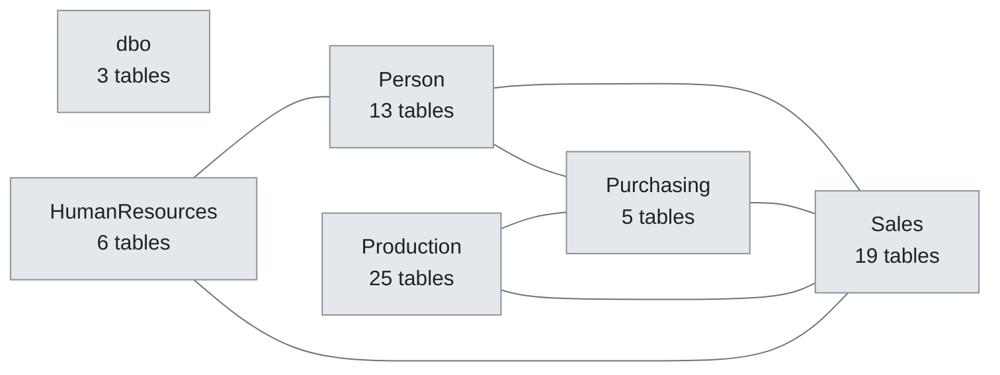

<div style="background:#f4f5f7;color:#1f2328;padding:16px 22px;border-radius:8px;">

# AdventureWorks2025: Data Profile

## At a Glance

<table style="border-collapse:collapse;margin:8px 0;">
<tr><th scope="row" align="left" style="text-align:left;vertical-align:top;white-space:nowrap;font-weight:600;padding:6px 16px 6px 10px;background:#e4e7eb;color:#1f2328;border-bottom:1px solid #d0d4da;">About</th><td style="text-align:left;vertical-align:top;padding:6px 10px;background:#ffffff;color:#1f2328;border-bottom:1px solid #d0d4da;">A sample database for a company that makes and sells bicycles. It covers its products and how they are built, purchases from vendors, sales to individual and reseller customers, and its employees. Orders and stock movements run from April 2022 to October 2025, and employee records go back to 2006. <i>(written by AI)</i></td></tr>
<tr><th scope="row" align="left" style="text-align:left;vertical-align:top;white-space:nowrap;font-weight:600;padding:6px 16px 6px 10px;background:#e4e7eb;color:#1f2328;border-bottom:1px solid #d0d4da;">Source</th><td style="text-align:left;vertical-align:top;padding:6px 10px;background:#ffffff;color:#1f2328;border-bottom:1px solid #d0d4da;">mssql://localhost/AdventureWorks2025 (sqlalchemy)</td></tr>
<tr><th scope="row" align="left" style="text-align:left;vertical-align:top;white-space:nowrap;font-weight:600;padding:6px 16px 6px 10px;background:#e4e7eb;color:#1f2328;border-bottom:1px solid #d0d4da;">Tables</th><td style="text-align:left;vertical-align:top;padding:6px 10px;background:#ffffff;color:#1f2328;border-bottom:1px solid #d0d4da;">71</td></tr>
<tr><th scope="row" align="left" style="text-align:left;vertical-align:top;white-space:nowrap;font-weight:600;padding:6px 16px 6px 10px;background:#e4e7eb;color:#1f2328;border-bottom:1px solid #d0d4da;">Sampled Rows</th><td style="text-align:left;vertical-align:top;padding:6px 10px;background:#ffffff;color:#1f2328;border-bottom:1px solid #d0d4da;">725,407</td></tr>
<tr><th scope="row" align="left" style="text-align:left;vertical-align:top;white-space:nowrap;font-weight:600;padding:6px 16px 6px 10px;background:#e4e7eb;color:#1f2328;border-bottom:1px solid #d0d4da;">Profiled</th><td style="text-align:left;vertical-align:top;padding:6px 10px;background:#ffffff;color:#1f2328;border-bottom:1px solid #d0d4da;">2026-11-22 22:15 UTC</td></tr>
<tr><th scope="row" align="left" style="text-align:left;vertical-align:top;white-space:nowrap;font-weight:600;padding:6px 16px 6px 10px;background:#e4e7eb;color:#1f2328;border-bottom:1px solid #d0d4da;">How to Read</th><td style="text-align:left;vertical-align:top;padding:6px 10px;background:#ffffff;color:#1f2328;border-bottom:1px solid #d0d4da;"><a href="how-to-read.md">How to Read This Wiki</a> · <a href="beam-annotations.md">BEAM✲ Annotations</a></td></tr>
</table>

## Data Stories

<i>A data story describes one table: what the thing is, what one row is, and what to watch out for.</i>

### dbo (3 tables)

<table style="border-collapse:collapse;margin:8px 0;width:100%;">
<tr><th style="padding:6px 10px;border:1px solid #d0d4da;background:#ffffff;color:#1f2328;text-align:left;vertical-align:top;background:#cfd5dd;color:#1f2328;font-weight:600;vertical-align:bottom;">Table</th><th style="padding:6px 10px;border:1px solid #d0d4da;background:#ffffff;color:#1f2328;text-align:left;vertical-align:top;background:#cfd5dd;color:#1f2328;font-weight:600;vertical-align:bottom;">BEAM✲</th><th style="padding:6px 10px;border:1px solid #d0d4da;background:#ffffff;color:#1f2328;text-align:left;vertical-align:top;background:#cfd5dd;color:#1f2328;font-weight:600;vertical-align:bottom;">Grain</th><th style="padding:6px 10px;border:1px solid #d0d4da;background:#ffffff;color:#1f2328;text-align:left;vertical-align:top;background:#cfd5dd;color:#1f2328;font-weight:600;vertical-align:bottom;">Description</th><th style="padding:6px 10px;border:1px solid #d0d4da;background:#ffffff;color:#1f2328;text-align:right;vertical-align:top;background:#cfd5dd;color:#1f2328;font-weight:600;vertical-align:bottom;">Sampled Rows</th><th style="padding:6px 10px;border:1px solid #d0d4da;background:#ffffff;color:#1f2328;text-align:right;vertical-align:top;background:#cfd5dd;color:#1f2328;font-weight:600;vertical-align:bottom;">Columns</th></tr>
<tr><td style="padding:6px 10px;border:1px solid #d0d4da;background:#ffffff;color:#1f2328;text-align:left;vertical-align:top;"><a href="data-stories/dbo-awbuildversion.md" style="color:#0b5cad">dbo.AWBuildVersion</a></td><td style="padding:6px 10px;border:1px solid #d0d4da;background:#ffffff;color:#1f2328;text-align:left;vertical-align:top;"><a href="beam-annotations.md#t-cv" style="color:#0b5cad" title="Current Value: Keeps only the current value of each attribute. Changes overwrite the old value. Also called a type 1 slowly changing dimension.">[CV]</a></td><td style="padding:6px 10px;border:1px solid #d0d4da;background:#ffffff;color:#1f2328;text-align:left;vertical-align:top;">One row for each version of the database that is currently installed; the table holds a single row, so there is one version.</td><td style="padding:6px 10px;border:1px solid #d0d4da;background:#ffffff;color:#1f2328;text-align:left;vertical-align:top;">Current version number of the AdventureWorks 2025 sample database.</td><td style="padding:6px 10px;border:1px solid #d0d4da;background:#ffffff;color:#1f2328;text-align:right;vertical-align:top;">1</td><td style="padding:6px 10px;border:1px solid #d0d4da;background:#ffffff;color:#1f2328;text-align:right;vertical-align:top;">4</td></tr>
<tr><td style="padding:6px 10px;border:1px solid #d0d4da;background:#ffffff;color:#1f2328;text-align:left;vertical-align:top;"><a href="data-stories/dbo-databaselog.md" style="color:#0b5cad">dbo.DatabaseLog</a></td><td style="padding:6px 10px;border:1px solid #d0d4da;background:#ffffff;color:#1f2328;text-align:left;vertical-align:top;"><a href="beam-annotations.md#t-de" style="color:#0b5cad" title="Discrete Event: Something that happens at one moment, or over a short time, and is then finished, e.g. a sale or a payment. Becomes a transaction fact table [TF].">[DE]</a></td><td style="padding:6px 10px;border:1px solid #d0d4da;background:#ffffff;color:#1f2328;text-align:left;vertical-align:top;">One row for each change to the structure of the database (create, alter, drop and similar statements) that the audit trigger recorded, identified by DatabaseLogID.</td><td style="padding:6px 10px;border:1px solid #d0d4da;background:#ffffff;color:#1f2328;text-align:left;vertical-align:top;">Audit table tracking all DDL changes made to the AdventureWorks database. Data is captured by the database trigger ddlDatabaseTriggerLog.</td><td style="padding:6px 10px;border:1px solid #d0d4da;background:#ffffff;color:#1f2328;text-align:right;vertical-align:top;">927</td><td style="padding:6px 10px;border:1px solid #d0d4da;background:#ffffff;color:#1f2328;text-align:right;vertical-align:top;">8</td></tr>
<tr><td style="padding:6px 10px;border:1px solid #d0d4da;background:#ffffff;color:#1f2328;text-align:left;vertical-align:top;"><a href="data-stories/dbo-errorlog.md" style="color:#0b5cad">dbo.ErrorLog</a></td><td style="padding:6px 10px;border:1px solid #d0d4da;background:#ffffff;color:#1f2328;text-align:left;vertical-align:top;"><a href="beam-annotations.md#t-de" style="color:#0b5cad" title="Discrete Event: Something that happens at one moment, or over a short time, and is then finished, e.g. a sale or a payment. Becomes a transaction fact table [TF].">[DE]</a></td><td style="padding:6px 10px;border:1px solid #d0d4da;background:#ffffff;color:#1f2328;text-align:left;vertical-align:top;">One row for each error caught in the database by a CATCH block, according to the system comment; the table has 0 rows, so this grain is not confirmed by any data.</td><td style="padding:6px 10px;border:1px solid #d0d4da;background:#ffffff;color:#1f2328;text-align:left;vertical-align:top;">Audit table tracking errors in the the AdventureWorks database that are caught by the CATCH block of a TRY...CATCH construct. Data is inserted by stored procedure dbo.uspLogError when it is executed from inside the CATCH block of a TRY...CATCH construct.</td><td style="padding:6px 10px;border:1px solid #d0d4da;background:#ffffff;color:#1f2328;text-align:right;vertical-align:top;">0</td><td style="padding:6px 10px;border:1px solid #d0d4da;background:#ffffff;color:#1f2328;text-align:right;vertical-align:top;">9</td></tr>
</table>

### HumanResources (6 tables)

<table style="border-collapse:collapse;margin:8px 0;width:100%;">
<tr><th style="padding:6px 10px;border:1px solid #d0d4da;background:#ffffff;color:#1f2328;text-align:left;vertical-align:top;background:#cfd5dd;color:#1f2328;font-weight:600;vertical-align:bottom;">Table</th><th style="padding:6px 10px;border:1px solid #d0d4da;background:#ffffff;color:#1f2328;text-align:left;vertical-align:top;background:#cfd5dd;color:#1f2328;font-weight:600;vertical-align:bottom;">BEAM✲</th><th style="padding:6px 10px;border:1px solid #d0d4da;background:#ffffff;color:#1f2328;text-align:left;vertical-align:top;background:#cfd5dd;color:#1f2328;font-weight:600;vertical-align:bottom;">Grain</th><th style="padding:6px 10px;border:1px solid #d0d4da;background:#ffffff;color:#1f2328;text-align:left;vertical-align:top;background:#cfd5dd;color:#1f2328;font-weight:600;vertical-align:bottom;">Description</th><th style="padding:6px 10px;border:1px solid #d0d4da;background:#ffffff;color:#1f2328;text-align:right;vertical-align:top;background:#cfd5dd;color:#1f2328;font-weight:600;vertical-align:bottom;">Sampled Rows</th><th style="padding:6px 10px;border:1px solid #d0d4da;background:#ffffff;color:#1f2328;text-align:right;vertical-align:top;background:#cfd5dd;color:#1f2328;font-weight:600;vertical-align:bottom;">Columns</th></tr>
<tr><td style="padding:6px 10px;border:1px solid #d0d4da;background:#ffffff;color:#1f2328;text-align:left;vertical-align:top;"><a href="data-stories/humanresources-department.md" style="color:#0b5cad">HumanResources.Department</a></td><td style="padding:6px 10px;border:1px solid #d0d4da;background:#ffffff;color:#1f2328;text-align:left;vertical-align:top;"><a href="beam-annotations.md#t-cv" style="color:#0b5cad" title="Current Value: Keeps only the current value of each attribute. Changes overwrite the old value. Also called a type 1 slowly changing dimension.">[CV]</a></td><td style="padding:6px 10px;border:1px solid #d0d4da;background:#ffffff;color:#1f2328;text-align:left;vertical-align:top;">One row for each department of the company, placed in one of 6 department groups; DepartmentID and Name are each unique across the 16 rows.</td><td style="padding:6px 10px;border:1px solid #d0d4da;background:#ffffff;color:#1f2328;text-align:left;vertical-align:top;">Lookup table containing the departments within the Adventure Works Cycles company.</td><td style="padding:6px 10px;border:1px solid #d0d4da;background:#ffffff;color:#1f2328;text-align:right;vertical-align:top;">16</td><td style="padding:6px 10px;border:1px solid #d0d4da;background:#ffffff;color:#1f2328;text-align:right;vertical-align:top;">4</td></tr>
<tr><td style="padding:6px 10px;border:1px solid #d0d4da;background:#ffffff;color:#1f2328;text-align:left;vertical-align:top;"><a href="data-stories/humanresources-employee.md" style="color:#0b5cad">HumanResources.Employee</a></td><td style="padding:6px 10px;border:1px solid #d0d4da;background:#ffffff;color:#1f2328;text-align:left;vertical-align:top;"><a href="beam-annotations.md#t-cv" style="color:#0b5cad" title="Current Value: Keeps only the current value of each attribute. Changes overwrite the old value. Also called a type 1 slowly changing dimension.">[CV]</a></td><td style="padding:6px 10px;border:1px solid #d0d4da;background:#ffffff;color:#1f2328;text-align:left;vertical-align:top;">One row for each person who works or has worked for the company as an employee; BusinessEntityID is unique across the 290 rows, and NationalIDNumber, LoginID and OrganizationNode are each unique too.</td><td style="padding:6px 10px;border:1px solid #d0d4da;background:#ffffff;color:#1f2328;text-align:left;vertical-align:top;">Employee information such as salary, department, and title.</td><td style="padding:6px 10px;border:1px solid #d0d4da;background:#ffffff;color:#1f2328;text-align:right;vertical-align:top;">290</td><td style="padding:6px 10px;border:1px solid #d0d4da;background:#ffffff;color:#1f2328;text-align:right;vertical-align:top;">16</td></tr>
<tr><td style="padding:6px 10px;border:1px solid #d0d4da;background:#ffffff;color:#1f2328;text-align:left;vertical-align:top;"><a href="data-stories/humanresources-employeedepartmenthistory.md" style="color:#0b5cad">HumanResources.EmployeeDepartmentHistory</a></td><td style="padding:6px 10px;border:1px solid #d0d4da;background:#ffffff;color:#1f2328;text-align:left;vertical-align:top;"><a href="beam-annotations.md#t-hv" style="color:#0b5cad" title="Historic Value: Keeps history for at least one attribute, so a change adds a new version of the row. Also called a type 2 slowly changing dimension.">[HV]</a></td><td style="padding:6px 10px;border:1px solid #d0d4da;background:#ffffff;color:#1f2328;text-align:left;vertical-align:top;">One row for each period in which an employee works in a department on a shift, from a start date to an end date that is empty while the assignment lasts. BusinessEntityID with StartDate is unique (and BusinessEntityID with DepartmentID too).</td><td style="padding:6px 10px;border:1px solid #d0d4da;background:#ffffff;color:#1f2328;text-align:left;vertical-align:top;">Employee department transfers.</td><td style="padding:6px 10px;border:1px solid #d0d4da;background:#ffffff;color:#1f2328;text-align:right;vertical-align:top;">296</td><td style="padding:6px 10px;border:1px solid #d0d4da;background:#ffffff;color:#1f2328;text-align:right;vertical-align:top;">6</td></tr>
<tr><td style="padding:6px 10px;border:1px solid #d0d4da;background:#ffffff;color:#1f2328;text-align:left;vertical-align:top;"><a href="data-stories/humanresources-employeepayhistory.md" style="color:#0b5cad">HumanResources.EmployeePayHistory</a></td><td style="padding:6px 10px;border:1px solid #d0d4da;background:#ffffff;color:#1f2328;text-align:left;vertical-align:top;"><a href="beam-annotations.md#t-de" style="color:#0b5cad" title="Discrete Event: Something that happens at one moment, or over a short time, and is then finished, e.g. a sale or a payment. Becomes a transaction fact table [TF].">[DE]</a></td><td style="padding:6px 10px;border:1px solid #d0d4da;background:#ffffff;color:#1f2328;text-align:left;vertical-align:top;">One row for each change of pay rate that takes effect for an employee on a date. BusinessEntityID with RateChangeDate is unique.</td><td style="padding:6px 10px;border:1px solid #d0d4da;background:#ffffff;color:#1f2328;text-align:left;vertical-align:top;">Employee pay history.</td><td style="padding:6px 10px;border:1px solid #d0d4da;background:#ffffff;color:#1f2328;text-align:right;vertical-align:top;">316</td><td style="padding:6px 10px;border:1px solid #d0d4da;background:#ffffff;color:#1f2328;text-align:right;vertical-align:top;">5</td></tr>
<tr><td style="padding:6px 10px;border:1px solid #d0d4da;background:#ffffff;color:#1f2328;text-align:left;vertical-align:top;"><a href="data-stories/humanresources-jobcandidate.md" style="color:#0b5cad">HumanResources.JobCandidate</a></td><td style="padding:6px 10px;border:1px solid #d0d4da;background:#ffffff;color:#1f2328;text-align:left;vertical-align:top;"><a href="beam-annotations.md#t-cv" style="color:#0b5cad" title="Current Value: Keeps only the current value of each attribute. Changes overwrite the old value. Also called a type 1 slowly changing dimension.">[CV]</a></td><td style="padding:6px 10px;border:1px solid #d0d4da;background:#ffffff;color:#1f2328;text-align:left;vertical-align:top;">One row for each résumé submitted by a job applicant; JobCandidateID is unique across the 13 rows, and the employee link is filled only for the 2 applicants who were hired.</td><td style="padding:6px 10px;border:1px solid #d0d4da;background:#ffffff;color:#1f2328;text-align:left;vertical-align:top;">Résumés submitted to Human Resources by job applicants.</td><td style="padding:6px 10px;border:1px solid #d0d4da;background:#ffffff;color:#1f2328;text-align:right;vertical-align:top;">13</td><td style="padding:6px 10px;border:1px solid #d0d4da;background:#ffffff;color:#1f2328;text-align:right;vertical-align:top;">4</td></tr>
<tr><td style="padding:6px 10px;border:1px solid #d0d4da;background:#ffffff;color:#1f2328;text-align:left;vertical-align:top;"><a href="data-stories/humanresources-shift.md" style="color:#0b5cad">HumanResources.Shift</a></td><td style="padding:6px 10px;border:1px solid #d0d4da;background:#ffffff;color:#1f2328;text-align:left;vertical-align:top;"><a href="beam-annotations.md#t-cv" style="color:#0b5cad" title="Current Value: Keeps only the current value of each attribute. Changes overwrite the old value. Also called a type 1 slowly changing dimension.">[CV]</a></td><td style="padding:6px 10px;border:1px solid #d0d4da;background:#ffffff;color:#1f2328;text-align:left;vertical-align:top;">One row for each work shift in the day (day, evening and night), with its start and end time; ShiftID, Name, StartTime and EndTime are each unique across the 3 rows.</td><td style="padding:6px 10px;border:1px solid #d0d4da;background:#ffffff;color:#1f2328;text-align:left;vertical-align:top;">Work shift lookup table.</td><td style="padding:6px 10px;border:1px solid #d0d4da;background:#ffffff;color:#1f2328;text-align:right;vertical-align:top;">3</td><td style="padding:6px 10px;border:1px solid #d0d4da;background:#ffffff;color:#1f2328;text-align:right;vertical-align:top;">5</td></tr>
</table>

### Person (13 tables)

<table style="border-collapse:collapse;margin:8px 0;width:100%;">
<tr><th style="padding:6px 10px;border:1px solid #d0d4da;background:#ffffff;color:#1f2328;text-align:left;vertical-align:top;background:#cfd5dd;color:#1f2328;font-weight:600;vertical-align:bottom;">Table</th><th style="padding:6px 10px;border:1px solid #d0d4da;background:#ffffff;color:#1f2328;text-align:left;vertical-align:top;background:#cfd5dd;color:#1f2328;font-weight:600;vertical-align:bottom;">BEAM✲</th><th style="padding:6px 10px;border:1px solid #d0d4da;background:#ffffff;color:#1f2328;text-align:left;vertical-align:top;background:#cfd5dd;color:#1f2328;font-weight:600;vertical-align:bottom;">Grain</th><th style="padding:6px 10px;border:1px solid #d0d4da;background:#ffffff;color:#1f2328;text-align:left;vertical-align:top;background:#cfd5dd;color:#1f2328;font-weight:600;vertical-align:bottom;">Description</th><th style="padding:6px 10px;border:1px solid #d0d4da;background:#ffffff;color:#1f2328;text-align:right;vertical-align:top;background:#cfd5dd;color:#1f2328;font-weight:600;vertical-align:bottom;">Sampled Rows</th><th style="padding:6px 10px;border:1px solid #d0d4da;background:#ffffff;color:#1f2328;text-align:right;vertical-align:top;background:#cfd5dd;color:#1f2328;font-weight:600;vertical-align:bottom;">Columns</th></tr>
<tr><td style="padding:6px 10px;border:1px solid #d0d4da;background:#ffffff;color:#1f2328;text-align:left;vertical-align:top;"><a href="data-stories/person-address.md" style="color:#0b5cad">Person.Address</a></td><td style="padding:6px 10px;border:1px solid #d0d4da;background:#ffffff;color:#1f2328;text-align:left;vertical-align:top;"><a href="beam-annotations.md#t-rp" style="color:#0b5cad" title="Role-Playing: One dimension used in several roles, e.g. Employee as both salesperson and manager. Calendar is the most common one.">[RP]</a></td><td style="padding:6px 10px;border:1px solid #d0d4da;background:#ffffff;color:#1f2328;text-align:left;vertical-align:top;">One row for each street address that is stored once and shared by whatever customer, employee or vendor uses it. AddressID alone pins a row, and every address is used by exactly one entity row.</td><td style="padding:6px 10px;border:1px solid #d0d4da;background:#ffffff;color:#1f2328;text-align:left;vertical-align:top;">Street address information for customers, employees, and vendors.</td><td style="padding:6px 10px;border:1px solid #d0d4da;background:#ffffff;color:#1f2328;text-align:right;vertical-align:top;">19,614</td><td style="padding:6px 10px;border:1px solid #d0d4da;background:#ffffff;color:#1f2328;text-align:right;vertical-align:top;">9</td></tr>
<tr><td style="padding:6px 10px;border:1px solid #d0d4da;background:#ffffff;color:#1f2328;text-align:left;vertical-align:top;"><a href="data-stories/person-addresstype.md" style="color:#0b5cad">Person.AddressType</a></td><td style="padding:6px 10px;border:1px solid #d0d4da;background:#ffffff;color:#1f2328;text-align:left;vertical-align:top;"><a href="beam-annotations.md#t-cv" style="color:#0b5cad" title="Current Value: Keeps only the current value of each attribute. Changes overwrite the old value. Also called a type 1 slowly changing dimension.">[CV]</a></td><td style="padding:6px 10px;border:1px solid #d0d4da;background:#ffffff;color:#1f2328;text-align:left;vertical-align:top;">One row for each kind of address an address can be filed under, such as billing, home or shipping; AddressTypeID and Name are each unique across the 6 rows.</td><td style="padding:6px 10px;border:1px solid #d0d4da;background:#ffffff;color:#1f2328;text-align:left;vertical-align:top;">Types of addresses stored in the Address table.</td><td style="padding:6px 10px;border:1px solid #d0d4da;background:#ffffff;color:#1f2328;text-align:right;vertical-align:top;">6</td><td style="padding:6px 10px;border:1px solid #d0d4da;background:#ffffff;color:#1f2328;text-align:right;vertical-align:top;">4</td></tr>
<tr><td style="padding:6px 10px;border:1px solid #d0d4da;background:#ffffff;color:#1f2328;text-align:left;vertical-align:top;"><a href="data-stories/person-businessentity.md" style="color:#0b5cad">Person.BusinessEntity</a></td><td style="padding:6px 10px;border:1px solid #d0d4da;background:#ffffff;color:#1f2328;text-align:left;vertical-align:top;"><a href="beam-annotations.md#t-cv" style="color:#0b5cad" title="Current Value: Keeps only the current value of each attribute. Changes overwrite the old value. Also called a type 1 slowly changing dimension.">[CV]</a></td><td style="padding:6px 10px;border:1px solid #d0d4da;background:#ffffff;color:#1f2328;text-align:left;vertical-align:top;">One row for each customer, vendor, store or employee identity that is given an ID; BusinessEntityID alone pins a row, and the IDs are consecutive from 1 to 20,777.</td><td style="padding:6px 10px;border:1px solid #d0d4da;background:#ffffff;color:#1f2328;text-align:left;vertical-align:top;">Source of the ID that connects vendors, customers, and employees with address and contact information.</td><td style="padding:6px 10px;border:1px solid #d0d4da;background:#ffffff;color:#1f2328;text-align:right;vertical-align:top;">20,777</td><td style="padding:6px 10px;border:1px solid #d0d4da;background:#ffffff;color:#1f2328;text-align:right;vertical-align:top;">3</td></tr>
<tr><td style="padding:6px 10px;border:1px solid #d0d4da;background:#ffffff;color:#1f2328;text-align:left;vertical-align:top;"><a href="data-stories/person-businessentityaddress.md" style="color:#0b5cad">Person.BusinessEntityAddress</a></td><td style="padding:6px 10px;border:1px solid #d0d4da;background:#ffffff;color:#1f2328;text-align:left;vertical-align:top;"><a href="beam-annotations.md#t-mv" style="color:#0b5cad" title="Multi-Valued: A bridge table that links a fact to several values of a dimension at once (many-to-many), often with a weighting factor.">[MV]</a></td><td style="padding:6px 10px;border:1px solid #d0d4da;background:#ffffff;color:#1f2328;text-align:left;vertical-align:top;">One row for each address that belongs to a person, store or vendor, filed under an address type. An entity has at most one address of each type (BusinessEntityID with AddressTypeID is unique), and each address appears once.</td><td style="padding:6px 10px;border:1px solid #d0d4da;background:#ffffff;color:#1f2328;text-align:left;vertical-align:top;">Cross-reference table mapping customers, vendors, and employees to their addresses.</td><td style="padding:6px 10px;border:1px solid #d0d4da;background:#ffffff;color:#1f2328;text-align:right;vertical-align:top;">19,614</td><td style="padding:6px 10px;border:1px solid #d0d4da;background:#ffffff;color:#1f2328;text-align:right;vertical-align:top;">5</td></tr>
<tr><td style="padding:6px 10px;border:1px solid #d0d4da;background:#ffffff;color:#1f2328;text-align:left;vertical-align:top;"><a href="data-stories/person-businessentitycontact.md" style="color:#0b5cad">Person.BusinessEntityContact</a></td><td style="padding:6px 10px;border:1px solid #d0d4da;background:#ffffff;color:#1f2328;text-align:left;vertical-align:top;"><a href="beam-annotations.md#t-mv" style="color:#0b5cad" title="Multi-Valued: A bridge table that links a fact to several values of a dimension at once (many-to-many), often with a weighting factor.">[MV]</a></td><td style="padding:6px 10px;border:1px solid #d0d4da;background:#ffffff;color:#1f2328;text-align:left;vertical-align:top;">One row for each person who is a contact of a store or vendor, in one contact role. PersonID alone is unique, and BusinessEntityID with ContactTypeID is unique, so a contact person appears once and an entity has at most one contact per role.</td><td style="padding:6px 10px;border:1px solid #d0d4da;background:#ffffff;color:#1f2328;text-align:left;vertical-align:top;">Cross-reference table mapping stores, vendors, and employees to people</td><td style="padding:6px 10px;border:1px solid #d0d4da;background:#ffffff;color:#1f2328;text-align:right;vertical-align:top;">909</td><td style="padding:6px 10px;border:1px solid #d0d4da;background:#ffffff;color:#1f2328;text-align:right;vertical-align:top;">5</td></tr>
<tr><td style="padding:6px 10px;border:1px solid #d0d4da;background:#ffffff;color:#1f2328;text-align:left;vertical-align:top;"><a href="data-stories/person-contacttype.md" style="color:#0b5cad">Person.ContactType</a></td><td style="padding:6px 10px;border:1px solid #d0d4da;background:#ffffff;color:#1f2328;text-align:left;vertical-align:top;"><a href="beam-annotations.md#t-cv" style="color:#0b5cad" title="Current Value: Keeps only the current value of each attribute. Changes overwrite the old value. Also called a type 1 slowly changing dimension.">[CV]</a></td><td style="padding:6px 10px;border:1px solid #d0d4da;background:#ffffff;color:#1f2328;text-align:left;vertical-align:top;">One row for each job-like role a contact person can have at a store or vendor (for example Accounting Manager); ContactTypeID and Name are each unique across the 20 rows.</td><td style="padding:6px 10px;border:1px solid #d0d4da;background:#ffffff;color:#1f2328;text-align:left;vertical-align:top;">Lookup table containing the types of business entity contacts.</td><td style="padding:6px 10px;border:1px solid #d0d4da;background:#ffffff;color:#1f2328;text-align:right;vertical-align:top;">20</td><td style="padding:6px 10px;border:1px solid #d0d4da;background:#ffffff;color:#1f2328;text-align:right;vertical-align:top;">3</td></tr>
<tr><td style="padding:6px 10px;border:1px solid #d0d4da;background:#ffffff;color:#1f2328;text-align:left;vertical-align:top;"><a href="data-stories/person-countryregion.md" style="color:#0b5cad">Person.CountryRegion</a></td><td style="padding:6px 10px;border:1px solid #d0d4da;background:#ffffff;color:#1f2328;text-align:left;vertical-align:top;"><a href="beam-annotations.md#t-cv" style="color:#0b5cad" title="Current Value: Keeps only the current value of each attribute. Changes overwrite the old value. Also called a type 1 slowly changing dimension.">[CV]</a></td><td style="padding:6px 10px;border:1px solid #d0d4da;background:#ffffff;color:#1f2328;text-align:left;vertical-align:top;">One row for each country or region with an ISO code; CountryRegionCode and Name are each unique across the 238 rows.</td><td style="padding:6px 10px;border:1px solid #d0d4da;background:#ffffff;color:#1f2328;text-align:left;vertical-align:top;">Lookup table containing the ISO standard codes for countries and regions.</td><td style="padding:6px 10px;border:1px solid #d0d4da;background:#ffffff;color:#1f2328;text-align:right;vertical-align:top;">238</td><td style="padding:6px 10px;border:1px solid #d0d4da;background:#ffffff;color:#1f2328;text-align:right;vertical-align:top;">3</td></tr>
<tr><td style="padding:6px 10px;border:1px solid #d0d4da;background:#ffffff;color:#1f2328;text-align:left;vertical-align:top;"><a href="data-stories/person-emailaddress.md" style="color:#0b5cad">Person.EmailAddress</a></td><td style="padding:6px 10px;border:1px solid #d0d4da;background:#ffffff;color:#1f2328;text-align:left;vertical-align:top;"><a href="beam-annotations.md#t-cv" style="color:#0b5cad" title="Current Value: Keeps only the current value of each attribute. Changes overwrite the old value. Also called a type 1 slowly changing dimension.">[CV]</a></td><td style="padding:6px 10px;border:1px solid #d0d4da;background:#ffffff;color:#1f2328;text-align:left;vertical-align:top;">One row for each person, holding that person's one email address. BusinessEntityID, EmailAddressID and EmailAddress are each unique across the 19,972 rows, so no person has two.</td><td style="padding:6px 10px;border:1px solid #d0d4da;background:#ffffff;color:#1f2328;text-align:left;vertical-align:top;">Where to send a person email.</td><td style="padding:6px 10px;border:1px solid #d0d4da;background:#ffffff;color:#1f2328;text-align:right;vertical-align:top;">19,972</td><td style="padding:6px 10px;border:1px solid #d0d4da;background:#ffffff;color:#1f2328;text-align:right;vertical-align:top;">5</td></tr>
<tr><td style="padding:6px 10px;border:1px solid #d0d4da;background:#ffffff;color:#1f2328;text-align:left;vertical-align:top;"><a href="data-stories/person-password.md" style="color:#0b5cad">Person.Password</a></td><td style="padding:6px 10px;border:1px solid #d0d4da;background:#ffffff;color:#1f2328;text-align:left;vertical-align:top;"><a href="beam-annotations.md#t-cv" style="color:#0b5cad" title="Current Value: Keeps only the current value of each attribute. Changes overwrite the old value. Also called a type 1 slowly changing dimension.">[CV]</a></td><td style="padding:6px 10px;border:1px solid #d0d4da;background:#ffffff;color:#1f2328;text-align:left;vertical-align:top;">One row for each person who has a stored login credential: a hashed password and its salt. BusinessEntityID is unique across the 19,972 rows and matches every person.</td><td style="padding:6px 10px;border:1px solid #d0d4da;background:#ffffff;color:#1f2328;text-align:left;vertical-align:top;">One way hashed authentication information</td><td style="padding:6px 10px;border:1px solid #d0d4da;background:#ffffff;color:#1f2328;text-align:right;vertical-align:top;">19,972</td><td style="padding:6px 10px;border:1px solid #d0d4da;background:#ffffff;color:#1f2328;text-align:right;vertical-align:top;">5</td></tr>
<tr><td style="padding:6px 10px;border:1px solid #d0d4da;background:#ffffff;color:#1f2328;text-align:left;vertical-align:top;"><a href="data-stories/person-person.md" style="color:#0b5cad">Person.Person</a></td><td style="padding:6px 10px;border:1px solid #d0d4da;background:#ffffff;color:#1f2328;text-align:left;vertical-align:top;"><a href="beam-annotations.md#t-cv" style="color:#0b5cad" title="Current Value: Keeps only the current value of each attribute. Changes overwrite the old value. Also called a type 1 slowly changing dimension.">[CV]</a></td><td style="padding:6px 10px;border:1px solid #d0d4da;background:#ffffff;color:#1f2328;text-align:left;vertical-align:top;">One row for each person known to the company, whether customer, employee, store contact, vendor contact or general contact. BusinessEntityID alone pins a row, and PersonType says which kind of person it is.</td><td style="padding:6px 10px;border:1px solid #d0d4da;background:#ffffff;color:#1f2328;text-align:left;vertical-align:top;">Human beings involved with AdventureWorks: employees, customer contacts, and vendor contacts.</td><td style="padding:6px 10px;border:1px solid #d0d4da;background:#ffffff;color:#1f2328;text-align:right;vertical-align:top;">19,972</td><td style="padding:6px 10px;border:1px solid #d0d4da;background:#ffffff;color:#1f2328;text-align:right;vertical-align:top;">13</td></tr>
<tr><td style="padding:6px 10px;border:1px solid #d0d4da;background:#ffffff;color:#1f2328;text-align:left;vertical-align:top;"><a href="data-stories/person-personphone.md" style="color:#0b5cad">Person.PersonPhone</a></td><td style="padding:6px 10px;border:1px solid #d0d4da;background:#ffffff;color:#1f2328;text-align:left;vertical-align:top;"><a href="beam-annotations.md#t-cv" style="color:#0b5cad" title="Current Value: Keeps only the current value of each attribute. Changes overwrite the old value. Also called a type 1 slowly changing dimension.">[CV]</a></td><td style="padding:6px 10px;border:1px solid #d0d4da;background:#ffffff;color:#1f2328;text-align:left;vertical-align:top;">One row for each person, holding the one phone number and its type that is stored for that person. BusinessEntityID is unique alone, although the declared key also includes PhoneNumber and PhoneNumberTypeID.</td><td style="padding:6px 10px;border:1px solid #d0d4da;background:#ffffff;color:#1f2328;text-align:left;vertical-align:top;">Telephone number and type of a person.</td><td style="padding:6px 10px;border:1px solid #d0d4da;background:#ffffff;color:#1f2328;text-align:right;vertical-align:top;">19,972</td><td style="padding:6px 10px;border:1px solid #d0d4da;background:#ffffff;color:#1f2328;text-align:right;vertical-align:top;">4</td></tr>
<tr><td style="padding:6px 10px;border:1px solid #d0d4da;background:#ffffff;color:#1f2328;text-align:left;vertical-align:top;"><a href="data-stories/person-phonenumbertype.md" style="color:#0b5cad">Person.PhoneNumberType</a></td><td style="padding:6px 10px;border:1px solid #d0d4da;background:#ffffff;color:#1f2328;text-align:left;vertical-align:top;"><a href="beam-annotations.md#t-cv" style="color:#0b5cad" title="Current Value: Keeps only the current value of each attribute. Changes overwrite the old value. Also called a type 1 slowly changing dimension.">[CV]</a></td><td style="padding:6px 10px;border:1px solid #d0d4da;background:#ffffff;color:#1f2328;text-align:left;vertical-align:top;">One row for each kind of phone number a person can have (Cell, Home or Work); PhoneNumberTypeID and Name are each unique across the 3 rows.</td><td style="padding:6px 10px;border:1px solid #d0d4da;background:#ffffff;color:#1f2328;text-align:left;vertical-align:top;">Type of phone number of a person.</td><td style="padding:6px 10px;border:1px solid #d0d4da;background:#ffffff;color:#1f2328;text-align:right;vertical-align:top;">3</td><td style="padding:6px 10px;border:1px solid #d0d4da;background:#ffffff;color:#1f2328;text-align:right;vertical-align:top;">3</td></tr>
<tr><td style="padding:6px 10px;border:1px solid #d0d4da;background:#ffffff;color:#1f2328;text-align:left;vertical-align:top;"><a href="data-stories/person-stateprovince.md" style="color:#0b5cad">Person.StateProvince</a></td><td style="padding:6px 10px;border:1px solid #d0d4da;background:#ffffff;color:#1f2328;text-align:left;vertical-align:top;"><a href="beam-annotations.md#t-cv" style="color:#0b5cad" title="Current Value: Keeps only the current value of each attribute. Changes overwrite the old value. Also called a type 1 slowly changing dimension.">[CV]</a></td><td style="padding:6px 10px;border:1px solid #d0d4da;background:#ffffff;color:#1f2328;text-align:left;vertical-align:top;">One row for each state, province or similar first-level region of a country, within a sales territory. StateProvinceID, StateProvinceCode and Name are each unique across the 181 rows.</td><td style="padding:6px 10px;border:1px solid #d0d4da;background:#ffffff;color:#1f2328;text-align:left;vertical-align:top;">State and province lookup table.</td><td style="padding:6px 10px;border:1px solid #d0d4da;background:#ffffff;color:#1f2328;text-align:right;vertical-align:top;">181</td><td style="padding:6px 10px;border:1px solid #d0d4da;background:#ffffff;color:#1f2328;text-align:right;vertical-align:top;">8</td></tr>
</table>

### Production (25 tables)

<table style="border-collapse:collapse;margin:8px 0;width:100%;">
<tr><th style="padding:6px 10px;border:1px solid #d0d4da;background:#ffffff;color:#1f2328;text-align:left;vertical-align:top;background:#cfd5dd;color:#1f2328;font-weight:600;vertical-align:bottom;">Table</th><th style="padding:6px 10px;border:1px solid #d0d4da;background:#ffffff;color:#1f2328;text-align:left;vertical-align:top;background:#cfd5dd;color:#1f2328;font-weight:600;vertical-align:bottom;">BEAM✲</th><th style="padding:6px 10px;border:1px solid #d0d4da;background:#ffffff;color:#1f2328;text-align:left;vertical-align:top;background:#cfd5dd;color:#1f2328;font-weight:600;vertical-align:bottom;">Grain</th><th style="padding:6px 10px;border:1px solid #d0d4da;background:#ffffff;color:#1f2328;text-align:left;vertical-align:top;background:#cfd5dd;color:#1f2328;font-weight:600;vertical-align:bottom;">Description</th><th style="padding:6px 10px;border:1px solid #d0d4da;background:#ffffff;color:#1f2328;text-align:right;vertical-align:top;background:#cfd5dd;color:#1f2328;font-weight:600;vertical-align:bottom;">Sampled Rows</th><th style="padding:6px 10px;border:1px solid #d0d4da;background:#ffffff;color:#1f2328;text-align:right;vertical-align:top;background:#cfd5dd;color:#1f2328;font-weight:600;vertical-align:bottom;">Columns</th></tr>
<tr><td style="padding:6px 10px;border:1px solid #d0d4da;background:#ffffff;color:#1f2328;text-align:left;vertical-align:top;"><a href="data-stories/production-billofmaterials.md" style="color:#0b5cad">Production.BillOfMaterials</a></td><td style="padding:6px 10px;border:1px solid #d0d4da;background:#ffffff;color:#1f2328;text-align:left;vertical-align:top;"><a href="beam-annotations.md#t-hm" style="color:#0b5cad" title="Hierarchy Map: A helper table for a hierarchy of varying depth, e.g. a company structure.">[HM]</a></td><td style="padding:6px 10px;border:1px solid #d0d4da;background:#ffffff;color:#1f2328;text-align:left;vertical-align:top;">One row for each use of a component product in a parent assembly product from a start date onward. BillOfMaterialsID identifies a row, and the assembly, the component and the start date are also unique together.</td><td style="padding:6px 10px;border:1px solid #d0d4da;background:#ffffff;color:#1f2328;text-align:left;vertical-align:top;">Items required to make bicycles and bicycle subassemblies. It identifies the heirarchical relationship between a parent product and its components.</td><td style="padding:6px 10px;border:1px solid #d0d4da;background:#ffffff;color:#1f2328;text-align:right;vertical-align:top;">2,679</td><td style="padding:6px 10px;border:1px solid #d0d4da;background:#ffffff;color:#1f2328;text-align:right;vertical-align:top;">9</td></tr>
<tr><td style="padding:6px 10px;border:1px solid #d0d4da;background:#ffffff;color:#1f2328;text-align:left;vertical-align:top;"><a href="data-stories/production-culture.md" style="color:#0b5cad">Production.Culture</a></td><td style="padding:6px 10px;border:1px solid #d0d4da;background:#ffffff;color:#1f2328;text-align:left;vertical-align:top;"><a href="beam-annotations.md#t-cv" style="color:#0b5cad" title="Current Value: Keeps only the current value of each attribute. Changes overwrite the old value. Also called a type 1 slowly changing dimension.">[CV]</a></td><td style="padding:6px 10px;border:1px solid #d0d4da;background:#ffffff;color:#1f2328;text-align:left;vertical-align:top;">One row for each language (culture) in which some data is stored, identified by CultureID, plus one row for an invariant culture. Name is also unique.</td><td style="padding:6px 10px;border:1px solid #d0d4da;background:#ffffff;color:#1f2328;text-align:left;vertical-align:top;">Lookup table containing the languages in which some AdventureWorks data is stored.</td><td style="padding:6px 10px;border:1px solid #d0d4da;background:#ffffff;color:#1f2328;text-align:right;vertical-align:top;">8</td><td style="padding:6px 10px;border:1px solid #d0d4da;background:#ffffff;color:#1f2328;text-align:right;vertical-align:top;">3</td></tr>
<tr><td style="padding:6px 10px;border:1px solid #d0d4da;background:#ffffff;color:#1f2328;text-align:left;vertical-align:top;"><a href="data-stories/production-document.md" style="color:#0b5cad">Production.Document</a></td><td style="padding:6px 10px;border:1px solid #d0d4da;background:#ffffff;color:#1f2328;text-align:left;vertical-align:top;"><a href="beam-annotations.md#t-ml" style="color:#0b5cad" title="Multi-Level: A dimension that also has members for higher levels of its hierarchy, so facts can attach at different levels, e.g. an employee or a whole team.">[ML]</a></td><td style="padding:6px 10px;border:1px solid #d0d4da;background:#ffffff;color:#1f2328;text-align:left;vertical-align:top;">One row for each folder or document in the product maintenance document tree, identified by DocumentNode, the path that shows where it sits in the tree. Title, FileName and rowguid are also unique.</td><td style="padding:6px 10px;border:1px solid #d0d4da;background:#ffffff;color:#1f2328;text-align:left;vertical-align:top;">Product maintenance documents.</td><td style="padding:6px 10px;border:1px solid #d0d4da;background:#ffffff;color:#1f2328;text-align:right;vertical-align:top;">12</td><td style="padding:6px 10px;border:1px solid #d0d4da;background:#ffffff;color:#1f2328;text-align:right;vertical-align:top;">14</td></tr>
<tr><td style="padding:6px 10px;border:1px solid #d0d4da;background:#ffffff;color:#1f2328;text-align:left;vertical-align:top;"><a href="data-stories/production-illustration.md" style="color:#0b5cad">Production.Illustration</a></td><td style="padding:6px 10px;border:1px solid #d0d4da;background:#ffffff;color:#1f2328;text-align:left;vertical-align:top;"><a href="beam-annotations.md#t-cv" style="color:#0b5cad" title="Current Value: Keeps only the current value of each attribute. Changes overwrite the old value. Also called a type 1 slowly changing dimension.">[CV]</a></td><td style="padding:6px 10px;border:1px solid #d0d4da;background:#ffffff;color:#1f2328;text-align:left;vertical-align:top;">One row for each bicycle assembly diagram, identified by IllustrationID; the diagram itself is stored as XML.</td><td style="padding:6px 10px;border:1px solid #d0d4da;background:#ffffff;color:#1f2328;text-align:left;vertical-align:top;">Bicycle assembly diagrams.</td><td style="padding:6px 10px;border:1px solid #d0d4da;background:#ffffff;color:#1f2328;text-align:right;vertical-align:top;">5</td><td style="padding:6px 10px;border:1px solid #d0d4da;background:#ffffff;color:#1f2328;text-align:right;vertical-align:top;">3</td></tr>
<tr><td style="padding:6px 10px;border:1px solid #d0d4da;background:#ffffff;color:#1f2328;text-align:left;vertical-align:top;"><a href="data-stories/production-location.md" style="color:#0b5cad">Production.Location</a></td><td style="padding:6px 10px;border:1px solid #d0d4da;background:#ffffff;color:#1f2328;text-align:left;vertical-align:top;"><a href="beam-annotations.md#t-cv" style="color:#0b5cad" title="Current Value: Keeps only the current value of each attribute. Changes overwrite the old value. Also called a type 1 slowly changing dimension.">[CV]</a></td><td style="padding:6px 10px;border:1px solid #d0d4da;background:#ffffff;color:#1f2328;text-align:left;vertical-align:top;">One row for each place where products are stored or manufactured, identified by LocationID (Name is also unique).</td><td style="padding:6px 10px;border:1px solid #d0d4da;background:#ffffff;color:#1f2328;text-align:left;vertical-align:top;">Product inventory and manufacturing locations.</td><td style="padding:6px 10px;border:1px solid #d0d4da;background:#ffffff;color:#1f2328;text-align:right;vertical-align:top;">14</td><td style="padding:6px 10px;border:1px solid #d0d4da;background:#ffffff;color:#1f2328;text-align:right;vertical-align:top;">5</td></tr>
<tr><td style="padding:6px 10px;border:1px solid #d0d4da;background:#ffffff;color:#1f2328;text-align:left;vertical-align:top;"><a href="data-stories/production-product.md" style="color:#0b5cad">Production.Product</a></td><td style="padding:6px 10px;border:1px solid #d0d4da;background:#ffffff;color:#1f2328;text-align:left;vertical-align:top;"><a href="beam-annotations.md#t-cv" style="color:#0b5cad" title="Current Value: Keeps only the current value of each attribute. Changes overwrite the old value. Also called a type 1 slowly changing dimension.">[CV]</a></td><td style="padding:6px 10px;border:1px solid #d0d4da;background:#ffffff;color:#1f2328;text-align:left;vertical-align:top;">One row for each product, whether it is bought, made in-house or sold, identified by ProductID. ProductNumber, Name and rowguid are also unique and map one-to-one to ProductID.</td><td style="padding:6px 10px;border:1px solid #d0d4da;background:#ffffff;color:#1f2328;text-align:left;vertical-align:top;">Products sold or used in the manfacturing of sold products.</td><td style="padding:6px 10px;border:1px solid #d0d4da;background:#ffffff;color:#1f2328;text-align:right;vertical-align:top;">504</td><td style="padding:6px 10px;border:1px solid #d0d4da;background:#ffffff;color:#1f2328;text-align:right;vertical-align:top;">25</td></tr>
<tr><td style="padding:6px 10px;border:1px solid #d0d4da;background:#ffffff;color:#1f2328;text-align:left;vertical-align:top;"><a href="data-stories/production-productcategory.md" style="color:#0b5cad">Production.ProductCategory</a></td><td style="padding:6px 10px;border:1px solid #d0d4da;background:#ffffff;color:#1f2328;text-align:left;vertical-align:top;"><a href="beam-annotations.md#t-cv" style="color:#0b5cad" title="Current Value: Keeps only the current value of each attribute. Changes overwrite the old value. Also called a type 1 slowly changing dimension.">[CV]</a></td><td style="padding:6px 10px;border:1px solid #d0d4da;background:#ffffff;color:#1f2328;text-align:left;vertical-align:top;">One row for each top-level product category, identified by ProductCategoryID (Name and rowguid are also unique).</td><td style="padding:6px 10px;border:1px solid #d0d4da;background:#ffffff;color:#1f2328;text-align:left;vertical-align:top;">High-level product categorization.</td><td style="padding:6px 10px;border:1px solid #d0d4da;background:#ffffff;color:#1f2328;text-align:right;vertical-align:top;">4</td><td style="padding:6px 10px;border:1px solid #d0d4da;background:#ffffff;color:#1f2328;text-align:right;vertical-align:top;">4</td></tr>
<tr><td style="padding:6px 10px;border:1px solid #d0d4da;background:#ffffff;color:#1f2328;text-align:left;vertical-align:top;"><a href="data-stories/production-productcosthistory.md" style="color:#0b5cad">Production.ProductCostHistory</a></td><td style="padding:6px 10px;border:1px solid #d0d4da;background:#ffffff;color:#1f2328;text-align:left;vertical-align:top;"><a href="beam-annotations.md#t-hv" style="color:#0b5cad" title="Historic Value: Keeps history for at least one attribute, so a change adds a new version of the row. Also called a type 2 slowly changing dimension.">[HV]</a></td><td style="padding:6px 10px;border:1px solid #d0d4da;background:#ffffff;color:#1f2328;text-align:left;vertical-align:top;">One row for each period in which a product had one standard cost, identified by the product and the start date of the period (ProductID and StartDate).</td><td style="padding:6px 10px;border:1px solid #d0d4da;background:#ffffff;color:#1f2328;text-align:left;vertical-align:top;">Changes in the cost of a product over time.</td><td style="padding:6px 10px;border:1px solid #d0d4da;background:#ffffff;color:#1f2328;text-align:right;vertical-align:top;">395</td><td style="padding:6px 10px;border:1px solid #d0d4da;background:#ffffff;color:#1f2328;text-align:right;vertical-align:top;">5</td></tr>
<tr><td style="padding:6px 10px;border:1px solid #d0d4da;background:#ffffff;color:#1f2328;text-align:left;vertical-align:top;"><a href="data-stories/production-productdescription.md" style="color:#0b5cad">Production.ProductDescription</a></td><td style="padding:6px 10px;border:1px solid #d0d4da;background:#ffffff;color:#1f2328;text-align:left;vertical-align:top;"><a href="beam-annotations.md#t-cv" style="color:#0b5cad" title="Current Value: Keeps only the current value of each attribute. Changes overwrite the old value. Also called a type 1 slowly changing dimension.">[CV]</a></td><td style="padding:6px 10px;border:1px solid #d0d4da;background:#ffffff;color:#1f2328;text-align:left;vertical-align:top;">One row for each product description text written in one language, identified by ProductDescriptionID. Which model and language a text belongs to is held in ProductModelProductDescriptionCulture.</td><td style="padding:6px 10px;border:1px solid #d0d4da;background:#ffffff;color:#1f2328;text-align:left;vertical-align:top;">Product descriptions in several languages.</td><td style="padding:6px 10px;border:1px solid #d0d4da;background:#ffffff;color:#1f2328;text-align:right;vertical-align:top;">762</td><td style="padding:6px 10px;border:1px solid #d0d4da;background:#ffffff;color:#1f2328;text-align:right;vertical-align:top;">4</td></tr>
<tr><td style="padding:6px 10px;border:1px solid #d0d4da;background:#ffffff;color:#1f2328;text-align:left;vertical-align:top;"><a href="data-stories/production-productdocument.md" style="color:#0b5cad">Production.ProductDocument</a></td><td style="padding:6px 10px;border:1px solid #d0d4da;background:#ffffff;color:#1f2328;text-align:left;vertical-align:top;"><a href="beam-annotations.md#t-mv" style="color:#0b5cad" title="Multi-Valued: A bridge table that links a fact to several values of a dimension at once (many-to-many), often with a weighting factor.">[MV]</a></td><td style="padding:6px 10px;border:1px solid #d0d4da;background:#ffffff;color:#1f2328;text-align:left;vertical-align:top;">One row for each link between a product and a maintenance document. A product can be linked to several documents and a document to several products; the declared key is ProductID and DocumentNode together.</td><td style="padding:6px 10px;border:1px solid #d0d4da;background:#ffffff;color:#1f2328;text-align:left;vertical-align:top;">Cross-reference table mapping products to related product documents.</td><td style="padding:6px 10px;border:1px solid #d0d4da;background:#ffffff;color:#1f2328;text-align:right;vertical-align:top;">32</td><td style="padding:6px 10px;border:1px solid #d0d4da;background:#ffffff;color:#1f2328;text-align:right;vertical-align:top;">3</td></tr>
<tr><td style="padding:6px 10px;border:1px solid #d0d4da;background:#ffffff;color:#1f2328;text-align:left;vertical-align:top;"><a href="data-stories/production-productinventory.md" style="color:#0b5cad">Production.ProductInventory</a></td><td style="padding:6px 10px;border:1px solid #d0d4da;background:#ffffff;color:#1f2328;text-align:left;vertical-align:top;"><a href="beam-annotations.md#t-re" style="color:#0b5cad" title="Recurring Event: A measurement taken at regular intervals, e.g. daily stock levels or month-end balances. Becomes a periodic snapshot [PS].">[RE]</a></td><td style="padding:6px 10px;border:1px solid #d0d4da;background:#ffffff;color:#1f2328;text-align:left;vertical-align:top;">One row for each product held at one inventory location, with the shelf, the bin and the quantity in stock there. ProductID and LocationID are unique together; zero stock is still a row.</td><td style="padding:6px 10px;border:1px solid #d0d4da;background:#ffffff;color:#1f2328;text-align:left;vertical-align:top;">Product inventory information.</td><td style="padding:6px 10px;border:1px solid #d0d4da;background:#ffffff;color:#1f2328;text-align:right;vertical-align:top;">1,069</td><td style="padding:6px 10px;border:1px solid #d0d4da;background:#ffffff;color:#1f2328;text-align:right;vertical-align:top;">7</td></tr>
<tr><td style="padding:6px 10px;border:1px solid #d0d4da;background:#ffffff;color:#1f2328;text-align:left;vertical-align:top;"><a href="data-stories/production-productlistpricehistory.md" style="color:#0b5cad">Production.ProductListPriceHistory</a></td><td style="padding:6px 10px;border:1px solid #d0d4da;background:#ffffff;color:#1f2328;text-align:left;vertical-align:top;"><a href="beam-annotations.md#t-hv" style="color:#0b5cad" title="Historic Value: Keeps history for at least one attribute, so a change adds a new version of the row. Also called a type 2 slowly changing dimension.">[HV]</a></td><td style="padding:6px 10px;border:1px solid #d0d4da;background:#ffffff;color:#1f2328;text-align:left;vertical-align:top;">One row for each period in which a product had one list price, identified by the product and the start date of the period (ProductID and StartDate).</td><td style="padding:6px 10px;border:1px solid #d0d4da;background:#ffffff;color:#1f2328;text-align:left;vertical-align:top;">Changes in the list price of a product over time.</td><td style="padding:6px 10px;border:1px solid #d0d4da;background:#ffffff;color:#1f2328;text-align:right;vertical-align:top;">395</td><td style="padding:6px 10px;border:1px solid #d0d4da;background:#ffffff;color:#1f2328;text-align:right;vertical-align:top;">5</td></tr>
<tr><td style="padding:6px 10px;border:1px solid #d0d4da;background:#ffffff;color:#1f2328;text-align:left;vertical-align:top;"><a href="data-stories/production-productmodel.md" style="color:#0b5cad">Production.ProductModel</a></td><td style="padding:6px 10px;border:1px solid #d0d4da;background:#ffffff;color:#1f2328;text-align:left;vertical-align:top;"><a href="beam-annotations.md#t-cv" style="color:#0b5cad" title="Current Value: Keeps only the current value of each attribute. Changes overwrite the old value. Also called a type 1 slowly changing dimension.">[CV]</a></td><td style="padding:6px 10px;border:1px solid #d0d4da;background:#ffffff;color:#1f2328;text-align:left;vertical-align:top;">One row for each product model, a named design that one or more products share, identified by ProductModelID (Name and rowguid are also unique).</td><td style="padding:6px 10px;border:1px solid #d0d4da;background:#ffffff;color:#1f2328;text-align:left;vertical-align:top;">Product model classification.</td><td style="padding:6px 10px;border:1px solid #d0d4da;background:#ffffff;color:#1f2328;text-align:right;vertical-align:top;">128</td><td style="padding:6px 10px;border:1px solid #d0d4da;background:#ffffff;color:#1f2328;text-align:right;vertical-align:top;">6</td></tr>
<tr><td style="padding:6px 10px;border:1px solid #d0d4da;background:#ffffff;color:#1f2328;text-align:left;vertical-align:top;"><a href="data-stories/production-productmodelillustration.md" style="color:#0b5cad">Production.ProductModelIllustration</a></td><td style="padding:6px 10px;border:1px solid #d0d4da;background:#ffffff;color:#1f2328;text-align:left;vertical-align:top;"><a href="beam-annotations.md#t-mv" style="color:#0b5cad" title="Multi-Valued: A bridge table that links a fact to several values of a dimension at once (many-to-many), often with a weighting factor.">[MV]</a></td><td style="padding:6px 10px;border:1px solid #d0d4da;background:#ffffff;color:#1f2328;text-align:left;vertical-align:top;">One row for each pairing of a product model with an illustration; ProductModelID and IllustrationID are unique together.</td><td style="padding:6px 10px;border:1px solid #d0d4da;background:#ffffff;color:#1f2328;text-align:left;vertical-align:top;">Cross-reference table mapping product models and illustrations.</td><td style="padding:6px 10px;border:1px solid #d0d4da;background:#ffffff;color:#1f2328;text-align:right;vertical-align:top;">7</td><td style="padding:6px 10px;border:1px solid #d0d4da;background:#ffffff;color:#1f2328;text-align:right;vertical-align:top;">3</td></tr>
<tr><td style="padding:6px 10px;border:1px solid #d0d4da;background:#ffffff;color:#1f2328;text-align:left;vertical-align:top;"><a href="data-stories/production-productmodelproductdescriptionculture.md" style="color:#0b5cad">Production.ProductModelProductDescriptionCulture</a></td><td style="padding:6px 10px;border:1px solid #d0d4da;background:#ffffff;color:#1f2328;text-align:left;vertical-align:top;"><a href="beam-annotations.md#t-mv" style="color:#0b5cad" title="Multi-Valued: A bridge table that links a fact to several values of a dimension at once (many-to-many), often with a weighting factor.">[MV]</a></td><td style="padding:6px 10px;border:1px solid #d0d4da;background:#ffffff;color:#1f2328;text-align:left;vertical-align:top;">One row for each product model in one language, pointing to the description text written for it; ProductModelID and CultureID are unique together, and ProductDescriptionID is also unique on its own.</td><td style="padding:6px 10px;border:1px solid #d0d4da;background:#ffffff;color:#1f2328;text-align:left;vertical-align:top;">Cross-reference table mapping product descriptions and the language the description is written in.</td><td style="padding:6px 10px;border:1px solid #d0d4da;background:#ffffff;color:#1f2328;text-align:right;vertical-align:top;">762</td><td style="padding:6px 10px;border:1px solid #d0d4da;background:#ffffff;color:#1f2328;text-align:right;vertical-align:top;">4</td></tr>
<tr><td style="padding:6px 10px;border:1px solid #d0d4da;background:#ffffff;color:#1f2328;text-align:left;vertical-align:top;"><a href="data-stories/production-productphoto.md" style="color:#0b5cad">Production.ProductPhoto</a></td><td style="padding:6px 10px;border:1px solid #d0d4da;background:#ffffff;color:#1f2328;text-align:left;vertical-align:top;"><a href="beam-annotations.md#t-cv" style="color:#0b5cad" title="Current Value: Keeps only the current value of each attribute. Changes overwrite the old value. Also called a type 1 slowly changing dimension.">[CV]</a></td><td style="padding:6px 10px;border:1px solid #d0d4da;background:#ffffff;color:#1f2328;text-align:left;vertical-align:top;">One row for each product picture, held as a small thumbnail and a large photo with their file names, identified by ProductPhotoID.</td><td style="padding:6px 10px;border:1px solid #d0d4da;background:#ffffff;color:#1f2328;text-align:left;vertical-align:top;">Product images.</td><td style="padding:6px 10px;border:1px solid #d0d4da;background:#ffffff;color:#1f2328;text-align:right;vertical-align:top;">101</td><td style="padding:6px 10px;border:1px solid #d0d4da;background:#ffffff;color:#1f2328;text-align:right;vertical-align:top;">6</td></tr>
<tr><td style="padding:6px 10px;border:1px solid #d0d4da;background:#ffffff;color:#1f2328;text-align:left;vertical-align:top;"><a href="data-stories/production-productproductphoto.md" style="color:#0b5cad">Production.ProductProductPhoto</a></td><td style="padding:6px 10px;border:1px solid #d0d4da;background:#ffffff;color:#1f2328;text-align:left;vertical-align:top;"><a href="beam-annotations.md#t-mv" style="color:#0b5cad" title="Multi-Valued: A bridge table that links a fact to several values of a dimension at once (many-to-many), often with a weighting factor.">[MV]</a></td><td style="padding:6px 10px;border:1px solid #d0d4da;background:#ffffff;color:#1f2328;text-align:left;vertical-align:top;">One row for each product and the photo shown for it. ProductID alone is unique, so each product has exactly one row, although the declared key allows several photos per product.</td><td style="padding:6px 10px;border:1px solid #d0d4da;background:#ffffff;color:#1f2328;text-align:left;vertical-align:top;">Cross-reference table mapping products and product photos.</td><td style="padding:6px 10px;border:1px solid #d0d4da;background:#ffffff;color:#1f2328;text-align:right;vertical-align:top;">504</td><td style="padding:6px 10px;border:1px solid #d0d4da;background:#ffffff;color:#1f2328;text-align:right;vertical-align:top;">4</td></tr>
<tr><td style="padding:6px 10px;border:1px solid #d0d4da;background:#ffffff;color:#1f2328;text-align:left;vertical-align:top;"><a href="data-stories/production-productreview.md" style="color:#0b5cad">Production.ProductReview</a></td><td style="padding:6px 10px;border:1px solid #d0d4da;background:#ffffff;color:#1f2328;text-align:left;vertical-align:top;"><a href="beam-annotations.md#t-de" style="color:#0b5cad" title="Discrete Event: Something that happens at one moment, or over a short time, and is then finished, e.g. a sale or a payment. Becomes a transaction fact table [TF].">[DE]</a></td><td style="padding:6px 10px;border:1px solid #d0d4da;background:#ffffff;color:#1f2328;text-align:left;vertical-align:top;">One row for each review a customer wrote about a product, identified by ProductReviewID; the reviewer's name and email are masked personal data.</td><td style="padding:6px 10px;border:1px solid #d0d4da;background:#ffffff;color:#1f2328;text-align:left;vertical-align:top;">Customer reviews of products they have purchased.</td><td style="padding:6px 10px;border:1px solid #d0d4da;background:#ffffff;color:#1f2328;text-align:right;vertical-align:top;">4</td><td style="padding:6px 10px;border:1px solid #d0d4da;background:#ffffff;color:#1f2328;text-align:right;vertical-align:top;">8</td></tr>
<tr><td style="padding:6px 10px;border:1px solid #d0d4da;background:#ffffff;color:#1f2328;text-align:left;vertical-align:top;"><a href="data-stories/production-productsubcategory.md" style="color:#0b5cad">Production.ProductSubcategory</a></td><td style="padding:6px 10px;border:1px solid #d0d4da;background:#ffffff;color:#1f2328;text-align:left;vertical-align:top;"><a href="beam-annotations.md#t-cv" style="color:#0b5cad" title="Current Value: Keeps only the current value of each attribute. Changes overwrite the old value. Also called a type 1 slowly changing dimension.">[CV]</a></td><td style="padding:6px 10px;border:1px solid #d0d4da;background:#ffffff;color:#1f2328;text-align:left;vertical-align:top;">One row for each product subcategory, a finer group inside one product category, identified by ProductSubcategoryID (Name and rowguid are also unique).</td><td style="padding:6px 10px;border:1px solid #d0d4da;background:#ffffff;color:#1f2328;text-align:left;vertical-align:top;">Product subcategories. See ProductCategory table.</td><td style="padding:6px 10px;border:1px solid #d0d4da;background:#ffffff;color:#1f2328;text-align:right;vertical-align:top;">37</td><td style="padding:6px 10px;border:1px solid #d0d4da;background:#ffffff;color:#1f2328;text-align:right;vertical-align:top;">5</td></tr>
<tr><td style="padding:6px 10px;border:1px solid #d0d4da;background:#ffffff;color:#1f2328;text-align:left;vertical-align:top;"><a href="data-stories/production-scrapreason.md" style="color:#0b5cad">Production.ScrapReason</a></td><td style="padding:6px 10px;border:1px solid #d0d4da;background:#ffffff;color:#1f2328;text-align:left;vertical-align:top;"><a href="beam-annotations.md#t-cv" style="color:#0b5cad" title="Current Value: Keeps only the current value of each attribute. Changes overwrite the old value. Also called a type 1 slowly changing dimension.">[CV]</a></td><td style="padding:6px 10px;border:1px solid #d0d4da;background:#ffffff;color:#1f2328;text-align:left;vertical-align:top;">One row for each reason a manufactured item can be scrapped, identified by ScrapReasonID (Name is also unique).</td><td style="padding:6px 10px;border:1px solid #d0d4da;background:#ffffff;color:#1f2328;text-align:left;vertical-align:top;">Manufacturing failure reasons lookup table.</td><td style="padding:6px 10px;border:1px solid #d0d4da;background:#ffffff;color:#1f2328;text-align:right;vertical-align:top;">16</td><td style="padding:6px 10px;border:1px solid #d0d4da;background:#ffffff;color:#1f2328;text-align:right;vertical-align:top;">3</td></tr>
<tr><td style="padding:6px 10px;border:1px solid #d0d4da;background:#ffffff;color:#1f2328;text-align:left;vertical-align:top;"><a href="data-stories/production-transactionhistory.md" style="color:#0b5cad">Production.TransactionHistory</a></td><td style="padding:6px 10px;border:1px solid #d0d4da;background:#ffffff;color:#1f2328;text-align:left;vertical-align:top;"><a href="beam-annotations.md#t-de" style="color:#0b5cad" title="Discrete Event: Something that happens at one moment, or over a short time, and is then finished, e.g. a sale or a payment. Becomes a transaction fact table [TF].">[DE]</a></td><td style="padding:6px 10px;border:1px solid #d0d4da;background:#ffffff;color:#1f2328;text-align:left;vertical-align:top;">One row for each transaction on one line of a purchase order, a sales order or a work order, identified by TransactionID. In the first 50,000 rows ReferenceOrderID and ReferenceOrderLineID are also unique together.</td><td style="padding:6px 10px;border:1px solid #d0d4da;background:#ffffff;color:#1f2328;text-align:left;vertical-align:top;">Record of each purchase order, sales order, or work order transaction year to date.</td><td style="padding:6px 10px;border:1px solid #d0d4da;background:#ffffff;color:#1f2328;text-align:right;vertical-align:top;">100,000</td><td style="padding:6px 10px;border:1px solid #d0d4da;background:#ffffff;color:#1f2328;text-align:right;vertical-align:top;">9</td></tr>
<tr><td style="padding:6px 10px;border:1px solid #d0d4da;background:#ffffff;color:#1f2328;text-align:left;vertical-align:top;"><a href="data-stories/production-transactionhistoryarchive.md" style="color:#0b5cad">Production.TransactionHistoryArchive</a></td><td style="padding:6px 10px;border:1px solid #d0d4da;background:#ffffff;color:#1f2328;text-align:left;vertical-align:top;"><a href="beam-annotations.md#t-de" style="color:#0b5cad" title="Discrete Event: Something that happens at one moment, or over a short time, and is then finished, e.g. a sale or a payment. Becomes a transaction fact table [TF].">[DE]</a></td><td style="padding:6px 10px;border:1px solid #d0d4da;background:#ffffff;color:#1f2328;text-align:left;vertical-align:top;">One row for each transaction on one line of a purchase order, a sales order or a work order from earlier years, identified by TransactionID. In the first 50,000 rows ProductID with ReferenceOrderID, and ReferenceOrderID with ReferenceOrderLineID, are also unique together.</td><td style="padding:6px 10px;border:1px solid #d0d4da;background:#ffffff;color:#1f2328;text-align:left;vertical-align:top;">Transactions for previous years.</td><td style="padding:6px 10px;border:1px solid #d0d4da;background:#ffffff;color:#1f2328;text-align:right;vertical-align:top;">89,253</td><td style="padding:6px 10px;border:1px solid #d0d4da;background:#ffffff;color:#1f2328;text-align:right;vertical-align:top;">9</td></tr>
<tr><td style="padding:6px 10px;border:1px solid #d0d4da;background:#ffffff;color:#1f2328;text-align:left;vertical-align:top;"><a href="data-stories/production-unitmeasure.md" style="color:#0b5cad">Production.UnitMeasure</a></td><td style="padding:6px 10px;border:1px solid #d0d4da;background:#ffffff;color:#1f2328;text-align:left;vertical-align:top;"><a href="beam-annotations.md#t-rp" style="color:#0b5cad" title="Role-Playing: One dimension used in several roles, e.g. Employee as both salesperson and manager. Calendar is the most common one.">[RP]</a></td><td style="padding:6px 10px;border:1px solid #d0d4da;background:#ffffff;color:#1f2328;text-align:left;vertical-align:top;">One row for each unit of measure, identified by a short code (UnitMeasureCode); Name is also unique.</td><td style="padding:6px 10px;border:1px solid #d0d4da;background:#ffffff;color:#1f2328;text-align:left;vertical-align:top;">Unit of measure lookup table.</td><td style="padding:6px 10px;border:1px solid #d0d4da;background:#ffffff;color:#1f2328;text-align:right;vertical-align:top;">38</td><td style="padding:6px 10px;border:1px solid #d0d4da;background:#ffffff;color:#1f2328;text-align:right;vertical-align:top;">3</td></tr>
<tr><td style="padding:6px 10px;border:1px solid #d0d4da;background:#ffffff;color:#1f2328;text-align:left;vertical-align:top;"><a href="data-stories/production-workorder.md" style="color:#0b5cad">Production.WorkOrder</a></td><td style="padding:6px 10px;border:1px solid #d0d4da;background:#ffffff;color:#1f2328;text-align:left;vertical-align:top;"><a href="beam-annotations.md#t-ee" style="color:#0b5cad" title="Evolving Event: A process that takes time to complete and passes through milestones, e.g. order → ship → deliver. Becomes an accumulating snapshot [AS].">[EE]</a></td><td style="padding:6px 10px;border:1px solid #d0d4da;background:#ffffff;color:#1f2328;text-align:left;vertical-align:top;">One row for each work order, a manufacturing job for one product, identified by WorkOrderID.</td><td style="padding:6px 10px;border:1px solid #d0d4da;background:#ffffff;color:#1f2328;text-align:left;vertical-align:top;">A manufacturing job to make a quantity of one product, with the planned start and due dates, the date it ended, how many units were ordered, put into stock and scrapped, and the reason when units were scrapped.</td><td style="padding:6px 10px;border:1px solid #d0d4da;background:#ffffff;color:#1f2328;text-align:right;vertical-align:top;">72,591</td><td style="padding:6px 10px;border:1px solid #d0d4da;background:#ffffff;color:#1f2328;text-align:right;vertical-align:top;">10</td></tr>
<tr><td style="padding:6px 10px;border:1px solid #d0d4da;background:#ffffff;color:#1f2328;text-align:left;vertical-align:top;"><a href="data-stories/production-workorderrouting.md" style="color:#0b5cad">Production.WorkOrderRouting</a></td><td style="padding:6px 10px;border:1px solid #d0d4da;background:#ffffff;color:#1f2328;text-align:left;vertical-align:top;"><a href="beam-annotations.md#t-ee" style="color:#0b5cad" title="Evolving Event: A process that takes time to complete and passes through milestones, e.g. order → ship → deliver. Becomes an accumulating snapshot [AS].">[EE]</a></td><td style="padding:6px 10px;border:1px solid #d0d4da;background:#ffffff;color:#1f2328;text-align:left;vertical-align:top;">One row for each operation of a work order at a manufacturing location. The declared key is WorkOrderID, ProductID and OperationSequence; in the first 50,000 rows WorkOrderID and LocationID are also unique together.</td><td style="padding:6px 10px;border:1px solid #d0d4da;background:#ffffff;color:#1f2328;text-align:left;vertical-align:top;">The individual steps of a manufacturing job: for each work order, the operation, the location where it is carried out, the scheduled and actual dates, the hours used and the planned and actual cost.</td><td style="padding:6px 10px;border:1px solid #d0d4da;background:#ffffff;color:#1f2328;text-align:right;vertical-align:top;">67,131</td><td style="padding:6px 10px;border:1px solid #d0d4da;background:#ffffff;color:#1f2328;text-align:right;vertical-align:top;">12</td></tr>
</table>

### Purchasing (5 tables)

<table style="border-collapse:collapse;margin:8px 0;width:100%;">
<tr><th style="padding:6px 10px;border:1px solid #d0d4da;background:#ffffff;color:#1f2328;text-align:left;vertical-align:top;background:#cfd5dd;color:#1f2328;font-weight:600;vertical-align:bottom;">Table</th><th style="padding:6px 10px;border:1px solid #d0d4da;background:#ffffff;color:#1f2328;text-align:left;vertical-align:top;background:#cfd5dd;color:#1f2328;font-weight:600;vertical-align:bottom;">BEAM✲</th><th style="padding:6px 10px;border:1px solid #d0d4da;background:#ffffff;color:#1f2328;text-align:left;vertical-align:top;background:#cfd5dd;color:#1f2328;font-weight:600;vertical-align:bottom;">Grain</th><th style="padding:6px 10px;border:1px solid #d0d4da;background:#ffffff;color:#1f2328;text-align:left;vertical-align:top;background:#cfd5dd;color:#1f2328;font-weight:600;vertical-align:bottom;">Description</th><th style="padding:6px 10px;border:1px solid #d0d4da;background:#ffffff;color:#1f2328;text-align:right;vertical-align:top;background:#cfd5dd;color:#1f2328;font-weight:600;vertical-align:bottom;">Sampled Rows</th><th style="padding:6px 10px;border:1px solid #d0d4da;background:#ffffff;color:#1f2328;text-align:right;vertical-align:top;background:#cfd5dd;color:#1f2328;font-weight:600;vertical-align:bottom;">Columns</th></tr>
<tr><td style="padding:6px 10px;border:1px solid #d0d4da;background:#ffffff;color:#1f2328;text-align:left;vertical-align:top;"><a href="data-stories/purchasing-productvendor.md" style="color:#0b5cad">Purchasing.ProductVendor</a></td><td style="padding:6px 10px;border:1px solid #d0d4da;background:#ffffff;color:#1f2328;text-align:left;vertical-align:top;"><a href="beam-annotations.md#t-cv" style="color:#0b5cad" title="Current Value: Keeps only the current value of each attribute. Changes overwrite the old value. Also called a type 1 slowly changing dimension.">[CV]</a></td><td style="padding:6px 10px;border:1px solid #d0d4da;background:#ffffff;color:#1f2328;text-align:left;vertical-align:top;">One row for each product that a vendor supplies; the product and the vendor together identify a row (460 rows covering 265 products and 86 vendors).</td><td style="padding:6px 10px;border:1px solid #d0d4da;background:#ffffff;color:#1f2328;text-align:left;vertical-align:top;">Cross-reference table mapping vendors with the products they supply.</td><td style="padding:6px 10px;border:1px solid #d0d4da;background:#ffffff;color:#1f2328;text-align:right;vertical-align:top;">460</td><td style="padding:6px 10px;border:1px solid #d0d4da;background:#ffffff;color:#1f2328;text-align:right;vertical-align:top;">11</td></tr>
<tr><td style="padding:6px 10px;border:1px solid #d0d4da;background:#ffffff;color:#1f2328;text-align:left;vertical-align:top;"><a href="data-stories/purchasing-purchaseorderdetail.md" style="color:#0b5cad">Purchasing.PurchaseOrderDetail</a></td><td style="padding:6px 10px;border:1px solid #d0d4da;background:#ffffff;color:#1f2328;text-align:left;vertical-align:top;"><a href="beam-annotations.md#t-de" style="color:#0b5cad" title="Discrete Event: Something that happens at one moment, or over a short time, and is then finished, e.g. a sale or a payment. Becomes a transaction fact table [TF].">[DE]</a></td><td style="padding:6px 10px;border:1px solid #d0d4da;background:#ffffff;color:#1f2328;text-align:left;vertical-align:top;">One row for each product line on a purchase order; the order number and the line number (PurchaseOrderDetailID) identify a row, and PurchaseOrderDetailID is unique on its own across all 8,845 rows.</td><td style="padding:6px 10px;border:1px solid #d0d4da;background:#ffffff;color:#1f2328;text-align:left;vertical-align:top;">Individual products associated with a specific purchase order. See PurchaseOrderHeader.</td><td style="padding:6px 10px;border:1px solid #d0d4da;background:#ffffff;color:#1f2328;text-align:right;vertical-align:top;">8,845</td><td style="padding:6px 10px;border:1px solid #d0d4da;background:#ffffff;color:#1f2328;text-align:right;vertical-align:top;">11</td></tr>
<tr><td style="padding:6px 10px;border:1px solid #d0d4da;background:#ffffff;color:#1f2328;text-align:left;vertical-align:top;"><a href="data-stories/purchasing-purchaseorderheader.md" style="color:#0b5cad">Purchasing.PurchaseOrderHeader</a></td><td style="padding:6px 10px;border:1px solid #d0d4da;background:#ffffff;color:#1f2328;text-align:left;vertical-align:top;"><a href="beam-annotations.md#t-ee" style="color:#0b5cad" title="Evolving Event: A process that takes time to complete and passes through milestones, e.g. order → ship → deliver. Becomes an accumulating snapshot [AS].">[EE]</a></td><td style="padding:6px 10px;border:1px solid #d0d4da;background:#ffffff;color:#1f2328;text-align:left;vertical-align:top;">One row for each purchase order placed with a vendor, identified by PurchaseOrderID; the order has one or more lines in Purchasing.PurchaseOrderDetail.</td><td style="padding:6px 10px;border:1px solid #d0d4da;background:#ffffff;color:#1f2328;text-align:left;vertical-align:top;">General purchase order information. See PurchaseOrderDetail.</td><td style="padding:6px 10px;border:1px solid #d0d4da;background:#ffffff;color:#1f2328;text-align:right;vertical-align:top;">4,012</td><td style="padding:6px 10px;border:1px solid #d0d4da;background:#ffffff;color:#1f2328;text-align:right;vertical-align:top;">13</td></tr>
<tr><td style="padding:6px 10px;border:1px solid #d0d4da;background:#ffffff;color:#1f2328;text-align:left;vertical-align:top;"><a href="data-stories/purchasing-shipmethod.md" style="color:#0b5cad">Purchasing.ShipMethod</a></td><td style="padding:6px 10px;border:1px solid #d0d4da;background:#ffffff;color:#1f2328;text-align:left;vertical-align:top;"><a href="beam-annotations.md#t-cv" style="color:#0b5cad" title="Current Value: Keeps only the current value of each attribute. Changes overwrite the old value. Also called a type 1 slowly changing dimension.">[CV]</a></td><td style="padding:6px 10px;border:1px solid #d0d4da;background:#ffffff;color:#1f2328;text-align:left;vertical-align:top;">One row for each shipping method that goods can be sent with, identified by ShipMethodID; every name and every price pair is different.</td><td style="padding:6px 10px;border:1px solid #d0d4da;background:#ffffff;color:#1f2328;text-align:left;vertical-align:top;">Shipping company lookup table.</td><td style="padding:6px 10px;border:1px solid #d0d4da;background:#ffffff;color:#1f2328;text-align:right;vertical-align:top;">5</td><td style="padding:6px 10px;border:1px solid #d0d4da;background:#ffffff;color:#1f2328;text-align:right;vertical-align:top;">6</td></tr>
<tr><td style="padding:6px 10px;border:1px solid #d0d4da;background:#ffffff;color:#1f2328;text-align:left;vertical-align:top;"><a href="data-stories/purchasing-vendor.md" style="color:#0b5cad">Purchasing.Vendor</a></td><td style="padding:6px 10px;border:1px solid #d0d4da;background:#ffffff;color:#1f2328;text-align:left;vertical-align:top;"><a href="beam-annotations.md#t-cv" style="color:#0b5cad" title="Current Value: Keeps only the current value of each attribute. Changes overwrite the old value. Also called a type 1 slowly changing dimension.">[CV]</a></td><td style="padding:6px 10px;border:1px solid #d0d4da;background:#ffffff;color:#1f2328;text-align:left;vertical-align:top;">One row for each vendor company that supplies goods to the company, identified by BusinessEntityID; the account number and the name are also unique.</td><td style="padding:6px 10px;border:1px solid #d0d4da;background:#ffffff;color:#1f2328;text-align:left;vertical-align:top;">Companies from whom Adventure Works Cycles purchases parts or other goods.</td><td style="padding:6px 10px;border:1px solid #d0d4da;background:#ffffff;color:#1f2328;text-align:right;vertical-align:top;">104</td><td style="padding:6px 10px;border:1px solid #d0d4da;background:#ffffff;color:#1f2328;text-align:right;vertical-align:top;">8</td></tr>
</table>

### Sales (19 tables)

<table style="border-collapse:collapse;margin:8px 0;width:100%;">
<tr><th style="padding:6px 10px;border:1px solid #d0d4da;background:#ffffff;color:#1f2328;text-align:left;vertical-align:top;background:#cfd5dd;color:#1f2328;font-weight:600;vertical-align:bottom;">Table</th><th style="padding:6px 10px;border:1px solid #d0d4da;background:#ffffff;color:#1f2328;text-align:left;vertical-align:top;background:#cfd5dd;color:#1f2328;font-weight:600;vertical-align:bottom;">BEAM✲</th><th style="padding:6px 10px;border:1px solid #d0d4da;background:#ffffff;color:#1f2328;text-align:left;vertical-align:top;background:#cfd5dd;color:#1f2328;font-weight:600;vertical-align:bottom;">Grain</th><th style="padding:6px 10px;border:1px solid #d0d4da;background:#ffffff;color:#1f2328;text-align:left;vertical-align:top;background:#cfd5dd;color:#1f2328;font-weight:600;vertical-align:bottom;">Description</th><th style="padding:6px 10px;border:1px solid #d0d4da;background:#ffffff;color:#1f2328;text-align:right;vertical-align:top;background:#cfd5dd;color:#1f2328;font-weight:600;vertical-align:bottom;">Sampled Rows</th><th style="padding:6px 10px;border:1px solid #d0d4da;background:#ffffff;color:#1f2328;text-align:right;vertical-align:top;background:#cfd5dd;color:#1f2328;font-weight:600;vertical-align:bottom;">Columns</th></tr>
<tr><td style="padding:6px 10px;border:1px solid #d0d4da;background:#ffffff;color:#1f2328;text-align:left;vertical-align:top;"><a href="data-stories/sales-countryregioncurrency.md" style="color:#0b5cad">Sales.CountryRegionCurrency</a></td><td style="padding:6px 10px;border:1px solid #d0d4da;background:#ffffff;color:#1f2328;text-align:left;vertical-align:top;"><a href="beam-annotations.md#t-cv" style="color:#0b5cad" title="Current Value: Keeps only the current value of each attribute. Changes overwrite the old value. Also called a type 1 slowly changing dimension.">[CV]</a></td><td style="padding:6px 10px;border:1px solid #d0d4da;background:#ffffff;color:#1f2328;text-align:left;vertical-align:top;">One row for each pairing of a country or region with a currency used there; the country or region code and the currency code together identify a row.</td><td style="padding:6px 10px;border:1px solid #d0d4da;background:#ffffff;color:#1f2328;text-align:left;vertical-align:top;">Cross-reference table mapping ISO currency codes to a country or region.</td><td style="padding:6px 10px;border:1px solid #d0d4da;background:#ffffff;color:#1f2328;text-align:right;vertical-align:top;">109</td><td style="padding:6px 10px;border:1px solid #d0d4da;background:#ffffff;color:#1f2328;text-align:right;vertical-align:top;">3</td></tr>
<tr><td style="padding:6px 10px;border:1px solid #d0d4da;background:#ffffff;color:#1f2328;text-align:left;vertical-align:top;"><a href="data-stories/sales-creditcard.md" style="color:#0b5cad">Sales.CreditCard</a></td><td style="padding:6px 10px;border:1px solid #d0d4da;background:#ffffff;color:#1f2328;text-align:left;vertical-align:top;"><a href="beam-annotations.md#t-cv" style="color:#0b5cad" title="Current Value: Keeps only the current value of each attribute. Changes overwrite the old value. Also called a type 1 slowly changing dimension.">[CV]</a></td><td style="padding:6px 10px;border:1px solid #d0d4da;background:#ffffff;color:#1f2328;text-align:left;vertical-align:top;">One row for each credit card on file, identified by CreditCardID; the card number is also different on every one of the 19,118 rows.</td><td style="padding:6px 10px;border:1px solid #d0d4da;background:#ffffff;color:#1f2328;text-align:left;vertical-align:top;">Customer credit card information.</td><td style="padding:6px 10px;border:1px solid #d0d4da;background:#ffffff;color:#1f2328;text-align:right;vertical-align:top;">19,118</td><td style="padding:6px 10px;border:1px solid #d0d4da;background:#ffffff;color:#1f2328;text-align:right;vertical-align:top;">6</td></tr>
<tr><td style="padding:6px 10px;border:1px solid #d0d4da;background:#ffffff;color:#1f2328;text-align:left;vertical-align:top;"><a href="data-stories/sales-currency.md" style="color:#0b5cad">Sales.Currency</a></td><td style="padding:6px 10px;border:1px solid #d0d4da;background:#ffffff;color:#1f2328;text-align:left;vertical-align:top;"><a href="beam-annotations.md#t-cv" style="color:#0b5cad" title="Current Value: Keeps only the current value of each attribute. Changes overwrite the old value. Also called a type 1 slowly changing dimension.">[CV]</a></td><td style="padding:6px 10px;border:1px solid #d0d4da;background:#ffffff;color:#1f2328;text-align:left;vertical-align:top;">One row for each currency, identified by its three-letter ISO currency code; the currency name is also different on every row.</td><td style="padding:6px 10px;border:1px solid #d0d4da;background:#ffffff;color:#1f2328;text-align:left;vertical-align:top;">Lookup table containing standard ISO currencies.</td><td style="padding:6px 10px;border:1px solid #d0d4da;background:#ffffff;color:#1f2328;text-align:right;vertical-align:top;">105</td><td style="padding:6px 10px;border:1px solid #d0d4da;background:#ffffff;color:#1f2328;text-align:right;vertical-align:top;">3</td></tr>
<tr><td style="padding:6px 10px;border:1px solid #d0d4da;background:#ffffff;color:#1f2328;text-align:left;vertical-align:top;"><a href="data-stories/sales-currencyrate.md" style="color:#0b5cad">Sales.CurrencyRate</a></td><td style="padding:6px 10px;border:1px solid #d0d4da;background:#ffffff;color:#1f2328;text-align:left;vertical-align:top;"><a href="beam-annotations.md#t-re" style="color:#0b5cad" title="Recurring Event: A measurement taken at regular intervals, e.g. daily stock levels or month-end balances. Becomes a periodic snapshot [PS].">[RE]</a></td><td style="padding:6px 10px;border:1px solid #d0d4da;background:#ffffff;color:#1f2328;text-align:left;vertical-align:top;">One row for each target currency on each rate date, converted from a single source currency (USD on all 13,532 rows); the target currency and the rate date together are unique.</td><td style="padding:6px 10px;border:1px solid #d0d4da;background:#ffffff;color:#1f2328;text-align:left;vertical-align:top;">Currency exchange rates.</td><td style="padding:6px 10px;border:1px solid #d0d4da;background:#ffffff;color:#1f2328;text-align:right;vertical-align:top;">13,532</td><td style="padding:6px 10px;border:1px solid #d0d4da;background:#ffffff;color:#1f2328;text-align:right;vertical-align:top;">7</td></tr>
<tr><td style="padding:6px 10px;border:1px solid #d0d4da;background:#ffffff;color:#1f2328;text-align:left;vertical-align:top;"><a href="data-stories/sales-customer.md" style="color:#0b5cad">Sales.Customer</a></td><td style="padding:6px 10px;border:1px solid #d0d4da;background:#ffffff;color:#1f2328;text-align:left;vertical-align:top;"><a href="beam-annotations.md#t-cv" style="color:#0b5cad" title="Current Value: Keeps only the current value of each attribute. Changes overwrite the old value. Also called a type 1 slowly changing dimension.">[CV]</a></td><td style="padding:6px 10px;border:1px solid #d0d4da;background:#ffffff;color:#1f2328;text-align:left;vertical-align:top;">One row for each customer account, identified by CustomerID; an account is linked to a person, to a store, or to a person who belongs to a store.</td><td style="padding:6px 10px;border:1px solid #d0d4da;background:#ffffff;color:#1f2328;text-align:left;vertical-align:top;">Current customer information. Also see the Person and Store tables.</td><td style="padding:6px 10px;border:1px solid #d0d4da;background:#ffffff;color:#1f2328;text-align:right;vertical-align:top;">19,820</td><td style="padding:6px 10px;border:1px solid #d0d4da;background:#ffffff;color:#1f2328;text-align:right;vertical-align:top;">7</td></tr>
<tr><td style="padding:6px 10px;border:1px solid #d0d4da;background:#ffffff;color:#1f2328;text-align:left;vertical-align:top;"><a href="data-stories/sales-personcreditcard.md" style="color:#0b5cad">Sales.PersonCreditCard</a></td><td style="padding:6px 10px;border:1px solid #d0d4da;background:#ffffff;color:#1f2328;text-align:left;vertical-align:top;"><a href="beam-annotations.md#t-cv" style="color:#0b5cad" title="Current Value: Keeps only the current value of each attribute. Changes overwrite the old value. Also called a type 1 slowly changing dimension.">[CV]</a></td><td style="padding:6px 10px;border:1px solid #d0d4da;background:#ffffff;color:#1f2328;text-align:left;vertical-align:top;">One row for each person and the credit card that belongs to that person; both BusinessEntityID and CreditCardID are unique on their own, so each person appears once and each card appears once.</td><td style="padding:6px 10px;border:1px solid #d0d4da;background:#ffffff;color:#1f2328;text-align:left;vertical-align:top;">Cross-reference table mapping people to their credit card information in the CreditCard table.</td><td style="padding:6px 10px;border:1px solid #d0d4da;background:#ffffff;color:#1f2328;text-align:right;vertical-align:top;">19,118</td><td style="padding:6px 10px;border:1px solid #d0d4da;background:#ffffff;color:#1f2328;text-align:right;vertical-align:top;">3</td></tr>
<tr><td style="padding:6px 10px;border:1px solid #d0d4da;background:#ffffff;color:#1f2328;text-align:left;vertical-align:top;"><a href="data-stories/sales-salesorderdetail.md" style="color:#0b5cad">Sales.SalesOrderDetail</a></td><td style="padding:6px 10px;border:1px solid #d0d4da;background:#ffffff;color:#1f2328;text-align:left;vertical-align:top;"><a href="beam-annotations.md#t-de" style="color:#0b5cad" title="Discrete Event: Something that happens at one moment, or over a short time, and is then finished, e.g. a sale or a payment. Becomes a transaction fact table [TF].">[DE]</a></td><td style="padding:6px 10px;border:1px solid #d0d4da;background:#ffffff;color:#1f2328;text-align:left;vertical-align:top;">One row for each product on a sales order (an order line); the order number and the line number together identify a row, and in the first 50,000 rows the order and the product are also unique together.</td><td style="padding:6px 10px;border:1px solid #d0d4da;background:#ffffff;color:#1f2328;text-align:left;vertical-align:top;">Individual products associated with a specific sales order. See SalesOrderHeader.</td><td style="padding:6px 10px;border:1px solid #d0d4da;background:#ffffff;color:#1f2328;text-align:right;vertical-align:top;">100,000</td><td style="padding:6px 10px;border:1px solid #d0d4da;background:#ffffff;color:#1f2328;text-align:right;vertical-align:top;">11</td></tr>
<tr><td style="padding:6px 10px;border:1px solid #d0d4da;background:#ffffff;color:#1f2328;text-align:left;vertical-align:top;"><a href="data-stories/sales-salesorderheader.md" style="color:#0b5cad">Sales.SalesOrderHeader</a></td><td style="padding:6px 10px;border:1px solid #d0d4da;background:#ffffff;color:#1f2328;text-align:left;vertical-align:top;"><a href="beam-annotations.md#t-ee" style="color:#0b5cad" title="Evolving Event: A process that takes time to complete and passes through milestones, e.g. order → ship → deliver. Becomes an accumulating snapshot [AS].">[EE]</a></td><td style="padding:6px 10px;border:1px solid #d0d4da;background:#ffffff;color:#1f2328;text-align:left;vertical-align:top;">One row for each sales order, identified by SalesOrderID (SalesOrderNumber is also unique); the order has one or more lines in Sales.SalesOrderDetail.</td><td style="padding:6px 10px;border:1px solid #d0d4da;background:#ffffff;color:#1f2328;text-align:left;vertical-align:top;">General sales order information.</td><td style="padding:6px 10px;border:1px solid #d0d4da;background:#ffffff;color:#1f2328;text-align:right;vertical-align:top;">31,465</td><td style="padding:6px 10px;border:1px solid #d0d4da;background:#ffffff;color:#1f2328;text-align:right;vertical-align:top;">26</td></tr>
<tr><td style="padding:6px 10px;border:1px solid #d0d4da;background:#ffffff;color:#1f2328;text-align:left;vertical-align:top;"><a href="data-stories/sales-salesorderheadersalesreason.md" style="color:#0b5cad">Sales.SalesOrderHeaderSalesReason</a></td><td style="padding:6px 10px;border:1px solid #d0d4da;background:#ffffff;color:#1f2328;text-align:left;vertical-align:top;"><a href="beam-annotations.md#t-mv" style="color:#0b5cad" title="Multi-Valued: A bridge table that links a fact to several values of a dimension at once (many-to-many), often with a weighting factor.">[MV]</a></td><td style="padding:6px 10px;border:1px solid #d0d4da;background:#ffffff;color:#1f2328;text-align:left;vertical-align:top;">One row for each reason given for a sales order; an order can have several reasons, and the order and the reason together identify a row.</td><td style="padding:6px 10px;border:1px solid #d0d4da;background:#ffffff;color:#1f2328;text-align:left;vertical-align:top;">Cross-reference table mapping sales orders to sales reason codes.</td><td style="padding:6px 10px;border:1px solid #d0d4da;background:#ffffff;color:#1f2328;text-align:right;vertical-align:top;">27,647</td><td style="padding:6px 10px;border:1px solid #d0d4da;background:#ffffff;color:#1f2328;text-align:right;vertical-align:top;">3</td></tr>
<tr><td style="padding:6px 10px;border:1px solid #d0d4da;background:#ffffff;color:#1f2328;text-align:left;vertical-align:top;"><a href="data-stories/sales-salesperson.md" style="color:#0b5cad">Sales.SalesPerson</a></td><td style="padding:6px 10px;border:1px solid #d0d4da;background:#ffffff;color:#1f2328;text-align:left;vertical-align:top;"><a href="beam-annotations.md#t-cv" style="color:#0b5cad" title="Current Value: Keeps only the current value of each attribute. Changes overwrite the old value. Also called a type 1 slowly changing dimension.">[CV]</a></td><td style="padding:6px 10px;border:1px solid #d0d4da;background:#ffffff;color:#1f2328;text-align:left;vertical-align:top;">One row for each sales representative, identified by BusinessEntityID, which is the same number as in the employee table.</td><td style="padding:6px 10px;border:1px solid #d0d4da;background:#ffffff;color:#1f2328;text-align:left;vertical-align:top;">Sales representative current information.</td><td style="padding:6px 10px;border:1px solid #d0d4da;background:#ffffff;color:#1f2328;text-align:right;vertical-align:top;">17</td><td style="padding:6px 10px;border:1px solid #d0d4da;background:#ffffff;color:#1f2328;text-align:right;vertical-align:top;">9</td></tr>
<tr><td style="padding:6px 10px;border:1px solid #d0d4da;background:#ffffff;color:#1f2328;text-align:left;vertical-align:top;"><a href="data-stories/sales-salespersonquotahistory.md" style="color:#0b5cad">Sales.SalesPersonQuotaHistory</a></td><td style="padding:6px 10px;border:1px solid #d0d4da;background:#ffffff;color:#1f2328;text-align:left;vertical-align:top;"><a href="beam-annotations.md#t-re" style="color:#0b5cad" title="Recurring Event: A measurement taken at regular intervals, e.g. daily stock levels or month-end balances. Becomes a periodic snapshot [PS].">[RE]</a></td><td style="padding:6px 10px;border:1px solid #d0d4da;background:#ffffff;color:#1f2328;text-align:left;vertical-align:top;">One row for each sales person and quota date, giving the sales quota set for that person on that date; the person and the quota date together are unique.</td><td style="padding:6px 10px;border:1px solid #d0d4da;background:#ffffff;color:#1f2328;text-align:left;vertical-align:top;">Sales performance tracking.</td><td style="padding:6px 10px;border:1px solid #d0d4da;background:#ffffff;color:#1f2328;text-align:right;vertical-align:top;">163</td><td style="padding:6px 10px;border:1px solid #d0d4da;background:#ffffff;color:#1f2328;text-align:right;vertical-align:top;">5</td></tr>
<tr><td style="padding:6px 10px;border:1px solid #d0d4da;background:#ffffff;color:#1f2328;text-align:left;vertical-align:top;"><a href="data-stories/sales-salesreason.md" style="color:#0b5cad">Sales.SalesReason</a></td><td style="padding:6px 10px;border:1px solid #d0d4da;background:#ffffff;color:#1f2328;text-align:left;vertical-align:top;"><a href="beam-annotations.md#t-cv" style="color:#0b5cad" title="Current Value: Keeps only the current value of each attribute. Changes overwrite the old value. Also called a type 1 slowly changing dimension.">[CV]</a></td><td style="padding:6px 10px;border:1px solid #d0d4da;background:#ffffff;color:#1f2328;text-align:left;vertical-align:top;">One row for each reason a customer can give for a purchase, identified by SalesReasonID; each reason belongs to one of three reason types.</td><td style="padding:6px 10px;border:1px solid #d0d4da;background:#ffffff;color:#1f2328;text-align:left;vertical-align:top;">Lookup table of customer purchase reasons.</td><td style="padding:6px 10px;border:1px solid #d0d4da;background:#ffffff;color:#1f2328;text-align:right;vertical-align:top;">10</td><td style="padding:6px 10px;border:1px solid #d0d4da;background:#ffffff;color:#1f2328;text-align:right;vertical-align:top;">4</td></tr>
<tr><td style="padding:6px 10px;border:1px solid #d0d4da;background:#ffffff;color:#1f2328;text-align:left;vertical-align:top;"><a href="data-stories/sales-salestaxrate.md" style="color:#0b5cad">Sales.SalesTaxRate</a></td><td style="padding:6px 10px;border:1px solid #d0d4da;background:#ffffff;color:#1f2328;text-align:left;vertical-align:top;"><a href="beam-annotations.md#t-cv" style="color:#0b5cad" title="Current Value: Keeps only the current value of each attribute. Changes overwrite the old value. Also called a type 1 slowly changing dimension.">[CV]</a></td><td style="padding:6px 10px;border:1px solid #d0d4da;background:#ffffff;color:#1f2328;text-align:left;vertical-align:top;">One row for each tax rate line, identified by SalesTaxRateID; a state or province can have more than one line (29 rows for 26 states or provinces), told apart by the tax type and the name.</td><td style="padding:6px 10px;border:1px solid #d0d4da;background:#ffffff;color:#1f2328;text-align:left;vertical-align:top;">Tax rate lookup table.</td><td style="padding:6px 10px;border:1px solid #d0d4da;background:#ffffff;color:#1f2328;text-align:right;vertical-align:top;">29</td><td style="padding:6px 10px;border:1px solid #d0d4da;background:#ffffff;color:#1f2328;text-align:right;vertical-align:top;">7</td></tr>
<tr><td style="padding:6px 10px;border:1px solid #d0d4da;background:#ffffff;color:#1f2328;text-align:left;vertical-align:top;"><a href="data-stories/sales-salesterritory.md" style="color:#0b5cad">Sales.SalesTerritory</a></td><td style="padding:6px 10px;border:1px solid #d0d4da;background:#ffffff;color:#1f2328;text-align:left;vertical-align:top;"><a href="beam-annotations.md#t-cv" style="color:#0b5cad" title="Current Value: Keeps only the current value of each attribute. Changes overwrite the old value. Also called a type 1 slowly changing dimension.">[CV]</a></td><td style="padding:6px 10px;border:1px solid #d0d4da;background:#ffffff;color:#1f2328;text-align:left;vertical-align:top;">One row for each sales territory, identified by TerritoryID; each territory belongs to one country or region and to one of three groups.</td><td style="padding:6px 10px;border:1px solid #d0d4da;background:#ffffff;color:#1f2328;text-align:left;vertical-align:top;">Sales territory lookup table.</td><td style="padding:6px 10px;border:1px solid #d0d4da;background:#ffffff;color:#1f2328;text-align:right;vertical-align:top;">10</td><td style="padding:6px 10px;border:1px solid #d0d4da;background:#ffffff;color:#1f2328;text-align:right;vertical-align:top;">10</td></tr>
<tr><td style="padding:6px 10px;border:1px solid #d0d4da;background:#ffffff;color:#1f2328;text-align:left;vertical-align:top;"><a href="data-stories/sales-salesterritoryhistory.md" style="color:#0b5cad">Sales.SalesTerritoryHistory</a></td><td style="padding:6px 10px;border:1px solid #d0d4da;background:#ffffff;color:#1f2328;text-align:left;vertical-align:top;"><a href="beam-annotations.md#t-hv" style="color:#0b5cad" title="Historic Value: Keeps history for at least one attribute, so a change adds a new version of the row. Also called a type 2 slowly changing dimension.">[HV]</a></td><td style="padding:6px 10px;border:1px solid #d0d4da;background:#ffffff;color:#1f2328;text-align:left;vertical-align:top;">One row for each period in which a sales representative is assigned to a sales territory; the person, the territory and the start date identify a row, and an empty end date means the assignment is still open.</td><td style="padding:6px 10px;border:1px solid #d0d4da;background:#ffffff;color:#1f2328;text-align:left;vertical-align:top;">Sales representative transfers to other sales territories.</td><td style="padding:6px 10px;border:1px solid #d0d4da;background:#ffffff;color:#1f2328;text-align:right;vertical-align:top;">17</td><td style="padding:6px 10px;border:1px solid #d0d4da;background:#ffffff;color:#1f2328;text-align:right;vertical-align:top;">6</td></tr>
<tr><td style="padding:6px 10px;border:1px solid #d0d4da;background:#ffffff;color:#1f2328;text-align:left;vertical-align:top;"><a href="data-stories/sales-shoppingcartitem.md" style="color:#0b5cad">Sales.ShoppingCartItem</a></td><td style="padding:6px 10px;border:1px solid #d0d4da;background:#ffffff;color:#1f2328;text-align:left;vertical-align:top;"><a href="beam-annotations.md#t-de" style="color:#0b5cad" title="Discrete Event: Something that happens at one moment, or over a short time, and is then finished, e.g. a sale or a payment. Becomes a transaction fact table [TF].">[DE]</a></td><td style="padding:6px 10px;border:1px solid #d0d4da;background:#ffffff;color:#1f2328;text-align:left;vertical-align:top;">One row for each product that a visitor has put in a shopping cart, identified by ShoppingCartItemID; a cart (ShoppingCartID) can have several items.</td><td style="padding:6px 10px;border:1px solid #d0d4da;background:#ffffff;color:#1f2328;text-align:left;vertical-align:top;">Contains online customer orders until the order is submitted or cancelled.</td><td style="padding:6px 10px;border:1px solid #d0d4da;background:#ffffff;color:#1f2328;text-align:right;vertical-align:top;">3</td><td style="padding:6px 10px;border:1px solid #d0d4da;background:#ffffff;color:#1f2328;text-align:right;vertical-align:top;">6</td></tr>
<tr><td style="padding:6px 10px;border:1px solid #d0d4da;background:#ffffff;color:#1f2328;text-align:left;vertical-align:top;"><a href="data-stories/sales-specialoffer.md" style="color:#0b5cad">Sales.SpecialOffer</a></td><td style="padding:6px 10px;border:1px solid #d0d4da;background:#ffffff;color:#1f2328;text-align:left;vertical-align:top;"><a href="beam-annotations.md#t-cv" style="color:#0b5cad" title="Current Value: Keeps only the current value of each attribute. Changes overwrite the old value. Also called a type 1 slowly changing dimension.">[CV]</a></td><td style="padding:6px 10px;border:1px solid #d0d4da;background:#ffffff;color:#1f2328;text-align:left;vertical-align:top;">One row for each special offer or discount programme, identified by SpecialOfferID, with the period in which it is valid; each description is also different.</td><td style="padding:6px 10px;border:1px solid #d0d4da;background:#ffffff;color:#1f2328;text-align:left;vertical-align:top;">Sale discounts lookup table.</td><td style="padding:6px 10px;border:1px solid #d0d4da;background:#ffffff;color:#1f2328;text-align:right;vertical-align:top;">16</td><td style="padding:6px 10px;border:1px solid #d0d4da;background:#ffffff;color:#1f2328;text-align:right;vertical-align:top;">11</td></tr>
<tr><td style="padding:6px 10px;border:1px solid #d0d4da;background:#ffffff;color:#1f2328;text-align:left;vertical-align:top;"><a href="data-stories/sales-specialofferproduct.md" style="color:#0b5cad">Sales.SpecialOfferProduct</a></td><td style="padding:6px 10px;border:1px solid #d0d4da;background:#ffffff;color:#1f2328;text-align:left;vertical-align:top;"><a href="beam-annotations.md#t-cv" style="color:#0b5cad" title="Current Value: Keeps only the current value of each attribute. Changes overwrite the old value. Also called a type 1 slowly changing dimension.">[CV]</a></td><td style="padding:6px 10px;border:1px solid #d0d4da;background:#ffffff;color:#1f2328;text-align:left;vertical-align:top;">One row for each product that a special offer applies to; the offer and the product together are unique across the 538 rows.</td><td style="padding:6px 10px;border:1px solid #d0d4da;background:#ffffff;color:#1f2328;text-align:left;vertical-align:top;">Cross-reference table mapping products to special offer discounts.</td><td style="padding:6px 10px;border:1px solid #d0d4da;background:#ffffff;color:#1f2328;text-align:right;vertical-align:top;">538</td><td style="padding:6px 10px;border:1px solid #d0d4da;background:#ffffff;color:#1f2328;text-align:right;vertical-align:top;">4</td></tr>
<tr><td style="padding:6px 10px;border:1px solid #d0d4da;background:#ffffff;color:#1f2328;text-align:left;vertical-align:top;"><a href="data-stories/sales-store.md" style="color:#0b5cad">Sales.Store</a></td><td style="padding:6px 10px;border:1px solid #d0d4da;background:#ffffff;color:#1f2328;text-align:left;vertical-align:top;"><a href="beam-annotations.md#t-cv" style="color:#0b5cad" title="Current Value: Keeps only the current value of each attribute. Changes overwrite the old value. Also called a type 1 slowly changing dimension.">[CV]</a></td><td style="padding:6px 10px;border:1px solid #d0d4da;background:#ffffff;color:#1f2328;text-align:left;vertical-align:top;">One row for each store (a reseller business that buys from the company), identified by BusinessEntityID.</td><td style="padding:6px 10px;border:1px solid #d0d4da;background:#ffffff;color:#1f2328;text-align:left;vertical-align:top;">Customers (resellers) of Adventure Works products.</td><td style="padding:6px 10px;border:1px solid #d0d4da;background:#ffffff;color:#1f2328;text-align:right;vertical-align:top;">701</td><td style="padding:6px 10px;border:1px solid #d0d4da;background:#ffffff;color:#1f2328;text-align:right;vertical-align:top;">6</td></tr>
</table>


## Data Model

<i>The schemas and how they connect. Open a schema to see its tables and their relationships.</i>



<i>One diagram per schema:</i>

- <a href="schemas/dbo.md" style="color:#0b5cad">dbo</a> (3 tables)
- <a href="schemas/humanresources.md" style="color:#0b5cad">HumanResources</a> (6 tables)
- <a href="schemas/person.md" style="color:#0b5cad">Person</a> (13 tables)
- <a href="schemas/production.md" style="color:#0b5cad">Production</a> (25 tables)
- <a href="schemas/purchasing.md" style="color:#0b5cad">Purchasing</a> (5 tables)
- <a href="schemas/sales.md" style="color:#0b5cad">Sales</a> (19 tables)

<i>Profiling took 42 s (connecting 0.3 s, tables 42 s, relationships 0.4 s).</i>

---

## Metadata

_Machine-readable facts about this page, for tools and AI agents._

```yaml
bijoe: "data-profile-index"
schema_version: 2
dataset: "AdventureWorks2025"
source: "mssql://localhost/AdventureWorks2025"
source_type: "database"
connector: "sqlalchemy"
tables: 71
sampled_rows: 725407
relationships: 165
profile_seconds: 42.308
connect_seconds: 0.327
tables_seconds: 41.574
relationships_seconds: 0.387
generated_at: "2026-11-22T22:15:39+00:00"
generator: "bi-joe-data-profiler 0.1.0a1"
```

</div>
