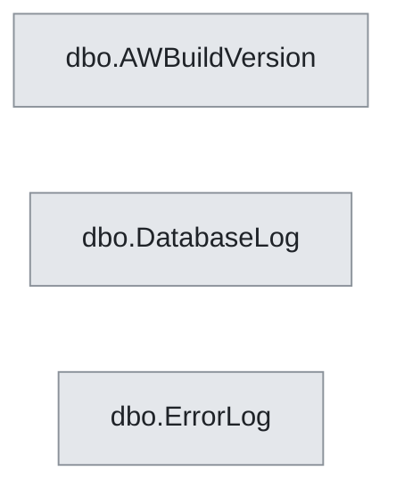

<div style="background:#f4f5f7;color:#1f2328;padding:16px 22px;border-radius:8px;">

<a href="../index.md" style="color:#0b5cad">← AdventureWorks2025 Overview</a> · <a href="../beam-annotations.md" style="color:#0b5cad">BEAM✲ Annotations</a> · <a href="../how-to-read.md" style="color:#0b5cad">How to Read This Wiki</a>

# dbo

<i>3 tables. Tables with a dashed outline in the diagram belong to another schema.</i>

## Data Stories

<table style="border-collapse:collapse;margin:8px 0;width:100%;">
<tr><th style="padding:6px 10px;border:1px solid #d0d4da;background:#ffffff;color:#1f2328;text-align:left;vertical-align:top;background:#cfd5dd;color:#1f2328;font-weight:600;vertical-align:bottom;">Table</th><th style="padding:6px 10px;border:1px solid #d0d4da;background:#ffffff;color:#1f2328;text-align:left;vertical-align:top;background:#cfd5dd;color:#1f2328;font-weight:600;vertical-align:bottom;">BEAM✲</th><th style="padding:6px 10px;border:1px solid #d0d4da;background:#ffffff;color:#1f2328;text-align:left;vertical-align:top;background:#cfd5dd;color:#1f2328;font-weight:600;vertical-align:bottom;">Grain</th><th style="padding:6px 10px;border:1px solid #d0d4da;background:#ffffff;color:#1f2328;text-align:left;vertical-align:top;background:#cfd5dd;color:#1f2328;font-weight:600;vertical-align:bottom;">Description</th><th style="padding:6px 10px;border:1px solid #d0d4da;background:#ffffff;color:#1f2328;text-align:right;vertical-align:top;background:#cfd5dd;color:#1f2328;font-weight:600;vertical-align:bottom;">Sampled Rows</th><th style="padding:6px 10px;border:1px solid #d0d4da;background:#ffffff;color:#1f2328;text-align:right;vertical-align:top;background:#cfd5dd;color:#1f2328;font-weight:600;vertical-align:bottom;">Columns</th></tr>
<tr><td style="padding:6px 10px;border:1px solid #d0d4da;background:#ffffff;color:#1f2328;text-align:left;vertical-align:top;"><a href="../data-stories/dbo-awbuildversion.md" style="color:#0b5cad">dbo.AWBuildVersion</a></td><td style="padding:6px 10px;border:1px solid #d0d4da;background:#ffffff;color:#1f2328;text-align:left;vertical-align:top;"><a href="beam-annotations.md#t-cv" style="color:#0b5cad" title="Current Value: Keeps only the current value of each attribute. Changes overwrite the old value. Also called a type 1 slowly changing dimension.">[CV]</a></td><td style="padding:6px 10px;border:1px solid #d0d4da;background:#ffffff;color:#1f2328;text-align:left;vertical-align:top;">One row for each recorded version of this sample database; the table holds a single row, so it only describes the version that is installed</td><td style="padding:6px 10px;border:1px solid #d0d4da;background:#ffffff;color:#1f2328;text-align:left;vertical-align:top;">Current version number of the AdventureWorks 2025 sample database.</td><td style="padding:6px 10px;border:1px solid #d0d4da;background:#ffffff;color:#1f2328;text-align:right;vertical-align:top;">1</td><td style="padding:6px 10px;border:1px solid #d0d4da;background:#ffffff;color:#1f2328;text-align:right;vertical-align:top;">4</td></tr>
<tr><td style="padding:6px 10px;border:1px solid #d0d4da;background:#ffffff;color:#1f2328;text-align:left;vertical-align:top;"><a href="../data-stories/dbo-databaselog.md" style="color:#0b5cad">dbo.DatabaseLog</a></td><td style="padding:6px 10px;border:1px solid #d0d4da;background:#ffffff;color:#1f2328;text-align:left;vertical-align:top;"><a href="beam-annotations.md#t-de" style="color:#0b5cad" title="Discrete Event: Something that happens at one moment, or over a short time, and is then finished, e.g. a sale or a payment. Becomes a transaction fact table [TF].">[DE]</a></td><td style="padding:6px 10px;border:1px solid #d0d4da;background:#ffffff;color:#1f2328;text-align:left;vertical-align:top;">One row for each change made to the structure of the database, such as creating a table or index, with the exact statement that was run</td><td style="padding:6px 10px;border:1px solid #d0d4da;background:#ffffff;color:#1f2328;text-align:left;vertical-align:top;">Audit table tracking all DDL changes made to the AdventureWorks database. Data is captured by the database trigger ddlDatabaseTriggerLog.</td><td style="padding:6px 10px;border:1px solid #d0d4da;background:#ffffff;color:#1f2328;text-align:right;vertical-align:top;">927</td><td style="padding:6px 10px;border:1px solid #d0d4da;background:#ffffff;color:#1f2328;text-align:right;vertical-align:top;">8</td></tr>
<tr><td style="padding:6px 10px;border:1px solid #d0d4da;background:#ffffff;color:#1f2328;text-align:left;vertical-align:top;"><a href="../data-stories/dbo-errorlog.md" style="color:#0b5cad">dbo.ErrorLog</a></td><td style="padding:6px 10px;border:1px solid #d0d4da;background:#ffffff;color:#1f2328;text-align:left;vertical-align:top;"><a href="beam-annotations.md#t-de" style="color:#0b5cad" title="Discrete Event: Something that happens at one moment, or over a short time, and is then finished, e.g. a sale or a payment. Becomes a transaction fact table [TF].">[DE]</a></td><td style="padding:6px 10px;border:1px solid #d0d4da;background:#ffffff;color:#1f2328;text-align:left;vertical-align:top;">One row for each error that was caught and logged by the database's error handling, with the time, user, error number and message</td><td style="padding:6px 10px;border:1px solid #d0d4da;background:#ffffff;color:#1f2328;text-align:left;vertical-align:top;">Audit table tracking errors in the the AdventureWorks database that are caught by the CATCH block of a TRY...CATCH construct. Data is inserted by stored procedure dbo.uspLogError when it is executed from inside the CATCH block of a TRY...CATCH construct.</td><td style="padding:6px 10px;border:1px solid #d0d4da;background:#ffffff;color:#1f2328;text-align:right;vertical-align:top;">0</td><td style="padding:6px 10px;border:1px solid #d0d4da;background:#ffffff;color:#1f2328;text-align:right;vertical-align:top;">9</td></tr>
</table>

## Data Model



---

## Metadata

_Machine-readable facts about this page, for tools and AI agents._

```yaml
bijoe: "schema"
schema_version: 2
dataset: "AdventureWorks2025"
schema: "dbo"
tables: 3
generated_at: "2026-11-22T19:17:45+00:00"
```

</div>
