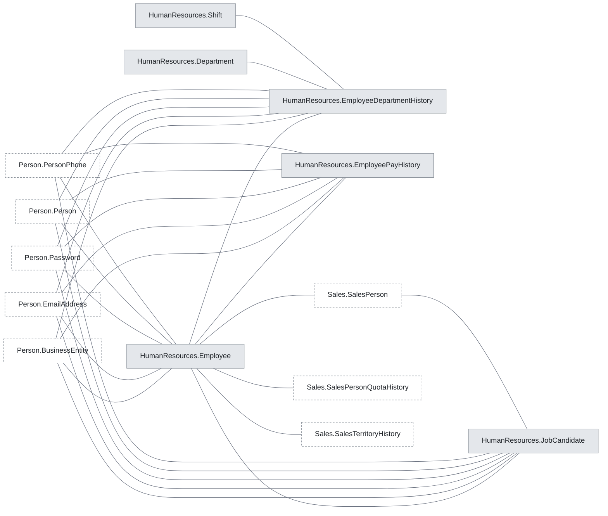

<div style="background:#f4f5f7;color:#1f2328;padding:16px 22px;border-radius:8px;">

<a href="../index.md" style="color:#0b5cad">← AdventureWorks2025 Overview</a> · <a href="../beam-annotations.md" style="color:#0b5cad">BEAM✲ Annotations</a> · <a href="../how-to-read.md" style="color:#0b5cad">How to Read This Wiki</a>

# HumanResources

<i>6 tables. Tables with a dashed outline in the diagram belong to another schema.</i>

## Data Stories

<table style="border-collapse:collapse;margin:8px 0;width:100%;">
<tr><th style="padding:6px 10px;border:1px solid #d0d4da;background:#ffffff;color:#1f2328;text-align:left;vertical-align:top;background:#cfd5dd;color:#1f2328;font-weight:600;vertical-align:bottom;">Table</th><th style="padding:6px 10px;border:1px solid #d0d4da;background:#ffffff;color:#1f2328;text-align:left;vertical-align:top;background:#cfd5dd;color:#1f2328;font-weight:600;vertical-align:bottom;">BEAM✲</th><th style="padding:6px 10px;border:1px solid #d0d4da;background:#ffffff;color:#1f2328;text-align:left;vertical-align:top;background:#cfd5dd;color:#1f2328;font-weight:600;vertical-align:bottom;">Grain</th><th style="padding:6px 10px;border:1px solid #d0d4da;background:#ffffff;color:#1f2328;text-align:left;vertical-align:top;background:#cfd5dd;color:#1f2328;font-weight:600;vertical-align:bottom;">Description</th><th style="padding:6px 10px;border:1px solid #d0d4da;background:#ffffff;color:#1f2328;text-align:right;vertical-align:top;background:#cfd5dd;color:#1f2328;font-weight:600;vertical-align:bottom;">Sampled Rows</th><th style="padding:6px 10px;border:1px solid #d0d4da;background:#ffffff;color:#1f2328;text-align:right;vertical-align:top;background:#cfd5dd;color:#1f2328;font-weight:600;vertical-align:bottom;">Columns</th></tr>
<tr><td style="padding:6px 10px;border:1px solid #d0d4da;background:#ffffff;color:#1f2328;text-align:left;vertical-align:top;"><a href="../data-stories/humanresources-department.md" style="color:#0b5cad">HumanResources.Department</a></td><td style="padding:6px 10px;border:1px solid #d0d4da;background:#ffffff;color:#1f2328;text-align:left;vertical-align:top;"><a href="beam-annotations.md#t-cv" style="color:#0b5cad" title="Current Value: Keeps only the current value of each attribute. Changes overwrite the old value. Also called a type 1 slowly changing dimension.">[CV]</a></td><td style="padding:6px 10px;border:1px solid #d0d4da;background:#ffffff;color:#1f2328;text-align:left;vertical-align:top;">One row for each department of the company, placed in one of 6 department groups; DepartmentID and Name are each unique across the 16 rows.</td><td style="padding:6px 10px;border:1px solid #d0d4da;background:#ffffff;color:#1f2328;text-align:left;vertical-align:top;">Lookup table containing the departments within the Adventure Works Cycles company.</td><td style="padding:6px 10px;border:1px solid #d0d4da;background:#ffffff;color:#1f2328;text-align:right;vertical-align:top;">16</td><td style="padding:6px 10px;border:1px solid #d0d4da;background:#ffffff;color:#1f2328;text-align:right;vertical-align:top;">4</td></tr>
<tr><td style="padding:6px 10px;border:1px solid #d0d4da;background:#ffffff;color:#1f2328;text-align:left;vertical-align:top;"><a href="../data-stories/humanresources-employee.md" style="color:#0b5cad">HumanResources.Employee</a></td><td style="padding:6px 10px;border:1px solid #d0d4da;background:#ffffff;color:#1f2328;text-align:left;vertical-align:top;"><a href="beam-annotations.md#t-cv" style="color:#0b5cad" title="Current Value: Keeps only the current value of each attribute. Changes overwrite the old value. Also called a type 1 slowly changing dimension.">[CV]</a></td><td style="padding:6px 10px;border:1px solid #d0d4da;background:#ffffff;color:#1f2328;text-align:left;vertical-align:top;">One row for each person who works or has worked for the company as an employee; BusinessEntityID is unique across the 290 rows, and NationalIDNumber, LoginID and OrganizationNode are each unique too.</td><td style="padding:6px 10px;border:1px solid #d0d4da;background:#ffffff;color:#1f2328;text-align:left;vertical-align:top;">Employee information such as salary, department, and title.</td><td style="padding:6px 10px;border:1px solid #d0d4da;background:#ffffff;color:#1f2328;text-align:right;vertical-align:top;">290</td><td style="padding:6px 10px;border:1px solid #d0d4da;background:#ffffff;color:#1f2328;text-align:right;vertical-align:top;">16</td></tr>
<tr><td style="padding:6px 10px;border:1px solid #d0d4da;background:#ffffff;color:#1f2328;text-align:left;vertical-align:top;"><a href="../data-stories/humanresources-employeedepartmenthistory.md" style="color:#0b5cad">HumanResources.EmployeeDepartmentHistory</a></td><td style="padding:6px 10px;border:1px solid #d0d4da;background:#ffffff;color:#1f2328;text-align:left;vertical-align:top;"><a href="beam-annotations.md#t-hv" style="color:#0b5cad" title="Historic Value: Keeps history for at least one attribute, so a change adds a new version of the row. Also called a type 2 slowly changing dimension.">[HV]</a></td><td style="padding:6px 10px;border:1px solid #d0d4da;background:#ffffff;color:#1f2328;text-align:left;vertical-align:top;">One row for each period in which an employee works in a department on a shift, from a start date to an end date that is empty while the assignment lasts. BusinessEntityID with StartDate is unique (and BusinessEntityID with DepartmentID too).</td><td style="padding:6px 10px;border:1px solid #d0d4da;background:#ffffff;color:#1f2328;text-align:left;vertical-align:top;">Employee department transfers.</td><td style="padding:6px 10px;border:1px solid #d0d4da;background:#ffffff;color:#1f2328;text-align:right;vertical-align:top;">296</td><td style="padding:6px 10px;border:1px solid #d0d4da;background:#ffffff;color:#1f2328;text-align:right;vertical-align:top;">6</td></tr>
<tr><td style="padding:6px 10px;border:1px solid #d0d4da;background:#ffffff;color:#1f2328;text-align:left;vertical-align:top;"><a href="../data-stories/humanresources-employeepayhistory.md" style="color:#0b5cad">HumanResources.EmployeePayHistory</a></td><td style="padding:6px 10px;border:1px solid #d0d4da;background:#ffffff;color:#1f2328;text-align:left;vertical-align:top;"><a href="beam-annotations.md#t-de" style="color:#0b5cad" title="Discrete Event: Something that happens at one moment, or over a short time, and is then finished, e.g. a sale or a payment. Becomes a transaction fact table [TF].">[DE]</a></td><td style="padding:6px 10px;border:1px solid #d0d4da;background:#ffffff;color:#1f2328;text-align:left;vertical-align:top;">One row for each change of pay rate that takes effect for an employee on a date. BusinessEntityID with RateChangeDate is unique.</td><td style="padding:6px 10px;border:1px solid #d0d4da;background:#ffffff;color:#1f2328;text-align:left;vertical-align:top;">Employee pay history.</td><td style="padding:6px 10px;border:1px solid #d0d4da;background:#ffffff;color:#1f2328;text-align:right;vertical-align:top;">316</td><td style="padding:6px 10px;border:1px solid #d0d4da;background:#ffffff;color:#1f2328;text-align:right;vertical-align:top;">5</td></tr>
<tr><td style="padding:6px 10px;border:1px solid #d0d4da;background:#ffffff;color:#1f2328;text-align:left;vertical-align:top;"><a href="../data-stories/humanresources-jobcandidate.md" style="color:#0b5cad">HumanResources.JobCandidate</a></td><td style="padding:6px 10px;border:1px solid #d0d4da;background:#ffffff;color:#1f2328;text-align:left;vertical-align:top;"><a href="beam-annotations.md#t-cv" style="color:#0b5cad" title="Current Value: Keeps only the current value of each attribute. Changes overwrite the old value. Also called a type 1 slowly changing dimension.">[CV]</a></td><td style="padding:6px 10px;border:1px solid #d0d4da;background:#ffffff;color:#1f2328;text-align:left;vertical-align:top;">One row for each résumé submitted by a job applicant; JobCandidateID is unique across the 13 rows, and the employee link is filled only for the 2 applicants who were hired.</td><td style="padding:6px 10px;border:1px solid #d0d4da;background:#ffffff;color:#1f2328;text-align:left;vertical-align:top;">Résumés submitted to Human Resources by job applicants.</td><td style="padding:6px 10px;border:1px solid #d0d4da;background:#ffffff;color:#1f2328;text-align:right;vertical-align:top;">13</td><td style="padding:6px 10px;border:1px solid #d0d4da;background:#ffffff;color:#1f2328;text-align:right;vertical-align:top;">4</td></tr>
<tr><td style="padding:6px 10px;border:1px solid #d0d4da;background:#ffffff;color:#1f2328;text-align:left;vertical-align:top;"><a href="../data-stories/humanresources-shift.md" style="color:#0b5cad">HumanResources.Shift</a></td><td style="padding:6px 10px;border:1px solid #d0d4da;background:#ffffff;color:#1f2328;text-align:left;vertical-align:top;"><a href="beam-annotations.md#t-cv" style="color:#0b5cad" title="Current Value: Keeps only the current value of each attribute. Changes overwrite the old value. Also called a type 1 slowly changing dimension.">[CV]</a></td><td style="padding:6px 10px;border:1px solid #d0d4da;background:#ffffff;color:#1f2328;text-align:left;vertical-align:top;">One row for each work shift in the day (day, evening and night), with its start and end time; ShiftID, Name, StartTime and EndTime are each unique across the 3 rows.</td><td style="padding:6px 10px;border:1px solid #d0d4da;background:#ffffff;color:#1f2328;text-align:left;vertical-align:top;">Work shift lookup table.</td><td style="padding:6px 10px;border:1px solid #d0d4da;background:#ffffff;color:#1f2328;text-align:right;vertical-align:top;">3</td><td style="padding:6px 10px;border:1px solid #d0d4da;background:#ffffff;color:#1f2328;text-align:right;vertical-align:top;">5</td></tr>
</table>

## Data Model



<i>Its tables took 0.8 s to profile.</i>

---

## Metadata

_Machine-readable facts about this page, for tools and AI agents._

```yaml
bijoe: "schema"
schema_version: 2
dataset: "AdventureWorks2025"
schema: "HumanResources"
tables: 6
generated_at: "2026-11-22T22:15:39+00:00"
```

</div>
