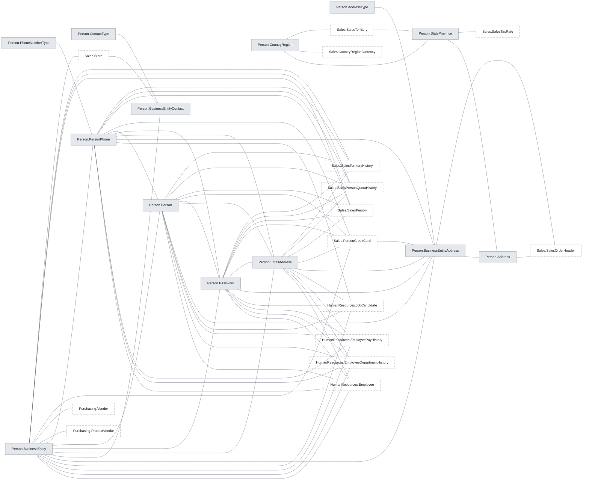

<div style="background:#f4f5f7;color:#1f2328;padding:16px 22px;border-radius:8px;">

<a href="../index.md" style="color:#0b5cad">← AdventureWorks2025 Overview</a> · <a href="../beam-annotations.md" style="color:#0b5cad">BEAM✲ Annotations</a> · <a href="../how-to-read.md" style="color:#0b5cad">How to Read This Wiki</a>

# Person

<i>13 tables. Tables with a dashed outline in the diagram belong to another schema.</i>

## Data Stories

<table style="border-collapse:collapse;margin:8px 0;width:100%;">
<tr><th style="padding:6px 10px;border:1px solid #d0d4da;background:#ffffff;color:#1f2328;text-align:left;vertical-align:top;background:#cfd5dd;color:#1f2328;font-weight:600;vertical-align:bottom;">Table</th><th style="padding:6px 10px;border:1px solid #d0d4da;background:#ffffff;color:#1f2328;text-align:left;vertical-align:top;background:#cfd5dd;color:#1f2328;font-weight:600;vertical-align:bottom;">BEAM✲</th><th style="padding:6px 10px;border:1px solid #d0d4da;background:#ffffff;color:#1f2328;text-align:left;vertical-align:top;background:#cfd5dd;color:#1f2328;font-weight:600;vertical-align:bottom;">Grain</th><th style="padding:6px 10px;border:1px solid #d0d4da;background:#ffffff;color:#1f2328;text-align:left;vertical-align:top;background:#cfd5dd;color:#1f2328;font-weight:600;vertical-align:bottom;">Description</th><th style="padding:6px 10px;border:1px solid #d0d4da;background:#ffffff;color:#1f2328;text-align:right;vertical-align:top;background:#cfd5dd;color:#1f2328;font-weight:600;vertical-align:bottom;">Sampled Rows</th><th style="padding:6px 10px;border:1px solid #d0d4da;background:#ffffff;color:#1f2328;text-align:right;vertical-align:top;background:#cfd5dd;color:#1f2328;font-weight:600;vertical-align:bottom;">Columns</th></tr>
<tr><td style="padding:6px 10px;border:1px solid #d0d4da;background:#ffffff;color:#1f2328;text-align:left;vertical-align:top;"><a href="../data-stories/person-address.md" style="color:#0b5cad">Person.Address</a></td><td style="padding:6px 10px;border:1px solid #d0d4da;background:#ffffff;color:#1f2328;text-align:left;vertical-align:top;"><a href="beam-annotations.md#t-rp" style="color:#0b5cad" title="Role-Playing: One dimension used in several roles, e.g. Employee as both salesperson and manager. Calendar is the most common one.">[RP]</a></td><td style="padding:6px 10px;border:1px solid #d0d4da;background:#ffffff;color:#1f2328;text-align:left;vertical-align:top;">One row for each street address that is stored once and shared by whatever customer, employee or vendor uses it. AddressID alone pins a row, and every address is used by exactly one entity row.</td><td style="padding:6px 10px;border:1px solid #d0d4da;background:#ffffff;color:#1f2328;text-align:left;vertical-align:top;">Street address information for customers, employees, and vendors.</td><td style="padding:6px 10px;border:1px solid #d0d4da;background:#ffffff;color:#1f2328;text-align:right;vertical-align:top;">19,614</td><td style="padding:6px 10px;border:1px solid #d0d4da;background:#ffffff;color:#1f2328;text-align:right;vertical-align:top;">9</td></tr>
<tr><td style="padding:6px 10px;border:1px solid #d0d4da;background:#ffffff;color:#1f2328;text-align:left;vertical-align:top;"><a href="../data-stories/person-addresstype.md" style="color:#0b5cad">Person.AddressType</a></td><td style="padding:6px 10px;border:1px solid #d0d4da;background:#ffffff;color:#1f2328;text-align:left;vertical-align:top;"><a href="beam-annotations.md#t-cv" style="color:#0b5cad" title="Current Value: Keeps only the current value of each attribute. Changes overwrite the old value. Also called a type 1 slowly changing dimension.">[CV]</a></td><td style="padding:6px 10px;border:1px solid #d0d4da;background:#ffffff;color:#1f2328;text-align:left;vertical-align:top;">One row for each kind of address an address can be filed under, such as billing, home or shipping; AddressTypeID and Name are each unique across the 6 rows.</td><td style="padding:6px 10px;border:1px solid #d0d4da;background:#ffffff;color:#1f2328;text-align:left;vertical-align:top;">Types of addresses stored in the Address table.</td><td style="padding:6px 10px;border:1px solid #d0d4da;background:#ffffff;color:#1f2328;text-align:right;vertical-align:top;">6</td><td style="padding:6px 10px;border:1px solid #d0d4da;background:#ffffff;color:#1f2328;text-align:right;vertical-align:top;">4</td></tr>
<tr><td style="padding:6px 10px;border:1px solid #d0d4da;background:#ffffff;color:#1f2328;text-align:left;vertical-align:top;"><a href="../data-stories/person-businessentity.md" style="color:#0b5cad">Person.BusinessEntity</a></td><td style="padding:6px 10px;border:1px solid #d0d4da;background:#ffffff;color:#1f2328;text-align:left;vertical-align:top;"><a href="beam-annotations.md#t-cv" style="color:#0b5cad" title="Current Value: Keeps only the current value of each attribute. Changes overwrite the old value. Also called a type 1 slowly changing dimension.">[CV]</a></td><td style="padding:6px 10px;border:1px solid #d0d4da;background:#ffffff;color:#1f2328;text-align:left;vertical-align:top;">One row for each customer, vendor, store or employee identity that is given an ID; BusinessEntityID alone pins a row, and the IDs are consecutive from 1 to 20,777.</td><td style="padding:6px 10px;border:1px solid #d0d4da;background:#ffffff;color:#1f2328;text-align:left;vertical-align:top;">Source of the ID that connects vendors, customers, and employees with address and contact information.</td><td style="padding:6px 10px;border:1px solid #d0d4da;background:#ffffff;color:#1f2328;text-align:right;vertical-align:top;">20,777</td><td style="padding:6px 10px;border:1px solid #d0d4da;background:#ffffff;color:#1f2328;text-align:right;vertical-align:top;">3</td></tr>
<tr><td style="padding:6px 10px;border:1px solid #d0d4da;background:#ffffff;color:#1f2328;text-align:left;vertical-align:top;"><a href="../data-stories/person-businessentityaddress.md" style="color:#0b5cad">Person.BusinessEntityAddress</a></td><td style="padding:6px 10px;border:1px solid #d0d4da;background:#ffffff;color:#1f2328;text-align:left;vertical-align:top;"><a href="beam-annotations.md#t-mv" style="color:#0b5cad" title="Multi-Valued: A bridge table that links a fact to several values of a dimension at once (many-to-many), often with a weighting factor.">[MV]</a></td><td style="padding:6px 10px;border:1px solid #d0d4da;background:#ffffff;color:#1f2328;text-align:left;vertical-align:top;">One row for each address that belongs to a person, store or vendor, filed under an address type. An entity has at most one address of each type (BusinessEntityID with AddressTypeID is unique), and each address appears once.</td><td style="padding:6px 10px;border:1px solid #d0d4da;background:#ffffff;color:#1f2328;text-align:left;vertical-align:top;">Cross-reference table mapping customers, vendors, and employees to their addresses.</td><td style="padding:6px 10px;border:1px solid #d0d4da;background:#ffffff;color:#1f2328;text-align:right;vertical-align:top;">19,614</td><td style="padding:6px 10px;border:1px solid #d0d4da;background:#ffffff;color:#1f2328;text-align:right;vertical-align:top;">5</td></tr>
<tr><td style="padding:6px 10px;border:1px solid #d0d4da;background:#ffffff;color:#1f2328;text-align:left;vertical-align:top;"><a href="../data-stories/person-businessentitycontact.md" style="color:#0b5cad">Person.BusinessEntityContact</a></td><td style="padding:6px 10px;border:1px solid #d0d4da;background:#ffffff;color:#1f2328;text-align:left;vertical-align:top;"><a href="beam-annotations.md#t-mv" style="color:#0b5cad" title="Multi-Valued: A bridge table that links a fact to several values of a dimension at once (many-to-many), often with a weighting factor.">[MV]</a></td><td style="padding:6px 10px;border:1px solid #d0d4da;background:#ffffff;color:#1f2328;text-align:left;vertical-align:top;">One row for each person who is a contact of a store or vendor, in one contact role. PersonID alone is unique, and BusinessEntityID with ContactTypeID is unique, so a contact person appears once and an entity has at most one contact per role.</td><td style="padding:6px 10px;border:1px solid #d0d4da;background:#ffffff;color:#1f2328;text-align:left;vertical-align:top;">Cross-reference table mapping stores, vendors, and employees to people</td><td style="padding:6px 10px;border:1px solid #d0d4da;background:#ffffff;color:#1f2328;text-align:right;vertical-align:top;">909</td><td style="padding:6px 10px;border:1px solid #d0d4da;background:#ffffff;color:#1f2328;text-align:right;vertical-align:top;">5</td></tr>
<tr><td style="padding:6px 10px;border:1px solid #d0d4da;background:#ffffff;color:#1f2328;text-align:left;vertical-align:top;"><a href="../data-stories/person-contacttype.md" style="color:#0b5cad">Person.ContactType</a></td><td style="padding:6px 10px;border:1px solid #d0d4da;background:#ffffff;color:#1f2328;text-align:left;vertical-align:top;"><a href="beam-annotations.md#t-cv" style="color:#0b5cad" title="Current Value: Keeps only the current value of each attribute. Changes overwrite the old value. Also called a type 1 slowly changing dimension.">[CV]</a></td><td style="padding:6px 10px;border:1px solid #d0d4da;background:#ffffff;color:#1f2328;text-align:left;vertical-align:top;">One row for each job-like role a contact person can have at a store or vendor (for example Accounting Manager); ContactTypeID and Name are each unique across the 20 rows.</td><td style="padding:6px 10px;border:1px solid #d0d4da;background:#ffffff;color:#1f2328;text-align:left;vertical-align:top;">Lookup table containing the types of business entity contacts.</td><td style="padding:6px 10px;border:1px solid #d0d4da;background:#ffffff;color:#1f2328;text-align:right;vertical-align:top;">20</td><td style="padding:6px 10px;border:1px solid #d0d4da;background:#ffffff;color:#1f2328;text-align:right;vertical-align:top;">3</td></tr>
<tr><td style="padding:6px 10px;border:1px solid #d0d4da;background:#ffffff;color:#1f2328;text-align:left;vertical-align:top;"><a href="../data-stories/person-countryregion.md" style="color:#0b5cad">Person.CountryRegion</a></td><td style="padding:6px 10px;border:1px solid #d0d4da;background:#ffffff;color:#1f2328;text-align:left;vertical-align:top;"><a href="beam-annotations.md#t-cv" style="color:#0b5cad" title="Current Value: Keeps only the current value of each attribute. Changes overwrite the old value. Also called a type 1 slowly changing dimension.">[CV]</a></td><td style="padding:6px 10px;border:1px solid #d0d4da;background:#ffffff;color:#1f2328;text-align:left;vertical-align:top;">One row for each country or region with an ISO code; CountryRegionCode and Name are each unique across the 238 rows.</td><td style="padding:6px 10px;border:1px solid #d0d4da;background:#ffffff;color:#1f2328;text-align:left;vertical-align:top;">Lookup table containing the ISO standard codes for countries and regions.</td><td style="padding:6px 10px;border:1px solid #d0d4da;background:#ffffff;color:#1f2328;text-align:right;vertical-align:top;">238</td><td style="padding:6px 10px;border:1px solid #d0d4da;background:#ffffff;color:#1f2328;text-align:right;vertical-align:top;">3</td></tr>
<tr><td style="padding:6px 10px;border:1px solid #d0d4da;background:#ffffff;color:#1f2328;text-align:left;vertical-align:top;"><a href="../data-stories/person-emailaddress.md" style="color:#0b5cad">Person.EmailAddress</a></td><td style="padding:6px 10px;border:1px solid #d0d4da;background:#ffffff;color:#1f2328;text-align:left;vertical-align:top;"><a href="beam-annotations.md#t-cv" style="color:#0b5cad" title="Current Value: Keeps only the current value of each attribute. Changes overwrite the old value. Also called a type 1 slowly changing dimension.">[CV]</a></td><td style="padding:6px 10px;border:1px solid #d0d4da;background:#ffffff;color:#1f2328;text-align:left;vertical-align:top;">One row for each person, holding that person's one email address. BusinessEntityID, EmailAddressID and EmailAddress are each unique across the 19,972 rows, so no person has two.</td><td style="padding:6px 10px;border:1px solid #d0d4da;background:#ffffff;color:#1f2328;text-align:left;vertical-align:top;">Where to send a person email.</td><td style="padding:6px 10px;border:1px solid #d0d4da;background:#ffffff;color:#1f2328;text-align:right;vertical-align:top;">19,972</td><td style="padding:6px 10px;border:1px solid #d0d4da;background:#ffffff;color:#1f2328;text-align:right;vertical-align:top;">5</td></tr>
<tr><td style="padding:6px 10px;border:1px solid #d0d4da;background:#ffffff;color:#1f2328;text-align:left;vertical-align:top;"><a href="../data-stories/person-password.md" style="color:#0b5cad">Person.Password</a></td><td style="padding:6px 10px;border:1px solid #d0d4da;background:#ffffff;color:#1f2328;text-align:left;vertical-align:top;"><a href="beam-annotations.md#t-cv" style="color:#0b5cad" title="Current Value: Keeps only the current value of each attribute. Changes overwrite the old value. Also called a type 1 slowly changing dimension.">[CV]</a></td><td style="padding:6px 10px;border:1px solid #d0d4da;background:#ffffff;color:#1f2328;text-align:left;vertical-align:top;">One row for each person who has a stored login credential: a hashed password and its salt. BusinessEntityID is unique across the 19,972 rows and matches every person.</td><td style="padding:6px 10px;border:1px solid #d0d4da;background:#ffffff;color:#1f2328;text-align:left;vertical-align:top;">One way hashed authentication information</td><td style="padding:6px 10px;border:1px solid #d0d4da;background:#ffffff;color:#1f2328;text-align:right;vertical-align:top;">19,972</td><td style="padding:6px 10px;border:1px solid #d0d4da;background:#ffffff;color:#1f2328;text-align:right;vertical-align:top;">5</td></tr>
<tr><td style="padding:6px 10px;border:1px solid #d0d4da;background:#ffffff;color:#1f2328;text-align:left;vertical-align:top;"><a href="../data-stories/person-person.md" style="color:#0b5cad">Person.Person</a></td><td style="padding:6px 10px;border:1px solid #d0d4da;background:#ffffff;color:#1f2328;text-align:left;vertical-align:top;"><a href="beam-annotations.md#t-cv" style="color:#0b5cad" title="Current Value: Keeps only the current value of each attribute. Changes overwrite the old value. Also called a type 1 slowly changing dimension.">[CV]</a></td><td style="padding:6px 10px;border:1px solid #d0d4da;background:#ffffff;color:#1f2328;text-align:left;vertical-align:top;">One row for each person known to the company, whether customer, employee, store contact, vendor contact or general contact. BusinessEntityID alone pins a row, and PersonType says which kind of person it is.</td><td style="padding:6px 10px;border:1px solid #d0d4da;background:#ffffff;color:#1f2328;text-align:left;vertical-align:top;">Human beings involved with AdventureWorks: employees, customer contacts, and vendor contacts.</td><td style="padding:6px 10px;border:1px solid #d0d4da;background:#ffffff;color:#1f2328;text-align:right;vertical-align:top;">19,972</td><td style="padding:6px 10px;border:1px solid #d0d4da;background:#ffffff;color:#1f2328;text-align:right;vertical-align:top;">13</td></tr>
<tr><td style="padding:6px 10px;border:1px solid #d0d4da;background:#ffffff;color:#1f2328;text-align:left;vertical-align:top;"><a href="../data-stories/person-personphone.md" style="color:#0b5cad">Person.PersonPhone</a></td><td style="padding:6px 10px;border:1px solid #d0d4da;background:#ffffff;color:#1f2328;text-align:left;vertical-align:top;"><a href="beam-annotations.md#t-cv" style="color:#0b5cad" title="Current Value: Keeps only the current value of each attribute. Changes overwrite the old value. Also called a type 1 slowly changing dimension.">[CV]</a></td><td style="padding:6px 10px;border:1px solid #d0d4da;background:#ffffff;color:#1f2328;text-align:left;vertical-align:top;">One row for each person, holding the one phone number and its type that is stored for that person. BusinessEntityID is unique alone, although the declared key also includes PhoneNumber and PhoneNumberTypeID.</td><td style="padding:6px 10px;border:1px solid #d0d4da;background:#ffffff;color:#1f2328;text-align:left;vertical-align:top;">Telephone number and type of a person.</td><td style="padding:6px 10px;border:1px solid #d0d4da;background:#ffffff;color:#1f2328;text-align:right;vertical-align:top;">19,972</td><td style="padding:6px 10px;border:1px solid #d0d4da;background:#ffffff;color:#1f2328;text-align:right;vertical-align:top;">4</td></tr>
<tr><td style="padding:6px 10px;border:1px solid #d0d4da;background:#ffffff;color:#1f2328;text-align:left;vertical-align:top;"><a href="../data-stories/person-phonenumbertype.md" style="color:#0b5cad">Person.PhoneNumberType</a></td><td style="padding:6px 10px;border:1px solid #d0d4da;background:#ffffff;color:#1f2328;text-align:left;vertical-align:top;"><a href="beam-annotations.md#t-cv" style="color:#0b5cad" title="Current Value: Keeps only the current value of each attribute. Changes overwrite the old value. Also called a type 1 slowly changing dimension.">[CV]</a></td><td style="padding:6px 10px;border:1px solid #d0d4da;background:#ffffff;color:#1f2328;text-align:left;vertical-align:top;">One row for each kind of phone number a person can have (Cell, Home or Work); PhoneNumberTypeID and Name are each unique across the 3 rows.</td><td style="padding:6px 10px;border:1px solid #d0d4da;background:#ffffff;color:#1f2328;text-align:left;vertical-align:top;">Type of phone number of a person.</td><td style="padding:6px 10px;border:1px solid #d0d4da;background:#ffffff;color:#1f2328;text-align:right;vertical-align:top;">3</td><td style="padding:6px 10px;border:1px solid #d0d4da;background:#ffffff;color:#1f2328;text-align:right;vertical-align:top;">3</td></tr>
<tr><td style="padding:6px 10px;border:1px solid #d0d4da;background:#ffffff;color:#1f2328;text-align:left;vertical-align:top;"><a href="../data-stories/person-stateprovince.md" style="color:#0b5cad">Person.StateProvince</a></td><td style="padding:6px 10px;border:1px solid #d0d4da;background:#ffffff;color:#1f2328;text-align:left;vertical-align:top;"><a href="beam-annotations.md#t-cv" style="color:#0b5cad" title="Current Value: Keeps only the current value of each attribute. Changes overwrite the old value. Also called a type 1 slowly changing dimension.">[CV]</a></td><td style="padding:6px 10px;border:1px solid #d0d4da;background:#ffffff;color:#1f2328;text-align:left;vertical-align:top;">One row for each state, province or similar first-level region of a country, within a sales territory. StateProvinceID, StateProvinceCode and Name are each unique across the 181 rows.</td><td style="padding:6px 10px;border:1px solid #d0d4da;background:#ffffff;color:#1f2328;text-align:left;vertical-align:top;">State and province lookup table.</td><td style="padding:6px 10px;border:1px solid #d0d4da;background:#ffffff;color:#1f2328;text-align:right;vertical-align:top;">181</td><td style="padding:6px 10px;border:1px solid #d0d4da;background:#ffffff;color:#1f2328;text-align:right;vertical-align:top;">8</td></tr>
</table>

## Data Model



<i>Its tables took 7.2 s to profile.</i>

---

## Metadata

_Machine-readable facts about this page, for tools and AI agents._

```yaml
bijoe: "schema"
schema_version: 2
dataset: "AdventureWorks2025"
schema: "Person"
tables: 13
generated_at: "2026-11-22T22:15:39+00:00"
```

</div>
