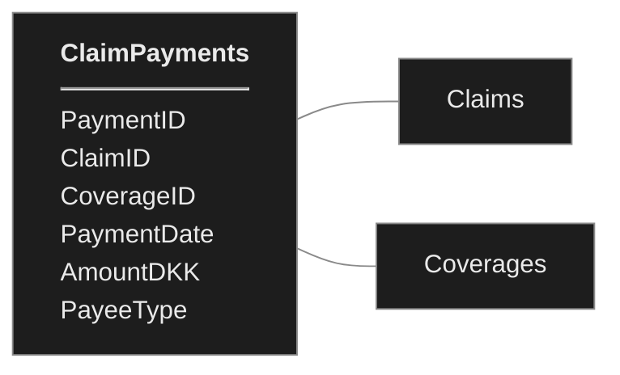

<div style="background:#101010;color:#eaeaea;padding:16px 22px;border-radius:8px;">

<a href="../index.md" style="color:#4cc2ff">← Danish Insurance Company Overview</a> · <a href="../beam-annotations.md" style="color:#4cc2ff">BEAM✲ Annotations</a> · <a href="../how-to-read.md" style="color:#4cc2ff">How to Read This Wiki</a>

# ClaimPayments

<table style="border-collapse:collapse;margin:8px 0;">
<tr><th scope="row" align="left" style="text-align:left;vertical-align:top;white-space:nowrap;font-weight:600;padding:6px 16px 6px 10px;background:#1d1d1d;color:#dcdcdc;border-bottom:1px solid #2c2c2c;">Description</th><td style="text-align:left;vertical-align:top;padding:6px 10px;background:#161616;color:#eaeaea;border-bottom:1px solid #2c2c2c;">A payment the company makes out of a claim to a customer or to a workshop, supplier or craftsman, tied to the cover it falls under. A claim can be paid in several instalments.</td></tr>
<tr><th scope="row" align="left" style="text-align:left;vertical-align:top;white-space:nowrap;font-weight:600;padding:6px 16px 6px 10px;background:#1d1d1d;color:#dcdcdc;border-bottom:1px solid #2c2c2c;">Grain</th><td style="text-align:left;vertical-align:top;padding:6px 10px;background:#161616;color:#eaeaea;border-bottom:1px solid #2c2c2c;">One row for each payment made on a claim</td></tr>
<tr><th scope="row" align="left" style="text-align:left;vertical-align:top;white-space:nowrap;font-weight:600;padding:6px 16px 6px 10px;background:#1d1d1d;color:#dcdcdc;border-bottom:1px solid #2c2c2c;">BEAM✲</th><td style="text-align:left;vertical-align:top;padding:6px 10px;background:#161616;color:#eaeaea;border-bottom:1px solid #2c2c2c;"><a href="../beam-annotations.md#t-de" style="color:#4cc2ff" title="Discrete Event: Something that happens at one moment, or over a short time, and is then finished, e.g. a sale or a payment. Becomes a transaction fact table [TF].">[DE]</a> <i>(suggested by AI)</i></td></tr>
<tr><th scope="row" align="left" style="text-align:left;vertical-align:top;white-space:nowrap;font-weight:600;padding:6px 16px 6px 10px;background:#1d1d1d;color:#dcdcdc;border-bottom:1px solid #2c2c2c;">Why <a href="../beam-annotations.md#t-de" style="color:#4cc2ff" title="Discrete Event: Something that happens at one moment, or over a short time, and is then finished, e.g. a sale or a payment. Becomes a transaction fact table [TF].">[DE]</a></th><td style="text-align:left;vertical-align:top;padding:6px 10px;background:#161616;color:#eaeaea;border-bottom:1px solid #2c2c2c;">One payment date, and the row is finished when the payment is made.</td></tr>
<tr><th scope="row" align="left" style="text-align:left;vertical-align:top;white-space:nowrap;font-weight:600;padding:6px 16px 6px 10px;background:#1d1d1d;color:#dcdcdc;border-bottom:1px solid #2c2c2c;">Source</th><td style="text-align:left;vertical-align:top;padding:6px 10px;background:#161616;color:#eaeaea;border-bottom:1px solid #2c2c2c;"><a href="../beam-annotations.md#t-source" style="color:#4cc2ff" title="Data source: The source system table or file the table comes from.">{ClaimPayments.csv}</a> <i>(measured)</i></td></tr>
<tr><th scope="row" align="left" style="text-align:left;vertical-align:top;white-space:nowrap;font-weight:600;padding:6px 16px 6px 10px;background:#1d1d1d;color:#dcdcdc;border-bottom:1px solid #2c2c2c;">Sampled Rows</th><td style="text-align:left;vertical-align:top;padding:6px 10px;background:#161616;color:#eaeaea;border-bottom:1px solid #2c2c2c;">956</td></tr>
<tr><th scope="row" align="left" style="text-align:left;vertical-align:top;white-space:nowrap;font-weight:600;padding:6px 16px 6px 10px;background:#1d1d1d;color:#dcdcdc;border-bottom:1px solid #2c2c2c;">Columns</th><td style="text-align:left;vertical-align:top;padding:6px 10px;background:#161616;color:#eaeaea;border-bottom:1px solid #2c2c2c;">6</td></tr>
<tr><th scope="row" align="left" style="text-align:left;vertical-align:top;white-space:nowrap;font-weight:600;padding:6px 16px 6px 10px;background:#1d1d1d;color:#dcdcdc;border-bottom:1px solid #2c2c2c;">Description Source</th><td style="text-align:left;vertical-align:top;padding:6px 10px;background:#161616;color:#eaeaea;border-bottom:1px solid #2c2c2c;">Written by AI from the data. Check before relying on it.</td></tr>
<tr><th scope="row" align="left" style="text-align:left;vertical-align:top;white-space:nowrap;font-weight:600;padding:6px 16px 6px 10px;background:#1d1d1d;color:#dcdcdc;border-bottom:1px solid #2c2c2c;">Confidence</th><td style="text-align:left;vertical-align:top;padding:6px 10px;background:#161616;color:#eaeaea;border-bottom:1px solid #2c2c2c;">medium</td></tr>
</table>

## Columns

<div style="overflow-x:auto;max-width:100%;">
<table style="border-collapse:separate;border-spacing:0;font-size:90%;">
<tr><td rowspan="3" style="position:sticky;left:0;z-index:2;box-sizing:border-box;width:34px;min-width:34px;max-width:34px;padding:0;border:0;background:transparent;"></td><th style="position:sticky;left:34px;z-index:2;border:0 solid #2c2c2c;border-width:0 1px 1px 0;background:#242424;color:#ffffff;padding:3px 8px;white-space:nowrap;text-align:left;vertical-align:top;font-weight:700;border-top:1px solid #2c2c2c;border-left:1px solid #2c2c2c;cursor:help;" title="The column as it is named in the data. Each column of the table is one column in this matrix.">Column Name</th><th style="border:0 solid #2c2c2c;border-width:0 1px 1px 0;padding:3px 8px;white-space:nowrap;text-align:left;vertical-align:top;background:#161616;color:#eaeaea;font-weight:600;background:#242424;color:#ffffff;border-top:1px solid #2c2c2c;">PaymentID</th><th style="border:0 solid #2c2c2c;border-width:0 1px 1px 0;padding:3px 8px;white-space:nowrap;text-align:left;vertical-align:top;background:#161616;color:#eaeaea;font-weight:600;background:#242424;color:#ffffff;border-top:1px solid #2c2c2c;">ClaimID</th><th style="border:0 solid #2c2c2c;border-width:0 1px 1px 0;padding:3px 8px;white-space:nowrap;text-align:left;vertical-align:top;background:#161616;color:#eaeaea;font-weight:600;background:#242424;color:#ffffff;border-top:1px solid #2c2c2c;">CoverageID</th><th style="border:0 solid #2c2c2c;border-width:0 1px 1px 0;padding:3px 8px;white-space:nowrap;text-align:left;vertical-align:top;background:#161616;color:#eaeaea;font-weight:600;background:#242424;color:#ffffff;border-top:1px solid #2c2c2c;">PaymentDate</th><th style="border:0 solid #2c2c2c;border-width:0 1px 1px 0;padding:3px 8px;white-space:nowrap;text-align:left;vertical-align:top;background:#161616;color:#eaeaea;font-weight:600;background:#242424;color:#ffffff;border-top:1px solid #2c2c2c;">AmountDKK</th><th style="border:0 solid #2c2c2c;border-width:0 1px 1px 0;padding:3px 8px;white-space:nowrap;text-align:left;vertical-align:top;background:#161616;color:#eaeaea;font-weight:600;background:#242424;color:#ffffff;border-top:1px solid #2c2c2c;">PayeeType</th></tr>
<tr><td style="position:sticky;left:34px;z-index:2;border:0 solid #2c2c2c;border-width:0 1px 1px 0;background:#1d1d1d;color:#dcdcdc;padding:3px 8px;white-space:nowrap;text-align:left;vertical-align:top;font-weight:600;border-left:1px solid #2c2c2c;cursor:help;" title="The kind of values found in the data, which may differ from what the source declares. The short code is a BEAM annotation, for example C9 is text with a longest value of 9 characters.">Data Type</td><td style="border:0 solid #2c2c2c;border-width:0 1px 1px 0;padding:3px 8px;white-space:nowrap;text-align:left;vertical-align:top;background:#161616;color:#eaeaea;"><a href="../beam-annotations.md#c-i" style="color:#4cc2ff" title="Integer: A whole number. (Measured from the data.)">I</a> whole number</td><td style="border:0 solid #2c2c2c;border-width:0 1px 1px 0;padding:3px 8px;white-space:nowrap;text-align:left;vertical-align:top;background:#161616;color:#eaeaea;"><a href="../beam-annotations.md#c-i" style="color:#4cc2ff" title="Integer: A whole number. (Measured from the data.)">I</a> whole number</td><td style="border:0 solid #2c2c2c;border-width:0 1px 1px 0;padding:3px 8px;white-space:nowrap;text-align:left;vertical-align:top;background:#161616;color:#eaeaea;"><a href="../beam-annotations.md#c-i" style="color:#4cc2ff" title="Integer: A whole number. (Measured from the data.)">I</a> whole number</td><td style="border:0 solid #2c2c2c;border-width:0 1px 1px 0;padding:3px 8px;white-space:nowrap;text-align:left;vertical-align:top;background:#161616;color:#eaeaea;"><a href="../beam-annotations.md#c-d" style="color:#4cc2ff" title="Date: A calendar date. Numbers order milestones, e.g. D1 → D2. (Measured from the data.)">D</a> date</td><td style="border:0 solid #2c2c2c;border-width:0 1px 1px 0;padding:3px 8px;white-space:nowrap;text-align:left;vertical-align:top;background:#161616;color:#eaeaea;"><a href="../beam-annotations.md#c-i" style="color:#4cc2ff" title="Integer: A whole number. (Measured from the data.)">I</a> whole number</td><td style="border:0 solid #2c2c2c;border-width:0 1px 1px 0;padding:3px 8px;white-space:nowrap;text-align:left;vertical-align:top;background:#161616;color:#eaeaea;"><a href="../beam-annotations.md#c-c" style="color:#4cc2ff" title="Character: Short text, with n = the longest value seen. (Measured from the data.)">C10</a> text</td></tr>
<tr><td style="position:sticky;left:34px;z-index:2;border:0 solid #2c2c2c;border-width:0 1px 1px 0;background:#1d1d1d;color:#dcdcdc;padding:3px 8px;white-space:nowrap;text-align:left;vertical-align:top;font-weight:600;border-left:1px solid #2c2c2c;cursor:help;" title="Short BEAM annotations. Plain codes are measured from the data. Codes in italics are suggested by AI and should be checked. Click a code to read what it means.">BEAM✲</td><td style="border:0 solid #2c2c2c;border-width:0 1px 1px 0;padding:3px 8px;white-space:nowrap;text-align:left;vertical-align:top;background:#161616;color:#eaeaea;"><a href="../beam-annotations.md#c-nd" style="color:#4cc2ff" title="No Duplicates: Every value is different. The numbered form marks columns that are unique in combination. In this wiki measured: no duplicates were found in the text or whole-number values profiled. (Measured from the data.)">ND</a> <i><a href="../beam-annotations.md#c-bk" style="color:#4cc2ff" title="Business Key: The source system&#x27;s own identifier for the thing the table is about, e.g. the customer number in a customers table. It identifies a row of this table. (Suggested by AI.)">BK</a></i></td><td style="border:0 solid #2c2c2c;border-width:0 1px 1px 0;padding:3px 8px;white-space:nowrap;text-align:left;vertical-align:top;background:#161616;color:#eaeaea;"><a href="../beam-annotations.md#c-fk" style="color:#4cc2ff" title="Foreign Key: Points to the key of another table. In this wiki measured: every value was found in the other table. (Measured from the data.)">FK</a> <i><a href="../beam-annotations.md#c-dim" style="color:#4cc2ff" title="Dimension or role: The dimension a detail refers to, e.g. PreferredStoreID [Stores] when the preferred store is a role of the store dimension. (Suggested by AI.)">[Claims]</a></i></td><td style="border:0 solid #2c2c2c;border-width:0 1px 1px 0;padding:3px 8px;white-space:nowrap;text-align:left;vertical-align:top;background:#161616;color:#eaeaea;"><a href="../beam-annotations.md#c-fk" style="color:#4cc2ff" title="Foreign Key: Points to the key of another table. In this wiki measured: every value was found in the other table. (Measured from the data.)">FK</a> <i><a href="../beam-annotations.md#c-dim" style="color:#4cc2ff" title="Dimension or role: The dimension a detail refers to, e.g. PreferredStoreID [Stores] when the preferred store is a role of the store dimension. (Suggested by AI.)">[Coverages]</a></i></td><td style="border:0 solid #2c2c2c;border-width:0 1px 1px 0;padding:3px 8px;white-space:nowrap;text-align:left;vertical-align:top;background:#161616;color:#eaeaea;"><i><a href="../beam-annotations.md#w-when" style="color:#4cc2ff" title="[when]: When did it happen? For example order date, ship date. (Suggested by AI.)">[when]</a></i> <i><a href="../beam-annotations.md#c-md" style="color:#4cc2ff" title="Mandatory: The value should always be there under normal conditions. Shown as MD when the data has gaps. (Suggested by AI.)">MD</a></i></td><td style="border:0 solid #2c2c2c;border-width:0 1px 1px 0;padding:3px 8px;white-space:nowrap;text-align:left;vertical-align:top;background:#161616;color:#eaeaea;"><i><a href="../beam-annotations.md#c-fa" style="color:#4cc2ff" title="Fully Additive fact: Can be summed across everything, e.g. quantity or revenue. Needs a single unit of measure. (Suggested by AI.)">FA</a></i> <i><a href="../beam-annotations.md#c-important" style="color:#4cc2ff" title="Important: A key column for the purpose of this profile. (Suggested by AI.)">!</a></i></td><td style="border:0 solid #2c2c2c;border-width:0 1px 1px 0;padding:3px 8px;white-space:nowrap;text-align:left;vertical-align:top;background:#161616;color:#eaeaea;"><i><a href="../beam-annotations.md#w-who" style="color:#4cc2ff" title="[who]: Who is involved? For example customer, employee, supplier. (Suggested by AI.)">[who]</a></i></td></tr>
<tr><td rowspan="9" style="position:sticky;left:0;z-index:2;box-sizing:border-box;width:34px;min-width:34px;max-width:34px;border:0 solid #2c2c2c;border-width:0 1px 1px 0;background:#0f2f2c;color:#2de2c9;padding:4px 0;text-align:center;vertical-align:middle;border-left:3px solid #2de2c9;cursor:help;" title="Counts and extremes measured from the rows that were read. They are facts, not opinions."><div style="writing-mode:vertical-rl;transform:rotate(180deg);white-space:nowrap;margin:0 auto;font-weight:600;">Data Profiling Results</div></td><td style="position:sticky;left:34px;z-index:2;border:0 solid #2c2c2c;border-width:0 1px 1px 0;background:#1d1d1d;color:#dcdcdc;padding:3px 8px;white-space:nowrap;text-align:left;vertical-align:top;font-weight:600;cursor:help;" title="How many rows were read for these numbers. Every percentage in this group is based on it, so check it first: on very large tables it can be fewer than all rows.">Sample Count</td><td style="border:0 solid #2c2c2c;border-width:0 1px 1px 0;padding:3px 8px;white-space:nowrap;text-align:right;vertical-align:top;background:#161616;color:#eaeaea;background:#161616;">956</td><td style="border:0 solid #2c2c2c;border-width:0 1px 1px 0;padding:3px 8px;white-space:nowrap;text-align:right;vertical-align:top;background:#161616;color:#eaeaea;background:#161616;">956</td><td style="border:0 solid #2c2c2c;border-width:0 1px 1px 0;padding:3px 8px;white-space:nowrap;text-align:right;vertical-align:top;background:#161616;color:#eaeaea;background:#161616;">956</td><td style="border:0 solid #2c2c2c;border-width:0 1px 1px 0;padding:3px 8px;white-space:nowrap;text-align:right;vertical-align:top;background:#161616;color:#eaeaea;background:#161616;">956</td><td style="border:0 solid #2c2c2c;border-width:0 1px 1px 0;padding:3px 8px;white-space:nowrap;text-align:right;vertical-align:top;background:#161616;color:#eaeaea;background:#161616;">956</td><td style="border:0 solid #2c2c2c;border-width:0 1px 1px 0;padding:3px 8px;white-space:nowrap;text-align:right;vertical-align:top;background:#161616;color:#eaeaea;background:#161616;">956</td></tr>
<tr><td style="position:sticky;left:34px;z-index:2;border:0 solid #2c2c2c;border-width:0 1px 1px 0;background:#1d1d1d;color:#dcdcdc;padding:3px 8px;white-space:nowrap;text-align:left;vertical-align:top;font-weight:600;cursor:help;" title="Rows where the column is empty or blank, with the share of rows. It matters because gaps break joins and totals, and a column that should always be filled in should show 0.">Missing</td><td style="border:0 solid #2c2c2c;border-width:0 1px 1px 0;padding:3px 8px;white-space:nowrap;text-align:left;vertical-align:top;background:#161616;color:#eaeaea;background:#161616;">0 (0%)</td><td style="border:0 solid #2c2c2c;border-width:0 1px 1px 0;padding:3px 8px;white-space:nowrap;text-align:left;vertical-align:top;background:#161616;color:#eaeaea;background:#161616;">0 (0%)</td><td style="border:0 solid #2c2c2c;border-width:0 1px 1px 0;padding:3px 8px;white-space:nowrap;text-align:left;vertical-align:top;background:#161616;color:#eaeaea;background:#161616;">0 (0%)</td><td style="border:0 solid #2c2c2c;border-width:0 1px 1px 0;padding:3px 8px;white-space:nowrap;text-align:left;vertical-align:top;background:#161616;color:#eaeaea;background:#161616;">0 (0%)</td><td style="border:0 solid #2c2c2c;border-width:0 1px 1px 0;padding:3px 8px;white-space:nowrap;text-align:left;vertical-align:top;background:#161616;color:#eaeaea;background:#161616;">0 (0%)</td><td style="border:0 solid #2c2c2c;border-width:0 1px 1px 0;padding:3px 8px;white-space:nowrap;text-align:left;vertical-align:top;background:#161616;color:#eaeaea;background:#161616;">0 (0%)</td></tr>
<tr><td style="position:sticky;left:34px;z-index:2;border:0 solid #2c2c2c;border-width:0 1px 1px 0;background:#1d1d1d;color:#dcdcdc;padding:3px 8px;white-space:nowrap;text-align:left;vertical-align:top;font-weight:600;cursor:help;" title="How many different values occur, with the share of rows. 100% means every value is different, so the column could identify a row. A low share means the column holds categories or codes.">Unique Values</td><td style="border:0 solid #2c2c2c;border-width:0 1px 1px 0;padding:3px 8px;white-space:nowrap;text-align:left;vertical-align:top;background:#161616;color:#eaeaea;background:#161616;">956 (100%)</td><td style="border:0 solid #2c2c2c;border-width:0 1px 1px 0;padding:3px 8px;white-space:nowrap;text-align:left;vertical-align:top;background:#161616;color:#eaeaea;background:#161616;">658 (68.8%)</td><td style="border:0 solid #2c2c2c;border-width:0 1px 1px 0;padding:3px 8px;white-space:nowrap;text-align:left;vertical-align:top;background:#161616;color:#eaeaea;background:#161616;">25 (2.62%)</td><td style="border:0 solid #2c2c2c;border-width:0 1px 1px 0;padding:3px 8px;white-space:nowrap;text-align:left;vertical-align:top;background:#161616;color:#eaeaea;background:#161616;">603 (63.1%)</td><td style="border:0 solid #2c2c2c;border-width:0 1px 1px 0;padding:3px 8px;white-space:nowrap;text-align:left;vertical-align:top;background:#161616;color:#eaeaea;background:#161616;">560 (58.6%)</td><td style="border:0 solid #2c2c2c;border-width:0 1px 1px 0;padding:3px 8px;white-space:nowrap;text-align:left;vertical-align:top;background:#161616;color:#eaeaea;background:#161616;">4 (0.418%)</td></tr>
<tr><td style="position:sticky;left:34px;z-index:2;border:0 solid #2c2c2c;border-width:0 1px 1px 0;background:#1d1d1d;color:#dcdcdc;padding:3px 8px;white-space:nowrap;text-align:left;vertical-align:top;font-weight:600;cursor:help;" title="The smallest value: the lowest number, the earliest date, or the first in alphabetical order. It matters because it shows the start of the range and catches impossible values such as a negative quantity.">Min Value</td><td style="border:0 solid #2c2c2c;border-width:0 1px 1px 0;padding:3px 8px;white-space:nowrap;text-align:left;vertical-align:top;background:#161616;color:#eaeaea;background:#161616;">950001</td><td style="border:0 solid #2c2c2c;border-width:0 1px 1px 0;padding:3px 8px;white-space:nowrap;text-align:left;vertical-align:top;background:#161616;color:#eaeaea;background:#161616;">900001</td><td style="border:0 solid #2c2c2c;border-width:0 1px 1px 0;padding:3px 8px;white-space:nowrap;text-align:left;vertical-align:top;background:#161616;color:#eaeaea;background:#161616;">1</td><td style="border:0 solid #2c2c2c;border-width:0 1px 1px 0;padding:3px 8px;white-space:nowrap;text-align:left;vertical-align:top;background:#161616;color:#eaeaea;background:#161616;">2023-01-22</td><td style="border:0 solid #2c2c2c;border-width:0 1px 1px 0;padding:3px 8px;white-space:nowrap;text-align:left;vertical-align:top;background:#161616;color:#eaeaea;background:#161616;">20</td><td style="border:0 solid #2c2c2c;border-width:0 1px 1px 0;padding:3px 8px;white-space:nowrap;text-align:left;vertical-align:top;background:#161616;color:#eaeaea;background:#161616;">Håndværker</td></tr>
<tr><td style="position:sticky;left:34px;z-index:2;border:0 solid #2c2c2c;border-width:0 1px 1px 0;background:#1d1d1d;color:#dcdcdc;padding:3px 8px;white-space:nowrap;text-align:left;vertical-align:top;font-weight:600;cursor:help;" title="How many rows have the smallest value. On a unique column it is 1. A high count suggests a default or a stand-in value, such as 0 or 1900-01-01, rather than a real minimum.">Min Count</td><td style="border:0 solid #2c2c2c;border-width:0 1px 1px 0;padding:3px 8px;white-space:nowrap;text-align:left;vertical-align:top;background:#161616;color:#eaeaea;background:#161616;">1 (0.105%)</td><td style="border:0 solid #2c2c2c;border-width:0 1px 1px 0;padding:3px 8px;white-space:nowrap;text-align:left;vertical-align:top;background:#161616;color:#eaeaea;background:#161616;">1 (0.105%)</td><td style="border:0 solid #2c2c2c;border-width:0 1px 1px 0;padding:3px 8px;white-space:nowrap;text-align:left;vertical-align:top;background:#161616;color:#eaeaea;background:#161616;">21 (2.2%)</td><td style="border:0 solid #2c2c2c;border-width:0 1px 1px 0;padding:3px 8px;white-space:nowrap;text-align:left;vertical-align:top;background:#161616;color:#eaeaea;background:#161616;">1 (0.105%)</td><td style="border:0 solid #2c2c2c;border-width:0 1px 1px 0;padding:3px 8px;white-space:nowrap;text-align:left;vertical-align:top;background:#161616;color:#eaeaea;background:#161616;">1 (0.105%)</td><td style="border:0 solid #2c2c2c;border-width:0 1px 1px 0;padding:3px 8px;white-space:nowrap;text-align:left;vertical-align:top;background:#161616;color:#eaeaea;background:#161616;">138 (14.4%)</td></tr>
<tr><td style="position:sticky;left:34px;z-index:2;border:0 solid #2c2c2c;border-width:0 1px 1px 0;background:#1d1d1d;color:#dcdcdc;padding:3px 8px;white-space:nowrap;text-align:left;vertical-align:top;font-weight:600;cursor:help;" title="The largest value: the highest number, the latest date, or the last in alphabetical order. It matters because it shows the end of the range and catches outliers or future dates.">Max Value</td><td style="border:0 solid #2c2c2c;border-width:0 1px 1px 0;padding:3px 8px;white-space:nowrap;text-align:left;vertical-align:top;background:#161616;color:#eaeaea;background:#161616;">950956</td><td style="border:0 solid #2c2c2c;border-width:0 1px 1px 0;padding:3px 8px;white-space:nowrap;text-align:left;vertical-align:top;background:#161616;color:#eaeaea;background:#161616;">900850</td><td style="border:0 solid #2c2c2c;border-width:0 1px 1px 0;padding:3px 8px;white-space:nowrap;text-align:left;vertical-align:top;background:#161616;color:#eaeaea;background:#161616;">28</td><td style="border:0 solid #2c2c2c;border-width:0 1px 1px 0;padding:3px 8px;white-space:nowrap;text-align:left;vertical-align:top;background:#161616;color:#eaeaea;background:#161616;">2025-12-31</td><td style="border:0 solid #2c2c2c;border-width:0 1px 1px 0;padding:3px 8px;white-space:nowrap;text-align:left;vertical-align:top;background:#161616;color:#eaeaea;background:#161616;">447700</td><td style="border:0 solid #2c2c2c;border-width:0 1px 1px 0;padding:3px 8px;white-space:nowrap;text-align:left;vertical-align:top;background:#161616;color:#eaeaea;background:#161616;">Værksted</td></tr>
<tr><td style="position:sticky;left:34px;z-index:2;border:0 solid #2c2c2c;border-width:0 1px 1px 0;background:#1d1d1d;color:#dcdcdc;padding:3px 8px;white-space:nowrap;text-align:left;vertical-align:top;font-weight:600;cursor:help;" title="How many rows have the largest value. A high count suggests a cap or a stand-in value, such as 9999-12-31, rather than a real maximum.">Max Count</td><td style="border:0 solid #2c2c2c;border-width:0 1px 1px 0;padding:3px 8px;white-space:nowrap;text-align:left;vertical-align:top;background:#161616;color:#eaeaea;background:#161616;">1 (0.105%)</td><td style="border:0 solid #2c2c2c;border-width:0 1px 1px 0;padding:3px 8px;white-space:nowrap;text-align:left;vertical-align:top;background:#161616;color:#eaeaea;background:#161616;">1 (0.105%)</td><td style="border:0 solid #2c2c2c;border-width:0 1px 1px 0;padding:3px 8px;white-space:nowrap;text-align:left;vertical-align:top;background:#161616;color:#eaeaea;background:#161616;">8 (0.837%)</td><td style="border:0 solid #2c2c2c;border-width:0 1px 1px 0;padding:3px 8px;white-space:nowrap;text-align:left;vertical-align:top;background:#161616;color:#eaeaea;background:#161616;">15 (1.57%)</td><td style="border:0 solid #2c2c2c;border-width:0 1px 1px 0;padding:3px 8px;white-space:nowrap;text-align:left;vertical-align:top;background:#161616;color:#eaeaea;background:#161616;">2 (0.209%)</td><td style="border:0 solid #2c2c2c;border-width:0 1px 1px 0;padding:3px 8px;white-space:nowrap;text-align:left;vertical-align:top;background:#161616;color:#eaeaea;background:#161616;">157 (16.4%)</td></tr>
<tr><td style="position:sticky;left:34px;z-index:2;border:0 solid #2c2c2c;border-width:0 1px 1px 0;background:#1d1d1d;color:#dcdcdc;padding:3px 8px;white-space:nowrap;text-align:left;vertical-align:top;font-weight:600;cursor:help;" title="The shortest text, counted in characters. If it differs a lot from the longest, the column may mix formats, or have values that were cut off.">Min Length</td><td style="border:0 solid #2c2c2c;border-width:0 1px 1px 0;padding:3px 8px;white-space:nowrap;text-align:right;vertical-align:top;background:#161616;color:#eaeaea;background:#161616;">—</td><td style="border:0 solid #2c2c2c;border-width:0 1px 1px 0;padding:3px 8px;white-space:nowrap;text-align:right;vertical-align:top;background:#161616;color:#eaeaea;background:#161616;">—</td><td style="border:0 solid #2c2c2c;border-width:0 1px 1px 0;padding:3px 8px;white-space:nowrap;text-align:right;vertical-align:top;background:#161616;color:#eaeaea;background:#161616;">—</td><td style="border:0 solid #2c2c2c;border-width:0 1px 1px 0;padding:3px 8px;white-space:nowrap;text-align:right;vertical-align:top;background:#161616;color:#eaeaea;background:#161616;">—</td><td style="border:0 solid #2c2c2c;border-width:0 1px 1px 0;padding:3px 8px;white-space:nowrap;text-align:right;vertical-align:top;background:#161616;color:#eaeaea;background:#161616;">—</td><td style="border:0 solid #2c2c2c;border-width:0 1px 1px 0;padding:3px 8px;white-space:nowrap;text-align:right;vertical-align:top;background:#161616;color:#eaeaea;background:#161616;">5</td></tr>
<tr><td style="position:sticky;left:34px;z-index:2;border:0 solid #2c2c2c;border-width:0 1px 1px 0;background:#1d1d1d;color:#dcdcdc;padding:3px 8px;white-space:nowrap;text-align:left;vertical-align:top;font-weight:600;cursor:help;" title="The longest text, counted in characters. It matters when you load the data elsewhere, because the target column must be wide enough.">Max Length</td><td style="border:0 solid #2c2c2c;border-width:0 1px 1px 0;padding:3px 8px;white-space:nowrap;text-align:right;vertical-align:top;background:#161616;color:#eaeaea;background:#161616;">—</td><td style="border:0 solid #2c2c2c;border-width:0 1px 1px 0;padding:3px 8px;white-space:nowrap;text-align:right;vertical-align:top;background:#161616;color:#eaeaea;background:#161616;">—</td><td style="border:0 solid #2c2c2c;border-width:0 1px 1px 0;padding:3px 8px;white-space:nowrap;text-align:right;vertical-align:top;background:#161616;color:#eaeaea;background:#161616;">—</td><td style="border:0 solid #2c2c2c;border-width:0 1px 1px 0;padding:3px 8px;white-space:nowrap;text-align:right;vertical-align:top;background:#161616;color:#eaeaea;background:#161616;">—</td><td style="border:0 solid #2c2c2c;border-width:0 1px 1px 0;padding:3px 8px;white-space:nowrap;text-align:right;vertical-align:top;background:#161616;color:#eaeaea;background:#161616;">—</td><td style="border:0 solid #2c2c2c;border-width:0 1px 1px 0;padding:3px 8px;white-space:nowrap;text-align:right;vertical-align:top;background:#161616;color:#eaeaea;background:#161616;">10</td></tr>
<tr><td rowspan="6" style="position:sticky;left:0;z-index:2;box-sizing:border-box;width:34px;min-width:34px;max-width:34px;border:0 solid #2c2c2c;border-width:0 1px 1px 0;background:#2d1530;color:#ff6fd8;padding:4px 0;text-align:center;vertical-align:middle;border-left:3px solid #ff6fd8;cursor:help;" title="Examples taken from the measured values, to show how varied the column is and what odd values look like."><div style="writing-mode:vertical-rl;transform:rotate(180deg);white-space:nowrap;margin:0 auto;font-weight:600;">Variation</div></td><td style="position:sticky;left:34px;z-index:2;border:0 solid #2c2c2c;border-width:0 1px 1px 0;background:#1d1d1d;color:#dcdcdc;padding:3px 8px;white-space:nowrap;text-align:left;vertical-align:top;font-weight:600;cursor:help;" title="The most common value, so you can see what a normal row looks like. In a column where every value is different, this is just the first of them.">Typical</td><td style="border:0 solid #2c2c2c;border-width:0 1px 1px 0;padding:3px 8px;white-space:nowrap;text-align:left;vertical-align:top;background:#161616;color:#eaeaea;background:#161616;">950001</td><td style="border:0 solid #2c2c2c;border-width:0 1px 1px 0;padding:3px 8px;white-space:nowrap;text-align:left;vertical-align:top;background:#161616;color:#eaeaea;background:#161616;">900006</td><td style="border:0 solid #2c2c2c;border-width:0 1px 1px 0;padding:3px 8px;white-space:nowrap;text-align:left;vertical-align:top;background:#161616;color:#eaeaea;background:#161616;">8</td><td style="border:0 solid #2c2c2c;border-width:0 1px 1px 0;padding:3px 8px;white-space:nowrap;text-align:left;vertical-align:top;background:#161616;color:#eaeaea;background:#161616;">2025-12-31</td><td style="border:0 solid #2c2c2c;border-width:0 1px 1px 0;padding:3px 8px;white-space:nowrap;text-align:left;vertical-align:top;background:#161616;color:#eaeaea;background:#161616;">5000</td><td style="border:0 solid #2c2c2c;border-width:0 1px 1px 0;padding:3px 8px;white-space:nowrap;text-align:left;vertical-align:top;background:#161616;color:#eaeaea;background:#161616;">Kunde</td></tr>
<tr><td style="position:sticky;left:34px;z-index:2;border:0 solid #2c2c2c;border-width:0 1px 1px 0;background:#1d1d1d;color:#dcdcdc;padding:3px 8px;white-space:nowrap;text-align:left;vertical-align:top;font-weight:600;cursor:help;" title="A rare value, one of the least common. Odd values are often special cases or mistakes, so they are worth a look.">Different</td><td style="border:0 solid #2c2c2c;border-width:0 1px 1px 0;padding:3px 8px;white-space:nowrap;text-align:left;vertical-align:top;background:#161616;color:#eaeaea;background:#161616;">950002</td><td style="border:0 solid #2c2c2c;border-width:0 1px 1px 0;padding:3px 8px;white-space:nowrap;text-align:left;vertical-align:top;background:#161616;color:#eaeaea;background:#161616;">900001</td><td style="border:0 solid #2c2c2c;border-width:0 1px 1px 0;padding:3px 8px;white-space:nowrap;text-align:left;vertical-align:top;background:#161616;color:#eaeaea;background:#161616;">27</td><td style="border:0 solid #2c2c2c;border-width:0 1px 1px 0;padding:3px 8px;white-space:nowrap;text-align:left;vertical-align:top;background:#161616;color:#eaeaea;background:#161616;">2023-01-22</td><td style="border:0 solid #2c2c2c;border-width:0 1px 1px 0;padding:3px 8px;white-space:nowrap;text-align:left;vertical-align:top;background:#161616;color:#eaeaea;background:#161616;">100</td><td style="border:0 solid #2c2c2c;border-width:0 1px 1px 0;padding:3px 8px;white-space:nowrap;text-align:left;vertical-align:top;background:#161616;color:#eaeaea;background:#161616;">Håndværker</td></tr>
<tr><td style="position:sticky;left:34px;z-index:2;border:0 solid #2c2c2c;border-width:0 1px 1px 0;background:#1d1d1d;color:#dcdcdc;padding:3px 8px;white-space:nowrap;text-align:left;vertical-align:top;font-weight:600;cursor:help;" title="A value that occurs more than once, and how many times (x3 means three rows). &#x27;No repeats&#x27; means every value is different.">Repeat</td><td style="border:0 solid #2c2c2c;border-width:0 1px 1px 0;padding:3px 8px;white-space:nowrap;text-align:left;vertical-align:top;background:#161616;color:#eaeaea;background:#161616;">no repeats</td><td style="border:0 solid #2c2c2c;border-width:0 1px 1px 0;padding:3px 8px;white-space:nowrap;text-align:left;vertical-align:top;background:#161616;color:#eaeaea;background:#161616;">900007 ×3</td><td style="border:0 solid #2c2c2c;border-width:0 1px 1px 0;padding:3px 8px;white-space:nowrap;text-align:left;vertical-align:top;background:#161616;color:#eaeaea;background:#161616;">7 ×103</td><td style="border:0 solid #2c2c2c;border-width:0 1px 1px 0;padding:3px 8px;white-space:nowrap;text-align:left;vertical-align:top;background:#161616;color:#eaeaea;background:#161616;">2024-04-06 ×5</td><td style="border:0 solid #2c2c2c;border-width:0 1px 1px 0;padding:3px 8px;white-space:nowrap;text-align:left;vertical-align:top;background:#161616;color:#eaeaea;background:#161616;">20367 ×6</td><td style="border:0 solid #2c2c2c;border-width:0 1px 1px 0;padding:3px 8px;white-space:nowrap;text-align:left;vertical-align:top;background:#161616;color:#eaeaea;background:#161616;">Værksted ×157</td></tr>
<tr><td style="position:sticky;left:34px;z-index:2;border:0 solid #2c2c2c;border-width:0 1px 1px 0;background:#1d1d1d;color:#dcdcdc;padding:3px 8px;white-space:nowrap;text-align:left;vertical-align:top;font-weight:600;cursor:help;" title="What stands in for &#x27;no value&#x27;: empty cells and stand-in words such as N/A or unknown, with how many of each. Stand-ins are easy to mistake for real values.">Missing</td><td style="border:0 solid #2c2c2c;border-width:0 1px 1px 0;padding:3px 8px;white-space:nowrap;text-align:left;vertical-align:top;background:#161616;color:#eaeaea;background:#161616;">—</td><td style="border:0 solid #2c2c2c;border-width:0 1px 1px 0;padding:3px 8px;white-space:nowrap;text-align:left;vertical-align:top;background:#161616;color:#eaeaea;background:#161616;">—</td><td style="border:0 solid #2c2c2c;border-width:0 1px 1px 0;padding:3px 8px;white-space:nowrap;text-align:left;vertical-align:top;background:#161616;color:#eaeaea;background:#161616;">—</td><td style="border:0 solid #2c2c2c;border-width:0 1px 1px 0;padding:3px 8px;white-space:nowrap;text-align:left;vertical-align:top;background:#161616;color:#eaeaea;background:#161616;">—</td><td style="border:0 solid #2c2c2c;border-width:0 1px 1px 0;padding:3px 8px;white-space:nowrap;text-align:left;vertical-align:top;background:#161616;color:#eaeaea;background:#161616;">—</td><td style="border:0 solid #2c2c2c;border-width:0 1px 1px 0;padding:3px 8px;white-space:nowrap;text-align:left;vertical-align:top;background:#161616;color:#eaeaea;background:#161616;">—</td></tr>
<tr><td style="position:sticky;left:34px;z-index:2;border:0 solid #2c2c2c;border-width:0 1px 1px 0;background:#1d1d1d;color:#dcdcdc;padding:3px 8px;white-space:nowrap;text-align:left;vertical-align:top;font-weight:600;cursor:help;" title="From the smallest to the largest value in one line, to show the spread at a glance.">Range</td><td style="border:0 solid #2c2c2c;border-width:0 1px 1px 0;padding:3px 8px;white-space:nowrap;text-align:left;vertical-align:top;background:#161616;color:#eaeaea;background:#161616;">950001 → 950956</td><td style="border:0 solid #2c2c2c;border-width:0 1px 1px 0;padding:3px 8px;white-space:nowrap;text-align:left;vertical-align:top;background:#161616;color:#eaeaea;background:#161616;">900001 → 900850</td><td style="border:0 solid #2c2c2c;border-width:0 1px 1px 0;padding:3px 8px;white-space:nowrap;text-align:left;vertical-align:top;background:#161616;color:#eaeaea;background:#161616;">1 → 28</td><td style="border:0 solid #2c2c2c;border-width:0 1px 1px 0;padding:3px 8px;white-space:nowrap;text-align:left;vertical-align:top;background:#161616;color:#eaeaea;background:#161616;">2023-01-22 → 2025-12-31</td><td style="border:0 solid #2c2c2c;border-width:0 1px 1px 0;padding:3px 8px;white-space:nowrap;text-align:left;vertical-align:top;background:#161616;color:#eaeaea;background:#161616;">20 → 447700</td><td style="border:0 solid #2c2c2c;border-width:0 1px 1px 0;padding:3px 8px;white-space:nowrap;text-align:left;vertical-align:top;background:#161616;color:#eaeaea;background:#161616;">Håndværker → Værksted</td></tr>
<tr><td style="position:sticky;left:34px;z-index:2;border:0 solid #2c2c2c;border-width:0 1px 1px 0;background:#1d1d1d;color:#dcdcdc;padding:3px 8px;white-space:nowrap;text-align:left;vertical-align:top;font-weight:600;cursor:help;" title="How values change over time cannot be seen in a single snapshot. Profile the same data again later and compare to see it.">Change</td><td style="border:0 solid #2c2c2c;border-width:0 1px 1px 0;padding:3px 8px;white-space:nowrap;text-align:left;vertical-align:top;background:#161616;color:#eaeaea;background:#161616;">—</td><td style="border:0 solid #2c2c2c;border-width:0 1px 1px 0;padding:3px 8px;white-space:nowrap;text-align:left;vertical-align:top;background:#161616;color:#eaeaea;background:#161616;">—</td><td style="border:0 solid #2c2c2c;border-width:0 1px 1px 0;padding:3px 8px;white-space:nowrap;text-align:left;vertical-align:top;background:#161616;color:#eaeaea;background:#161616;">—</td><td style="border:0 solid #2c2c2c;border-width:0 1px 1px 0;padding:3px 8px;white-space:nowrap;text-align:left;vertical-align:top;background:#161616;color:#eaeaea;background:#161616;">—</td><td style="border:0 solid #2c2c2c;border-width:0 1px 1px 0;padding:3px 8px;white-space:nowrap;text-align:left;vertical-align:top;background:#161616;color:#eaeaea;background:#161616;">—</td><td style="border:0 solid #2c2c2c;border-width:0 1px 1px 0;padding:3px 8px;white-space:nowrap;text-align:left;vertical-align:top;background:#161616;color:#eaeaea;background:#161616;">—</td></tr>
<tr><td rowspan="6" style="position:sticky;left:0;z-index:2;box-sizing:border-box;width:34px;min-width:34px;max-width:34px;border:0 solid #2c2c2c;border-width:0 1px 1px 0;background:#0b2a3d;color:#4cc2ff;padding:4px 0;text-align:center;vertical-align:middle;border-left:3px solid #4cc2ff;cursor:help;" title="How the values are spread: a small histogram, its shape, the middle value, the spread, and any outliers and gaps. Counted from the rows that were read."><div style="writing-mode:vertical-rl;transform:rotate(180deg);white-space:nowrap;margin:0 auto;font-weight:600;">Distribution</div></td><td style="position:sticky;left:34px;z-index:2;border:0 solid #2c2c2c;border-width:0 1px 1px 0;background:#1d1d1d;color:#dcdcdc;padding:3px 8px;white-space:nowrap;text-align:left;vertical-align:top;font-weight:600;cursor:help;" title="How the rows are spread over ranges of values (bins). Each bar is one bin and its height is the number of rows. Hover a bar for its range and count. Orange bars are outliers, dashed boxes are gaps with no rows. Categories show the most frequent values. Keys, names and other personal data are not charted.">Histogram</td><td style="border:0 solid #2c2c2c;border-width:0 1px 1px 0;padding:3px 8px;white-space:nowrap;text-align:left;vertical-align:top;background:#161616;color:#eaeaea;background:#161616;">—</td><td style="border:0 solid #2c2c2c;border-width:0 1px 1px 0;padding:3px 8px;white-space:nowrap;text-align:left;vertical-align:top;background:#161616;color:#eaeaea;background:#161616;">—</td><td style="border:0 solid #2c2c2c;border-width:0 1px 1px 0;padding:3px 8px;white-space:nowrap;text-align:left;vertical-align:top;background:#161616;color:#eaeaea;background:#161616;">—</td><td style="border:0 solid #2c2c2c;border-width:0 1px 1px 0;padding:3px 8px;white-space:nowrap;text-align:left;vertical-align:top;background:#161616;color:#eaeaea;background:#161616;"><table style="border-collapse:collapse;border:0;margin:0;background:transparent;"><tr style="vertical-align:bottom"><td title="2023 Q1: 27 rows (2.82%)" style="padding:0 1px;border:0;background:transparent;vertical-align:bottom;"><div style="width:9px;height:8px;background:#4cc2ff;"></div></td><td title="2023 Q2: 82 rows (8.58%)" style="padding:0 1px;border:0;background:transparent;vertical-align:bottom;"><div style="width:9px;height:26px;background:#4cc2ff;"></div></td><td title="2023 Q3: 89 rows (9.31%)" style="padding:0 1px;border:0;background:transparent;vertical-align:bottom;"><div style="width:9px;height:28px;background:#4cc2ff;"></div></td><td title="2023 Q4: 58 rows (6.07%)" style="padding:0 1px;border:0;background:transparent;vertical-align:bottom;"><div style="width:9px;height:18px;background:#4cc2ff;"></div></td><td title="2024 Q1: 84 rows (8.79%)" style="padding:0 1px;border:0;background:transparent;vertical-align:bottom;"><div style="width:9px;height:26px;background:#4cc2ff;"></div></td><td title="2024 Q2: 77 rows (8.05%)" style="padding:0 1px;border:0;background:transparent;vertical-align:bottom;"><div style="width:9px;height:24px;background:#4cc2ff;"></div></td><td title="2024 Q3: 83 rows (8.68%)" style="padding:0 1px;border:0;background:transparent;vertical-align:bottom;"><div style="width:9px;height:26px;background:#4cc2ff;"></div></td><td title="2024 Q4: 82 rows (8.58%)" style="padding:0 1px;border:0;background:transparent;vertical-align:bottom;"><div style="width:9px;height:26px;background:#4cc2ff;"></div></td><td title="2025 Q1: 107 rows (11.19%)" style="padding:0 1px;border:0;background:transparent;vertical-align:bottom;"><div style="width:9px;height:34px;background:#4cc2ff;"></div></td><td title="2025 Q2: 70 rows (7.32%)" style="padding:0 1px;border:0;background:transparent;vertical-align:bottom;"><div style="width:9px;height:22px;background:#4cc2ff;"></div></td><td title="2025 Q3: 89 rows (9.31%)" style="padding:0 1px;border:0;background:transparent;vertical-align:bottom;"><div style="width:9px;height:28px;background:#4cc2ff;"></div></td><td title="2025 Q4: 108 rows (11.3%)" style="padding:0 1px;border:0;background:transparent;vertical-align:bottom;"><div style="width:9px;height:34px;background:#4cc2ff;"></div></td></tr></table><div style="font-size:75%;opacity:.75;white-space:nowrap;">2023 Q1 → 2025 Q4</div></td><td style="border:0 solid #2c2c2c;border-width:0 1px 1px 0;padding:3px 8px;white-space:nowrap;text-align:left;vertical-align:top;background:#161616;color:#eaeaea;background:#161616;"><table style="border-collapse:collapse;border:0;margin:0;background:transparent;"><tr style="vertical-align:bottom"><td title="0–4,999: 301 rows (31.49%)" style="padding:0 1px;border:0;background:transparent;vertical-align:bottom;"><div style="width:9px;height:34px;background:#4cc2ff;"></div></td><td title="5,000–9,999: 238 rows (24.9%)" style="padding:0 1px;border:0;background:transparent;vertical-align:bottom;"><div style="width:9px;height:27px;background:#4cc2ff;"></div></td><td title="10,000–14,999: 113 rows (11.82%)" style="padding:0 1px;border:0;background:transparent;vertical-align:bottom;"><div style="width:9px;height:13px;background:#4cc2ff;"></div></td><td title="15,000–19,999: 93 rows (9.73%)" style="padding:0 1px;border:0;background:transparent;vertical-align:bottom;"><div style="width:9px;height:11px;background:#4cc2ff;"></div></td><td title="20,000–24,999: 51 rows (5.33%)" style="padding:0 1px;border:0;background:transparent;vertical-align:bottom;"><div style="width:9px;height:6px;background:#4cc2ff;"></div></td><td title="25,000–29,999: 27 rows (2.82%)" style="padding:0 1px;border:0;background:transparent;vertical-align:bottom;"><div style="width:9px;height:3px;background:#4cc2ff;"></div></td><td title="30,000–34,999: 27 rows (2.82%)" style="padding:0 1px;border:0;background:transparent;vertical-align:bottom;"><div style="width:9px;height:3px;background:#4cc2ff;"></div></td><td title="35,000–39,999: 10 rows (1.05%)" style="padding:0 1px;border:0;background:transparent;vertical-align:bottom;"><div style="width:9px;height:2px;background:#4cc2ff;"></div></td><td title="above 40,000: 96 rows (10.04%) (outliers: far outside the usual range)" style="padding:0 1px;border:0;background:transparent;vertical-align:bottom;"><div style="width:9px;height:11px;background:#ff9f43;"></div></td></tr></table><div style="font-size:75%;opacity:.75;white-space:nowrap;">0 → 39,999</div></td><td style="border:0 solid #2c2c2c;border-width:0 1px 1px 0;padding:3px 8px;white-space:nowrap;text-align:left;vertical-align:top;background:#161616;color:#eaeaea;background:#161616;"><table style="border-collapse:collapse;border:0;margin:0;background:transparent;"><tr style="vertical-align:bottom"><td title="Kunde: 515 rows (53.87%)" style="padding:0 1px;border:0;background:transparent;vertical-align:bottom;"><div style="width:9px;height:34px;background:#4cc2ff;"></div></td><td title="Værksted: 157 rows (16.42%)" style="padding:0 1px;border:0;background:transparent;vertical-align:bottom;"><div style="width:9px;height:10px;background:#4cc2ff;"></div></td><td title="Leverandør: 146 rows (15.27%)" style="padding:0 1px;border:0;background:transparent;vertical-align:bottom;"><div style="width:9px;height:10px;background:#4cc2ff;"></div></td><td title="Håndværker: 138 rows (14.44%)" style="padding:0 1px;border:0;background:transparent;vertical-align:bottom;"><div style="width:9px;height:9px;background:#4cc2ff;"></div></td></tr></table><div style="font-size:75%;opacity:.75;white-space:nowrap;">Kunde 53.87%</div></td></tr>
<tr><td style="position:sticky;left:34px;z-index:2;border:0 solid #2c2c2c;border-width:0 1px 1px 0;background:#1d1d1d;color:#dcdcdc;padding:3px 8px;white-space:nowrap;text-align:left;vertical-align:top;font-weight:600;cursor:help;" title="The overall form of the histogram: symmetric, right-skewed, left-skewed, uniform, bimodal or one dominant value. It matters because a skewed column has an average that misleads, and two peaks often mean two groups mixed together.">Shape</td><td style="border:0 solid #2c2c2c;border-width:0 1px 1px 0;padding:3px 8px;white-space:nowrap;text-align:left;vertical-align:top;background:#161616;color:#eaeaea;background:#161616;">—</td><td style="border:0 solid #2c2c2c;border-width:0 1px 1px 0;padding:3px 8px;white-space:nowrap;text-align:left;vertical-align:top;background:#161616;color:#eaeaea;background:#161616;">—</td><td style="border:0 solid #2c2c2c;border-width:0 1px 1px 0;padding:3px 8px;white-space:nowrap;text-align:left;vertical-align:top;background:#161616;color:#eaeaea;background:#161616;">—</td><td style="border:0 solid #2c2c2c;border-width:0 1px 1px 0;padding:3px 8px;white-space:nowrap;text-align:left;vertical-align:top;background:#161616;color:#eaeaea;background:#161616;"><span title="Uniform: every range holds about the same number of rows, so no value or range is favoured.">Uniform</span></td><td style="border:0 solid #2c2c2c;border-width:0 1px 1px 0;padding:3px 8px;white-space:nowrap;text-align:left;vertical-align:top;background:#161616;color:#eaeaea;background:#161616;"><span title="Right-skewed: most values are low, with a long tail of a few high ones. The average is pulled above the median.">Right-skewed</span></td><td style="border:0 solid #2c2c2c;border-width:0 1px 1px 0;padding:3px 8px;white-space:nowrap;text-align:left;vertical-align:top;background:#161616;color:#eaeaea;background:#161616;"><span title="One dominant value: at least half of the rows share the same value.">One dominant value</span></td></tr>
<tr><td style="position:sticky;left:34px;z-index:2;border:0 solid #2c2c2c;border-width:0 1px 1px 0;background:#1d1d1d;color:#dcdcdc;padding:3px 8px;white-space:nowrap;text-align:left;vertical-align:top;font-weight:600;cursor:help;" title="The middle value: half of the rows are below it and half above. Compare it with the average. A big difference means the data is skewed or has outliers.">Median</td><td style="border:0 solid #2c2c2c;border-width:0 1px 1px 0;padding:3px 8px;white-space:nowrap;text-align:left;vertical-align:top;background:#161616;color:#eaeaea;background:#161616;">—</td><td style="border:0 solid #2c2c2c;border-width:0 1px 1px 0;padding:3px 8px;white-space:nowrap;text-align:left;vertical-align:top;background:#161616;color:#eaeaea;background:#161616;">—</td><td style="border:0 solid #2c2c2c;border-width:0 1px 1px 0;padding:3px 8px;white-space:nowrap;text-align:left;vertical-align:top;background:#161616;color:#eaeaea;background:#161616;">—</td><td style="border:0 solid #2c2c2c;border-width:0 1px 1px 0;padding:3px 8px;white-space:nowrap;text-align:left;vertical-align:top;background:#161616;color:#eaeaea;background:#161616;">—</td><td style="border:0 solid #2c2c2c;border-width:0 1px 1px 0;padding:3px 8px;white-space:nowrap;text-align:left;vertical-align:top;background:#161616;color:#eaeaea;background:#161616;">7,990</td><td style="border:0 solid #2c2c2c;border-width:0 1px 1px 0;padding:3px 8px;white-space:nowrap;text-align:left;vertical-align:top;background:#161616;color:#eaeaea;background:#161616;">—</td></tr>
<tr><td style="position:sticky;left:34px;z-index:2;border:0 solid #2c2c2c;border-width:0 1px 1px 0;background:#1d1d1d;color:#dcdcdc;padding:3px 8px;white-space:nowrap;text-align:left;vertical-align:top;font-weight:600;cursor:help;" title="The range holding the middle half of the rows (first to third quartile). A narrow spread means similar values, a wide one means high variability.">Spread</td><td style="border:0 solid #2c2c2c;border-width:0 1px 1px 0;padding:3px 8px;white-space:nowrap;text-align:left;vertical-align:top;background:#161616;color:#eaeaea;background:#161616;">—</td><td style="border:0 solid #2c2c2c;border-width:0 1px 1px 0;padding:3px 8px;white-space:nowrap;text-align:left;vertical-align:top;background:#161616;color:#eaeaea;background:#161616;">—</td><td style="border:0 solid #2c2c2c;border-width:0 1px 1px 0;padding:3px 8px;white-space:nowrap;text-align:left;vertical-align:top;background:#161616;color:#eaeaea;background:#161616;">—</td><td style="border:0 solid #2c2c2c;border-width:0 1px 1px 0;padding:3px 8px;white-space:nowrap;text-align:left;vertical-align:top;background:#161616;color:#eaeaea;background:#161616;">—</td><td style="border:0 solid #2c2c2c;border-width:0 1px 1px 0;padding:3px 8px;white-space:nowrap;text-align:left;vertical-align:top;background:#161616;color:#eaeaea;background:#161616;">4,130 – 18,375</td><td style="border:0 solid #2c2c2c;border-width:0 1px 1px 0;padding:3px 8px;white-space:nowrap;text-align:left;vertical-align:top;background:#161616;color:#eaeaea;background:#161616;">—</td></tr>
<tr><td style="position:sticky;left:34px;z-index:2;border:0 solid #2c2c2c;border-width:0 1px 1px 0;background:#1d1d1d;color:#dcdcdc;padding:3px 8px;white-space:nowrap;text-align:left;vertical-align:top;font-weight:600;cursor:help;" title="Values far outside the usual range (more than 1.5 times the middle spread beyond the quartiles). They may be mistakes or real extremes, so they are worth checking. The count is shown with the limit it passed.">Outliers</td><td style="border:0 solid #2c2c2c;border-width:0 1px 1px 0;padding:3px 8px;white-space:nowrap;text-align:left;vertical-align:top;background:#161616;color:#eaeaea;background:#161616;">—</td><td style="border:0 solid #2c2c2c;border-width:0 1px 1px 0;padding:3px 8px;white-space:nowrap;text-align:left;vertical-align:top;background:#161616;color:#eaeaea;background:#161616;">—</td><td style="border:0 solid #2c2c2c;border-width:0 1px 1px 0;padding:3px 8px;white-space:nowrap;text-align:left;vertical-align:top;background:#161616;color:#eaeaea;background:#161616;">—</td><td style="border:0 solid #2c2c2c;border-width:0 1px 1px 0;padding:3px 8px;white-space:nowrap;text-align:left;vertical-align:top;background:#161616;color:#eaeaea;background:#161616;">—</td><td style="border:0 solid #2c2c2c;border-width:0 1px 1px 0;padding:3px 8px;white-space:nowrap;text-align:left;vertical-align:top;background:#161616;color:#eaeaea;background:#161616;">96 above 39,743</td><td style="border:0 solid #2c2c2c;border-width:0 1px 1px 0;padding:3px 8px;white-space:nowrap;text-align:left;vertical-align:top;background:#161616;color:#eaeaea;background:#161616;">—</td></tr>
<tr><td style="position:sticky;left:34px;z-index:2;border:0 solid #2c2c2c;border-width:0 1px 1px 0;background:#1d1d1d;color:#dcdcdc;padding:3px 8px;white-space:nowrap;text-align:left;vertical-align:top;font-weight:600;cursor:help;" title="Ranges between filled bins where no rows exist at all. In dates they show periods with no activity or missing data, which a total or an average would hide.">Gaps</td><td style="border:0 solid #2c2c2c;border-width:0 1px 1px 0;padding:3px 8px;white-space:nowrap;text-align:left;vertical-align:top;background:#161616;color:#eaeaea;background:#161616;">—</td><td style="border:0 solid #2c2c2c;border-width:0 1px 1px 0;padding:3px 8px;white-space:nowrap;text-align:left;vertical-align:top;background:#161616;color:#eaeaea;background:#161616;">—</td><td style="border:0 solid #2c2c2c;border-width:0 1px 1px 0;padding:3px 8px;white-space:nowrap;text-align:left;vertical-align:top;background:#161616;color:#eaeaea;background:#161616;">—</td><td style="border:0 solid #2c2c2c;border-width:0 1px 1px 0;padding:3px 8px;white-space:nowrap;text-align:left;vertical-align:top;background:#161616;color:#eaeaea;background:#161616;">none</td><td style="border:0 solid #2c2c2c;border-width:0 1px 1px 0;padding:3px 8px;white-space:nowrap;text-align:left;vertical-align:top;background:#161616;color:#eaeaea;background:#161616;">none</td><td style="border:0 solid #2c2c2c;border-width:0 1px 1px 0;padding:3px 8px;white-space:nowrap;text-align:left;vertical-align:top;background:#161616;color:#eaeaea;background:#161616;">—</td></tr>
<tr><td rowspan="5" style="position:sticky;left:0;z-index:2;box-sizing:border-box;width:34px;min-width:34px;max-width:34px;border:0 solid #2c2c2c;border-width:0 1px 1px 0;background:#33290a;color:#ffd23f;padding:4px 0;text-align:center;vertical-align:middle;border-left:3px solid #ffd23f;cursor:help;" title="Five random rows from the table, shown side by side so you can see real values together."><div style="writing-mode:vertical-rl;transform:rotate(180deg);white-space:nowrap;margin:0 auto;font-weight:600;">Sample Data</div></td><td style="position:sticky;left:34px;z-index:2;border:0 solid #2c2c2c;border-width:0 1px 1px 0;background:#1d1d1d;color:#dcdcdc;padding:3px 8px;white-space:nowrap;text-align:left;vertical-align:top;font-weight:600;cursor:help;"></td><td style="border:0 solid #2c2c2c;border-width:0 1px 1px 0;padding:3px 8px;white-space:nowrap;text-align:left;vertical-align:top;background:#161616;color:#eaeaea;background:#161616;">950190</td><td style="border:0 solid #2c2c2c;border-width:0 1px 1px 0;padding:3px 8px;white-space:nowrap;text-align:left;vertical-align:top;background:#161616;color:#eaeaea;background:#161616;">900179</td><td style="border:0 solid #2c2c2c;border-width:0 1px 1px 0;padding:3px 8px;white-space:nowrap;text-align:left;vertical-align:top;background:#161616;color:#eaeaea;background:#161616;">15</td><td style="border:0 solid #2c2c2c;border-width:0 1px 1px 0;padding:3px 8px;white-space:nowrap;text-align:left;vertical-align:top;background:#161616;color:#eaeaea;background:#161616;">2025-03-02</td><td style="border:0 solid #2c2c2c;border-width:0 1px 1px 0;padding:3px 8px;white-space:nowrap;text-align:left;vertical-align:top;background:#161616;color:#eaeaea;background:#161616;">52400</td><td style="border:0 solid #2c2c2c;border-width:0 1px 1px 0;padding:3px 8px;white-space:nowrap;text-align:left;vertical-align:top;background:#161616;color:#eaeaea;background:#161616;">Kunde</td></tr>
<tr><td style="position:sticky;left:34px;z-index:2;border:0 solid #2c2c2c;border-width:0 1px 1px 0;background:#1d1d1d;color:#dcdcdc;padding:3px 8px;white-space:nowrap;text-align:left;vertical-align:top;font-weight:600;cursor:help;"></td><td style="border:0 solid #2c2c2c;border-width:0 1px 1px 0;padding:3px 8px;white-space:nowrap;text-align:left;vertical-align:top;background:#161616;color:#eaeaea;background:#161616;">950331</td><td style="border:0 solid #2c2c2c;border-width:0 1px 1px 0;padding:3px 8px;white-space:nowrap;text-align:left;vertical-align:top;background:#161616;color:#eaeaea;background:#161616;">900294</td><td style="border:0 solid #2c2c2c;border-width:0 1px 1px 0;padding:3px 8px;white-space:nowrap;text-align:left;vertical-align:top;background:#161616;color:#eaeaea;background:#161616;">8</td><td style="border:0 solid #2c2c2c;border-width:0 1px 1px 0;padding:3px 8px;white-space:nowrap;text-align:left;vertical-align:top;background:#161616;color:#eaeaea;background:#161616;">2025-11-30</td><td style="border:0 solid #2c2c2c;border-width:0 1px 1px 0;padding:3px 8px;white-space:nowrap;text-align:left;vertical-align:top;background:#161616;color:#eaeaea;background:#161616;">18333</td><td style="border:0 solid #2c2c2c;border-width:0 1px 1px 0;padding:3px 8px;white-space:nowrap;text-align:left;vertical-align:top;background:#161616;color:#eaeaea;background:#161616;">Værksted</td></tr>
<tr><td style="position:sticky;left:34px;z-index:2;border:0 solid #2c2c2c;border-width:0 1px 1px 0;background:#1d1d1d;color:#dcdcdc;padding:3px 8px;white-space:nowrap;text-align:left;vertical-align:top;font-weight:600;cursor:help;"></td><td style="border:0 solid #2c2c2c;border-width:0 1px 1px 0;padding:3px 8px;white-space:nowrap;text-align:left;vertical-align:top;background:#161616;color:#eaeaea;background:#161616;">950537</td><td style="border:0 solid #2c2c2c;border-width:0 1px 1px 0;padding:3px 8px;white-space:nowrap;text-align:left;vertical-align:top;background:#161616;color:#eaeaea;background:#161616;">900486</td><td style="border:0 solid #2c2c2c;border-width:0 1px 1px 0;padding:3px 8px;white-space:nowrap;text-align:left;vertical-align:top;background:#161616;color:#eaeaea;background:#161616;">8</td><td style="border:0 solid #2c2c2c;border-width:0 1px 1px 0;padding:3px 8px;white-space:nowrap;text-align:left;vertical-align:top;background:#161616;color:#eaeaea;background:#161616;">2023-12-10</td><td style="border:0 solid #2c2c2c;border-width:0 1px 1px 0;padding:3px 8px;white-space:nowrap;text-align:left;vertical-align:top;background:#161616;color:#eaeaea;background:#161616;">65300</td><td style="border:0 solid #2c2c2c;border-width:0 1px 1px 0;padding:3px 8px;white-space:nowrap;text-align:left;vertical-align:top;background:#161616;color:#eaeaea;background:#161616;">Kunde</td></tr>
<tr><td style="position:sticky;left:34px;z-index:2;border:0 solid #2c2c2c;border-width:0 1px 1px 0;background:#1d1d1d;color:#dcdcdc;padding:3px 8px;white-space:nowrap;text-align:left;vertical-align:top;font-weight:600;cursor:help;"></td><td style="border:0 solid #2c2c2c;border-width:0 1px 1px 0;padding:3px 8px;white-space:nowrap;text-align:left;vertical-align:top;background:#161616;color:#eaeaea;background:#161616;">950662</td><td style="border:0 solid #2c2c2c;border-width:0 1px 1px 0;padding:3px 8px;white-space:nowrap;text-align:left;vertical-align:top;background:#161616;color:#eaeaea;background:#161616;">900598</td><td style="border:0 solid #2c2c2c;border-width:0 1px 1px 0;padding:3px 8px;white-space:nowrap;text-align:left;vertical-align:top;background:#161616;color:#eaeaea;background:#161616;">8</td><td style="border:0 solid #2c2c2c;border-width:0 1px 1px 0;padding:3px 8px;white-space:nowrap;text-align:left;vertical-align:top;background:#161616;color:#eaeaea;background:#161616;">2025-05-24</td><td style="border:0 solid #2c2c2c;border-width:0 1px 1px 0;padding:3px 8px;white-space:nowrap;text-align:left;vertical-align:top;background:#161616;color:#eaeaea;background:#161616;">15200</td><td style="border:0 solid #2c2c2c;border-width:0 1px 1px 0;padding:3px 8px;white-space:nowrap;text-align:left;vertical-align:top;background:#161616;color:#eaeaea;background:#161616;">Kunde</td></tr>
<tr><td style="position:sticky;left:34px;z-index:2;border:0 solid #2c2c2c;border-width:0 1px 1px 0;background:#1d1d1d;color:#dcdcdc;padding:3px 8px;white-space:nowrap;text-align:left;vertical-align:top;font-weight:600;cursor:help;"></td><td style="border:0 solid #2c2c2c;border-width:0 1px 1px 0;padding:3px 8px;white-space:nowrap;text-align:left;vertical-align:top;background:#161616;color:#eaeaea;background:#161616;">950836</td><td style="border:0 solid #2c2c2c;border-width:0 1px 1px 0;padding:3px 8px;white-space:nowrap;text-align:left;vertical-align:top;background:#161616;color:#eaeaea;background:#161616;">900744</td><td style="border:0 solid #2c2c2c;border-width:0 1px 1px 0;padding:3px 8px;white-space:nowrap;text-align:left;vertical-align:top;background:#161616;color:#eaeaea;background:#161616;">23</td><td style="border:0 solid #2c2c2c;border-width:0 1px 1px 0;padding:3px 8px;white-space:nowrap;text-align:left;vertical-align:top;background:#161616;color:#eaeaea;background:#161616;">2024-11-08</td><td style="border:0 solid #2c2c2c;border-width:0 1px 1px 0;padding:3px 8px;white-space:nowrap;text-align:left;vertical-align:top;background:#161616;color:#eaeaea;background:#161616;">9700</td><td style="border:0 solid #2c2c2c;border-width:0 1px 1px 0;padding:3px 8px;white-space:nowrap;text-align:left;vertical-align:top;background:#161616;color:#eaeaea;background:#161616;">Kunde</td></tr>
</table>
</div>

<i>BEAM✲ codes in plain text are measured from the data; codes in italics are suggested by AI. Change can't be seen in a single snapshot of the data. <a href="../beam-annotations.md" style="color:#4cc2ff">What do the codes mean?</a></i>

## Relationships (Measured)



## Additional Context (Written by AI)

ClaimID + CoverageID + PaymentDate is not unique (946 distinct in 956 rows), so a claim can pay the same cover twice on one day. Danish values: Kunde = customer, Værksted = workshop, Leverandør = supplier, Håndværker = craftsman.

## Open Questions for the Data Owner

- Does CoverageID show which cover of the policy paid, and is it always one of the policy's own covers?
- Why do 10 combinations of claim and payment date occur twice?

---

## Metadata

_Machine-readable facts about this page, for tools and AI agents._

```yaml
bijoe: "data-story"
schema_version: 2
dataset: "Danish Insurance Company"
table: "ClaimPayments"
grain: "One row for each payment made on a claim"
sampled_rows: 956
columns: 6
description_source: "inferred"
confidence: "medium"
beam_table_codes:
  - "[DE]"
beam_source: "{ClaimPayments.csv}"
beam_reasons:
  - "[DE]: One payment date, and the row is finished when the payment is made."
  - "PaymentID BK: The identifier for each individual payment."
  - "ClaimID [Claims]: Measured relationship to Claims, 100% found."
  - "CoverageID [Coverages]: Measured relationship to Coverages, 100% found."
  - "PaymentDate [when] MD: The day the payment was made."
  - "PayeeType [who]: Says who receives the money."
  - "AmountDKK FA !: The amount paid out; can be summed per claim, and is central to claim cost."
evidence:
  - "PaymentID unique, 956 rows, 950001-950956"
  - "ClaimID found in Claims (100%), 658 of 850 claims have payments, up to 3 payments each"
  - "CoverageID found in Coverages (100%), 25 distinct values"
  - "PayeeType: Kunde (customer) 515, Værksted (workshop) 157, Leverandør (supplier) 146, Håndværker (craftsman) 138"
  - "AmountDKK 20-447,700; PaymentDate 2023-01-22 to 2025-12-31"
relationships:
  - "ClaimPayments.ClaimID -> Claims.ClaimID: 956/956 values found (100%)"
  - "ClaimPayments.CoverageID -> Coverages.CoverageID: 956/956 values found (100%)"
generated_at: "2026-11-22T19:53:18+00:00"
```

</div>
