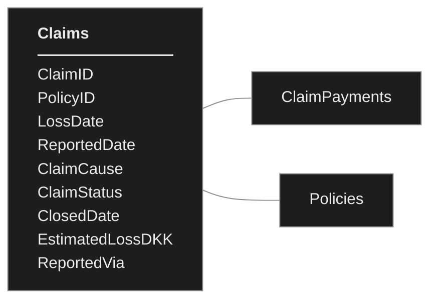

<div style="background:#101010;color:#eaeaea;padding:16px 22px;border-radius:8px;">

<a href="../index.md" style="color:#4cc2ff">← Danish Insurance Company Overview</a> · <a href="../beam-annotations.md" style="color:#4cc2ff">BEAM✲ Annotations</a> · <a href="../how-to-read.md" style="color:#4cc2ff">How to Read This Wiki</a>

# Claims

<table style="border-collapse:collapse;margin:8px 0;">
<tr><th scope="row" align="left" style="text-align:left;vertical-align:top;white-space:nowrap;font-weight:600;padding:6px 16px 6px 10px;background:#1d1d1d;color:#dcdcdc;border-bottom:1px solid #2c2c2c;">Description</th><td style="text-align:left;vertical-align:top;padding:6px 10px;background:#161616;color:#eaeaea;border-bottom:1px solid #2c2c2c;">A report from a policyholder that something insured has been lost or damaged, with when it happened, when it was reported, why, how it was reported, the estimated cost and whether it was settled, rejected or is still open. Closed claims carry the day they were closed.</td></tr>
<tr><th scope="row" align="left" style="text-align:left;vertical-align:top;white-space:nowrap;font-weight:600;padding:6px 16px 6px 10px;background:#1d1d1d;color:#dcdcdc;border-bottom:1px solid #2c2c2c;">Grain</th><td style="text-align:left;vertical-align:top;padding:6px 10px;background:#161616;color:#eaeaea;border-bottom:1px solid #2c2c2c;">One row for each claim made on a policy</td></tr>
<tr><th scope="row" align="left" style="text-align:left;vertical-align:top;white-space:nowrap;font-weight:600;padding:6px 16px 6px 10px;background:#1d1d1d;color:#dcdcdc;border-bottom:1px solid #2c2c2c;">BEAM✲</th><td style="text-align:left;vertical-align:top;padding:6px 10px;background:#161616;color:#eaeaea;border-bottom:1px solid #2c2c2c;"><a href="../beam-annotations.md#t-ee" style="color:#4cc2ff" title="Evolving Event: A process that takes time to complete and passes through milestones, e.g. order → ship → deliver. Becomes an accumulating snapshot [AS].">[EE]</a> <i>(suggested by AI)</i></td></tr>
<tr><th scope="row" align="left" style="text-align:left;vertical-align:top;white-space:nowrap;font-weight:600;padding:6px 16px 6px 10px;background:#1d1d1d;color:#dcdcdc;border-bottom:1px solid #2c2c2c;">Why <a href="../beam-annotations.md#t-ee" style="color:#4cc2ff" title="Evolving Event: A process that takes time to complete and passes through milestones, e.g. order → ship → deliver. Becomes an accumulating snapshot [AS].">[EE]</a></th><td style="text-align:left;vertical-align:top;padding:6px 10px;background:#161616;color:#eaeaea;border-bottom:1px solid #2c2c2c;">Three dates (LossDate, ReportedDate, ClosedDate) mark milestones of one claim, and ClosedDate is still empty for open claims.</td></tr>
<tr><th scope="row" align="left" style="text-align:left;vertical-align:top;white-space:nowrap;font-weight:600;padding:6px 16px 6px 10px;background:#1d1d1d;color:#dcdcdc;border-bottom:1px solid #2c2c2c;">Source</th><td style="text-align:left;vertical-align:top;padding:6px 10px;background:#161616;color:#eaeaea;border-bottom:1px solid #2c2c2c;"><a href="../beam-annotations.md#t-source" style="color:#4cc2ff" title="Data source: The source system table or file the table comes from.">{Claims.csv}</a> <i>(measured)</i></td></tr>
<tr><th scope="row" align="left" style="text-align:left;vertical-align:top;white-space:nowrap;font-weight:600;padding:6px 16px 6px 10px;background:#1d1d1d;color:#dcdcdc;border-bottom:1px solid #2c2c2c;">Sampled Rows</th><td style="text-align:left;vertical-align:top;padding:6px 10px;background:#161616;color:#eaeaea;border-bottom:1px solid #2c2c2c;">850</td></tr>
<tr><th scope="row" align="left" style="text-align:left;vertical-align:top;white-space:nowrap;font-weight:600;padding:6px 16px 6px 10px;background:#1d1d1d;color:#dcdcdc;border-bottom:1px solid #2c2c2c;">Columns</th><td style="text-align:left;vertical-align:top;padding:6px 10px;background:#161616;color:#eaeaea;border-bottom:1px solid #2c2c2c;">9</td></tr>
<tr><th scope="row" align="left" style="text-align:left;vertical-align:top;white-space:nowrap;font-weight:600;padding:6px 16px 6px 10px;background:#1d1d1d;color:#dcdcdc;border-bottom:1px solid #2c2c2c;">Description Source</th><td style="text-align:left;vertical-align:top;padding:6px 10px;background:#161616;color:#eaeaea;border-bottom:1px solid #2c2c2c;">Written by AI from the data. Check before relying on it.</td></tr>
<tr><th scope="row" align="left" style="text-align:left;vertical-align:top;white-space:nowrap;font-weight:600;padding:6px 16px 6px 10px;background:#1d1d1d;color:#dcdcdc;border-bottom:1px solid #2c2c2c;">Confidence</th><td style="text-align:left;vertical-align:top;padding:6px 10px;background:#161616;color:#eaeaea;border-bottom:1px solid #2c2c2c;">high</td></tr>
</table>

## Columns

<div style="overflow-x:auto;max-width:100%;">
<table style="border-collapse:separate;border-spacing:0;font-size:90%;">
<tr><td rowspan="3" style="position:sticky;left:0;z-index:2;box-sizing:border-box;width:34px;min-width:34px;max-width:34px;padding:0;border:0;background:transparent;"></td><th style="position:sticky;left:34px;z-index:2;border:0 solid #2c2c2c;border-width:0 1px 1px 0;background:#242424;color:#ffffff;padding:3px 8px;white-space:nowrap;text-align:left;vertical-align:top;font-weight:700;border-top:1px solid #2c2c2c;border-left:1px solid #2c2c2c;cursor:help;" title="The column as it is named in the data. Each column of the table is one column in this matrix.">Column Name</th><th style="border:0 solid #2c2c2c;border-width:0 1px 1px 0;padding:3px 8px;white-space:nowrap;text-align:left;vertical-align:top;background:#161616;color:#eaeaea;font-weight:600;background:#242424;color:#ffffff;border-top:1px solid #2c2c2c;">ClaimID</th><th style="border:0 solid #2c2c2c;border-width:0 1px 1px 0;padding:3px 8px;white-space:nowrap;text-align:left;vertical-align:top;background:#161616;color:#eaeaea;font-weight:600;background:#242424;color:#ffffff;border-top:1px solid #2c2c2c;">PolicyID</th><th style="border:0 solid #2c2c2c;border-width:0 1px 1px 0;padding:3px 8px;white-space:nowrap;text-align:left;vertical-align:top;background:#161616;color:#eaeaea;font-weight:600;background:#242424;color:#ffffff;border-top:1px solid #2c2c2c;">LossDate</th><th style="border:0 solid #2c2c2c;border-width:0 1px 1px 0;padding:3px 8px;white-space:nowrap;text-align:left;vertical-align:top;background:#161616;color:#eaeaea;font-weight:600;background:#242424;color:#ffffff;border-top:1px solid #2c2c2c;">ReportedDate</th><th style="border:0 solid #2c2c2c;border-width:0 1px 1px 0;padding:3px 8px;white-space:nowrap;text-align:left;vertical-align:top;background:#161616;color:#eaeaea;font-weight:600;background:#242424;color:#ffffff;border-top:1px solid #2c2c2c;">ClaimCause</th><th style="border:0 solid #2c2c2c;border-width:0 1px 1px 0;padding:3px 8px;white-space:nowrap;text-align:left;vertical-align:top;background:#161616;color:#eaeaea;font-weight:600;background:#242424;color:#ffffff;border-top:1px solid #2c2c2c;">ClaimStatus</th><th style="border:0 solid #2c2c2c;border-width:0 1px 1px 0;padding:3px 8px;white-space:nowrap;text-align:left;vertical-align:top;background:#161616;color:#eaeaea;font-weight:600;background:#242424;color:#ffffff;border-top:1px solid #2c2c2c;">ClosedDate</th><th style="border:0 solid #2c2c2c;border-width:0 1px 1px 0;padding:3px 8px;white-space:nowrap;text-align:left;vertical-align:top;background:#161616;color:#eaeaea;font-weight:600;background:#242424;color:#ffffff;border-top:1px solid #2c2c2c;">EstimatedLossDKK</th><th style="border:0 solid #2c2c2c;border-width:0 1px 1px 0;padding:3px 8px;white-space:nowrap;text-align:left;vertical-align:top;background:#161616;color:#eaeaea;font-weight:600;background:#242424;color:#ffffff;border-top:1px solid #2c2c2c;">ReportedVia</th></tr>
<tr><td style="position:sticky;left:34px;z-index:2;border:0 solid #2c2c2c;border-width:0 1px 1px 0;background:#1d1d1d;color:#dcdcdc;padding:3px 8px;white-space:nowrap;text-align:left;vertical-align:top;font-weight:600;border-left:1px solid #2c2c2c;cursor:help;" title="The kind of values found in the data, which may differ from what the source declares. The short code is a BEAM annotation, for example C9 is text with a longest value of 9 characters.">Data Type</td><td style="border:0 solid #2c2c2c;border-width:0 1px 1px 0;padding:3px 8px;white-space:nowrap;text-align:left;vertical-align:top;background:#161616;color:#eaeaea;"><a href="../beam-annotations.md#c-i" style="color:#4cc2ff" title="Integer: A whole number. (Measured from the data.)">I</a> whole number</td><td style="border:0 solid #2c2c2c;border-width:0 1px 1px 0;padding:3px 8px;white-space:nowrap;text-align:left;vertical-align:top;background:#161616;color:#eaeaea;"><a href="../beam-annotations.md#c-i" style="color:#4cc2ff" title="Integer: A whole number. (Measured from the data.)">I</a> whole number</td><td style="border:0 solid #2c2c2c;border-width:0 1px 1px 0;padding:3px 8px;white-space:nowrap;text-align:left;vertical-align:top;background:#161616;color:#eaeaea;"><a href="../beam-annotations.md#c-d" style="color:#4cc2ff" title="Date: A calendar date. Numbers order milestones, e.g. D1 → D2. (Measured from the data.)">D</a> date</td><td style="border:0 solid #2c2c2c;border-width:0 1px 1px 0;padding:3px 8px;white-space:nowrap;text-align:left;vertical-align:top;background:#161616;color:#eaeaea;"><a href="../beam-annotations.md#c-d" style="color:#4cc2ff" title="Date: A calendar date. Numbers order milestones, e.g. D1 → D2. (Measured from the data.)">D</a> date</td><td style="border:0 solid #2c2c2c;border-width:0 1px 1px 0;padding:3px 8px;white-space:nowrap;text-align:left;vertical-align:top;background:#161616;color:#eaeaea;"><a href="../beam-annotations.md#c-c" style="color:#4cc2ff" title="Character: Short text, with n = the longest value seen. (Measured from the data.)">C23</a> text</td><td style="border:0 solid #2c2c2c;border-width:0 1px 1px 0;padding:3px 8px;white-space:nowrap;text-align:left;vertical-align:top;background:#161616;color:#eaeaea;"><a href="../beam-annotations.md#c-c" style="color:#4cc2ff" title="Character: Short text, with n = the longest value seen. (Measured from the data.)">C9</a> text</td><td style="border:0 solid #2c2c2c;border-width:0 1px 1px 0;padding:3px 8px;white-space:nowrap;text-align:left;vertical-align:top;background:#161616;color:#eaeaea;"><a href="../beam-annotations.md#c-d" style="color:#4cc2ff" title="Date: A calendar date. Numbers order milestones, e.g. D1 → D2. (Measured from the data.)">D</a> date</td><td style="border:0 solid #2c2c2c;border-width:0 1px 1px 0;padding:3px 8px;white-space:nowrap;text-align:left;vertical-align:top;background:#161616;color:#eaeaea;"><a href="../beam-annotations.md#c-i" style="color:#4cc2ff" title="Integer: A whole number. (Measured from the data.)">I</a> whole number</td><td style="border:0 solid #2c2c2c;border-width:0 1px 1px 0;padding:3px 8px;white-space:nowrap;text-align:left;vertical-align:top;background:#161616;color:#eaeaea;"><a href="../beam-annotations.md#c-c" style="color:#4cc2ff" title="Character: Short text, with n = the longest value seen. (Measured from the data.)">C20</a> text</td></tr>
<tr><td style="position:sticky;left:34px;z-index:2;border:0 solid #2c2c2c;border-width:0 1px 1px 0;background:#1d1d1d;color:#dcdcdc;padding:3px 8px;white-space:nowrap;text-align:left;vertical-align:top;font-weight:600;border-left:1px solid #2c2c2c;cursor:help;" title="Short BEAM annotations. Plain codes are measured from the data. Codes in italics are suggested by AI and should be checked. Click a code to read what it means.">BEAM✲</td><td style="border:0 solid #2c2c2c;border-width:0 1px 1px 0;padding:3px 8px;white-space:nowrap;text-align:left;vertical-align:top;background:#161616;color:#eaeaea;"><a href="../beam-annotations.md#c-nd" style="color:#4cc2ff" title="No Duplicates: Every value is different. The numbered form marks columns that are unique in combination. In this wiki measured: no duplicates were found in the text or whole-number values profiled. (Measured from the data.)">ND</a> <i><a href="../beam-annotations.md#c-bk" style="color:#4cc2ff" title="Business Key: The source system&#x27;s own identifier for the thing the table is about, e.g. the customer number in a customers table. It identifies a row of this table. (Suggested by AI.)">BK</a></i></td><td style="border:0 solid #2c2c2c;border-width:0 1px 1px 0;padding:3px 8px;white-space:nowrap;text-align:left;vertical-align:top;background:#161616;color:#eaeaea;"><a href="../beam-annotations.md#c-fk" style="color:#4cc2ff" title="Foreign Key: Points to the key of another table. In this wiki measured: every value was found in the other table. (Measured from the data.)">FK</a> <i><a href="../beam-annotations.md#c-dim" style="color:#4cc2ff" title="Dimension or role: The dimension a detail refers to, e.g. PreferredStoreID [Stores] when the preferred store is a role of the store dimension. (Suggested by AI.)">[Policies]</a></i> <i><a href="../beam-annotations.md#w-who" style="color:#4cc2ff" title="[who]: Who is involved? For example customer, employee, supplier. (Suggested by AI.)">[who]</a></i></td><td style="border:0 solid #2c2c2c;border-width:0 1px 1px 0;padding:3px 8px;white-space:nowrap;text-align:left;vertical-align:top;background:#161616;color:#eaeaea;"><i><a href="../beam-annotations.md#w-when" style="color:#4cc2ff" title="[when]: When did it happen? For example order date, ship date. (Suggested by AI.)">[when]</a></i> <i><a href="../beam-annotations.md#c-md" style="color:#4cc2ff" title="Mandatory: The value should always be there under normal conditions. Shown as MD when the data has gaps. (Suggested by AI.)">MD</a></i></td><td style="border:0 solid #2c2c2c;border-width:0 1px 1px 0;padding:3px 8px;white-space:nowrap;text-align:left;vertical-align:top;background:#161616;color:#eaeaea;"><i><a href="../beam-annotations.md#w-when" style="color:#4cc2ff" title="[when]: When did it happen? For example order date, ship date. (Suggested by AI.)">[when]</a></i> <i><a href="../beam-annotations.md#c-md" style="color:#4cc2ff" title="Mandatory: The value should always be there under normal conditions. Shown as MD when the data has gaps. (Suggested by AI.)">MD</a></i></td><td style="border:0 solid #2c2c2c;border-width:0 1px 1px 0;padding:3px 8px;white-space:nowrap;text-align:left;vertical-align:top;background:#161616;color:#eaeaea;"><i><a href="../beam-annotations.md#w-why" style="color:#4cc2ff" title="[why]: Why did it happen? For example promotion, reason code. (Suggested by AI.)">[why]</a></i></td><td style="border:0 solid #2c2c2c;border-width:0 1px 1px 0;padding:3px 8px;white-space:nowrap;text-align:left;vertical-align:top;background:#161616;color:#eaeaea;"><i><a href="../beam-annotations.md#c-dc" style="color:#4cc2ff" title="Defining Characteristic: Its value decides which exclusive (X) columns apply, e.g. product type. (Suggested by AI.)">DC</a></i> <i><a href="../beam-annotations.md#c-important" style="color:#4cc2ff" title="Important: A key column for the purpose of this profile. (Suggested by AI.)">!</a></i></td><td style="border:0 solid #2c2c2c;border-width:0 1px 1px 0;padding:3px 8px;white-space:nowrap;text-align:left;vertical-align:top;background:#161616;color:#eaeaea;"><i><a href="../beam-annotations.md#w-when" style="color:#4cc2ff" title="[when]: When did it happen? For example order date, ship date. (Suggested by AI.)">[when]</a></i> <i><a href="../beam-annotations.md#c-dc" style="color:#4cc2ff" title="Defining Characteristic: Its value decides which exclusive (X) columns apply, e.g. product type. (Suggested by AI.)">DC</a></i></td><td style="border:0 solid #2c2c2c;border-width:0 1px 1px 0;padding:3px 8px;white-space:nowrap;text-align:left;vertical-align:top;background:#161616;color:#eaeaea;"><i><a href="../beam-annotations.md#c-fa" style="color:#4cc2ff" title="Fully Additive fact: Can be summed across everything, e.g. quantity or revenue. Needs a single unit of measure. (Suggested by AI.)">FA</a></i> <i><a href="../beam-annotations.md#c-important" style="color:#4cc2ff" title="Important: A key column for the purpose of this profile. (Suggested by AI.)">!</a></i></td><td style="border:0 solid #2c2c2c;border-width:0 1px 1px 0;padding:3px 8px;white-space:nowrap;text-align:left;vertical-align:top;background:#161616;color:#eaeaea;"><i><a href="../beam-annotations.md#w-how" style="color:#4cc2ff" title="[how]: How did it happen? For example channel, order number, payment method. (Suggested by AI.)">[how]</a></i></td></tr>
<tr><td rowspan="9" style="position:sticky;left:0;z-index:2;box-sizing:border-box;width:34px;min-width:34px;max-width:34px;border:0 solid #2c2c2c;border-width:0 1px 1px 0;background:#0f2f2c;color:#2de2c9;padding:4px 0;text-align:center;vertical-align:middle;border-left:3px solid #2de2c9;cursor:help;" title="Counts and extremes measured from the rows that were read. They are facts, not opinions."><div style="writing-mode:vertical-rl;transform:rotate(180deg);white-space:nowrap;margin:0 auto;font-weight:600;">Data Profiling Results</div></td><td style="position:sticky;left:34px;z-index:2;border:0 solid #2c2c2c;border-width:0 1px 1px 0;background:#1d1d1d;color:#dcdcdc;padding:3px 8px;white-space:nowrap;text-align:left;vertical-align:top;font-weight:600;cursor:help;" title="How many rows were read for these numbers. Every percentage in this group is based on it, so check it first: on very large tables it can be fewer than all rows.">Sample Count</td><td style="border:0 solid #2c2c2c;border-width:0 1px 1px 0;padding:3px 8px;white-space:nowrap;text-align:right;vertical-align:top;background:#161616;color:#eaeaea;background:#161616;">850</td><td style="border:0 solid #2c2c2c;border-width:0 1px 1px 0;padding:3px 8px;white-space:nowrap;text-align:right;vertical-align:top;background:#161616;color:#eaeaea;background:#161616;">850</td><td style="border:0 solid #2c2c2c;border-width:0 1px 1px 0;padding:3px 8px;white-space:nowrap;text-align:right;vertical-align:top;background:#161616;color:#eaeaea;background:#161616;">850</td><td style="border:0 solid #2c2c2c;border-width:0 1px 1px 0;padding:3px 8px;white-space:nowrap;text-align:right;vertical-align:top;background:#161616;color:#eaeaea;background:#161616;">850</td><td style="border:0 solid #2c2c2c;border-width:0 1px 1px 0;padding:3px 8px;white-space:nowrap;text-align:right;vertical-align:top;background:#161616;color:#eaeaea;background:#161616;">850</td><td style="border:0 solid #2c2c2c;border-width:0 1px 1px 0;padding:3px 8px;white-space:nowrap;text-align:right;vertical-align:top;background:#161616;color:#eaeaea;background:#161616;">850</td><td style="border:0 solid #2c2c2c;border-width:0 1px 1px 0;padding:3px 8px;white-space:nowrap;text-align:right;vertical-align:top;background:#161616;color:#eaeaea;background:#161616;">850</td><td style="border:0 solid #2c2c2c;border-width:0 1px 1px 0;padding:3px 8px;white-space:nowrap;text-align:right;vertical-align:top;background:#161616;color:#eaeaea;background:#161616;">850</td><td style="border:0 solid #2c2c2c;border-width:0 1px 1px 0;padding:3px 8px;white-space:nowrap;text-align:right;vertical-align:top;background:#161616;color:#eaeaea;background:#161616;">850</td></tr>
<tr><td style="position:sticky;left:34px;z-index:2;border:0 solid #2c2c2c;border-width:0 1px 1px 0;background:#1d1d1d;color:#dcdcdc;padding:3px 8px;white-space:nowrap;text-align:left;vertical-align:top;font-weight:600;cursor:help;" title="Rows where the column is empty or blank, with the share of rows. It matters because gaps break joins and totals, and a column that should always be filled in should show 0.">Missing</td><td style="border:0 solid #2c2c2c;border-width:0 1px 1px 0;padding:3px 8px;white-space:nowrap;text-align:left;vertical-align:top;background:#161616;color:#eaeaea;background:#161616;">0 (0%)</td><td style="border:0 solid #2c2c2c;border-width:0 1px 1px 0;padding:3px 8px;white-space:nowrap;text-align:left;vertical-align:top;background:#161616;color:#eaeaea;background:#161616;">0 (0%)</td><td style="border:0 solid #2c2c2c;border-width:0 1px 1px 0;padding:3px 8px;white-space:nowrap;text-align:left;vertical-align:top;background:#161616;color:#eaeaea;background:#161616;">0 (0%)</td><td style="border:0 solid #2c2c2c;border-width:0 1px 1px 0;padding:3px 8px;white-space:nowrap;text-align:left;vertical-align:top;background:#161616;color:#eaeaea;background:#161616;">0 (0%)</td><td style="border:0 solid #2c2c2c;border-width:0 1px 1px 0;padding:3px 8px;white-space:nowrap;text-align:left;vertical-align:top;background:#161616;color:#eaeaea;background:#161616;">0 (0%)</td><td style="border:0 solid #2c2c2c;border-width:0 1px 1px 0;padding:3px 8px;white-space:nowrap;text-align:left;vertical-align:top;background:#161616;color:#eaeaea;background:#161616;">0 (0%)</td><td style="border:0 solid #2c2c2c;border-width:0 1px 1px 0;padding:3px 8px;white-space:nowrap;text-align:left;vertical-align:top;background:#161616;color:#eaeaea;background:#161616;">41 (4.82%)</td><td style="border:0 solid #2c2c2c;border-width:0 1px 1px 0;padding:3px 8px;white-space:nowrap;text-align:left;vertical-align:top;background:#161616;color:#eaeaea;background:#161616;">0 (0%)</td><td style="border:0 solid #2c2c2c;border-width:0 1px 1px 0;padding:3px 8px;white-space:nowrap;text-align:left;vertical-align:top;background:#161616;color:#eaeaea;background:#161616;">0 (0%)</td></tr>
<tr><td style="position:sticky;left:34px;z-index:2;border:0 solid #2c2c2c;border-width:0 1px 1px 0;background:#1d1d1d;color:#dcdcdc;padding:3px 8px;white-space:nowrap;text-align:left;vertical-align:top;font-weight:600;cursor:help;" title="How many different values occur, with the share of rows. 100% means every value is different, so the column could identify a row. A low share means the column holds categories or codes.">Unique Values</td><td style="border:0 solid #2c2c2c;border-width:0 1px 1px 0;padding:3px 8px;white-space:nowrap;text-align:left;vertical-align:top;background:#161616;color:#eaeaea;background:#161616;">850 (100%)</td><td style="border:0 solid #2c2c2c;border-width:0 1px 1px 0;padding:3px 8px;white-space:nowrap;text-align:left;vertical-align:top;background:#161616;color:#eaeaea;background:#161616;">775 (91.2%)</td><td style="border:0 solid #2c2c2c;border-width:0 1px 1px 0;padding:3px 8px;white-space:nowrap;text-align:left;vertical-align:top;background:#161616;color:#eaeaea;background:#161616;">592 (69.6%)</td><td style="border:0 solid #2c2c2c;border-width:0 1px 1px 0;padding:3px 8px;white-space:nowrap;text-align:left;vertical-align:top;background:#161616;color:#eaeaea;background:#161616;">589 (69.3%)</td><td style="border:0 solid #2c2c2c;border-width:0 1px 1px 0;padding:3px 8px;white-space:nowrap;text-align:left;vertical-align:top;background:#161616;color:#eaeaea;background:#161616;">25 (2.94%)</td><td style="border:0 solid #2c2c2c;border-width:0 1px 1px 0;padding:3px 8px;white-space:nowrap;text-align:left;vertical-align:top;background:#161616;color:#eaeaea;background:#161616;">3 (0.353%)</td><td style="border:0 solid #2c2c2c;border-width:0 1px 1px 0;padding:3px 8px;white-space:nowrap;text-align:left;vertical-align:top;background:#161616;color:#eaeaea;background:#161616;">560 (65.9%)</td><td style="border:0 solid #2c2c2c;border-width:0 1px 1px 0;padding:3px 8px;white-space:nowrap;text-align:left;vertical-align:top;background:#161616;color:#eaeaea;background:#161616;">678 (79.8%)</td><td style="border:0 solid #2c2c2c;border-width:0 1px 1px 0;padding:3px 8px;white-space:nowrap;text-align:left;vertical-align:top;background:#161616;color:#eaeaea;background:#161616;">3 (0.353%)</td></tr>
<tr><td style="position:sticky;left:34px;z-index:2;border:0 solid #2c2c2c;border-width:0 1px 1px 0;background:#1d1d1d;color:#dcdcdc;padding:3px 8px;white-space:nowrap;text-align:left;vertical-align:top;font-weight:600;cursor:help;" title="The smallest value: the lowest number, the earliest date, or the first in alphabetical order. It matters because it shows the start of the range and catches impossible values such as a negative quantity.">Min Value</td><td style="border:0 solid #2c2c2c;border-width:0 1px 1px 0;padding:3px 8px;white-space:nowrap;text-align:left;vertical-align:top;background:#161616;color:#eaeaea;background:#161616;">900001</td><td style="border:0 solid #2c2c2c;border-width:0 1px 1px 0;padding:3px 8px;white-space:nowrap;text-align:left;vertical-align:top;background:#161616;color:#eaeaea;background:#161616;">700008</td><td style="border:0 solid #2c2c2c;border-width:0 1px 1px 0;padding:3px 8px;white-space:nowrap;text-align:left;vertical-align:top;background:#161616;color:#eaeaea;background:#161616;">2023-01-04</td><td style="border:0 solid #2c2c2c;border-width:0 1px 1px 0;padding:3px 8px;white-space:nowrap;text-align:left;vertical-align:top;background:#161616;color:#eaeaea;background:#161616;">2023-01-06</td><td style="border:0 solid #2c2c2c;border-width:0 1px 1px 0;padding:3px 8px;white-space:nowrap;text-align:left;vertical-align:top;background:#161616;color:#eaeaea;background:#161616;">Arbejdsulykke</td><td style="border:0 solid #2c2c2c;border-width:0 1px 1px 0;padding:3px 8px;white-space:nowrap;text-align:left;vertical-align:top;background:#161616;color:#eaeaea;background:#161616;">Afsluttet</td><td style="border:0 solid #2c2c2c;border-width:0 1px 1px 0;padding:3px 8px;white-space:nowrap;text-align:left;vertical-align:top;background:#161616;color:#eaeaea;background:#161616;">2023-01-22</td><td style="border:0 solid #2c2c2c;border-width:0 1px 1px 0;padding:3px 8px;white-space:nowrap;text-align:left;vertical-align:top;background:#161616;color:#eaeaea;background:#161616;">420</td><td style="border:0 solid #2c2c2c;border-width:0 1px 1px 0;padding:3px 8px;white-space:nowrap;text-align:left;vertical-align:top;background:#161616;color:#eaeaea;background:#161616;">App</td></tr>
<tr><td style="position:sticky;left:34px;z-index:2;border:0 solid #2c2c2c;border-width:0 1px 1px 0;background:#1d1d1d;color:#dcdcdc;padding:3px 8px;white-space:nowrap;text-align:left;vertical-align:top;font-weight:600;cursor:help;" title="How many rows have the smallest value. On a unique column it is 1. A high count suggests a default or a stand-in value, such as 0 or 1900-01-01, rather than a real minimum.">Min Count</td><td style="border:0 solid #2c2c2c;border-width:0 1px 1px 0;padding:3px 8px;white-space:nowrap;text-align:left;vertical-align:top;background:#161616;color:#eaeaea;background:#161616;">1 (0.118%)</td><td style="border:0 solid #2c2c2c;border-width:0 1px 1px 0;padding:3px 8px;white-space:nowrap;text-align:left;vertical-align:top;background:#161616;color:#eaeaea;background:#161616;">1 (0.118%)</td><td style="border:0 solid #2c2c2c;border-width:0 1px 1px 0;padding:3px 8px;white-space:nowrap;text-align:left;vertical-align:top;background:#161616;color:#eaeaea;background:#161616;">1 (0.118%)</td><td style="border:0 solid #2c2c2c;border-width:0 1px 1px 0;padding:3px 8px;white-space:nowrap;text-align:left;vertical-align:top;background:#161616;color:#eaeaea;background:#161616;">1 (0.118%)</td><td style="border:0 solid #2c2c2c;border-width:0 1px 1px 0;padding:3px 8px;white-space:nowrap;text-align:left;vertical-align:top;background:#161616;color:#eaeaea;background:#161616;">5 (0.588%)</td><td style="border:0 solid #2c2c2c;border-width:0 1px 1px 0;padding:3px 8px;white-space:nowrap;text-align:left;vertical-align:top;background:#161616;color:#eaeaea;background:#161616;">714 (84%)</td><td style="border:0 solid #2c2c2c;border-width:0 1px 1px 0;padding:3px 8px;white-space:nowrap;text-align:left;vertical-align:top;background:#161616;color:#eaeaea;background:#161616;">1 (0.118%)</td><td style="border:0 solid #2c2c2c;border-width:0 1px 1px 0;padding:3px 8px;white-space:nowrap;text-align:left;vertical-align:top;background:#161616;color:#eaeaea;background:#161616;">1 (0.118%)</td><td style="border:0 solid #2c2c2c;border-width:0 1px 1px 0;padding:3px 8px;white-space:nowrap;text-align:left;vertical-align:top;background:#161616;color:#eaeaea;background:#161616;">134 (15.8%)</td></tr>
<tr><td style="position:sticky;left:34px;z-index:2;border:0 solid #2c2c2c;border-width:0 1px 1px 0;background:#1d1d1d;color:#dcdcdc;padding:3px 8px;white-space:nowrap;text-align:left;vertical-align:top;font-weight:600;cursor:help;" title="The largest value: the highest number, the latest date, or the last in alphabetical order. It matters because it shows the end of the range and catches outliers or future dates.">Max Value</td><td style="border:0 solid #2c2c2c;border-width:0 1px 1px 0;padding:3px 8px;white-space:nowrap;text-align:left;vertical-align:top;background:#161616;color:#eaeaea;background:#161616;">900850</td><td style="border:0 solid #2c2c2c;border-width:0 1px 1px 0;padding:3px 8px;white-space:nowrap;text-align:left;vertical-align:top;background:#161616;color:#eaeaea;background:#161616;">705628</td><td style="border:0 solid #2c2c2c;border-width:0 1px 1px 0;padding:3px 8px;white-space:nowrap;text-align:left;vertical-align:top;background:#161616;color:#eaeaea;background:#161616;">2025-12-31</td><td style="border:0 solid #2c2c2c;border-width:0 1px 1px 0;padding:3px 8px;white-space:nowrap;text-align:left;vertical-align:top;background:#161616;color:#eaeaea;background:#161616;">2025-12-31</td><td style="border:0 solid #2c2c2c;border-width:0 1px 1px 0;padding:3px 8px;white-space:nowrap;text-align:left;vertical-align:top;background:#161616;color:#eaeaea;background:#161616;">Vejhjælp</td><td style="border:0 solid #2c2c2c;border-width:0 1px 1px 0;padding:3px 8px;white-space:nowrap;text-align:left;vertical-align:top;background:#161616;color:#eaeaea;background:#161616;">Åben</td><td style="border:0 solid #2c2c2c;border-width:0 1px 1px 0;padding:3px 8px;white-space:nowrap;text-align:left;vertical-align:top;background:#161616;color:#eaeaea;background:#161616;">2025-12-31</td><td style="border:0 solid #2c2c2c;border-width:0 1px 1px 0;padding:3px 8px;white-space:nowrap;text-align:left;vertical-align:top;background:#161616;color:#eaeaea;background:#161616;">895400</td><td style="border:0 solid #2c2c2c;border-width:0 1px 1px 0;padding:3px 8px;white-space:nowrap;text-align:left;vertical-align:top;background:#161616;color:#eaeaea;background:#161616;">Telefon</td></tr>
<tr><td style="position:sticky;left:34px;z-index:2;border:0 solid #2c2c2c;border-width:0 1px 1px 0;background:#1d1d1d;color:#dcdcdc;padding:3px 8px;white-space:nowrap;text-align:left;vertical-align:top;font-weight:600;cursor:help;" title="How many rows have the largest value. A high count suggests a cap or a stand-in value, such as 9999-12-31, rather than a real maximum.">Max Count</td><td style="border:0 solid #2c2c2c;border-width:0 1px 1px 0;padding:3px 8px;white-space:nowrap;text-align:left;vertical-align:top;background:#161616;color:#eaeaea;background:#161616;">1 (0.118%)</td><td style="border:0 solid #2c2c2c;border-width:0 1px 1px 0;padding:3px 8px;white-space:nowrap;text-align:left;vertical-align:top;background:#161616;color:#eaeaea;background:#161616;">1 (0.118%)</td><td style="border:0 solid #2c2c2c;border-width:0 1px 1px 0;padding:3px 8px;white-space:nowrap;text-align:left;vertical-align:top;background:#161616;color:#eaeaea;background:#161616;">1 (0.118%)</td><td style="border:0 solid #2c2c2c;border-width:0 1px 1px 0;padding:3px 8px;white-space:nowrap;text-align:left;vertical-align:top;background:#161616;color:#eaeaea;background:#161616;">3 (0.353%)</td><td style="border:0 solid #2c2c2c;border-width:0 1px 1px 0;padding:3px 8px;white-space:nowrap;text-align:left;vertical-align:top;background:#161616;color:#eaeaea;background:#161616;">31 (3.65%)</td><td style="border:0 solid #2c2c2c;border-width:0 1px 1px 0;padding:3px 8px;white-space:nowrap;text-align:left;vertical-align:top;background:#161616;color:#eaeaea;background:#161616;">41 (4.82%)</td><td style="border:0 solid #2c2c2c;border-width:0 1px 1px 0;padding:3px 8px;white-space:nowrap;text-align:left;vertical-align:top;background:#161616;color:#eaeaea;background:#161616;">12 (1.41%)</td><td style="border:0 solid #2c2c2c;border-width:0 1px 1px 0;padding:3px 8px;white-space:nowrap;text-align:left;vertical-align:top;background:#161616;color:#eaeaea;background:#161616;">1 (0.118%)</td><td style="border:0 solid #2c2c2c;border-width:0 1px 1px 0;padding:3px 8px;white-space:nowrap;text-align:left;vertical-align:top;background:#161616;color:#eaeaea;background:#161616;">290 (34.1%)</td></tr>
<tr><td style="position:sticky;left:34px;z-index:2;border:0 solid #2c2c2c;border-width:0 1px 1px 0;background:#1d1d1d;color:#dcdcdc;padding:3px 8px;white-space:nowrap;text-align:left;vertical-align:top;font-weight:600;cursor:help;" title="The shortest text, counted in characters. If it differs a lot from the longest, the column may mix formats, or have values that were cut off.">Min Length</td><td style="border:0 solid #2c2c2c;border-width:0 1px 1px 0;padding:3px 8px;white-space:nowrap;text-align:right;vertical-align:top;background:#161616;color:#eaeaea;background:#161616;">—</td><td style="border:0 solid #2c2c2c;border-width:0 1px 1px 0;padding:3px 8px;white-space:nowrap;text-align:right;vertical-align:top;background:#161616;color:#eaeaea;background:#161616;">—</td><td style="border:0 solid #2c2c2c;border-width:0 1px 1px 0;padding:3px 8px;white-space:nowrap;text-align:right;vertical-align:top;background:#161616;color:#eaeaea;background:#161616;">—</td><td style="border:0 solid #2c2c2c;border-width:0 1px 1px 0;padding:3px 8px;white-space:nowrap;text-align:right;vertical-align:top;background:#161616;color:#eaeaea;background:#161616;">—</td><td style="border:0 solid #2c2c2c;border-width:0 1px 1px 0;padding:3px 8px;white-space:nowrap;text-align:right;vertical-align:top;background:#161616;color:#eaeaea;background:#161616;">5</td><td style="border:0 solid #2c2c2c;border-width:0 1px 1px 0;padding:3px 8px;white-space:nowrap;text-align:right;vertical-align:top;background:#161616;color:#eaeaea;background:#161616;">4</td><td style="border:0 solid #2c2c2c;border-width:0 1px 1px 0;padding:3px 8px;white-space:nowrap;text-align:right;vertical-align:top;background:#161616;color:#eaeaea;background:#161616;">—</td><td style="border:0 solid #2c2c2c;border-width:0 1px 1px 0;padding:3px 8px;white-space:nowrap;text-align:right;vertical-align:top;background:#161616;color:#eaeaea;background:#161616;">—</td><td style="border:0 solid #2c2c2c;border-width:0 1px 1px 0;padding:3px 8px;white-space:nowrap;text-align:right;vertical-align:top;background:#161616;color:#eaeaea;background:#161616;">3</td></tr>
<tr><td style="position:sticky;left:34px;z-index:2;border:0 solid #2c2c2c;border-width:0 1px 1px 0;background:#1d1d1d;color:#dcdcdc;padding:3px 8px;white-space:nowrap;text-align:left;vertical-align:top;font-weight:600;cursor:help;" title="The longest text, counted in characters. It matters when you load the data elsewhere, because the target column must be wide enough.">Max Length</td><td style="border:0 solid #2c2c2c;border-width:0 1px 1px 0;padding:3px 8px;white-space:nowrap;text-align:right;vertical-align:top;background:#161616;color:#eaeaea;background:#161616;">—</td><td style="border:0 solid #2c2c2c;border-width:0 1px 1px 0;padding:3px 8px;white-space:nowrap;text-align:right;vertical-align:top;background:#161616;color:#eaeaea;background:#161616;">—</td><td style="border:0 solid #2c2c2c;border-width:0 1px 1px 0;padding:3px 8px;white-space:nowrap;text-align:right;vertical-align:top;background:#161616;color:#eaeaea;background:#161616;">—</td><td style="border:0 solid #2c2c2c;border-width:0 1px 1px 0;padding:3px 8px;white-space:nowrap;text-align:right;vertical-align:top;background:#161616;color:#eaeaea;background:#161616;">—</td><td style="border:0 solid #2c2c2c;border-width:0 1px 1px 0;padding:3px 8px;white-space:nowrap;text-align:right;vertical-align:top;background:#161616;color:#eaeaea;background:#161616;">23</td><td style="border:0 solid #2c2c2c;border-width:0 1px 1px 0;padding:3px 8px;white-space:nowrap;text-align:right;vertical-align:top;background:#161616;color:#eaeaea;background:#161616;">9</td><td style="border:0 solid #2c2c2c;border-width:0 1px 1px 0;padding:3px 8px;white-space:nowrap;text-align:right;vertical-align:top;background:#161616;color:#eaeaea;background:#161616;">—</td><td style="border:0 solid #2c2c2c;border-width:0 1px 1px 0;padding:3px 8px;white-space:nowrap;text-align:right;vertical-align:top;background:#161616;color:#eaeaea;background:#161616;">—</td><td style="border:0 solid #2c2c2c;border-width:0 1px 1px 0;padding:3px 8px;white-space:nowrap;text-align:right;vertical-align:top;background:#161616;color:#eaeaea;background:#161616;">20</td></tr>
<tr><td rowspan="6" style="position:sticky;left:0;z-index:2;box-sizing:border-box;width:34px;min-width:34px;max-width:34px;border:0 solid #2c2c2c;border-width:0 1px 1px 0;background:#2d1530;color:#ff6fd8;padding:4px 0;text-align:center;vertical-align:middle;border-left:3px solid #ff6fd8;cursor:help;" title="Examples taken from the measured values, to show how varied the column is and what odd values look like."><div style="writing-mode:vertical-rl;transform:rotate(180deg);white-space:nowrap;margin:0 auto;font-weight:600;">Variation</div></td><td style="position:sticky;left:34px;z-index:2;border:0 solid #2c2c2c;border-width:0 1px 1px 0;background:#1d1d1d;color:#dcdcdc;padding:3px 8px;white-space:nowrap;text-align:left;vertical-align:top;font-weight:600;cursor:help;" title="The most common value, so you can see what a normal row looks like. In a column where every value is different, this is just the first of them.">Typical</td><td style="border:0 solid #2c2c2c;border-width:0 1px 1px 0;padding:3px 8px;white-space:nowrap;text-align:left;vertical-align:top;background:#161616;color:#eaeaea;background:#161616;">900001</td><td style="border:0 solid #2c2c2c;border-width:0 1px 1px 0;padding:3px 8px;white-space:nowrap;text-align:left;vertical-align:top;background:#161616;color:#eaeaea;background:#161616;">702395</td><td style="border:0 solid #2c2c2c;border-width:0 1px 1px 0;padding:3px 8px;white-space:nowrap;text-align:left;vertical-align:top;background:#161616;color:#eaeaea;background:#161616;">2025-05-31</td><td style="border:0 solid #2c2c2c;border-width:0 1px 1px 0;padding:3px 8px;white-space:nowrap;text-align:left;vertical-align:top;background:#161616;color:#eaeaea;background:#161616;">2025-03-10</td><td style="border:0 solid #2c2c2c;border-width:0 1px 1px 0;padding:3px 8px;white-space:nowrap;text-align:left;vertical-align:top;background:#161616;color:#eaeaea;background:#161616;">Rudeskade</td><td style="border:0 solid #2c2c2c;border-width:0 1px 1px 0;padding:3px 8px;white-space:nowrap;text-align:left;vertical-align:top;background:#161616;color:#eaeaea;background:#161616;">Afsluttet</td><td style="border:0 solid #2c2c2c;border-width:0 1px 1px 0;padding:3px 8px;white-space:nowrap;text-align:left;vertical-align:top;background:#161616;color:#eaeaea;background:#161616;">2025-12-31</td><td style="border:0 solid #2c2c2c;border-width:0 1px 1px 0;padding:3px 8px;white-space:nowrap;text-align:left;vertical-align:top;background:#161616;color:#eaeaea;background:#161616;">13400</td><td style="border:0 solid #2c2c2c;border-width:0 1px 1px 0;padding:3px 8px;white-space:nowrap;text-align:left;vertical-align:top;background:#161616;color:#eaeaea;background:#161616;">Selvbetjening på web</td></tr>
<tr><td style="position:sticky;left:34px;z-index:2;border:0 solid #2c2c2c;border-width:0 1px 1px 0;background:#1d1d1d;color:#dcdcdc;padding:3px 8px;white-space:nowrap;text-align:left;vertical-align:top;font-weight:600;cursor:help;" title="A rare value, one of the least common. Odd values are often special cases or mistakes, so they are worth a look.">Different</td><td style="border:0 solid #2c2c2c;border-width:0 1px 1px 0;padding:3px 8px;white-space:nowrap;text-align:left;vertical-align:top;background:#161616;color:#eaeaea;background:#161616;">900002</td><td style="border:0 solid #2c2c2c;border-width:0 1px 1px 0;padding:3px 8px;white-space:nowrap;text-align:left;vertical-align:top;background:#161616;color:#eaeaea;background:#161616;">700008</td><td style="border:0 solid #2c2c2c;border-width:0 1px 1px 0;padding:3px 8px;white-space:nowrap;text-align:left;vertical-align:top;background:#161616;color:#eaeaea;background:#161616;">2023-01-04</td><td style="border:0 solid #2c2c2c;border-width:0 1px 1px 0;padding:3px 8px;white-space:nowrap;text-align:left;vertical-align:top;background:#161616;color:#eaeaea;background:#161616;">2023-01-06</td><td style="border:0 solid #2c2c2c;border-width:0 1px 1px 0;padding:3px 8px;white-space:nowrap;text-align:left;vertical-align:top;background:#161616;color:#eaeaea;background:#161616;">Ledningsbrud</td><td style="border:0 solid #2c2c2c;border-width:0 1px 1px 0;padding:3px 8px;white-space:nowrap;text-align:left;vertical-align:top;background:#161616;color:#eaeaea;background:#161616;">Åben</td><td style="border:0 solid #2c2c2c;border-width:0 1px 1px 0;padding:3px 8px;white-space:nowrap;text-align:left;vertical-align:top;background:#161616;color:#eaeaea;background:#161616;">2023-01-22</td><td style="border:0 solid #2c2c2c;border-width:0 1px 1px 0;padding:3px 8px;white-space:nowrap;text-align:left;vertical-align:top;background:#161616;color:#eaeaea;background:#161616;">1000</td><td style="border:0 solid #2c2c2c;border-width:0 1px 1px 0;padding:3px 8px;white-space:nowrap;text-align:left;vertical-align:top;background:#161616;color:#eaeaea;background:#161616;">App</td></tr>
<tr><td style="position:sticky;left:34px;z-index:2;border:0 solid #2c2c2c;border-width:0 1px 1px 0;background:#1d1d1d;color:#dcdcdc;padding:3px 8px;white-space:nowrap;text-align:left;vertical-align:top;font-weight:600;cursor:help;" title="A value that occurs more than once, and how many times (x3 means three rows). &#x27;No repeats&#x27; means every value is different.">Repeat</td><td style="border:0 solid #2c2c2c;border-width:0 1px 1px 0;padding:3px 8px;white-space:nowrap;text-align:left;vertical-align:top;background:#161616;color:#eaeaea;background:#161616;">no repeats</td><td style="border:0 solid #2c2c2c;border-width:0 1px 1px 0;padding:3px 8px;white-space:nowrap;text-align:left;vertical-align:top;background:#161616;color:#eaeaea;background:#161616;">702667 ×3</td><td style="border:0 solid #2c2c2c;border-width:0 1px 1px 0;padding:3px 8px;white-space:nowrap;text-align:left;vertical-align:top;background:#161616;color:#eaeaea;background:#161616;">2025-09-03 ×4</td><td style="border:0 solid #2c2c2c;border-width:0 1px 1px 0;padding:3px 8px;white-space:nowrap;text-align:left;vertical-align:top;background:#161616;color:#eaeaea;background:#161616;">2024-05-15 ×4</td><td style="border:0 solid #2c2c2c;border-width:0 1px 1px 0;padding:3px 8px;white-space:nowrap;text-align:left;vertical-align:top;background:#161616;color:#eaeaea;background:#161616;">Vandskade ×98</td><td style="border:0 solid #2c2c2c;border-width:0 1px 1px 0;padding:3px 8px;white-space:nowrap;text-align:left;vertical-align:top;background:#161616;color:#eaeaea;background:#161616;">Afvist ×95</td><td style="border:0 solid #2c2c2c;border-width:0 1px 1px 0;padding:3px 8px;white-space:nowrap;text-align:left;vertical-align:top;background:#161616;color:#eaeaea;background:#161616;">2023-12-30 ×5</td><td style="border:0 solid #2c2c2c;border-width:0 1px 1px 0;padding:3px 8px;white-space:nowrap;text-align:left;vertical-align:top;background:#161616;color:#eaeaea;background:#161616;">19300 ×4</td><td style="border:0 solid #2c2c2c;border-width:0 1px 1px 0;padding:3px 8px;white-space:nowrap;text-align:left;vertical-align:top;background:#161616;color:#eaeaea;background:#161616;">Telefon ×290</td></tr>
<tr><td style="position:sticky;left:34px;z-index:2;border:0 solid #2c2c2c;border-width:0 1px 1px 0;background:#1d1d1d;color:#dcdcdc;padding:3px 8px;white-space:nowrap;text-align:left;vertical-align:top;font-weight:600;cursor:help;" title="What stands in for &#x27;no value&#x27;: empty cells and stand-in words such as N/A or unknown, with how many of each. Stand-ins are easy to mistake for real values.">Missing</td><td style="border:0 solid #2c2c2c;border-width:0 1px 1px 0;padding:3px 8px;white-space:nowrap;text-align:left;vertical-align:top;background:#161616;color:#eaeaea;background:#161616;">—</td><td style="border:0 solid #2c2c2c;border-width:0 1px 1px 0;padding:3px 8px;white-space:nowrap;text-align:left;vertical-align:top;background:#161616;color:#eaeaea;background:#161616;">—</td><td style="border:0 solid #2c2c2c;border-width:0 1px 1px 0;padding:3px 8px;white-space:nowrap;text-align:left;vertical-align:top;background:#161616;color:#eaeaea;background:#161616;">—</td><td style="border:0 solid #2c2c2c;border-width:0 1px 1px 0;padding:3px 8px;white-space:nowrap;text-align:left;vertical-align:top;background:#161616;color:#eaeaea;background:#161616;">—</td><td style="border:0 solid #2c2c2c;border-width:0 1px 1px 0;padding:3px 8px;white-space:nowrap;text-align:left;vertical-align:top;background:#161616;color:#eaeaea;background:#161616;">—</td><td style="border:0 solid #2c2c2c;border-width:0 1px 1px 0;padding:3px 8px;white-space:nowrap;text-align:left;vertical-align:top;background:#161616;color:#eaeaea;background:#161616;">—</td><td style="border:0 solid #2c2c2c;border-width:0 1px 1px 0;padding:3px 8px;white-space:nowrap;text-align:left;vertical-align:top;background:#161616;color:#eaeaea;background:#161616;">empty ×41</td><td style="border:0 solid #2c2c2c;border-width:0 1px 1px 0;padding:3px 8px;white-space:nowrap;text-align:left;vertical-align:top;background:#161616;color:#eaeaea;background:#161616;">—</td><td style="border:0 solid #2c2c2c;border-width:0 1px 1px 0;padding:3px 8px;white-space:nowrap;text-align:left;vertical-align:top;background:#161616;color:#eaeaea;background:#161616;">—</td></tr>
<tr><td style="position:sticky;left:34px;z-index:2;border:0 solid #2c2c2c;border-width:0 1px 1px 0;background:#1d1d1d;color:#dcdcdc;padding:3px 8px;white-space:nowrap;text-align:left;vertical-align:top;font-weight:600;cursor:help;" title="From the smallest to the largest value in one line, to show the spread at a glance.">Range</td><td style="border:0 solid #2c2c2c;border-width:0 1px 1px 0;padding:3px 8px;white-space:nowrap;text-align:left;vertical-align:top;background:#161616;color:#eaeaea;background:#161616;">900001 → 900850</td><td style="border:0 solid #2c2c2c;border-width:0 1px 1px 0;padding:3px 8px;white-space:nowrap;text-align:left;vertical-align:top;background:#161616;color:#eaeaea;background:#161616;">700008 → 705628</td><td style="border:0 solid #2c2c2c;border-width:0 1px 1px 0;padding:3px 8px;white-space:nowrap;text-align:left;vertical-align:top;background:#161616;color:#eaeaea;background:#161616;">2023-01-04 → 2025-12-31</td><td style="border:0 solid #2c2c2c;border-width:0 1px 1px 0;padding:3px 8px;white-space:nowrap;text-align:left;vertical-align:top;background:#161616;color:#eaeaea;background:#161616;">2023-01-06 → 2025-12-31</td><td style="border:0 solid #2c2c2c;border-width:0 1px 1px 0;padding:3px 8px;white-space:nowrap;text-align:left;vertical-align:top;background:#161616;color:#eaeaea;background:#161616;">Arbejdsulykke → Vejhjælp</td><td style="border:0 solid #2c2c2c;border-width:0 1px 1px 0;padding:3px 8px;white-space:nowrap;text-align:left;vertical-align:top;background:#161616;color:#eaeaea;background:#161616;">Afsluttet → Åben</td><td style="border:0 solid #2c2c2c;border-width:0 1px 1px 0;padding:3px 8px;white-space:nowrap;text-align:left;vertical-align:top;background:#161616;color:#eaeaea;background:#161616;">2023-01-22 → 2025-12-31</td><td style="border:0 solid #2c2c2c;border-width:0 1px 1px 0;padding:3px 8px;white-space:nowrap;text-align:left;vertical-align:top;background:#161616;color:#eaeaea;background:#161616;">420 → 895400</td><td style="border:0 solid #2c2c2c;border-width:0 1px 1px 0;padding:3px 8px;white-space:nowrap;text-align:left;vertical-align:top;background:#161616;color:#eaeaea;background:#161616;">App → Telefon</td></tr>
<tr><td style="position:sticky;left:34px;z-index:2;border:0 solid #2c2c2c;border-width:0 1px 1px 0;background:#1d1d1d;color:#dcdcdc;padding:3px 8px;white-space:nowrap;text-align:left;vertical-align:top;font-weight:600;cursor:help;" title="How values change over time cannot be seen in a single snapshot. Profile the same data again later and compare to see it.">Change</td><td style="border:0 solid #2c2c2c;border-width:0 1px 1px 0;padding:3px 8px;white-space:nowrap;text-align:left;vertical-align:top;background:#161616;color:#eaeaea;background:#161616;">—</td><td style="border:0 solid #2c2c2c;border-width:0 1px 1px 0;padding:3px 8px;white-space:nowrap;text-align:left;vertical-align:top;background:#161616;color:#eaeaea;background:#161616;">—</td><td style="border:0 solid #2c2c2c;border-width:0 1px 1px 0;padding:3px 8px;white-space:nowrap;text-align:left;vertical-align:top;background:#161616;color:#eaeaea;background:#161616;">—</td><td style="border:0 solid #2c2c2c;border-width:0 1px 1px 0;padding:3px 8px;white-space:nowrap;text-align:left;vertical-align:top;background:#161616;color:#eaeaea;background:#161616;">—</td><td style="border:0 solid #2c2c2c;border-width:0 1px 1px 0;padding:3px 8px;white-space:nowrap;text-align:left;vertical-align:top;background:#161616;color:#eaeaea;background:#161616;">—</td><td style="border:0 solid #2c2c2c;border-width:0 1px 1px 0;padding:3px 8px;white-space:nowrap;text-align:left;vertical-align:top;background:#161616;color:#eaeaea;background:#161616;">—</td><td style="border:0 solid #2c2c2c;border-width:0 1px 1px 0;padding:3px 8px;white-space:nowrap;text-align:left;vertical-align:top;background:#161616;color:#eaeaea;background:#161616;">—</td><td style="border:0 solid #2c2c2c;border-width:0 1px 1px 0;padding:3px 8px;white-space:nowrap;text-align:left;vertical-align:top;background:#161616;color:#eaeaea;background:#161616;">—</td><td style="border:0 solid #2c2c2c;border-width:0 1px 1px 0;padding:3px 8px;white-space:nowrap;text-align:left;vertical-align:top;background:#161616;color:#eaeaea;background:#161616;">—</td></tr>
<tr><td rowspan="6" style="position:sticky;left:0;z-index:2;box-sizing:border-box;width:34px;min-width:34px;max-width:34px;border:0 solid #2c2c2c;border-width:0 1px 1px 0;background:#0b2a3d;color:#4cc2ff;padding:4px 0;text-align:center;vertical-align:middle;border-left:3px solid #4cc2ff;cursor:help;" title="How the values are spread: a small histogram, its shape, the middle value, the spread, and any outliers and gaps. Counted from the rows that were read."><div style="writing-mode:vertical-rl;transform:rotate(180deg);white-space:nowrap;margin:0 auto;font-weight:600;">Distribution</div></td><td style="position:sticky;left:34px;z-index:2;border:0 solid #2c2c2c;border-width:0 1px 1px 0;background:#1d1d1d;color:#dcdcdc;padding:3px 8px;white-space:nowrap;text-align:left;vertical-align:top;font-weight:600;cursor:help;" title="How the rows are spread over ranges of values (bins). Each bar is one bin and its height is the number of rows. Hover a bar for its range and count. Orange bars are outliers, dashed boxes are gaps with no rows. Categories show the most frequent values. Keys, names and other personal data are not charted.">Histogram</td><td style="border:0 solid #2c2c2c;border-width:0 1px 1px 0;padding:3px 8px;white-space:nowrap;text-align:left;vertical-align:top;background:#161616;color:#eaeaea;background:#161616;">—</td><td style="border:0 solid #2c2c2c;border-width:0 1px 1px 0;padding:3px 8px;white-space:nowrap;text-align:left;vertical-align:top;background:#161616;color:#eaeaea;background:#161616;">—</td><td style="border:0 solid #2c2c2c;border-width:0 1px 1px 0;padding:3px 8px;white-space:nowrap;text-align:left;vertical-align:top;background:#161616;color:#eaeaea;background:#161616;"><table style="border-collapse:collapse;border:0;margin:0;background:transparent;"><tr style="vertical-align:bottom"><td title="2023 Q1: 68 rows (8%)" style="padding:0 1px;border:0;background:transparent;vertical-align:bottom;"><div style="width:9px;height:27px;background:#4cc2ff;"></div></td><td title="2023 Q2: 77 rows (9.06%)" style="padding:0 1px;border:0;background:transparent;vertical-align:bottom;"><div style="width:9px;height:30px;background:#4cc2ff;"></div></td><td title="2023 Q3: 54 rows (6.35%)" style="padding:0 1px;border:0;background:transparent;vertical-align:bottom;"><div style="width:9px;height:21px;background:#4cc2ff;"></div></td><td title="2023 Q4: 68 rows (8%)" style="padding:0 1px;border:0;background:transparent;vertical-align:bottom;"><div style="width:9px;height:27px;background:#4cc2ff;"></div></td><td title="2024 Q1: 73 rows (8.59%)" style="padding:0 1px;border:0;background:transparent;vertical-align:bottom;"><div style="width:9px;height:29px;background:#4cc2ff;"></div></td><td title="2024 Q2: 67 rows (7.88%)" style="padding:0 1px;border:0;background:transparent;vertical-align:bottom;"><div style="width:9px;height:26px;background:#4cc2ff;"></div></td><td title="2024 Q3: 70 rows (8.24%)" style="padding:0 1px;border:0;background:transparent;vertical-align:bottom;"><div style="width:9px;height:28px;background:#4cc2ff;"></div></td><td title="2024 Q4: 86 rows (10.12%)" style="padding:0 1px;border:0;background:transparent;vertical-align:bottom;"><div style="width:9px;height:34px;background:#4cc2ff;"></div></td><td title="2025 Q1: 75 rows (8.82%)" style="padding:0 1px;border:0;background:transparent;vertical-align:bottom;"><div style="width:9px;height:30px;background:#4cc2ff;"></div></td><td title="2025 Q2: 66 rows (7.76%)" style="padding:0 1px;border:0;background:transparent;vertical-align:bottom;"><div style="width:9px;height:26px;background:#4cc2ff;"></div></td><td title="2025 Q3: 81 rows (9.53%)" style="padding:0 1px;border:0;background:transparent;vertical-align:bottom;"><div style="width:9px;height:32px;background:#4cc2ff;"></div></td><td title="2025 Q4: 65 rows (7.65%)" style="padding:0 1px;border:0;background:transparent;vertical-align:bottom;"><div style="width:9px;height:26px;background:#4cc2ff;"></div></td></tr></table><div style="font-size:75%;opacity:.75;white-space:nowrap;">2023 Q1 → 2025 Q4</div></td><td style="border:0 solid #2c2c2c;border-width:0 1px 1px 0;padding:3px 8px;white-space:nowrap;text-align:left;vertical-align:top;background:#161616;color:#eaeaea;background:#161616;"><table style="border-collapse:collapse;border:0;margin:0;background:transparent;"><tr style="vertical-align:bottom"><td title="2023 Q1: 62 rows (7.29%)" style="padding:0 1px;border:0;background:transparent;vertical-align:bottom;"><div style="width:9px;height:26px;background:#4cc2ff;"></div></td><td title="2023 Q2: 81 rows (9.53%)" style="padding:0 1px;border:0;background:transparent;vertical-align:bottom;"><div style="width:9px;height:34px;background:#4cc2ff;"></div></td><td title="2023 Q3: 55 rows (6.47%)" style="padding:0 1px;border:0;background:transparent;vertical-align:bottom;"><div style="width:9px;height:23px;background:#4cc2ff;"></div></td><td title="2023 Q4: 66 rows (7.76%)" style="padding:0 1px;border:0;background:transparent;vertical-align:bottom;"><div style="width:9px;height:27px;background:#4cc2ff;"></div></td><td title="2024 Q1: 72 rows (8.47%)" style="padding:0 1px;border:0;background:transparent;vertical-align:bottom;"><div style="width:9px;height:30px;background:#4cc2ff;"></div></td><td title="2024 Q2: 69 rows (8.12%)" style="padding:0 1px;border:0;background:transparent;vertical-align:bottom;"><div style="width:9px;height:29px;background:#4cc2ff;"></div></td><td title="2024 Q3: 69 rows (8.12%)" style="padding:0 1px;border:0;background:transparent;vertical-align:bottom;"><div style="width:9px;height:29px;background:#4cc2ff;"></div></td><td title="2024 Q4: 82 rows (9.65%)" style="padding:0 1px;border:0;background:transparent;vertical-align:bottom;"><div style="width:9px;height:34px;background:#4cc2ff;"></div></td><td title="2025 Q1: 81 rows (9.53%)" style="padding:0 1px;border:0;background:transparent;vertical-align:bottom;"><div style="width:9px;height:34px;background:#4cc2ff;"></div></td><td title="2025 Q2: 65 rows (7.65%)" style="padding:0 1px;border:0;background:transparent;vertical-align:bottom;"><div style="width:9px;height:27px;background:#4cc2ff;"></div></td><td title="2025 Q3: 77 rows (9.06%)" style="padding:0 1px;border:0;background:transparent;vertical-align:bottom;"><div style="width:9px;height:32px;background:#4cc2ff;"></div></td><td title="2025 Q4: 71 rows (8.35%)" style="padding:0 1px;border:0;background:transparent;vertical-align:bottom;"><div style="width:9px;height:29px;background:#4cc2ff;"></div></td></tr></table><div style="font-size:75%;opacity:.75;white-space:nowrap;">2023 Q1 → 2025 Q4</div></td><td style="border:0 solid #2c2c2c;border-width:0 1px 1px 0;padding:3px 8px;white-space:nowrap;text-align:left;vertical-align:top;background:#161616;color:#eaeaea;background:#161616;"><table style="border-collapse:collapse;border:0;margin:0;background:transparent;"><tr style="vertical-align:bottom"><td title="Rudeskade: 141 rows (16.59%)" style="padding:0 1px;border:0;background:transparent;vertical-align:bottom;"><div style="width:9px;height:23px;background:#4cc2ff;"></div></td><td title="Vandskade: 98 rows (11.53%)" style="padding:0 1px;border:0;background:transparent;vertical-align:bottom;"><div style="width:9px;height:16px;background:#4cc2ff;"></div></td><td title="Skade på andres bil: 77 rows (9.06%)" style="padding:0 1px;border:0;background:transparent;vertical-align:bottom;"><div style="width:9px;height:12px;background:#4cc2ff;"></div></td><td title="Kollision: 65 rows (7.65%)" style="padding:0 1px;border:0;background:transparent;vertical-align:bottom;"><div style="width:9px;height:10px;background:#4cc2ff;"></div></td><td title="Sygdom hos dyret: 63 rows (7.41%)" style="padding:0 1px;border:0;background:transparent;vertical-align:bottom;"><div style="width:9px;height:10px;background:#4cc2ff;"></div></td><td title="Indbrud: 54 rows (6.35%)" style="padding:0 1px;border:0;background:transparent;vertical-align:bottom;"><div style="width:9px;height:9px;background:#4cc2ff;"></div></td><td title="Tyveri: 40 rows (4.71%)" style="padding:0 1px;border:0;background:transparent;vertical-align:bottom;"><div style="width:9px;height:6px;background:#4cc2ff;"></div></td><td title="Sygdom under rejsen: 38 rows (4.47%)" style="padding:0 1px;border:0;background:transparent;vertical-align:bottom;"><div style="width:9px;height:6px;background:#4cc2ff;"></div></td><td title="Storm eller hærværk: 32 rows (3.76%)" style="padding:0 1px;border:0;background:transparent;vertical-align:bottom;"><div style="width:9px;height:5px;background:#4cc2ff;"></div></td><td title="Rejseafbrydelse: 31 rows (3.65%)" style="padding:0 1px;border:0;background:transparent;vertical-align:bottom;"><div style="width:9px;height:5px;background:#4cc2ff;"></div></td><td title="Other (15 values): 211 rows (24.82%) (rare values grouped to protect small groups)" style="padding:0 1px;border:0;background:transparent;vertical-align:bottom;"><div style="width:9px;height:34px;background:#ff9f43;"></div></td></tr></table><div style="font-size:75%;opacity:.75;white-space:nowrap;">Rudeskade 16.59%</div></td><td style="border:0 solid #2c2c2c;border-width:0 1px 1px 0;padding:3px 8px;white-space:nowrap;text-align:left;vertical-align:top;background:#161616;color:#eaeaea;background:#161616;"><table style="border-collapse:collapse;border:0;margin:0;background:transparent;"><tr style="vertical-align:bottom"><td title="Afsluttet: 714 rows (84%)" style="padding:0 1px;border:0;background:transparent;vertical-align:bottom;"><div style="width:9px;height:34px;background:#4cc2ff;"></div></td><td title="Afvist: 95 rows (11.18%)" style="padding:0 1px;border:0;background:transparent;vertical-align:bottom;"><div style="width:9px;height:5px;background:#4cc2ff;"></div></td><td title="Åben: 41 rows (4.82%)" style="padding:0 1px;border:0;background:transparent;vertical-align:bottom;"><div style="width:9px;height:2px;background:#4cc2ff;"></div></td></tr></table><div style="font-size:75%;opacity:.75;white-space:nowrap;">Afsluttet 84%</div></td><td style="border:0 solid #2c2c2c;border-width:0 1px 1px 0;padding:3px 8px;white-space:nowrap;text-align:left;vertical-align:top;background:#161616;color:#eaeaea;background:#161616;"><table style="border-collapse:collapse;border:0;margin:0;background:transparent;"><tr style="vertical-align:bottom"><td title="2023 Q1: 20 rows (2.47%)" style="padding:0 1px;border:0;background:transparent;vertical-align:bottom;"><div style="width:9px;height:8px;background:#4cc2ff;"></div></td><td title="2023 Q2: 71 rows (8.78%)" style="padding:0 1px;border:0;background:transparent;vertical-align:bottom;"><div style="width:9px;height:30px;background:#4cc2ff;"></div></td><td title="2023 Q3: 69 rows (8.53%)" style="padding:0 1px;border:0;background:transparent;vertical-align:bottom;"><div style="width:9px;height:29px;background:#4cc2ff;"></div></td><td title="2023 Q4: 57 rows (7.05%)" style="padding:0 1px;border:0;background:transparent;vertical-align:bottom;"><div style="width:9px;height:24px;background:#4cc2ff;"></div></td><td title="2024 Q1: 73 rows (9.02%)" style="padding:0 1px;border:0;background:transparent;vertical-align:bottom;"><div style="width:9px;height:31px;background:#4cc2ff;"></div></td><td title="2024 Q2: 69 rows (8.53%)" style="padding:0 1px;border:0;background:transparent;vertical-align:bottom;"><div style="width:9px;height:29px;background:#4cc2ff;"></div></td><td title="2024 Q3: 73 rows (9.02%)" style="padding:0 1px;border:0;background:transparent;vertical-align:bottom;"><div style="width:9px;height:31px;background:#4cc2ff;"></div></td><td title="2024 Q4: 72 rows (8.9%)" style="padding:0 1px;border:0;background:transparent;vertical-align:bottom;"><div style="width:9px;height:31px;background:#4cc2ff;"></div></td><td title="2025 Q1: 80 rows (9.89%)" style="padding:0 1px;border:0;background:transparent;vertical-align:bottom;"><div style="width:9px;height:34px;background:#4cc2ff;"></div></td><td title="2025 Q2: 72 rows (8.9%)" style="padding:0 1px;border:0;background:transparent;vertical-align:bottom;"><div style="width:9px;height:31px;background:#4cc2ff;"></div></td><td title="2025 Q3: 74 rows (9.15%)" style="padding:0 1px;border:0;background:transparent;vertical-align:bottom;"><div style="width:9px;height:31px;background:#4cc2ff;"></div></td><td title="2025 Q4: 79 rows (9.77%)" style="padding:0 1px;border:0;background:transparent;vertical-align:bottom;"><div style="width:9px;height:34px;background:#4cc2ff;"></div></td></tr></table><div style="font-size:75%;opacity:.75;white-space:nowrap;">2023 Q1 → 2025 Q4</div></td><td style="border:0 solid #2c2c2c;border-width:0 1px 1px 0;padding:3px 8px;white-space:nowrap;text-align:left;vertical-align:top;background:#161616;color:#eaeaea;background:#161616;"><table style="border-collapse:collapse;border:0;margin:0;background:transparent;"><tr style="vertical-align:bottom"><td title="0–4,999: 244 rows (28.71%)" style="padding:0 1px;border:0;background:transparent;vertical-align:bottom;"><div style="width:7px;height:34px;background:#4cc2ff;"></div></td><td title="5,000–9,999: 145 rows (17.06%)" style="padding:0 1px;border:0;background:transparent;vertical-align:bottom;"><div style="width:7px;height:20px;background:#4cc2ff;"></div></td><td title="10,000–14,999: 109 rows (12.82%)" style="padding:0 1px;border:0;background:transparent;vertical-align:bottom;"><div style="width:7px;height:15px;background:#4cc2ff;"></div></td><td title="15,000–19,999: 72 rows (8.47%)" style="padding:0 1px;border:0;background:transparent;vertical-align:bottom;"><div style="width:7px;height:10px;background:#4cc2ff;"></div></td><td title="20,000–24,999: 60 rows (7.06%)" style="padding:0 1px;border:0;background:transparent;vertical-align:bottom;"><div style="width:7px;height:8px;background:#4cc2ff;"></div></td><td title="25,000–29,999: 27 rows (3.18%)" style="padding:0 1px;border:0;background:transparent;vertical-align:bottom;"><div style="width:7px;height:4px;background:#4cc2ff;"></div></td><td title="30,000–34,999: 25 rows (2.94%)" style="padding:0 1px;border:0;background:transparent;vertical-align:bottom;"><div style="width:7px;height:3px;background:#4cc2ff;"></div></td><td title="35,000–39,999: 23 rows (2.71%)" style="padding:0 1px;border:0;background:transparent;vertical-align:bottom;"><div style="width:7px;height:3px;background:#4cc2ff;"></div></td><td title="40,000–44,999: 10 rows (1.18%)" style="padding:0 1px;border:0;background:transparent;vertical-align:bottom;"><div style="width:7px;height:2px;background:#4cc2ff;"></div></td><td title="45,000–49,999: 13 rows (1.53%)" style="padding:0 1px;border:0;background:transparent;vertical-align:bottom;"><div style="width:7px;height:2px;background:#4cc2ff;"></div></td><td title="50,000–54,999: 10 rows (1.18%)" style="padding:0 1px;border:0;background:transparent;vertical-align:bottom;"><div style="width:7px;height:2px;background:#4cc2ff;"></div></td><td title="55,000–59,999: 19 rows (2.24%)" style="padding:0 1px;border:0;background:transparent;vertical-align:bottom;"><div style="width:7px;height:3px;background:#4cc2ff;"></div></td><td title="above 60,000: 93 rows (10.94%) (outliers: far outside the usual range)" style="padding:0 1px;border:0;background:transparent;vertical-align:bottom;"><div style="width:7px;height:13px;background:#ff9f43;"></div></td></tr></table><div style="font-size:75%;opacity:.75;white-space:nowrap;">0 → 59,999</div></td><td style="border:0 solid #2c2c2c;border-width:0 1px 1px 0;padding:3px 8px;white-space:nowrap;text-align:left;vertical-align:top;background:#161616;color:#eaeaea;background:#161616;"><table style="border-collapse:collapse;border:0;margin:0;background:transparent;"><tr style="vertical-align:bottom"><td title="Selvbetjening på web: 426 rows (50.12%)" style="padding:0 1px;border:0;background:transparent;vertical-align:bottom;"><div style="width:9px;height:34px;background:#4cc2ff;"></div></td><td title="Telefon: 290 rows (34.12%)" style="padding:0 1px;border:0;background:transparent;vertical-align:bottom;"><div style="width:9px;height:23px;background:#4cc2ff;"></div></td><td title="App: 134 rows (15.76%)" style="padding:0 1px;border:0;background:transparent;vertical-align:bottom;"><div style="width:9px;height:11px;background:#4cc2ff;"></div></td></tr></table><div style="font-size:75%;opacity:.75;white-space:nowrap;">Selvbetjening på web 50.12%</div></td></tr>
<tr><td style="position:sticky;left:34px;z-index:2;border:0 solid #2c2c2c;border-width:0 1px 1px 0;background:#1d1d1d;color:#dcdcdc;padding:3px 8px;white-space:nowrap;text-align:left;vertical-align:top;font-weight:600;cursor:help;" title="The overall form of the histogram: symmetric, right-skewed, left-skewed, uniform, bimodal or one dominant value. It matters because a skewed column has an average that misleads, and two peaks often mean two groups mixed together.">Shape</td><td style="border:0 solid #2c2c2c;border-width:0 1px 1px 0;padding:3px 8px;white-space:nowrap;text-align:left;vertical-align:top;background:#161616;color:#eaeaea;background:#161616;">—</td><td style="border:0 solid #2c2c2c;border-width:0 1px 1px 0;padding:3px 8px;white-space:nowrap;text-align:left;vertical-align:top;background:#161616;color:#eaeaea;background:#161616;">—</td><td style="border:0 solid #2c2c2c;border-width:0 1px 1px 0;padding:3px 8px;white-space:nowrap;text-align:left;vertical-align:top;background:#161616;color:#eaeaea;background:#161616;"><span title="Uniform: every range holds about the same number of rows, so no value or range is favoured.">Uniform</span></td><td style="border:0 solid #2c2c2c;border-width:0 1px 1px 0;padding:3px 8px;white-space:nowrap;text-align:left;vertical-align:top;background:#161616;color:#eaeaea;background:#161616;"><span title="Uniform: every range holds about the same number of rows, so no value or range is favoured.">Uniform</span></td><td style="border:0 solid #2c2c2c;border-width:0 1px 1px 0;padding:3px 8px;white-space:nowrap;text-align:left;vertical-align:top;background:#161616;color:#eaeaea;background:#161616;"><span title="Mixed: some values are common and others rare, without a clear pattern.">Mixed</span></td><td style="border:0 solid #2c2c2c;border-width:0 1px 1px 0;padding:3px 8px;white-space:nowrap;text-align:left;vertical-align:top;background:#161616;color:#eaeaea;background:#161616;"><span title="One dominant value: at least half of the rows share the same value.">One dominant value</span></td><td style="border:0 solid #2c2c2c;border-width:0 1px 1px 0;padding:3px 8px;white-space:nowrap;text-align:left;vertical-align:top;background:#161616;color:#eaeaea;background:#161616;"><span title="Uniform: every range holds about the same number of rows, so no value or range is favoured.">Uniform</span></td><td style="border:0 solid #2c2c2c;border-width:0 1px 1px 0;padding:3px 8px;white-space:nowrap;text-align:left;vertical-align:top;background:#161616;color:#eaeaea;background:#161616;"><span title="Right-skewed: most values are low, with a long tail of a few high ones. The average is pulled above the median.">Right-skewed</span></td><td style="border:0 solid #2c2c2c;border-width:0 1px 1px 0;padding:3px 8px;white-space:nowrap;text-align:left;vertical-align:top;background:#161616;color:#eaeaea;background:#161616;"><span title="One dominant value: at least half of the rows share the same value.">One dominant value</span></td></tr>
<tr><td style="position:sticky;left:34px;z-index:2;border:0 solid #2c2c2c;border-width:0 1px 1px 0;background:#1d1d1d;color:#dcdcdc;padding:3px 8px;white-space:nowrap;text-align:left;vertical-align:top;font-weight:600;cursor:help;" title="The middle value: half of the rows are below it and half above. Compare it with the average. A big difference means the data is skewed or has outliers.">Median</td><td style="border:0 solid #2c2c2c;border-width:0 1px 1px 0;padding:3px 8px;white-space:nowrap;text-align:left;vertical-align:top;background:#161616;color:#eaeaea;background:#161616;">—</td><td style="border:0 solid #2c2c2c;border-width:0 1px 1px 0;padding:3px 8px;white-space:nowrap;text-align:left;vertical-align:top;background:#161616;color:#eaeaea;background:#161616;">—</td><td style="border:0 solid #2c2c2c;border-width:0 1px 1px 0;padding:3px 8px;white-space:nowrap;text-align:left;vertical-align:top;background:#161616;color:#eaeaea;background:#161616;">—</td><td style="border:0 solid #2c2c2c;border-width:0 1px 1px 0;padding:3px 8px;white-space:nowrap;text-align:left;vertical-align:top;background:#161616;color:#eaeaea;background:#161616;">—</td><td style="border:0 solid #2c2c2c;border-width:0 1px 1px 0;padding:3px 8px;white-space:nowrap;text-align:left;vertical-align:top;background:#161616;color:#eaeaea;background:#161616;">—</td><td style="border:0 solid #2c2c2c;border-width:0 1px 1px 0;padding:3px 8px;white-space:nowrap;text-align:left;vertical-align:top;background:#161616;color:#eaeaea;background:#161616;">—</td><td style="border:0 solid #2c2c2c;border-width:0 1px 1px 0;padding:3px 8px;white-space:nowrap;text-align:left;vertical-align:top;background:#161616;color:#eaeaea;background:#161616;">—</td><td style="border:0 solid #2c2c2c;border-width:0 1px 1px 0;padding:3px 8px;white-space:nowrap;text-align:left;vertical-align:top;background:#161616;color:#eaeaea;background:#161616;">11,450</td><td style="border:0 solid #2c2c2c;border-width:0 1px 1px 0;padding:3px 8px;white-space:nowrap;text-align:left;vertical-align:top;background:#161616;color:#eaeaea;background:#161616;">—</td></tr>
<tr><td style="position:sticky;left:34px;z-index:2;border:0 solid #2c2c2c;border-width:0 1px 1px 0;background:#1d1d1d;color:#dcdcdc;padding:3px 8px;white-space:nowrap;text-align:left;vertical-align:top;font-weight:600;cursor:help;" title="The range holding the middle half of the rows (first to third quartile). A narrow spread means similar values, a wide one means high variability.">Spread</td><td style="border:0 solid #2c2c2c;border-width:0 1px 1px 0;padding:3px 8px;white-space:nowrap;text-align:left;vertical-align:top;background:#161616;color:#eaeaea;background:#161616;">—</td><td style="border:0 solid #2c2c2c;border-width:0 1px 1px 0;padding:3px 8px;white-space:nowrap;text-align:left;vertical-align:top;background:#161616;color:#eaeaea;background:#161616;">—</td><td style="border:0 solid #2c2c2c;border-width:0 1px 1px 0;padding:3px 8px;white-space:nowrap;text-align:left;vertical-align:top;background:#161616;color:#eaeaea;background:#161616;">—</td><td style="border:0 solid #2c2c2c;border-width:0 1px 1px 0;padding:3px 8px;white-space:nowrap;text-align:left;vertical-align:top;background:#161616;color:#eaeaea;background:#161616;">—</td><td style="border:0 solid #2c2c2c;border-width:0 1px 1px 0;padding:3px 8px;white-space:nowrap;text-align:left;vertical-align:top;background:#161616;color:#eaeaea;background:#161616;">—</td><td style="border:0 solid #2c2c2c;border-width:0 1px 1px 0;padding:3px 8px;white-space:nowrap;text-align:left;vertical-align:top;background:#161616;color:#eaeaea;background:#161616;">—</td><td style="border:0 solid #2c2c2c;border-width:0 1px 1px 0;padding:3px 8px;white-space:nowrap;text-align:left;vertical-align:top;background:#161616;color:#eaeaea;background:#161616;">—</td><td style="border:0 solid #2c2c2c;border-width:0 1px 1px 0;padding:3px 8px;white-space:nowrap;text-align:left;vertical-align:top;background:#161616;color:#eaeaea;background:#161616;">4,262 – 26,150</td><td style="border:0 solid #2c2c2c;border-width:0 1px 1px 0;padding:3px 8px;white-space:nowrap;text-align:left;vertical-align:top;background:#161616;color:#eaeaea;background:#161616;">—</td></tr>
<tr><td style="position:sticky;left:34px;z-index:2;border:0 solid #2c2c2c;border-width:0 1px 1px 0;background:#1d1d1d;color:#dcdcdc;padding:3px 8px;white-space:nowrap;text-align:left;vertical-align:top;font-weight:600;cursor:help;" title="Values far outside the usual range (more than 1.5 times the middle spread beyond the quartiles). They may be mistakes or real extremes, so they are worth checking. The count is shown with the limit it passed.">Outliers</td><td style="border:0 solid #2c2c2c;border-width:0 1px 1px 0;padding:3px 8px;white-space:nowrap;text-align:left;vertical-align:top;background:#161616;color:#eaeaea;background:#161616;">—</td><td style="border:0 solid #2c2c2c;border-width:0 1px 1px 0;padding:3px 8px;white-space:nowrap;text-align:left;vertical-align:top;background:#161616;color:#eaeaea;background:#161616;">—</td><td style="border:0 solid #2c2c2c;border-width:0 1px 1px 0;padding:3px 8px;white-space:nowrap;text-align:left;vertical-align:top;background:#161616;color:#eaeaea;background:#161616;">—</td><td style="border:0 solid #2c2c2c;border-width:0 1px 1px 0;padding:3px 8px;white-space:nowrap;text-align:left;vertical-align:top;background:#161616;color:#eaeaea;background:#161616;">—</td><td style="border:0 solid #2c2c2c;border-width:0 1px 1px 0;padding:3px 8px;white-space:nowrap;text-align:left;vertical-align:top;background:#161616;color:#eaeaea;background:#161616;">—</td><td style="border:0 solid #2c2c2c;border-width:0 1px 1px 0;padding:3px 8px;white-space:nowrap;text-align:left;vertical-align:top;background:#161616;color:#eaeaea;background:#161616;">—</td><td style="border:0 solid #2c2c2c;border-width:0 1px 1px 0;padding:3px 8px;white-space:nowrap;text-align:left;vertical-align:top;background:#161616;color:#eaeaea;background:#161616;">—</td><td style="border:0 solid #2c2c2c;border-width:0 1px 1px 0;padding:3px 8px;white-space:nowrap;text-align:left;vertical-align:top;background:#161616;color:#eaeaea;background:#161616;">93 above 58,981</td><td style="border:0 solid #2c2c2c;border-width:0 1px 1px 0;padding:3px 8px;white-space:nowrap;text-align:left;vertical-align:top;background:#161616;color:#eaeaea;background:#161616;">—</td></tr>
<tr><td style="position:sticky;left:34px;z-index:2;border:0 solid #2c2c2c;border-width:0 1px 1px 0;background:#1d1d1d;color:#dcdcdc;padding:3px 8px;white-space:nowrap;text-align:left;vertical-align:top;font-weight:600;cursor:help;" title="Ranges between filled bins where no rows exist at all. In dates they show periods with no activity or missing data, which a total or an average would hide.">Gaps</td><td style="border:0 solid #2c2c2c;border-width:0 1px 1px 0;padding:3px 8px;white-space:nowrap;text-align:left;vertical-align:top;background:#161616;color:#eaeaea;background:#161616;">—</td><td style="border:0 solid #2c2c2c;border-width:0 1px 1px 0;padding:3px 8px;white-space:nowrap;text-align:left;vertical-align:top;background:#161616;color:#eaeaea;background:#161616;">—</td><td style="border:0 solid #2c2c2c;border-width:0 1px 1px 0;padding:3px 8px;white-space:nowrap;text-align:left;vertical-align:top;background:#161616;color:#eaeaea;background:#161616;">none</td><td style="border:0 solid #2c2c2c;border-width:0 1px 1px 0;padding:3px 8px;white-space:nowrap;text-align:left;vertical-align:top;background:#161616;color:#eaeaea;background:#161616;">none</td><td style="border:0 solid #2c2c2c;border-width:0 1px 1px 0;padding:3px 8px;white-space:nowrap;text-align:left;vertical-align:top;background:#161616;color:#eaeaea;background:#161616;">—</td><td style="border:0 solid #2c2c2c;border-width:0 1px 1px 0;padding:3px 8px;white-space:nowrap;text-align:left;vertical-align:top;background:#161616;color:#eaeaea;background:#161616;">—</td><td style="border:0 solid #2c2c2c;border-width:0 1px 1px 0;padding:3px 8px;white-space:nowrap;text-align:left;vertical-align:top;background:#161616;color:#eaeaea;background:#161616;">none</td><td style="border:0 solid #2c2c2c;border-width:0 1px 1px 0;padding:3px 8px;white-space:nowrap;text-align:left;vertical-align:top;background:#161616;color:#eaeaea;background:#161616;">none</td><td style="border:0 solid #2c2c2c;border-width:0 1px 1px 0;padding:3px 8px;white-space:nowrap;text-align:left;vertical-align:top;background:#161616;color:#eaeaea;background:#161616;">—</td></tr>
<tr><td rowspan="5" style="position:sticky;left:0;z-index:2;box-sizing:border-box;width:34px;min-width:34px;max-width:34px;border:0 solid #2c2c2c;border-width:0 1px 1px 0;background:#33290a;color:#ffd23f;padding:4px 0;text-align:center;vertical-align:middle;border-left:3px solid #ffd23f;cursor:help;" title="Five random rows from the table, shown side by side so you can see real values together."><div style="writing-mode:vertical-rl;transform:rotate(180deg);white-space:nowrap;margin:0 auto;font-weight:600;">Sample Data</div></td><td style="position:sticky;left:34px;z-index:2;border:0 solid #2c2c2c;border-width:0 1px 1px 0;background:#1d1d1d;color:#dcdcdc;padding:3px 8px;white-space:nowrap;text-align:left;vertical-align:top;font-weight:600;cursor:help;"></td><td style="border:0 solid #2c2c2c;border-width:0 1px 1px 0;padding:3px 8px;white-space:nowrap;text-align:left;vertical-align:top;background:#161616;color:#eaeaea;background:#161616;">900094</td><td style="border:0 solid #2c2c2c;border-width:0 1px 1px 0;padding:3px 8px;white-space:nowrap;text-align:left;vertical-align:top;background:#161616;color:#eaeaea;background:#161616;">700589</td><td style="border:0 solid #2c2c2c;border-width:0 1px 1px 0;padding:3px 8px;white-space:nowrap;text-align:left;vertical-align:top;background:#161616;color:#eaeaea;background:#161616;">2024-09-22</td><td style="border:0 solid #2c2c2c;border-width:0 1px 1px 0;padding:3px 8px;white-space:nowrap;text-align:left;vertical-align:top;background:#161616;color:#eaeaea;background:#161616;">2024-09-25</td><td style="border:0 solid #2c2c2c;border-width:0 1px 1px 0;padding:3px 8px;white-space:nowrap;text-align:left;vertical-align:top;background:#161616;color:#eaeaea;background:#161616;">Vandskade</td><td style="border:0 solid #2c2c2c;border-width:0 1px 1px 0;padding:3px 8px;white-space:nowrap;text-align:left;vertical-align:top;background:#161616;color:#eaeaea;background:#161616;">Afsluttet</td><td style="border:0 solid #2c2c2c;border-width:0 1px 1px 0;padding:3px 8px;white-space:nowrap;text-align:left;vertical-align:top;background:#161616;color:#eaeaea;background:#161616;">2024-12-30</td><td style="border:0 solid #2c2c2c;border-width:0 1px 1px 0;padding:3px 8px;white-space:nowrap;text-align:left;vertical-align:top;background:#161616;color:#eaeaea;background:#161616;">89800</td><td style="border:0 solid #2c2c2c;border-width:0 1px 1px 0;padding:3px 8px;white-space:nowrap;text-align:left;vertical-align:top;background:#161616;color:#eaeaea;background:#161616;">Selvbetjening på web</td></tr>
<tr><td style="position:sticky;left:34px;z-index:2;border:0 solid #2c2c2c;border-width:0 1px 1px 0;background:#1d1d1d;color:#dcdcdc;padding:3px 8px;white-space:nowrap;text-align:left;vertical-align:top;font-weight:600;cursor:help;"></td><td style="border:0 solid #2c2c2c;border-width:0 1px 1px 0;padding:3px 8px;white-space:nowrap;text-align:left;vertical-align:top;background:#161616;color:#eaeaea;background:#161616;">900432</td><td style="border:0 solid #2c2c2c;border-width:0 1px 1px 0;padding:3px 8px;white-space:nowrap;text-align:left;vertical-align:top;background:#161616;color:#eaeaea;background:#161616;">702580</td><td style="border:0 solid #2c2c2c;border-width:0 1px 1px 0;padding:3px 8px;white-space:nowrap;text-align:left;vertical-align:top;background:#161616;color:#eaeaea;background:#161616;">2024-02-22</td><td style="border:0 solid #2c2c2c;border-width:0 1px 1px 0;padding:3px 8px;white-space:nowrap;text-align:left;vertical-align:top;background:#161616;color:#eaeaea;background:#161616;">2024-02-22</td><td style="border:0 solid #2c2c2c;border-width:0 1px 1px 0;padding:3px 8px;white-space:nowrap;text-align:left;vertical-align:top;background:#161616;color:#eaeaea;background:#161616;">Sygdom hos dyret</td><td style="border:0 solid #2c2c2c;border-width:0 1px 1px 0;padding:3px 8px;white-space:nowrap;text-align:left;vertical-align:top;background:#161616;color:#eaeaea;background:#161616;">Afsluttet</td><td style="border:0 solid #2c2c2c;border-width:0 1px 1px 0;padding:3px 8px;white-space:nowrap;text-align:left;vertical-align:top;background:#161616;color:#eaeaea;background:#161616;">2024-05-18</td><td style="border:0 solid #2c2c2c;border-width:0 1px 1px 0;padding:3px 8px;white-space:nowrap;text-align:left;vertical-align:top;background:#161616;color:#eaeaea;background:#161616;">7010</td><td style="border:0 solid #2c2c2c;border-width:0 1px 1px 0;padding:3px 8px;white-space:nowrap;text-align:left;vertical-align:top;background:#161616;color:#eaeaea;background:#161616;">Selvbetjening på web</td></tr>
<tr><td style="position:sticky;left:34px;z-index:2;border:0 solid #2c2c2c;border-width:0 1px 1px 0;background:#1d1d1d;color:#dcdcdc;padding:3px 8px;white-space:nowrap;text-align:left;vertical-align:top;font-weight:600;cursor:help;"></td><td style="border:0 solid #2c2c2c;border-width:0 1px 1px 0;padding:3px 8px;white-space:nowrap;text-align:left;vertical-align:top;background:#161616;color:#eaeaea;background:#161616;">900438</td><td style="border:0 solid #2c2c2c;border-width:0 1px 1px 0;padding:3px 8px;white-space:nowrap;text-align:left;vertical-align:top;background:#161616;color:#eaeaea;background:#161616;">702608</td><td style="border:0 solid #2c2c2c;border-width:0 1px 1px 0;padding:3px 8px;white-space:nowrap;text-align:left;vertical-align:top;background:#161616;color:#eaeaea;background:#161616;">2025-09-17</td><td style="border:0 solid #2c2c2c;border-width:0 1px 1px 0;padding:3px 8px;white-space:nowrap;text-align:left;vertical-align:top;background:#161616;color:#eaeaea;background:#161616;">2025-09-18</td><td style="border:0 solid #2c2c2c;border-width:0 1px 1px 0;padding:3px 8px;white-space:nowrap;text-align:left;vertical-align:top;background:#161616;color:#eaeaea;background:#161616;">Rudeskade</td><td style="border:0 solid #2c2c2c;border-width:0 1px 1px 0;padding:3px 8px;white-space:nowrap;text-align:left;vertical-align:top;background:#161616;color:#eaeaea;background:#161616;">Afsluttet</td><td style="border:0 solid #2c2c2c;border-width:0 1px 1px 0;padding:3px 8px;white-space:nowrap;text-align:left;vertical-align:top;background:#161616;color:#eaeaea;background:#161616;">2025-11-25</td><td style="border:0 solid #2c2c2c;border-width:0 1px 1px 0;padding:3px 8px;white-space:nowrap;text-align:left;vertical-align:top;background:#161616;color:#eaeaea;background:#161616;">2460</td><td style="border:0 solid #2c2c2c;border-width:0 1px 1px 0;padding:3px 8px;white-space:nowrap;text-align:left;vertical-align:top;background:#161616;color:#eaeaea;background:#161616;">Selvbetjening på web</td></tr>
<tr><td style="position:sticky;left:34px;z-index:2;border:0 solid #2c2c2c;border-width:0 1px 1px 0;background:#1d1d1d;color:#dcdcdc;padding:3px 8px;white-space:nowrap;text-align:left;vertical-align:top;font-weight:600;cursor:help;"></td><td style="border:0 solid #2c2c2c;border-width:0 1px 1px 0;padding:3px 8px;white-space:nowrap;text-align:left;vertical-align:top;background:#161616;color:#eaeaea;background:#161616;">900456</td><td style="border:0 solid #2c2c2c;border-width:0 1px 1px 0;padding:3px 8px;white-space:nowrap;text-align:left;vertical-align:top;background:#161616;color:#eaeaea;background:#161616;">702694</td><td style="border:0 solid #2c2c2c;border-width:0 1px 1px 0;padding:3px 8px;white-space:nowrap;text-align:left;vertical-align:top;background:#161616;color:#eaeaea;background:#161616;">2023-11-25</td><td style="border:0 solid #2c2c2c;border-width:0 1px 1px 0;padding:3px 8px;white-space:nowrap;text-align:left;vertical-align:top;background:#161616;color:#eaeaea;background:#161616;">2023-11-27</td><td style="border:0 solid #2c2c2c;border-width:0 1px 1px 0;padding:3px 8px;white-space:nowrap;text-align:left;vertical-align:top;background:#161616;color:#eaeaea;background:#161616;">Skade på andres bil</td><td style="border:0 solid #2c2c2c;border-width:0 1px 1px 0;padding:3px 8px;white-space:nowrap;text-align:left;vertical-align:top;background:#161616;color:#eaeaea;background:#161616;">Afsluttet</td><td style="border:0 solid #2c2c2c;border-width:0 1px 1px 0;padding:3px 8px;white-space:nowrap;text-align:left;vertical-align:top;background:#161616;color:#eaeaea;background:#161616;">2024-02-21</td><td style="border:0 solid #2c2c2c;border-width:0 1px 1px 0;padding:3px 8px;white-space:nowrap;text-align:left;vertical-align:top;background:#161616;color:#eaeaea;background:#161616;">15500</td><td style="border:0 solid #2c2c2c;border-width:0 1px 1px 0;padding:3px 8px;white-space:nowrap;text-align:left;vertical-align:top;background:#161616;color:#eaeaea;background:#161616;">App</td></tr>
<tr><td style="position:sticky;left:34px;z-index:2;border:0 solid #2c2c2c;border-width:0 1px 1px 0;background:#1d1d1d;color:#dcdcdc;padding:3px 8px;white-space:nowrap;text-align:left;vertical-align:top;font-weight:600;cursor:help;"></td><td style="border:0 solid #2c2c2c;border-width:0 1px 1px 0;padding:3px 8px;white-space:nowrap;text-align:left;vertical-align:top;background:#161616;color:#eaeaea;background:#161616;">900689</td><td style="border:0 solid #2c2c2c;border-width:0 1px 1px 0;padding:3px 8px;white-space:nowrap;text-align:left;vertical-align:top;background:#161616;color:#eaeaea;background:#161616;">704044</td><td style="border:0 solid #2c2c2c;border-width:0 1px 1px 0;padding:3px 8px;white-space:nowrap;text-align:left;vertical-align:top;background:#161616;color:#eaeaea;background:#161616;">2023-11-04</td><td style="border:0 solid #2c2c2c;border-width:0 1px 1px 0;padding:3px 8px;white-space:nowrap;text-align:left;vertical-align:top;background:#161616;color:#eaeaea;background:#161616;">2023-11-05</td><td style="border:0 solid #2c2c2c;border-width:0 1px 1px 0;padding:3px 8px;white-space:nowrap;text-align:left;vertical-align:top;background:#161616;color:#eaeaea;background:#161616;">Svamp</td><td style="border:0 solid #2c2c2c;border-width:0 1px 1px 0;padding:3px 8px;white-space:nowrap;text-align:left;vertical-align:top;background:#161616;color:#eaeaea;background:#161616;">Afsluttet</td><td style="border:0 solid #2c2c2c;border-width:0 1px 1px 0;padding:3px 8px;white-space:nowrap;text-align:left;vertical-align:top;background:#161616;color:#eaeaea;background:#161616;">2023-11-24</td><td style="border:0 solid #2c2c2c;border-width:0 1px 1px 0;padding:3px 8px;white-space:nowrap;text-align:left;vertical-align:top;background:#161616;color:#eaeaea;background:#161616;">105700</td><td style="border:0 solid #2c2c2c;border-width:0 1px 1px 0;padding:3px 8px;white-space:nowrap;text-align:left;vertical-align:top;background:#161616;color:#eaeaea;background:#161616;">Selvbetjening på web</td></tr>
</table>
</div>

<i>BEAM✲ codes in plain text are measured from the data; codes in italics are suggested by AI. Change can't be seen in a single snapshot of the data. <a href="../beam-annotations.md" style="color:#4cc2ff">What do the codes mean?</a></i>

## Relationships (Measured)



## Additional Context (Written by AI)

A policy has up to 3 claims (775 distinct policies in 850 claims). PolicyID + LossDate is unique. Danish values: Rudeskade = window damage, Vandskade = water damage, Selvbetjening på web = web self-service, Afvist = rejected, Åben = open.

## Open Questions for the Data Owner

- Is ClosedDate also the decision date for rejected claims (Afvist)?

---

## Metadata

_Machine-readable facts about this page, for tools and AI agents._

```yaml
bijoe: "data-story"
schema_version: 2
dataset: "Danish Insurance Company"
table: "Claims"
grain: "One row for each claim made on a policy"
sampled_rows: 850
columns: 9
description_source: "inferred"
confidence: "high"
beam_table_codes:
  - "[EE]"
beam_source: "{Claims.csv}"
beam_reasons:
  - "[EE]: Three dates (LossDate, ReportedDate, ClosedDate) mark milestones of one claim, and ClosedDate is still empty for open claims."
  - "ClaimID BK: The company's own identifier for each claim."
  - "PolicyID [Policies] [who]: The policy the claim is made under; measured relationship, 100% found."
  - "LossDate [when] MD: The day the damage happened; present for every claim."
  - "ReportedDate [when] MD: The day the claim was reported; present for every claim."
  - "ClosedDate [when] DC: Empty exactly for the open claims."
  - "ClaimCause [why]: Says what caused the loss."
  - "ReportedVia [how]: Says through which channel the claim arrived."
  - "ClaimStatus DC !: Decides whether ClosedDate applies; central to following claims through to settlement."
  - "EstimatedLossDKK FA !: The estimated cost of the loss; amounts can be summed over claims."
evidence:
  - "ClaimID unique, 850 rows, 900001-900850; PolicyID found in Policies (100%)"
  - "LossDate, ReportedDate and ClosedDate give three milestones; ClosedDate 4.82% missing, which equals Åben 41 of 850"
  - "ClaimStatus: Afsluttet (closed) 714, Afvist (rejected) 95, Åben (open) 41"
  - "ClaimCause 25 values, top Rudeskade 141, Vandskade 98; ReportedVia Selvbetjening på web 426, Telefon 290, App 134"
  - "EstimatedLossDKK 420-895,400"
relationships:
  - "ClaimPayments.ClaimID -> Claims.ClaimID: 956/956 values found (100%)"
  - "Claims.PolicyID -> Policies.PolicyID: 850/850 values found (100%)"
generated_at: "2026-11-22T19:53:18+00:00"
```

</div>
