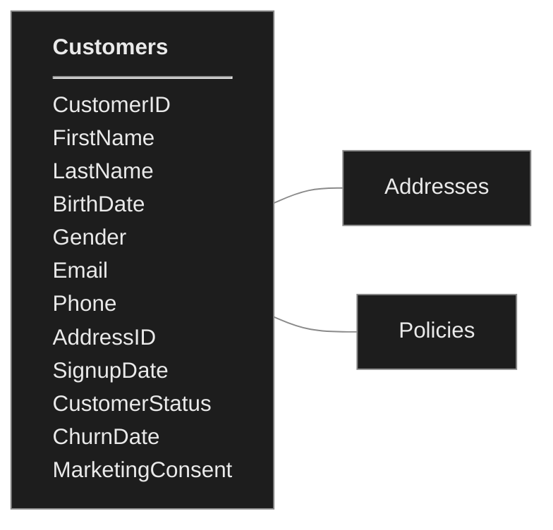

<div style="background:#101010;color:#eaeaea;padding:16px 22px;border-radius:8px;">

<a href="../index.md" style="color:#4cc2ff">← Danish Insurance Company Overview</a> · <a href="../beam-annotations.md" style="color:#4cc2ff">BEAM✲ Annotations</a> · <a href="../how-to-read.md" style="color:#4cc2ff">How to Read This Wiki</a>

# Customers

<table style="border-collapse:collapse;margin:8px 0;">
<tr><th scope="row" align="left" style="text-align:left;vertical-align:top;white-space:nowrap;font-weight:600;padding:6px 16px 6px 10px;background:#1d1d1d;color:#dcdcdc;border-bottom:1px solid #2c2c2c;">Description</th><td style="text-align:left;vertical-align:top;padding:6px 10px;background:#161616;color:#eaeaea;border-bottom:1px solid #2c2c2c;">The private persons who have, or have had, insurance with the company, with their contact details, when they signed up and whether they are still customers. A customer who has cancelled stays in the list with a churn date.</td></tr>
<tr><th scope="row" align="left" style="text-align:left;vertical-align:top;white-space:nowrap;font-weight:600;padding:6px 16px 6px 10px;background:#1d1d1d;color:#dcdcdc;border-bottom:1px solid #2c2c2c;">Grain</th><td style="text-align:left;vertical-align:top;padding:6px 10px;background:#161616;color:#eaeaea;border-bottom:1px solid #2c2c2c;">One row for each person who is a customer, whether still active or cancelled</td></tr>
<tr><th scope="row" align="left" style="text-align:left;vertical-align:top;white-space:nowrap;font-weight:600;padding:6px 16px 6px 10px;background:#1d1d1d;color:#dcdcdc;border-bottom:1px solid #2c2c2c;">BEAM✲</th><td style="text-align:left;vertical-align:top;padding:6px 10px;background:#161616;color:#eaeaea;border-bottom:1px solid #2c2c2c;"><a href="../beam-annotations.md#t-cv" style="color:#4cc2ff" title="Current Value: Keeps only the current value of each attribute. Changes overwrite the old value. Also called a type 1 slowly changing dimension.">[CV]</a> <i>(suggested by AI)</i></td></tr>
<tr><th scope="row" align="left" style="text-align:left;vertical-align:top;white-space:nowrap;font-weight:600;padding:6px 16px 6px 10px;background:#1d1d1d;color:#dcdcdc;border-bottom:1px solid #2c2c2c;">Why <a href="../beam-annotations.md#t-cv" style="color:#4cc2ff" title="Current Value: Keeps only the current value of each attribute. Changes overwrite the old value. Also called a type 1 slowly changing dimension.">[CV]</a></th><td style="text-align:left;vertical-align:top;padding:6px 10px;background:#161616;color:#eaeaea;border-bottom:1px solid #2c2c2c;">One row per CustomerID and no validity dates or version columns, so only the current values are held. The user did not say how changes should be handled.</td></tr>
<tr><th scope="row" align="left" style="text-align:left;vertical-align:top;white-space:nowrap;font-weight:600;padding:6px 16px 6px 10px;background:#1d1d1d;color:#dcdcdc;border-bottom:1px solid #2c2c2c;">Source</th><td style="text-align:left;vertical-align:top;padding:6px 10px;background:#161616;color:#eaeaea;border-bottom:1px solid #2c2c2c;"><a href="../beam-annotations.md#t-source" style="color:#4cc2ff" title="Data source: The source system table or file the table comes from.">{Customers.csv}</a> <i>(measured)</i></td></tr>
<tr><th scope="row" align="left" style="text-align:left;vertical-align:top;white-space:nowrap;font-weight:600;padding:6px 16px 6px 10px;background:#1d1d1d;color:#dcdcdc;border-bottom:1px solid #2c2c2c;">Sampled Rows</th><td style="text-align:left;vertical-align:top;padding:6px 10px;background:#161616;color:#eaeaea;border-bottom:1px solid #2c2c2c;">3,000</td></tr>
<tr><th scope="row" align="left" style="text-align:left;vertical-align:top;white-space:nowrap;font-weight:600;padding:6px 16px 6px 10px;background:#1d1d1d;color:#dcdcdc;border-bottom:1px solid #2c2c2c;">Columns</th><td style="text-align:left;vertical-align:top;padding:6px 10px;background:#161616;color:#eaeaea;border-bottom:1px solid #2c2c2c;">12</td></tr>
<tr><th scope="row" align="left" style="text-align:left;vertical-align:top;white-space:nowrap;font-weight:600;padding:6px 16px 6px 10px;background:#1d1d1d;color:#dcdcdc;border-bottom:1px solid #2c2c2c;">Description Source</th><td style="text-align:left;vertical-align:top;padding:6px 10px;background:#161616;color:#eaeaea;border-bottom:1px solid #2c2c2c;">Written by AI from the data. Check before relying on it.</td></tr>
<tr><th scope="row" align="left" style="text-align:left;vertical-align:top;white-space:nowrap;font-weight:600;padding:6px 16px 6px 10px;background:#1d1d1d;color:#dcdcdc;border-bottom:1px solid #2c2c2c;">Confidence</th><td style="text-align:left;vertical-align:top;padding:6px 10px;background:#161616;color:#eaeaea;border-bottom:1px solid #2c2c2c;">high</td></tr>
</table>

## Columns

<div style="overflow-x:auto;max-width:100%;">
<table style="border-collapse:separate;border-spacing:0;font-size:90%;">
<tr><td rowspan="3" style="position:sticky;left:0;z-index:2;box-sizing:border-box;width:34px;min-width:34px;max-width:34px;padding:0;border:0;background:transparent;"></td><th style="position:sticky;left:34px;z-index:2;border:0 solid #2c2c2c;border-width:0 1px 1px 0;background:#242424;color:#ffffff;padding:3px 8px;white-space:nowrap;text-align:left;vertical-align:top;font-weight:700;border-top:1px solid #2c2c2c;border-left:1px solid #2c2c2c;cursor:help;" title="The column as it is named in the data. Each column of the table is one column in this matrix.">Column Name</th><th style="border:0 solid #2c2c2c;border-width:0 1px 1px 0;padding:3px 8px;white-space:nowrap;text-align:left;vertical-align:top;background:#161616;color:#eaeaea;font-weight:600;background:#242424;color:#ffffff;border-top:1px solid #2c2c2c;">CustomerID</th><th style="border:0 solid #2c2c2c;border-width:0 1px 1px 0;padding:3px 8px;white-space:nowrap;text-align:left;vertical-align:top;background:#161616;color:#eaeaea;font-weight:600;background:#242424;color:#ffffff;border-top:1px solid #2c2c2c;">FirstName</th><th style="border:0 solid #2c2c2c;border-width:0 1px 1px 0;padding:3px 8px;white-space:nowrap;text-align:left;vertical-align:top;background:#161616;color:#eaeaea;font-weight:600;background:#242424;color:#ffffff;border-top:1px solid #2c2c2c;">LastName</th><th style="border:0 solid #2c2c2c;border-width:0 1px 1px 0;padding:3px 8px;white-space:nowrap;text-align:left;vertical-align:top;background:#161616;color:#eaeaea;font-weight:600;background:#242424;color:#ffffff;border-top:1px solid #2c2c2c;">BirthDate</th><th style="border:0 solid #2c2c2c;border-width:0 1px 1px 0;padding:3px 8px;white-space:nowrap;text-align:left;vertical-align:top;background:#161616;color:#eaeaea;font-weight:600;background:#242424;color:#ffffff;border-top:1px solid #2c2c2c;">Gender</th><th style="border:0 solid #2c2c2c;border-width:0 1px 1px 0;padding:3px 8px;white-space:nowrap;text-align:left;vertical-align:top;background:#161616;color:#eaeaea;font-weight:600;background:#242424;color:#ffffff;border-top:1px solid #2c2c2c;">Email</th><th style="border:0 solid #2c2c2c;border-width:0 1px 1px 0;padding:3px 8px;white-space:nowrap;text-align:left;vertical-align:top;background:#161616;color:#eaeaea;font-weight:600;background:#242424;color:#ffffff;border-top:1px solid #2c2c2c;">Phone</th><th style="border:0 solid #2c2c2c;border-width:0 1px 1px 0;padding:3px 8px;white-space:nowrap;text-align:left;vertical-align:top;background:#161616;color:#eaeaea;font-weight:600;background:#242424;color:#ffffff;border-top:1px solid #2c2c2c;">AddressID</th><th style="border:0 solid #2c2c2c;border-width:0 1px 1px 0;padding:3px 8px;white-space:nowrap;text-align:left;vertical-align:top;background:#161616;color:#eaeaea;font-weight:600;background:#242424;color:#ffffff;border-top:1px solid #2c2c2c;">SignupDate</th><th style="border:0 solid #2c2c2c;border-width:0 1px 1px 0;padding:3px 8px;white-space:nowrap;text-align:left;vertical-align:top;background:#161616;color:#eaeaea;font-weight:600;background:#242424;color:#ffffff;border-top:1px solid #2c2c2c;">CustomerStatus</th><th style="border:0 solid #2c2c2c;border-width:0 1px 1px 0;padding:3px 8px;white-space:nowrap;text-align:left;vertical-align:top;background:#161616;color:#eaeaea;font-weight:600;background:#242424;color:#ffffff;border-top:1px solid #2c2c2c;">ChurnDate</th><th style="border:0 solid #2c2c2c;border-width:0 1px 1px 0;padding:3px 8px;white-space:nowrap;text-align:left;vertical-align:top;background:#161616;color:#eaeaea;font-weight:600;background:#242424;color:#ffffff;border-top:1px solid #2c2c2c;">MarketingConsent</th></tr>
<tr><td style="position:sticky;left:34px;z-index:2;border:0 solid #2c2c2c;border-width:0 1px 1px 0;background:#1d1d1d;color:#dcdcdc;padding:3px 8px;white-space:nowrap;text-align:left;vertical-align:top;font-weight:600;border-left:1px solid #2c2c2c;cursor:help;" title="The kind of values found in the data, which may differ from what the source declares. The short code is a BEAM annotation, for example C9 is text with a longest value of 9 characters.">Data Type</td><td style="border:0 solid #2c2c2c;border-width:0 1px 1px 0;padding:3px 8px;white-space:nowrap;text-align:left;vertical-align:top;background:#161616;color:#eaeaea;"><a href="../beam-annotations.md#c-i" style="color:#4cc2ff" title="Integer: A whole number. (Measured from the data.)">I</a> whole number</td><td style="border:0 solid #2c2c2c;border-width:0 1px 1px 0;padding:3px 8px;white-space:nowrap;text-align:left;vertical-align:top;background:#161616;color:#eaeaea;"><a href="../beam-annotations.md#c-c" style="color:#4cc2ff" title="Character: Short text, with n = the longest value seen. (Measured from the data.)">C9</a> text <span title="Personal data. The engine measured this column but never saved or shows its values, so neither the AI agent nor the reader sees them." style="white-space:nowrap">🔒 person name</span></td><td style="border:0 solid #2c2c2c;border-width:0 1px 1px 0;padding:3px 8px;white-space:nowrap;text-align:left;vertical-align:top;background:#161616;color:#eaeaea;"><a href="../beam-annotations.md#c-c" style="color:#4cc2ff" title="Character: Short text, with n = the longest value seen. (Measured from the data.)">C12</a> text <span title="Personal data. The engine measured this column but never saved or shows its values, so neither the AI agent nor the reader sees them." style="white-space:nowrap">🔒 person name</span></td><td style="border:0 solid #2c2c2c;border-width:0 1px 1px 0;padding:3px 8px;white-space:nowrap;text-align:left;vertical-align:top;background:#161616;color:#eaeaea;"><a href="../beam-annotations.md#c-d" style="color:#4cc2ff" title="Date: A calendar date. Numbers order milestones, e.g. D1 → D2. (Measured from the data.)">D</a> date <span title="Personal data. The engine measured this column but never saved or shows its values, so neither the AI agent nor the reader sees them." style="white-space:nowrap">🔒 birth date</span></td><td style="border:0 solid #2c2c2c;border-width:0 1px 1px 0;padding:3px 8px;white-space:nowrap;text-align:left;vertical-align:top;background:#161616;color:#eaeaea;"><a href="../beam-annotations.md#c-c" style="color:#4cc2ff" title="Character: Short text, with n = the longest value seen. (Measured from the data.)">C1</a> text</td><td style="border:0 solid #2c2c2c;border-width:0 1px 1px 0;padding:3px 8px;white-space:nowrap;text-align:left;vertical-align:top;background:#161616;color:#eaeaea;"><a href="../beam-annotations.md#c-c" style="color:#4cc2ff" title="Character: Short text, with n = the longest value seen. (Measured from the data.)">C36</a> text <span title="Personal data. The engine measured this column but never saved or shows its values, so neither the AI agent nor the reader sees them." style="white-space:nowrap">🔒 email</span></td><td style="border:0 solid #2c2c2c;border-width:0 1px 1px 0;padding:3px 8px;white-space:nowrap;text-align:left;vertical-align:top;background:#161616;color:#eaeaea;"><a href="../beam-annotations.md#c-i" style="color:#4cc2ff" title="Integer: A whole number. (Measured from the data.)">I</a> whole number <span title="Personal data. The engine measured this column but never saved or shows its values, so neither the AI agent nor the reader sees them." style="white-space:nowrap">🔒 phone</span></td><td style="border:0 solid #2c2c2c;border-width:0 1px 1px 0;padding:3px 8px;white-space:nowrap;text-align:left;vertical-align:top;background:#161616;color:#eaeaea;"><a href="../beam-annotations.md#c-i" style="color:#4cc2ff" title="Integer: A whole number. (Measured from the data.)">I</a> whole number</td><td style="border:0 solid #2c2c2c;border-width:0 1px 1px 0;padding:3px 8px;white-space:nowrap;text-align:left;vertical-align:top;background:#161616;color:#eaeaea;"><a href="../beam-annotations.md#c-d" style="color:#4cc2ff" title="Date: A calendar date. Numbers order milestones, e.g. D1 → D2. (Measured from the data.)">D</a> date</td><td style="border:0 solid #2c2c2c;border-width:0 1px 1px 0;padding:3px 8px;white-space:nowrap;text-align:left;vertical-align:top;background:#161616;color:#eaeaea;"><a href="../beam-annotations.md#c-c" style="color:#4cc2ff" title="Character: Short text, with n = the longest value seen. (Measured from the data.)">C6</a> text</td><td style="border:0 solid #2c2c2c;border-width:0 1px 1px 0;padding:3px 8px;white-space:nowrap;text-align:left;vertical-align:top;background:#161616;color:#eaeaea;"><a href="../beam-annotations.md#c-d" style="color:#4cc2ff" title="Date: A calendar date. Numbers order milestones, e.g. D1 → D2. (Measured from the data.)">D</a> date</td><td style="border:0 solid #2c2c2c;border-width:0 1px 1px 0;padding:3px 8px;white-space:nowrap;text-align:left;vertical-align:top;background:#161616;color:#eaeaea;"><a href="../beam-annotations.md#c-c" style="color:#4cc2ff" title="Character: Short text, with n = the longest value seen. (Measured from the data.)">C3</a> text</td></tr>
<tr><td style="position:sticky;left:34px;z-index:2;border:0 solid #2c2c2c;border-width:0 1px 1px 0;background:#1d1d1d;color:#dcdcdc;padding:3px 8px;white-space:nowrap;text-align:left;vertical-align:top;font-weight:600;border-left:1px solid #2c2c2c;cursor:help;" title="Short BEAM annotations. Plain codes are measured from the data. Codes in italics are suggested by AI and should be checked. Click a code to read what it means.">BEAM✲</td><td style="border:0 solid #2c2c2c;border-width:0 1px 1px 0;padding:3px 8px;white-space:nowrap;text-align:left;vertical-align:top;background:#161616;color:#eaeaea;"><a href="../beam-annotations.md#c-nd" style="color:#4cc2ff" title="No Duplicates: Every value is different. The numbered form marks columns that are unique in combination. In this wiki measured: no duplicates were found in the text or whole-number values profiled. (Measured from the data.)">ND</a> <i><a href="../beam-annotations.md#c-bk" style="color:#4cc2ff" title="Business Key: The source system&#x27;s own identifier for the thing the table is about, e.g. the customer number in a customers table. It identifies a row of this table. (Suggested by AI.)">BK</a></i></td><td style="border:0 solid #2c2c2c;border-width:0 1px 1px 0;padding:3px 8px;white-space:nowrap;text-align:left;vertical-align:top;background:#161616;color:#eaeaea;"><i><a href="../beam-annotations.md#c-md" style="color:#4cc2ff" title="Mandatory: The value should always be there under normal conditions. Shown as MD when the data has gaps. (Suggested by AI.)">MD</a></i></td><td style="border:0 solid #2c2c2c;border-width:0 1px 1px 0;padding:3px 8px;white-space:nowrap;text-align:left;vertical-align:top;background:#161616;color:#eaeaea;"><i><a href="../beam-annotations.md#c-md" style="color:#4cc2ff" title="Mandatory: The value should always be there under normal conditions. Shown as MD when the data has gaps. (Suggested by AI.)">MD</a></i></td><td style="border:0 solid #2c2c2c;border-width:0 1px 1px 0;padding:3px 8px;white-space:nowrap;text-align:left;vertical-align:top;background:#161616;color:#eaeaea;"><i><a href="../beam-annotations.md#c-fv" style="color:#4cc2ff" title="Fixed Value: Shouldn&#x27;t change, e.g. a date of birth. Corrections overwrite it. (Suggested by AI.)">FV</a></i> <i><a href="../beam-annotations.md#c-md" style="color:#4cc2ff" title="Mandatory: The value should always be there under normal conditions. Shown as MD when the data has gaps. (Suggested by AI.)">MD</a></i></td><td style="border:0 solid #2c2c2c;border-width:0 1px 1px 0;padding:3px 8px;white-space:nowrap;text-align:left;vertical-align:top;background:#161616;color:#eaeaea;"></td><td style="border:0 solid #2c2c2c;border-width:0 1px 1px 0;padding:3px 8px;white-space:nowrap;text-align:left;vertical-align:top;background:#161616;color:#eaeaea;"><i><a href="../beam-annotations.md#c-suspect" style="color:#4cc2ff" title="Suspect: The column still needs clarifying. See the open questions on its page. (Suggested by AI.)">?</a></i></td><td style="border:0 solid #2c2c2c;border-width:0 1px 1px 0;padding:3px 8px;white-space:nowrap;text-align:left;vertical-align:top;background:#161616;color:#eaeaea;"></td><td style="border:0 solid #2c2c2c;border-width:0 1px 1px 0;padding:3px 8px;white-space:nowrap;text-align:left;vertical-align:top;background:#161616;color:#eaeaea;"><a href="../beam-annotations.md#c-fk" style="color:#4cc2ff" title="Foreign Key: Points to the key of another table. In this wiki measured: every value was found in the other table. (Measured from the data.)">FK</a> <i><a href="../beam-annotations.md#c-dim" style="color:#4cc2ff" title="Dimension or role: The dimension a detail refers to, e.g. PreferredStoreID [Stores] when the preferred store is a role of the store dimension. (Suggested by AI.)">[Addresses]</a></i></td><td style="border:0 solid #2c2c2c;border-width:0 1px 1px 0;padding:3px 8px;white-space:nowrap;text-align:left;vertical-align:top;background:#161616;color:#eaeaea;"><i><a href="../beam-annotations.md#c-fv" style="color:#4cc2ff" title="Fixed Value: Shouldn&#x27;t change, e.g. a date of birth. Corrections overwrite it. (Suggested by AI.)">FV</a></i> <i><a href="../beam-annotations.md#c-md" style="color:#4cc2ff" title="Mandatory: The value should always be there under normal conditions. Shown as MD when the data has gaps. (Suggested by AI.)">MD</a></i></td><td style="border:0 solid #2c2c2c;border-width:0 1px 1px 0;padding:3px 8px;white-space:nowrap;text-align:left;vertical-align:top;background:#161616;color:#eaeaea;"></td><td style="border:0 solid #2c2c2c;border-width:0 1px 1px 0;padding:3px 8px;white-space:nowrap;text-align:left;vertical-align:top;background:#161616;color:#eaeaea;"><i><a href="../beam-annotations.md#c-suspect" style="color:#4cc2ff" title="Suspect: The column still needs clarifying. See the open questions on its page. (Suggested by AI.)">?</a></i></td><td style="border:0 solid #2c2c2c;border-width:0 1px 1px 0;padding:3px 8px;white-space:nowrap;text-align:left;vertical-align:top;background:#161616;color:#eaeaea;"></td></tr>
<tr><td rowspan="9" style="position:sticky;left:0;z-index:2;box-sizing:border-box;width:34px;min-width:34px;max-width:34px;border:0 solid #2c2c2c;border-width:0 1px 1px 0;background:#0f2f2c;color:#2de2c9;padding:4px 0;text-align:center;vertical-align:middle;border-left:3px solid #2de2c9;cursor:help;" title="Counts and extremes measured from the rows that were read. They are facts, not opinions."><div style="writing-mode:vertical-rl;transform:rotate(180deg);white-space:nowrap;margin:0 auto;font-weight:600;">Data Profiling Results</div></td><td style="position:sticky;left:34px;z-index:2;border:0 solid #2c2c2c;border-width:0 1px 1px 0;background:#1d1d1d;color:#dcdcdc;padding:3px 8px;white-space:nowrap;text-align:left;vertical-align:top;font-weight:600;cursor:help;" title="How many rows were read for these numbers. Every percentage in this group is based on it, so check it first: on very large tables it can be fewer than all rows.">Sample Count</td><td style="border:0 solid #2c2c2c;border-width:0 1px 1px 0;padding:3px 8px;white-space:nowrap;text-align:right;vertical-align:top;background:#161616;color:#eaeaea;background:#161616;">3,000</td><td style="border:0 solid #2c2c2c;border-width:0 1px 1px 0;padding:3px 8px;white-space:nowrap;text-align:right;vertical-align:top;background:#161616;color:#eaeaea;background:#161616;">3,000</td><td style="border:0 solid #2c2c2c;border-width:0 1px 1px 0;padding:3px 8px;white-space:nowrap;text-align:right;vertical-align:top;background:#161616;color:#eaeaea;background:#161616;">3,000</td><td style="border:0 solid #2c2c2c;border-width:0 1px 1px 0;padding:3px 8px;white-space:nowrap;text-align:right;vertical-align:top;background:#161616;color:#eaeaea;background:#161616;">3,000</td><td style="border:0 solid #2c2c2c;border-width:0 1px 1px 0;padding:3px 8px;white-space:nowrap;text-align:right;vertical-align:top;background:#161616;color:#eaeaea;background:#161616;">3,000</td><td style="border:0 solid #2c2c2c;border-width:0 1px 1px 0;padding:3px 8px;white-space:nowrap;text-align:right;vertical-align:top;background:#161616;color:#eaeaea;background:#161616;">3,000</td><td style="border:0 solid #2c2c2c;border-width:0 1px 1px 0;padding:3px 8px;white-space:nowrap;text-align:right;vertical-align:top;background:#161616;color:#eaeaea;background:#161616;">3,000</td><td style="border:0 solid #2c2c2c;border-width:0 1px 1px 0;padding:3px 8px;white-space:nowrap;text-align:right;vertical-align:top;background:#161616;color:#eaeaea;background:#161616;">3,000</td><td style="border:0 solid #2c2c2c;border-width:0 1px 1px 0;padding:3px 8px;white-space:nowrap;text-align:right;vertical-align:top;background:#161616;color:#eaeaea;background:#161616;">3,000</td><td style="border:0 solid #2c2c2c;border-width:0 1px 1px 0;padding:3px 8px;white-space:nowrap;text-align:right;vertical-align:top;background:#161616;color:#eaeaea;background:#161616;">3,000</td><td style="border:0 solid #2c2c2c;border-width:0 1px 1px 0;padding:3px 8px;white-space:nowrap;text-align:right;vertical-align:top;background:#161616;color:#eaeaea;background:#161616;">3,000</td><td style="border:0 solid #2c2c2c;border-width:0 1px 1px 0;padding:3px 8px;white-space:nowrap;text-align:right;vertical-align:top;background:#161616;color:#eaeaea;background:#161616;">3,000</td></tr>
<tr><td style="position:sticky;left:34px;z-index:2;border:0 solid #2c2c2c;border-width:0 1px 1px 0;background:#1d1d1d;color:#dcdcdc;padding:3px 8px;white-space:nowrap;text-align:left;vertical-align:top;font-weight:600;cursor:help;" title="Rows where the column is empty or blank, with the share of rows. It matters because gaps break joins and totals, and a column that should always be filled in should show 0.">Missing</td><td style="border:0 solid #2c2c2c;border-width:0 1px 1px 0;padding:3px 8px;white-space:nowrap;text-align:left;vertical-align:top;background:#161616;color:#eaeaea;background:#161616;">0 (0%)</td><td style="border:0 solid #2c2c2c;border-width:0 1px 1px 0;padding:3px 8px;white-space:nowrap;text-align:left;vertical-align:top;background:#161616;color:#eaeaea;background:#161616;">0 (0%)</td><td style="border:0 solid #2c2c2c;border-width:0 1px 1px 0;padding:3px 8px;white-space:nowrap;text-align:left;vertical-align:top;background:#161616;color:#eaeaea;background:#161616;">0 (0%)</td><td style="border:0 solid #2c2c2c;border-width:0 1px 1px 0;padding:3px 8px;white-space:nowrap;text-align:left;vertical-align:top;background:#161616;color:#eaeaea;background:#161616;">0 (0%)</td><td style="border:0 solid #2c2c2c;border-width:0 1px 1px 0;padding:3px 8px;white-space:nowrap;text-align:left;vertical-align:top;background:#161616;color:#eaeaea;background:#161616;">0 (0%)</td><td style="border:0 solid #2c2c2c;border-width:0 1px 1px 0;padding:3px 8px;white-space:nowrap;text-align:left;vertical-align:top;background:#161616;color:#eaeaea;background:#161616;">82 (2.73%)</td><td style="border:0 solid #2c2c2c;border-width:0 1px 1px 0;padding:3px 8px;white-space:nowrap;text-align:left;vertical-align:top;background:#161616;color:#eaeaea;background:#161616;">240 (8%)</td><td style="border:0 solid #2c2c2c;border-width:0 1px 1px 0;padding:3px 8px;white-space:nowrap;text-align:left;vertical-align:top;background:#161616;color:#eaeaea;background:#161616;">0 (0%)</td><td style="border:0 solid #2c2c2c;border-width:0 1px 1px 0;padding:3px 8px;white-space:nowrap;text-align:left;vertical-align:top;background:#161616;color:#eaeaea;background:#161616;">0 (0%)</td><td style="border:0 solid #2c2c2c;border-width:0 1px 1px 0;padding:3px 8px;white-space:nowrap;text-align:left;vertical-align:top;background:#161616;color:#eaeaea;background:#161616;">0 (0%)</td><td style="border:0 solid #2c2c2c;border-width:0 1px 1px 0;padding:3px 8px;white-space:nowrap;text-align:left;vertical-align:top;background:#161616;color:#eaeaea;background:#161616;">2,541 (84.7%)</td><td style="border:0 solid #2c2c2c;border-width:0 1px 1px 0;padding:3px 8px;white-space:nowrap;text-align:left;vertical-align:top;background:#161616;color:#eaeaea;background:#161616;">0 (0%)</td></tr>
<tr><td style="position:sticky;left:34px;z-index:2;border:0 solid #2c2c2c;border-width:0 1px 1px 0;background:#1d1d1d;color:#dcdcdc;padding:3px 8px;white-space:nowrap;text-align:left;vertical-align:top;font-weight:600;cursor:help;" title="How many different values occur, with the share of rows. 100% means every value is different, so the column could identify a row. A low share means the column holds categories or codes.">Unique Values</td><td style="border:0 solid #2c2c2c;border-width:0 1px 1px 0;padding:3px 8px;white-space:nowrap;text-align:left;vertical-align:top;background:#161616;color:#eaeaea;background:#161616;">3,000 (100%)</td><td style="border:0 solid #2c2c2c;border-width:0 1px 1px 0;padding:3px 8px;white-space:nowrap;text-align:left;vertical-align:top;background:#161616;color:#eaeaea;background:#161616;">40 (1.33%)</td><td style="border:0 solid #2c2c2c;border-width:0 1px 1px 0;padding:3px 8px;white-space:nowrap;text-align:left;vertical-align:top;background:#161616;color:#eaeaea;background:#161616;">24 (0.8%)</td><td style="border:0 solid #2c2c2c;border-width:0 1px 1px 0;padding:3px 8px;white-space:nowrap;text-align:left;vertical-align:top;background:#161616;color:#eaeaea;background:#161616;">2,760 (92%)</td><td style="border:0 solid #2c2c2c;border-width:0 1px 1px 0;padding:3px 8px;white-space:nowrap;text-align:left;vertical-align:top;background:#161616;color:#eaeaea;background:#161616;">2 (0.0667%)</td><td style="border:0 solid #2c2c2c;border-width:0 1px 1px 0;padding:3px 8px;white-space:nowrap;text-align:left;vertical-align:top;background:#161616;color:#eaeaea;background:#161616;">2,629 (87.6%)</td><td style="border:0 solid #2c2c2c;border-width:0 1px 1px 0;padding:3px 8px;white-space:nowrap;text-align:left;vertical-align:top;background:#161616;color:#eaeaea;background:#161616;">2,760 (92%)</td><td style="border:0 solid #2c2c2c;border-width:0 1px 1px 0;padding:3px 8px;white-space:nowrap;text-align:left;vertical-align:top;background:#161616;color:#eaeaea;background:#161616;">2,773 (92.4%)</td><td style="border:0 solid #2c2c2c;border-width:0 1px 1px 0;padding:3px 8px;white-space:nowrap;text-align:left;vertical-align:top;background:#161616;color:#eaeaea;background:#161616;">2,406 (80.2%)</td><td style="border:0 solid #2c2c2c;border-width:0 1px 1px 0;padding:3px 8px;white-space:nowrap;text-align:left;vertical-align:top;background:#161616;color:#eaeaea;background:#161616;">2 (0.0667%)</td><td style="border:0 solid #2c2c2c;border-width:0 1px 1px 0;padding:3px 8px;white-space:nowrap;text-align:left;vertical-align:top;background:#161616;color:#eaeaea;background:#161616;">370 (12.3%)</td><td style="border:0 solid #2c2c2c;border-width:0 1px 1px 0;padding:3px 8px;white-space:nowrap;text-align:left;vertical-align:top;background:#161616;color:#eaeaea;background:#161616;">2 (0.0667%)</td></tr>
<tr><td style="position:sticky;left:34px;z-index:2;border:0 solid #2c2c2c;border-width:0 1px 1px 0;background:#1d1d1d;color:#dcdcdc;padding:3px 8px;white-space:nowrap;text-align:left;vertical-align:top;font-weight:600;cursor:help;" title="The smallest value: the lowest number, the earliest date, or the first in alphabetical order. It matters because it shows the start of the range and catches impossible values such as a negative quantity.">Min Value</td><td style="border:0 solid #2c2c2c;border-width:0 1px 1px 0;padding:3px 8px;white-space:nowrap;text-align:left;vertical-align:top;background:#161616;color:#eaeaea;background:#161616;">100001</td><td style="border:0 solid #2c2c2c;border-width:0 1px 1px 0;padding:3px 8px;white-space:nowrap;text-align:left;vertical-align:top;background:#161616;color:#eaeaea;background:#161616;"><i title="Personal data. The engine measured this column but never saved or shows its values, so neither the AI agent nor the reader sees them.">masked</i></td><td style="border:0 solid #2c2c2c;border-width:0 1px 1px 0;padding:3px 8px;white-space:nowrap;text-align:left;vertical-align:top;background:#161616;color:#eaeaea;background:#161616;"><i title="Personal data. The engine measured this column but never saved or shows its values, so neither the AI agent nor the reader sees them.">masked</i></td><td style="border:0 solid #2c2c2c;border-width:0 1px 1px 0;padding:3px 8px;white-space:nowrap;text-align:left;vertical-align:top;background:#161616;color:#eaeaea;background:#161616;">1937</td><td style="border:0 solid #2c2c2c;border-width:0 1px 1px 0;padding:3px 8px;white-space:nowrap;text-align:left;vertical-align:top;background:#161616;color:#eaeaea;background:#161616;">K</td><td style="border:0 solid #2c2c2c;border-width:0 1px 1px 0;padding:3px 8px;white-space:nowrap;text-align:left;vertical-align:top;background:#161616;color:#eaeaea;background:#161616;"><i title="Personal data. The engine measured this column but never saved or shows its values, so neither the AI agent nor the reader sees them.">masked</i></td><td style="border:0 solid #2c2c2c;border-width:0 1px 1px 0;padding:3px 8px;white-space:nowrap;text-align:left;vertical-align:top;background:#161616;color:#eaeaea;background:#161616;"><i title="Personal data. The engine measured this column but never saved or shows its values, so neither the AI agent nor the reader sees them.">masked</i></td><td style="border:0 solid #2c2c2c;border-width:0 1px 1px 0;padding:3px 8px;white-space:nowrap;text-align:left;vertical-align:top;background:#161616;color:#eaeaea;background:#161616;">50001</td><td style="border:0 solid #2c2c2c;border-width:0 1px 1px 0;padding:3px 8px;white-space:nowrap;text-align:left;vertical-align:top;background:#161616;color:#eaeaea;background:#161616;">2008-01-06</td><td style="border:0 solid #2c2c2c;border-width:0 1px 1px 0;padding:3px 8px;white-space:nowrap;text-align:left;vertical-align:top;background:#161616;color:#eaeaea;background:#161616;">Aktiv</td><td style="border:0 solid #2c2c2c;border-width:0 1px 1px 0;padding:3px 8px;white-space:nowrap;text-align:left;vertical-align:top;background:#161616;color:#eaeaea;background:#161616;">2023-01-09</td><td style="border:0 solid #2c2c2c;border-width:0 1px 1px 0;padding:3px 8px;white-space:nowrap;text-align:left;vertical-align:top;background:#161616;color:#eaeaea;background:#161616;">Ja</td></tr>
<tr><td style="position:sticky;left:34px;z-index:2;border:0 solid #2c2c2c;border-width:0 1px 1px 0;background:#1d1d1d;color:#dcdcdc;padding:3px 8px;white-space:nowrap;text-align:left;vertical-align:top;font-weight:600;cursor:help;" title="How many rows have the smallest value. On a unique column it is 1. A high count suggests a default or a stand-in value, such as 0 or 1900-01-01, rather than a real minimum.">Min Count</td><td style="border:0 solid #2c2c2c;border-width:0 1px 1px 0;padding:3px 8px;white-space:nowrap;text-align:left;vertical-align:top;background:#161616;color:#eaeaea;background:#161616;">1 (0.0333%)</td><td style="border:0 solid #2c2c2c;border-width:0 1px 1px 0;padding:3px 8px;white-space:nowrap;text-align:left;vertical-align:top;background:#161616;color:#eaeaea;background:#161616;">—</td><td style="border:0 solid #2c2c2c;border-width:0 1px 1px 0;padding:3px 8px;white-space:nowrap;text-align:left;vertical-align:top;background:#161616;color:#eaeaea;background:#161616;">—</td><td style="border:0 solid #2c2c2c;border-width:0 1px 1px 0;padding:3px 8px;white-space:nowrap;text-align:left;vertical-align:top;background:#161616;color:#eaeaea;background:#161616;">—</td><td style="border:0 solid #2c2c2c;border-width:0 1px 1px 0;padding:3px 8px;white-space:nowrap;text-align:left;vertical-align:top;background:#161616;color:#eaeaea;background:#161616;">1,529 (51%)</td><td style="border:0 solid #2c2c2c;border-width:0 1px 1px 0;padding:3px 8px;white-space:nowrap;text-align:left;vertical-align:top;background:#161616;color:#eaeaea;background:#161616;">—</td><td style="border:0 solid #2c2c2c;border-width:0 1px 1px 0;padding:3px 8px;white-space:nowrap;text-align:left;vertical-align:top;background:#161616;color:#eaeaea;background:#161616;">—</td><td style="border:0 solid #2c2c2c;border-width:0 1px 1px 0;padding:3px 8px;white-space:nowrap;text-align:left;vertical-align:top;background:#161616;color:#eaeaea;background:#161616;">1 (0.0333%)</td><td style="border:0 solid #2c2c2c;border-width:0 1px 1px 0;padding:3px 8px;white-space:nowrap;text-align:left;vertical-align:top;background:#161616;color:#eaeaea;background:#161616;">1 (0.0333%)</td><td style="border:0 solid #2c2c2c;border-width:0 1px 1px 0;padding:3px 8px;white-space:nowrap;text-align:left;vertical-align:top;background:#161616;color:#eaeaea;background:#161616;">2,541 (84.7%)</td><td style="border:0 solid #2c2c2c;border-width:0 1px 1px 0;padding:3px 8px;white-space:nowrap;text-align:left;vertical-align:top;background:#161616;color:#eaeaea;background:#161616;">1 (0.0333%)</td><td style="border:0 solid #2c2c2c;border-width:0 1px 1px 0;padding:3px 8px;white-space:nowrap;text-align:left;vertical-align:top;background:#161616;color:#eaeaea;background:#161616;">1,859 (62%)</td></tr>
<tr><td style="position:sticky;left:34px;z-index:2;border:0 solid #2c2c2c;border-width:0 1px 1px 0;background:#1d1d1d;color:#dcdcdc;padding:3px 8px;white-space:nowrap;text-align:left;vertical-align:top;font-weight:600;cursor:help;" title="The largest value: the highest number, the latest date, or the last in alphabetical order. It matters because it shows the end of the range and catches outliers or future dates.">Max Value</td><td style="border:0 solid #2c2c2c;border-width:0 1px 1px 0;padding:3px 8px;white-space:nowrap;text-align:left;vertical-align:top;background:#161616;color:#eaeaea;background:#161616;">103000</td><td style="border:0 solid #2c2c2c;border-width:0 1px 1px 0;padding:3px 8px;white-space:nowrap;text-align:left;vertical-align:top;background:#161616;color:#eaeaea;background:#161616;"><i title="Personal data. The engine measured this column but never saved or shows its values, so neither the AI agent nor the reader sees them.">masked</i></td><td style="border:0 solid #2c2c2c;border-width:0 1px 1px 0;padding:3px 8px;white-space:nowrap;text-align:left;vertical-align:top;background:#161616;color:#eaeaea;background:#161616;"><i title="Personal data. The engine measured this column but never saved or shows its values, so neither the AI agent nor the reader sees them.">masked</i></td><td style="border:0 solid #2c2c2c;border-width:0 1px 1px 0;padding:3px 8px;white-space:nowrap;text-align:left;vertical-align:top;background:#161616;color:#eaeaea;background:#161616;">2007</td><td style="border:0 solid #2c2c2c;border-width:0 1px 1px 0;padding:3px 8px;white-space:nowrap;text-align:left;vertical-align:top;background:#161616;color:#eaeaea;background:#161616;">M</td><td style="border:0 solid #2c2c2c;border-width:0 1px 1px 0;padding:3px 8px;white-space:nowrap;text-align:left;vertical-align:top;background:#161616;color:#eaeaea;background:#161616;"><i title="Personal data. The engine measured this column but never saved or shows its values, so neither the AI agent nor the reader sees them.">masked</i></td><td style="border:0 solid #2c2c2c;border-width:0 1px 1px 0;padding:3px 8px;white-space:nowrap;text-align:left;vertical-align:top;background:#161616;color:#eaeaea;background:#161616;"><i title="Personal data. The engine measured this column but never saved or shows its values, so neither the AI agent nor the reader sees them.">masked</i></td><td style="border:0 solid #2c2c2c;border-width:0 1px 1px 0;padding:3px 8px;white-space:nowrap;text-align:left;vertical-align:top;background:#161616;color:#eaeaea;background:#161616;">52773</td><td style="border:0 solid #2c2c2c;border-width:0 1px 1px 0;padding:3px 8px;white-space:nowrap;text-align:left;vertical-align:top;background:#161616;color:#eaeaea;background:#161616;">2025-10-31</td><td style="border:0 solid #2c2c2c;border-width:0 1px 1px 0;padding:3px 8px;white-space:nowrap;text-align:left;vertical-align:top;background:#161616;color:#eaeaea;background:#161616;">Opsagt</td><td style="border:0 solid #2c2c2c;border-width:0 1px 1px 0;padding:3px 8px;white-space:nowrap;text-align:left;vertical-align:top;background:#161616;color:#eaeaea;background:#161616;">2025-12-29</td><td style="border:0 solid #2c2c2c;border-width:0 1px 1px 0;padding:3px 8px;white-space:nowrap;text-align:left;vertical-align:top;background:#161616;color:#eaeaea;background:#161616;">Nej</td></tr>
<tr><td style="position:sticky;left:34px;z-index:2;border:0 solid #2c2c2c;border-width:0 1px 1px 0;background:#1d1d1d;color:#dcdcdc;padding:3px 8px;white-space:nowrap;text-align:left;vertical-align:top;font-weight:600;cursor:help;" title="How many rows have the largest value. A high count suggests a cap or a stand-in value, such as 9999-12-31, rather than a real maximum.">Max Count</td><td style="border:0 solid #2c2c2c;border-width:0 1px 1px 0;padding:3px 8px;white-space:nowrap;text-align:left;vertical-align:top;background:#161616;color:#eaeaea;background:#161616;">1 (0.0333%)</td><td style="border:0 solid #2c2c2c;border-width:0 1px 1px 0;padding:3px 8px;white-space:nowrap;text-align:left;vertical-align:top;background:#161616;color:#eaeaea;background:#161616;">—</td><td style="border:0 solid #2c2c2c;border-width:0 1px 1px 0;padding:3px 8px;white-space:nowrap;text-align:left;vertical-align:top;background:#161616;color:#eaeaea;background:#161616;">—</td><td style="border:0 solid #2c2c2c;border-width:0 1px 1px 0;padding:3px 8px;white-space:nowrap;text-align:left;vertical-align:top;background:#161616;color:#eaeaea;background:#161616;">—</td><td style="border:0 solid #2c2c2c;border-width:0 1px 1px 0;padding:3px 8px;white-space:nowrap;text-align:left;vertical-align:top;background:#161616;color:#eaeaea;background:#161616;">1,471 (49%)</td><td style="border:0 solid #2c2c2c;border-width:0 1px 1px 0;padding:3px 8px;white-space:nowrap;text-align:left;vertical-align:top;background:#161616;color:#eaeaea;background:#161616;">—</td><td style="border:0 solid #2c2c2c;border-width:0 1px 1px 0;padding:3px 8px;white-space:nowrap;text-align:left;vertical-align:top;background:#161616;color:#eaeaea;background:#161616;">—</td><td style="border:0 solid #2c2c2c;border-width:0 1px 1px 0;padding:3px 8px;white-space:nowrap;text-align:left;vertical-align:top;background:#161616;color:#eaeaea;background:#161616;">1 (0.0333%)</td><td style="border:0 solid #2c2c2c;border-width:0 1px 1px 0;padding:3px 8px;white-space:nowrap;text-align:left;vertical-align:top;background:#161616;color:#eaeaea;background:#161616;">1 (0.0333%)</td><td style="border:0 solid #2c2c2c;border-width:0 1px 1px 0;padding:3px 8px;white-space:nowrap;text-align:left;vertical-align:top;background:#161616;color:#eaeaea;background:#161616;">459 (15.3%)</td><td style="border:0 solid #2c2c2c;border-width:0 1px 1px 0;padding:3px 8px;white-space:nowrap;text-align:left;vertical-align:top;background:#161616;color:#eaeaea;background:#161616;">2 (0.0667%)</td><td style="border:0 solid #2c2c2c;border-width:0 1px 1px 0;padding:3px 8px;white-space:nowrap;text-align:left;vertical-align:top;background:#161616;color:#eaeaea;background:#161616;">1,141 (38%)</td></tr>
<tr><td style="position:sticky;left:34px;z-index:2;border:0 solid #2c2c2c;border-width:0 1px 1px 0;background:#1d1d1d;color:#dcdcdc;padding:3px 8px;white-space:nowrap;text-align:left;vertical-align:top;font-weight:600;cursor:help;" title="The shortest text, counted in characters. If it differs a lot from the longest, the column may mix formats, or have values that were cut off.">Min Length</td><td style="border:0 solid #2c2c2c;border-width:0 1px 1px 0;padding:3px 8px;white-space:nowrap;text-align:right;vertical-align:top;background:#161616;color:#eaeaea;background:#161616;">—</td><td style="border:0 solid #2c2c2c;border-width:0 1px 1px 0;padding:3px 8px;white-space:nowrap;text-align:right;vertical-align:top;background:#161616;color:#eaeaea;background:#161616;">3</td><td style="border:0 solid #2c2c2c;border-width:0 1px 1px 0;padding:3px 8px;white-space:nowrap;text-align:right;vertical-align:top;background:#161616;color:#eaeaea;background:#161616;">5</td><td style="border:0 solid #2c2c2c;border-width:0 1px 1px 0;padding:3px 8px;white-space:nowrap;text-align:right;vertical-align:top;background:#161616;color:#eaeaea;background:#161616;">—</td><td style="border:0 solid #2c2c2c;border-width:0 1px 1px 0;padding:3px 8px;white-space:nowrap;text-align:right;vertical-align:top;background:#161616;color:#eaeaea;background:#161616;">1</td><td style="border:0 solid #2c2c2c;border-width:0 1px 1px 0;padding:3px 8px;white-space:nowrap;text-align:right;vertical-align:top;background:#161616;color:#eaeaea;background:#161616;">17</td><td style="border:0 solid #2c2c2c;border-width:0 1px 1px 0;padding:3px 8px;white-space:nowrap;text-align:right;vertical-align:top;background:#161616;color:#eaeaea;background:#161616;">8</td><td style="border:0 solid #2c2c2c;border-width:0 1px 1px 0;padding:3px 8px;white-space:nowrap;text-align:right;vertical-align:top;background:#161616;color:#eaeaea;background:#161616;">—</td><td style="border:0 solid #2c2c2c;border-width:0 1px 1px 0;padding:3px 8px;white-space:nowrap;text-align:right;vertical-align:top;background:#161616;color:#eaeaea;background:#161616;">—</td><td style="border:0 solid #2c2c2c;border-width:0 1px 1px 0;padding:3px 8px;white-space:nowrap;text-align:right;vertical-align:top;background:#161616;color:#eaeaea;background:#161616;">5</td><td style="border:0 solid #2c2c2c;border-width:0 1px 1px 0;padding:3px 8px;white-space:nowrap;text-align:right;vertical-align:top;background:#161616;color:#eaeaea;background:#161616;">—</td><td style="border:0 solid #2c2c2c;border-width:0 1px 1px 0;padding:3px 8px;white-space:nowrap;text-align:right;vertical-align:top;background:#161616;color:#eaeaea;background:#161616;">2</td></tr>
<tr><td style="position:sticky;left:34px;z-index:2;border:0 solid #2c2c2c;border-width:0 1px 1px 0;background:#1d1d1d;color:#dcdcdc;padding:3px 8px;white-space:nowrap;text-align:left;vertical-align:top;font-weight:600;cursor:help;" title="The longest text, counted in characters. It matters when you load the data elsewhere, because the target column must be wide enough.">Max Length</td><td style="border:0 solid #2c2c2c;border-width:0 1px 1px 0;padding:3px 8px;white-space:nowrap;text-align:right;vertical-align:top;background:#161616;color:#eaeaea;background:#161616;">—</td><td style="border:0 solid #2c2c2c;border-width:0 1px 1px 0;padding:3px 8px;white-space:nowrap;text-align:right;vertical-align:top;background:#161616;color:#eaeaea;background:#161616;">9</td><td style="border:0 solid #2c2c2c;border-width:0 1px 1px 0;padding:3px 8px;white-space:nowrap;text-align:right;vertical-align:top;background:#161616;color:#eaeaea;background:#161616;">12</td><td style="border:0 solid #2c2c2c;border-width:0 1px 1px 0;padding:3px 8px;white-space:nowrap;text-align:right;vertical-align:top;background:#161616;color:#eaeaea;background:#161616;">—</td><td style="border:0 solid #2c2c2c;border-width:0 1px 1px 0;padding:3px 8px;white-space:nowrap;text-align:right;vertical-align:top;background:#161616;color:#eaeaea;background:#161616;">1</td><td style="border:0 solid #2c2c2c;border-width:0 1px 1px 0;padding:3px 8px;white-space:nowrap;text-align:right;vertical-align:top;background:#161616;color:#eaeaea;background:#161616;">36</td><td style="border:0 solid #2c2c2c;border-width:0 1px 1px 0;padding:3px 8px;white-space:nowrap;text-align:right;vertical-align:top;background:#161616;color:#eaeaea;background:#161616;">8</td><td style="border:0 solid #2c2c2c;border-width:0 1px 1px 0;padding:3px 8px;white-space:nowrap;text-align:right;vertical-align:top;background:#161616;color:#eaeaea;background:#161616;">—</td><td style="border:0 solid #2c2c2c;border-width:0 1px 1px 0;padding:3px 8px;white-space:nowrap;text-align:right;vertical-align:top;background:#161616;color:#eaeaea;background:#161616;">—</td><td style="border:0 solid #2c2c2c;border-width:0 1px 1px 0;padding:3px 8px;white-space:nowrap;text-align:right;vertical-align:top;background:#161616;color:#eaeaea;background:#161616;">6</td><td style="border:0 solid #2c2c2c;border-width:0 1px 1px 0;padding:3px 8px;white-space:nowrap;text-align:right;vertical-align:top;background:#161616;color:#eaeaea;background:#161616;">—</td><td style="border:0 solid #2c2c2c;border-width:0 1px 1px 0;padding:3px 8px;white-space:nowrap;text-align:right;vertical-align:top;background:#161616;color:#eaeaea;background:#161616;">3</td></tr>
<tr><td rowspan="6" style="position:sticky;left:0;z-index:2;box-sizing:border-box;width:34px;min-width:34px;max-width:34px;border:0 solid #2c2c2c;border-width:0 1px 1px 0;background:#2d1530;color:#ff6fd8;padding:4px 0;text-align:center;vertical-align:middle;border-left:3px solid #ff6fd8;cursor:help;" title="Examples taken from the measured values, to show how varied the column is and what odd values look like."><div style="writing-mode:vertical-rl;transform:rotate(180deg);white-space:nowrap;margin:0 auto;font-weight:600;">Variation</div></td><td style="position:sticky;left:34px;z-index:2;border:0 solid #2c2c2c;border-width:0 1px 1px 0;background:#1d1d1d;color:#dcdcdc;padding:3px 8px;white-space:nowrap;text-align:left;vertical-align:top;font-weight:600;cursor:help;" title="The most common value, so you can see what a normal row looks like. In a column where every value is different, this is just the first of them.">Typical</td><td style="border:0 solid #2c2c2c;border-width:0 1px 1px 0;padding:3px 8px;white-space:nowrap;text-align:left;vertical-align:top;background:#161616;color:#eaeaea;background:#161616;">100001</td><td style="border:0 solid #2c2c2c;border-width:0 1px 1px 0;padding:3px 8px;white-space:nowrap;text-align:left;vertical-align:top;background:#161616;color:#eaeaea;background:#161616;"><i title="Personal data. The engine measured this column but never saved or shows its values, so neither the AI agent nor the reader sees them.">masked</i></td><td style="border:0 solid #2c2c2c;border-width:0 1px 1px 0;padding:3px 8px;white-space:nowrap;text-align:left;vertical-align:top;background:#161616;color:#eaeaea;background:#161616;"><i title="Personal data. The engine measured this column but never saved or shows its values, so neither the AI agent nor the reader sees them.">masked</i></td><td style="border:0 solid #2c2c2c;border-width:0 1px 1px 0;padding:3px 8px;white-space:nowrap;text-align:left;vertical-align:top;background:#161616;color:#eaeaea;background:#161616;"><i title="Personal data. The engine measured this column but never saved or shows its values, so neither the AI agent nor the reader sees them.">masked</i></td><td style="border:0 solid #2c2c2c;border-width:0 1px 1px 0;padding:3px 8px;white-space:nowrap;text-align:left;vertical-align:top;background:#161616;color:#eaeaea;background:#161616;">K</td><td style="border:0 solid #2c2c2c;border-width:0 1px 1px 0;padding:3px 8px;white-space:nowrap;text-align:left;vertical-align:top;background:#161616;color:#eaeaea;background:#161616;"><i title="Personal data. The engine measured this column but never saved or shows its values, so neither the AI agent nor the reader sees them.">masked</i></td><td style="border:0 solid #2c2c2c;border-width:0 1px 1px 0;padding:3px 8px;white-space:nowrap;text-align:left;vertical-align:top;background:#161616;color:#eaeaea;background:#161616;"><i title="Personal data. The engine measured this column but never saved or shows its values, so neither the AI agent nor the reader sees them.">masked</i></td><td style="border:0 solid #2c2c2c;border-width:0 1px 1px 0;padding:3px 8px;white-space:nowrap;text-align:left;vertical-align:top;background:#161616;color:#eaeaea;background:#161616;">50144</td><td style="border:0 solid #2c2c2c;border-width:0 1px 1px 0;padding:3px 8px;white-space:nowrap;text-align:left;vertical-align:top;background:#161616;color:#eaeaea;background:#161616;">2011-08-14</td><td style="border:0 solid #2c2c2c;border-width:0 1px 1px 0;padding:3px 8px;white-space:nowrap;text-align:left;vertical-align:top;background:#161616;color:#eaeaea;background:#161616;">Aktiv</td><td style="border:0 solid #2c2c2c;border-width:0 1px 1px 0;padding:3px 8px;white-space:nowrap;text-align:left;vertical-align:top;background:#161616;color:#eaeaea;background:#161616;">2023-12-31</td><td style="border:0 solid #2c2c2c;border-width:0 1px 1px 0;padding:3px 8px;white-space:nowrap;text-align:left;vertical-align:top;background:#161616;color:#eaeaea;background:#161616;">Ja</td></tr>
<tr><td style="position:sticky;left:34px;z-index:2;border:0 solid #2c2c2c;border-width:0 1px 1px 0;background:#1d1d1d;color:#dcdcdc;padding:3px 8px;white-space:nowrap;text-align:left;vertical-align:top;font-weight:600;cursor:help;" title="A rare value, one of the least common. Odd values are often special cases or mistakes, so they are worth a look.">Different</td><td style="border:0 solid #2c2c2c;border-width:0 1px 1px 0;padding:3px 8px;white-space:nowrap;text-align:left;vertical-align:top;background:#161616;color:#eaeaea;background:#161616;">100002</td><td style="border:0 solid #2c2c2c;border-width:0 1px 1px 0;padding:3px 8px;white-space:nowrap;text-align:left;vertical-align:top;background:#161616;color:#eaeaea;background:#161616;"><i title="Personal data. The engine measured this column but never saved or shows its values, so neither the AI agent nor the reader sees them.">masked</i></td><td style="border:0 solid #2c2c2c;border-width:0 1px 1px 0;padding:3px 8px;white-space:nowrap;text-align:left;vertical-align:top;background:#161616;color:#eaeaea;background:#161616;"><i title="Personal data. The engine measured this column but never saved or shows its values, so neither the AI agent nor the reader sees them.">masked</i></td><td style="border:0 solid #2c2c2c;border-width:0 1px 1px 0;padding:3px 8px;white-space:nowrap;text-align:left;vertical-align:top;background:#161616;color:#eaeaea;background:#161616;"><i title="Personal data. The engine measured this column but never saved or shows its values, so neither the AI agent nor the reader sees them.">masked</i></td><td style="border:0 solid #2c2c2c;border-width:0 1px 1px 0;padding:3px 8px;white-space:nowrap;text-align:left;vertical-align:top;background:#161616;color:#eaeaea;background:#161616;">M</td><td style="border:0 solid #2c2c2c;border-width:0 1px 1px 0;padding:3px 8px;white-space:nowrap;text-align:left;vertical-align:top;background:#161616;color:#eaeaea;background:#161616;"><i title="Personal data. The engine measured this column but never saved or shows its values, so neither the AI agent nor the reader sees them.">masked</i></td><td style="border:0 solid #2c2c2c;border-width:0 1px 1px 0;padding:3px 8px;white-space:nowrap;text-align:left;vertical-align:top;background:#161616;color:#eaeaea;background:#161616;"><i title="Personal data. The engine measured this column but never saved or shows its values, so neither the AI agent nor the reader sees them.">masked</i></td><td style="border:0 solid #2c2c2c;border-width:0 1px 1px 0;padding:3px 8px;white-space:nowrap;text-align:left;vertical-align:top;background:#161616;color:#eaeaea;background:#161616;">50001</td><td style="border:0 solid #2c2c2c;border-width:0 1px 1px 0;padding:3px 8px;white-space:nowrap;text-align:left;vertical-align:top;background:#161616;color:#eaeaea;background:#161616;">2008-01-06</td><td style="border:0 solid #2c2c2c;border-width:0 1px 1px 0;padding:3px 8px;white-space:nowrap;text-align:left;vertical-align:top;background:#161616;color:#eaeaea;background:#161616;">Opsagt</td><td style="border:0 solid #2c2c2c;border-width:0 1px 1px 0;padding:3px 8px;white-space:nowrap;text-align:left;vertical-align:top;background:#161616;color:#eaeaea;background:#161616;">2023-01-09</td><td style="border:0 solid #2c2c2c;border-width:0 1px 1px 0;padding:3px 8px;white-space:nowrap;text-align:left;vertical-align:top;background:#161616;color:#eaeaea;background:#161616;">Nej</td></tr>
<tr><td style="position:sticky;left:34px;z-index:2;border:0 solid #2c2c2c;border-width:0 1px 1px 0;background:#1d1d1d;color:#dcdcdc;padding:3px 8px;white-space:nowrap;text-align:left;vertical-align:top;font-weight:600;cursor:help;" title="A value that occurs more than once, and how many times (x3 means three rows). &#x27;No repeats&#x27; means every value is different.">Repeat</td><td style="border:0 solid #2c2c2c;border-width:0 1px 1px 0;padding:3px 8px;white-space:nowrap;text-align:left;vertical-align:top;background:#161616;color:#eaeaea;background:#161616;">no repeats</td><td style="border:0 solid #2c2c2c;border-width:0 1px 1px 0;padding:3px 8px;white-space:nowrap;text-align:left;vertical-align:top;background:#161616;color:#eaeaea;background:#161616;"><i title="Personal data. The engine measured this column but never saved or shows its values, so neither the AI agent nor the reader sees them.">masked</i></td><td style="border:0 solid #2c2c2c;border-width:0 1px 1px 0;padding:3px 8px;white-space:nowrap;text-align:left;vertical-align:top;background:#161616;color:#eaeaea;background:#161616;"><i title="Personal data. The engine measured this column but never saved or shows its values, so neither the AI agent nor the reader sees them.">masked</i></td><td style="border:0 solid #2c2c2c;border-width:0 1px 1px 0;padding:3px 8px;white-space:nowrap;text-align:left;vertical-align:top;background:#161616;color:#eaeaea;background:#161616;"><i title="Personal data. The engine measured this column but never saved or shows its values, so neither the AI agent nor the reader sees them.">masked</i></td><td style="border:0 solid #2c2c2c;border-width:0 1px 1px 0;padding:3px 8px;white-space:nowrap;text-align:left;vertical-align:top;background:#161616;color:#eaeaea;background:#161616;">M ×1,471</td><td style="border:0 solid #2c2c2c;border-width:0 1px 1px 0;padding:3px 8px;white-space:nowrap;text-align:left;vertical-align:top;background:#161616;color:#eaeaea;background:#161616;"><i title="Personal data. The engine measured this column but never saved or shows its values, so neither the AI agent nor the reader sees them.">masked</i></td><td style="border:0 solid #2c2c2c;border-width:0 1px 1px 0;padding:3px 8px;white-space:nowrap;text-align:left;vertical-align:top;background:#161616;color:#eaeaea;background:#161616;"><i title="Personal data. The engine measured this column but never saved or shows its values, so neither the AI agent nor the reader sees them.">masked</i></td><td style="border:0 solid #2c2c2c;border-width:0 1px 1px 0;padding:3px 8px;white-space:nowrap;text-align:left;vertical-align:top;background:#161616;color:#eaeaea;background:#161616;">50004 ×4</td><td style="border:0 solid #2c2c2c;border-width:0 1px 1px 0;padding:3px 8px;white-space:nowrap;text-align:left;vertical-align:top;background:#161616;color:#eaeaea;background:#161616;">2013-08-22 ×4</td><td style="border:0 solid #2c2c2c;border-width:0 1px 1px 0;padding:3px 8px;white-space:nowrap;text-align:left;vertical-align:top;background:#161616;color:#eaeaea;background:#161616;">Opsagt ×459</td><td style="border:0 solid #2c2c2c;border-width:0 1px 1px 0;padding:3px 8px;white-space:nowrap;text-align:left;vertical-align:top;background:#161616;color:#eaeaea;background:#161616;">2025-09-10 ×3</td><td style="border:0 solid #2c2c2c;border-width:0 1px 1px 0;padding:3px 8px;white-space:nowrap;text-align:left;vertical-align:top;background:#161616;color:#eaeaea;background:#161616;">Nej ×1,141</td></tr>
<tr><td style="position:sticky;left:34px;z-index:2;border:0 solid #2c2c2c;border-width:0 1px 1px 0;background:#1d1d1d;color:#dcdcdc;padding:3px 8px;white-space:nowrap;text-align:left;vertical-align:top;font-weight:600;cursor:help;" title="What stands in for &#x27;no value&#x27;: empty cells and stand-in words such as N/A or unknown, with how many of each. Stand-ins are easy to mistake for real values.">Missing</td><td style="border:0 solid #2c2c2c;border-width:0 1px 1px 0;padding:3px 8px;white-space:nowrap;text-align:left;vertical-align:top;background:#161616;color:#eaeaea;background:#161616;">—</td><td style="border:0 solid #2c2c2c;border-width:0 1px 1px 0;padding:3px 8px;white-space:nowrap;text-align:left;vertical-align:top;background:#161616;color:#eaeaea;background:#161616;">—</td><td style="border:0 solid #2c2c2c;border-width:0 1px 1px 0;padding:3px 8px;white-space:nowrap;text-align:left;vertical-align:top;background:#161616;color:#eaeaea;background:#161616;">—</td><td style="border:0 solid #2c2c2c;border-width:0 1px 1px 0;padding:3px 8px;white-space:nowrap;text-align:left;vertical-align:top;background:#161616;color:#eaeaea;background:#161616;">—</td><td style="border:0 solid #2c2c2c;border-width:0 1px 1px 0;padding:3px 8px;white-space:nowrap;text-align:left;vertical-align:top;background:#161616;color:#eaeaea;background:#161616;">—</td><td style="border:0 solid #2c2c2c;border-width:0 1px 1px 0;padding:3px 8px;white-space:nowrap;text-align:left;vertical-align:top;background:#161616;color:#eaeaea;background:#161616;">empty ×82</td><td style="border:0 solid #2c2c2c;border-width:0 1px 1px 0;padding:3px 8px;white-space:nowrap;text-align:left;vertical-align:top;background:#161616;color:#eaeaea;background:#161616;">empty ×240</td><td style="border:0 solid #2c2c2c;border-width:0 1px 1px 0;padding:3px 8px;white-space:nowrap;text-align:left;vertical-align:top;background:#161616;color:#eaeaea;background:#161616;">—</td><td style="border:0 solid #2c2c2c;border-width:0 1px 1px 0;padding:3px 8px;white-space:nowrap;text-align:left;vertical-align:top;background:#161616;color:#eaeaea;background:#161616;">—</td><td style="border:0 solid #2c2c2c;border-width:0 1px 1px 0;padding:3px 8px;white-space:nowrap;text-align:left;vertical-align:top;background:#161616;color:#eaeaea;background:#161616;">—</td><td style="border:0 solid #2c2c2c;border-width:0 1px 1px 0;padding:3px 8px;white-space:nowrap;text-align:left;vertical-align:top;background:#161616;color:#eaeaea;background:#161616;">empty ×2,541</td><td style="border:0 solid #2c2c2c;border-width:0 1px 1px 0;padding:3px 8px;white-space:nowrap;text-align:left;vertical-align:top;background:#161616;color:#eaeaea;background:#161616;">—</td></tr>
<tr><td style="position:sticky;left:34px;z-index:2;border:0 solid #2c2c2c;border-width:0 1px 1px 0;background:#1d1d1d;color:#dcdcdc;padding:3px 8px;white-space:nowrap;text-align:left;vertical-align:top;font-weight:600;cursor:help;" title="From the smallest to the largest value in one line, to show the spread at a glance.">Range</td><td style="border:0 solid #2c2c2c;border-width:0 1px 1px 0;padding:3px 8px;white-space:nowrap;text-align:left;vertical-align:top;background:#161616;color:#eaeaea;background:#161616;">100001 → 103000</td><td style="border:0 solid #2c2c2c;border-width:0 1px 1px 0;padding:3px 8px;white-space:nowrap;text-align:left;vertical-align:top;background:#161616;color:#eaeaea;background:#161616;"><i title="Personal data. The engine measured this column but never saved or shows its values, so neither the AI agent nor the reader sees them.">masked</i></td><td style="border:0 solid #2c2c2c;border-width:0 1px 1px 0;padding:3px 8px;white-space:nowrap;text-align:left;vertical-align:top;background:#161616;color:#eaeaea;background:#161616;"><i title="Personal data. The engine measured this column but never saved or shows its values, so neither the AI agent nor the reader sees them.">masked</i></td><td style="border:0 solid #2c2c2c;border-width:0 1px 1px 0;padding:3px 8px;white-space:nowrap;text-align:left;vertical-align:top;background:#161616;color:#eaeaea;background:#161616;"><i title="Personal data. The engine measured this column but never saved or shows its values, so neither the AI agent nor the reader sees them.">masked</i></td><td style="border:0 solid #2c2c2c;border-width:0 1px 1px 0;padding:3px 8px;white-space:nowrap;text-align:left;vertical-align:top;background:#161616;color:#eaeaea;background:#161616;">K → M</td><td style="border:0 solid #2c2c2c;border-width:0 1px 1px 0;padding:3px 8px;white-space:nowrap;text-align:left;vertical-align:top;background:#161616;color:#eaeaea;background:#161616;"><i title="Personal data. The engine measured this column but never saved or shows its values, so neither the AI agent nor the reader sees them.">masked</i></td><td style="border:0 solid #2c2c2c;border-width:0 1px 1px 0;padding:3px 8px;white-space:nowrap;text-align:left;vertical-align:top;background:#161616;color:#eaeaea;background:#161616;"><i title="Personal data. The engine measured this column but never saved or shows its values, so neither the AI agent nor the reader sees them.">masked</i></td><td style="border:0 solid #2c2c2c;border-width:0 1px 1px 0;padding:3px 8px;white-space:nowrap;text-align:left;vertical-align:top;background:#161616;color:#eaeaea;background:#161616;">50001 → 52773</td><td style="border:0 solid #2c2c2c;border-width:0 1px 1px 0;padding:3px 8px;white-space:nowrap;text-align:left;vertical-align:top;background:#161616;color:#eaeaea;background:#161616;">2008-01-06 → 2025-10-31</td><td style="border:0 solid #2c2c2c;border-width:0 1px 1px 0;padding:3px 8px;white-space:nowrap;text-align:left;vertical-align:top;background:#161616;color:#eaeaea;background:#161616;">Aktiv → Opsagt</td><td style="border:0 solid #2c2c2c;border-width:0 1px 1px 0;padding:3px 8px;white-space:nowrap;text-align:left;vertical-align:top;background:#161616;color:#eaeaea;background:#161616;">2023-01-09 → 2025-12-29</td><td style="border:0 solid #2c2c2c;border-width:0 1px 1px 0;padding:3px 8px;white-space:nowrap;text-align:left;vertical-align:top;background:#161616;color:#eaeaea;background:#161616;">Ja → Nej</td></tr>
<tr><td style="position:sticky;left:34px;z-index:2;border:0 solid #2c2c2c;border-width:0 1px 1px 0;background:#1d1d1d;color:#dcdcdc;padding:3px 8px;white-space:nowrap;text-align:left;vertical-align:top;font-weight:600;cursor:help;" title="How values change over time cannot be seen in a single snapshot. Profile the same data again later and compare to see it.">Change</td><td style="border:0 solid #2c2c2c;border-width:0 1px 1px 0;padding:3px 8px;white-space:nowrap;text-align:left;vertical-align:top;background:#161616;color:#eaeaea;background:#161616;">—</td><td style="border:0 solid #2c2c2c;border-width:0 1px 1px 0;padding:3px 8px;white-space:nowrap;text-align:left;vertical-align:top;background:#161616;color:#eaeaea;background:#161616;">—</td><td style="border:0 solid #2c2c2c;border-width:0 1px 1px 0;padding:3px 8px;white-space:nowrap;text-align:left;vertical-align:top;background:#161616;color:#eaeaea;background:#161616;">—</td><td style="border:0 solid #2c2c2c;border-width:0 1px 1px 0;padding:3px 8px;white-space:nowrap;text-align:left;vertical-align:top;background:#161616;color:#eaeaea;background:#161616;">—</td><td style="border:0 solid #2c2c2c;border-width:0 1px 1px 0;padding:3px 8px;white-space:nowrap;text-align:left;vertical-align:top;background:#161616;color:#eaeaea;background:#161616;">—</td><td style="border:0 solid #2c2c2c;border-width:0 1px 1px 0;padding:3px 8px;white-space:nowrap;text-align:left;vertical-align:top;background:#161616;color:#eaeaea;background:#161616;">—</td><td style="border:0 solid #2c2c2c;border-width:0 1px 1px 0;padding:3px 8px;white-space:nowrap;text-align:left;vertical-align:top;background:#161616;color:#eaeaea;background:#161616;">—</td><td style="border:0 solid #2c2c2c;border-width:0 1px 1px 0;padding:3px 8px;white-space:nowrap;text-align:left;vertical-align:top;background:#161616;color:#eaeaea;background:#161616;">—</td><td style="border:0 solid #2c2c2c;border-width:0 1px 1px 0;padding:3px 8px;white-space:nowrap;text-align:left;vertical-align:top;background:#161616;color:#eaeaea;background:#161616;">—</td><td style="border:0 solid #2c2c2c;border-width:0 1px 1px 0;padding:3px 8px;white-space:nowrap;text-align:left;vertical-align:top;background:#161616;color:#eaeaea;background:#161616;">—</td><td style="border:0 solid #2c2c2c;border-width:0 1px 1px 0;padding:3px 8px;white-space:nowrap;text-align:left;vertical-align:top;background:#161616;color:#eaeaea;background:#161616;">—</td><td style="border:0 solid #2c2c2c;border-width:0 1px 1px 0;padding:3px 8px;white-space:nowrap;text-align:left;vertical-align:top;background:#161616;color:#eaeaea;background:#161616;">—</td></tr>
<tr><td rowspan="6" style="position:sticky;left:0;z-index:2;box-sizing:border-box;width:34px;min-width:34px;max-width:34px;border:0 solid #2c2c2c;border-width:0 1px 1px 0;background:#0b2a3d;color:#4cc2ff;padding:4px 0;text-align:center;vertical-align:middle;border-left:3px solid #4cc2ff;cursor:help;" title="How the values are spread: a small histogram, its shape, the middle value, the spread, and any outliers and gaps. Counted from the rows that were read."><div style="writing-mode:vertical-rl;transform:rotate(180deg);white-space:nowrap;margin:0 auto;font-weight:600;">Distribution</div></td><td style="position:sticky;left:34px;z-index:2;border:0 solid #2c2c2c;border-width:0 1px 1px 0;background:#1d1d1d;color:#dcdcdc;padding:3px 8px;white-space:nowrap;text-align:left;vertical-align:top;font-weight:600;cursor:help;" title="How the rows are spread over ranges of values (bins). Each bar is one bin and its height is the number of rows. Hover a bar for its range and count. Orange bars are outliers, dashed boxes are gaps with no rows. Categories show the most frequent values. Keys, names and other personal data are not charted.">Histogram</td><td style="border:0 solid #2c2c2c;border-width:0 1px 1px 0;padding:3px 8px;white-space:nowrap;text-align:left;vertical-align:top;background:#161616;color:#eaeaea;background:#161616;">—</td><td style="border:0 solid #2c2c2c;border-width:0 1px 1px 0;padding:3px 8px;white-space:nowrap;text-align:left;vertical-align:top;background:#161616;color:#eaeaea;background:#161616;"><i title="Personal data. The engine measured this column but never saved or shows its values, so neither the AI agent nor the reader sees them.">not charted: personal data</i><span style="font-size:80%;opacity:.75"><br>most common value: 3.4% of rows</span></td><td style="border:0 solid #2c2c2c;border-width:0 1px 1px 0;padding:3px 8px;white-space:nowrap;text-align:left;vertical-align:top;background:#161616;color:#eaeaea;background:#161616;"><i title="Personal data. The engine measured this column but never saved or shows its values, so neither the AI agent nor the reader sees them.">not charted: personal data</i><span style="font-size:80%;opacity:.75"><br>most common value: 5.1% of rows</span></td><td style="border:0 solid #2c2c2c;border-width:0 1px 1px 0;padding:3px 8px;white-space:nowrap;text-align:left;vertical-align:top;background:#161616;color:#eaeaea;background:#161616;"><table style="border-collapse:collapse;border:0;margin:0;background:transparent;"><tr style="vertical-align:bottom"><td title="1930s: 9 rows (0.3%)" style="padding:0 1px;border:0;background:transparent;vertical-align:bottom;"><div style="width:9px;height:2px;background:#4cc2ff;"></div></td><td title="1940s: 56 rows (1.87%)" style="padding:0 1px;border:0;background:transparent;vertical-align:bottom;"><div style="width:9px;height:3px;background:#4cc2ff;"></div></td><td title="1950s: 208 rows (6.93%)" style="padding:0 1px;border:0;background:transparent;vertical-align:bottom;"><div style="width:9px;height:10px;background:#4cc2ff;"></div></td><td title="1960s: 455 rows (15.17%)" style="padding:0 1px;border:0;background:transparent;vertical-align:bottom;"><div style="width:9px;height:21px;background:#4cc2ff;"></div></td><td title="1970s: 742 rows (24.73%)" style="padding:0 1px;border:0;background:transparent;vertical-align:bottom;"><div style="width:9px;height:34px;background:#4cc2ff;"></div></td><td title="1980s: 742 rows (24.73%)" style="padding:0 1px;border:0;background:transparent;vertical-align:bottom;"><div style="width:9px;height:34px;background:#4cc2ff;"></div></td><td title="1990s: 528 rows (17.6%)" style="padding:0 1px;border:0;background:transparent;vertical-align:bottom;"><div style="width:9px;height:24px;background:#4cc2ff;"></div></td><td title="2000s: 260 rows (8.67%)" style="padding:0 1px;border:0;background:transparent;vertical-align:bottom;"><div style="width:9px;height:12px;background:#4cc2ff;"></div></td></tr></table><div style="font-size:75%;opacity:.75;white-space:nowrap;">1930s → 2000s</div></td><td style="border:0 solid #2c2c2c;border-width:0 1px 1px 0;padding:3px 8px;white-space:nowrap;text-align:left;vertical-align:top;background:#161616;color:#eaeaea;background:#161616;"><table style="border-collapse:collapse;border:0;margin:0;background:transparent;"><tr style="vertical-align:bottom"><td title="K: 1,529 rows (50.97%)" style="padding:0 1px;border:0;background:transparent;vertical-align:bottom;"><div style="width:9px;height:34px;background:#4cc2ff;"></div></td><td title="M: 1,471 rows (49.03%)" style="padding:0 1px;border:0;background:transparent;vertical-align:bottom;"><div style="width:9px;height:33px;background:#4cc2ff;"></div></td></tr></table><div style="font-size:75%;opacity:.75;white-space:nowrap;">K 50.97%</div></td><td style="border:0 solid #2c2c2c;border-width:0 1px 1px 0;padding:3px 8px;white-space:nowrap;text-align:left;vertical-align:top;background:#161616;color:#eaeaea;background:#161616;"><i title="Personal data. The engine measured this column but never saved or shows its values, so neither the AI agent nor the reader sees them.">not charted: personal data</i><span style="font-size:80%;opacity:.75"><br>most common value: 0.1% of rows</span></td><td style="border:0 solid #2c2c2c;border-width:0 1px 1px 0;padding:3px 8px;white-space:nowrap;text-align:left;vertical-align:top;background:#161616;color:#eaeaea;background:#161616;"><i title="Personal data. The engine measured this column but never saved or shows its values, so neither the AI agent nor the reader sees them.">not charted: personal data</i><span style="font-size:80%;opacity:.75"><br>most common value: 0.0% of rows</span></td><td style="border:0 solid #2c2c2c;border-width:0 1px 1px 0;padding:3px 8px;white-space:nowrap;text-align:left;vertical-align:top;background:#161616;color:#eaeaea;background:#161616;">—</td><td style="border:0 solid #2c2c2c;border-width:0 1px 1px 0;padding:3px 8px;white-space:nowrap;text-align:left;vertical-align:top;background:#161616;color:#eaeaea;background:#161616;"><table style="border-collapse:collapse;border:0;margin:0;background:transparent;"><tr style="vertical-align:bottom"><td title="2008: 137 rows (4.57%)" style="padding:0 1px;border:0;background:transparent;vertical-align:bottom;"><div style="width:7px;height:18px;background:#4cc2ff;"></div></td><td title="2009: 154 rows (5.13%)" style="padding:0 1px;border:0;background:transparent;vertical-align:bottom;"><div style="width:7px;height:20px;background:#4cc2ff;"></div></td><td title="2010: 152 rows (5.07%)" style="padding:0 1px;border:0;background:transparent;vertical-align:bottom;"><div style="width:7px;height:20px;background:#4cc2ff;"></div></td><td title="2011: 166 rows (5.53%)" style="padding:0 1px;border:0;background:transparent;vertical-align:bottom;"><div style="width:7px;height:22px;background:#4cc2ff;"></div></td><td title="2012: 136 rows (4.53%)" style="padding:0 1px;border:0;background:transparent;vertical-align:bottom;"><div style="width:7px;height:18px;background:#4cc2ff;"></div></td><td title="2013: 148 rows (4.93%)" style="padding:0 1px;border:0;background:transparent;vertical-align:bottom;"><div style="width:7px;height:19px;background:#4cc2ff;"></div></td><td title="2014: 175 rows (5.83%)" style="padding:0 1px;border:0;background:transparent;vertical-align:bottom;"><div style="width:7px;height:23px;background:#4cc2ff;"></div></td><td title="2015: 162 rows (5.4%)" style="padding:0 1px;border:0;background:transparent;vertical-align:bottom;"><div style="width:7px;height:21px;background:#4cc2ff;"></div></td><td title="2016: 137 rows (4.57%)" style="padding:0 1px;border:0;background:transparent;vertical-align:bottom;"><div style="width:7px;height:18px;background:#4cc2ff;"></div></td><td title="2017: 163 rows (5.43%)" style="padding:0 1px;border:0;background:transparent;vertical-align:bottom;"><div style="width:7px;height:21px;background:#4cc2ff;"></div></td><td title="2018: 155 rows (5.17%)" style="padding:0 1px;border:0;background:transparent;vertical-align:bottom;"><div style="width:7px;height:20px;background:#4cc2ff;"></div></td><td title="2019: 137 rows (4.57%)" style="padding:0 1px;border:0;background:transparent;vertical-align:bottom;"><div style="width:7px;height:18px;background:#4cc2ff;"></div></td><td title="2020: 152 rows (5.07%)" style="padding:0 1px;border:0;background:transparent;vertical-align:bottom;"><div style="width:7px;height:20px;background:#4cc2ff;"></div></td><td title="2021: 165 rows (5.5%)" style="padding:0 1px;border:0;background:transparent;vertical-align:bottom;"><div style="width:7px;height:21px;background:#4cc2ff;"></div></td><td title="2022: 161 rows (5.37%)" style="padding:0 1px;border:0;background:transparent;vertical-align:bottom;"><div style="width:7px;height:21px;background:#4cc2ff;"></div></td><td title="2023: 261 rows (8.7%)" style="padding:0 1px;border:0;background:transparent;vertical-align:bottom;"><div style="width:7px;height:34px;background:#4cc2ff;"></div></td><td title="2024: 234 rows (7.8%)" style="padding:0 1px;border:0;background:transparent;vertical-align:bottom;"><div style="width:7px;height:30px;background:#4cc2ff;"></div></td><td title="2025: 205 rows (6.83%)" style="padding:0 1px;border:0;background:transparent;vertical-align:bottom;"><div style="width:7px;height:27px;background:#4cc2ff;"></div></td></tr></table><div style="font-size:75%;opacity:.75;white-space:nowrap;">2008 → 2025</div></td><td style="border:0 solid #2c2c2c;border-width:0 1px 1px 0;padding:3px 8px;white-space:nowrap;text-align:left;vertical-align:top;background:#161616;color:#eaeaea;background:#161616;"><table style="border-collapse:collapse;border:0;margin:0;background:transparent;"><tr style="vertical-align:bottom"><td title="Aktiv: 2,541 rows (84.7%)" style="padding:0 1px;border:0;background:transparent;vertical-align:bottom;"><div style="width:9px;height:34px;background:#4cc2ff;"></div></td><td title="Opsagt: 459 rows (15.3%)" style="padding:0 1px;border:0;background:transparent;vertical-align:bottom;"><div style="width:9px;height:6px;background:#4cc2ff;"></div></td></tr></table><div style="font-size:75%;opacity:.75;white-space:nowrap;">Aktiv 84.7%</div></td><td style="border:0 solid #2c2c2c;border-width:0 1px 1px 0;padding:3px 8px;white-space:nowrap;text-align:left;vertical-align:top;background:#161616;color:#eaeaea;background:#161616;"><table style="border-collapse:collapse;border:0;margin:0;background:transparent;"><tr style="vertical-align:bottom"><td title="2023 Q1: 35 rows (7.63%)" style="padding:0 1px;border:0;background:transparent;vertical-align:bottom;"><div style="width:9px;height:27px;background:#4cc2ff;"></div></td><td title="2023 Q2: 27 rows (5.88%)" style="padding:0 1px;border:0;background:transparent;vertical-align:bottom;"><div style="width:9px;height:21px;background:#4cc2ff;"></div></td><td title="2023 Q3: 42 rows (9.15%)" style="padding:0 1px;border:0;background:transparent;vertical-align:bottom;"><div style="width:9px;height:32px;background:#4cc2ff;"></div></td><td title="2023 Q4: 44 rows (9.59%)" style="padding:0 1px;border:0;background:transparent;vertical-align:bottom;"><div style="width:9px;height:34px;background:#4cc2ff;"></div></td><td title="2024 Q1: 41 rows (8.93%)" style="padding:0 1px;border:0;background:transparent;vertical-align:bottom;"><div style="width:9px;height:32px;background:#4cc2ff;"></div></td><td title="2024 Q2: 34 rows (7.41%)" style="padding:0 1px;border:0;background:transparent;vertical-align:bottom;"><div style="width:9px;height:26px;background:#4cc2ff;"></div></td><td title="2024 Q3: 37 rows (8.06%)" style="padding:0 1px;border:0;background:transparent;vertical-align:bottom;"><div style="width:9px;height:29px;background:#4cc2ff;"></div></td><td title="2024 Q4: 43 rows (9.37%)" style="padding:0 1px;border:0;background:transparent;vertical-align:bottom;"><div style="width:9px;height:33px;background:#4cc2ff;"></div></td><td title="2025 Q1: 33 rows (7.19%)" style="padding:0 1px;border:0;background:transparent;vertical-align:bottom;"><div style="width:9px;height:26px;background:#4cc2ff;"></div></td><td title="2025 Q2: 44 rows (9.59%)" style="padding:0 1px;border:0;background:transparent;vertical-align:bottom;"><div style="width:9px;height:34px;background:#4cc2ff;"></div></td><td title="2025 Q3: 39 rows (8.5%)" style="padding:0 1px;border:0;background:transparent;vertical-align:bottom;"><div style="width:9px;height:30px;background:#4cc2ff;"></div></td><td title="2025 Q4: 40 rows (8.71%)" style="padding:0 1px;border:0;background:transparent;vertical-align:bottom;"><div style="width:9px;height:31px;background:#4cc2ff;"></div></td></tr></table><div style="font-size:75%;opacity:.75;white-space:nowrap;">2023 Q1 → 2025 Q4</div></td><td style="border:0 solid #2c2c2c;border-width:0 1px 1px 0;padding:3px 8px;white-space:nowrap;text-align:left;vertical-align:top;background:#161616;color:#eaeaea;background:#161616;"><table style="border-collapse:collapse;border:0;margin:0;background:transparent;"><tr style="vertical-align:bottom"><td title="Ja: 1,859 rows (61.97%)" style="padding:0 1px;border:0;background:transparent;vertical-align:bottom;"><div style="width:9px;height:34px;background:#4cc2ff;"></div></td><td title="Nej: 1,141 rows (38.03%)" style="padding:0 1px;border:0;background:transparent;vertical-align:bottom;"><div style="width:9px;height:21px;background:#4cc2ff;"></div></td></tr></table><div style="font-size:75%;opacity:.75;white-space:nowrap;">Ja 61.97%</div></td></tr>
<tr><td style="position:sticky;left:34px;z-index:2;border:0 solid #2c2c2c;border-width:0 1px 1px 0;background:#1d1d1d;color:#dcdcdc;padding:3px 8px;white-space:nowrap;text-align:left;vertical-align:top;font-weight:600;cursor:help;" title="The overall form of the histogram: symmetric, right-skewed, left-skewed, uniform, bimodal or one dominant value. It matters because a skewed column has an average that misleads, and two peaks often mean two groups mixed together.">Shape</td><td style="border:0 solid #2c2c2c;border-width:0 1px 1px 0;padding:3px 8px;white-space:nowrap;text-align:left;vertical-align:top;background:#161616;color:#eaeaea;background:#161616;">—</td><td style="border:0 solid #2c2c2c;border-width:0 1px 1px 0;padding:3px 8px;white-space:nowrap;text-align:left;vertical-align:top;background:#161616;color:#eaeaea;background:#161616;">—</td><td style="border:0 solid #2c2c2c;border-width:0 1px 1px 0;padding:3px 8px;white-space:nowrap;text-align:left;vertical-align:top;background:#161616;color:#eaeaea;background:#161616;">—</td><td style="border:0 solid #2c2c2c;border-width:0 1px 1px 0;padding:3px 8px;white-space:nowrap;text-align:left;vertical-align:top;background:#161616;color:#eaeaea;background:#161616;"><span title="Symmetric: values cluster around the middle and thin out evenly on both sides.">Symmetric</span></td><td style="border:0 solid #2c2c2c;border-width:0 1px 1px 0;padding:3px 8px;white-space:nowrap;text-align:left;vertical-align:top;background:#161616;color:#eaeaea;background:#161616;"><span title="One dominant value: at least half of the rows share the same value.">One dominant value</span></td><td style="border:0 solid #2c2c2c;border-width:0 1px 1px 0;padding:3px 8px;white-space:nowrap;text-align:left;vertical-align:top;background:#161616;color:#eaeaea;background:#161616;">—</td><td style="border:0 solid #2c2c2c;border-width:0 1px 1px 0;padding:3px 8px;white-space:nowrap;text-align:left;vertical-align:top;background:#161616;color:#eaeaea;background:#161616;">—</td><td style="border:0 solid #2c2c2c;border-width:0 1px 1px 0;padding:3px 8px;white-space:nowrap;text-align:left;vertical-align:top;background:#161616;color:#eaeaea;background:#161616;">—</td><td style="border:0 solid #2c2c2c;border-width:0 1px 1px 0;padding:3px 8px;white-space:nowrap;text-align:left;vertical-align:top;background:#161616;color:#eaeaea;background:#161616;"><span title="Uniform: every range holds about the same number of rows, so no value or range is favoured.">Uniform</span></td><td style="border:0 solid #2c2c2c;border-width:0 1px 1px 0;padding:3px 8px;white-space:nowrap;text-align:left;vertical-align:top;background:#161616;color:#eaeaea;background:#161616;"><span title="One dominant value: at least half of the rows share the same value.">One dominant value</span></td><td style="border:0 solid #2c2c2c;border-width:0 1px 1px 0;padding:3px 8px;white-space:nowrap;text-align:left;vertical-align:top;background:#161616;color:#eaeaea;background:#161616;"><span title="Uniform: every range holds about the same number of rows, so no value or range is favoured.">Uniform</span></td><td style="border:0 solid #2c2c2c;border-width:0 1px 1px 0;padding:3px 8px;white-space:nowrap;text-align:left;vertical-align:top;background:#161616;color:#eaeaea;background:#161616;"><span title="One dominant value: at least half of the rows share the same value.">One dominant value</span></td></tr>
<tr><td style="position:sticky;left:34px;z-index:2;border:0 solid #2c2c2c;border-width:0 1px 1px 0;background:#1d1d1d;color:#dcdcdc;padding:3px 8px;white-space:nowrap;text-align:left;vertical-align:top;font-weight:600;cursor:help;" title="The middle value: half of the rows are below it and half above. Compare it with the average. A big difference means the data is skewed or has outliers.">Median</td><td style="border:0 solid #2c2c2c;border-width:0 1px 1px 0;padding:3px 8px;white-space:nowrap;text-align:left;vertical-align:top;background:#161616;color:#eaeaea;background:#161616;">—</td><td style="border:0 solid #2c2c2c;border-width:0 1px 1px 0;padding:3px 8px;white-space:nowrap;text-align:left;vertical-align:top;background:#161616;color:#eaeaea;background:#161616;">—</td><td style="border:0 solid #2c2c2c;border-width:0 1px 1px 0;padding:3px 8px;white-space:nowrap;text-align:left;vertical-align:top;background:#161616;color:#eaeaea;background:#161616;">—</td><td style="border:0 solid #2c2c2c;border-width:0 1px 1px 0;padding:3px 8px;white-space:nowrap;text-align:left;vertical-align:top;background:#161616;color:#eaeaea;background:#161616;">—</td><td style="border:0 solid #2c2c2c;border-width:0 1px 1px 0;padding:3px 8px;white-space:nowrap;text-align:left;vertical-align:top;background:#161616;color:#eaeaea;background:#161616;">—</td><td style="border:0 solid #2c2c2c;border-width:0 1px 1px 0;padding:3px 8px;white-space:nowrap;text-align:left;vertical-align:top;background:#161616;color:#eaeaea;background:#161616;">—</td><td style="border:0 solid #2c2c2c;border-width:0 1px 1px 0;padding:3px 8px;white-space:nowrap;text-align:left;vertical-align:top;background:#161616;color:#eaeaea;background:#161616;">—</td><td style="border:0 solid #2c2c2c;border-width:0 1px 1px 0;padding:3px 8px;white-space:nowrap;text-align:left;vertical-align:top;background:#161616;color:#eaeaea;background:#161616;">—</td><td style="border:0 solid #2c2c2c;border-width:0 1px 1px 0;padding:3px 8px;white-space:nowrap;text-align:left;vertical-align:top;background:#161616;color:#eaeaea;background:#161616;">—</td><td style="border:0 solid #2c2c2c;border-width:0 1px 1px 0;padding:3px 8px;white-space:nowrap;text-align:left;vertical-align:top;background:#161616;color:#eaeaea;background:#161616;">—</td><td style="border:0 solid #2c2c2c;border-width:0 1px 1px 0;padding:3px 8px;white-space:nowrap;text-align:left;vertical-align:top;background:#161616;color:#eaeaea;background:#161616;">—</td><td style="border:0 solid #2c2c2c;border-width:0 1px 1px 0;padding:3px 8px;white-space:nowrap;text-align:left;vertical-align:top;background:#161616;color:#eaeaea;background:#161616;">—</td></tr>
<tr><td style="position:sticky;left:34px;z-index:2;border:0 solid #2c2c2c;border-width:0 1px 1px 0;background:#1d1d1d;color:#dcdcdc;padding:3px 8px;white-space:nowrap;text-align:left;vertical-align:top;font-weight:600;cursor:help;" title="The range holding the middle half of the rows (first to third quartile). A narrow spread means similar values, a wide one means high variability.">Spread</td><td style="border:0 solid #2c2c2c;border-width:0 1px 1px 0;padding:3px 8px;white-space:nowrap;text-align:left;vertical-align:top;background:#161616;color:#eaeaea;background:#161616;">—</td><td style="border:0 solid #2c2c2c;border-width:0 1px 1px 0;padding:3px 8px;white-space:nowrap;text-align:left;vertical-align:top;background:#161616;color:#eaeaea;background:#161616;">—</td><td style="border:0 solid #2c2c2c;border-width:0 1px 1px 0;padding:3px 8px;white-space:nowrap;text-align:left;vertical-align:top;background:#161616;color:#eaeaea;background:#161616;">—</td><td style="border:0 solid #2c2c2c;border-width:0 1px 1px 0;padding:3px 8px;white-space:nowrap;text-align:left;vertical-align:top;background:#161616;color:#eaeaea;background:#161616;">—</td><td style="border:0 solid #2c2c2c;border-width:0 1px 1px 0;padding:3px 8px;white-space:nowrap;text-align:left;vertical-align:top;background:#161616;color:#eaeaea;background:#161616;">—</td><td style="border:0 solid #2c2c2c;border-width:0 1px 1px 0;padding:3px 8px;white-space:nowrap;text-align:left;vertical-align:top;background:#161616;color:#eaeaea;background:#161616;">—</td><td style="border:0 solid #2c2c2c;border-width:0 1px 1px 0;padding:3px 8px;white-space:nowrap;text-align:left;vertical-align:top;background:#161616;color:#eaeaea;background:#161616;">—</td><td style="border:0 solid #2c2c2c;border-width:0 1px 1px 0;padding:3px 8px;white-space:nowrap;text-align:left;vertical-align:top;background:#161616;color:#eaeaea;background:#161616;">—</td><td style="border:0 solid #2c2c2c;border-width:0 1px 1px 0;padding:3px 8px;white-space:nowrap;text-align:left;vertical-align:top;background:#161616;color:#eaeaea;background:#161616;">—</td><td style="border:0 solid #2c2c2c;border-width:0 1px 1px 0;padding:3px 8px;white-space:nowrap;text-align:left;vertical-align:top;background:#161616;color:#eaeaea;background:#161616;">—</td><td style="border:0 solid #2c2c2c;border-width:0 1px 1px 0;padding:3px 8px;white-space:nowrap;text-align:left;vertical-align:top;background:#161616;color:#eaeaea;background:#161616;">—</td><td style="border:0 solid #2c2c2c;border-width:0 1px 1px 0;padding:3px 8px;white-space:nowrap;text-align:left;vertical-align:top;background:#161616;color:#eaeaea;background:#161616;">—</td></tr>
<tr><td style="position:sticky;left:34px;z-index:2;border:0 solid #2c2c2c;border-width:0 1px 1px 0;background:#1d1d1d;color:#dcdcdc;padding:3px 8px;white-space:nowrap;text-align:left;vertical-align:top;font-weight:600;cursor:help;" title="Values far outside the usual range (more than 1.5 times the middle spread beyond the quartiles). They may be mistakes or real extremes, so they are worth checking. The count is shown with the limit it passed.">Outliers</td><td style="border:0 solid #2c2c2c;border-width:0 1px 1px 0;padding:3px 8px;white-space:nowrap;text-align:left;vertical-align:top;background:#161616;color:#eaeaea;background:#161616;">—</td><td style="border:0 solid #2c2c2c;border-width:0 1px 1px 0;padding:3px 8px;white-space:nowrap;text-align:left;vertical-align:top;background:#161616;color:#eaeaea;background:#161616;">—</td><td style="border:0 solid #2c2c2c;border-width:0 1px 1px 0;padding:3px 8px;white-space:nowrap;text-align:left;vertical-align:top;background:#161616;color:#eaeaea;background:#161616;">—</td><td style="border:0 solid #2c2c2c;border-width:0 1px 1px 0;padding:3px 8px;white-space:nowrap;text-align:left;vertical-align:top;background:#161616;color:#eaeaea;background:#161616;">—</td><td style="border:0 solid #2c2c2c;border-width:0 1px 1px 0;padding:3px 8px;white-space:nowrap;text-align:left;vertical-align:top;background:#161616;color:#eaeaea;background:#161616;">—</td><td style="border:0 solid #2c2c2c;border-width:0 1px 1px 0;padding:3px 8px;white-space:nowrap;text-align:left;vertical-align:top;background:#161616;color:#eaeaea;background:#161616;">—</td><td style="border:0 solid #2c2c2c;border-width:0 1px 1px 0;padding:3px 8px;white-space:nowrap;text-align:left;vertical-align:top;background:#161616;color:#eaeaea;background:#161616;">—</td><td style="border:0 solid #2c2c2c;border-width:0 1px 1px 0;padding:3px 8px;white-space:nowrap;text-align:left;vertical-align:top;background:#161616;color:#eaeaea;background:#161616;">—</td><td style="border:0 solid #2c2c2c;border-width:0 1px 1px 0;padding:3px 8px;white-space:nowrap;text-align:left;vertical-align:top;background:#161616;color:#eaeaea;background:#161616;">—</td><td style="border:0 solid #2c2c2c;border-width:0 1px 1px 0;padding:3px 8px;white-space:nowrap;text-align:left;vertical-align:top;background:#161616;color:#eaeaea;background:#161616;">—</td><td style="border:0 solid #2c2c2c;border-width:0 1px 1px 0;padding:3px 8px;white-space:nowrap;text-align:left;vertical-align:top;background:#161616;color:#eaeaea;background:#161616;">—</td><td style="border:0 solid #2c2c2c;border-width:0 1px 1px 0;padding:3px 8px;white-space:nowrap;text-align:left;vertical-align:top;background:#161616;color:#eaeaea;background:#161616;">—</td></tr>
<tr><td style="position:sticky;left:34px;z-index:2;border:0 solid #2c2c2c;border-width:0 1px 1px 0;background:#1d1d1d;color:#dcdcdc;padding:3px 8px;white-space:nowrap;text-align:left;vertical-align:top;font-weight:600;cursor:help;" title="Ranges between filled bins where no rows exist at all. In dates they show periods with no activity or missing data, which a total or an average would hide.">Gaps</td><td style="border:0 solid #2c2c2c;border-width:0 1px 1px 0;padding:3px 8px;white-space:nowrap;text-align:left;vertical-align:top;background:#161616;color:#eaeaea;background:#161616;">—</td><td style="border:0 solid #2c2c2c;border-width:0 1px 1px 0;padding:3px 8px;white-space:nowrap;text-align:left;vertical-align:top;background:#161616;color:#eaeaea;background:#161616;">—</td><td style="border:0 solid #2c2c2c;border-width:0 1px 1px 0;padding:3px 8px;white-space:nowrap;text-align:left;vertical-align:top;background:#161616;color:#eaeaea;background:#161616;">—</td><td style="border:0 solid #2c2c2c;border-width:0 1px 1px 0;padding:3px 8px;white-space:nowrap;text-align:left;vertical-align:top;background:#161616;color:#eaeaea;background:#161616;">none</td><td style="border:0 solid #2c2c2c;border-width:0 1px 1px 0;padding:3px 8px;white-space:nowrap;text-align:left;vertical-align:top;background:#161616;color:#eaeaea;background:#161616;">—</td><td style="border:0 solid #2c2c2c;border-width:0 1px 1px 0;padding:3px 8px;white-space:nowrap;text-align:left;vertical-align:top;background:#161616;color:#eaeaea;background:#161616;">—</td><td style="border:0 solid #2c2c2c;border-width:0 1px 1px 0;padding:3px 8px;white-space:nowrap;text-align:left;vertical-align:top;background:#161616;color:#eaeaea;background:#161616;">—</td><td style="border:0 solid #2c2c2c;border-width:0 1px 1px 0;padding:3px 8px;white-space:nowrap;text-align:left;vertical-align:top;background:#161616;color:#eaeaea;background:#161616;">—</td><td style="border:0 solid #2c2c2c;border-width:0 1px 1px 0;padding:3px 8px;white-space:nowrap;text-align:left;vertical-align:top;background:#161616;color:#eaeaea;background:#161616;">none</td><td style="border:0 solid #2c2c2c;border-width:0 1px 1px 0;padding:3px 8px;white-space:nowrap;text-align:left;vertical-align:top;background:#161616;color:#eaeaea;background:#161616;">—</td><td style="border:0 solid #2c2c2c;border-width:0 1px 1px 0;padding:3px 8px;white-space:nowrap;text-align:left;vertical-align:top;background:#161616;color:#eaeaea;background:#161616;">none</td><td style="border:0 solid #2c2c2c;border-width:0 1px 1px 0;padding:3px 8px;white-space:nowrap;text-align:left;vertical-align:top;background:#161616;color:#eaeaea;background:#161616;">—</td></tr>
<tr><td rowspan="5" style="position:sticky;left:0;z-index:2;box-sizing:border-box;width:34px;min-width:34px;max-width:34px;border:0 solid #2c2c2c;border-width:0 1px 1px 0;background:#33290a;color:#ffd23f;padding:4px 0;text-align:center;vertical-align:middle;border-left:3px solid #ffd23f;cursor:help;" title="Five random rows from the table, shown side by side so you can see real values together."><div style="writing-mode:vertical-rl;transform:rotate(180deg);white-space:nowrap;margin:0 auto;font-weight:600;">Sample Data</div></td><td style="position:sticky;left:34px;z-index:2;border:0 solid #2c2c2c;border-width:0 1px 1px 0;background:#1d1d1d;color:#dcdcdc;padding:3px 8px;white-space:nowrap;text-align:left;vertical-align:top;font-weight:600;cursor:help;"></td><td style="border:0 solid #2c2c2c;border-width:0 1px 1px 0;padding:3px 8px;white-space:nowrap;text-align:left;vertical-align:top;background:#161616;color:#eaeaea;background:#161616;">100137</td><td style="border:0 solid #2c2c2c;border-width:0 1px 1px 0;padding:3px 8px;white-space:nowrap;text-align:left;vertical-align:top;background:#161616;color:#eaeaea;background:#161616;">••••</td><td style="border:0 solid #2c2c2c;border-width:0 1px 1px 0;padding:3px 8px;white-space:nowrap;text-align:left;vertical-align:top;background:#161616;color:#eaeaea;background:#161616;">••••</td><td style="border:0 solid #2c2c2c;border-width:0 1px 1px 0;padding:3px 8px;white-space:nowrap;text-align:left;vertical-align:top;background:#161616;color:#eaeaea;background:#161616;">••••</td><td style="border:0 solid #2c2c2c;border-width:0 1px 1px 0;padding:3px 8px;white-space:nowrap;text-align:left;vertical-align:top;background:#161616;color:#eaeaea;background:#161616;">M</td><td style="border:0 solid #2c2c2c;border-width:0 1px 1px 0;padding:3px 8px;white-space:nowrap;text-align:left;vertical-align:top;background:#161616;color:#eaeaea;background:#161616;">••••</td><td style="border:0 solid #2c2c2c;border-width:0 1px 1px 0;padding:3px 8px;white-space:nowrap;text-align:left;vertical-align:top;background:#161616;color:#eaeaea;background:#161616;">••••</td><td style="border:0 solid #2c2c2c;border-width:0 1px 1px 0;padding:3px 8px;white-space:nowrap;text-align:left;vertical-align:top;background:#161616;color:#eaeaea;background:#161616;">50129</td><td style="border:0 solid #2c2c2c;border-width:0 1px 1px 0;padding:3px 8px;white-space:nowrap;text-align:left;vertical-align:top;background:#161616;color:#eaeaea;background:#161616;">2018-03-15</td><td style="border:0 solid #2c2c2c;border-width:0 1px 1px 0;padding:3px 8px;white-space:nowrap;text-align:left;vertical-align:top;background:#161616;color:#eaeaea;background:#161616;">Aktiv</td><td style="border:0 solid #2c2c2c;border-width:0 1px 1px 0;padding:3px 8px;white-space:nowrap;text-align:left;vertical-align:top;background:#161616;color:#eaeaea;background:#161616;"></td><td style="border:0 solid #2c2c2c;border-width:0 1px 1px 0;padding:3px 8px;white-space:nowrap;text-align:left;vertical-align:top;background:#161616;color:#eaeaea;background:#161616;">Ja</td></tr>
<tr><td style="position:sticky;left:34px;z-index:2;border:0 solid #2c2c2c;border-width:0 1px 1px 0;background:#1d1d1d;color:#dcdcdc;padding:3px 8px;white-space:nowrap;text-align:left;vertical-align:top;font-weight:600;cursor:help;"></td><td style="border:0 solid #2c2c2c;border-width:0 1px 1px 0;padding:3px 8px;white-space:nowrap;text-align:left;vertical-align:top;background:#161616;color:#eaeaea;background:#161616;">100445</td><td style="border:0 solid #2c2c2c;border-width:0 1px 1px 0;padding:3px 8px;white-space:nowrap;text-align:left;vertical-align:top;background:#161616;color:#eaeaea;background:#161616;">••••</td><td style="border:0 solid #2c2c2c;border-width:0 1px 1px 0;padding:3px 8px;white-space:nowrap;text-align:left;vertical-align:top;background:#161616;color:#eaeaea;background:#161616;">••••</td><td style="border:0 solid #2c2c2c;border-width:0 1px 1px 0;padding:3px 8px;white-space:nowrap;text-align:left;vertical-align:top;background:#161616;color:#eaeaea;background:#161616;">••••</td><td style="border:0 solid #2c2c2c;border-width:0 1px 1px 0;padding:3px 8px;white-space:nowrap;text-align:left;vertical-align:top;background:#161616;color:#eaeaea;background:#161616;">K</td><td style="border:0 solid #2c2c2c;border-width:0 1px 1px 0;padding:3px 8px;white-space:nowrap;text-align:left;vertical-align:top;background:#161616;color:#eaeaea;background:#161616;">••••</td><td style="border:0 solid #2c2c2c;border-width:0 1px 1px 0;padding:3px 8px;white-space:nowrap;text-align:left;vertical-align:top;background:#161616;color:#eaeaea;background:#161616;">••••</td><td style="border:0 solid #2c2c2c;border-width:0 1px 1px 0;padding:3px 8px;white-space:nowrap;text-align:left;vertical-align:top;background:#161616;color:#eaeaea;background:#161616;">50419</td><td style="border:0 solid #2c2c2c;border-width:0 1px 1px 0;padding:3px 8px;white-space:nowrap;text-align:left;vertical-align:top;background:#161616;color:#eaeaea;background:#161616;">2013-08-18</td><td style="border:0 solid #2c2c2c;border-width:0 1px 1px 0;padding:3px 8px;white-space:nowrap;text-align:left;vertical-align:top;background:#161616;color:#eaeaea;background:#161616;">Opsagt</td><td style="border:0 solid #2c2c2c;border-width:0 1px 1px 0;padding:3px 8px;white-space:nowrap;text-align:left;vertical-align:top;background:#161616;color:#eaeaea;background:#161616;">2023-05-10</td><td style="border:0 solid #2c2c2c;border-width:0 1px 1px 0;padding:3px 8px;white-space:nowrap;text-align:left;vertical-align:top;background:#161616;color:#eaeaea;background:#161616;">Nej</td></tr>
<tr><td style="position:sticky;left:34px;z-index:2;border:0 solid #2c2c2c;border-width:0 1px 1px 0;background:#1d1d1d;color:#dcdcdc;padding:3px 8px;white-space:nowrap;text-align:left;vertical-align:top;font-weight:600;cursor:help;"></td><td style="border:0 solid #2c2c2c;border-width:0 1px 1px 0;padding:3px 8px;white-space:nowrap;text-align:left;vertical-align:top;background:#161616;color:#eaeaea;background:#161616;">101771</td><td style="border:0 solid #2c2c2c;border-width:0 1px 1px 0;padding:3px 8px;white-space:nowrap;text-align:left;vertical-align:top;background:#161616;color:#eaeaea;background:#161616;">••••</td><td style="border:0 solid #2c2c2c;border-width:0 1px 1px 0;padding:3px 8px;white-space:nowrap;text-align:left;vertical-align:top;background:#161616;color:#eaeaea;background:#161616;">••••</td><td style="border:0 solid #2c2c2c;border-width:0 1px 1px 0;padding:3px 8px;white-space:nowrap;text-align:left;vertical-align:top;background:#161616;color:#eaeaea;background:#161616;">••••</td><td style="border:0 solid #2c2c2c;border-width:0 1px 1px 0;padding:3px 8px;white-space:nowrap;text-align:left;vertical-align:top;background:#161616;color:#eaeaea;background:#161616;">M</td><td style="border:0 solid #2c2c2c;border-width:0 1px 1px 0;padding:3px 8px;white-space:nowrap;text-align:left;vertical-align:top;background:#161616;color:#eaeaea;background:#161616;">••••</td><td style="border:0 solid #2c2c2c;border-width:0 1px 1px 0;padding:3px 8px;white-space:nowrap;text-align:left;vertical-align:top;background:#161616;color:#eaeaea;background:#161616;">••••</td><td style="border:0 solid #2c2c2c;border-width:0 1px 1px 0;padding:3px 8px;white-space:nowrap;text-align:left;vertical-align:top;background:#161616;color:#eaeaea;background:#161616;">51639</td><td style="border:0 solid #2c2c2c;border-width:0 1px 1px 0;padding:3px 8px;white-space:nowrap;text-align:left;vertical-align:top;background:#161616;color:#eaeaea;background:#161616;">2010-09-17</td><td style="border:0 solid #2c2c2c;border-width:0 1px 1px 0;padding:3px 8px;white-space:nowrap;text-align:left;vertical-align:top;background:#161616;color:#eaeaea;background:#161616;">Aktiv</td><td style="border:0 solid #2c2c2c;border-width:0 1px 1px 0;padding:3px 8px;white-space:nowrap;text-align:left;vertical-align:top;background:#161616;color:#eaeaea;background:#161616;"></td><td style="border:0 solid #2c2c2c;border-width:0 1px 1px 0;padding:3px 8px;white-space:nowrap;text-align:left;vertical-align:top;background:#161616;color:#eaeaea;background:#161616;">Ja</td></tr>
<tr><td style="position:sticky;left:34px;z-index:2;border:0 solid #2c2c2c;border-width:0 1px 1px 0;background:#1d1d1d;color:#dcdcdc;padding:3px 8px;white-space:nowrap;text-align:left;vertical-align:top;font-weight:600;cursor:help;"></td><td style="border:0 solid #2c2c2c;border-width:0 1px 1px 0;padding:3px 8px;white-space:nowrap;text-align:left;vertical-align:top;background:#161616;color:#eaeaea;background:#161616;">102368</td><td style="border:0 solid #2c2c2c;border-width:0 1px 1px 0;padding:3px 8px;white-space:nowrap;text-align:left;vertical-align:top;background:#161616;color:#eaeaea;background:#161616;">••••</td><td style="border:0 solid #2c2c2c;border-width:0 1px 1px 0;padding:3px 8px;white-space:nowrap;text-align:left;vertical-align:top;background:#161616;color:#eaeaea;background:#161616;">••••</td><td style="border:0 solid #2c2c2c;border-width:0 1px 1px 0;padding:3px 8px;white-space:nowrap;text-align:left;vertical-align:top;background:#161616;color:#eaeaea;background:#161616;">••••</td><td style="border:0 solid #2c2c2c;border-width:0 1px 1px 0;padding:3px 8px;white-space:nowrap;text-align:left;vertical-align:top;background:#161616;color:#eaeaea;background:#161616;">M</td><td style="border:0 solid #2c2c2c;border-width:0 1px 1px 0;padding:3px 8px;white-space:nowrap;text-align:left;vertical-align:top;background:#161616;color:#eaeaea;background:#161616;">••••</td><td style="border:0 solid #2c2c2c;border-width:0 1px 1px 0;padding:3px 8px;white-space:nowrap;text-align:left;vertical-align:top;background:#161616;color:#eaeaea;background:#161616;">••••</td><td style="border:0 solid #2c2c2c;border-width:0 1px 1px 0;padding:3px 8px;white-space:nowrap;text-align:left;vertical-align:top;background:#161616;color:#eaeaea;background:#161616;">52185</td><td style="border:0 solid #2c2c2c;border-width:0 1px 1px 0;padding:3px 8px;white-space:nowrap;text-align:left;vertical-align:top;background:#161616;color:#eaeaea;background:#161616;">2024-10-31</td><td style="border:0 solid #2c2c2c;border-width:0 1px 1px 0;padding:3px 8px;white-space:nowrap;text-align:left;vertical-align:top;background:#161616;color:#eaeaea;background:#161616;">Aktiv</td><td style="border:0 solid #2c2c2c;border-width:0 1px 1px 0;padding:3px 8px;white-space:nowrap;text-align:left;vertical-align:top;background:#161616;color:#eaeaea;background:#161616;"></td><td style="border:0 solid #2c2c2c;border-width:0 1px 1px 0;padding:3px 8px;white-space:nowrap;text-align:left;vertical-align:top;background:#161616;color:#eaeaea;background:#161616;">Ja</td></tr>
<tr><td style="position:sticky;left:34px;z-index:2;border:0 solid #2c2c2c;border-width:0 1px 1px 0;background:#1d1d1d;color:#dcdcdc;padding:3px 8px;white-space:nowrap;text-align:left;vertical-align:top;font-weight:600;cursor:help;"></td><td style="border:0 solid #2c2c2c;border-width:0 1px 1px 0;padding:3px 8px;white-space:nowrap;text-align:left;vertical-align:top;background:#161616;color:#eaeaea;background:#161616;">102484</td><td style="border:0 solid #2c2c2c;border-width:0 1px 1px 0;padding:3px 8px;white-space:nowrap;text-align:left;vertical-align:top;background:#161616;color:#eaeaea;background:#161616;">••••</td><td style="border:0 solid #2c2c2c;border-width:0 1px 1px 0;padding:3px 8px;white-space:nowrap;text-align:left;vertical-align:top;background:#161616;color:#eaeaea;background:#161616;">••••</td><td style="border:0 solid #2c2c2c;border-width:0 1px 1px 0;padding:3px 8px;white-space:nowrap;text-align:left;vertical-align:top;background:#161616;color:#eaeaea;background:#161616;">••••</td><td style="border:0 solid #2c2c2c;border-width:0 1px 1px 0;padding:3px 8px;white-space:nowrap;text-align:left;vertical-align:top;background:#161616;color:#eaeaea;background:#161616;">M</td><td style="border:0 solid #2c2c2c;border-width:0 1px 1px 0;padding:3px 8px;white-space:nowrap;text-align:left;vertical-align:top;background:#161616;color:#eaeaea;background:#161616;">••••</td><td style="border:0 solid #2c2c2c;border-width:0 1px 1px 0;padding:3px 8px;white-space:nowrap;text-align:left;vertical-align:top;background:#161616;color:#eaeaea;background:#161616;">••••</td><td style="border:0 solid #2c2c2c;border-width:0 1px 1px 0;padding:3px 8px;white-space:nowrap;text-align:left;vertical-align:top;background:#161616;color:#eaeaea;background:#161616;">52297</td><td style="border:0 solid #2c2c2c;border-width:0 1px 1px 0;padding:3px 8px;white-space:nowrap;text-align:left;vertical-align:top;background:#161616;color:#eaeaea;background:#161616;">2024-11-08</td><td style="border:0 solid #2c2c2c;border-width:0 1px 1px 0;padding:3px 8px;white-space:nowrap;text-align:left;vertical-align:top;background:#161616;color:#eaeaea;background:#161616;">Aktiv</td><td style="border:0 solid #2c2c2c;border-width:0 1px 1px 0;padding:3px 8px;white-space:nowrap;text-align:left;vertical-align:top;background:#161616;color:#eaeaea;background:#161616;"></td><td style="border:0 solid #2c2c2c;border-width:0 1px 1px 0;padding:3px 8px;white-space:nowrap;text-align:left;vertical-align:top;background:#161616;color:#eaeaea;background:#161616;">Ja</td></tr>
</table>
</div>

<i>BEAM✲ codes in plain text are measured from the data; codes in italics are suggested by AI. Change can't be seen in a single snapshot of the data. <a href="../beam-annotations.md" style="color:#4cc2ff">What do the codes mean?</a></i>

## Relationships (Measured)



## Additional Context (Written by AI)

Phone is also unique across all filled rows but is a contact detail, not the identity of the customer. Email has 2,629 distinct values in 2,918 filled rows, so some addresses are shared by several customers. AddressID is shared by up to 5 customers (2,773 distinct addresses in 3,000 rows). Contains personal data (names, birth dates, email, phone).

## Open Questions for the Data Owner

- Is Email the customer's own address, given that up to 4 customers share one?
- Is ChurnDate the day the customer asked to leave or the day the last policy ended?
- Phone is unique where filled and 8% is missing: can a phone number be shared between customers?
- Does MarketingConsent Ja/Nej record consent given at signup or the current choice?

---

## Metadata

_Machine-readable facts about this page, for tools and AI agents._

```yaml
bijoe: "data-story"
schema_version: 2
dataset: "Danish Insurance Company"
table: "Customers"
grain: "One row for each person who is a customer, whether still active or cancelled"
sampled_rows: 3000
columns: 12
description_source: "inferred"
confidence: "high"
beam_table_codes:
  - "[CV]"
beam_source: "{Customers.csv}"
beam_reasons:
  - "[CV]: One row per CustomerID and no validity dates or version columns, so only the current values are held. The user did not say how changes should be handled."
  - "CustomerID BK: The company's own identifier for each customer; unique across all 3,000 rows."
  - "FirstName MD: A customer is a named person, so the name should be filled in for every row."
  - "LastName MD: A customer is a named person, so the name should be filled in for every row."
  - "BirthDate FV MD: A person's date of birth does not change, and every customer should have one."
  - "SignupDate FV MD: The day a customer joined does not change, and every customer has one."
  - "Email ?: Shared by several customers in some cases (up to 4 rows with the same address) and missing for 2.73%; unclear whether it is the customer's own address."
  - "AddressID [Addresses]: Measured relationship: all 3,000 values are found in Addresses.AddressID."
  - "ChurnDate ?: Filled only for cancelled customers; unclear whether it is the day the customer asked to leave or the day the last policy ended."
evidence:
  - "CustomerID unique, 0% missing, 3,000 rows, integer 100001-103000"
  - "FirstName, LastName, BirthDate (1937-2007) and Gender (K 1,529, M 1,471) describe a person"
  - "CustomerStatus: Aktiv 2,541, Opsagt 459; ChurnDate filled for 15.3% of rows (84.7% missing), which matches the 459 Opsagt rows"
  - "Policies.CustomerID found in Customers.CustomerID for 5,640 of 5,640 values (100%)"
relationships:
  - "Customers.AddressID -> Addresses.AddressID: 3000/3000 values found (100%)"
  - "Policies.CustomerID -> Customers.CustomerID: 5640/5640 values found (100%)"
generated_at: "2026-11-22T19:53:18+00:00"
```

</div>
