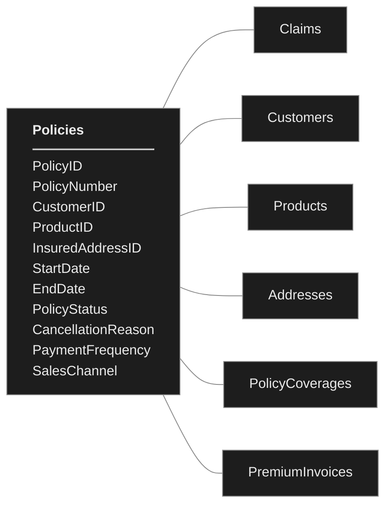

<div style="background:#101010;color:#eaeaea;padding:16px 22px;border-radius:8px;">

<a href="../index.md" style="color:#4cc2ff">← Danish Insurance Company Overview</a> · <a href="../beam-annotations.md" style="color:#4cc2ff">BEAM✲ Annotations</a> · <a href="../how-to-read.md" style="color:#4cc2ff">How to Read This Wiki</a>

# Policies

<table style="border-collapse:collapse;margin:8px 0;">
<tr><th scope="row" align="left" style="text-align:left;vertical-align:top;white-space:nowrap;font-weight:600;padding:6px 16px 6px 10px;background:#1d1d1d;color:#dcdcdc;border-bottom:1px solid #2c2c2c;">Description</th><td style="text-align:left;vertical-align:top;padding:6px 10px;background:#161616;color:#eaeaea;border-bottom:1px solid #2c2c2c;">An insurance agreement between a customer and the company for one product, with the day it started, the day it ended if it was cancelled, how often the customer pays and how it was sold. Cancelled policies stay in the table with their cancellation reason.</td></tr>
<tr><th scope="row" align="left" style="text-align:left;vertical-align:top;white-space:nowrap;font-weight:600;padding:6px 16px 6px 10px;background:#1d1d1d;color:#dcdcdc;border-bottom:1px solid #2c2c2c;">Grain</th><td style="text-align:left;vertical-align:top;padding:6px 10px;background:#161616;color:#eaeaea;border-bottom:1px solid #2c2c2c;">One row for each insurance policy a customer takes out, identified by the policy number</td></tr>
<tr><th scope="row" align="left" style="text-align:left;vertical-align:top;white-space:nowrap;font-weight:600;padding:6px 16px 6px 10px;background:#1d1d1d;color:#dcdcdc;border-bottom:1px solid #2c2c2c;">BEAM✲</th><td style="text-align:left;vertical-align:top;padding:6px 10px;background:#161616;color:#eaeaea;border-bottom:1px solid #2c2c2c;"><a href="../beam-annotations.md#t-cv" style="color:#4cc2ff" title="Current Value: Keeps only the current value of each attribute. Changes overwrite the old value. Also called a type 1 slowly changing dimension.">[CV]</a> <i>(suggested by AI)</i></td></tr>
<tr><th scope="row" align="left" style="text-align:left;vertical-align:top;white-space:nowrap;font-weight:600;padding:6px 16px 6px 10px;background:#1d1d1d;color:#dcdcdc;border-bottom:1px solid #2c2c2c;">Why <a href="../beam-annotations.md#t-cv" style="color:#4cc2ff" title="Current Value: Keeps only the current value of each attribute. Changes overwrite the old value. Also called a type 1 slowly changing dimension.">[CV]</a></th><td style="text-align:left;vertical-align:top;padding:6px 10px;background:#161616;color:#eaeaea;border-bottom:1px solid #2c2c2c;">One row per PolicyID. StartDate and EndDate are the life of the policy itself, not version dates of a repeated key, so the table keeps only the current state of each policy.</td></tr>
<tr><th scope="row" align="left" style="text-align:left;vertical-align:top;white-space:nowrap;font-weight:600;padding:6px 16px 6px 10px;background:#1d1d1d;color:#dcdcdc;border-bottom:1px solid #2c2c2c;">Source</th><td style="text-align:left;vertical-align:top;padding:6px 10px;background:#161616;color:#eaeaea;border-bottom:1px solid #2c2c2c;"><a href="../beam-annotations.md#t-source" style="color:#4cc2ff" title="Data source: The source system table or file the table comes from.">{Policies.csv}</a> <i>(measured)</i></td></tr>
<tr><th scope="row" align="left" style="text-align:left;vertical-align:top;white-space:nowrap;font-weight:600;padding:6px 16px 6px 10px;background:#1d1d1d;color:#dcdcdc;border-bottom:1px solid #2c2c2c;">Sampled Rows</th><td style="text-align:left;vertical-align:top;padding:6px 10px;background:#161616;color:#eaeaea;border-bottom:1px solid #2c2c2c;">5,640</td></tr>
<tr><th scope="row" align="left" style="text-align:left;vertical-align:top;white-space:nowrap;font-weight:600;padding:6px 16px 6px 10px;background:#1d1d1d;color:#dcdcdc;border-bottom:1px solid #2c2c2c;">Columns</th><td style="text-align:left;vertical-align:top;padding:6px 10px;background:#161616;color:#eaeaea;border-bottom:1px solid #2c2c2c;">11</td></tr>
<tr><th scope="row" align="left" style="text-align:left;vertical-align:top;white-space:nowrap;font-weight:600;padding:6px 16px 6px 10px;background:#1d1d1d;color:#dcdcdc;border-bottom:1px solid #2c2c2c;">Description Source</th><td style="text-align:left;vertical-align:top;padding:6px 10px;background:#161616;color:#eaeaea;border-bottom:1px solid #2c2c2c;">Written by AI from the data. Check before relying on it.</td></tr>
<tr><th scope="row" align="left" style="text-align:left;vertical-align:top;white-space:nowrap;font-weight:600;padding:6px 16px 6px 10px;background:#1d1d1d;color:#dcdcdc;border-bottom:1px solid #2c2c2c;">Confidence</th><td style="text-align:left;vertical-align:top;padding:6px 10px;background:#161616;color:#eaeaea;border-bottom:1px solid #2c2c2c;">high</td></tr>
</table>

## Columns

<div style="overflow-x:auto;max-width:100%;">
<table style="border-collapse:separate;border-spacing:0;font-size:90%;">
<tr><td rowspan="3" style="position:sticky;left:0;z-index:2;box-sizing:border-box;width:34px;min-width:34px;max-width:34px;padding:0;border:0;background:transparent;"></td><th style="position:sticky;left:34px;z-index:2;border:0 solid #2c2c2c;border-width:0 1px 1px 0;background:#242424;color:#ffffff;padding:3px 8px;white-space:nowrap;text-align:left;vertical-align:top;font-weight:700;border-top:1px solid #2c2c2c;border-left:1px solid #2c2c2c;cursor:help;" title="The column as it is named in the data. Each column of the table is one column in this matrix.">Column Name</th><th style="border:0 solid #2c2c2c;border-width:0 1px 1px 0;padding:3px 8px;white-space:nowrap;text-align:left;vertical-align:top;background:#161616;color:#eaeaea;font-weight:600;background:#242424;color:#ffffff;border-top:1px solid #2c2c2c;">PolicyID</th><th style="border:0 solid #2c2c2c;border-width:0 1px 1px 0;padding:3px 8px;white-space:nowrap;text-align:left;vertical-align:top;background:#161616;color:#eaeaea;font-weight:600;background:#242424;color:#ffffff;border-top:1px solid #2c2c2c;">PolicyNumber</th><th style="border:0 solid #2c2c2c;border-width:0 1px 1px 0;padding:3px 8px;white-space:nowrap;text-align:left;vertical-align:top;background:#161616;color:#eaeaea;font-weight:600;background:#242424;color:#ffffff;border-top:1px solid #2c2c2c;">CustomerID</th><th style="border:0 solid #2c2c2c;border-width:0 1px 1px 0;padding:3px 8px;white-space:nowrap;text-align:left;vertical-align:top;background:#161616;color:#eaeaea;font-weight:600;background:#242424;color:#ffffff;border-top:1px solid #2c2c2c;">ProductID</th><th style="border:0 solid #2c2c2c;border-width:0 1px 1px 0;padding:3px 8px;white-space:nowrap;text-align:left;vertical-align:top;background:#161616;color:#eaeaea;font-weight:600;background:#242424;color:#ffffff;border-top:1px solid #2c2c2c;">InsuredAddressID</th><th style="border:0 solid #2c2c2c;border-width:0 1px 1px 0;padding:3px 8px;white-space:nowrap;text-align:left;vertical-align:top;background:#161616;color:#eaeaea;font-weight:600;background:#242424;color:#ffffff;border-top:1px solid #2c2c2c;">StartDate</th><th style="border:0 solid #2c2c2c;border-width:0 1px 1px 0;padding:3px 8px;white-space:nowrap;text-align:left;vertical-align:top;background:#161616;color:#eaeaea;font-weight:600;background:#242424;color:#ffffff;border-top:1px solid #2c2c2c;">EndDate</th><th style="border:0 solid #2c2c2c;border-width:0 1px 1px 0;padding:3px 8px;white-space:nowrap;text-align:left;vertical-align:top;background:#161616;color:#eaeaea;font-weight:600;background:#242424;color:#ffffff;border-top:1px solid #2c2c2c;">PolicyStatus</th><th style="border:0 solid #2c2c2c;border-width:0 1px 1px 0;padding:3px 8px;white-space:nowrap;text-align:left;vertical-align:top;background:#161616;color:#eaeaea;font-weight:600;background:#242424;color:#ffffff;border-top:1px solid #2c2c2c;">CancellationReason</th><th style="border:0 solid #2c2c2c;border-width:0 1px 1px 0;padding:3px 8px;white-space:nowrap;text-align:left;vertical-align:top;background:#161616;color:#eaeaea;font-weight:600;background:#242424;color:#ffffff;border-top:1px solid #2c2c2c;">PaymentFrequency</th><th style="border:0 solid #2c2c2c;border-width:0 1px 1px 0;padding:3px 8px;white-space:nowrap;text-align:left;vertical-align:top;background:#161616;color:#eaeaea;font-weight:600;background:#242424;color:#ffffff;border-top:1px solid #2c2c2c;">SalesChannel</th></tr>
<tr><td style="position:sticky;left:34px;z-index:2;border:0 solid #2c2c2c;border-width:0 1px 1px 0;background:#1d1d1d;color:#dcdcdc;padding:3px 8px;white-space:nowrap;text-align:left;vertical-align:top;font-weight:600;border-left:1px solid #2c2c2c;cursor:help;" title="The kind of values found in the data, which may differ from what the source declares. The short code is a BEAM annotation, for example C9 is text with a longest value of 9 characters.">Data Type</td><td style="border:0 solid #2c2c2c;border-width:0 1px 1px 0;padding:3px 8px;white-space:nowrap;text-align:left;vertical-align:top;background:#161616;color:#eaeaea;"><a href="../beam-annotations.md#c-i" style="color:#4cc2ff" title="Integer: A whole number. (Measured from the data.)">I</a> whole number</td><td style="border:0 solid #2c2c2c;border-width:0 1px 1px 0;padding:3px 8px;white-space:nowrap;text-align:left;vertical-align:top;background:#161616;color:#eaeaea;"><a href="../beam-annotations.md#c-c" style="color:#4cc2ff" title="Character: Short text, with n = the longest value seen. (Measured from the data.)">C14</a> text</td><td style="border:0 solid #2c2c2c;border-width:0 1px 1px 0;padding:3px 8px;white-space:nowrap;text-align:left;vertical-align:top;background:#161616;color:#eaeaea;"><a href="../beam-annotations.md#c-i" style="color:#4cc2ff" title="Integer: A whole number. (Measured from the data.)">I</a> whole number</td><td style="border:0 solid #2c2c2c;border-width:0 1px 1px 0;padding:3px 8px;white-space:nowrap;text-align:left;vertical-align:top;background:#161616;color:#eaeaea;"><a href="../beam-annotations.md#c-i" style="color:#4cc2ff" title="Integer: A whole number. (Measured from the data.)">I</a> whole number</td><td style="border:0 solid #2c2c2c;border-width:0 1px 1px 0;padding:3px 8px;white-space:nowrap;text-align:left;vertical-align:top;background:#161616;color:#eaeaea;"><a href="../beam-annotations.md#c-i" style="color:#4cc2ff" title="Integer: A whole number. (Measured from the data.)">I</a> whole number</td><td style="border:0 solid #2c2c2c;border-width:0 1px 1px 0;padding:3px 8px;white-space:nowrap;text-align:left;vertical-align:top;background:#161616;color:#eaeaea;"><a href="../beam-annotations.md#c-d" style="color:#4cc2ff" title="Date: A calendar date. Numbers order milestones, e.g. D1 → D2. (Measured from the data.)">D</a> date</td><td style="border:0 solid #2c2c2c;border-width:0 1px 1px 0;padding:3px 8px;white-space:nowrap;text-align:left;vertical-align:top;background:#161616;color:#eaeaea;"><a href="../beam-annotations.md#c-d" style="color:#4cc2ff" title="Date: A calendar date. Numbers order milestones, e.g. D1 → D2. (Measured from the data.)">D</a> date</td><td style="border:0 solid #2c2c2c;border-width:0 1px 1px 0;padding:3px 8px;white-space:nowrap;text-align:left;vertical-align:top;background:#161616;color:#eaeaea;"><a href="../beam-annotations.md#c-c" style="color:#4cc2ff" title="Character: Short text, with n = the longest value seen. (Measured from the data.)">C6</a> text</td><td style="border:0 solid #2c2c2c;border-width:0 1px 1px 0;padding:3px 8px;white-space:nowrap;text-align:left;vertical-align:top;background:#161616;color:#eaeaea;"><a href="../beam-annotations.md#c-c" style="color:#4cc2ff" title="Character: Short text, with n = the longest value seen. (Measured from the data.)">C29</a> text</td><td style="border:0 solid #2c2c2c;border-width:0 1px 1px 0;padding:3px 8px;white-space:nowrap;text-align:left;vertical-align:top;background:#161616;color:#eaeaea;"><a href="../beam-annotations.md#c-c" style="color:#4cc2ff" title="Character: Short text, with n = the longest value seen. (Measured from the data.)">C11</a> text</td><td style="border:0 solid #2c2c2c;border-width:0 1px 1px 0;padding:3px 8px;white-space:nowrap;text-align:left;vertical-align:top;background:#161616;color:#eaeaea;"><a href="../beam-annotations.md#c-c" style="color:#4cc2ff" title="Character: Short text, with n = the longest value seen. (Measured from the data.)">C8</a> text</td></tr>
<tr><td style="position:sticky;left:34px;z-index:2;border:0 solid #2c2c2c;border-width:0 1px 1px 0;background:#1d1d1d;color:#dcdcdc;padding:3px 8px;white-space:nowrap;text-align:left;vertical-align:top;font-weight:600;border-left:1px solid #2c2c2c;cursor:help;" title="Short BEAM annotations. Plain codes are measured from the data. Codes in italics are suggested by AI and should be checked. Click a code to read what it means.">BEAM✲</td><td style="border:0 solid #2c2c2c;border-width:0 1px 1px 0;padding:3px 8px;white-space:nowrap;text-align:left;vertical-align:top;background:#161616;color:#eaeaea;"><a href="../beam-annotations.md#c-nd" style="color:#4cc2ff" title="No Duplicates: Every value is different. The numbered form marks columns that are unique in combination. In this wiki measured: no duplicates were found in the text or whole-number values profiled. (Measured from the data.)">ND</a> <i><a href="../beam-annotations.md#c-bk" style="color:#4cc2ff" title="Business Key: The source system&#x27;s own identifier for the thing the table is about, e.g. the customer number in a customers table. It identifies a row of this table. (Suggested by AI.)">BK</a></i></td><td style="border:0 solid #2c2c2c;border-width:0 1px 1px 0;padding:3px 8px;white-space:nowrap;text-align:left;vertical-align:top;background:#161616;color:#eaeaea;"><a href="../beam-annotations.md#c-nd" style="color:#4cc2ff" title="No Duplicates: Every value is different. The numbered form marks columns that are unique in combination. In this wiki measured: no duplicates were found in the text or whole-number values profiled. (Measured from the data.)">ND</a> <i><a href="../beam-annotations.md#c-nk" style="color:#4cc2ff" title="Natural Key: An identifier people use in the real world for the thing the table is about, e.g. the SKU in a products table. (Suggested by AI.)">NK</a></i></td><td style="border:0 solid #2c2c2c;border-width:0 1px 1px 0;padding:3px 8px;white-space:nowrap;text-align:left;vertical-align:top;background:#161616;color:#eaeaea;"><a href="../beam-annotations.md#c-fk" style="color:#4cc2ff" title="Foreign Key: Points to the key of another table. In this wiki measured: every value was found in the other table. (Measured from the data.)">FK</a> <i><a href="../beam-annotations.md#c-dim" style="color:#4cc2ff" title="Dimension or role: The dimension a detail refers to, e.g. PreferredStoreID [Stores] when the preferred store is a role of the store dimension. (Suggested by AI.)">[Customers]</a></i> <i><a href="../beam-annotations.md#c-md" style="color:#4cc2ff" title="Mandatory: The value should always be there under normal conditions. Shown as MD when the data has gaps. (Suggested by AI.)">MD</a></i></td><td style="border:0 solid #2c2c2c;border-width:0 1px 1px 0;padding:3px 8px;white-space:nowrap;text-align:left;vertical-align:top;background:#161616;color:#eaeaea;"><a href="../beam-annotations.md#c-fk" style="color:#4cc2ff" title="Foreign Key: Points to the key of another table. In this wiki measured: every value was found in the other table. (Measured from the data.)">FK</a> <i><a href="../beam-annotations.md#c-dim" style="color:#4cc2ff" title="Dimension or role: The dimension a detail refers to, e.g. PreferredStoreID [Stores] when the preferred store is a role of the store dimension. (Suggested by AI.)">[Products]</a></i> <i><a href="../beam-annotations.md#c-md" style="color:#4cc2ff" title="Mandatory: The value should always be there under normal conditions. Shown as MD when the data has gaps. (Suggested by AI.)">MD</a></i></td><td style="border:0 solid #2c2c2c;border-width:0 1px 1px 0;padding:3px 8px;white-space:nowrap;text-align:left;vertical-align:top;background:#161616;color:#eaeaea;"><a href="../beam-annotations.md#c-fk" style="color:#4cc2ff" title="Foreign Key: Points to the key of another table. In this wiki measured: every value was found in the other table. (Measured from the data.)">FK</a> <i><a href="../beam-annotations.md#c-dim" style="color:#4cc2ff" title="Dimension or role: The dimension a detail refers to, e.g. PreferredStoreID [Stores] when the preferred store is a role of the store dimension. (Suggested by AI.)">[Addresses]</a></i> <i><a href="../beam-annotations.md#c-suspect" style="color:#4cc2ff" title="Suspect: The column still needs clarifying. See the open questions on its page. (Suggested by AI.)">?</a></i></td><td style="border:0 solid #2c2c2c;border-width:0 1px 1px 0;padding:3px 8px;white-space:nowrap;text-align:left;vertical-align:top;background:#161616;color:#eaeaea;"><i><a href="../beam-annotations.md#c-md" style="color:#4cc2ff" title="Mandatory: The value should always be there under normal conditions. Shown as MD when the data has gaps. (Suggested by AI.)">MD</a></i> <i><a href="../beam-annotations.md#c-fv" style="color:#4cc2ff" title="Fixed Value: Shouldn&#x27;t change, e.g. a date of birth. Corrections overwrite it. (Suggested by AI.)">FV</a></i></td><td style="border:0 solid #2c2c2c;border-width:0 1px 1px 0;padding:3px 8px;white-space:nowrap;text-align:left;vertical-align:top;background:#161616;color:#eaeaea;"><i><a href="../beam-annotations.md#c-dc" style="color:#4cc2ff" title="Defining Characteristic: Its value decides which exclusive (X) columns apply, e.g. product type. (Suggested by AI.)">DC</a></i></td><td style="border:0 solid #2c2c2c;border-width:0 1px 1px 0;padding:3px 8px;white-space:nowrap;text-align:left;vertical-align:top;background:#161616;color:#eaeaea;"></td><td style="border:0 solid #2c2c2c;border-width:0 1px 1px 0;padding:3px 8px;white-space:nowrap;text-align:left;vertical-align:top;background:#161616;color:#eaeaea;"><i><a href="../beam-annotations.md#c-dc" style="color:#4cc2ff" title="Defining Characteristic: Its value decides which exclusive (X) columns apply, e.g. product type. (Suggested by AI.)">DC</a></i></td><td style="border:0 solid #2c2c2c;border-width:0 1px 1px 0;padding:3px 8px;white-space:nowrap;text-align:left;vertical-align:top;background:#161616;color:#eaeaea;"></td><td style="border:0 solid #2c2c2c;border-width:0 1px 1px 0;padding:3px 8px;white-space:nowrap;text-align:left;vertical-align:top;background:#161616;color:#eaeaea;"></td></tr>
<tr><td rowspan="9" style="position:sticky;left:0;z-index:2;box-sizing:border-box;width:34px;min-width:34px;max-width:34px;border:0 solid #2c2c2c;border-width:0 1px 1px 0;background:#0f2f2c;color:#2de2c9;padding:4px 0;text-align:center;vertical-align:middle;border-left:3px solid #2de2c9;cursor:help;" title="Counts and extremes measured from the rows that were read. They are facts, not opinions."><div style="writing-mode:vertical-rl;transform:rotate(180deg);white-space:nowrap;margin:0 auto;font-weight:600;">Data Profiling Results</div></td><td style="position:sticky;left:34px;z-index:2;border:0 solid #2c2c2c;border-width:0 1px 1px 0;background:#1d1d1d;color:#dcdcdc;padding:3px 8px;white-space:nowrap;text-align:left;vertical-align:top;font-weight:600;cursor:help;" title="How many rows were read for these numbers. Every percentage in this group is based on it, so check it first: on very large tables it can be fewer than all rows.">Sample Count</td><td style="border:0 solid #2c2c2c;border-width:0 1px 1px 0;padding:3px 8px;white-space:nowrap;text-align:right;vertical-align:top;background:#161616;color:#eaeaea;background:#161616;">5,640</td><td style="border:0 solid #2c2c2c;border-width:0 1px 1px 0;padding:3px 8px;white-space:nowrap;text-align:right;vertical-align:top;background:#161616;color:#eaeaea;background:#161616;">5,640</td><td style="border:0 solid #2c2c2c;border-width:0 1px 1px 0;padding:3px 8px;white-space:nowrap;text-align:right;vertical-align:top;background:#161616;color:#eaeaea;background:#161616;">5,640</td><td style="border:0 solid #2c2c2c;border-width:0 1px 1px 0;padding:3px 8px;white-space:nowrap;text-align:right;vertical-align:top;background:#161616;color:#eaeaea;background:#161616;">5,640</td><td style="border:0 solid #2c2c2c;border-width:0 1px 1px 0;padding:3px 8px;white-space:nowrap;text-align:right;vertical-align:top;background:#161616;color:#eaeaea;background:#161616;">5,640</td><td style="border:0 solid #2c2c2c;border-width:0 1px 1px 0;padding:3px 8px;white-space:nowrap;text-align:right;vertical-align:top;background:#161616;color:#eaeaea;background:#161616;">5,640</td><td style="border:0 solid #2c2c2c;border-width:0 1px 1px 0;padding:3px 8px;white-space:nowrap;text-align:right;vertical-align:top;background:#161616;color:#eaeaea;background:#161616;">5,640</td><td style="border:0 solid #2c2c2c;border-width:0 1px 1px 0;padding:3px 8px;white-space:nowrap;text-align:right;vertical-align:top;background:#161616;color:#eaeaea;background:#161616;">5,640</td><td style="border:0 solid #2c2c2c;border-width:0 1px 1px 0;padding:3px 8px;white-space:nowrap;text-align:right;vertical-align:top;background:#161616;color:#eaeaea;background:#161616;">5,640</td><td style="border:0 solid #2c2c2c;border-width:0 1px 1px 0;padding:3px 8px;white-space:nowrap;text-align:right;vertical-align:top;background:#161616;color:#eaeaea;background:#161616;">5,640</td><td style="border:0 solid #2c2c2c;border-width:0 1px 1px 0;padding:3px 8px;white-space:nowrap;text-align:right;vertical-align:top;background:#161616;color:#eaeaea;background:#161616;">5,640</td></tr>
<tr><td style="position:sticky;left:34px;z-index:2;border:0 solid #2c2c2c;border-width:0 1px 1px 0;background:#1d1d1d;color:#dcdcdc;padding:3px 8px;white-space:nowrap;text-align:left;vertical-align:top;font-weight:600;cursor:help;" title="Rows where the column is empty or blank, with the share of rows. It matters because gaps break joins and totals, and a column that should always be filled in should show 0.">Missing</td><td style="border:0 solid #2c2c2c;border-width:0 1px 1px 0;padding:3px 8px;white-space:nowrap;text-align:left;vertical-align:top;background:#161616;color:#eaeaea;background:#161616;">0 (0%)</td><td style="border:0 solid #2c2c2c;border-width:0 1px 1px 0;padding:3px 8px;white-space:nowrap;text-align:left;vertical-align:top;background:#161616;color:#eaeaea;background:#161616;">0 (0%)</td><td style="border:0 solid #2c2c2c;border-width:0 1px 1px 0;padding:3px 8px;white-space:nowrap;text-align:left;vertical-align:top;background:#161616;color:#eaeaea;background:#161616;">0 (0%)</td><td style="border:0 solid #2c2c2c;border-width:0 1px 1px 0;padding:3px 8px;white-space:nowrap;text-align:left;vertical-align:top;background:#161616;color:#eaeaea;background:#161616;">0 (0%)</td><td style="border:0 solid #2c2c2c;border-width:0 1px 1px 0;padding:3px 8px;white-space:nowrap;text-align:left;vertical-align:top;background:#161616;color:#eaeaea;background:#161616;">3,035 (53.8%)</td><td style="border:0 solid #2c2c2c;border-width:0 1px 1px 0;padding:3px 8px;white-space:nowrap;text-align:left;vertical-align:top;background:#161616;color:#eaeaea;background:#161616;">0 (0%)</td><td style="border:0 solid #2c2c2c;border-width:0 1px 1px 0;padding:3px 8px;white-space:nowrap;text-align:left;vertical-align:top;background:#161616;color:#eaeaea;background:#161616;">4,595 (81.5%)</td><td style="border:0 solid #2c2c2c;border-width:0 1px 1px 0;padding:3px 8px;white-space:nowrap;text-align:left;vertical-align:top;background:#161616;color:#eaeaea;background:#161616;">0 (0%)</td><td style="border:0 solid #2c2c2c;border-width:0 1px 1px 0;padding:3px 8px;white-space:nowrap;text-align:left;vertical-align:top;background:#161616;color:#eaeaea;background:#161616;">4,595 (81.5%)</td><td style="border:0 solid #2c2c2c;border-width:0 1px 1px 0;padding:3px 8px;white-space:nowrap;text-align:left;vertical-align:top;background:#161616;color:#eaeaea;background:#161616;">0 (0%)</td><td style="border:0 solid #2c2c2c;border-width:0 1px 1px 0;padding:3px 8px;white-space:nowrap;text-align:left;vertical-align:top;background:#161616;color:#eaeaea;background:#161616;">0 (0%)</td></tr>
<tr><td style="position:sticky;left:34px;z-index:2;border:0 solid #2c2c2c;border-width:0 1px 1px 0;background:#1d1d1d;color:#dcdcdc;padding:3px 8px;white-space:nowrap;text-align:left;vertical-align:top;font-weight:600;cursor:help;" title="How many different values occur, with the share of rows. 100% means every value is different, so the column could identify a row. A low share means the column holds categories or codes.">Unique Values</td><td style="border:0 solid #2c2c2c;border-width:0 1px 1px 0;padding:3px 8px;white-space:nowrap;text-align:left;vertical-align:top;background:#161616;color:#eaeaea;background:#161616;">5,640 (100%)</td><td style="border:0 solid #2c2c2c;border-width:0 1px 1px 0;padding:3px 8px;white-space:nowrap;text-align:left;vertical-align:top;background:#161616;color:#eaeaea;background:#161616;">5,640 (100%)</td><td style="border:0 solid #2c2c2c;border-width:0 1px 1px 0;padding:3px 8px;white-space:nowrap;text-align:left;vertical-align:top;background:#161616;color:#eaeaea;background:#161616;">3,000 (53.2%)</td><td style="border:0 solid #2c2c2c;border-width:0 1px 1px 0;padding:3px 8px;white-space:nowrap;text-align:left;vertical-align:top;background:#161616;color:#eaeaea;background:#161616;">6 (0.106%)</td><td style="border:0 solid #2c2c2c;border-width:0 1px 1px 0;padding:3px 8px;white-space:nowrap;text-align:left;vertical-align:top;background:#161616;color:#eaeaea;background:#161616;">2,047 (36.3%)</td><td style="border:0 solid #2c2c2c;border-width:0 1px 1px 0;padding:3px 8px;white-space:nowrap;text-align:left;vertical-align:top;background:#161616;color:#eaeaea;background:#161616;">3,537 (62.7%)</td><td style="border:0 solid #2c2c2c;border-width:0 1px 1px 0;padding:3px 8px;white-space:nowrap;text-align:left;vertical-align:top;background:#161616;color:#eaeaea;background:#161616;">543 (9.63%)</td><td style="border:0 solid #2c2c2c;border-width:0 1px 1px 0;padding:3px 8px;white-space:nowrap;text-align:left;vertical-align:top;background:#161616;color:#eaeaea;background:#161616;">2 (0.0355%)</td><td style="border:0 solid #2c2c2c;border-width:0 1px 1px 0;padding:3px 8px;white-space:nowrap;text-align:left;vertical-align:top;background:#161616;color:#eaeaea;background:#161616;">7 (0.124%)</td><td style="border:0 solid #2c2c2c;border-width:0 1px 1px 0;padding:3px 8px;white-space:nowrap;text-align:left;vertical-align:top;background:#161616;color:#eaeaea;background:#161616;">4 (0.0709%)</td><td style="border:0 solid #2c2c2c;border-width:0 1px 1px 0;padding:3px 8px;white-space:nowrap;text-align:left;vertical-align:top;background:#161616;color:#eaeaea;background:#161616;">4 (0.0709%)</td></tr>
<tr><td style="position:sticky;left:34px;z-index:2;border:0 solid #2c2c2c;border-width:0 1px 1px 0;background:#1d1d1d;color:#dcdcdc;padding:3px 8px;white-space:nowrap;text-align:left;vertical-align:top;font-weight:600;cursor:help;" title="The smallest value: the lowest number, the earliest date, or the first in alphabetical order. It matters because it shows the start of the range and catches impossible values such as a negative quantity.">Min Value</td><td style="border:0 solid #2c2c2c;border-width:0 1px 1px 0;padding:3px 8px;white-space:nowrap;text-align:left;vertical-align:top;background:#161616;color:#eaeaea;background:#161616;">700001</td><td style="border:0 solid #2c2c2c;border-width:0 1px 1px 0;padding:3px 8px;white-space:nowrap;text-align:left;vertical-align:top;background:#161616;color:#eaeaea;background:#161616;">DK-2008-100001</td><td style="border:0 solid #2c2c2c;border-width:0 1px 1px 0;padding:3px 8px;white-space:nowrap;text-align:left;vertical-align:top;background:#161616;color:#eaeaea;background:#161616;">100001</td><td style="border:0 solid #2c2c2c;border-width:0 1px 1px 0;padding:3px 8px;white-space:nowrap;text-align:left;vertical-align:top;background:#161616;color:#eaeaea;background:#161616;">1</td><td style="border:0 solid #2c2c2c;border-width:0 1px 1px 0;padding:3px 8px;white-space:nowrap;text-align:left;vertical-align:top;background:#161616;color:#eaeaea;background:#161616;">50001</td><td style="border:0 solid #2c2c2c;border-width:0 1px 1px 0;padding:3px 8px;white-space:nowrap;text-align:left;vertical-align:top;background:#161616;color:#eaeaea;background:#161616;">2008-01-06</td><td style="border:0 solid #2c2c2c;border-width:0 1px 1px 0;padding:3px 8px;white-space:nowrap;text-align:left;vertical-align:top;background:#161616;color:#eaeaea;background:#161616;">2023-01-09</td><td style="border:0 solid #2c2c2c;border-width:0 1px 1px 0;padding:3px 8px;white-space:nowrap;text-align:left;vertical-align:top;background:#161616;color:#eaeaea;background:#161616;">Aktiv</td><td style="border:0 solid #2c2c2c;border-width:0 1px 1px 0;padding:3px 8px;white-space:nowrap;text-align:left;vertical-align:top;background:#161616;color:#eaeaea;background:#161616;">Dødsfald</td><td style="border:0 solid #2c2c2c;border-width:0 1px 1px 0;padding:3px 8px;white-space:nowrap;text-align:left;vertical-align:top;background:#161616;color:#eaeaea;background:#161616;">Halvårlig</td><td style="border:0 solid #2c2c2c;border-width:0 1px 1px 0;padding:3px 8px;white-space:nowrap;text-align:left;vertical-align:top;background:#161616;color:#eaeaea;background:#161616;">Partner</td></tr>
<tr><td style="position:sticky;left:34px;z-index:2;border:0 solid #2c2c2c;border-width:0 1px 1px 0;background:#1d1d1d;color:#dcdcdc;padding:3px 8px;white-space:nowrap;text-align:left;vertical-align:top;font-weight:600;cursor:help;" title="How many rows have the smallest value. On a unique column it is 1. A high count suggests a default or a stand-in value, such as 0 or 1900-01-01, rather than a real minimum.">Min Count</td><td style="border:0 solid #2c2c2c;border-width:0 1px 1px 0;padding:3px 8px;white-space:nowrap;text-align:left;vertical-align:top;background:#161616;color:#eaeaea;background:#161616;">1 (0.0177%)</td><td style="border:0 solid #2c2c2c;border-width:0 1px 1px 0;padding:3px 8px;white-space:nowrap;text-align:left;vertical-align:top;background:#161616;color:#eaeaea;background:#161616;">1 (0.0177%)</td><td style="border:0 solid #2c2c2c;border-width:0 1px 1px 0;padding:3px 8px;white-space:nowrap;text-align:left;vertical-align:top;background:#161616;color:#eaeaea;background:#161616;">2 (0.0355%)</td><td style="border:0 solid #2c2c2c;border-width:0 1px 1px 0;padding:3px 8px;white-space:nowrap;text-align:left;vertical-align:top;background:#161616;color:#eaeaea;background:#161616;">1,683 (29.8%)</td><td style="border:0 solid #2c2c2c;border-width:0 1px 1px 0;padding:3px 8px;white-space:nowrap;text-align:left;vertical-align:top;background:#161616;color:#eaeaea;background:#161616;">1 (0.0177%)</td><td style="border:0 solid #2c2c2c;border-width:0 1px 1px 0;padding:3px 8px;white-space:nowrap;text-align:left;vertical-align:top;background:#161616;color:#eaeaea;background:#161616;">1 (0.0177%)</td><td style="border:0 solid #2c2c2c;border-width:0 1px 1px 0;padding:3px 8px;white-space:nowrap;text-align:left;vertical-align:top;background:#161616;color:#eaeaea;background:#161616;">1 (0.0177%)</td><td style="border:0 solid #2c2c2c;border-width:0 1px 1px 0;padding:3px 8px;white-space:nowrap;text-align:left;vertical-align:top;background:#161616;color:#eaeaea;background:#161616;">4,595 (81.5%)</td><td style="border:0 solid #2c2c2c;border-width:0 1px 1px 0;padding:3px 8px;white-space:nowrap;text-align:left;vertical-align:top;background:#161616;color:#eaeaea;background:#161616;">18 (0.319%)</td><td style="border:0 solid #2c2c2c;border-width:0 1px 1px 0;padding:3px 8px;white-space:nowrap;text-align:left;vertical-align:top;background:#161616;color:#eaeaea;background:#161616;">309 (5.48%)</td><td style="border:0 solid #2c2c2c;border-width:0 1px 1px 0;padding:3px 8px;white-space:nowrap;text-align:left;vertical-align:top;background:#161616;color:#eaeaea;background:#161616;">928 (16.5%)</td></tr>
<tr><td style="position:sticky;left:34px;z-index:2;border:0 solid #2c2c2c;border-width:0 1px 1px 0;background:#1d1d1d;color:#dcdcdc;padding:3px 8px;white-space:nowrap;text-align:left;vertical-align:top;font-weight:600;cursor:help;" title="The largest value: the highest number, the latest date, or the last in alphabetical order. It matters because it shows the end of the range and catches outliers or future dates.">Max Value</td><td style="border:0 solid #2c2c2c;border-width:0 1px 1px 0;padding:3px 8px;white-space:nowrap;text-align:left;vertical-align:top;background:#161616;color:#eaeaea;background:#161616;">705640</td><td style="border:0 solid #2c2c2c;border-width:0 1px 1px 0;padding:3px 8px;white-space:nowrap;text-align:left;vertical-align:top;background:#161616;color:#eaeaea;background:#161616;">DK-2025-105638</td><td style="border:0 solid #2c2c2c;border-width:0 1px 1px 0;padding:3px 8px;white-space:nowrap;text-align:left;vertical-align:top;background:#161616;color:#eaeaea;background:#161616;">103000</td><td style="border:0 solid #2c2c2c;border-width:0 1px 1px 0;padding:3px 8px;white-space:nowrap;text-align:left;vertical-align:top;background:#161616;color:#eaeaea;background:#161616;">6</td><td style="border:0 solid #2c2c2c;border-width:0 1px 1px 0;padding:3px 8px;white-space:nowrap;text-align:left;vertical-align:top;background:#161616;color:#eaeaea;background:#161616;">52860</td><td style="border:0 solid #2c2c2c;border-width:0 1px 1px 0;padding:3px 8px;white-space:nowrap;text-align:left;vertical-align:top;background:#161616;color:#eaeaea;background:#161616;">2025-12-31</td><td style="border:0 solid #2c2c2c;border-width:0 1px 1px 0;padding:3px 8px;white-space:nowrap;text-align:left;vertical-align:top;background:#161616;color:#eaeaea;background:#161616;">2025-12-29</td><td style="border:0 solid #2c2c2c;border-width:0 1px 1px 0;padding:3px 8px;white-space:nowrap;text-align:left;vertical-align:top;background:#161616;color:#eaeaea;background:#161616;">Opsagt</td><td style="border:0 solid #2c2c2c;border-width:0 1px 1px 0;padding:3px 8px;white-space:nowrap;text-align:left;vertical-align:top;background:#161616;color:#eaeaea;background:#161616;">Utilfreds med skadebehan…</td><td style="border:0 solid #2c2c2c;border-width:0 1px 1px 0;padding:3px 8px;white-space:nowrap;text-align:left;vertical-align:top;background:#161616;color:#eaeaea;background:#161616;">Årlig</td><td style="border:0 solid #2c2c2c;border-width:0 1px 1px 0;padding:3px 8px;white-space:nowrap;text-align:left;vertical-align:top;background:#161616;color:#eaeaea;background:#161616;">Web</td></tr>
<tr><td style="position:sticky;left:34px;z-index:2;border:0 solid #2c2c2c;border-width:0 1px 1px 0;background:#1d1d1d;color:#dcdcdc;padding:3px 8px;white-space:nowrap;text-align:left;vertical-align:top;font-weight:600;cursor:help;" title="How many rows have the largest value. A high count suggests a cap or a stand-in value, such as 9999-12-31, rather than a real maximum.">Max Count</td><td style="border:0 solid #2c2c2c;border-width:0 1px 1px 0;padding:3px 8px;white-space:nowrap;text-align:left;vertical-align:top;background:#161616;color:#eaeaea;background:#161616;">1 (0.0177%)</td><td style="border:0 solid #2c2c2c;border-width:0 1px 1px 0;padding:3px 8px;white-space:nowrap;text-align:left;vertical-align:top;background:#161616;color:#eaeaea;background:#161616;">1 (0.0177%)</td><td style="border:0 solid #2c2c2c;border-width:0 1px 1px 0;padding:3px 8px;white-space:nowrap;text-align:left;vertical-align:top;background:#161616;color:#eaeaea;background:#161616;">2 (0.0355%)</td><td style="border:0 solid #2c2c2c;border-width:0 1px 1px 0;padding:3px 8px;white-space:nowrap;text-align:left;vertical-align:top;background:#161616;color:#eaeaea;background:#161616;">343 (6.08%)</td><td style="border:0 solid #2c2c2c;border-width:0 1px 1px 0;padding:3px 8px;white-space:nowrap;text-align:left;vertical-align:top;background:#161616;color:#eaeaea;background:#161616;">1 (0.0177%)</td><td style="border:0 solid #2c2c2c;border-width:0 1px 1px 0;padding:3px 8px;white-space:nowrap;text-align:left;vertical-align:top;background:#161616;color:#eaeaea;background:#161616;">3 (0.0532%)</td><td style="border:0 solid #2c2c2c;border-width:0 1px 1px 0;padding:3px 8px;white-space:nowrap;text-align:left;vertical-align:top;background:#161616;color:#eaeaea;background:#161616;">3 (0.0532%)</td><td style="border:0 solid #2c2c2c;border-width:0 1px 1px 0;padding:3px 8px;white-space:nowrap;text-align:left;vertical-align:top;background:#161616;color:#eaeaea;background:#161616;">1,045 (18.5%)</td><td style="border:0 solid #2c2c2c;border-width:0 1px 1px 0;padding:3px 8px;white-space:nowrap;text-align:left;vertical-align:top;background:#161616;color:#eaeaea;background:#161616;">60 (1.06%)</td><td style="border:0 solid #2c2c2c;border-width:0 1px 1px 0;padding:3px 8px;white-space:nowrap;text-align:left;vertical-align:top;background:#161616;color:#eaeaea;background:#161616;">1,439 (25.5%)</td><td style="border:0 solid #2c2c2c;border-width:0 1px 1px 0;padding:3px 8px;white-space:nowrap;text-align:left;vertical-align:top;background:#161616;color:#eaeaea;background:#161616;">2,400 (42.6%)</td></tr>
<tr><td style="position:sticky;left:34px;z-index:2;border:0 solid #2c2c2c;border-width:0 1px 1px 0;background:#1d1d1d;color:#dcdcdc;padding:3px 8px;white-space:nowrap;text-align:left;vertical-align:top;font-weight:600;cursor:help;" title="The shortest text, counted in characters. If it differs a lot from the longest, the column may mix formats, or have values that were cut off.">Min Length</td><td style="border:0 solid #2c2c2c;border-width:0 1px 1px 0;padding:3px 8px;white-space:nowrap;text-align:right;vertical-align:top;background:#161616;color:#eaeaea;background:#161616;">—</td><td style="border:0 solid #2c2c2c;border-width:0 1px 1px 0;padding:3px 8px;white-space:nowrap;text-align:right;vertical-align:top;background:#161616;color:#eaeaea;background:#161616;">14</td><td style="border:0 solid #2c2c2c;border-width:0 1px 1px 0;padding:3px 8px;white-space:nowrap;text-align:right;vertical-align:top;background:#161616;color:#eaeaea;background:#161616;">—</td><td style="border:0 solid #2c2c2c;border-width:0 1px 1px 0;padding:3px 8px;white-space:nowrap;text-align:right;vertical-align:top;background:#161616;color:#eaeaea;background:#161616;">—</td><td style="border:0 solid #2c2c2c;border-width:0 1px 1px 0;padding:3px 8px;white-space:nowrap;text-align:right;vertical-align:top;background:#161616;color:#eaeaea;background:#161616;">—</td><td style="border:0 solid #2c2c2c;border-width:0 1px 1px 0;padding:3px 8px;white-space:nowrap;text-align:right;vertical-align:top;background:#161616;color:#eaeaea;background:#161616;">—</td><td style="border:0 solid #2c2c2c;border-width:0 1px 1px 0;padding:3px 8px;white-space:nowrap;text-align:right;vertical-align:top;background:#161616;color:#eaeaea;background:#161616;">—</td><td style="border:0 solid #2c2c2c;border-width:0 1px 1px 0;padding:3px 8px;white-space:nowrap;text-align:right;vertical-align:top;background:#161616;color:#eaeaea;background:#161616;">5</td><td style="border:0 solid #2c2c2c;border-width:0 1px 1px 0;padding:3px 8px;white-space:nowrap;text-align:right;vertical-align:top;background:#161616;color:#eaeaea;background:#161616;">8</td><td style="border:0 solid #2c2c2c;border-width:0 1px 1px 0;padding:3px 8px;white-space:nowrap;text-align:right;vertical-align:top;background:#161616;color:#eaeaea;background:#161616;">5</td><td style="border:0 solid #2c2c2c;border-width:0 1px 1px 0;padding:3px 8px;white-space:nowrap;text-align:right;vertical-align:top;background:#161616;color:#eaeaea;background:#161616;">3</td></tr>
<tr><td style="position:sticky;left:34px;z-index:2;border:0 solid #2c2c2c;border-width:0 1px 1px 0;background:#1d1d1d;color:#dcdcdc;padding:3px 8px;white-space:nowrap;text-align:left;vertical-align:top;font-weight:600;cursor:help;" title="The longest text, counted in characters. It matters when you load the data elsewhere, because the target column must be wide enough.">Max Length</td><td style="border:0 solid #2c2c2c;border-width:0 1px 1px 0;padding:3px 8px;white-space:nowrap;text-align:right;vertical-align:top;background:#161616;color:#eaeaea;background:#161616;">—</td><td style="border:0 solid #2c2c2c;border-width:0 1px 1px 0;padding:3px 8px;white-space:nowrap;text-align:right;vertical-align:top;background:#161616;color:#eaeaea;background:#161616;">14</td><td style="border:0 solid #2c2c2c;border-width:0 1px 1px 0;padding:3px 8px;white-space:nowrap;text-align:right;vertical-align:top;background:#161616;color:#eaeaea;background:#161616;">—</td><td style="border:0 solid #2c2c2c;border-width:0 1px 1px 0;padding:3px 8px;white-space:nowrap;text-align:right;vertical-align:top;background:#161616;color:#eaeaea;background:#161616;">—</td><td style="border:0 solid #2c2c2c;border-width:0 1px 1px 0;padding:3px 8px;white-space:nowrap;text-align:right;vertical-align:top;background:#161616;color:#eaeaea;background:#161616;">—</td><td style="border:0 solid #2c2c2c;border-width:0 1px 1px 0;padding:3px 8px;white-space:nowrap;text-align:right;vertical-align:top;background:#161616;color:#eaeaea;background:#161616;">—</td><td style="border:0 solid #2c2c2c;border-width:0 1px 1px 0;padding:3px 8px;white-space:nowrap;text-align:right;vertical-align:top;background:#161616;color:#eaeaea;background:#161616;">—</td><td style="border:0 solid #2c2c2c;border-width:0 1px 1px 0;padding:3px 8px;white-space:nowrap;text-align:right;vertical-align:top;background:#161616;color:#eaeaea;background:#161616;">6</td><td style="border:0 solid #2c2c2c;border-width:0 1px 1px 0;padding:3px 8px;white-space:nowrap;text-align:right;vertical-align:top;background:#161616;color:#eaeaea;background:#161616;">29</td><td style="border:0 solid #2c2c2c;border-width:0 1px 1px 0;padding:3px 8px;white-space:nowrap;text-align:right;vertical-align:top;background:#161616;color:#eaeaea;background:#161616;">11</td><td style="border:0 solid #2c2c2c;border-width:0 1px 1px 0;padding:3px 8px;white-space:nowrap;text-align:right;vertical-align:top;background:#161616;color:#eaeaea;background:#161616;">8</td></tr>
<tr><td rowspan="6" style="position:sticky;left:0;z-index:2;box-sizing:border-box;width:34px;min-width:34px;max-width:34px;border:0 solid #2c2c2c;border-width:0 1px 1px 0;background:#2d1530;color:#ff6fd8;padding:4px 0;text-align:center;vertical-align:middle;border-left:3px solid #ff6fd8;cursor:help;" title="Examples taken from the measured values, to show how varied the column is and what odd values look like."><div style="writing-mode:vertical-rl;transform:rotate(180deg);white-space:nowrap;margin:0 auto;font-weight:600;">Variation</div></td><td style="position:sticky;left:34px;z-index:2;border:0 solid #2c2c2c;border-width:0 1px 1px 0;background:#1d1d1d;color:#dcdcdc;padding:3px 8px;white-space:nowrap;text-align:left;vertical-align:top;font-weight:600;cursor:help;" title="The most common value, so you can see what a normal row looks like. In a column where every value is different, this is just the first of them.">Typical</td><td style="border:0 solid #2c2c2c;border-width:0 1px 1px 0;padding:3px 8px;white-space:nowrap;text-align:left;vertical-align:top;background:#161616;color:#eaeaea;background:#161616;">700001</td><td style="border:0 solid #2c2c2c;border-width:0 1px 1px 0;padding:3px 8px;white-space:nowrap;text-align:left;vertical-align:top;background:#161616;color:#eaeaea;background:#161616;">DK-2008-100001</td><td style="border:0 solid #2c2c2c;border-width:0 1px 1px 0;padding:3px 8px;white-space:nowrap;text-align:left;vertical-align:top;background:#161616;color:#eaeaea;background:#161616;">100295</td><td style="border:0 solid #2c2c2c;border-width:0 1px 1px 0;padding:3px 8px;white-space:nowrap;text-align:left;vertical-align:top;background:#161616;color:#eaeaea;background:#161616;">1</td><td style="border:0 solid #2c2c2c;border-width:0 1px 1px 0;padding:3px 8px;white-space:nowrap;text-align:left;vertical-align:top;background:#161616;color:#eaeaea;background:#161616;">50004</td><td style="border:0 solid #2c2c2c;border-width:0 1px 1px 0;padding:3px 8px;white-space:nowrap;text-align:left;vertical-align:top;background:#161616;color:#eaeaea;background:#161616;">2025-12-26</td><td style="border:0 solid #2c2c2c;border-width:0 1px 1px 0;padding:3px 8px;white-space:nowrap;text-align:left;vertical-align:top;background:#161616;color:#eaeaea;background:#161616;">2024-12-06</td><td style="border:0 solid #2c2c2c;border-width:0 1px 1px 0;padding:3px 8px;white-space:nowrap;text-align:left;vertical-align:top;background:#161616;color:#eaeaea;background:#161616;">Aktiv</td><td style="border:0 solid #2c2c2c;border-width:0 1px 1px 0;padding:3px 8px;white-space:nowrap;text-align:left;vertical-align:top;background:#161616;color:#eaeaea;background:#161616;">Fandt en billigere pris</td><td style="border:0 solid #2c2c2c;border-width:0 1px 1px 0;padding:3px 8px;white-space:nowrap;text-align:left;vertical-align:top;background:#161616;color:#eaeaea;background:#161616;">Månedlig</td><td style="border:0 solid #2c2c2c;border-width:0 1px 1px 0;padding:3px 8px;white-space:nowrap;text-align:left;vertical-align:top;background:#161616;color:#eaeaea;background:#161616;">Web</td></tr>
<tr><td style="position:sticky;left:34px;z-index:2;border:0 solid #2c2c2c;border-width:0 1px 1px 0;background:#1d1d1d;color:#dcdcdc;padding:3px 8px;white-space:nowrap;text-align:left;vertical-align:top;font-weight:600;cursor:help;" title="A rare value, one of the least common. Odd values are often special cases or mistakes, so they are worth a look.">Different</td><td style="border:0 solid #2c2c2c;border-width:0 1px 1px 0;padding:3px 8px;white-space:nowrap;text-align:left;vertical-align:top;background:#161616;color:#eaeaea;background:#161616;">700002</td><td style="border:0 solid #2c2c2c;border-width:0 1px 1px 0;padding:3px 8px;white-space:nowrap;text-align:left;vertical-align:top;background:#161616;color:#eaeaea;background:#161616;">DK-2017-100002</td><td style="border:0 solid #2c2c2c;border-width:0 1px 1px 0;padding:3px 8px;white-space:nowrap;text-align:left;vertical-align:top;background:#161616;color:#eaeaea;background:#161616;">100002</td><td style="border:0 solid #2c2c2c;border-width:0 1px 1px 0;padding:3px 8px;white-space:nowrap;text-align:left;vertical-align:top;background:#161616;color:#eaeaea;background:#161616;">6</td><td style="border:0 solid #2c2c2c;border-width:0 1px 1px 0;padding:3px 8px;white-space:nowrap;text-align:left;vertical-align:top;background:#161616;color:#eaeaea;background:#161616;">50001</td><td style="border:0 solid #2c2c2c;border-width:0 1px 1px 0;padding:3px 8px;white-space:nowrap;text-align:left;vertical-align:top;background:#161616;color:#eaeaea;background:#161616;">2008-01-06</td><td style="border:0 solid #2c2c2c;border-width:0 1px 1px 0;padding:3px 8px;white-space:nowrap;text-align:left;vertical-align:top;background:#161616;color:#eaeaea;background:#161616;">2023-01-09</td><td style="border:0 solid #2c2c2c;border-width:0 1px 1px 0;padding:3px 8px;white-space:nowrap;text-align:left;vertical-align:top;background:#161616;color:#eaeaea;background:#161616;">Opsagt</td><td style="border:0 solid #2c2c2c;border-width:0 1px 1px 0;padding:3px 8px;white-space:nowrap;text-align:left;vertical-align:top;background:#161616;color:#eaeaea;background:#161616;">Dødsfald</td><td style="border:0 solid #2c2c2c;border-width:0 1px 1px 0;padding:3px 8px;white-space:nowrap;text-align:left;vertical-align:top;background:#161616;color:#eaeaea;background:#161616;">Halvårlig</td><td style="border:0 solid #2c2c2c;border-width:0 1px 1px 0;padding:3px 8px;white-space:nowrap;text-align:left;vertical-align:top;background:#161616;color:#eaeaea;background:#161616;">Partner</td></tr>
<tr><td style="position:sticky;left:34px;z-index:2;border:0 solid #2c2c2c;border-width:0 1px 1px 0;background:#1d1d1d;color:#dcdcdc;padding:3px 8px;white-space:nowrap;text-align:left;vertical-align:top;font-weight:600;cursor:help;" title="A value that occurs more than once, and how many times (x3 means three rows). &#x27;No repeats&#x27; means every value is different.">Repeat</td><td style="border:0 solid #2c2c2c;border-width:0 1px 1px 0;padding:3px 8px;white-space:nowrap;text-align:left;vertical-align:top;background:#161616;color:#eaeaea;background:#161616;">no repeats</td><td style="border:0 solid #2c2c2c;border-width:0 1px 1px 0;padding:3px 8px;white-space:nowrap;text-align:left;vertical-align:top;background:#161616;color:#eaeaea;background:#161616;">no repeats</td><td style="border:0 solid #2c2c2c;border-width:0 1px 1px 0;padding:3px 8px;white-space:nowrap;text-align:left;vertical-align:top;background:#161616;color:#eaeaea;background:#161616;">100615 ×6</td><td style="border:0 solid #2c2c2c;border-width:0 1px 1px 0;padding:3px 8px;white-space:nowrap;text-align:left;vertical-align:top;background:#161616;color:#eaeaea;background:#161616;">2 ×1,617</td><td style="border:0 solid #2c2c2c;border-width:0 1px 1px 0;padding:3px 8px;white-space:nowrap;text-align:left;vertical-align:top;background:#161616;color:#eaeaea;background:#161616;">50144 ×6</td><td style="border:0 solid #2c2c2c;border-width:0 1px 1px 0;padding:3px 8px;white-space:nowrap;text-align:left;vertical-align:top;background:#161616;color:#eaeaea;background:#161616;">2025-10-21 ×8</td><td style="border:0 solid #2c2c2c;border-width:0 1px 1px 0;padding:3px 8px;white-space:nowrap;text-align:left;vertical-align:top;background:#161616;color:#eaeaea;background:#161616;">2024-11-05 ×7</td><td style="border:0 solid #2c2c2c;border-width:0 1px 1px 0;padding:3px 8px;white-space:nowrap;text-align:left;vertical-align:top;background:#161616;color:#eaeaea;background:#161616;">Opsagt ×1,045</td><td style="border:0 solid #2c2c2c;border-width:0 1px 1px 0;padding:3px 8px;white-space:nowrap;text-align:left;vertical-align:top;background:#161616;color:#eaeaea;background:#161616;">Skiftet til et andet sel… ×266</td><td style="border:0 solid #2c2c2c;border-width:0 1px 1px 0;padding:3px 8px;white-space:nowrap;text-align:left;vertical-align:top;background:#161616;color:#eaeaea;background:#161616;">Årlig ×1,439</td><td style="border:0 solid #2c2c2c;border-width:0 1px 1px 0;padding:3px 8px;white-space:nowrap;text-align:left;vertical-align:top;background:#161616;color:#eaeaea;background:#161616;">Telefon ×1,200</td></tr>
<tr><td style="position:sticky;left:34px;z-index:2;border:0 solid #2c2c2c;border-width:0 1px 1px 0;background:#1d1d1d;color:#dcdcdc;padding:3px 8px;white-space:nowrap;text-align:left;vertical-align:top;font-weight:600;cursor:help;" title="What stands in for &#x27;no value&#x27;: empty cells and stand-in words such as N/A or unknown, with how many of each. Stand-ins are easy to mistake for real values.">Missing</td><td style="border:0 solid #2c2c2c;border-width:0 1px 1px 0;padding:3px 8px;white-space:nowrap;text-align:left;vertical-align:top;background:#161616;color:#eaeaea;background:#161616;">—</td><td style="border:0 solid #2c2c2c;border-width:0 1px 1px 0;padding:3px 8px;white-space:nowrap;text-align:left;vertical-align:top;background:#161616;color:#eaeaea;background:#161616;">—</td><td style="border:0 solid #2c2c2c;border-width:0 1px 1px 0;padding:3px 8px;white-space:nowrap;text-align:left;vertical-align:top;background:#161616;color:#eaeaea;background:#161616;">—</td><td style="border:0 solid #2c2c2c;border-width:0 1px 1px 0;padding:3px 8px;white-space:nowrap;text-align:left;vertical-align:top;background:#161616;color:#eaeaea;background:#161616;">—</td><td style="border:0 solid #2c2c2c;border-width:0 1px 1px 0;padding:3px 8px;white-space:nowrap;text-align:left;vertical-align:top;background:#161616;color:#eaeaea;background:#161616;">empty ×3,035</td><td style="border:0 solid #2c2c2c;border-width:0 1px 1px 0;padding:3px 8px;white-space:nowrap;text-align:left;vertical-align:top;background:#161616;color:#eaeaea;background:#161616;">—</td><td style="border:0 solid #2c2c2c;border-width:0 1px 1px 0;padding:3px 8px;white-space:nowrap;text-align:left;vertical-align:top;background:#161616;color:#eaeaea;background:#161616;">empty ×4,595</td><td style="border:0 solid #2c2c2c;border-width:0 1px 1px 0;padding:3px 8px;white-space:nowrap;text-align:left;vertical-align:top;background:#161616;color:#eaeaea;background:#161616;">—</td><td style="border:0 solid #2c2c2c;border-width:0 1px 1px 0;padding:3px 8px;white-space:nowrap;text-align:left;vertical-align:top;background:#161616;color:#eaeaea;background:#161616;">empty ×4,595</td><td style="border:0 solid #2c2c2c;border-width:0 1px 1px 0;padding:3px 8px;white-space:nowrap;text-align:left;vertical-align:top;background:#161616;color:#eaeaea;background:#161616;">—</td><td style="border:0 solid #2c2c2c;border-width:0 1px 1px 0;padding:3px 8px;white-space:nowrap;text-align:left;vertical-align:top;background:#161616;color:#eaeaea;background:#161616;">—</td></tr>
<tr><td style="position:sticky;left:34px;z-index:2;border:0 solid #2c2c2c;border-width:0 1px 1px 0;background:#1d1d1d;color:#dcdcdc;padding:3px 8px;white-space:nowrap;text-align:left;vertical-align:top;font-weight:600;cursor:help;" title="From the smallest to the largest value in one line, to show the spread at a glance.">Range</td><td style="border:0 solid #2c2c2c;border-width:0 1px 1px 0;padding:3px 8px;white-space:nowrap;text-align:left;vertical-align:top;background:#161616;color:#eaeaea;background:#161616;">700001 → 705640</td><td style="border:0 solid #2c2c2c;border-width:0 1px 1px 0;padding:3px 8px;white-space:nowrap;text-align:left;vertical-align:top;background:#161616;color:#eaeaea;background:#161616;">DK-2008-100001 → DK-2025-105638</td><td style="border:0 solid #2c2c2c;border-width:0 1px 1px 0;padding:3px 8px;white-space:nowrap;text-align:left;vertical-align:top;background:#161616;color:#eaeaea;background:#161616;">100001 → 103000</td><td style="border:0 solid #2c2c2c;border-width:0 1px 1px 0;padding:3px 8px;white-space:nowrap;text-align:left;vertical-align:top;background:#161616;color:#eaeaea;background:#161616;">1 → 6</td><td style="border:0 solid #2c2c2c;border-width:0 1px 1px 0;padding:3px 8px;white-space:nowrap;text-align:left;vertical-align:top;background:#161616;color:#eaeaea;background:#161616;">50001 → 52860</td><td style="border:0 solid #2c2c2c;border-width:0 1px 1px 0;padding:3px 8px;white-space:nowrap;text-align:left;vertical-align:top;background:#161616;color:#eaeaea;background:#161616;">2008-01-06 → 2025-12-31</td><td style="border:0 solid #2c2c2c;border-width:0 1px 1px 0;padding:3px 8px;white-space:nowrap;text-align:left;vertical-align:top;background:#161616;color:#eaeaea;background:#161616;">2023-01-09 → 2025-12-29</td><td style="border:0 solid #2c2c2c;border-width:0 1px 1px 0;padding:3px 8px;white-space:nowrap;text-align:left;vertical-align:top;background:#161616;color:#eaeaea;background:#161616;">Aktiv → Opsagt</td><td style="border:0 solid #2c2c2c;border-width:0 1px 1px 0;padding:3px 8px;white-space:nowrap;text-align:left;vertical-align:top;background:#161616;color:#eaeaea;background:#161616;">Dødsfald → Utilfreds med skadebehan…</td><td style="border:0 solid #2c2c2c;border-width:0 1px 1px 0;padding:3px 8px;white-space:nowrap;text-align:left;vertical-align:top;background:#161616;color:#eaeaea;background:#161616;">Halvårlig → Årlig</td><td style="border:0 solid #2c2c2c;border-width:0 1px 1px 0;padding:3px 8px;white-space:nowrap;text-align:left;vertical-align:top;background:#161616;color:#eaeaea;background:#161616;">Partner → Web</td></tr>
<tr><td style="position:sticky;left:34px;z-index:2;border:0 solid #2c2c2c;border-width:0 1px 1px 0;background:#1d1d1d;color:#dcdcdc;padding:3px 8px;white-space:nowrap;text-align:left;vertical-align:top;font-weight:600;cursor:help;" title="How values change over time cannot be seen in a single snapshot. Profile the same data again later and compare to see it.">Change</td><td style="border:0 solid #2c2c2c;border-width:0 1px 1px 0;padding:3px 8px;white-space:nowrap;text-align:left;vertical-align:top;background:#161616;color:#eaeaea;background:#161616;">—</td><td style="border:0 solid #2c2c2c;border-width:0 1px 1px 0;padding:3px 8px;white-space:nowrap;text-align:left;vertical-align:top;background:#161616;color:#eaeaea;background:#161616;">—</td><td style="border:0 solid #2c2c2c;border-width:0 1px 1px 0;padding:3px 8px;white-space:nowrap;text-align:left;vertical-align:top;background:#161616;color:#eaeaea;background:#161616;">—</td><td style="border:0 solid #2c2c2c;border-width:0 1px 1px 0;padding:3px 8px;white-space:nowrap;text-align:left;vertical-align:top;background:#161616;color:#eaeaea;background:#161616;">—</td><td style="border:0 solid #2c2c2c;border-width:0 1px 1px 0;padding:3px 8px;white-space:nowrap;text-align:left;vertical-align:top;background:#161616;color:#eaeaea;background:#161616;">—</td><td style="border:0 solid #2c2c2c;border-width:0 1px 1px 0;padding:3px 8px;white-space:nowrap;text-align:left;vertical-align:top;background:#161616;color:#eaeaea;background:#161616;">—</td><td style="border:0 solid #2c2c2c;border-width:0 1px 1px 0;padding:3px 8px;white-space:nowrap;text-align:left;vertical-align:top;background:#161616;color:#eaeaea;background:#161616;">—</td><td style="border:0 solid #2c2c2c;border-width:0 1px 1px 0;padding:3px 8px;white-space:nowrap;text-align:left;vertical-align:top;background:#161616;color:#eaeaea;background:#161616;">—</td><td style="border:0 solid #2c2c2c;border-width:0 1px 1px 0;padding:3px 8px;white-space:nowrap;text-align:left;vertical-align:top;background:#161616;color:#eaeaea;background:#161616;">—</td><td style="border:0 solid #2c2c2c;border-width:0 1px 1px 0;padding:3px 8px;white-space:nowrap;text-align:left;vertical-align:top;background:#161616;color:#eaeaea;background:#161616;">—</td><td style="border:0 solid #2c2c2c;border-width:0 1px 1px 0;padding:3px 8px;white-space:nowrap;text-align:left;vertical-align:top;background:#161616;color:#eaeaea;background:#161616;">—</td></tr>
<tr><td rowspan="6" style="position:sticky;left:0;z-index:2;box-sizing:border-box;width:34px;min-width:34px;max-width:34px;border:0 solid #2c2c2c;border-width:0 1px 1px 0;background:#0b2a3d;color:#4cc2ff;padding:4px 0;text-align:center;vertical-align:middle;border-left:3px solid #4cc2ff;cursor:help;" title="How the values are spread: a small histogram, its shape, the middle value, the spread, and any outliers and gaps. Counted from the rows that were read."><div style="writing-mode:vertical-rl;transform:rotate(180deg);white-space:nowrap;margin:0 auto;font-weight:600;">Distribution</div></td><td style="position:sticky;left:34px;z-index:2;border:0 solid #2c2c2c;border-width:0 1px 1px 0;background:#1d1d1d;color:#dcdcdc;padding:3px 8px;white-space:nowrap;text-align:left;vertical-align:top;font-weight:600;cursor:help;" title="How the rows are spread over ranges of values (bins). Each bar is one bin and its height is the number of rows. Hover a bar for its range and count. Orange bars are outliers, dashed boxes are gaps with no rows. Categories show the most frequent values. Keys, names and other personal data are not charted.">Histogram</td><td style="border:0 solid #2c2c2c;border-width:0 1px 1px 0;padding:3px 8px;white-space:nowrap;text-align:left;vertical-align:top;background:#161616;color:#eaeaea;background:#161616;">—</td><td style="border:0 solid #2c2c2c;border-width:0 1px 1px 0;padding:3px 8px;white-space:nowrap;text-align:left;vertical-align:top;background:#161616;color:#eaeaea;background:#161616;">—</td><td style="border:0 solid #2c2c2c;border-width:0 1px 1px 0;padding:3px 8px;white-space:nowrap;text-align:left;vertical-align:top;background:#161616;color:#eaeaea;background:#161616;">—</td><td style="border:0 solid #2c2c2c;border-width:0 1px 1px 0;padding:3px 8px;white-space:nowrap;text-align:left;vertical-align:top;background:#161616;color:#eaeaea;background:#161616;">—</td><td style="border:0 solid #2c2c2c;border-width:0 1px 1px 0;padding:3px 8px;white-space:nowrap;text-align:left;vertical-align:top;background:#161616;color:#eaeaea;background:#161616;">—</td><td style="border:0 solid #2c2c2c;border-width:0 1px 1px 0;padding:3px 8px;white-space:nowrap;text-align:left;vertical-align:top;background:#161616;color:#eaeaea;background:#161616;"><table style="border-collapse:collapse;border:0;margin:0;background:transparent;"><tr style="vertical-align:bottom"><td title="2008: 138 rows (2.45%)" style="padding:0 1px;border:0;background:transparent;vertical-align:bottom;"><div style="width:7px;height:5px;background:#4cc2ff;"></div></td><td title="2009: 165 rows (2.93%)" style="padding:0 1px;border:0;background:transparent;vertical-align:bottom;"><div style="width:7px;height:6px;background:#4cc2ff;"></div></td><td title="2010: 175 rows (3.1%)" style="padding:0 1px;border:0;background:transparent;vertical-align:bottom;"><div style="width:7px;height:7px;background:#4cc2ff;"></div></td><td title="2011: 196 rows (3.48%)" style="padding:0 1px;border:0;background:transparent;vertical-align:bottom;"><div style="width:7px;height:8px;background:#4cc2ff;"></div></td><td title="2012: 180 rows (3.19%)" style="padding:0 1px;border:0;background:transparent;vertical-align:bottom;"><div style="width:7px;height:7px;background:#4cc2ff;"></div></td><td title="2013: 202 rows (3.58%)" style="padding:0 1px;border:0;background:transparent;vertical-align:bottom;"><div style="width:7px;height:8px;background:#4cc2ff;"></div></td><td title="2014: 230 rows (4.08%)" style="padding:0 1px;border:0;background:transparent;vertical-align:bottom;"><div style="width:7px;height:9px;background:#4cc2ff;"></div></td><td title="2015: 238 rows (4.22%)" style="padding:0 1px;border:0;background:transparent;vertical-align:bottom;"><div style="width:7px;height:9px;background:#4cc2ff;"></div></td><td title="2016: 227 rows (4.02%)" style="padding:0 1px;border:0;background:transparent;vertical-align:bottom;"><div style="width:7px;height:9px;background:#4cc2ff;"></div></td><td title="2017: 263 rows (4.66%)" style="padding:0 1px;border:0;background:transparent;vertical-align:bottom;"><div style="width:7px;height:10px;background:#4cc2ff;"></div></td><td title="2018: 281 rows (4.98%)" style="padding:0 1px;border:0;background:transparent;vertical-align:bottom;"><div style="width:7px;height:11px;background:#4cc2ff;"></div></td><td title="2019: 256 rows (4.54%)" style="padding:0 1px;border:0;background:transparent;vertical-align:bottom;"><div style="width:7px;height:10px;background:#4cc2ff;"></div></td><td title="2020: 308 rows (5.46%)" style="padding:0 1px;border:0;background:transparent;vertical-align:bottom;"><div style="width:7px;height:12px;background:#4cc2ff;"></div></td><td title="2021: 369 rows (6.54%)" style="padding:0 1px;border:0;background:transparent;vertical-align:bottom;"><div style="width:7px;height:14px;background:#4cc2ff;"></div></td><td title="2022: 383 rows (6.79%)" style="padding:0 1px;border:0;background:transparent;vertical-align:bottom;"><div style="width:7px;height:15px;background:#4cc2ff;"></div></td><td title="2023: 549 rows (9.73%)" style="padding:0 1px;border:0;background:transparent;vertical-align:bottom;"><div style="width:7px;height:21px;background:#4cc2ff;"></div></td><td title="2024: 606 rows (10.74%)" style="padding:0 1px;border:0;background:transparent;vertical-align:bottom;"><div style="width:7px;height:24px;background:#4cc2ff;"></div></td><td title="2025: 874 rows (15.5%)" style="padding:0 1px;border:0;background:transparent;vertical-align:bottom;"><div style="width:7px;height:34px;background:#4cc2ff;"></div></td></tr></table><div style="font-size:75%;opacity:.75;white-space:nowrap;">2008 → 2025</div></td><td style="border:0 solid #2c2c2c;border-width:0 1px 1px 0;padding:3px 8px;white-space:nowrap;text-align:left;vertical-align:top;background:#161616;color:#eaeaea;background:#161616;"><table style="border-collapse:collapse;border:0;margin:0;background:transparent;"><tr style="vertical-align:bottom"><td title="2023 Q1: 71 rows (6.79%)" style="padding:0 1px;border:0;background:transparent;vertical-align:bottom;"><div style="width:9px;height:22px;background:#4cc2ff;"></div></td><td title="2023 Q2: 55 rows (5.26%)" style="padding:0 1px;border:0;background:transparent;vertical-align:bottom;"><div style="width:9px;height:17px;background:#4cc2ff;"></div></td><td title="2023 Q3: 107 rows (10.24%)" style="padding:0 1px;border:0;background:transparent;vertical-align:bottom;"><div style="width:9px;height:33px;background:#4cc2ff;"></div></td><td title="2023 Q4: 98 rows (9.38%)" style="padding:0 1px;border:0;background:transparent;vertical-align:bottom;"><div style="width:9px;height:30px;background:#4cc2ff;"></div></td><td title="2024 Q1: 78 rows (7.46%)" style="padding:0 1px;border:0;background:transparent;vertical-align:bottom;"><div style="width:9px;height:24px;background:#4cc2ff;"></div></td><td title="2024 Q2: 67 rows (6.41%)" style="padding:0 1px;border:0;background:transparent;vertical-align:bottom;"><div style="width:9px;height:21px;background:#4cc2ff;"></div></td><td title="2024 Q3: 75 rows (7.18%)" style="padding:0 1px;border:0;background:transparent;vertical-align:bottom;"><div style="width:9px;height:23px;background:#4cc2ff;"></div></td><td title="2024 Q4: 110 rows (10.53%)" style="padding:0 1px;border:0;background:transparent;vertical-align:bottom;"><div style="width:9px;height:34px;background:#4cc2ff;"></div></td><td title="2025 Q1: 80 rows (7.66%)" style="padding:0 1px;border:0;background:transparent;vertical-align:bottom;"><div style="width:9px;height:25px;background:#4cc2ff;"></div></td><td title="2025 Q2: 95 rows (9.09%)" style="padding:0 1px;border:0;background:transparent;vertical-align:bottom;"><div style="width:9px;height:29px;background:#4cc2ff;"></div></td><td title="2025 Q3: 105 rows (10.05%)" style="padding:0 1px;border:0;background:transparent;vertical-align:bottom;"><div style="width:9px;height:32px;background:#4cc2ff;"></div></td><td title="2025 Q4: 104 rows (9.95%)" style="padding:0 1px;border:0;background:transparent;vertical-align:bottom;"><div style="width:9px;height:32px;background:#4cc2ff;"></div></td></tr></table><div style="font-size:75%;opacity:.75;white-space:nowrap;">2023 Q1 → 2025 Q4</div></td><td style="border:0 solid #2c2c2c;border-width:0 1px 1px 0;padding:3px 8px;white-space:nowrap;text-align:left;vertical-align:top;background:#161616;color:#eaeaea;background:#161616;"><table style="border-collapse:collapse;border:0;margin:0;background:transparent;"><tr style="vertical-align:bottom"><td title="Aktiv: 4,595 rows (81.47%)" style="padding:0 1px;border:0;background:transparent;vertical-align:bottom;"><div style="width:9px;height:34px;background:#4cc2ff;"></div></td><td title="Opsagt: 1,045 rows (18.53%)" style="padding:0 1px;border:0;background:transparent;vertical-align:bottom;"><div style="width:9px;height:8px;background:#4cc2ff;"></div></td></tr></table><div style="font-size:75%;opacity:.75;white-space:nowrap;">Aktiv 81.47%</div></td><td style="border:0 solid #2c2c2c;border-width:0 1px 1px 0;padding:3px 8px;white-space:nowrap;text-align:left;vertical-align:top;background:#161616;color:#eaeaea;background:#161616;"><table style="border-collapse:collapse;border:0;margin:0;background:transparent;"><tr style="vertical-align:bottom"><td title="Fandt en billigere pris: 375 rows (35.89%)" style="padding:0 1px;border:0;background:transparent;vertical-align:bottom;"><div style="width:9px;height:34px;background:#4cc2ff;"></div></td><td title="Skiftet til et andet selskab: 266 rows (25.45%)" style="padding:0 1px;border:0;background:transparent;vertical-align:bottom;"><div style="width:9px;height:24px;background:#4cc2ff;"></div></td><td title="Ikke længere behov: 151 rows (14.45%)" style="padding:0 1px;border:0;background:transparent;vertical-align:bottom;"><div style="width:9px;height:14px;background:#4cc2ff;"></div></td><td title="Fraflyttet: 89 rows (8.52%)" style="padding:0 1px;border:0;background:transparent;vertical-align:bottom;"><div style="width:9px;height:8px;background:#4cc2ff;"></div></td><td title="Solgt bil eller bolig: 86 rows (8.23%)" style="padding:0 1px;border:0;background:transparent;vertical-align:bottom;"><div style="width:9px;height:8px;background:#4cc2ff;"></div></td><td title="Utilfreds med skadebehandling: 60 rows (5.74%)" style="padding:0 1px;border:0;background:transparent;vertical-align:bottom;"><div style="width:9px;height:5px;background:#4cc2ff;"></div></td><td title="Dødsfald: 18 rows (1.72%)" style="padding:0 1px;border:0;background:transparent;vertical-align:bottom;"><div style="width:9px;height:2px;background:#4cc2ff;"></div></td></tr></table><div style="font-size:75%;opacity:.75;white-space:nowrap;">Fandt en billigere pris 35.89%</div></td><td style="border:0 solid #2c2c2c;border-width:0 1px 1px 0;padding:3px 8px;white-space:nowrap;text-align:left;vertical-align:top;background:#161616;color:#eaeaea;background:#161616;"><table style="border-collapse:collapse;border:0;margin:0;background:transparent;"><tr style="vertical-align:bottom"><td title="Månedlig: 3,048 rows (54.04%)" style="padding:0 1px;border:0;background:transparent;vertical-align:bottom;"><div style="width:9px;height:34px;background:#4cc2ff;"></div></td><td title="Årlig: 1,439 rows (25.51%)" style="padding:0 1px;border:0;background:transparent;vertical-align:bottom;"><div style="width:9px;height:16px;background:#4cc2ff;"></div></td><td title="Kvartalsvis: 844 rows (14.96%)" style="padding:0 1px;border:0;background:transparent;vertical-align:bottom;"><div style="width:9px;height:9px;background:#4cc2ff;"></div></td><td title="Halvårlig: 309 rows (5.48%)" style="padding:0 1px;border:0;background:transparent;vertical-align:bottom;"><div style="width:9px;height:3px;background:#4cc2ff;"></div></td></tr></table><div style="font-size:75%;opacity:.75;white-space:nowrap;">Månedlig 54.04%</div></td><td style="border:0 solid #2c2c2c;border-width:0 1px 1px 0;padding:3px 8px;white-space:nowrap;text-align:left;vertical-align:top;background:#161616;color:#eaeaea;background:#161616;"><table style="border-collapse:collapse;border:0;margin:0;background:transparent;"><tr style="vertical-align:bottom"><td title="Web: 2,400 rows (42.55%)" style="padding:0 1px;border:0;background:transparent;vertical-align:bottom;"><div style="width:9px;height:34px;background:#4cc2ff;"></div></td><td title="Telefon: 1,200 rows (21.28%)" style="padding:0 1px;border:0;background:transparent;vertical-align:bottom;"><div style="width:9px;height:17px;background:#4cc2ff;"></div></td><td title="Rådgiver: 1,112 rows (19.72%)" style="padding:0 1px;border:0;background:transparent;vertical-align:bottom;"><div style="width:9px;height:16px;background:#4cc2ff;"></div></td><td title="Partner: 928 rows (16.45%)" style="padding:0 1px;border:0;background:transparent;vertical-align:bottom;"><div style="width:9px;height:13px;background:#4cc2ff;"></div></td></tr></table><div style="font-size:75%;opacity:.75;white-space:nowrap;">Web 42.55%</div></td></tr>
<tr><td style="position:sticky;left:34px;z-index:2;border:0 solid #2c2c2c;border-width:0 1px 1px 0;background:#1d1d1d;color:#dcdcdc;padding:3px 8px;white-space:nowrap;text-align:left;vertical-align:top;font-weight:600;cursor:help;" title="The overall form of the histogram: symmetric, right-skewed, left-skewed, uniform, bimodal or one dominant value. It matters because a skewed column has an average that misleads, and two peaks often mean two groups mixed together.">Shape</td><td style="border:0 solid #2c2c2c;border-width:0 1px 1px 0;padding:3px 8px;white-space:nowrap;text-align:left;vertical-align:top;background:#161616;color:#eaeaea;background:#161616;">—</td><td style="border:0 solid #2c2c2c;border-width:0 1px 1px 0;padding:3px 8px;white-space:nowrap;text-align:left;vertical-align:top;background:#161616;color:#eaeaea;background:#161616;">—</td><td style="border:0 solid #2c2c2c;border-width:0 1px 1px 0;padding:3px 8px;white-space:nowrap;text-align:left;vertical-align:top;background:#161616;color:#eaeaea;background:#161616;">—</td><td style="border:0 solid #2c2c2c;border-width:0 1px 1px 0;padding:3px 8px;white-space:nowrap;text-align:left;vertical-align:top;background:#161616;color:#eaeaea;background:#161616;">—</td><td style="border:0 solid #2c2c2c;border-width:0 1px 1px 0;padding:3px 8px;white-space:nowrap;text-align:left;vertical-align:top;background:#161616;color:#eaeaea;background:#161616;">—</td><td style="border:0 solid #2c2c2c;border-width:0 1px 1px 0;padding:3px 8px;white-space:nowrap;text-align:left;vertical-align:top;background:#161616;color:#eaeaea;background:#161616;"><span title="Left-skewed: most values are high, with a long tail of a few low ones. The average is pulled below the median.">Left-skewed</span></td><td style="border:0 solid #2c2c2c;border-width:0 1px 1px 0;padding:3px 8px;white-space:nowrap;text-align:left;vertical-align:top;background:#161616;color:#eaeaea;background:#161616;"><span title="Uniform: every range holds about the same number of rows, so no value or range is favoured.">Uniform</span></td><td style="border:0 solid #2c2c2c;border-width:0 1px 1px 0;padding:3px 8px;white-space:nowrap;text-align:left;vertical-align:top;background:#161616;color:#eaeaea;background:#161616;"><span title="One dominant value: at least half of the rows share the same value.">One dominant value</span></td><td style="border:0 solid #2c2c2c;border-width:0 1px 1px 0;padding:3px 8px;white-space:nowrap;text-align:left;vertical-align:top;background:#161616;color:#eaeaea;background:#161616;"><span title="Mixed: some values are common and others rare, without a clear pattern.">Mixed</span></td><td style="border:0 solid #2c2c2c;border-width:0 1px 1px 0;padding:3px 8px;white-space:nowrap;text-align:left;vertical-align:top;background:#161616;color:#eaeaea;background:#161616;"><span title="One dominant value: at least half of the rows share the same value.">One dominant value</span></td><td style="border:0 solid #2c2c2c;border-width:0 1px 1px 0;padding:3px 8px;white-space:nowrap;text-align:left;vertical-align:top;background:#161616;color:#eaeaea;background:#161616;"><span title="Concentrated: a few values hold most of the rows.">Concentrated</span></td></tr>
<tr><td style="position:sticky;left:34px;z-index:2;border:0 solid #2c2c2c;border-width:0 1px 1px 0;background:#1d1d1d;color:#dcdcdc;padding:3px 8px;white-space:nowrap;text-align:left;vertical-align:top;font-weight:600;cursor:help;" title="The middle value: half of the rows are below it and half above. Compare it with the average. A big difference means the data is skewed or has outliers.">Median</td><td style="border:0 solid #2c2c2c;border-width:0 1px 1px 0;padding:3px 8px;white-space:nowrap;text-align:left;vertical-align:top;background:#161616;color:#eaeaea;background:#161616;">—</td><td style="border:0 solid #2c2c2c;border-width:0 1px 1px 0;padding:3px 8px;white-space:nowrap;text-align:left;vertical-align:top;background:#161616;color:#eaeaea;background:#161616;">—</td><td style="border:0 solid #2c2c2c;border-width:0 1px 1px 0;padding:3px 8px;white-space:nowrap;text-align:left;vertical-align:top;background:#161616;color:#eaeaea;background:#161616;">—</td><td style="border:0 solid #2c2c2c;border-width:0 1px 1px 0;padding:3px 8px;white-space:nowrap;text-align:left;vertical-align:top;background:#161616;color:#eaeaea;background:#161616;">—</td><td style="border:0 solid #2c2c2c;border-width:0 1px 1px 0;padding:3px 8px;white-space:nowrap;text-align:left;vertical-align:top;background:#161616;color:#eaeaea;background:#161616;">—</td><td style="border:0 solid #2c2c2c;border-width:0 1px 1px 0;padding:3px 8px;white-space:nowrap;text-align:left;vertical-align:top;background:#161616;color:#eaeaea;background:#161616;">—</td><td style="border:0 solid #2c2c2c;border-width:0 1px 1px 0;padding:3px 8px;white-space:nowrap;text-align:left;vertical-align:top;background:#161616;color:#eaeaea;background:#161616;">—</td><td style="border:0 solid #2c2c2c;border-width:0 1px 1px 0;padding:3px 8px;white-space:nowrap;text-align:left;vertical-align:top;background:#161616;color:#eaeaea;background:#161616;">—</td><td style="border:0 solid #2c2c2c;border-width:0 1px 1px 0;padding:3px 8px;white-space:nowrap;text-align:left;vertical-align:top;background:#161616;color:#eaeaea;background:#161616;">—</td><td style="border:0 solid #2c2c2c;border-width:0 1px 1px 0;padding:3px 8px;white-space:nowrap;text-align:left;vertical-align:top;background:#161616;color:#eaeaea;background:#161616;">—</td><td style="border:0 solid #2c2c2c;border-width:0 1px 1px 0;padding:3px 8px;white-space:nowrap;text-align:left;vertical-align:top;background:#161616;color:#eaeaea;background:#161616;">—</td></tr>
<tr><td style="position:sticky;left:34px;z-index:2;border:0 solid #2c2c2c;border-width:0 1px 1px 0;background:#1d1d1d;color:#dcdcdc;padding:3px 8px;white-space:nowrap;text-align:left;vertical-align:top;font-weight:600;cursor:help;" title="The range holding the middle half of the rows (first to third quartile). A narrow spread means similar values, a wide one means high variability.">Spread</td><td style="border:0 solid #2c2c2c;border-width:0 1px 1px 0;padding:3px 8px;white-space:nowrap;text-align:left;vertical-align:top;background:#161616;color:#eaeaea;background:#161616;">—</td><td style="border:0 solid #2c2c2c;border-width:0 1px 1px 0;padding:3px 8px;white-space:nowrap;text-align:left;vertical-align:top;background:#161616;color:#eaeaea;background:#161616;">—</td><td style="border:0 solid #2c2c2c;border-width:0 1px 1px 0;padding:3px 8px;white-space:nowrap;text-align:left;vertical-align:top;background:#161616;color:#eaeaea;background:#161616;">—</td><td style="border:0 solid #2c2c2c;border-width:0 1px 1px 0;padding:3px 8px;white-space:nowrap;text-align:left;vertical-align:top;background:#161616;color:#eaeaea;background:#161616;">—</td><td style="border:0 solid #2c2c2c;border-width:0 1px 1px 0;padding:3px 8px;white-space:nowrap;text-align:left;vertical-align:top;background:#161616;color:#eaeaea;background:#161616;">—</td><td style="border:0 solid #2c2c2c;border-width:0 1px 1px 0;padding:3px 8px;white-space:nowrap;text-align:left;vertical-align:top;background:#161616;color:#eaeaea;background:#161616;">—</td><td style="border:0 solid #2c2c2c;border-width:0 1px 1px 0;padding:3px 8px;white-space:nowrap;text-align:left;vertical-align:top;background:#161616;color:#eaeaea;background:#161616;">—</td><td style="border:0 solid #2c2c2c;border-width:0 1px 1px 0;padding:3px 8px;white-space:nowrap;text-align:left;vertical-align:top;background:#161616;color:#eaeaea;background:#161616;">—</td><td style="border:0 solid #2c2c2c;border-width:0 1px 1px 0;padding:3px 8px;white-space:nowrap;text-align:left;vertical-align:top;background:#161616;color:#eaeaea;background:#161616;">—</td><td style="border:0 solid #2c2c2c;border-width:0 1px 1px 0;padding:3px 8px;white-space:nowrap;text-align:left;vertical-align:top;background:#161616;color:#eaeaea;background:#161616;">—</td><td style="border:0 solid #2c2c2c;border-width:0 1px 1px 0;padding:3px 8px;white-space:nowrap;text-align:left;vertical-align:top;background:#161616;color:#eaeaea;background:#161616;">—</td></tr>
<tr><td style="position:sticky;left:34px;z-index:2;border:0 solid #2c2c2c;border-width:0 1px 1px 0;background:#1d1d1d;color:#dcdcdc;padding:3px 8px;white-space:nowrap;text-align:left;vertical-align:top;font-weight:600;cursor:help;" title="Values far outside the usual range (more than 1.5 times the middle spread beyond the quartiles). They may be mistakes or real extremes, so they are worth checking. The count is shown with the limit it passed.">Outliers</td><td style="border:0 solid #2c2c2c;border-width:0 1px 1px 0;padding:3px 8px;white-space:nowrap;text-align:left;vertical-align:top;background:#161616;color:#eaeaea;background:#161616;">—</td><td style="border:0 solid #2c2c2c;border-width:0 1px 1px 0;padding:3px 8px;white-space:nowrap;text-align:left;vertical-align:top;background:#161616;color:#eaeaea;background:#161616;">—</td><td style="border:0 solid #2c2c2c;border-width:0 1px 1px 0;padding:3px 8px;white-space:nowrap;text-align:left;vertical-align:top;background:#161616;color:#eaeaea;background:#161616;">—</td><td style="border:0 solid #2c2c2c;border-width:0 1px 1px 0;padding:3px 8px;white-space:nowrap;text-align:left;vertical-align:top;background:#161616;color:#eaeaea;background:#161616;">—</td><td style="border:0 solid #2c2c2c;border-width:0 1px 1px 0;padding:3px 8px;white-space:nowrap;text-align:left;vertical-align:top;background:#161616;color:#eaeaea;background:#161616;">—</td><td style="border:0 solid #2c2c2c;border-width:0 1px 1px 0;padding:3px 8px;white-space:nowrap;text-align:left;vertical-align:top;background:#161616;color:#eaeaea;background:#161616;">—</td><td style="border:0 solid #2c2c2c;border-width:0 1px 1px 0;padding:3px 8px;white-space:nowrap;text-align:left;vertical-align:top;background:#161616;color:#eaeaea;background:#161616;">—</td><td style="border:0 solid #2c2c2c;border-width:0 1px 1px 0;padding:3px 8px;white-space:nowrap;text-align:left;vertical-align:top;background:#161616;color:#eaeaea;background:#161616;">—</td><td style="border:0 solid #2c2c2c;border-width:0 1px 1px 0;padding:3px 8px;white-space:nowrap;text-align:left;vertical-align:top;background:#161616;color:#eaeaea;background:#161616;">—</td><td style="border:0 solid #2c2c2c;border-width:0 1px 1px 0;padding:3px 8px;white-space:nowrap;text-align:left;vertical-align:top;background:#161616;color:#eaeaea;background:#161616;">—</td><td style="border:0 solid #2c2c2c;border-width:0 1px 1px 0;padding:3px 8px;white-space:nowrap;text-align:left;vertical-align:top;background:#161616;color:#eaeaea;background:#161616;">—</td></tr>
<tr><td style="position:sticky;left:34px;z-index:2;border:0 solid #2c2c2c;border-width:0 1px 1px 0;background:#1d1d1d;color:#dcdcdc;padding:3px 8px;white-space:nowrap;text-align:left;vertical-align:top;font-weight:600;cursor:help;" title="Ranges between filled bins where no rows exist at all. In dates they show periods with no activity or missing data, which a total or an average would hide.">Gaps</td><td style="border:0 solid #2c2c2c;border-width:0 1px 1px 0;padding:3px 8px;white-space:nowrap;text-align:left;vertical-align:top;background:#161616;color:#eaeaea;background:#161616;">—</td><td style="border:0 solid #2c2c2c;border-width:0 1px 1px 0;padding:3px 8px;white-space:nowrap;text-align:left;vertical-align:top;background:#161616;color:#eaeaea;background:#161616;">—</td><td style="border:0 solid #2c2c2c;border-width:0 1px 1px 0;padding:3px 8px;white-space:nowrap;text-align:left;vertical-align:top;background:#161616;color:#eaeaea;background:#161616;">—</td><td style="border:0 solid #2c2c2c;border-width:0 1px 1px 0;padding:3px 8px;white-space:nowrap;text-align:left;vertical-align:top;background:#161616;color:#eaeaea;background:#161616;">—</td><td style="border:0 solid #2c2c2c;border-width:0 1px 1px 0;padding:3px 8px;white-space:nowrap;text-align:left;vertical-align:top;background:#161616;color:#eaeaea;background:#161616;">—</td><td style="border:0 solid #2c2c2c;border-width:0 1px 1px 0;padding:3px 8px;white-space:nowrap;text-align:left;vertical-align:top;background:#161616;color:#eaeaea;background:#161616;">none</td><td style="border:0 solid #2c2c2c;border-width:0 1px 1px 0;padding:3px 8px;white-space:nowrap;text-align:left;vertical-align:top;background:#161616;color:#eaeaea;background:#161616;">none</td><td style="border:0 solid #2c2c2c;border-width:0 1px 1px 0;padding:3px 8px;white-space:nowrap;text-align:left;vertical-align:top;background:#161616;color:#eaeaea;background:#161616;">—</td><td style="border:0 solid #2c2c2c;border-width:0 1px 1px 0;padding:3px 8px;white-space:nowrap;text-align:left;vertical-align:top;background:#161616;color:#eaeaea;background:#161616;">—</td><td style="border:0 solid #2c2c2c;border-width:0 1px 1px 0;padding:3px 8px;white-space:nowrap;text-align:left;vertical-align:top;background:#161616;color:#eaeaea;background:#161616;">—</td><td style="border:0 solid #2c2c2c;border-width:0 1px 1px 0;padding:3px 8px;white-space:nowrap;text-align:left;vertical-align:top;background:#161616;color:#eaeaea;background:#161616;">—</td></tr>
<tr><td rowspan="5" style="position:sticky;left:0;z-index:2;box-sizing:border-box;width:34px;min-width:34px;max-width:34px;border:0 solid #2c2c2c;border-width:0 1px 1px 0;background:#33290a;color:#ffd23f;padding:4px 0;text-align:center;vertical-align:middle;border-left:3px solid #ffd23f;cursor:help;" title="Five random rows from the table, shown side by side so you can see real values together."><div style="writing-mode:vertical-rl;transform:rotate(180deg);white-space:nowrap;margin:0 auto;font-weight:600;">Sample Data</div></td><td style="position:sticky;left:34px;z-index:2;border:0 solid #2c2c2c;border-width:0 1px 1px 0;background:#1d1d1d;color:#dcdcdc;padding:3px 8px;white-space:nowrap;text-align:left;vertical-align:top;font-weight:600;cursor:help;"></td><td style="border:0 solid #2c2c2c;border-width:0 1px 1px 0;padding:3px 8px;white-space:nowrap;text-align:left;vertical-align:top;background:#161616;color:#eaeaea;background:#161616;">700174</td><td style="border:0 solid #2c2c2c;border-width:0 1px 1px 0;padding:3px 8px;white-space:nowrap;text-align:left;vertical-align:top;background:#161616;color:#eaeaea;background:#161616;">DK-2022-100174</td><td style="border:0 solid #2c2c2c;border-width:0 1px 1px 0;padding:3px 8px;white-space:nowrap;text-align:left;vertical-align:top;background:#161616;color:#eaeaea;background:#161616;">100095</td><td style="border:0 solid #2c2c2c;border-width:0 1px 1px 0;padding:3px 8px;white-space:nowrap;text-align:left;vertical-align:top;background:#161616;color:#eaeaea;background:#161616;">2</td><td style="border:0 solid #2c2c2c;border-width:0 1px 1px 0;padding:3px 8px;white-space:nowrap;text-align:left;vertical-align:top;background:#161616;color:#eaeaea;background:#161616;"></td><td style="border:0 solid #2c2c2c;border-width:0 1px 1px 0;padding:3px 8px;white-space:nowrap;text-align:left;vertical-align:top;background:#161616;color:#eaeaea;background:#161616;">2022-03-19</td><td style="border:0 solid #2c2c2c;border-width:0 1px 1px 0;padding:3px 8px;white-space:nowrap;text-align:left;vertical-align:top;background:#161616;color:#eaeaea;background:#161616;">2023-12-06</td><td style="border:0 solid #2c2c2c;border-width:0 1px 1px 0;padding:3px 8px;white-space:nowrap;text-align:left;vertical-align:top;background:#161616;color:#eaeaea;background:#161616;">Opsagt</td><td style="border:0 solid #2c2c2c;border-width:0 1px 1px 0;padding:3px 8px;white-space:nowrap;text-align:left;vertical-align:top;background:#161616;color:#eaeaea;background:#161616;">Ikke længere behov</td><td style="border:0 solid #2c2c2c;border-width:0 1px 1px 0;padding:3px 8px;white-space:nowrap;text-align:left;vertical-align:top;background:#161616;color:#eaeaea;background:#161616;">Månedlig</td><td style="border:0 solid #2c2c2c;border-width:0 1px 1px 0;padding:3px 8px;white-space:nowrap;text-align:left;vertical-align:top;background:#161616;color:#eaeaea;background:#161616;">Web</td></tr>
<tr><td style="position:sticky;left:34px;z-index:2;border:0 solid #2c2c2c;border-width:0 1px 1px 0;background:#1d1d1d;color:#dcdcdc;padding:3px 8px;white-space:nowrap;text-align:left;vertical-align:top;font-weight:600;cursor:help;"></td><td style="border:0 solid #2c2c2c;border-width:0 1px 1px 0;padding:3px 8px;white-space:nowrap;text-align:left;vertical-align:top;background:#161616;color:#eaeaea;background:#161616;">702454</td><td style="border:0 solid #2c2c2c;border-width:0 1px 1px 0;padding:3px 8px;white-space:nowrap;text-align:left;vertical-align:top;background:#161616;color:#eaeaea;background:#161616;">DK-2012-102454</td><td style="border:0 solid #2c2c2c;border-width:0 1px 1px 0;padding:3px 8px;white-space:nowrap;text-align:left;vertical-align:top;background:#161616;color:#eaeaea;background:#161616;">101305</td><td style="border:0 solid #2c2c2c;border-width:0 1px 1px 0;padding:3px 8px;white-space:nowrap;text-align:left;vertical-align:top;background:#161616;color:#eaeaea;background:#161616;">4</td><td style="border:0 solid #2c2c2c;border-width:0 1px 1px 0;padding:3px 8px;white-space:nowrap;text-align:left;vertical-align:top;background:#161616;color:#eaeaea;background:#161616;"></td><td style="border:0 solid #2c2c2c;border-width:0 1px 1px 0;padding:3px 8px;white-space:nowrap;text-align:left;vertical-align:top;background:#161616;color:#eaeaea;background:#161616;">2012-03-24</td><td style="border:0 solid #2c2c2c;border-width:0 1px 1px 0;padding:3px 8px;white-space:nowrap;text-align:left;vertical-align:top;background:#161616;color:#eaeaea;background:#161616;"></td><td style="border:0 solid #2c2c2c;border-width:0 1px 1px 0;padding:3px 8px;white-space:nowrap;text-align:left;vertical-align:top;background:#161616;color:#eaeaea;background:#161616;">Aktiv</td><td style="border:0 solid #2c2c2c;border-width:0 1px 1px 0;padding:3px 8px;white-space:nowrap;text-align:left;vertical-align:top;background:#161616;color:#eaeaea;background:#161616;"></td><td style="border:0 solid #2c2c2c;border-width:0 1px 1px 0;padding:3px 8px;white-space:nowrap;text-align:left;vertical-align:top;background:#161616;color:#eaeaea;background:#161616;">Årlig</td><td style="border:0 solid #2c2c2c;border-width:0 1px 1px 0;padding:3px 8px;white-space:nowrap;text-align:left;vertical-align:top;background:#161616;color:#eaeaea;background:#161616;">Web</td></tr>
<tr><td style="position:sticky;left:34px;z-index:2;border:0 solid #2c2c2c;border-width:0 1px 1px 0;background:#1d1d1d;color:#dcdcdc;padding:3px 8px;white-space:nowrap;text-align:left;vertical-align:top;font-weight:600;cursor:help;"></td><td style="border:0 solid #2c2c2c;border-width:0 1px 1px 0;padding:3px 8px;white-space:nowrap;text-align:left;vertical-align:top;background:#161616;color:#eaeaea;background:#161616;">702467</td><td style="border:0 solid #2c2c2c;border-width:0 1px 1px 0;padding:3px 8px;white-space:nowrap;text-align:left;vertical-align:top;background:#161616;color:#eaeaea;background:#161616;">DK-2022-102467</td><td style="border:0 solid #2c2c2c;border-width:0 1px 1px 0;padding:3px 8px;white-space:nowrap;text-align:left;vertical-align:top;background:#161616;color:#eaeaea;background:#161616;">101312</td><td style="border:0 solid #2c2c2c;border-width:0 1px 1px 0;padding:3px 8px;white-space:nowrap;text-align:left;vertical-align:top;background:#161616;color:#eaeaea;background:#161616;">3</td><td style="border:0 solid #2c2c2c;border-width:0 1px 1px 0;padding:3px 8px;white-space:nowrap;text-align:left;vertical-align:top;background:#161616;color:#eaeaea;background:#161616;">51217</td><td style="border:0 solid #2c2c2c;border-width:0 1px 1px 0;padding:3px 8px;white-space:nowrap;text-align:left;vertical-align:top;background:#161616;color:#eaeaea;background:#161616;">2022-02-28</td><td style="border:0 solid #2c2c2c;border-width:0 1px 1px 0;padding:3px 8px;white-space:nowrap;text-align:left;vertical-align:top;background:#161616;color:#eaeaea;background:#161616;"></td><td style="border:0 solid #2c2c2c;border-width:0 1px 1px 0;padding:3px 8px;white-space:nowrap;text-align:left;vertical-align:top;background:#161616;color:#eaeaea;background:#161616;">Aktiv</td><td style="border:0 solid #2c2c2c;border-width:0 1px 1px 0;padding:3px 8px;white-space:nowrap;text-align:left;vertical-align:top;background:#161616;color:#eaeaea;background:#161616;"></td><td style="border:0 solid #2c2c2c;border-width:0 1px 1px 0;padding:3px 8px;white-space:nowrap;text-align:left;vertical-align:top;background:#161616;color:#eaeaea;background:#161616;">Årlig</td><td style="border:0 solid #2c2c2c;border-width:0 1px 1px 0;padding:3px 8px;white-space:nowrap;text-align:left;vertical-align:top;background:#161616;color:#eaeaea;background:#161616;">Partner</td></tr>
<tr><td style="position:sticky;left:34px;z-index:2;border:0 solid #2c2c2c;border-width:0 1px 1px 0;background:#1d1d1d;color:#dcdcdc;padding:3px 8px;white-space:nowrap;text-align:left;vertical-align:top;font-weight:600;cursor:help;"></td><td style="border:0 solid #2c2c2c;border-width:0 1px 1px 0;padding:3px 8px;white-space:nowrap;text-align:left;vertical-align:top;background:#161616;color:#eaeaea;background:#161616;">702847</td><td style="border:0 solid #2c2c2c;border-width:0 1px 1px 0;padding:3px 8px;white-space:nowrap;text-align:left;vertical-align:top;background:#161616;color:#eaeaea;background:#161616;">DK-2024-102847</td><td style="border:0 solid #2c2c2c;border-width:0 1px 1px 0;padding:3px 8px;white-space:nowrap;text-align:left;vertical-align:top;background:#161616;color:#eaeaea;background:#161616;">101516</td><td style="border:0 solid #2c2c2c;border-width:0 1px 1px 0;padding:3px 8px;white-space:nowrap;text-align:left;vertical-align:top;background:#161616;color:#eaeaea;background:#161616;">5</td><td style="border:0 solid #2c2c2c;border-width:0 1px 1px 0;padding:3px 8px;white-space:nowrap;text-align:left;vertical-align:top;background:#161616;color:#eaeaea;background:#161616;"></td><td style="border:0 solid #2c2c2c;border-width:0 1px 1px 0;padding:3px 8px;white-space:nowrap;text-align:left;vertical-align:top;background:#161616;color:#eaeaea;background:#161616;">2024-09-24</td><td style="border:0 solid #2c2c2c;border-width:0 1px 1px 0;padding:3px 8px;white-space:nowrap;text-align:left;vertical-align:top;background:#161616;color:#eaeaea;background:#161616;"></td><td style="border:0 solid #2c2c2c;border-width:0 1px 1px 0;padding:3px 8px;white-space:nowrap;text-align:left;vertical-align:top;background:#161616;color:#eaeaea;background:#161616;">Aktiv</td><td style="border:0 solid #2c2c2c;border-width:0 1px 1px 0;padding:3px 8px;white-space:nowrap;text-align:left;vertical-align:top;background:#161616;color:#eaeaea;background:#161616;"></td><td style="border:0 solid #2c2c2c;border-width:0 1px 1px 0;padding:3px 8px;white-space:nowrap;text-align:left;vertical-align:top;background:#161616;color:#eaeaea;background:#161616;">Månedlig</td><td style="border:0 solid #2c2c2c;border-width:0 1px 1px 0;padding:3px 8px;white-space:nowrap;text-align:left;vertical-align:top;background:#161616;color:#eaeaea;background:#161616;">Partner</td></tr>
<tr><td style="position:sticky;left:34px;z-index:2;border:0 solid #2c2c2c;border-width:0 1px 1px 0;background:#1d1d1d;color:#dcdcdc;padding:3px 8px;white-space:nowrap;text-align:left;vertical-align:top;font-weight:600;cursor:help;"></td><td style="border:0 solid #2c2c2c;border-width:0 1px 1px 0;padding:3px 8px;white-space:nowrap;text-align:left;vertical-align:top;background:#161616;color:#eaeaea;background:#161616;">703693</td><td style="border:0 solid #2c2c2c;border-width:0 1px 1px 0;padding:3px 8px;white-space:nowrap;text-align:left;vertical-align:top;background:#161616;color:#eaeaea;background:#161616;">DK-2017-103693</td><td style="border:0 solid #2c2c2c;border-width:0 1px 1px 0;padding:3px 8px;white-space:nowrap;text-align:left;vertical-align:top;background:#161616;color:#eaeaea;background:#161616;">101970</td><td style="border:0 solid #2c2c2c;border-width:0 1px 1px 0;padding:3px 8px;white-space:nowrap;text-align:left;vertical-align:top;background:#161616;color:#eaeaea;background:#161616;">1</td><td style="border:0 solid #2c2c2c;border-width:0 1px 1px 0;padding:3px 8px;white-space:nowrap;text-align:left;vertical-align:top;background:#161616;color:#eaeaea;background:#161616;">51823</td><td style="border:0 solid #2c2c2c;border-width:0 1px 1px 0;padding:3px 8px;white-space:nowrap;text-align:left;vertical-align:top;background:#161616;color:#eaeaea;background:#161616;">2017-05-01</td><td style="border:0 solid #2c2c2c;border-width:0 1px 1px 0;padding:3px 8px;white-space:nowrap;text-align:left;vertical-align:top;background:#161616;color:#eaeaea;background:#161616;"></td><td style="border:0 solid #2c2c2c;border-width:0 1px 1px 0;padding:3px 8px;white-space:nowrap;text-align:left;vertical-align:top;background:#161616;color:#eaeaea;background:#161616;">Aktiv</td><td style="border:0 solid #2c2c2c;border-width:0 1px 1px 0;padding:3px 8px;white-space:nowrap;text-align:left;vertical-align:top;background:#161616;color:#eaeaea;background:#161616;"></td><td style="border:0 solid #2c2c2c;border-width:0 1px 1px 0;padding:3px 8px;white-space:nowrap;text-align:left;vertical-align:top;background:#161616;color:#eaeaea;background:#161616;">Månedlig</td><td style="border:0 solid #2c2c2c;border-width:0 1px 1px 0;padding:3px 8px;white-space:nowrap;text-align:left;vertical-align:top;background:#161616;color:#eaeaea;background:#161616;">Telefon</td></tr>
</table>
</div>

<i>BEAM✲ codes in plain text are measured from the data; codes in italics are suggested by AI. Change can't be seen in a single snapshot of the data. <a href="../beam-annotations.md" style="color:#4cc2ff">What do the codes mean?</a></i>

## Relationships (Measured)



## Additional Context (Written by AI)

Customers hold up to 6 policies each (1,753 of 3,000 customers have more than one row). InsuredAddressID is filled for 2,605 rows. PolicyNumber has the form DK-year-number. PremiumInvoices.PolicyID covers 5,594 of 5,640 policies.

## Open Questions for the Data Owner

- InsuredAddressID is 53.81% missing: is it left empty for policies that insure no building (car, travel, accident), or is it missing data?

---

## Metadata

_Machine-readable facts about this page, for tools and AI agents._

```yaml
bijoe: "data-story"
schema_version: 2
dataset: "Danish Insurance Company"
table: "Policies"
grain: "One row for each insurance policy a customer takes out, identified by the policy number"
sampled_rows: 5640
columns: 11
description_source: "inferred"
confidence: "high"
beam_table_codes:
  - "[CV]"
beam_source: "{Policies.csv}"
beam_reasons:
  - "[CV]: One row per PolicyID. StartDate and EndDate are the life of the policy itself, not version dates of a repeated key, so the table keeps only the current state of each policy."
  - "PolicyID BK: The source's own identifier for each policy; unique across 5,640 rows."
  - "PolicyNumber NK: The number printed on the policy, in the form DK-year-number; unique and one-to-one with PolicyID."
  - "CustomerID [Customers] MD: Every policy belongs to a customer; measured relationship, 100% found."
  - "ProductID [Products] MD: Every policy is for a product; measured relationship, 100% found."
  - "InsuredAddressID [Addresses] ?: Measured relationship to Addresses; 53.81% missing without a clear reason."
  - "StartDate MD FV: The day a policy starts is known for every row and does not change."
  - "CancellationReason DC: Filled only when the policy is cancelled (Opsagt) and empty otherwise; same 81.47% missing as EndDate."
  - "EndDate DC: Filled only for cancelled policies, same rows as CancellationReason."
evidence:
  - "PolicyID and PolicyNumber both unique, 5,640 rows, one-to-one"
  - "CustomerID found in Customers (100%), ProductID found in Products (100%)"
  - "PolicyStatus: Aktiv 4,595, Opsagt (cancelled) 1,045; EndDate and CancellationReason both 81.47% missing, so filled for 1,045 rows"
  - "StartDate 2008-01-06 to 2025-12-31; PaymentFrequency Månedlig 3,048, Årlig 1,439, Kvartalsvis 844, Halvårlig 309; SalesChannel Web 2,400, Telefon 1,200, Rådgiver 1,112, Partner 928"
  - "CustomerID + ProductID + StartDate unique; CustomerID + StartDate has 2 repeats"
relationships:
  - "Claims.PolicyID -> Policies.PolicyID: 850/850 values found (100%)"
  - "Policies.CustomerID -> Customers.CustomerID: 5640/5640 values found (100%)"
  - "Policies.ProductID -> Products.ProductID: 5640/5640 values found (100%)"
  - "Policies.InsuredAddressID -> Addresses.AddressID: 2605/2605 values found (100%)"
  - "PolicyCoverages.PolicyID -> Policies.PolicyID: 20787/20787 values found (100%)"
  - "PremiumInvoices.PolicyID -> Policies.PolicyID: 90962/90962 values found (100%)"
generated_at: "2026-11-22T19:53:18+00:00"
```

</div>
