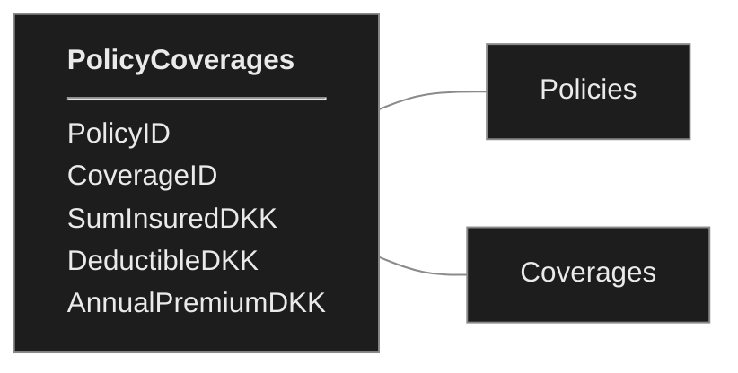

<div style="background:#101010;color:#eaeaea;padding:16px 22px;border-radius:8px;">

<a href="../index.md" style="color:#4cc2ff">← Danish Insurance Company Overview</a> · <a href="../beam-annotations.md" style="color:#4cc2ff">BEAM✲ Annotations</a> · <a href="../how-to-read.md" style="color:#4cc2ff">How to Read This Wiki</a>

# PolicyCoverages

<table style="border-collapse:collapse;margin:8px 0;">
<tr><th scope="row" align="left" style="text-align:left;vertical-align:top;white-space:nowrap;font-weight:600;padding:6px 16px 6px 10px;background:#1d1d1d;color:#dcdcdc;border-bottom:1px solid #2c2c2c;">Description</th><td style="text-align:left;vertical-align:top;padding:6px 10px;background:#161616;color:#eaeaea;border-bottom:1px solid #2c2c2c;">The covers that are included in each policy, with the sum insured, the deductible and the yearly premium agreed for that policy. It splits the price of a policy into its parts.</td></tr>
<tr><th scope="row" align="left" style="text-align:left;vertical-align:top;white-space:nowrap;font-weight:600;padding:6px 16px 6px 10px;background:#1d1d1d;color:#dcdcdc;border-bottom:1px solid #2c2c2c;">Grain</th><td style="text-align:left;vertical-align:top;padding:6px 10px;background:#161616;color:#eaeaea;border-bottom:1px solid #2c2c2c;">One row for each cover included in a policy, so a policy appears once for every cover it has</td></tr>
<tr><th scope="row" align="left" style="text-align:left;vertical-align:top;white-space:nowrap;font-weight:600;padding:6px 16px 6px 10px;background:#1d1d1d;color:#dcdcdc;border-bottom:1px solid #2c2c2c;">BEAM✲</th><td style="text-align:left;vertical-align:top;padding:6px 10px;background:#161616;color:#eaeaea;border-bottom:1px solid #2c2c2c;"><i>pending</i></td></tr>
<tr><th scope="row" align="left" style="text-align:left;vertical-align:top;white-space:nowrap;font-weight:600;padding:6px 16px 6px 10px;background:#1d1d1d;color:#dcdcdc;border-bottom:1px solid #2c2c2c;">Source</th><td style="text-align:left;vertical-align:top;padding:6px 10px;background:#161616;color:#eaeaea;border-bottom:1px solid #2c2c2c;"><a href="../beam-annotations.md#t-source" style="color:#4cc2ff" title="Data source: The source system table or file the table comes from.">{PolicyCoverages.csv}</a> <i>(measured)</i></td></tr>
<tr><th scope="row" align="left" style="text-align:left;vertical-align:top;white-space:nowrap;font-weight:600;padding:6px 16px 6px 10px;background:#1d1d1d;color:#dcdcdc;border-bottom:1px solid #2c2c2c;">Sampled Rows</th><td style="text-align:left;vertical-align:top;padding:6px 10px;background:#161616;color:#eaeaea;border-bottom:1px solid #2c2c2c;">20,787</td></tr>
<tr><th scope="row" align="left" style="text-align:left;vertical-align:top;white-space:nowrap;font-weight:600;padding:6px 16px 6px 10px;background:#1d1d1d;color:#dcdcdc;border-bottom:1px solid #2c2c2c;">Columns</th><td style="text-align:left;vertical-align:top;padding:6px 10px;background:#161616;color:#eaeaea;border-bottom:1px solid #2c2c2c;">5</td></tr>
<tr><th scope="row" align="left" style="text-align:left;vertical-align:top;white-space:nowrap;font-weight:600;padding:6px 16px 6px 10px;background:#1d1d1d;color:#dcdcdc;border-bottom:1px solid #2c2c2c;">Description Source</th><td style="text-align:left;vertical-align:top;padding:6px 10px;background:#161616;color:#eaeaea;border-bottom:1px solid #2c2c2c;">Written by AI from the data. Check before relying on it.</td></tr>
<tr><th scope="row" align="left" style="text-align:left;vertical-align:top;white-space:nowrap;font-weight:600;padding:6px 16px 6px 10px;background:#1d1d1d;color:#dcdcdc;border-bottom:1px solid #2c2c2c;">Confidence</th><td style="text-align:left;vertical-align:top;padding:6px 10px;background:#161616;color:#eaeaea;border-bottom:1px solid #2c2c2c;">high</td></tr>
</table>

## Columns

<div style="overflow-x:auto;max-width:100%;">
<table style="border-collapse:separate;border-spacing:0;font-size:90%;">
<tr><td rowspan="3" style="position:sticky;left:0;z-index:2;box-sizing:border-box;width:34px;min-width:34px;max-width:34px;padding:0;border:0;background:transparent;"></td><th style="position:sticky;left:34px;z-index:2;border:0 solid #2c2c2c;border-width:0 1px 1px 0;background:#242424;color:#ffffff;padding:3px 8px;white-space:nowrap;text-align:left;vertical-align:top;font-weight:700;border-top:1px solid #2c2c2c;border-left:1px solid #2c2c2c;cursor:help;" title="The column as it is named in the data. Each column of the table is one column in this matrix.">Column Name</th><th style="border:0 solid #2c2c2c;border-width:0 1px 1px 0;padding:3px 8px;white-space:nowrap;text-align:left;vertical-align:top;background:#161616;color:#eaeaea;font-weight:600;background:#242424;color:#ffffff;border-top:1px solid #2c2c2c;">PolicyID</th><th style="border:0 solid #2c2c2c;border-width:0 1px 1px 0;padding:3px 8px;white-space:nowrap;text-align:left;vertical-align:top;background:#161616;color:#eaeaea;font-weight:600;background:#242424;color:#ffffff;border-top:1px solid #2c2c2c;">CoverageID</th><th style="border:0 solid #2c2c2c;border-width:0 1px 1px 0;padding:3px 8px;white-space:nowrap;text-align:left;vertical-align:top;background:#161616;color:#eaeaea;font-weight:600;background:#242424;color:#ffffff;border-top:1px solid #2c2c2c;">SumInsuredDKK</th><th style="border:0 solid #2c2c2c;border-width:0 1px 1px 0;padding:3px 8px;white-space:nowrap;text-align:left;vertical-align:top;background:#161616;color:#eaeaea;font-weight:600;background:#242424;color:#ffffff;border-top:1px solid #2c2c2c;">DeductibleDKK</th><th style="border:0 solid #2c2c2c;border-width:0 1px 1px 0;padding:3px 8px;white-space:nowrap;text-align:left;vertical-align:top;background:#161616;color:#eaeaea;font-weight:600;background:#242424;color:#ffffff;border-top:1px solid #2c2c2c;">AnnualPremiumDKK</th></tr>
<tr><td style="position:sticky;left:34px;z-index:2;border:0 solid #2c2c2c;border-width:0 1px 1px 0;background:#1d1d1d;color:#dcdcdc;padding:3px 8px;white-space:nowrap;text-align:left;vertical-align:top;font-weight:600;border-left:1px solid #2c2c2c;cursor:help;" title="The kind of values found in the data, which may differ from what the source declares. The short code is a BEAM annotation, for example C9 is text with a longest value of 9 characters.">Data Type</td><td style="border:0 solid #2c2c2c;border-width:0 1px 1px 0;padding:3px 8px;white-space:nowrap;text-align:left;vertical-align:top;background:#161616;color:#eaeaea;"><a href="../beam-annotations.md#c-i" style="color:#4cc2ff" title="Integer: A whole number. (Measured from the data.)">I</a> whole number</td><td style="border:0 solid #2c2c2c;border-width:0 1px 1px 0;padding:3px 8px;white-space:nowrap;text-align:left;vertical-align:top;background:#161616;color:#eaeaea;"><a href="../beam-annotations.md#c-i" style="color:#4cc2ff" title="Integer: A whole number. (Measured from the data.)">I</a> whole number</td><td style="border:0 solid #2c2c2c;border-width:0 1px 1px 0;padding:3px 8px;white-space:nowrap;text-align:left;vertical-align:top;background:#161616;color:#eaeaea;"><a href="../beam-annotations.md#c-i" style="color:#4cc2ff" title="Integer: A whole number. (Measured from the data.)">I</a> whole number</td><td style="border:0 solid #2c2c2c;border-width:0 1px 1px 0;padding:3px 8px;white-space:nowrap;text-align:left;vertical-align:top;background:#161616;color:#eaeaea;"><a href="../beam-annotations.md#c-i" style="color:#4cc2ff" title="Integer: A whole number. (Measured from the data.)">I</a> whole number</td><td style="border:0 solid #2c2c2c;border-width:0 1px 1px 0;padding:3px 8px;white-space:nowrap;text-align:left;vertical-align:top;background:#161616;color:#eaeaea;"><a href="../beam-annotations.md#c-i" style="color:#4cc2ff" title="Integer: A whole number. (Measured from the data.)">I</a> whole number</td></tr>
<tr><td style="position:sticky;left:34px;z-index:2;border:0 solid #2c2c2c;border-width:0 1px 1px 0;background:#1d1d1d;color:#dcdcdc;padding:3px 8px;white-space:nowrap;text-align:left;vertical-align:top;font-weight:600;border-left:1px solid #2c2c2c;cursor:help;" title="Short BEAM annotations. Plain codes are measured from the data. Codes in italics are suggested by AI and should be checked. Click a code to read what it means.">BEAM✲</td><td style="border:0 solid #2c2c2c;border-width:0 1px 1px 0;padding:3px 8px;white-space:nowrap;text-align:left;vertical-align:top;background:#161616;color:#eaeaea;"><a href="../beam-annotations.md#c-fk" style="color:#4cc2ff" title="Foreign Key: Points to the key of another table. In this wiki measured: every value was found in the other table. (Measured from the data.)">FK</a> <i><a href="../beam-annotations.md#c-dim" style="color:#4cc2ff" title="Dimension or role: The dimension a detail refers to, e.g. PreferredStoreID [Stores] when the preferred store is a role of the store dimension. (Suggested by AI.)">[Policies]</a></i> <i><a href="../beam-annotations.md#c-md" style="color:#4cc2ff" title="Mandatory: The value should always be there under normal conditions. Shown as MD when the data has gaps. (Suggested by AI.)">MD</a></i></td><td style="border:0 solid #2c2c2c;border-width:0 1px 1px 0;padding:3px 8px;white-space:nowrap;text-align:left;vertical-align:top;background:#161616;color:#eaeaea;"><a href="../beam-annotations.md#c-fk" style="color:#4cc2ff" title="Foreign Key: Points to the key of another table. In this wiki measured: every value was found in the other table. (Measured from the data.)">FK</a> <i><a href="../beam-annotations.md#c-dim" style="color:#4cc2ff" title="Dimension or role: The dimension a detail refers to, e.g. PreferredStoreID [Stores] when the preferred store is a role of the store dimension. (Suggested by AI.)">[Coverages]</a></i> <i><a href="../beam-annotations.md#c-md" style="color:#4cc2ff" title="Mandatory: The value should always be there under normal conditions. Shown as MD when the data has gaps. (Suggested by AI.)">MD</a></i></td><td style="border:0 solid #2c2c2c;border-width:0 1px 1px 0;padding:3px 8px;white-space:nowrap;text-align:left;vertical-align:top;background:#161616;color:#eaeaea;"><i><a href="../beam-annotations.md#c-fa" style="color:#4cc2ff" title="Fully Additive fact: Can be summed across everything, e.g. quantity or revenue. Needs a single unit of measure. (Suggested by AI.)">FA</a></i> <i><a href="../beam-annotations.md#c-suspect" style="color:#4cc2ff" title="Suspect: The column still needs clarifying. See the open questions on its page. (Suggested by AI.)">?</a></i></td><td style="border:0 solid #2c2c2c;border-width:0 1px 1px 0;padding:3px 8px;white-space:nowrap;text-align:left;vertical-align:top;background:#161616;color:#eaeaea;"><i><a href="../beam-annotations.md#c-na" style="color:#4cc2ff" title="Non-Additive fact: Can&#x27;t be summed at all, e.g. unit prices, percentages, temperatures. Use min, max or average. (Suggested by AI.)">NA</a></i></td><td style="border:0 solid #2c2c2c;border-width:0 1px 1px 0;padding:3px 8px;white-space:nowrap;text-align:left;vertical-align:top;background:#161616;color:#eaeaea;"><i><a href="../beam-annotations.md#c-fa" style="color:#4cc2ff" title="Fully Additive fact: Can be summed across everything, e.g. quantity or revenue. Needs a single unit of measure. (Suggested by AI.)">FA</a></i></td></tr>
<tr><td rowspan="9" style="position:sticky;left:0;z-index:2;box-sizing:border-box;width:34px;min-width:34px;max-width:34px;border:0 solid #2c2c2c;border-width:0 1px 1px 0;background:#0f2f2c;color:#2de2c9;padding:4px 0;text-align:center;vertical-align:middle;border-left:3px solid #2de2c9;cursor:help;" title="Counts and extremes measured from the rows that were read. They are facts, not opinions."><div style="writing-mode:vertical-rl;transform:rotate(180deg);white-space:nowrap;margin:0 auto;font-weight:600;">Data Profiling Results</div></td><td style="position:sticky;left:34px;z-index:2;border:0 solid #2c2c2c;border-width:0 1px 1px 0;background:#1d1d1d;color:#dcdcdc;padding:3px 8px;white-space:nowrap;text-align:left;vertical-align:top;font-weight:600;cursor:help;" title="How many rows were read for these numbers. Every percentage in this group is based on it, so check it first: on very large tables it can be fewer than all rows.">Sample Count</td><td style="border:0 solid #2c2c2c;border-width:0 1px 1px 0;padding:3px 8px;white-space:nowrap;text-align:right;vertical-align:top;background:#161616;color:#eaeaea;background:#161616;">20,787</td><td style="border:0 solid #2c2c2c;border-width:0 1px 1px 0;padding:3px 8px;white-space:nowrap;text-align:right;vertical-align:top;background:#161616;color:#eaeaea;background:#161616;">20,787</td><td style="border:0 solid #2c2c2c;border-width:0 1px 1px 0;padding:3px 8px;white-space:nowrap;text-align:right;vertical-align:top;background:#161616;color:#eaeaea;background:#161616;">20,787</td><td style="border:0 solid #2c2c2c;border-width:0 1px 1px 0;padding:3px 8px;white-space:nowrap;text-align:right;vertical-align:top;background:#161616;color:#eaeaea;background:#161616;">20,787</td><td style="border:0 solid #2c2c2c;border-width:0 1px 1px 0;padding:3px 8px;white-space:nowrap;text-align:right;vertical-align:top;background:#161616;color:#eaeaea;background:#161616;">20,787</td></tr>
<tr><td style="position:sticky;left:34px;z-index:2;border:0 solid #2c2c2c;border-width:0 1px 1px 0;background:#1d1d1d;color:#dcdcdc;padding:3px 8px;white-space:nowrap;text-align:left;vertical-align:top;font-weight:600;cursor:help;" title="Rows where the column is empty or blank, with the share of rows. It matters because gaps break joins and totals, and a column that should always be filled in should show 0.">Missing</td><td style="border:0 solid #2c2c2c;border-width:0 1px 1px 0;padding:3px 8px;white-space:nowrap;text-align:left;vertical-align:top;background:#161616;color:#eaeaea;background:#161616;">0 (0%)</td><td style="border:0 solid #2c2c2c;border-width:0 1px 1px 0;padding:3px 8px;white-space:nowrap;text-align:left;vertical-align:top;background:#161616;color:#eaeaea;background:#161616;">0 (0%)</td><td style="border:0 solid #2c2c2c;border-width:0 1px 1px 0;padding:3px 8px;white-space:nowrap;text-align:left;vertical-align:top;background:#161616;color:#eaeaea;background:#161616;">1,125 (5.41%)</td><td style="border:0 solid #2c2c2c;border-width:0 1px 1px 0;padding:3px 8px;white-space:nowrap;text-align:left;vertical-align:top;background:#161616;color:#eaeaea;background:#161616;">0 (0%)</td><td style="border:0 solid #2c2c2c;border-width:0 1px 1px 0;padding:3px 8px;white-space:nowrap;text-align:left;vertical-align:top;background:#161616;color:#eaeaea;background:#161616;">0 (0%)</td></tr>
<tr><td style="position:sticky;left:34px;z-index:2;border:0 solid #2c2c2c;border-width:0 1px 1px 0;background:#1d1d1d;color:#dcdcdc;padding:3px 8px;white-space:nowrap;text-align:left;vertical-align:top;font-weight:600;cursor:help;" title="How many different values occur, with the share of rows. 100% means every value is different, so the column could identify a row. A low share means the column holds categories or codes.">Unique Values</td><td style="border:0 solid #2c2c2c;border-width:0 1px 1px 0;padding:3px 8px;white-space:nowrap;text-align:left;vertical-align:top;background:#161616;color:#eaeaea;background:#161616;">5,640 (27.1%)</td><td style="border:0 solid #2c2c2c;border-width:0 1px 1px 0;padding:3px 8px;white-space:nowrap;text-align:left;vertical-align:top;background:#161616;color:#eaeaea;background:#161616;">29 (0.14%)</td><td style="border:0 solid #2c2c2c;border-width:0 1px 1px 0;padding:3px 8px;white-space:nowrap;text-align:left;vertical-align:top;background:#161616;color:#eaeaea;background:#161616;">5,832 (28.1%)</td><td style="border:0 solid #2c2c2c;border-width:0 1px 1px 0;padding:3px 8px;white-space:nowrap;text-align:left;vertical-align:top;background:#161616;color:#eaeaea;background:#161616;">15 (0.0722%)</td><td style="border:0 solid #2c2c2c;border-width:0 1px 1px 0;padding:3px 8px;white-space:nowrap;text-align:left;vertical-align:top;background:#161616;color:#eaeaea;background:#161616;">3,211 (15.4%)</td></tr>
<tr><td style="position:sticky;left:34px;z-index:2;border:0 solid #2c2c2c;border-width:0 1px 1px 0;background:#1d1d1d;color:#dcdcdc;padding:3px 8px;white-space:nowrap;text-align:left;vertical-align:top;font-weight:600;cursor:help;" title="The smallest value: the lowest number, the earliest date, or the first in alphabetical order. It matters because it shows the start of the range and catches impossible values such as a negative quantity.">Min Value</td><td style="border:0 solid #2c2c2c;border-width:0 1px 1px 0;padding:3px 8px;white-space:nowrap;text-align:left;vertical-align:top;background:#161616;color:#eaeaea;background:#161616;">700001</td><td style="border:0 solid #2c2c2c;border-width:0 1px 1px 0;padding:3px 8px;white-space:nowrap;text-align:left;vertical-align:top;background:#161616;color:#eaeaea;background:#161616;">1</td><td style="border:0 solid #2c2c2c;border-width:0 1px 1px 0;padding:3px 8px;white-space:nowrap;text-align:left;vertical-align:top;background:#161616;color:#eaeaea;background:#161616;">5000</td><td style="border:0 solid #2c2c2c;border-width:0 1px 1px 0;padding:3px 8px;white-space:nowrap;text-align:left;vertical-align:top;background:#161616;color:#eaeaea;background:#161616;">0</td><td style="border:0 solid #2c2c2c;border-width:0 1px 1px 0;padding:3px 8px;white-space:nowrap;text-align:left;vertical-align:top;background:#161616;color:#eaeaea;background:#161616;">68</td></tr>
<tr><td style="position:sticky;left:34px;z-index:2;border:0 solid #2c2c2c;border-width:0 1px 1px 0;background:#1d1d1d;color:#dcdcdc;padding:3px 8px;white-space:nowrap;text-align:left;vertical-align:top;font-weight:600;cursor:help;" title="How many rows have the smallest value. On a unique column it is 1. A high count suggests a default or a stand-in value, such as 0 or 1900-01-01, rather than a real minimum.">Min Count</td><td style="border:0 solid #2c2c2c;border-width:0 1px 1px 0;padding:3px 8px;white-space:nowrap;text-align:left;vertical-align:top;background:#161616;color:#eaeaea;background:#161616;">3 (0.0144%)</td><td style="border:0 solid #2c2c2c;border-width:0 1px 1px 0;padding:3px 8px;white-space:nowrap;text-align:left;vertical-align:top;background:#161616;color:#eaeaea;background:#161616;">1,683 (8.1%)</td><td style="border:0 solid #2c2c2c;border-width:0 1px 1px 0;padding:3px 8px;white-space:nowrap;text-align:left;vertical-align:top;background:#161616;color:#eaeaea;background:#161616;">4 (0.0192%)</td><td style="border:0 solid #2c2c2c;border-width:0 1px 1px 0;padding:3px 8px;white-space:nowrap;text-align:left;vertical-align:top;background:#161616;color:#eaeaea;background:#161616;">10,881 (52.3%)</td><td style="border:0 solid #2c2c2c;border-width:0 1px 1px 0;padding:3px 8px;white-space:nowrap;text-align:left;vertical-align:top;background:#161616;color:#eaeaea;background:#161616;">1 (0.00481%)</td></tr>
<tr><td style="position:sticky;left:34px;z-index:2;border:0 solid #2c2c2c;border-width:0 1px 1px 0;background:#1d1d1d;color:#dcdcdc;padding:3px 8px;white-space:nowrap;text-align:left;vertical-align:top;font-weight:600;cursor:help;" title="The largest value: the highest number, the latest date, or the last in alphabetical order. It matters because it shows the end of the range and catches outliers or future dates.">Max Value</td><td style="border:0 solid #2c2c2c;border-width:0 1px 1px 0;padding:3px 8px;white-space:nowrap;text-align:left;vertical-align:top;background:#161616;color:#eaeaea;background:#161616;">705640</td><td style="border:0 solid #2c2c2c;border-width:0 1px 1px 0;padding:3px 8px;white-space:nowrap;text-align:left;vertical-align:top;background:#161616;color:#eaeaea;background:#161616;">29</td><td style="border:0 solid #2c2c2c;border-width:0 1px 1px 0;padding:3px 8px;white-space:nowrap;text-align:left;vertical-align:top;background:#161616;color:#eaeaea;background:#161616;">10000000</td><td style="border:0 solid #2c2c2c;border-width:0 1px 1px 0;padding:3px 8px;white-space:nowrap;text-align:left;vertical-align:top;background:#161616;color:#eaeaea;background:#161616;">7500</td><td style="border:0 solid #2c2c2c;border-width:0 1px 1px 0;padding:3px 8px;white-space:nowrap;text-align:left;vertical-align:top;background:#161616;color:#eaeaea;background:#161616;">6752</td></tr>
<tr><td style="position:sticky;left:34px;z-index:2;border:0 solid #2c2c2c;border-width:0 1px 1px 0;background:#1d1d1d;color:#dcdcdc;padding:3px 8px;white-space:nowrap;text-align:left;vertical-align:top;font-weight:600;cursor:help;" title="How many rows have the largest value. A high count suggests a cap or a stand-in value, such as 9999-12-31, rather than a real maximum.">Max Count</td><td style="border:0 solid #2c2c2c;border-width:0 1px 1px 0;padding:3px 8px;white-space:nowrap;text-align:left;vertical-align:top;background:#161616;color:#eaeaea;background:#161616;">5 (0.0241%)</td><td style="border:0 solid #2c2c2c;border-width:0 1px 1px 0;padding:3px 8px;white-space:nowrap;text-align:left;vertical-align:top;background:#161616;color:#eaeaea;background:#161616;">108 (0.52%)</td><td style="border:0 solid #2c2c2c;border-width:0 1px 1px 0;padding:3px 8px;white-space:nowrap;text-align:left;vertical-align:top;background:#161616;color:#eaeaea;background:#161616;">1,617 (7.78%)</td><td style="border:0 solid #2c2c2c;border-width:0 1px 1px 0;padding:3px 8px;white-space:nowrap;text-align:left;vertical-align:top;background:#161616;color:#eaeaea;background:#161616;">61 (0.293%)</td><td style="border:0 solid #2c2c2c;border-width:0 1px 1px 0;padding:3px 8px;white-space:nowrap;text-align:left;vertical-align:top;background:#161616;color:#eaeaea;background:#161616;">1 (0.00481%)</td></tr>
<tr><td style="position:sticky;left:34px;z-index:2;border:0 solid #2c2c2c;border-width:0 1px 1px 0;background:#1d1d1d;color:#dcdcdc;padding:3px 8px;white-space:nowrap;text-align:left;vertical-align:top;font-weight:600;cursor:help;" title="The shortest text, counted in characters. If it differs a lot from the longest, the column may mix formats, or have values that were cut off.">Min Length</td><td style="border:0 solid #2c2c2c;border-width:0 1px 1px 0;padding:3px 8px;white-space:nowrap;text-align:right;vertical-align:top;background:#161616;color:#eaeaea;background:#161616;">—</td><td style="border:0 solid #2c2c2c;border-width:0 1px 1px 0;padding:3px 8px;white-space:nowrap;text-align:right;vertical-align:top;background:#161616;color:#eaeaea;background:#161616;">—</td><td style="border:0 solid #2c2c2c;border-width:0 1px 1px 0;padding:3px 8px;white-space:nowrap;text-align:right;vertical-align:top;background:#161616;color:#eaeaea;background:#161616;">—</td><td style="border:0 solid #2c2c2c;border-width:0 1px 1px 0;padding:3px 8px;white-space:nowrap;text-align:right;vertical-align:top;background:#161616;color:#eaeaea;background:#161616;">—</td><td style="border:0 solid #2c2c2c;border-width:0 1px 1px 0;padding:3px 8px;white-space:nowrap;text-align:right;vertical-align:top;background:#161616;color:#eaeaea;background:#161616;">—</td></tr>
<tr><td style="position:sticky;left:34px;z-index:2;border:0 solid #2c2c2c;border-width:0 1px 1px 0;background:#1d1d1d;color:#dcdcdc;padding:3px 8px;white-space:nowrap;text-align:left;vertical-align:top;font-weight:600;cursor:help;" title="The longest text, counted in characters. It matters when you load the data elsewhere, because the target column must be wide enough.">Max Length</td><td style="border:0 solid #2c2c2c;border-width:0 1px 1px 0;padding:3px 8px;white-space:nowrap;text-align:right;vertical-align:top;background:#161616;color:#eaeaea;background:#161616;">—</td><td style="border:0 solid #2c2c2c;border-width:0 1px 1px 0;padding:3px 8px;white-space:nowrap;text-align:right;vertical-align:top;background:#161616;color:#eaeaea;background:#161616;">—</td><td style="border:0 solid #2c2c2c;border-width:0 1px 1px 0;padding:3px 8px;white-space:nowrap;text-align:right;vertical-align:top;background:#161616;color:#eaeaea;background:#161616;">—</td><td style="border:0 solid #2c2c2c;border-width:0 1px 1px 0;padding:3px 8px;white-space:nowrap;text-align:right;vertical-align:top;background:#161616;color:#eaeaea;background:#161616;">—</td><td style="border:0 solid #2c2c2c;border-width:0 1px 1px 0;padding:3px 8px;white-space:nowrap;text-align:right;vertical-align:top;background:#161616;color:#eaeaea;background:#161616;">—</td></tr>
<tr><td rowspan="6" style="position:sticky;left:0;z-index:2;box-sizing:border-box;width:34px;min-width:34px;max-width:34px;border:0 solid #2c2c2c;border-width:0 1px 1px 0;background:#2d1530;color:#ff6fd8;padding:4px 0;text-align:center;vertical-align:middle;border-left:3px solid #ff6fd8;cursor:help;" title="Examples taken from the measured values, to show how varied the column is and what odd values look like."><div style="writing-mode:vertical-rl;transform:rotate(180deg);white-space:nowrap;margin:0 auto;font-weight:600;">Variation</div></td><td style="position:sticky;left:34px;z-index:2;border:0 solid #2c2c2c;border-width:0 1px 1px 0;background:#1d1d1d;color:#dcdcdc;padding:3px 8px;white-space:nowrap;text-align:left;vertical-align:top;font-weight:600;cursor:help;" title="The most common value, so you can see what a normal row looks like. In a column where every value is different, this is just the first of them.">Typical</td><td style="border:0 solid #2c2c2c;border-width:0 1px 1px 0;padding:3px 8px;white-space:nowrap;text-align:left;vertical-align:top;background:#161616;color:#eaeaea;background:#161616;">700028</td><td style="border:0 solid #2c2c2c;border-width:0 1px 1px 0;padding:3px 8px;white-space:nowrap;text-align:left;vertical-align:top;background:#161616;color:#eaeaea;background:#161616;">1</td><td style="border:0 solid #2c2c2c;border-width:0 1px 1px 0;padding:3px 8px;white-space:nowrap;text-align:left;vertical-align:top;background:#161616;color:#eaeaea;background:#161616;">10000000</td><td style="border:0 solid #2c2c2c;border-width:0 1px 1px 0;padding:3px 8px;white-space:nowrap;text-align:left;vertical-align:top;background:#161616;color:#eaeaea;background:#161616;">0</td><td style="border:0 solid #2c2c2c;border-width:0 1px 1px 0;padding:3px 8px;white-space:nowrap;text-align:left;vertical-align:top;background:#161616;color:#eaeaea;background:#161616;">410</td></tr>
<tr><td style="position:sticky;left:34px;z-index:2;border:0 solid #2c2c2c;border-width:0 1px 1px 0;background:#1d1d1d;color:#dcdcdc;padding:3px 8px;white-space:nowrap;text-align:left;vertical-align:top;font-weight:600;cursor:help;" title="A rare value, one of the least common. Odd values are often special cases or mistakes, so they are worth a look.">Different</td><td style="border:0 solid #2c2c2c;border-width:0 1px 1px 0;padding:3px 8px;white-space:nowrap;text-align:left;vertical-align:top;background:#161616;color:#eaeaea;background:#161616;">700009</td><td style="border:0 solid #2c2c2c;border-width:0 1px 1px 0;padding:3px 8px;white-space:nowrap;text-align:left;vertical-align:top;background:#161616;color:#eaeaea;background:#161616;">29</td><td style="border:0 solid #2c2c2c;border-width:0 1px 1px 0;padding:3px 8px;white-space:nowrap;text-align:left;vertical-align:top;background:#161616;color:#eaeaea;background:#161616;">1022000</td><td style="border:0 solid #2c2c2c;border-width:0 1px 1px 0;padding:3px 8px;white-space:nowrap;text-align:left;vertical-align:top;background:#161616;color:#eaeaea;background:#161616;">1125</td><td style="border:0 solid #2c2c2c;border-width:0 1px 1px 0;padding:3px 8px;white-space:nowrap;text-align:left;vertical-align:top;background:#161616;color:#eaeaea;background:#161616;">1000</td></tr>
<tr><td style="position:sticky;left:34px;z-index:2;border:0 solid #2c2c2c;border-width:0 1px 1px 0;background:#1d1d1d;color:#dcdcdc;padding:3px 8px;white-space:nowrap;text-align:left;vertical-align:top;font-weight:600;cursor:help;" title="A value that occurs more than once, and how many times (x3 means three rows). &#x27;No repeats&#x27; means every value is different.">Repeat</td><td style="border:0 solid #2c2c2c;border-width:0 1px 1px 0;padding:3px 8px;white-space:nowrap;text-align:left;vertical-align:top;background:#161616;color:#eaeaea;background:#161616;">700043 ×6</td><td style="border:0 solid #2c2c2c;border-width:0 1px 1px 0;padding:3px 8px;white-space:nowrap;text-align:left;vertical-align:top;background:#161616;color:#eaeaea;background:#161616;">2 ×1,683</td><td style="border:0 solid #2c2c2c;border-width:0 1px 1px 0;padding:3px 8px;white-space:nowrap;text-align:left;vertical-align:top;background:#161616;color:#eaeaea;background:#161616;">5000000 ×522</td><td style="border:0 solid #2c2c2c;border-width:0 1px 1px 0;padding:3px 8px;white-space:nowrap;text-align:left;vertical-align:top;background:#161616;color:#eaeaea;background:#161616;">1500 ×2,912</td><td style="border:0 solid #2c2c2c;border-width:0 1px 1px 0;padding:3px 8px;white-space:nowrap;text-align:left;vertical-align:top;background:#161616;color:#eaeaea;background:#161616;">357 ×55</td></tr>
<tr><td style="position:sticky;left:34px;z-index:2;border:0 solid #2c2c2c;border-width:0 1px 1px 0;background:#1d1d1d;color:#dcdcdc;padding:3px 8px;white-space:nowrap;text-align:left;vertical-align:top;font-weight:600;cursor:help;" title="What stands in for &#x27;no value&#x27;: empty cells and stand-in words such as N/A or unknown, with how many of each. Stand-ins are easy to mistake for real values.">Missing</td><td style="border:0 solid #2c2c2c;border-width:0 1px 1px 0;padding:3px 8px;white-space:nowrap;text-align:left;vertical-align:top;background:#161616;color:#eaeaea;background:#161616;">—</td><td style="border:0 solid #2c2c2c;border-width:0 1px 1px 0;padding:3px 8px;white-space:nowrap;text-align:left;vertical-align:top;background:#161616;color:#eaeaea;background:#161616;">—</td><td style="border:0 solid #2c2c2c;border-width:0 1px 1px 0;padding:3px 8px;white-space:nowrap;text-align:left;vertical-align:top;background:#161616;color:#eaeaea;background:#161616;">empty ×1,125</td><td style="border:0 solid #2c2c2c;border-width:0 1px 1px 0;padding:3px 8px;white-space:nowrap;text-align:left;vertical-align:top;background:#161616;color:#eaeaea;background:#161616;">—</td><td style="border:0 solid #2c2c2c;border-width:0 1px 1px 0;padding:3px 8px;white-space:nowrap;text-align:left;vertical-align:top;background:#161616;color:#eaeaea;background:#161616;">—</td></tr>
<tr><td style="position:sticky;left:34px;z-index:2;border:0 solid #2c2c2c;border-width:0 1px 1px 0;background:#1d1d1d;color:#dcdcdc;padding:3px 8px;white-space:nowrap;text-align:left;vertical-align:top;font-weight:600;cursor:help;" title="From the smallest to the largest value in one line, to show the spread at a glance.">Range</td><td style="border:0 solid #2c2c2c;border-width:0 1px 1px 0;padding:3px 8px;white-space:nowrap;text-align:left;vertical-align:top;background:#161616;color:#eaeaea;background:#161616;">700001 → 705640</td><td style="border:0 solid #2c2c2c;border-width:0 1px 1px 0;padding:3px 8px;white-space:nowrap;text-align:left;vertical-align:top;background:#161616;color:#eaeaea;background:#161616;">1 → 29</td><td style="border:0 solid #2c2c2c;border-width:0 1px 1px 0;padding:3px 8px;white-space:nowrap;text-align:left;vertical-align:top;background:#161616;color:#eaeaea;background:#161616;">5000 → 10000000</td><td style="border:0 solid #2c2c2c;border-width:0 1px 1px 0;padding:3px 8px;white-space:nowrap;text-align:left;vertical-align:top;background:#161616;color:#eaeaea;background:#161616;">0 → 7500</td><td style="border:0 solid #2c2c2c;border-width:0 1px 1px 0;padding:3px 8px;white-space:nowrap;text-align:left;vertical-align:top;background:#161616;color:#eaeaea;background:#161616;">68 → 6752</td></tr>
<tr><td style="position:sticky;left:34px;z-index:2;border:0 solid #2c2c2c;border-width:0 1px 1px 0;background:#1d1d1d;color:#dcdcdc;padding:3px 8px;white-space:nowrap;text-align:left;vertical-align:top;font-weight:600;cursor:help;" title="How values change over time cannot be seen in a single snapshot. Profile the same data again later and compare to see it.">Change</td><td style="border:0 solid #2c2c2c;border-width:0 1px 1px 0;padding:3px 8px;white-space:nowrap;text-align:left;vertical-align:top;background:#161616;color:#eaeaea;background:#161616;">—</td><td style="border:0 solid #2c2c2c;border-width:0 1px 1px 0;padding:3px 8px;white-space:nowrap;text-align:left;vertical-align:top;background:#161616;color:#eaeaea;background:#161616;">—</td><td style="border:0 solid #2c2c2c;border-width:0 1px 1px 0;padding:3px 8px;white-space:nowrap;text-align:left;vertical-align:top;background:#161616;color:#eaeaea;background:#161616;">—</td><td style="border:0 solid #2c2c2c;border-width:0 1px 1px 0;padding:3px 8px;white-space:nowrap;text-align:left;vertical-align:top;background:#161616;color:#eaeaea;background:#161616;">—</td><td style="border:0 solid #2c2c2c;border-width:0 1px 1px 0;padding:3px 8px;white-space:nowrap;text-align:left;vertical-align:top;background:#161616;color:#eaeaea;background:#161616;">—</td></tr>
<tr><td rowspan="6" style="position:sticky;left:0;z-index:2;box-sizing:border-box;width:34px;min-width:34px;max-width:34px;border:0 solid #2c2c2c;border-width:0 1px 1px 0;background:#0b2a3d;color:#4cc2ff;padding:4px 0;text-align:center;vertical-align:middle;border-left:3px solid #4cc2ff;cursor:help;" title="How the values are spread: a small histogram, its shape, the middle value, the spread, and any outliers and gaps. Counted from the rows that were read."><div style="writing-mode:vertical-rl;transform:rotate(180deg);white-space:nowrap;margin:0 auto;font-weight:600;">Distribution</div></td><td style="position:sticky;left:34px;z-index:2;border:0 solid #2c2c2c;border-width:0 1px 1px 0;background:#1d1d1d;color:#dcdcdc;padding:3px 8px;white-space:nowrap;text-align:left;vertical-align:top;font-weight:600;cursor:help;" title="How the rows are spread over ranges of values (bins). Each bar is one bin and its height is the number of rows. Hover a bar for its range and count. Orange bars are outliers, dashed boxes are gaps with no rows. Categories show the most frequent values. Keys, names and other personal data are not charted.">Histogram</td><td style="border:0 solid #2c2c2c;border-width:0 1px 1px 0;padding:3px 8px;white-space:nowrap;text-align:left;vertical-align:top;background:#161616;color:#eaeaea;background:#161616;">—</td><td style="border:0 solid #2c2c2c;border-width:0 1px 1px 0;padding:3px 8px;white-space:nowrap;text-align:left;vertical-align:top;background:#161616;color:#eaeaea;background:#161616;">—</td><td style="border:0 solid #2c2c2c;border-width:0 1px 1px 0;padding:3px 8px;white-space:nowrap;text-align:left;vertical-align:top;background:#161616;color:#eaeaea;background:#161616;"><table style="border-collapse:collapse;border:0;margin:0;background:transparent;"><tr style="vertical-align:bottom"><td title="0–499,999: 6,195 rows (31.51%)" style="padding:0 1px;border:0;background:transparent;vertical-align:bottom;"><div style="width:7px;height:34px;background:#4cc2ff;"></div></td><td title="500,000–999,999: 3,302 rows (16.79%)" style="padding:0 1px;border:0;background:transparent;vertical-align:bottom;"><div style="width:7px;height:18px;background:#4cc2ff;"></div></td><td title="1,000,000–1,499,999: 1,309 rows (6.66%)" style="padding:0 1px;border:0;background:transparent;vertical-align:bottom;"><div style="width:7px;height:7px;background:#4cc2ff;"></div></td><td title="1,500,000–1,999,999: 530 rows (2.7%)" style="padding:0 1px;border:0;background:transparent;vertical-align:bottom;"><div style="width:7px;height:3px;background:#4cc2ff;"></div></td><td title="2,000,000–2,499,999: 466 rows (2.37%)" style="padding:0 1px;border:0;background:transparent;vertical-align:bottom;"><div style="width:7px;height:3px;background:#4cc2ff;"></div></td><td title="2,500,000–2,999,999: 480 rows (2.44%)" style="padding:0 1px;border:0;background:transparent;vertical-align:bottom;"><div style="width:7px;height:3px;background:#4cc2ff;"></div></td><td title="3,000,000–3,499,999: 481 rows (2.45%)" style="padding:0 1px;border:0;background:transparent;vertical-align:bottom;"><div style="width:7px;height:3px;background:#4cc2ff;"></div></td><td title="3,500,000–3,999,999: 442 rows (2.25%)" style="padding:0 1px;border:0;background:transparent;vertical-align:bottom;"><div style="width:7px;height:2px;background:#4cc2ff;"></div></td><td title="4,000,000–4,499,999: 459 rows (2.33%)" style="padding:0 1px;border:0;background:transparent;vertical-align:bottom;"><div style="width:7px;height:3px;background:#4cc2ff;"></div></td><td title="4,500,000–4,999,999: 437 rows (2.22%)" style="padding:0 1px;border:0;background:transparent;vertical-align:bottom;"><div style="width:7px;height:2px;background:#4cc2ff;"></div></td><td title="5,000,000–5,499,999: 1,221 rows (6.21%)" style="padding:0 1px;border:0;background:transparent;vertical-align:bottom;"><div style="width:7px;height:7px;background:#4cc2ff;"></div></td><td title="5,500,000–5,999,999: 671 rows (3.41%)" style="padding:0 1px;border:0;background:transparent;vertical-align:bottom;"><div style="width:7px;height:4px;background:#4cc2ff;"></div></td><td title="6,000,000–6,499,999: 239 rows (1.22%)" style="padding:0 1px;border:0;background:transparent;vertical-align:bottom;"><div style="width:7px;height:2px;background:#4cc2ff;"></div></td><td title="6,500,000–6,999,999: 258 rows (1.31%)" style="padding:0 1px;border:0;background:transparent;vertical-align:bottom;"><div style="width:7px;height:2px;background:#4cc2ff;"></div></td><td title="7,000,000–7,499,999: 271 rows (1.38%)" style="padding:0 1px;border:0;background:transparent;vertical-align:bottom;"><div style="width:7px;height:2px;background:#4cc2ff;"></div></td><td title="7,500,000–7,999,999: 262 rows (1.33%)" style="padding:0 1px;border:0;background:transparent;vertical-align:bottom;"><div style="width:7px;height:2px;background:#4cc2ff;"></div></td><td title="8,000,000–8,499,999: 267 rows (1.36%)" style="padding:0 1px;border:0;background:transparent;vertical-align:bottom;"><div style="width:7px;height:2px;background:#4cc2ff;"></div></td><td title="8,500,000–8,999,999: 268 rows (1.36%)" style="padding:0 1px;border:0;background:transparent;vertical-align:bottom;"><div style="width:7px;height:2px;background:#4cc2ff;"></div></td><td title="9,000,000–9,499,999: 253 rows (1.29%)" style="padding:0 1px;border:0;background:transparent;vertical-align:bottom;"><div style="width:7px;height:2px;background:#4cc2ff;"></div></td><td title="9,500,000–9,999,999: 1,851 rows (9.41%)" style="padding:0 1px;border:0;background:transparent;vertical-align:bottom;"><div style="width:7px;height:10px;background:#4cc2ff;"></div></td></tr></table><div style="font-size:75%;opacity:.75;white-space:nowrap;">0 → 9,999,999</div></td><td style="border:0 solid #2c2c2c;border-width:0 1px 1px 0;padding:3px 8px;white-space:nowrap;text-align:left;vertical-align:top;background:#161616;color:#eaeaea;background:#161616;"><table style="border-collapse:collapse;border:0;margin:0;background:transparent;"><tr style="vertical-align:bottom"><td title="0–499: 10,881 rows (52.35%)" style="padding:0 1px;border:0;background:transparent;vertical-align:bottom;"><div style="width:7px;height:34px;background:#4cc2ff;"></div></td><td title="500–999: 863 rows (4.15%)" style="padding:0 1px;border:0;background:transparent;vertical-align:bottom;"><div style="width:7px;height:3px;background:#4cc2ff;"></div></td><td title="1,000–1,499: 804 rows (3.87%)" style="padding:0 1px;border:0;background:transparent;vertical-align:bottom;"><div style="width:7px;height:3px;background:#4cc2ff;"></div></td><td title="1,500–1,999: 2,912 rows (14.01%)" style="padding:0 1px;border:0;background:transparent;vertical-align:bottom;"><div style="width:7px;height:9px;background:#4cc2ff;"></div></td><td title="2,000–2,499: 643 rows (3.09%)" style="padding:0 1px;border:0;background:transparent;vertical-align:bottom;"><div style="width:7px;height:2px;background:#4cc2ff;"></div></td><td title="2,500–2,999: 1,200 rows (5.77%)" style="padding:0 1px;border:0;background:transparent;vertical-align:bottom;"><div style="width:7px;height:4px;background:#4cc2ff;"></div></td><td title="3,000–3,499: 977 rows (4.7%)" style="padding:0 1px;border:0;background:transparent;vertical-align:bottom;"><div style="width:7px;height:3px;background:#4cc2ff;"></div></td><td title="3,500–3,999: 1,597 rows (7.68%)" style="padding:0 1px;border:0;background:transparent;vertical-align:bottom;"><div style="width:7px;height:5px;background:#4cc2ff;"></div></td><td title="4,000–4,499: 0 rows (0%) (gap: no rows in this range)" style="padding:0 1px;border:0;background:transparent;vertical-align:bottom;"><div style="width:7px;height:8px;box-sizing:border-box;border:1px dashed #8a8a8a;"></div></td><td title="4,500–4,999: 249 rows (1.2%)" style="padding:0 1px;border:0;background:transparent;vertical-align:bottom;"><div style="width:7px;height:2px;background:#4cc2ff;"></div></td><td title="5,000–5,499: 600 rows (2.89%)" style="padding:0 1px;border:0;background:transparent;vertical-align:bottom;"><div style="width:7px;height:2px;background:#4cc2ff;"></div></td><td title="5,500–5,999: 0 rows (0%)" style="padding:0 1px;border:0;background:transparent;vertical-align:bottom;"><div style="width:7px;height:1px;background:#8a8a8a;"></div></td><td title="above 6,000: 61 rows (0.29%) (outliers: far outside the usual range)" style="padding:0 1px;border:0;background:transparent;vertical-align:bottom;"><div style="width:7px;height:2px;background:#ff9f43;"></div></td></tr></table><div style="font-size:75%;opacity:.75;white-space:nowrap;">0 → 5,999</div></td><td style="border:0 solid #2c2c2c;border-width:0 1px 1px 0;padding:3px 8px;white-space:nowrap;text-align:left;vertical-align:top;background:#161616;color:#eaeaea;background:#161616;"><table style="border-collapse:collapse;border:0;margin:0;background:transparent;"><tr style="vertical-align:bottom"><td title="0–199: 1,489 rows (7.16%)" style="padding:0 1px;border:0;background:transparent;vertical-align:bottom;"><div style="width:7px;height:8px;background:#4cc2ff;"></div></td><td title="200–399: 6,222 rows (29.93%)" style="padding:0 1px;border:0;background:transparent;vertical-align:bottom;"><div style="width:7px;height:34px;background:#4cc2ff;"></div></td><td title="400–599: 4,148 rows (19.95%)" style="padding:0 1px;border:0;background:transparent;vertical-align:bottom;"><div style="width:7px;height:23px;background:#4cc2ff;"></div></td><td title="600–799: 1,267 rows (6.1%)" style="padding:0 1px;border:0;background:transparent;vertical-align:bottom;"><div style="width:7px;height:7px;background:#4cc2ff;"></div></td><td title="800–999: 588 rows (2.83%)" style="padding:0 1px;border:0;background:transparent;vertical-align:bottom;"><div style="width:7px;height:3px;background:#4cc2ff;"></div></td><td title="1,000–1,199: 727 rows (3.5%)" style="padding:0 1px;border:0;background:transparent;vertical-align:bottom;"><div style="width:7px;height:4px;background:#4cc2ff;"></div></td><td title="1,200–1,399: 1,302 rows (6.26%)" style="padding:0 1px;border:0;background:transparent;vertical-align:bottom;"><div style="width:7px;height:7px;background:#4cc2ff;"></div></td><td title="1,400–1,599: 1,222 rows (5.88%)" style="padding:0 1px;border:0;background:transparent;vertical-align:bottom;"><div style="width:7px;height:7px;background:#4cc2ff;"></div></td><td title="1,600–1,799: 885 rows (4.26%)" style="padding:0 1px;border:0;background:transparent;vertical-align:bottom;"><div style="width:7px;height:5px;background:#4cc2ff;"></div></td><td title="1,800–1,999: 723 rows (3.48%)" style="padding:0 1px;border:0;background:transparent;vertical-align:bottom;"><div style="width:7px;height:4px;background:#4cc2ff;"></div></td><td title="2,000–2,199: 592 rows (2.85%)" style="padding:0 1px;border:0;background:transparent;vertical-align:bottom;"><div style="width:7px;height:3px;background:#4cc2ff;"></div></td><td title="2,200–2,399: 395 rows (1.9%)" style="padding:0 1px;border:0;background:transparent;vertical-align:bottom;"><div style="width:7px;height:2px;background:#4cc2ff;"></div></td><td title="2,400–2,599: 262 rows (1.26%)" style="padding:0 1px;border:0;background:transparent;vertical-align:bottom;"><div style="width:7px;height:2px;background:#4cc2ff;"></div></td><td title="2,600–2,799: 133 rows (0.64%)" style="padding:0 1px;border:0;background:transparent;vertical-align:bottom;"><div style="width:7px;height:2px;background:#4cc2ff;"></div></td><td title="2,800–2,999: 52 rows (0.25%)" style="padding:0 1px;border:0;background:transparent;vertical-align:bottom;"><div style="width:7px;height:2px;background:#4cc2ff;"></div></td><td title="above 3,000: 780 rows (3.75%) (outliers: far outside the usual range)" style="padding:0 1px;border:0;background:transparent;vertical-align:bottom;"><div style="width:7px;height:4px;background:#ff9f43;"></div></td></tr></table><div style="font-size:75%;opacity:.75;white-space:nowrap;">0 → 2,999</div></td></tr>
<tr><td style="position:sticky;left:34px;z-index:2;border:0 solid #2c2c2c;border-width:0 1px 1px 0;background:#1d1d1d;color:#dcdcdc;padding:3px 8px;white-space:nowrap;text-align:left;vertical-align:top;font-weight:600;cursor:help;" title="The overall form of the histogram: symmetric, right-skewed, left-skewed, uniform, bimodal or one dominant value. It matters because a skewed column has an average that misleads, and two peaks often mean two groups mixed together.">Shape</td><td style="border:0 solid #2c2c2c;border-width:0 1px 1px 0;padding:3px 8px;white-space:nowrap;text-align:left;vertical-align:top;background:#161616;color:#eaeaea;background:#161616;">—</td><td style="border:0 solid #2c2c2c;border-width:0 1px 1px 0;padding:3px 8px;white-space:nowrap;text-align:left;vertical-align:top;background:#161616;color:#eaeaea;background:#161616;">—</td><td style="border:0 solid #2c2c2c;border-width:0 1px 1px 0;padding:3px 8px;white-space:nowrap;text-align:left;vertical-align:top;background:#161616;color:#eaeaea;background:#161616;"><span title="Bimodal: two separate peaks, which often means two different groups or processes in the data.">Bimodal</span></td><td style="border:0 solid #2c2c2c;border-width:0 1px 1px 0;padding:3px 8px;white-space:nowrap;text-align:left;vertical-align:top;background:#161616;color:#eaeaea;background:#161616;"><span title="One dominant value: at least half of the rows share the same value.">One dominant value</span></td><td style="border:0 solid #2c2c2c;border-width:0 1px 1px 0;padding:3px 8px;white-space:nowrap;text-align:left;vertical-align:top;background:#161616;color:#eaeaea;background:#161616;"><span title="Right-skewed: most values are low, with a long tail of a few high ones. The average is pulled above the median.">Right-skewed</span></td></tr>
<tr><td style="position:sticky;left:34px;z-index:2;border:0 solid #2c2c2c;border-width:0 1px 1px 0;background:#1d1d1d;color:#dcdcdc;padding:3px 8px;white-space:nowrap;text-align:left;vertical-align:top;font-weight:600;cursor:help;" title="The middle value: half of the rows are below it and half above. Compare it with the average. A big difference means the data is skewed or has outliers.">Median</td><td style="border:0 solid #2c2c2c;border-width:0 1px 1px 0;padding:3px 8px;white-space:nowrap;text-align:left;vertical-align:top;background:#161616;color:#eaeaea;background:#161616;">—</td><td style="border:0 solid #2c2c2c;border-width:0 1px 1px 0;padding:3px 8px;white-space:nowrap;text-align:left;vertical-align:top;background:#161616;color:#eaeaea;background:#161616;">—</td><td style="border:0 solid #2c2c2c;border-width:0 1px 1px 0;padding:3px 8px;white-space:nowrap;text-align:left;vertical-align:top;background:#161616;color:#eaeaea;background:#161616;">1,053,000</td><td style="border:0 solid #2c2c2c;border-width:0 1px 1px 0;padding:3px 8px;white-space:nowrap;text-align:left;vertical-align:top;background:#161616;color:#eaeaea;background:#161616;">0</td><td style="border:0 solid #2c2c2c;border-width:0 1px 1px 0;padding:3px 8px;white-space:nowrap;text-align:left;vertical-align:top;background:#161616;color:#eaeaea;background:#161616;">495</td></tr>
<tr><td style="position:sticky;left:34px;z-index:2;border:0 solid #2c2c2c;border-width:0 1px 1px 0;background:#1d1d1d;color:#dcdcdc;padding:3px 8px;white-space:nowrap;text-align:left;vertical-align:top;font-weight:600;cursor:help;" title="The range holding the middle half of the rows (first to third quartile). A narrow spread means similar values, a wide one means high variability.">Spread</td><td style="border:0 solid #2c2c2c;border-width:0 1px 1px 0;padding:3px 8px;white-space:nowrap;text-align:left;vertical-align:top;background:#161616;color:#eaeaea;background:#161616;">—</td><td style="border:0 solid #2c2c2c;border-width:0 1px 1px 0;padding:3px 8px;white-space:nowrap;text-align:left;vertical-align:top;background:#161616;color:#eaeaea;background:#161616;">—</td><td style="border:0 solid #2c2c2c;border-width:0 1px 1px 0;padding:3px 8px;white-space:nowrap;text-align:left;vertical-align:top;background:#161616;color:#eaeaea;background:#161616;">394,000 – 5,088,500</td><td style="border:0 solid #2c2c2c;border-width:0 1px 1px 0;padding:3px 8px;white-space:nowrap;text-align:left;vertical-align:top;background:#161616;color:#eaeaea;background:#161616;">0 – 2,250</td><td style="border:0 solid #2c2c2c;border-width:0 1px 1px 0;padding:3px 8px;white-space:nowrap;text-align:left;vertical-align:top;background:#161616;color:#eaeaea;background:#161616;">330 – 1,380</td></tr>
<tr><td style="position:sticky;left:34px;z-index:2;border:0 solid #2c2c2c;border-width:0 1px 1px 0;background:#1d1d1d;color:#dcdcdc;padding:3px 8px;white-space:nowrap;text-align:left;vertical-align:top;font-weight:600;cursor:help;" title="Values far outside the usual range (more than 1.5 times the middle spread beyond the quartiles). They may be mistakes or real extremes, so they are worth checking. The count is shown with the limit it passed.">Outliers</td><td style="border:0 solid #2c2c2c;border-width:0 1px 1px 0;padding:3px 8px;white-space:nowrap;text-align:left;vertical-align:top;background:#161616;color:#eaeaea;background:#161616;">—</td><td style="border:0 solid #2c2c2c;border-width:0 1px 1px 0;padding:3px 8px;white-space:nowrap;text-align:left;vertical-align:top;background:#161616;color:#eaeaea;background:#161616;">—</td><td style="border:0 solid #2c2c2c;border-width:0 1px 1px 0;padding:3px 8px;white-space:nowrap;text-align:left;vertical-align:top;background:#161616;color:#eaeaea;background:#161616;">none</td><td style="border:0 solid #2c2c2c;border-width:0 1px 1px 0;padding:3px 8px;white-space:nowrap;text-align:left;vertical-align:top;background:#161616;color:#eaeaea;background:#161616;">61 above 5,625</td><td style="border:0 solid #2c2c2c;border-width:0 1px 1px 0;padding:3px 8px;white-space:nowrap;text-align:left;vertical-align:top;background:#161616;color:#eaeaea;background:#161616;">780 above 2,955</td></tr>
<tr><td style="position:sticky;left:34px;z-index:2;border:0 solid #2c2c2c;border-width:0 1px 1px 0;background:#1d1d1d;color:#dcdcdc;padding:3px 8px;white-space:nowrap;text-align:left;vertical-align:top;font-weight:600;cursor:help;" title="Ranges between filled bins where no rows exist at all. In dates they show periods with no activity or missing data, which a total or an average would hide.">Gaps</td><td style="border:0 solid #2c2c2c;border-width:0 1px 1px 0;padding:3px 8px;white-space:nowrap;text-align:left;vertical-align:top;background:#161616;color:#eaeaea;background:#161616;">—</td><td style="border:0 solid #2c2c2c;border-width:0 1px 1px 0;padding:3px 8px;white-space:nowrap;text-align:left;vertical-align:top;background:#161616;color:#eaeaea;background:#161616;">—</td><td style="border:0 solid #2c2c2c;border-width:0 1px 1px 0;padding:3px 8px;white-space:nowrap;text-align:left;vertical-align:top;background:#161616;color:#eaeaea;background:#161616;">none</td><td style="border:0 solid #2c2c2c;border-width:0 1px 1px 0;padding:3px 8px;white-space:nowrap;text-align:left;vertical-align:top;background:#161616;color:#eaeaea;background:#161616;">1 gap (1 empty bin)</td><td style="border:0 solid #2c2c2c;border-width:0 1px 1px 0;padding:3px 8px;white-space:nowrap;text-align:left;vertical-align:top;background:#161616;color:#eaeaea;background:#161616;">none</td></tr>
<tr><td rowspan="5" style="position:sticky;left:0;z-index:2;box-sizing:border-box;width:34px;min-width:34px;max-width:34px;border:0 solid #2c2c2c;border-width:0 1px 1px 0;background:#33290a;color:#ffd23f;padding:4px 0;text-align:center;vertical-align:middle;border-left:3px solid #ffd23f;cursor:help;" title="Five random rows from the table, shown side by side so you can see real values together."><div style="writing-mode:vertical-rl;transform:rotate(180deg);white-space:nowrap;margin:0 auto;font-weight:600;">Sample Data</div></td><td style="position:sticky;left:34px;z-index:2;border:0 solid #2c2c2c;border-width:0 1px 1px 0;background:#1d1d1d;color:#dcdcdc;padding:3px 8px;white-space:nowrap;text-align:left;vertical-align:top;font-weight:600;cursor:help;"></td><td style="border:0 solid #2c2c2c;border-width:0 1px 1px 0;padding:3px 8px;white-space:nowrap;text-align:left;vertical-align:top;background:#161616;color:#eaeaea;background:#161616;">700200</td><td style="border:0 solid #2c2c2c;border-width:0 1px 1px 0;padding:3px 8px;white-space:nowrap;text-align:left;vertical-align:top;background:#161616;color:#eaeaea;background:#161616;">3</td><td style="border:0 solid #2c2c2c;border-width:0 1px 1px 0;padding:3px 8px;white-space:nowrap;text-align:left;vertical-align:top;background:#161616;color:#eaeaea;background:#161616;">1167000</td><td style="border:0 solid #2c2c2c;border-width:0 1px 1px 0;padding:3px 8px;white-space:nowrap;text-align:left;vertical-align:top;background:#161616;color:#eaeaea;background:#161616;">2250</td><td style="border:0 solid #2c2c2c;border-width:0 1px 1px 0;padding:3px 8px;white-space:nowrap;text-align:left;vertical-align:top;background:#161616;color:#eaeaea;background:#161616;">386</td></tr>
<tr><td style="position:sticky;left:34px;z-index:2;border:0 solid #2c2c2c;border-width:0 1px 1px 0;background:#1d1d1d;color:#dcdcdc;padding:3px 8px;white-space:nowrap;text-align:left;vertical-align:top;font-weight:600;cursor:help;"></td><td style="border:0 solid #2c2c2c;border-width:0 1px 1px 0;padding:3px 8px;white-space:nowrap;text-align:left;vertical-align:top;background:#161616;color:#eaeaea;background:#161616;">701608</td><td style="border:0 solid #2c2c2c;border-width:0 1px 1px 0;padding:3px 8px;white-space:nowrap;text-align:left;vertical-align:top;background:#161616;color:#eaeaea;background:#161616;">13</td><td style="border:0 solid #2c2c2c;border-width:0 1px 1px 0;padding:3px 8px;white-space:nowrap;text-align:left;vertical-align:top;background:#161616;color:#eaeaea;background:#161616;">2237000</td><td style="border:0 solid #2c2c2c;border-width:0 1px 1px 0;padding:3px 8px;white-space:nowrap;text-align:left;vertical-align:top;background:#161616;color:#eaeaea;background:#161616;">0</td><td style="border:0 solid #2c2c2c;border-width:0 1px 1px 0;padding:3px 8px;white-space:nowrap;text-align:left;vertical-align:top;background:#161616;color:#eaeaea;background:#161616;">2446</td></tr>
<tr><td style="position:sticky;left:34px;z-index:2;border:0 solid #2c2c2c;border-width:0 1px 1px 0;background:#1d1d1d;color:#dcdcdc;padding:3px 8px;white-space:nowrap;text-align:left;vertical-align:top;font-weight:600;cursor:help;"></td><td style="border:0 solid #2c2c2c;border-width:0 1px 1px 0;padding:3px 8px;white-space:nowrap;text-align:left;vertical-align:top;background:#161616;color:#eaeaea;background:#161616;">703068</td><td style="border:0 solid #2c2c2c;border-width:0 1px 1px 0;padding:3px 8px;white-space:nowrap;text-align:left;vertical-align:top;background:#161616;color:#eaeaea;background:#161616;">11</td><td style="border:0 solid #2c2c2c;border-width:0 1px 1px 0;padding:3px 8px;white-space:nowrap;text-align:left;vertical-align:top;background:#161616;color:#eaeaea;background:#161616;"></td><td style="border:0 solid #2c2c2c;border-width:0 1px 1px 0;padding:3px 8px;white-space:nowrap;text-align:left;vertical-align:top;background:#161616;color:#eaeaea;background:#161616;">0</td><td style="border:0 solid #2c2c2c;border-width:0 1px 1px 0;padding:3px 8px;white-space:nowrap;text-align:left;vertical-align:top;background:#161616;color:#eaeaea;background:#161616;">324</td></tr>
<tr><td style="position:sticky;left:34px;z-index:2;border:0 solid #2c2c2c;border-width:0 1px 1px 0;background:#1d1d1d;color:#dcdcdc;padding:3px 8px;white-space:nowrap;text-align:left;vertical-align:top;font-weight:600;cursor:help;"></td><td style="border:0 solid #2c2c2c;border-width:0 1px 1px 0;padding:3px 8px;white-space:nowrap;text-align:left;vertical-align:top;background:#161616;color:#eaeaea;background:#161616;">703479</td><td style="border:0 solid #2c2c2c;border-width:0 1px 1px 0;padding:3px 8px;white-space:nowrap;text-align:left;vertical-align:top;background:#161616;color:#eaeaea;background:#161616;">13</td><td style="border:0 solid #2c2c2c;border-width:0 1px 1px 0;padding:3px 8px;white-space:nowrap;text-align:left;vertical-align:top;background:#161616;color:#eaeaea;background:#161616;">3675000</td><td style="border:0 solid #2c2c2c;border-width:0 1px 1px 0;padding:3px 8px;white-space:nowrap;text-align:left;vertical-align:top;background:#161616;color:#eaeaea;background:#161616;">0</td><td style="border:0 solid #2c2c2c;border-width:0 1px 1px 0;padding:3px 8px;white-space:nowrap;text-align:left;vertical-align:top;background:#161616;color:#eaeaea;background:#161616;">1972</td></tr>
<tr><td style="position:sticky;left:34px;z-index:2;border:0 solid #2c2c2c;border-width:0 1px 1px 0;background:#1d1d1d;color:#dcdcdc;padding:3px 8px;white-space:nowrap;text-align:left;vertical-align:top;font-weight:600;cursor:help;"></td><td style="border:0 solid #2c2c2c;border-width:0 1px 1px 0;padding:3px 8px;white-space:nowrap;text-align:left;vertical-align:top;background:#161616;color:#eaeaea;background:#161616;">705253</td><td style="border:0 solid #2c2c2c;border-width:0 1px 1px 0;padding:3px 8px;white-space:nowrap;text-align:left;vertical-align:top;background:#161616;color:#eaeaea;background:#161616;">1</td><td style="border:0 solid #2c2c2c;border-width:0 1px 1px 0;padding:3px 8px;white-space:nowrap;text-align:left;vertical-align:top;background:#161616;color:#eaeaea;background:#161616;">1178000</td><td style="border:0 solid #2c2c2c;border-width:0 1px 1px 0;padding:3px 8px;white-space:nowrap;text-align:left;vertical-align:top;background:#161616;color:#eaeaea;background:#161616;">0</td><td style="border:0 solid #2c2c2c;border-width:0 1px 1px 0;padding:3px 8px;white-space:nowrap;text-align:left;vertical-align:top;background:#161616;color:#eaeaea;background:#161616;">421</td></tr>
</table>
</div>

<i>BEAM✲ codes in plain text are measured from the data; codes in italics are suggested by AI. Change can't be seen in a single snapshot of the data. <a href="../beam-annotations.md" style="color:#4cc2ff">What do the codes mean?</a></i>

## Relationships (Measured)



## Additional Context (Written by AI)

A link between policies and coverages that also carries values of its own. SumInsuredDKK repeats the values 10,000,000 (1,617 rows) and 5,000,000 (522 rows), which look like fixed limits.

## Open Questions for the Data Owner

- SumInsuredDKK is missing for 5.41% of rows: is it left empty for covers that have no insured sum, such as liability?
- Does a policy's yearly premium equal the sum of AnnualPremiumDKK over its covers?

---

## Metadata

_Machine-readable facts about this page, for tools and AI agents._

```yaml
bijoe: "data-story"
schema_version: 2
dataset: "Danish Insurance Company"
table: "PolicyCoverages"
grain: "One row for each cover included in a policy, so a policy appears once for every cover it has"
sampled_rows: 20787
columns: 5
description_source: "inferred"
confidence: "high"
beam_table_codes: []
beam_source: "{PolicyCoverages.csv}"
beam_reasons:
  - "PolicyID [Policies] MD: Part of the identity of a row; 100% found in Policies."
  - "CoverageID [Coverages] MD: Part of the identity of a row; 100% found in Coverages."
  - "SumInsuredDKK FA ?: The amount insured for this cover on this policy; missing for 5.41% without explanation."
  - "DeductibleDKK NA: The excess the customer pays on a claim; an amount that is not summed."
  - "AnnualPremiumDKK FA: The yearly price of this cover on this policy; can be summed to a policy total."
evidence:
  - "PolicyID + CoverageID unique together; no single column is unique; 20,787 rows"
  - "PolicyID found in Policies (100%), CoverageID found in Coverages (100%)"
  - "5,640 distinct policies and 29 distinct coverages"
  - "SumInsuredDKK 5.41% missing, 5,000-10,000,000; DeductibleDKK 0-7,500; AnnualPremiumDKK 68-6,752"
relationships:
  - "PolicyCoverages.PolicyID -> Policies.PolicyID: 20787/20787 values found (100%)"
  - "PolicyCoverages.CoverageID -> Coverages.CoverageID: 20787/20787 values found (100%)"
generated_at: "2026-11-22T19:53:18+00:00"
```

</div>
