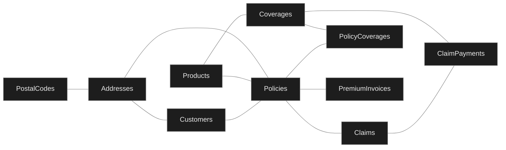

<div style="background:#101010;color:#eaeaea;padding:16px 22px;border-radius:8px;">

# Danish Insurance Company: Data Profile

## At a Glance

<table style="border-collapse:collapse;margin:8px 0;">
<tr><th scope="row" align="left" style="text-align:left;vertical-align:top;white-space:nowrap;font-weight:600;padding:6px 16px 6px 10px;background:#1d1d1d;color:#dcdcdc;border-bottom:1px solid #2c2c2c;">About</th><td style="text-align:left;vertical-align:top;padding:6px 10px;background:#161616;color:#eaeaea;border-bottom:1px solid #2c2c2c;">The policyholder, policy, claim and billing records of a Danish insurance company that sells home, car, personal, pet and travel cover to private persons. The oldest records date from 2008, while claims, payments and invoices cover January 2023 to the end of 2025. <i>(written by AI)</i></td></tr>
<tr><th scope="row" align="left" style="text-align:left;vertical-align:top;white-space:nowrap;font-weight:600;padding:6px 16px 6px 10px;background:#1d1d1d;color:#dcdcdc;border-bottom:1px solid #2c2c2c;">Source</th><td style="text-align:left;vertical-align:top;padding:6px 10px;background:#161616;color:#eaeaea;border-bottom:1px solid #2c2c2c;">insurance_dk/ (10 files) (csv)</td></tr>
<tr><th scope="row" align="left" style="text-align:left;vertical-align:top;white-space:nowrap;font-weight:600;padding:6px 16px 6px 10px;background:#1d1d1d;color:#dcdcdc;border-bottom:1px solid #2c2c2c;">Tables</th><td style="text-align:left;vertical-align:top;padding:6px 10px;background:#161616;color:#eaeaea;border-bottom:1px solid #2c2c2c;">10</td></tr>
<tr><th scope="row" align="left" style="text-align:left;vertical-align:top;white-space:nowrap;font-weight:600;padding:6px 16px 6px 10px;background:#1d1d1d;color:#dcdcdc;border-bottom:1px solid #2c2c2c;">Sampled Rows</th><td style="text-align:left;vertical-align:top;padding:6px 10px;background:#161616;color:#eaeaea;border-bottom:1px solid #2c2c2c;">125,134</td></tr>
<tr><th scope="row" align="left" style="text-align:left;vertical-align:top;white-space:nowrap;font-weight:600;padding:6px 16px 6px 10px;background:#1d1d1d;color:#dcdcdc;border-bottom:1px solid #2c2c2c;">Profiled</th><td style="text-align:left;vertical-align:top;padding:6px 10px;background:#161616;color:#eaeaea;border-bottom:1px solid #2c2c2c;">2026-11-22 19:53 UTC</td></tr>
<tr><th scope="row" align="left" style="text-align:left;vertical-align:top;white-space:nowrap;font-weight:600;padding:6px 16px 6px 10px;background:#1d1d1d;color:#dcdcdc;border-bottom:1px solid #2c2c2c;">How to Read</th><td style="text-align:left;vertical-align:top;padding:6px 10px;background:#161616;color:#eaeaea;border-bottom:1px solid #2c2c2c;"><a href="how-to-read.md">How to Read This Wiki</a> · <a href="beam-annotations.md">BEAM✲ Annotations</a></td></tr>
</table>

## Data Stories

<i>A data story describes one table: what the thing is, what one row is, and what to watch out for.</i>

<table style="border-collapse:collapse;margin:8px 0;width:100%;">
<tr><th style="padding:6px 10px;border:1px solid #2c2c2c;background:#161616;color:#eaeaea;text-align:left;vertical-align:top;background:#242424;color:#ffffff;font-weight:600;vertical-align:bottom;">Table</th><th style="padding:6px 10px;border:1px solid #2c2c2c;background:#161616;color:#eaeaea;text-align:left;vertical-align:top;background:#242424;color:#ffffff;font-weight:600;vertical-align:bottom;">BEAM✲</th><th style="padding:6px 10px;border:1px solid #2c2c2c;background:#161616;color:#eaeaea;text-align:left;vertical-align:top;background:#242424;color:#ffffff;font-weight:600;vertical-align:bottom;">Grain</th><th style="padding:6px 10px;border:1px solid #2c2c2c;background:#161616;color:#eaeaea;text-align:left;vertical-align:top;background:#242424;color:#ffffff;font-weight:600;vertical-align:bottom;">Description</th><th style="padding:6px 10px;border:1px solid #2c2c2c;background:#161616;color:#eaeaea;text-align:right;vertical-align:top;background:#242424;color:#ffffff;font-weight:600;vertical-align:bottom;">Sampled Rows</th><th style="padding:6px 10px;border:1px solid #2c2c2c;background:#161616;color:#eaeaea;text-align:right;vertical-align:top;background:#242424;color:#ffffff;font-weight:600;vertical-align:bottom;">Columns</th></tr>
<tr><td style="padding:6px 10px;border:1px solid #2c2c2c;background:#161616;color:#eaeaea;text-align:left;vertical-align:top;"><a href="data-stories/addresses.md" style="color:#4cc2ff">Addresses</a></td><td style="padding:6px 10px;border:1px solid #2c2c2c;background:#161616;color:#eaeaea;text-align:left;vertical-align:top;"><a href="beam-annotations.md#t-cv" style="color:#4cc2ff" title="Current Value: Keeps only the current value of each attribute. Changes overwrite the old value. Also called a type 1 slowly changing dimension.">[CV]</a></td><td style="padding:6px 10px;border:1px solid #2c2c2c;background:#161616;color:#eaeaea;text-align:left;vertical-align:top;">One row for each address, made up of a street, a house number, an optional floor and a postal code</td><td style="padding:6px 10px;border:1px solid #2c2c2c;background:#161616;color:#eaeaea;text-align:left;vertical-align:top;">The Danish postal addresses, with street, house number, optional floor and postal code, that customers live at and that policies insure. An address can be shared by several customers or policies.</td><td style="padding:6px 10px;border:1px solid #2c2c2c;background:#161616;color:#eaeaea;text-align:right;vertical-align:top;">2,860</td><td style="padding:6px 10px;border:1px solid #2c2c2c;background:#161616;color:#eaeaea;text-align:right;vertical-align:top;">5</td></tr>
<tr><td style="padding:6px 10px;border:1px solid #2c2c2c;background:#161616;color:#eaeaea;text-align:left;vertical-align:top;"><a href="data-stories/claimpayments.md" style="color:#4cc2ff">ClaimPayments</a></td><td style="padding:6px 10px;border:1px solid #2c2c2c;background:#161616;color:#eaeaea;text-align:left;vertical-align:top;"><a href="beam-annotations.md#t-de" style="color:#4cc2ff" title="Discrete Event: Something that happens at one moment, or over a short time, and is then finished, e.g. a sale or a payment. Becomes a transaction fact table [TF].">[DE]</a></td><td style="padding:6px 10px;border:1px solid #2c2c2c;background:#161616;color:#eaeaea;text-align:left;vertical-align:top;">One row for each payment made on a claim</td><td style="padding:6px 10px;border:1px solid #2c2c2c;background:#161616;color:#eaeaea;text-align:left;vertical-align:top;">A payment the company makes out of a claim to a customer or to a workshop, supplier or craftsman, tied to the cover it falls under. A claim can be paid in several instalments.</td><td style="padding:6px 10px;border:1px solid #2c2c2c;background:#161616;color:#eaeaea;text-align:right;vertical-align:top;">956</td><td style="padding:6px 10px;border:1px solid #2c2c2c;background:#161616;color:#eaeaea;text-align:right;vertical-align:top;">6</td></tr>
<tr><td style="padding:6px 10px;border:1px solid #2c2c2c;background:#161616;color:#eaeaea;text-align:left;vertical-align:top;"><a href="data-stories/claims.md" style="color:#4cc2ff">Claims</a></td><td style="padding:6px 10px;border:1px solid #2c2c2c;background:#161616;color:#eaeaea;text-align:left;vertical-align:top;"><a href="beam-annotations.md#t-ee" style="color:#4cc2ff" title="Evolving Event: A process that takes time to complete and passes through milestones, e.g. order → ship → deliver. Becomes an accumulating snapshot [AS].">[EE]</a></td><td style="padding:6px 10px;border:1px solid #2c2c2c;background:#161616;color:#eaeaea;text-align:left;vertical-align:top;">One row for each claim made on a policy</td><td style="padding:6px 10px;border:1px solid #2c2c2c;background:#161616;color:#eaeaea;text-align:left;vertical-align:top;">A report from a policyholder that something insured has been lost or damaged, with when it happened, when it was reported, why, how it was reported, the estimated cost and whether it was settled, rejected or is still open. Closed claims carry the day they were closed.</td><td style="padding:6px 10px;border:1px solid #2c2c2c;background:#161616;color:#eaeaea;text-align:right;vertical-align:top;">850</td><td style="padding:6px 10px;border:1px solid #2c2c2c;background:#161616;color:#eaeaea;text-align:right;vertical-align:top;">9</td></tr>
<tr><td style="padding:6px 10px;border:1px solid #2c2c2c;background:#161616;color:#eaeaea;text-align:left;vertical-align:top;"><a href="data-stories/coverages.md" style="color:#4cc2ff">Coverages</a></td><td style="padding:6px 10px;border:1px solid #2c2c2c;background:#161616;color:#eaeaea;text-align:left;vertical-align:top;"><a href="beam-annotations.md#t-cv" style="color:#4cc2ff" title="Current Value: Keeps only the current value of each attribute. Changes overwrite the old value. Also called a type 1 slowly changing dimension.">[CV]</a></td><td style="padding:6px 10px;border:1px solid #2c2c2c;background:#161616;color:#eaeaea;text-align:left;vertical-align:top;">One row for each type of cover offered under a product</td><td style="padding:6px 10px;border:1px solid #2c2c2c;background:#161616;color:#eaeaea;text-align:left;vertical-align:top;">The individual types of cover that can be part of a product, for example liability or fire, each marked as standard or optional, with the usual yearly price and deductible. A coverage belongs to one product.</td><td style="padding:6px 10px;border:1px solid #2c2c2c;background:#161616;color:#eaeaea;text-align:right;vertical-align:top;">29</td><td style="padding:6px 10px;border:1px solid #2c2c2c;background:#161616;color:#eaeaea;text-align:right;vertical-align:top;">6</td></tr>
<tr><td style="padding:6px 10px;border:1px solid #2c2c2c;background:#161616;color:#eaeaea;text-align:left;vertical-align:top;"><a href="data-stories/customers.md" style="color:#4cc2ff">Customers</a></td><td style="padding:6px 10px;border:1px solid #2c2c2c;background:#161616;color:#eaeaea;text-align:left;vertical-align:top;"><a href="beam-annotations.md#t-cv" style="color:#4cc2ff" title="Current Value: Keeps only the current value of each attribute. Changes overwrite the old value. Also called a type 1 slowly changing dimension.">[CV]</a></td><td style="padding:6px 10px;border:1px solid #2c2c2c;background:#161616;color:#eaeaea;text-align:left;vertical-align:top;">One row for each person who is a customer, whether still active or cancelled</td><td style="padding:6px 10px;border:1px solid #2c2c2c;background:#161616;color:#eaeaea;text-align:left;vertical-align:top;">The private persons who have, or have had, insurance with the company, with their contact details, when they signed up and whether they are still customers. A customer who has cancelled stays in the list with a churn date.</td><td style="padding:6px 10px;border:1px solid #2c2c2c;background:#161616;color:#eaeaea;text-align:right;vertical-align:top;">3,000</td><td style="padding:6px 10px;border:1px solid #2c2c2c;background:#161616;color:#eaeaea;text-align:right;vertical-align:top;">12</td></tr>
<tr><td style="padding:6px 10px;border:1px solid #2c2c2c;background:#161616;color:#eaeaea;text-align:left;vertical-align:top;"><a href="data-stories/policies.md" style="color:#4cc2ff">Policies</a></td><td style="padding:6px 10px;border:1px solid #2c2c2c;background:#161616;color:#eaeaea;text-align:left;vertical-align:top;"><a href="beam-annotations.md#t-cv" style="color:#4cc2ff" title="Current Value: Keeps only the current value of each attribute. Changes overwrite the old value. Also called a type 1 slowly changing dimension.">[CV]</a></td><td style="padding:6px 10px;border:1px solid #2c2c2c;background:#161616;color:#eaeaea;text-align:left;vertical-align:top;">One row for each insurance policy a customer takes out, identified by the policy number</td><td style="padding:6px 10px;border:1px solid #2c2c2c;background:#161616;color:#eaeaea;text-align:left;vertical-align:top;">An insurance agreement between a customer and the company for one product, with the day it started, the day it ended if it was cancelled, how often the customer pays and how it was sold. Cancelled policies stay in the table with their cancellation reason.</td><td style="padding:6px 10px;border:1px solid #2c2c2c;background:#161616;color:#eaeaea;text-align:right;vertical-align:top;">5,640</td><td style="padding:6px 10px;border:1px solid #2c2c2c;background:#161616;color:#eaeaea;text-align:right;vertical-align:top;">11</td></tr>
<tr><td style="padding:6px 10px;border:1px solid #2c2c2c;background:#161616;color:#eaeaea;text-align:left;vertical-align:top;"><a href="data-stories/policycoverages.md" style="color:#4cc2ff">PolicyCoverages</a></td><td style="padding:6px 10px;border:1px solid #2c2c2c;background:#161616;color:#eaeaea;text-align:left;vertical-align:top;"></td><td style="padding:6px 10px;border:1px solid #2c2c2c;background:#161616;color:#eaeaea;text-align:left;vertical-align:top;">One row for each cover included in a policy, so a policy appears once for every cover it has</td><td style="padding:6px 10px;border:1px solid #2c2c2c;background:#161616;color:#eaeaea;text-align:left;vertical-align:top;">The covers that are included in each policy, with the sum insured, the deductible and the yearly premium agreed for that policy. It splits the price of a policy into its parts.</td><td style="padding:6px 10px;border:1px solid #2c2c2c;background:#161616;color:#eaeaea;text-align:right;vertical-align:top;">20,787</td><td style="padding:6px 10px;border:1px solid #2c2c2c;background:#161616;color:#eaeaea;text-align:right;vertical-align:top;">5</td></tr>
<tr><td style="padding:6px 10px;border:1px solid #2c2c2c;background:#161616;color:#eaeaea;text-align:left;vertical-align:top;"><a href="data-stories/postalcodes.md" style="color:#4cc2ff">PostalCodes</a></td><td style="padding:6px 10px;border:1px solid #2c2c2c;background:#161616;color:#eaeaea;text-align:left;vertical-align:top;"><a href="beam-annotations.md#t-cv" style="color:#4cc2ff" title="Current Value: Keeps only the current value of each attribute. Changes overwrite the old value. Also called a type 1 slowly changing dimension.">[CV]</a></td><td style="padding:6px 10px;border:1px solid #2c2c2c;background:#161616;color:#eaeaea;text-align:left;vertical-align:top;">One row for each Danish postal area, identified by its four-digit code</td><td style="padding:6px 10px;border:1px solid #2c2c2c;background:#161616;color:#eaeaea;text-align:left;vertical-align:top;">The list of Danish postal codes used in the data, each with its city and the region it belongs to. It places an address in a town and a region.</td><td style="padding:6px 10px;border:1px solid #2c2c2c;background:#161616;color:#eaeaea;text-align:right;vertical-align:top;">44</td><td style="padding:6px 10px;border:1px solid #2c2c2c;background:#161616;color:#eaeaea;text-align:right;vertical-align:top;">3</td></tr>
<tr><td style="padding:6px 10px;border:1px solid #2c2c2c;background:#161616;color:#eaeaea;text-align:left;vertical-align:top;"><a href="data-stories/premiuminvoices.md" style="color:#4cc2ff">PremiumInvoices</a></td><td style="padding:6px 10px;border:1px solid #2c2c2c;background:#161616;color:#eaeaea;text-align:left;vertical-align:top;"><a href="beam-annotations.md#t-ee" style="color:#4cc2ff" title="Evolving Event: A process that takes time to complete and passes through milestones, e.g. order → ship → deliver. Becomes an accumulating snapshot [AS].">[EE]</a></td><td style="padding:6px 10px;border:1px solid #2c2c2c;background:#161616;color:#eaeaea;text-align:left;vertical-align:top;">One row for each premium invoice sent for a policy, one for each billing period</td><td style="padding:6px 10px;border:1px solid #2c2c2c;background:#161616;color:#eaeaea;text-align:left;vertical-align:top;">A bill sent to a customer for the insurance premium of one policy for one period, with the invoice date, the due date, the period it covers, the amount and whether it has been paid, is overdue or is still open.</td><td style="padding:6px 10px;border:1px solid #2c2c2c;background:#161616;color:#eaeaea;text-align:right;vertical-align:top;">90,962</td><td style="padding:6px 10px;border:1px solid #2c2c2c;background:#161616;color:#eaeaea;text-align:right;vertical-align:top;">9</td></tr>
<tr><td style="padding:6px 10px;border:1px solid #2c2c2c;background:#161616;color:#eaeaea;text-align:left;vertical-align:top;"><a href="data-stories/products.md" style="color:#4cc2ff">Products</a></td><td style="padding:6px 10px;border:1px solid #2c2c2c;background:#161616;color:#eaeaea;text-align:left;vertical-align:top;"><a href="beam-annotations.md#t-cv" style="color:#4cc2ff" title="Current Value: Keeps only the current value of each attribute. Changes overwrite the old value. Also called a type 1 slowly changing dimension.">[CV]</a></td><td style="padding:6px 10px;border:1px solid #2c2c2c;background:#161616;color:#eaeaea;text-align:left;vertical-align:top;">One row for each kind of insurance the company sells</td><td style="padding:6px 10px;border:1px solid #2c2c2c;background:#161616;color:#eaeaea;text-align:left;vertical-align:top;">The six kinds of insurance the company sells, such as home contents, car and travel, grouped into four categories: Bolig (home), Person, Bil (car) and Dyr (pet).</td><td style="padding:6px 10px;border:1px solid #2c2c2c;background:#161616;color:#eaeaea;text-align:right;vertical-align:top;">6</td><td style="padding:6px 10px;border:1px solid #2c2c2c;background:#161616;color:#eaeaea;text-align:right;vertical-align:top;">3</td></tr>
</table>

## Data Model

<i>How the tables connect, drawn from the measured relationships.</i>



---

## Metadata

_Machine-readable facts about this page, for tools and AI agents._

```yaml
bijoe: "data-profile-index"
schema_version: 2
dataset: "Danish Insurance Company"
source: "insurance_dk/ (10 files)"
source_type: "files"
connector: "csv"
tables: 10
sampled_rows: 125134
relationships: 12
generated_at: "2026-11-22T19:53:18+00:00"
generator: "bi-joe-data-profiler 0.1.0a1"
```

</div>
