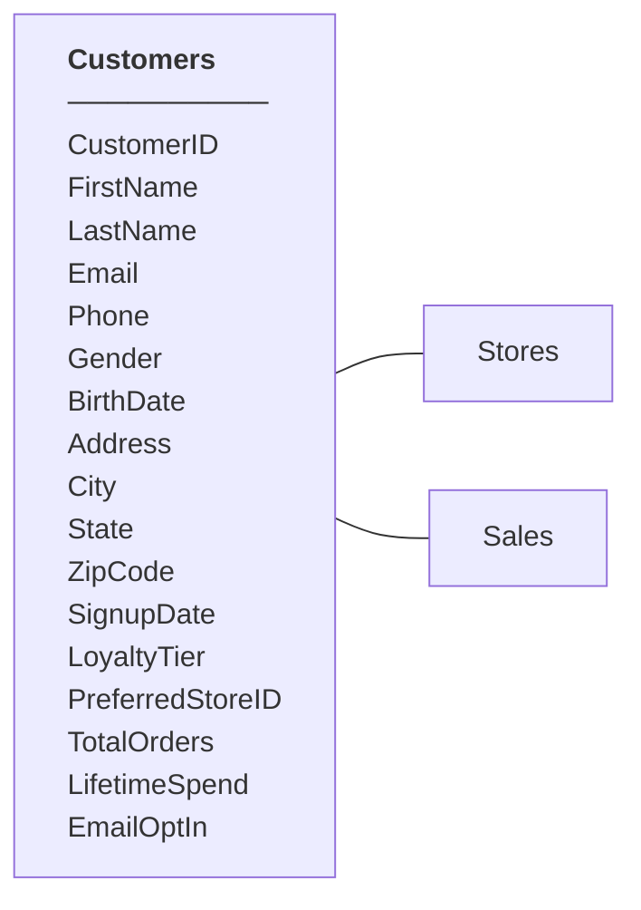

[← Shoe Company Overview](../index.md) · [BEAM✲ Annotations](../beam-annotations.md) · [How to Read This Wiki](../how-to-read.md)

# Customers

<table style="border-collapse:collapse;margin:8px 0;">
<tr><th scope="row" align="left" style="text-align:left;vertical-align:top;white-space:nowrap;font-weight:600;padding:6px 16px 6px 0;border-bottom:1px solid rgba(128,128,128,.4);">Description</th><td style="text-align:left;vertical-align:top;padding:6px 0;border-bottom:1px solid rgba(128,128,128,.4);">A person who has bought from the company at least once and belongs to its loyalty programme, together with the shop they prefer and whether they agreed to receive emails.</td></tr>
<tr><th scope="row" align="left" style="text-align:left;vertical-align:top;white-space:nowrap;font-weight:600;padding:6px 16px 6px 0;border-bottom:1px solid rgba(128,128,128,.4);">Grain</th><td style="text-align:left;vertical-align:top;padding:6px 0;border-bottom:1px solid rgba(128,128,128,.4);">One row for each person who has signed up as a customer</td></tr>
<tr><th scope="row" align="left" style="text-align:left;vertical-align:top;white-space:nowrap;font-weight:600;padding:6px 16px 6px 0;border-bottom:1px solid rgba(128,128,128,.4);">BEAM✲</th><td style="text-align:left;vertical-align:top;padding:6px 0;border-bottom:1px solid rgba(128,128,128,.4);"><a href="../beam-annotations.md#t-cv">[CV]</a> <i>(suggested by AI)</i></td></tr>
<tr><th scope="row" align="left" style="text-align:left;vertical-align:top;white-space:nowrap;font-weight:600;padding:6px 16px 6px 0;border-bottom:1px solid rgba(128,128,128,.4);">Why <a href="../beam-annotations.md#t-cv">[CV]</a></th><td style="text-align:left;vertical-align:top;padding:6px 0;border-bottom:1px solid rgba(128,128,128,.4);">One row per <code>CustomerID</code>, no validity dates, version columns or current flag, so each customer holds a single set of current values.</td></tr>
<tr><th scope="row" align="left" style="text-align:left;vertical-align:top;white-space:nowrap;font-weight:600;padding:6px 16px 6px 0;border-bottom:1px solid rgba(128,128,128,.4);">Source</th><td style="text-align:left;vertical-align:top;padding:6px 0;border-bottom:1px solid rgba(128,128,128,.4);"><a href="../beam-annotations.md#t-source">{shoe_company.xlsx: Customers}</a> <i>(measured)</i></td></tr>
<tr><th scope="row" align="left" style="text-align:left;vertical-align:top;white-space:nowrap;font-weight:600;padding:6px 16px 6px 0;border-bottom:1px solid rgba(128,128,128,.4);">Sampled Rows</th><td style="text-align:left;vertical-align:top;padding:6px 0;border-bottom:1px solid rgba(128,128,128,.4);">200</td></tr>
<tr><th scope="row" align="left" style="text-align:left;vertical-align:top;white-space:nowrap;font-weight:600;padding:6px 16px 6px 0;border-bottom:1px solid rgba(128,128,128,.4);">Columns</th><td style="text-align:left;vertical-align:top;padding:6px 0;border-bottom:1px solid rgba(128,128,128,.4);">17</td></tr>
<tr><th scope="row" align="left" style="text-align:left;vertical-align:top;white-space:nowrap;font-weight:600;padding:6px 16px 6px 0;border-bottom:1px solid rgba(128,128,128,.4);">Description Source</th><td style="text-align:left;vertical-align:top;padding:6px 0;border-bottom:1px solid rgba(128,128,128,.4);">Written by AI from the data. Check before relying on it.</td></tr>
<tr><th scope="row" align="left" style="text-align:left;vertical-align:top;white-space:nowrap;font-weight:600;padding:6px 16px 6px 0;border-bottom:1px solid rgba(128,128,128,.4);">Confidence</th><td style="text-align:left;vertical-align:top;padding:6px 0;border-bottom:1px solid rgba(128,128,128,.4);">medium</td></tr>
</table>

## Columns

<div style="overflow-x:auto;max-width:100%;">
<table style="border-collapse:separate;border-spacing:0;border:1px solid rgba(128,128,128,.4);border-width:1px 0 0 1px;font-size:90%;">
<tr><th colspan="2" style="position:sticky;left:0;z-index:2;background:#eef0f2;color:#1f2328;border:0 solid rgba(128,128,128,.4);border-width:0 1px 1px 0;padding:3px 8px;white-space:nowrap;text-align:left;vertical-align:top;font-weight:600;">Column Name</th><th style="border:0 solid rgba(128,128,128,.4);border-width:0 1px 1px 0;padding:3px 8px;white-space:nowrap;text-align:left;vertical-align:top;font-weight:600;">CustomerID</th><th style="border:0 solid rgba(128,128,128,.4);border-width:0 1px 1px 0;padding:3px 8px;white-space:nowrap;text-align:left;vertical-align:top;font-weight:600;">FirstName</th><th style="border:0 solid rgba(128,128,128,.4);border-width:0 1px 1px 0;padding:3px 8px;white-space:nowrap;text-align:left;vertical-align:top;font-weight:600;">LastName</th><th style="border:0 solid rgba(128,128,128,.4);border-width:0 1px 1px 0;padding:3px 8px;white-space:nowrap;text-align:left;vertical-align:top;font-weight:600;">Email</th><th style="border:0 solid rgba(128,128,128,.4);border-width:0 1px 1px 0;padding:3px 8px;white-space:nowrap;text-align:left;vertical-align:top;font-weight:600;">Phone</th><th style="border:0 solid rgba(128,128,128,.4);border-width:0 1px 1px 0;padding:3px 8px;white-space:nowrap;text-align:left;vertical-align:top;font-weight:600;">Gender</th><th style="border:0 solid rgba(128,128,128,.4);border-width:0 1px 1px 0;padding:3px 8px;white-space:nowrap;text-align:left;vertical-align:top;font-weight:600;">BirthDate</th><th style="border:0 solid rgba(128,128,128,.4);border-width:0 1px 1px 0;padding:3px 8px;white-space:nowrap;text-align:left;vertical-align:top;font-weight:600;">Address</th><th style="border:0 solid rgba(128,128,128,.4);border-width:0 1px 1px 0;padding:3px 8px;white-space:nowrap;text-align:left;vertical-align:top;font-weight:600;">City</th><th style="border:0 solid rgba(128,128,128,.4);border-width:0 1px 1px 0;padding:3px 8px;white-space:nowrap;text-align:left;vertical-align:top;font-weight:600;">State</th><th style="border:0 solid rgba(128,128,128,.4);border-width:0 1px 1px 0;padding:3px 8px;white-space:nowrap;text-align:left;vertical-align:top;font-weight:600;">ZipCode</th><th style="border:0 solid rgba(128,128,128,.4);border-width:0 1px 1px 0;padding:3px 8px;white-space:nowrap;text-align:left;vertical-align:top;font-weight:600;">SignupDate</th><th style="border:0 solid rgba(128,128,128,.4);border-width:0 1px 1px 0;padding:3px 8px;white-space:nowrap;text-align:left;vertical-align:top;font-weight:600;">LoyaltyTier</th><th style="border:0 solid rgba(128,128,128,.4);border-width:0 1px 1px 0;padding:3px 8px;white-space:nowrap;text-align:left;vertical-align:top;font-weight:600;">PreferredStoreID</th><th style="border:0 solid rgba(128,128,128,.4);border-width:0 1px 1px 0;padding:3px 8px;white-space:nowrap;text-align:left;vertical-align:top;font-weight:600;">TotalOrders</th><th style="border:0 solid rgba(128,128,128,.4);border-width:0 1px 1px 0;padding:3px 8px;white-space:nowrap;text-align:left;vertical-align:top;font-weight:600;">LifetimeSpend</th><th style="border:0 solid rgba(128,128,128,.4);border-width:0 1px 1px 0;padding:3px 8px;white-space:nowrap;text-align:left;vertical-align:top;font-weight:600;">EmailOptIn</th></tr>
<tr><td colspan="2" style="position:sticky;left:0;z-index:2;background:#eef0f2;color:#1f2328;border:0 solid rgba(128,128,128,.4);border-width:0 1px 1px 0;padding:3px 8px;white-space:nowrap;text-align:left;vertical-align:top;font-weight:600;">Data Type</td><td style="border:0 solid rgba(128,128,128,.4);border-width:0 1px 1px 0;padding:3px 8px;white-space:nowrap;text-align:left;vertical-align:top;"><a href="../beam-annotations.md#c-c">C6</a> text</td><td style="border:0 solid rgba(128,128,128,.4);border-width:0 1px 1px 0;padding:3px 8px;white-space:nowrap;text-align:left;vertical-align:top;"><a href="../beam-annotations.md#c-c">C9</a> text</td><td style="border:0 solid rgba(128,128,128,.4);border-width:0 1px 1px 0;padding:3px 8px;white-space:nowrap;text-align:left;vertical-align:top;"><a href="../beam-annotations.md#c-c">C8</a> text</td><td style="border:0 solid rgba(128,128,128,.4);border-width:0 1px 1px 0;padding:3px 8px;white-space:nowrap;text-align:left;vertical-align:top;"><a href="../beam-annotations.md#c-c">C31</a> text</td><td style="border:0 solid rgba(128,128,128,.4);border-width:0 1px 1px 0;padding:3px 8px;white-space:nowrap;text-align:left;vertical-align:top;"><a href="../beam-annotations.md#c-c">C14</a> text</td><td style="border:0 solid rgba(128,128,128,.4);border-width:0 1px 1px 0;padding:3px 8px;white-space:nowrap;text-align:left;vertical-align:top;"><a href="../beam-annotations.md#c-c">C5</a> text</td><td style="border:0 solid rgba(128,128,128,.4);border-width:0 1px 1px 0;padding:3px 8px;white-space:nowrap;text-align:left;vertical-align:top;"><a href="../beam-annotations.md#c-d">D</a> date</td><td style="border:0 solid rgba(128,128,128,.4);border-width:0 1px 1px 0;padding:3px 8px;white-space:nowrap;text-align:left;vertical-align:top;"><a href="../beam-annotations.md#c-c">C13</a> text</td><td style="border:0 solid rgba(128,128,128,.4);border-width:0 1px 1px 0;padding:3px 8px;white-space:nowrap;text-align:left;vertical-align:top;"><a href="../beam-annotations.md#c-c">C11</a> text</td><td style="border:0 solid rgba(128,128,128,.4);border-width:0 1px 1px 0;padding:3px 8px;white-space:nowrap;text-align:left;vertical-align:top;"><a href="../beam-annotations.md#c-c">C2</a> text</td><td style="border:0 solid rgba(128,128,128,.4);border-width:0 1px 1px 0;padding:3px 8px;white-space:nowrap;text-align:left;vertical-align:top;"><a href="../beam-annotations.md#c-i">I</a> whole number</td><td style="border:0 solid rgba(128,128,128,.4);border-width:0 1px 1px 0;padding:3px 8px;white-space:nowrap;text-align:left;vertical-align:top;"><a href="../beam-annotations.md#c-d">D</a> date</td><td style="border:0 solid rgba(128,128,128,.4);border-width:0 1px 1px 0;padding:3px 8px;white-space:nowrap;text-align:left;vertical-align:top;"><a href="../beam-annotations.md#c-c">C8</a> text</td><td style="border:0 solid rgba(128,128,128,.4);border-width:0 1px 1px 0;padding:3px 8px;white-space:nowrap;text-align:left;vertical-align:top;"><a href="../beam-annotations.md#c-c">C4</a> text</td><td style="border:0 solid rgba(128,128,128,.4);border-width:0 1px 1px 0;padding:3px 8px;white-space:nowrap;text-align:left;vertical-align:top;"><a href="../beam-annotations.md#c-i">I</a> whole number</td><td style="border:0 solid rgba(128,128,128,.4);border-width:0 1px 1px 0;padding:3px 8px;white-space:nowrap;text-align:left;vertical-align:top;"><a href="../beam-annotations.md#c-n">N6.2</a> number</td><td style="border:0 solid rgba(128,128,128,.4);border-width:0 1px 1px 0;padding:3px 8px;white-space:nowrap;text-align:left;vertical-align:top;">yes/no</td></tr>
<tr><td colspan="2" style="position:sticky;left:0;z-index:2;background:#eef0f2;color:#1f2328;border:0 solid rgba(128,128,128,.4);border-width:0 1px 1px 0;padding:3px 8px;white-space:nowrap;text-align:left;vertical-align:top;font-weight:600;">BEAM✲</td><td style="border:0 solid rgba(128,128,128,.4);border-width:0 1px 1px 0;padding:3px 8px;white-space:nowrap;text-align:left;vertical-align:top;"><a href="../beam-annotations.md#c-nd">ND</a> <i><a href="../beam-annotations.md#c-bk">BK</a></i> <i><a href="../beam-annotations.md#c-md">MD</a></i></td><td style="border:0 solid rgba(128,128,128,.4);border-width:0 1px 1px 0;padding:3px 8px;white-space:nowrap;text-align:left;vertical-align:top;"><i><a href="../beam-annotations.md#c-md">MD</a></i></td><td style="border:0 solid rgba(128,128,128,.4);border-width:0 1px 1px 0;padding:3px 8px;white-space:nowrap;text-align:left;vertical-align:top;"><i><a href="../beam-annotations.md#c-md">MD</a></i></td><td style="border:0 solid rgba(128,128,128,.4);border-width:0 1px 1px 0;padding:3px 8px;white-space:nowrap;text-align:left;vertical-align:top;"><a href="../beam-annotations.md#c-nd">ND</a></td><td style="border:0 solid rgba(128,128,128,.4);border-width:0 1px 1px 0;padding:3px 8px;white-space:nowrap;text-align:left;vertical-align:top;"><a href="../beam-annotations.md#c-nd">ND</a></td><td style="border:0 solid rgba(128,128,128,.4);border-width:0 1px 1px 0;padding:3px 8px;white-space:nowrap;text-align:left;vertical-align:top;"></td><td style="border:0 solid rgba(128,128,128,.4);border-width:0 1px 1px 0;padding:3px 8px;white-space:nowrap;text-align:left;vertical-align:top;"><i><a href="../beam-annotations.md#c-fv">FV</a></i></td><td style="border:0 solid rgba(128,128,128,.4);border-width:0 1px 1px 0;padding:3px 8px;white-space:nowrap;text-align:left;vertical-align:top;"><a href="../beam-annotations.md#c-nd">ND</a></td><td style="border:0 solid rgba(128,128,128,.4);border-width:0 1px 1px 0;padding:3px 8px;white-space:nowrap;text-align:left;vertical-align:top;"></td><td style="border:0 solid rgba(128,128,128,.4);border-width:0 1px 1px 0;padding:3px 8px;white-space:nowrap;text-align:left;vertical-align:top;"></td><td style="border:0 solid rgba(128,128,128,.4);border-width:0 1px 1px 0;padding:3px 8px;white-space:nowrap;text-align:left;vertical-align:top;"><a href="../beam-annotations.md#c-nd">ND</a></td><td style="border:0 solid rgba(128,128,128,.4);border-width:0 1px 1px 0;padding:3px 8px;white-space:nowrap;text-align:left;vertical-align:top;"><i><a href="../beam-annotations.md#c-fv">FV</a></i></td><td style="border:0 solid rgba(128,128,128,.4);border-width:0 1px 1px 0;padding:3px 8px;white-space:nowrap;text-align:left;vertical-align:top;"></td><td style="border:0 solid rgba(128,128,128,.4);border-width:0 1px 1px 0;padding:3px 8px;white-space:nowrap;text-align:left;vertical-align:top;"><a href="../beam-annotations.md#c-fk">FK</a> <i><a href="../beam-annotations.md#c-dim">[Stores]</a></i></td><td style="border:0 solid rgba(128,128,128,.4);border-width:0 1px 1px 0;padding:3px 8px;white-space:nowrap;text-align:left;vertical-align:top;"><i><a href="../beam-annotations.md#c-fa">FA</a></i></td><td style="border:0 solid rgba(128,128,128,.4);border-width:0 1px 1px 0;padding:3px 8px;white-space:nowrap;text-align:left;vertical-align:top;"><i><a href="../beam-annotations.md#c-fa">FA</a></i> <i><a href="../beam-annotations.md#c-suspect">?</a></i></td><td style="border:0 solid rgba(128,128,128,.4);border-width:0 1px 1px 0;padding:3px 8px;white-space:nowrap;text-align:left;vertical-align:top;"></td></tr>
<tr><td rowspan="9" style="position:sticky;left:0;z-index:2;background:#eef0f2;color:#1f2328;box-sizing:border-box;width:34px;min-width:34px;max-width:34px;border:0 solid rgba(128,128,128,.4);border-width:0 1px 1px 0;padding:4px 0;text-align:center;vertical-align:middle;"><div style="writing-mode:vertical-rl;transform:rotate(180deg);white-space:nowrap;margin:0 auto;font-weight:600;">Data Profiling Results</div></td><td style="position:sticky;left:34px;z-index:2;background:#eef0f2;color:#1f2328;border:0 solid rgba(128,128,128,.4);border-width:0 1px 1px 0;padding:3px 8px;white-space:nowrap;text-align:left;vertical-align:top;font-weight:600;">Sample Count</td><td style="border:0 solid rgba(128,128,128,.4);border-width:0 1px 1px 0;padding:3px 8px;white-space:nowrap;text-align:right;vertical-align:top;">200</td><td style="border:0 solid rgba(128,128,128,.4);border-width:0 1px 1px 0;padding:3px 8px;white-space:nowrap;text-align:right;vertical-align:top;">200</td><td style="border:0 solid rgba(128,128,128,.4);border-width:0 1px 1px 0;padding:3px 8px;white-space:nowrap;text-align:right;vertical-align:top;">200</td><td style="border:0 solid rgba(128,128,128,.4);border-width:0 1px 1px 0;padding:3px 8px;white-space:nowrap;text-align:right;vertical-align:top;">200</td><td style="border:0 solid rgba(128,128,128,.4);border-width:0 1px 1px 0;padding:3px 8px;white-space:nowrap;text-align:right;vertical-align:top;">200</td><td style="border:0 solid rgba(128,128,128,.4);border-width:0 1px 1px 0;padding:3px 8px;white-space:nowrap;text-align:right;vertical-align:top;">200</td><td style="border:0 solid rgba(128,128,128,.4);border-width:0 1px 1px 0;padding:3px 8px;white-space:nowrap;text-align:right;vertical-align:top;">200</td><td style="border:0 solid rgba(128,128,128,.4);border-width:0 1px 1px 0;padding:3px 8px;white-space:nowrap;text-align:right;vertical-align:top;">200</td><td style="border:0 solid rgba(128,128,128,.4);border-width:0 1px 1px 0;padding:3px 8px;white-space:nowrap;text-align:right;vertical-align:top;">200</td><td style="border:0 solid rgba(128,128,128,.4);border-width:0 1px 1px 0;padding:3px 8px;white-space:nowrap;text-align:right;vertical-align:top;">200</td><td style="border:0 solid rgba(128,128,128,.4);border-width:0 1px 1px 0;padding:3px 8px;white-space:nowrap;text-align:right;vertical-align:top;">200</td><td style="border:0 solid rgba(128,128,128,.4);border-width:0 1px 1px 0;padding:3px 8px;white-space:nowrap;text-align:right;vertical-align:top;">200</td><td style="border:0 solid rgba(128,128,128,.4);border-width:0 1px 1px 0;padding:3px 8px;white-space:nowrap;text-align:right;vertical-align:top;">200</td><td style="border:0 solid rgba(128,128,128,.4);border-width:0 1px 1px 0;padding:3px 8px;white-space:nowrap;text-align:right;vertical-align:top;">200</td><td style="border:0 solid rgba(128,128,128,.4);border-width:0 1px 1px 0;padding:3px 8px;white-space:nowrap;text-align:right;vertical-align:top;">200</td><td style="border:0 solid rgba(128,128,128,.4);border-width:0 1px 1px 0;padding:3px 8px;white-space:nowrap;text-align:right;vertical-align:top;">200</td><td style="border:0 solid rgba(128,128,128,.4);border-width:0 1px 1px 0;padding:3px 8px;white-space:nowrap;text-align:right;vertical-align:top;">200</td></tr>
<tr><td style="position:sticky;left:34px;z-index:2;background:#eef0f2;color:#1f2328;border:0 solid rgba(128,128,128,.4);border-width:0 1px 1px 0;padding:3px 8px;white-space:nowrap;text-align:left;vertical-align:top;font-weight:600;">Missing</td><td style="border:0 solid rgba(128,128,128,.4);border-width:0 1px 1px 0;padding:3px 8px;white-space:nowrap;text-align:left;vertical-align:top;">0 (0%)</td><td style="border:0 solid rgba(128,128,128,.4);border-width:0 1px 1px 0;padding:3px 8px;white-space:nowrap;text-align:left;vertical-align:top;">0 (0%)</td><td style="border:0 solid rgba(128,128,128,.4);border-width:0 1px 1px 0;padding:3px 8px;white-space:nowrap;text-align:left;vertical-align:top;">0 (0%)</td><td style="border:0 solid rgba(128,128,128,.4);border-width:0 1px 1px 0;padding:3px 8px;white-space:nowrap;text-align:left;vertical-align:top;">0 (0%)</td><td style="border:0 solid rgba(128,128,128,.4);border-width:0 1px 1px 0;padding:3px 8px;white-space:nowrap;text-align:left;vertical-align:top;">0 (0%)</td><td style="border:0 solid rgba(128,128,128,.4);border-width:0 1px 1px 0;padding:3px 8px;white-space:nowrap;text-align:left;vertical-align:top;">0 (0%)</td><td style="border:0 solid rgba(128,128,128,.4);border-width:0 1px 1px 0;padding:3px 8px;white-space:nowrap;text-align:left;vertical-align:top;">0 (0%)</td><td style="border:0 solid rgba(128,128,128,.4);border-width:0 1px 1px 0;padding:3px 8px;white-space:nowrap;text-align:left;vertical-align:top;">0 (0%)</td><td style="border:0 solid rgba(128,128,128,.4);border-width:0 1px 1px 0;padding:3px 8px;white-space:nowrap;text-align:left;vertical-align:top;">0 (0%)</td><td style="border:0 solid rgba(128,128,128,.4);border-width:0 1px 1px 0;padding:3px 8px;white-space:nowrap;text-align:left;vertical-align:top;">0 (0%)</td><td style="border:0 solid rgba(128,128,128,.4);border-width:0 1px 1px 0;padding:3px 8px;white-space:nowrap;text-align:left;vertical-align:top;">0 (0%)</td><td style="border:0 solid rgba(128,128,128,.4);border-width:0 1px 1px 0;padding:3px 8px;white-space:nowrap;text-align:left;vertical-align:top;">0 (0%)</td><td style="border:0 solid rgba(128,128,128,.4);border-width:0 1px 1px 0;padding:3px 8px;white-space:nowrap;text-align:left;vertical-align:top;">0 (0%)</td><td style="border:0 solid rgba(128,128,128,.4);border-width:0 1px 1px 0;padding:3px 8px;white-space:nowrap;text-align:left;vertical-align:top;">0 (0%)</td><td style="border:0 solid rgba(128,128,128,.4);border-width:0 1px 1px 0;padding:3px 8px;white-space:nowrap;text-align:left;vertical-align:top;">0 (0%)</td><td style="border:0 solid rgba(128,128,128,.4);border-width:0 1px 1px 0;padding:3px 8px;white-space:nowrap;text-align:left;vertical-align:top;">0 (0%)</td><td style="border:0 solid rgba(128,128,128,.4);border-width:0 1px 1px 0;padding:3px 8px;white-space:nowrap;text-align:left;vertical-align:top;">0 (0%)</td></tr>
<tr><td style="position:sticky;left:34px;z-index:2;background:#eef0f2;color:#1f2328;border:0 solid rgba(128,128,128,.4);border-width:0 1px 1px 0;padding:3px 8px;white-space:nowrap;text-align:left;vertical-align:top;font-weight:600;">Unique Values</td><td style="border:0 solid rgba(128,128,128,.4);border-width:0 1px 1px 0;padding:3px 8px;white-space:nowrap;text-align:left;vertical-align:top;">200 (100%)</td><td style="border:0 solid rgba(128,128,128,.4);border-width:0 1px 1px 0;padding:3px 8px;white-space:nowrap;text-align:left;vertical-align:top;">30 (15%)</td><td style="border:0 solid rgba(128,128,128,.4);border-width:0 1px 1px 0;padding:3px 8px;white-space:nowrap;text-align:left;vertical-align:top;">24 (12%)</td><td style="border:0 solid rgba(128,128,128,.4);border-width:0 1px 1px 0;padding:3px 8px;white-space:nowrap;text-align:left;vertical-align:top;">200 (100%)</td><td style="border:0 solid rgba(128,128,128,.4);border-width:0 1px 1px 0;padding:3px 8px;white-space:nowrap;text-align:left;vertical-align:top;">200 (100%)</td><td style="border:0 solid rgba(128,128,128,.4);border-width:0 1px 1px 0;padding:3px 8px;white-space:nowrap;text-align:left;vertical-align:top;">3 (1.5%)</td><td style="border:0 solid rgba(128,128,128,.4);border-width:0 1px 1px 0;padding:3px 8px;white-space:nowrap;text-align:left;vertical-align:top;">199 (99.5%)</td><td style="border:0 solid rgba(128,128,128,.4);border-width:0 1px 1px 0;padding:3px 8px;white-space:nowrap;text-align:left;vertical-align:top;">200 (100%)</td><td style="border:0 solid rgba(128,128,128,.4);border-width:0 1px 1px 0;padding:3px 8px;white-space:nowrap;text-align:left;vertical-align:top;">12 (6%)</td><td style="border:0 solid rgba(128,128,128,.4);border-width:0 1px 1px 0;padding:3px 8px;white-space:nowrap;text-align:left;vertical-align:top;">11 (5.5%)</td><td style="border:0 solid rgba(128,128,128,.4);border-width:0 1px 1px 0;padding:3px 8px;white-space:nowrap;text-align:left;vertical-align:top;">200 (100%)</td><td style="border:0 solid rgba(128,128,128,.4);border-width:0 1px 1px 0;padding:3px 8px;white-space:nowrap;text-align:left;vertical-align:top;">194 (97%)</td><td style="border:0 solid rgba(128,128,128,.4);border-width:0 1px 1px 0;padding:3px 8px;white-space:nowrap;text-align:left;vertical-align:top;">4 (2%)</td><td style="border:0 solid rgba(128,128,128,.4);border-width:0 1px 1px 0;padding:3px 8px;white-space:nowrap;text-align:left;vertical-align:top;">15 (7.5%)</td><td style="border:0 solid rgba(128,128,128,.4);border-width:0 1px 1px 0;padding:3px 8px;white-space:nowrap;text-align:left;vertical-align:top;">40 (20%)</td><td style="border:0 solid rgba(128,128,128,.4);border-width:0 1px 1px 0;padding:3px 8px;white-space:nowrap;text-align:left;vertical-align:top;">200 (100%)</td><td style="border:0 solid rgba(128,128,128,.4);border-width:0 1px 1px 0;padding:3px 8px;white-space:nowrap;text-align:left;vertical-align:top;">2 (1%)</td></tr>
<tr><td style="position:sticky;left:34px;z-index:2;background:#eef0f2;color:#1f2328;border:0 solid rgba(128,128,128,.4);border-width:0 1px 1px 0;padding:3px 8px;white-space:nowrap;text-align:left;vertical-align:top;font-weight:600;">Min Value</td><td style="border:0 solid rgba(128,128,128,.4);border-width:0 1px 1px 0;padding:3px 8px;white-space:nowrap;text-align:left;vertical-align:top;">C00001</td><td style="border:0 solid rgba(128,128,128,.4);border-width:0 1px 1px 0;padding:3px 8px;white-space:nowrap;text-align:left;vertical-align:top;">Ariel</td><td style="border:0 solid rgba(128,128,128,.4);border-width:0 1px 1px 0;padding:3px 8px;white-space:nowrap;text-align:left;vertical-align:top;">Anderson</td><td style="border:0 solid rgba(128,128,128,.4);border-width:0 1px 1px 0;padding:3px 8px;white-space:nowrap;text-align:left;vertical-align:top;">ariel.brown50@mail.test</td><td style="border:0 solid rgba(128,128,128,.4);border-width:0 1px 1px 0;padding:3px 8px;white-space:nowrap;text-align:left;vertical-align:top;">(555) 104-5076</td><td style="border:0 solid rgba(128,128,128,.4);border-width:0 1px 1px 0;padding:3px 8px;white-space:nowrap;text-align:left;vertical-align:top;">F</td><td style="border:0 solid rgba(128,128,128,.4);border-width:0 1px 1px 0;padding:3px 8px;white-space:nowrap;text-align:left;vertical-align:top;">1955-05-14</td><td style="border:0 solid rgba(128,128,128,.4);border-width:0 1px 1px 0;padding:3px 8px;white-space:nowrap;text-align:left;vertical-align:top;">1009 Oak Ave</td><td style="border:0 solid rgba(128,128,128,.4);border-width:0 1px 1px 0;padding:3px 8px;white-space:nowrap;text-align:left;vertical-align:top;">Atlanta</td><td style="border:0 solid rgba(128,128,128,.4);border-width:0 1px 1px 0;padding:3px 8px;white-space:nowrap;text-align:left;vertical-align:top;">AZ</td><td style="border:0 solid rgba(128,128,128,.4);border-width:0 1px 1px 0;padding:3px 8px;white-space:nowrap;text-align:left;vertical-align:top;">10089</td><td style="border:0 solid rgba(128,128,128,.4);border-width:0 1px 1px 0;padding:3px 8px;white-space:nowrap;text-align:left;vertical-align:top;">2018-01-26</td><td style="border:0 solid rgba(128,128,128,.4);border-width:0 1px 1px 0;padding:3px 8px;white-space:nowrap;text-align:left;vertical-align:top;">Bronze</td><td style="border:0 solid rgba(128,128,128,.4);border-width:0 1px 1px 0;padding:3px 8px;white-space:nowrap;text-align:left;vertical-align:top;">S001</td><td style="border:0 solid rgba(128,128,128,.4);border-width:0 1px 1px 0;padding:3px 8px;white-space:nowrap;text-align:left;vertical-align:top;">1</td><td style="border:0 solid rgba(128,128,128,.4);border-width:0 1px 1px 0;padding:3px 8px;white-space:nowrap;text-align:left;vertical-align:top;">32.68</td><td style="border:0 solid rgba(128,128,128,.4);border-width:0 1px 1px 0;padding:3px 8px;white-space:nowrap;text-align:left;vertical-align:top;">False</td></tr>
<tr><td style="position:sticky;left:34px;z-index:2;background:#eef0f2;color:#1f2328;border:0 solid rgba(128,128,128,.4);border-width:0 1px 1px 0;padding:3px 8px;white-space:nowrap;text-align:left;vertical-align:top;font-weight:600;">Min Count</td><td style="border:0 solid rgba(128,128,128,.4);border-width:0 1px 1px 0;padding:3px 8px;white-space:nowrap;text-align:left;vertical-align:top;">1 (0.5%)</td><td style="border:0 solid rgba(128,128,128,.4);border-width:0 1px 1px 0;padding:3px 8px;white-space:nowrap;text-align:left;vertical-align:top;">9 (4.5%)</td><td style="border:0 solid rgba(128,128,128,.4);border-width:0 1px 1px 0;padding:3px 8px;white-space:nowrap;text-align:left;vertical-align:top;">10 (5%)</td><td style="border:0 solid rgba(128,128,128,.4);border-width:0 1px 1px 0;padding:3px 8px;white-space:nowrap;text-align:left;vertical-align:top;">1 (0.5%)</td><td style="border:0 solid rgba(128,128,128,.4);border-width:0 1px 1px 0;padding:3px 8px;white-space:nowrap;text-align:left;vertical-align:top;">1 (0.5%)</td><td style="border:0 solid rgba(128,128,128,.4);border-width:0 1px 1px 0;padding:3px 8px;white-space:nowrap;text-align:left;vertical-align:top;">65 (32.5%)</td><td style="border:0 solid rgba(128,128,128,.4);border-width:0 1px 1px 0;padding:3px 8px;white-space:nowrap;text-align:left;vertical-align:top;">1 (0.5%)</td><td style="border:0 solid rgba(128,128,128,.4);border-width:0 1px 1px 0;padding:3px 8px;white-space:nowrap;text-align:left;vertical-align:top;">1 (0.5%)</td><td style="border:0 solid rgba(128,128,128,.4);border-width:0 1px 1px 0;padding:3px 8px;white-space:nowrap;text-align:left;vertical-align:top;">21 (10.5%)</td><td style="border:0 solid rgba(128,128,128,.4);border-width:0 1px 1px 0;padding:3px 8px;white-space:nowrap;text-align:left;vertical-align:top;">16 (8%)</td><td style="border:0 solid rgba(128,128,128,.4);border-width:0 1px 1px 0;padding:3px 8px;white-space:nowrap;text-align:left;vertical-align:top;">1 (0.5%)</td><td style="border:0 solid rgba(128,128,128,.4);border-width:0 1px 1px 0;padding:3px 8px;white-space:nowrap;text-align:left;vertical-align:top;">1 (0.5%)</td><td style="border:0 solid rgba(128,128,128,.4);border-width:0 1px 1px 0;padding:3px 8px;white-space:nowrap;text-align:left;vertical-align:top;">47 (23.5%)</td><td style="border:0 solid rgba(128,128,128,.4);border-width:0 1px 1px 0;padding:3px 8px;white-space:nowrap;text-align:left;vertical-align:top;">17 (8.5%)</td><td style="border:0 solid rgba(128,128,128,.4);border-width:0 1px 1px 0;padding:3px 8px;white-space:nowrap;text-align:left;vertical-align:top;">6 (3%)</td><td style="border:0 solid rgba(128,128,128,.4);border-width:0 1px 1px 0;padding:3px 8px;white-space:nowrap;text-align:left;vertical-align:top;">1 (0.5%)</td><td style="border:0 solid rgba(128,128,128,.4);border-width:0 1px 1px 0;padding:3px 8px;white-space:nowrap;text-align:left;vertical-align:top;">73 (36.5%)</td></tr>
<tr><td style="position:sticky;left:34px;z-index:2;background:#eef0f2;color:#1f2328;border:0 solid rgba(128,128,128,.4);border-width:0 1px 1px 0;padding:3px 8px;white-space:nowrap;text-align:left;vertical-align:top;font-weight:600;">Max Value</td><td style="border:0 solid rgba(128,128,128,.4);border-width:0 1px 1px 0;padding:3px 8px;white-space:nowrap;text-align:left;vertical-align:top;">C00200</td><td style="border:0 solid rgba(128,128,128,.4);border-width:0 1px 1px 0;padding:3px 8px;white-space:nowrap;text-align:left;vertical-align:top;">Zoe</td><td style="border:0 solid rgba(128,128,128,.4);border-width:0 1px 1px 0;padding:3px 8px;white-space:nowrap;text-align:left;vertical-align:top;">Young</td><td style="border:0 solid rgba(128,128,128,.4);border-width:0 1px 1px 0;padding:3px 8px;white-space:nowrap;text-align:left;vertical-align:top;">zoe.williams30@sample.org</td><td style="border:0 solid rgba(128,128,128,.4);border-width:0 1px 1px 0;padding:3px 8px;white-space:nowrap;text-align:left;vertical-align:top;">(555) 998-4522</td><td style="border:0 solid rgba(128,128,128,.4);border-width:0 1px 1px 0;padding:3px 8px;white-space:nowrap;text-align:left;vertical-align:top;">Other</td><td style="border:0 solid rgba(128,128,128,.4);border-width:0 1px 1px 0;padding:3px 8px;white-space:nowrap;text-align:left;vertical-align:top;">2008-08-26</td><td style="border:0 solid rgba(128,128,128,.4);border-width:0 1px 1px 0;padding:3px 8px;white-space:nowrap;text-align:left;vertical-align:top;">9894 Main St</td><td style="border:0 solid rgba(128,128,128,.4);border-width:0 1px 1px 0;padding:3px 8px;white-space:nowrap;text-align:left;vertical-align:top;">Seattle</td><td style="border:0 solid rgba(128,128,128,.4);border-width:0 1px 1px 0;padding:3px 8px;white-space:nowrap;text-align:left;vertical-align:top;">WA</td><td style="border:0 solid rgba(128,128,128,.4);border-width:0 1px 1px 0;padding:3px 8px;white-space:nowrap;text-align:left;vertical-align:top;">99881</td><td style="border:0 solid rgba(128,128,128,.4);border-width:0 1px 1px 0;padding:3px 8px;white-space:nowrap;text-align:left;vertical-align:top;">2026-09-17</td><td style="border:0 solid rgba(128,128,128,.4);border-width:0 1px 1px 0;padding:3px 8px;white-space:nowrap;text-align:left;vertical-align:top;">Silver</td><td style="border:0 solid rgba(128,128,128,.4);border-width:0 1px 1px 0;padding:3px 8px;white-space:nowrap;text-align:left;vertical-align:top;">S015</td><td style="border:0 solid rgba(128,128,128,.4);border-width:0 1px 1px 0;padding:3px 8px;white-space:nowrap;text-align:left;vertical-align:top;">40</td><td style="border:0 solid rgba(128,128,128,.4);border-width:0 1px 1px 0;padding:3px 8px;white-space:nowrap;text-align:left;vertical-align:top;">3950.48</td><td style="border:0 solid rgba(128,128,128,.4);border-width:0 1px 1px 0;padding:3px 8px;white-space:nowrap;text-align:left;vertical-align:top;">True</td></tr>
<tr><td style="position:sticky;left:34px;z-index:2;background:#eef0f2;color:#1f2328;border:0 solid rgba(128,128,128,.4);border-width:0 1px 1px 0;padding:3px 8px;white-space:nowrap;text-align:left;vertical-align:top;font-weight:600;">Max Count</td><td style="border:0 solid rgba(128,128,128,.4);border-width:0 1px 1px 0;padding:3px 8px;white-space:nowrap;text-align:left;vertical-align:top;">1 (0.5%)</td><td style="border:0 solid rgba(128,128,128,.4);border-width:0 1px 1px 0;padding:3px 8px;white-space:nowrap;text-align:left;vertical-align:top;">4 (2%)</td><td style="border:0 solid rgba(128,128,128,.4);border-width:0 1px 1px 0;padding:3px 8px;white-space:nowrap;text-align:left;vertical-align:top;">7 (3.5%)</td><td style="border:0 solid rgba(128,128,128,.4);border-width:0 1px 1px 0;padding:3px 8px;white-space:nowrap;text-align:left;vertical-align:top;">1 (0.5%)</td><td style="border:0 solid rgba(128,128,128,.4);border-width:0 1px 1px 0;padding:3px 8px;white-space:nowrap;text-align:left;vertical-align:top;">1 (0.5%)</td><td style="border:0 solid rgba(128,128,128,.4);border-width:0 1px 1px 0;padding:3px 8px;white-space:nowrap;text-align:left;vertical-align:top;">63 (31.5%)</td><td style="border:0 solid rgba(128,128,128,.4);border-width:0 1px 1px 0;padding:3px 8px;white-space:nowrap;text-align:left;vertical-align:top;">1 (0.5%)</td><td style="border:0 solid rgba(128,128,128,.4);border-width:0 1px 1px 0;padding:3px 8px;white-space:nowrap;text-align:left;vertical-align:top;">1 (0.5%)</td><td style="border:0 solid rgba(128,128,128,.4);border-width:0 1px 1px 0;padding:3px 8px;white-space:nowrap;text-align:left;vertical-align:top;">27 (13.5%)</td><td style="border:0 solid rgba(128,128,128,.4);border-width:0 1px 1px 0;padding:3px 8px;white-space:nowrap;text-align:left;vertical-align:top;">27 (13.5%)</td><td style="border:0 solid rgba(128,128,128,.4);border-width:0 1px 1px 0;padding:3px 8px;white-space:nowrap;text-align:left;vertical-align:top;">1 (0.5%)</td><td style="border:0 solid rgba(128,128,128,.4);border-width:0 1px 1px 0;padding:3px 8px;white-space:nowrap;text-align:left;vertical-align:top;">1 (0.5%)</td><td style="border:0 solid rgba(128,128,128,.4);border-width:0 1px 1px 0;padding:3px 8px;white-space:nowrap;text-align:left;vertical-align:top;">45 (22.5%)</td><td style="border:0 solid rgba(128,128,128,.4);border-width:0 1px 1px 0;padding:3px 8px;white-space:nowrap;text-align:left;vertical-align:top;">14 (7%)</td><td style="border:0 solid rgba(128,128,128,.4);border-width:0 1px 1px 0;padding:3px 8px;white-space:nowrap;text-align:left;vertical-align:top;">5 (2.5%)</td><td style="border:0 solid rgba(128,128,128,.4);border-width:0 1px 1px 0;padding:3px 8px;white-space:nowrap;text-align:left;vertical-align:top;">1 (0.5%)</td><td style="border:0 solid rgba(128,128,128,.4);border-width:0 1px 1px 0;padding:3px 8px;white-space:nowrap;text-align:left;vertical-align:top;">127 (63.5%)</td></tr>
<tr><td style="position:sticky;left:34px;z-index:2;background:#eef0f2;color:#1f2328;border:0 solid rgba(128,128,128,.4);border-width:0 1px 1px 0;padding:3px 8px;white-space:nowrap;text-align:left;vertical-align:top;font-weight:600;">Min Length</td><td style="border:0 solid rgba(128,128,128,.4);border-width:0 1px 1px 0;padding:3px 8px;white-space:nowrap;text-align:right;vertical-align:top;">6</td><td style="border:0 solid rgba(128,128,128,.4);border-width:0 1px 1px 0;padding:3px 8px;white-space:nowrap;text-align:right;vertical-align:top;">3</td><td style="border:0 solid rgba(128,128,128,.4);border-width:0 1px 1px 0;padding:3px 8px;white-space:nowrap;text-align:right;vertical-align:top;">3</td><td style="border:0 solid rgba(128,128,128,.4);border-width:0 1px 1px 0;padding:3px 8px;white-space:nowrap;text-align:right;vertical-align:top;">21</td><td style="border:0 solid rgba(128,128,128,.4);border-width:0 1px 1px 0;padding:3px 8px;white-space:nowrap;text-align:right;vertical-align:top;">14</td><td style="border:0 solid rgba(128,128,128,.4);border-width:0 1px 1px 0;padding:3px 8px;white-space:nowrap;text-align:right;vertical-align:top;">1</td><td style="border:0 solid rgba(128,128,128,.4);border-width:0 1px 1px 0;padding:3px 8px;white-space:nowrap;text-align:right;vertical-align:top;">—</td><td style="border:0 solid rgba(128,128,128,.4);border-width:0 1px 1px 0;padding:3px 8px;white-space:nowrap;text-align:right;vertical-align:top;">10</td><td style="border:0 solid rgba(128,128,128,.4);border-width:0 1px 1px 0;padding:3px 8px;white-space:nowrap;text-align:right;vertical-align:top;">5</td><td style="border:0 solid rgba(128,128,128,.4);border-width:0 1px 1px 0;padding:3px 8px;white-space:nowrap;text-align:right;vertical-align:top;">2</td><td style="border:0 solid rgba(128,128,128,.4);border-width:0 1px 1px 0;padding:3px 8px;white-space:nowrap;text-align:right;vertical-align:top;">—</td><td style="border:0 solid rgba(128,128,128,.4);border-width:0 1px 1px 0;padding:3px 8px;white-space:nowrap;text-align:right;vertical-align:top;">—</td><td style="border:0 solid rgba(128,128,128,.4);border-width:0 1px 1px 0;padding:3px 8px;white-space:nowrap;text-align:right;vertical-align:top;">4</td><td style="border:0 solid rgba(128,128,128,.4);border-width:0 1px 1px 0;padding:3px 8px;white-space:nowrap;text-align:right;vertical-align:top;">4</td><td style="border:0 solid rgba(128,128,128,.4);border-width:0 1px 1px 0;padding:3px 8px;white-space:nowrap;text-align:right;vertical-align:top;">—</td><td style="border:0 solid rgba(128,128,128,.4);border-width:0 1px 1px 0;padding:3px 8px;white-space:nowrap;text-align:right;vertical-align:top;">—</td><td style="border:0 solid rgba(128,128,128,.4);border-width:0 1px 1px 0;padding:3px 8px;white-space:nowrap;text-align:right;vertical-align:top;">—</td></tr>
<tr><td style="position:sticky;left:34px;z-index:2;background:#eef0f2;color:#1f2328;border:0 solid rgba(128,128,128,.4);border-width:0 1px 1px 0;padding:3px 8px;white-space:nowrap;text-align:left;vertical-align:top;font-weight:600;">Max Length</td><td style="border:0 solid rgba(128,128,128,.4);border-width:0 1px 1px 0;padding:3px 8px;white-space:nowrap;text-align:right;vertical-align:top;">6</td><td style="border:0 solid rgba(128,128,128,.4);border-width:0 1px 1px 0;padding:3px 8px;white-space:nowrap;text-align:right;vertical-align:top;">9</td><td style="border:0 solid rgba(128,128,128,.4);border-width:0 1px 1px 0;padding:3px 8px;white-space:nowrap;text-align:right;vertical-align:top;">8</td><td style="border:0 solid rgba(128,128,128,.4);border-width:0 1px 1px 0;padding:3px 8px;white-space:nowrap;text-align:right;vertical-align:top;">31</td><td style="border:0 solid rgba(128,128,128,.4);border-width:0 1px 1px 0;padding:3px 8px;white-space:nowrap;text-align:right;vertical-align:top;">14</td><td style="border:0 solid rgba(128,128,128,.4);border-width:0 1px 1px 0;padding:3px 8px;white-space:nowrap;text-align:right;vertical-align:top;">5</td><td style="border:0 solid rgba(128,128,128,.4);border-width:0 1px 1px 0;padding:3px 8px;white-space:nowrap;text-align:right;vertical-align:top;">—</td><td style="border:0 solid rgba(128,128,128,.4);border-width:0 1px 1px 0;padding:3px 8px;white-space:nowrap;text-align:right;vertical-align:top;">13</td><td style="border:0 solid rgba(128,128,128,.4);border-width:0 1px 1px 0;padding:3px 8px;white-space:nowrap;text-align:right;vertical-align:top;">11</td><td style="border:0 solid rgba(128,128,128,.4);border-width:0 1px 1px 0;padding:3px 8px;white-space:nowrap;text-align:right;vertical-align:top;">2</td><td style="border:0 solid rgba(128,128,128,.4);border-width:0 1px 1px 0;padding:3px 8px;white-space:nowrap;text-align:right;vertical-align:top;">—</td><td style="border:0 solid rgba(128,128,128,.4);border-width:0 1px 1px 0;padding:3px 8px;white-space:nowrap;text-align:right;vertical-align:top;">—</td><td style="border:0 solid rgba(128,128,128,.4);border-width:0 1px 1px 0;padding:3px 8px;white-space:nowrap;text-align:right;vertical-align:top;">8</td><td style="border:0 solid rgba(128,128,128,.4);border-width:0 1px 1px 0;padding:3px 8px;white-space:nowrap;text-align:right;vertical-align:top;">4</td><td style="border:0 solid rgba(128,128,128,.4);border-width:0 1px 1px 0;padding:3px 8px;white-space:nowrap;text-align:right;vertical-align:top;">—</td><td style="border:0 solid rgba(128,128,128,.4);border-width:0 1px 1px 0;padding:3px 8px;white-space:nowrap;text-align:right;vertical-align:top;">—</td><td style="border:0 solid rgba(128,128,128,.4);border-width:0 1px 1px 0;padding:3px 8px;white-space:nowrap;text-align:right;vertical-align:top;">—</td></tr>
<tr><td rowspan="6" style="position:sticky;left:0;z-index:2;background:#eef0f2;color:#1f2328;box-sizing:border-box;width:34px;min-width:34px;max-width:34px;border:0 solid rgba(128,128,128,.4);border-width:0 1px 1px 0;padding:4px 0;text-align:center;vertical-align:middle;"><div style="writing-mode:vertical-rl;transform:rotate(180deg);white-space:nowrap;margin:0 auto;font-weight:600;">Variation</div></td><td style="position:sticky;left:34px;z-index:2;background:#eef0f2;color:#1f2328;border:0 solid rgba(128,128,128,.4);border-width:0 1px 1px 0;padding:3px 8px;white-space:nowrap;text-align:left;vertical-align:top;font-weight:600;">Typical</td><td style="border:0 solid rgba(128,128,128,.4);border-width:0 1px 1px 0;padding:3px 8px;white-space:nowrap;text-align:left;vertical-align:top;">C00001</td><td style="border:0 solid rgba(128,128,128,.4);border-width:0 1px 1px 0;padding:3px 8px;white-space:nowrap;text-align:left;vertical-align:top;">Olivia</td><td style="border:0 solid rgba(128,128,128,.4);border-width:0 1px 1px 0;padding:3px 8px;white-space:nowrap;text-align:left;vertical-align:top;">Lopez</td><td style="border:0 solid rgba(128,128,128,.4);border-width:0 1px 1px 0;padding:3px 8px;white-space:nowrap;text-align:left;vertical-align:top;">olivia.thomas69@mail.test</td><td style="border:0 solid rgba(128,128,128,.4);border-width:0 1px 1px 0;padding:3px 8px;white-space:nowrap;text-align:left;vertical-align:top;">(555) 453-6446</td><td style="border:0 solid rgba(128,128,128,.4);border-width:0 1px 1px 0;padding:3px 8px;white-space:nowrap;text-align:left;vertical-align:top;">M</td><td style="border:0 solid rgba(128,128,128,.4);border-width:0 1px 1px 0;padding:3px 8px;white-space:nowrap;text-align:left;vertical-align:top;">1979-07-20</td><td style="border:0 solid rgba(128,128,128,.4);border-width:0 1px 1px 0;padding:3px 8px;white-space:nowrap;text-align:left;vertical-align:top;">7470 Elm St</td><td style="border:0 solid rgba(128,128,128,.4);border-width:0 1px 1px 0;padding:3px 8px;white-space:nowrap;text-align:left;vertical-align:top;">Seattle</td><td style="border:0 solid rgba(128,128,128,.4);border-width:0 1px 1px 0;padding:3px 8px;white-space:nowrap;text-align:left;vertical-align:top;">TX</td><td style="border:0 solid rgba(128,128,128,.4);border-width:0 1px 1px 0;padding:3px 8px;white-space:nowrap;text-align:left;vertical-align:top;">34727</td><td style="border:0 solid rgba(128,128,128,.4);border-width:0 1px 1px 0;padding:3px 8px;white-space:nowrap;text-align:left;vertical-align:top;">2026-09-15</td><td style="border:0 solid rgba(128,128,128,.4);border-width:0 1px 1px 0;padding:3px 8px;white-space:nowrap;text-align:left;vertical-align:top;">Gold</td><td style="border:0 solid rgba(128,128,128,.4);border-width:0 1px 1px 0;padding:3px 8px;white-space:nowrap;text-align:left;vertical-align:top;">S010</td><td style="border:0 solid rgba(128,128,128,.4);border-width:0 1px 1px 0;padding:3px 8px;white-space:nowrap;text-align:left;vertical-align:top;">34</td><td style="border:0 solid rgba(128,128,128,.4);border-width:0 1px 1px 0;padding:3px 8px;white-space:nowrap;text-align:left;vertical-align:top;">957.24</td><td style="border:0 solid rgba(128,128,128,.4);border-width:0 1px 1px 0;padding:3px 8px;white-space:nowrap;text-align:left;vertical-align:top;">True</td></tr>
<tr><td style="position:sticky;left:34px;z-index:2;background:#eef0f2;color:#1f2328;border:0 solid rgba(128,128,128,.4);border-width:0 1px 1px 0;padding:3px 8px;white-space:nowrap;text-align:left;vertical-align:top;font-weight:600;">Different</td><td style="border:0 solid rgba(128,128,128,.4);border-width:0 1px 1px 0;padding:3px 8px;white-space:nowrap;text-align:left;vertical-align:top;">C00002</td><td style="border:0 solid rgba(128,128,128,.4);border-width:0 1px 1px 0;padding:3px 8px;white-space:nowrap;text-align:left;vertical-align:top;">Sofia</td><td style="border:0 solid rgba(128,128,128,.4);border-width:0 1px 1px 0;padding:3px 8px;white-space:nowrap;text-align:left;vertical-align:top;">Clark</td><td style="border:0 solid rgba(128,128,128,.4);border-width:0 1px 1px 0;padding:3px 8px;white-space:nowrap;text-align:left;vertical-align:top;">ariel.brown50@mail.test</td><td style="border:0 solid rgba(128,128,128,.4);border-width:0 1px 1px 0;padding:3px 8px;white-space:nowrap;text-align:left;vertical-align:top;">(555) 104-5076</td><td style="border:0 solid rgba(128,128,128,.4);border-width:0 1px 1px 0;padding:3px 8px;white-space:nowrap;text-align:left;vertical-align:top;">Other</td><td style="border:0 solid rgba(128,128,128,.4);border-width:0 1px 1px 0;padding:3px 8px;white-space:nowrap;text-align:left;vertical-align:top;">1955-05-14</td><td style="border:0 solid rgba(128,128,128,.4);border-width:0 1px 1px 0;padding:3px 8px;white-space:nowrap;text-align:left;vertical-align:top;">1009 Oak Ave</td><td style="border:0 solid rgba(128,128,128,.4);border-width:0 1px 1px 0;padding:3px 8px;white-space:nowrap;text-align:left;vertical-align:top;">Houston</td><td style="border:0 solid rgba(128,128,128,.4);border-width:0 1px 1px 0;padding:3px 8px;white-space:nowrap;text-align:left;vertical-align:top;">CA</td><td style="border:0 solid rgba(128,128,128,.4);border-width:0 1px 1px 0;padding:3px 8px;white-space:nowrap;text-align:left;vertical-align:top;">10089</td><td style="border:0 solid rgba(128,128,128,.4);border-width:0 1px 1px 0;padding:3px 8px;white-space:nowrap;text-align:left;vertical-align:top;">2018-01-26</td><td style="border:0 solid rgba(128,128,128,.4);border-width:0 1px 1px 0;padding:3px 8px;white-space:nowrap;text-align:left;vertical-align:top;">Silver</td><td style="border:0 solid rgba(128,128,128,.4);border-width:0 1px 1px 0;padding:3px 8px;white-space:nowrap;text-align:left;vertical-align:top;">S004</td><td style="border:0 solid rgba(128,128,128,.4);border-width:0 1px 1px 0;padding:3px 8px;white-space:nowrap;text-align:left;vertical-align:top;">37</td><td style="border:0 solid rgba(128,128,128,.4);border-width:0 1px 1px 0;padding:3px 8px;white-space:nowrap;text-align:left;vertical-align:top;">1000.87</td><td style="border:0 solid rgba(128,128,128,.4);border-width:0 1px 1px 0;padding:3px 8px;white-space:nowrap;text-align:left;vertical-align:top;">False</td></tr>
<tr><td style="position:sticky;left:34px;z-index:2;background:#eef0f2;color:#1f2328;border:0 solid rgba(128,128,128,.4);border-width:0 1px 1px 0;padding:3px 8px;white-space:nowrap;text-align:left;vertical-align:top;font-weight:600;">Repeat</td><td style="border:0 solid rgba(128,128,128,.4);border-width:0 1px 1px 0;padding:3px 8px;white-space:nowrap;text-align:left;vertical-align:top;">no repeats</td><td style="border:0 solid rgba(128,128,128,.4);border-width:0 1px 1px 0;padding:3px 8px;white-space:nowrap;text-align:left;vertical-align:top;">Linda ×10</td><td style="border:0 solid rgba(128,128,128,.4);border-width:0 1px 1px 0;padding:3px 8px;white-space:nowrap;text-align:left;vertical-align:top;">Martinez ×14</td><td style="border:0 solid rgba(128,128,128,.4);border-width:0 1px 1px 0;padding:3px 8px;white-space:nowrap;text-align:left;vertical-align:top;">no repeats</td><td style="border:0 solid rgba(128,128,128,.4);border-width:0 1px 1px 0;padding:3px 8px;white-space:nowrap;text-align:left;vertical-align:top;">no repeats</td><td style="border:0 solid rgba(128,128,128,.4);border-width:0 1px 1px 0;padding:3px 8px;white-space:nowrap;text-align:left;vertical-align:top;">F ×65</td><td style="border:0 solid rgba(128,128,128,.4);border-width:0 1px 1px 0;padding:3px 8px;white-space:nowrap;text-align:left;vertical-align:top;">1979-07-20 ×2</td><td style="border:0 solid rgba(128,128,128,.4);border-width:0 1px 1px 0;padding:3px 8px;white-space:nowrap;text-align:left;vertical-align:top;">no repeats</td><td style="border:0 solid rgba(128,128,128,.4);border-width:0 1px 1px 0;padding:3px 8px;white-space:nowrap;text-align:left;vertical-align:top;">Chicago ×22</td><td style="border:0 solid rgba(128,128,128,.4);border-width:0 1px 1px 0;padding:3px 8px;white-space:nowrap;text-align:left;vertical-align:top;">WA ×27</td><td style="border:0 solid rgba(128,128,128,.4);border-width:0 1px 1px 0;padding:3px 8px;white-space:nowrap;text-align:left;vertical-align:top;">no repeats</td><td style="border:0 solid rgba(128,128,128,.4);border-width:0 1px 1px 0;padding:3px 8px;white-space:nowrap;text-align:left;vertical-align:top;">2023-01-26 ×2</td><td style="border:0 solid rgba(128,128,128,.4);border-width:0 1px 1px 0;padding:3px 8px;white-space:nowrap;text-align:left;vertical-align:top;">Platinum ×49</td><td style="border:0 solid rgba(128,128,128,.4);border-width:0 1px 1px 0;padding:3px 8px;white-space:nowrap;text-align:left;vertical-align:top;">S005 ×19</td><td style="border:0 solid rgba(128,128,128,.4);border-width:0 1px 1px 0;padding:3px 8px;white-space:nowrap;text-align:left;vertical-align:top;">35 ×8</td><td style="border:0 solid rgba(128,128,128,.4);border-width:0 1px 1px 0;padding:3px 8px;white-space:nowrap;text-align:left;vertical-align:top;">no repeats</td><td style="border:0 solid rgba(128,128,128,.4);border-width:0 1px 1px 0;padding:3px 8px;white-space:nowrap;text-align:left;vertical-align:top;">False ×73</td></tr>
<tr><td style="position:sticky;left:34px;z-index:2;background:#eef0f2;color:#1f2328;border:0 solid rgba(128,128,128,.4);border-width:0 1px 1px 0;padding:3px 8px;white-space:nowrap;text-align:left;vertical-align:top;font-weight:600;">Missing</td><td style="border:0 solid rgba(128,128,128,.4);border-width:0 1px 1px 0;padding:3px 8px;white-space:nowrap;text-align:left;vertical-align:top;">—</td><td style="border:0 solid rgba(128,128,128,.4);border-width:0 1px 1px 0;padding:3px 8px;white-space:nowrap;text-align:left;vertical-align:top;">—</td><td style="border:0 solid rgba(128,128,128,.4);border-width:0 1px 1px 0;padding:3px 8px;white-space:nowrap;text-align:left;vertical-align:top;">—</td><td style="border:0 solid rgba(128,128,128,.4);border-width:0 1px 1px 0;padding:3px 8px;white-space:nowrap;text-align:left;vertical-align:top;">—</td><td style="border:0 solid rgba(128,128,128,.4);border-width:0 1px 1px 0;padding:3px 8px;white-space:nowrap;text-align:left;vertical-align:top;">—</td><td style="border:0 solid rgba(128,128,128,.4);border-width:0 1px 1px 0;padding:3px 8px;white-space:nowrap;text-align:left;vertical-align:top;">—</td><td style="border:0 solid rgba(128,128,128,.4);border-width:0 1px 1px 0;padding:3px 8px;white-space:nowrap;text-align:left;vertical-align:top;">—</td><td style="border:0 solid rgba(128,128,128,.4);border-width:0 1px 1px 0;padding:3px 8px;white-space:nowrap;text-align:left;vertical-align:top;">—</td><td style="border:0 solid rgba(128,128,128,.4);border-width:0 1px 1px 0;padding:3px 8px;white-space:nowrap;text-align:left;vertical-align:top;">—</td><td style="border:0 solid rgba(128,128,128,.4);border-width:0 1px 1px 0;padding:3px 8px;white-space:nowrap;text-align:left;vertical-align:top;">—</td><td style="border:0 solid rgba(128,128,128,.4);border-width:0 1px 1px 0;padding:3px 8px;white-space:nowrap;text-align:left;vertical-align:top;">—</td><td style="border:0 solid rgba(128,128,128,.4);border-width:0 1px 1px 0;padding:3px 8px;white-space:nowrap;text-align:left;vertical-align:top;">—</td><td style="border:0 solid rgba(128,128,128,.4);border-width:0 1px 1px 0;padding:3px 8px;white-space:nowrap;text-align:left;vertical-align:top;">—</td><td style="border:0 solid rgba(128,128,128,.4);border-width:0 1px 1px 0;padding:3px 8px;white-space:nowrap;text-align:left;vertical-align:top;">—</td><td style="border:0 solid rgba(128,128,128,.4);border-width:0 1px 1px 0;padding:3px 8px;white-space:nowrap;text-align:left;vertical-align:top;">—</td><td style="border:0 solid rgba(128,128,128,.4);border-width:0 1px 1px 0;padding:3px 8px;white-space:nowrap;text-align:left;vertical-align:top;">—</td><td style="border:0 solid rgba(128,128,128,.4);border-width:0 1px 1px 0;padding:3px 8px;white-space:nowrap;text-align:left;vertical-align:top;">—</td></tr>
<tr><td style="position:sticky;left:34px;z-index:2;background:#eef0f2;color:#1f2328;border:0 solid rgba(128,128,128,.4);border-width:0 1px 1px 0;padding:3px 8px;white-space:nowrap;text-align:left;vertical-align:top;font-weight:600;">Range</td><td style="border:0 solid rgba(128,128,128,.4);border-width:0 1px 1px 0;padding:3px 8px;white-space:nowrap;text-align:left;vertical-align:top;">C00001 → C00200</td><td style="border:0 solid rgba(128,128,128,.4);border-width:0 1px 1px 0;padding:3px 8px;white-space:nowrap;text-align:left;vertical-align:top;">Ariel → Zoe</td><td style="border:0 solid rgba(128,128,128,.4);border-width:0 1px 1px 0;padding:3px 8px;white-space:nowrap;text-align:left;vertical-align:top;">Anderson → Young</td><td style="border:0 solid rgba(128,128,128,.4);border-width:0 1px 1px 0;padding:3px 8px;white-space:nowrap;text-align:left;vertical-align:top;">ariel.brown50@mail.test → zoe.williams30@sample.org</td><td style="border:0 solid rgba(128,128,128,.4);border-width:0 1px 1px 0;padding:3px 8px;white-space:nowrap;text-align:left;vertical-align:top;">(555) 104-5076 → (555) 998-4522</td><td style="border:0 solid rgba(128,128,128,.4);border-width:0 1px 1px 0;padding:3px 8px;white-space:nowrap;text-align:left;vertical-align:top;">F → Other</td><td style="border:0 solid rgba(128,128,128,.4);border-width:0 1px 1px 0;padding:3px 8px;white-space:nowrap;text-align:left;vertical-align:top;">1955-05-14 → 2008-08-26</td><td style="border:0 solid rgba(128,128,128,.4);border-width:0 1px 1px 0;padding:3px 8px;white-space:nowrap;text-align:left;vertical-align:top;">1009 Oak Ave → 9894 Main St</td><td style="border:0 solid rgba(128,128,128,.4);border-width:0 1px 1px 0;padding:3px 8px;white-space:nowrap;text-align:left;vertical-align:top;">Atlanta → Seattle</td><td style="border:0 solid rgba(128,128,128,.4);border-width:0 1px 1px 0;padding:3px 8px;white-space:nowrap;text-align:left;vertical-align:top;">AZ → WA</td><td style="border:0 solid rgba(128,128,128,.4);border-width:0 1px 1px 0;padding:3px 8px;white-space:nowrap;text-align:left;vertical-align:top;">10089 → 99881</td><td style="border:0 solid rgba(128,128,128,.4);border-width:0 1px 1px 0;padding:3px 8px;white-space:nowrap;text-align:left;vertical-align:top;">2018-01-26 → 2026-09-17</td><td style="border:0 solid rgba(128,128,128,.4);border-width:0 1px 1px 0;padding:3px 8px;white-space:nowrap;text-align:left;vertical-align:top;">Bronze → Silver</td><td style="border:0 solid rgba(128,128,128,.4);border-width:0 1px 1px 0;padding:3px 8px;white-space:nowrap;text-align:left;vertical-align:top;">S001 → S015</td><td style="border:0 solid rgba(128,128,128,.4);border-width:0 1px 1px 0;padding:3px 8px;white-space:nowrap;text-align:left;vertical-align:top;">1 → 40</td><td style="border:0 solid rgba(128,128,128,.4);border-width:0 1px 1px 0;padding:3px 8px;white-space:nowrap;text-align:left;vertical-align:top;">32.68 → 3950.48</td><td style="border:0 solid rgba(128,128,128,.4);border-width:0 1px 1px 0;padding:3px 8px;white-space:nowrap;text-align:left;vertical-align:top;">False → True</td></tr>
<tr><td style="position:sticky;left:34px;z-index:2;background:#eef0f2;color:#1f2328;border:0 solid rgba(128,128,128,.4);border-width:0 1px 1px 0;padding:3px 8px;white-space:nowrap;text-align:left;vertical-align:top;font-weight:600;">Change</td><td style="border:0 solid rgba(128,128,128,.4);border-width:0 1px 1px 0;padding:3px 8px;white-space:nowrap;text-align:left;vertical-align:top;">—</td><td style="border:0 solid rgba(128,128,128,.4);border-width:0 1px 1px 0;padding:3px 8px;white-space:nowrap;text-align:left;vertical-align:top;">—</td><td style="border:0 solid rgba(128,128,128,.4);border-width:0 1px 1px 0;padding:3px 8px;white-space:nowrap;text-align:left;vertical-align:top;">—</td><td style="border:0 solid rgba(128,128,128,.4);border-width:0 1px 1px 0;padding:3px 8px;white-space:nowrap;text-align:left;vertical-align:top;">—</td><td style="border:0 solid rgba(128,128,128,.4);border-width:0 1px 1px 0;padding:3px 8px;white-space:nowrap;text-align:left;vertical-align:top;">—</td><td style="border:0 solid rgba(128,128,128,.4);border-width:0 1px 1px 0;padding:3px 8px;white-space:nowrap;text-align:left;vertical-align:top;">—</td><td style="border:0 solid rgba(128,128,128,.4);border-width:0 1px 1px 0;padding:3px 8px;white-space:nowrap;text-align:left;vertical-align:top;">—</td><td style="border:0 solid rgba(128,128,128,.4);border-width:0 1px 1px 0;padding:3px 8px;white-space:nowrap;text-align:left;vertical-align:top;">—</td><td style="border:0 solid rgba(128,128,128,.4);border-width:0 1px 1px 0;padding:3px 8px;white-space:nowrap;text-align:left;vertical-align:top;">—</td><td style="border:0 solid rgba(128,128,128,.4);border-width:0 1px 1px 0;padding:3px 8px;white-space:nowrap;text-align:left;vertical-align:top;">—</td><td style="border:0 solid rgba(128,128,128,.4);border-width:0 1px 1px 0;padding:3px 8px;white-space:nowrap;text-align:left;vertical-align:top;">—</td><td style="border:0 solid rgba(128,128,128,.4);border-width:0 1px 1px 0;padding:3px 8px;white-space:nowrap;text-align:left;vertical-align:top;">—</td><td style="border:0 solid rgba(128,128,128,.4);border-width:0 1px 1px 0;padding:3px 8px;white-space:nowrap;text-align:left;vertical-align:top;">—</td><td style="border:0 solid rgba(128,128,128,.4);border-width:0 1px 1px 0;padding:3px 8px;white-space:nowrap;text-align:left;vertical-align:top;">—</td><td style="border:0 solid rgba(128,128,128,.4);border-width:0 1px 1px 0;padding:3px 8px;white-space:nowrap;text-align:left;vertical-align:top;">—</td><td style="border:0 solid rgba(128,128,128,.4);border-width:0 1px 1px 0;padding:3px 8px;white-space:nowrap;text-align:left;vertical-align:top;">—</td><td style="border:0 solid rgba(128,128,128,.4);border-width:0 1px 1px 0;padding:3px 8px;white-space:nowrap;text-align:left;vertical-align:top;">—</td></tr>
<tr><td rowspan="5" style="position:sticky;left:0;z-index:2;background:#eef0f2;color:#1f2328;box-sizing:border-box;width:34px;min-width:34px;max-width:34px;border:0 solid rgba(128,128,128,.4);border-width:0 1px 1px 0;padding:4px 0;text-align:center;vertical-align:middle;"><div style="writing-mode:vertical-rl;transform:rotate(180deg);white-space:nowrap;margin:0 auto;font-weight:600;">Sample Data</div></td><td style="position:sticky;left:34px;z-index:2;background:#eef0f2;color:#1f2328;border:0 solid rgba(128,128,128,.4);border-width:0 1px 1px 0;padding:3px 8px;white-space:nowrap;text-align:left;vertical-align:top;font-weight:600;"></td><td style="border:0 solid rgba(128,128,128,.4);border-width:0 1px 1px 0;padding:3px 8px;white-space:nowrap;text-align:left;vertical-align:top;">C00021</td><td style="border:0 solid rgba(128,128,128,.4);border-width:0 1px 1px 0;padding:3px 8px;white-space:nowrap;text-align:left;vertical-align:top;">Yael</td><td style="border:0 solid rgba(128,128,128,.4);border-width:0 1px 1px 0;padding:3px 8px;white-space:nowrap;text-align:left;vertical-align:top;">Lopez</td><td style="border:0 solid rgba(128,128,128,.4);border-width:0 1px 1px 0;padding:3px 8px;white-space:nowrap;text-align:left;vertical-align:top;">yael.lopez55@sample.org</td><td style="border:0 solid rgba(128,128,128,.4);border-width:0 1px 1px 0;padding:3px 8px;white-space:nowrap;text-align:left;vertical-align:top;">(555) 152-5712</td><td style="border:0 solid rgba(128,128,128,.4);border-width:0 1px 1px 0;padding:3px 8px;white-space:nowrap;text-align:left;vertical-align:top;">Other</td><td style="border:0 solid rgba(128,128,128,.4);border-width:0 1px 1px 0;padding:3px 8px;white-space:nowrap;text-align:left;vertical-align:top;">1974-06-04</td><td style="border:0 solid rgba(128,128,128,.4);border-width:0 1px 1px 0;padding:3px 8px;white-space:nowrap;text-align:left;vertical-align:top;">9478 Hill St</td><td style="border:0 solid rgba(128,128,128,.4);border-width:0 1px 1px 0;padding:3px 8px;white-space:nowrap;text-align:left;vertical-align:top;">Austin</td><td style="border:0 solid rgba(128,128,128,.4);border-width:0 1px 1px 0;padding:3px 8px;white-space:nowrap;text-align:left;vertical-align:top;">TX</td><td style="border:0 solid rgba(128,128,128,.4);border-width:0 1px 1px 0;padding:3px 8px;white-space:nowrap;text-align:left;vertical-align:top;">37884</td><td style="border:0 solid rgba(128,128,128,.4);border-width:0 1px 1px 0;padding:3px 8px;white-space:nowrap;text-align:left;vertical-align:top;">2026-06-01</td><td style="border:0 solid rgba(128,128,128,.4);border-width:0 1px 1px 0;padding:3px 8px;white-space:nowrap;text-align:left;vertical-align:top;">Silver</td><td style="border:0 solid rgba(128,128,128,.4);border-width:0 1px 1px 0;padding:3px 8px;white-space:nowrap;text-align:left;vertical-align:top;">S011</td><td style="border:0 solid rgba(128,128,128,.4);border-width:0 1px 1px 0;padding:3px 8px;white-space:nowrap;text-align:left;vertical-align:top;">31</td><td style="border:0 solid rgba(128,128,128,.4);border-width:0 1px 1px 0;padding:3px 8px;white-space:nowrap;text-align:left;vertical-align:top;">920.25</td><td style="border:0 solid rgba(128,128,128,.4);border-width:0 1px 1px 0;padding:3px 8px;white-space:nowrap;text-align:left;vertical-align:top;">False</td></tr>
<tr><td style="position:sticky;left:34px;z-index:2;background:#eef0f2;color:#1f2328;border:0 solid rgba(128,128,128,.4);border-width:0 1px 1px 0;padding:3px 8px;white-space:nowrap;text-align:left;vertical-align:top;font-weight:600;"></td><td style="border:0 solid rgba(128,128,128,.4);border-width:0 1px 1px 0;padding:3px 8px;white-space:nowrap;text-align:left;vertical-align:top;">C00113</td><td style="border:0 solid rgba(128,128,128,.4);border-width:0 1px 1px 0;padding:3px 8px;white-space:nowrap;text-align:left;vertical-align:top;">Omar</td><td style="border:0 solid rgba(128,128,128,.4);border-width:0 1px 1px 0;padding:3px 8px;white-space:nowrap;text-align:left;vertical-align:top;">Walker</td><td style="border:0 solid rgba(128,128,128,.4);border-width:0 1px 1px 0;padding:3px 8px;white-space:nowrap;text-align:left;vertical-align:top;">omar.walker88@mail.test</td><td style="border:0 solid rgba(128,128,128,.4);border-width:0 1px 1px 0;padding:3px 8px;white-space:nowrap;text-align:left;vertical-align:top;">(555) 525-8272</td><td style="border:0 solid rgba(128,128,128,.4);border-width:0 1px 1px 0;padding:3px 8px;white-space:nowrap;text-align:left;vertical-align:top;">F</td><td style="border:0 solid rgba(128,128,128,.4);border-width:0 1px 1px 0;padding:3px 8px;white-space:nowrap;text-align:left;vertical-align:top;">1965-02-19</td><td style="border:0 solid rgba(128,128,128,.4);border-width:0 1px 1px 0;padding:3px 8px;white-space:nowrap;text-align:left;vertical-align:top;">515 Pine St</td><td style="border:0 solid rgba(128,128,128,.4);border-width:0 1px 1px 0;padding:3px 8px;white-space:nowrap;text-align:left;vertical-align:top;">Boston</td><td style="border:0 solid rgba(128,128,128,.4);border-width:0 1px 1px 0;padding:3px 8px;white-space:nowrap;text-align:left;vertical-align:top;">MA</td><td style="border:0 solid rgba(128,128,128,.4);border-width:0 1px 1px 0;padding:3px 8px;white-space:nowrap;text-align:left;vertical-align:top;">48284</td><td style="border:0 solid rgba(128,128,128,.4);border-width:0 1px 1px 0;padding:3px 8px;white-space:nowrap;text-align:left;vertical-align:top;">2022-08-03</td><td style="border:0 solid rgba(128,128,128,.4);border-width:0 1px 1px 0;padding:3px 8px;white-space:nowrap;text-align:left;vertical-align:top;">Bronze</td><td style="border:0 solid rgba(128,128,128,.4);border-width:0 1px 1px 0;padding:3px 8px;white-space:nowrap;text-align:left;vertical-align:top;">S005</td><td style="border:0 solid rgba(128,128,128,.4);border-width:0 1px 1px 0;padding:3px 8px;white-space:nowrap;text-align:left;vertical-align:top;">15</td><td style="border:0 solid rgba(128,128,128,.4);border-width:0 1px 1px 0;padding:3px 8px;white-space:nowrap;text-align:left;vertical-align:top;">2164.31</td><td style="border:0 solid rgba(128,128,128,.4);border-width:0 1px 1px 0;padding:3px 8px;white-space:nowrap;text-align:left;vertical-align:top;">False</td></tr>
<tr><td style="position:sticky;left:34px;z-index:2;background:#eef0f2;color:#1f2328;border:0 solid rgba(128,128,128,.4);border-width:0 1px 1px 0;padding:3px 8px;white-space:nowrap;text-align:left;vertical-align:top;font-weight:600;"></td><td style="border:0 solid rgba(128,128,128,.4);border-width:0 1px 1px 0;padding:3px 8px;white-space:nowrap;text-align:left;vertical-align:top;">C00137</td><td style="border:0 solid rgba(128,128,128,.4);border-width:0 1px 1px 0;padding:3px 8px;white-space:nowrap;text-align:left;vertical-align:top;">Ethan</td><td style="border:0 solid rgba(128,128,128,.4);border-width:0 1px 1px 0;padding:3px 8px;white-space:nowrap;text-align:left;vertical-align:top;">Lopez</td><td style="border:0 solid rgba(128,128,128,.4);border-width:0 1px 1px 0;padding:3px 8px;white-space:nowrap;text-align:left;vertical-align:top;">ethan.lopez11@sample.org</td><td style="border:0 solid rgba(128,128,128,.4);border-width:0 1px 1px 0;padding:3px 8px;white-space:nowrap;text-align:left;vertical-align:top;">(555) 197-9280</td><td style="border:0 solid rgba(128,128,128,.4);border-width:0 1px 1px 0;padding:3px 8px;white-space:nowrap;text-align:left;vertical-align:top;">M</td><td style="border:0 solid rgba(128,128,128,.4);border-width:0 1px 1px 0;padding:3px 8px;white-space:nowrap;text-align:left;vertical-align:top;">1995-07-03</td><td style="border:0 solid rgba(128,128,128,.4);border-width:0 1px 1px 0;padding:3px 8px;white-space:nowrap;text-align:left;vertical-align:top;">9707 River Rd</td><td style="border:0 solid rgba(128,128,128,.4);border-width:0 1px 1px 0;padding:3px 8px;white-space:nowrap;text-align:left;vertical-align:top;">Boston</td><td style="border:0 solid rgba(128,128,128,.4);border-width:0 1px 1px 0;padding:3px 8px;white-space:nowrap;text-align:left;vertical-align:top;">MA</td><td style="border:0 solid rgba(128,128,128,.4);border-width:0 1px 1px 0;padding:3px 8px;white-space:nowrap;text-align:left;vertical-align:top;">18163</td><td style="border:0 solid rgba(128,128,128,.4);border-width:0 1px 1px 0;padding:3px 8px;white-space:nowrap;text-align:left;vertical-align:top;">2026-05-22</td><td style="border:0 solid rgba(128,128,128,.4);border-width:0 1px 1px 0;padding:3px 8px;white-space:nowrap;text-align:left;vertical-align:top;">Platinum</td><td style="border:0 solid rgba(128,128,128,.4);border-width:0 1px 1px 0;padding:3px 8px;white-space:nowrap;text-align:left;vertical-align:top;">S011</td><td style="border:0 solid rgba(128,128,128,.4);border-width:0 1px 1px 0;padding:3px 8px;white-space:nowrap;text-align:left;vertical-align:top;">9</td><td style="border:0 solid rgba(128,128,128,.4);border-width:0 1px 1px 0;padding:3px 8px;white-space:nowrap;text-align:left;vertical-align:top;">969.98</td><td style="border:0 solid rgba(128,128,128,.4);border-width:0 1px 1px 0;padding:3px 8px;white-space:nowrap;text-align:left;vertical-align:top;">False</td></tr>
<tr><td style="position:sticky;left:34px;z-index:2;background:#eef0f2;color:#1f2328;border:0 solid rgba(128,128,128,.4);border-width:0 1px 1px 0;padding:3px 8px;white-space:nowrap;text-align:left;vertical-align:top;font-weight:600;"></td><td style="border:0 solid rgba(128,128,128,.4);border-width:0 1px 1px 0;padding:3px 8px;white-space:nowrap;text-align:left;vertical-align:top;">C00176</td><td style="border:0 solid rgba(128,128,128,.4);border-width:0 1px 1px 0;padding:3px 8px;white-space:nowrap;text-align:left;vertical-align:top;">Elizabeth</td><td style="border:0 solid rgba(128,128,128,.4);border-width:0 1px 1px 0;padding:3px 8px;white-space:nowrap;text-align:left;vertical-align:top;">Taylor</td><td style="border:0 solid rgba(128,128,128,.4);border-width:0 1px 1px 0;padding:3px 8px;white-space:nowrap;text-align:left;vertical-align:top;">elizabeth.taylor77@sampl…</td><td style="border:0 solid rgba(128,128,128,.4);border-width:0 1px 1px 0;padding:3px 8px;white-space:nowrap;text-align:left;vertical-align:top;">(555) 445-8105</td><td style="border:0 solid rgba(128,128,128,.4);border-width:0 1px 1px 0;padding:3px 8px;white-space:nowrap;text-align:left;vertical-align:top;">Other</td><td style="border:0 solid rgba(128,128,128,.4);border-width:0 1px 1px 0;padding:3px 8px;white-space:nowrap;text-align:left;vertical-align:top;">1963-06-16</td><td style="border:0 solid rgba(128,128,128,.4);border-width:0 1px 1px 0;padding:3px 8px;white-space:nowrap;text-align:left;vertical-align:top;">5895 Pine St</td><td style="border:0 solid rgba(128,128,128,.4);border-width:0 1px 1px 0;padding:3px 8px;white-space:nowrap;text-align:left;vertical-align:top;">Portland</td><td style="border:0 solid rgba(128,128,128,.4);border-width:0 1px 1px 0;padding:3px 8px;white-space:nowrap;text-align:left;vertical-align:top;">OR</td><td style="border:0 solid rgba(128,128,128,.4);border-width:0 1px 1px 0;padding:3px 8px;white-space:nowrap;text-align:left;vertical-align:top;">31611</td><td style="border:0 solid rgba(128,128,128,.4);border-width:0 1px 1px 0;padding:3px 8px;white-space:nowrap;text-align:left;vertical-align:top;">2023-11-02</td><td style="border:0 solid rgba(128,128,128,.4);border-width:0 1px 1px 0;padding:3px 8px;white-space:nowrap;text-align:left;vertical-align:top;">Platinum</td><td style="border:0 solid rgba(128,128,128,.4);border-width:0 1px 1px 0;padding:3px 8px;white-space:nowrap;text-align:left;vertical-align:top;">S001</td><td style="border:0 solid rgba(128,128,128,.4);border-width:0 1px 1px 0;padding:3px 8px;white-space:nowrap;text-align:left;vertical-align:top;">15</td><td style="border:0 solid rgba(128,128,128,.4);border-width:0 1px 1px 0;padding:3px 8px;white-space:nowrap;text-align:left;vertical-align:top;">920.56</td><td style="border:0 solid rgba(128,128,128,.4);border-width:0 1px 1px 0;padding:3px 8px;white-space:nowrap;text-align:left;vertical-align:top;">True</td></tr>
<tr><td style="position:sticky;left:34px;z-index:2;background:#eef0f2;color:#1f2328;border:0 solid rgba(128,128,128,.4);border-width:0 1px 1px 0;padding:3px 8px;white-space:nowrap;text-align:left;vertical-align:top;font-weight:600;"></td><td style="border:0 solid rgba(128,128,128,.4);border-width:0 1px 1px 0;padding:3px 8px;white-space:nowrap;text-align:left;vertical-align:top;">C00199</td><td style="border:0 solid rgba(128,128,128,.4);border-width:0 1px 1px 0;padding:3px 8px;white-space:nowrap;text-align:left;vertical-align:top;">Mary</td><td style="border:0 solid rgba(128,128,128,.4);border-width:0 1px 1px 0;padding:3px 8px;white-space:nowrap;text-align:left;vertical-align:top;">Jones</td><td style="border:0 solid rgba(128,128,128,.4);border-width:0 1px 1px 0;padding:3px 8px;white-space:nowrap;text-align:left;vertical-align:top;">mary.jones7@sample.org</td><td style="border:0 solid rgba(128,128,128,.4);border-width:0 1px 1px 0;padding:3px 8px;white-space:nowrap;text-align:left;vertical-align:top;">(555) 730-5934</td><td style="border:0 solid rgba(128,128,128,.4);border-width:0 1px 1px 0;padding:3px 8px;white-space:nowrap;text-align:left;vertical-align:top;">F</td><td style="border:0 solid rgba(128,128,128,.4);border-width:0 1px 1px 0;padding:3px 8px;white-space:nowrap;text-align:left;vertical-align:top;">2005-10-18</td><td style="border:0 solid rgba(128,128,128,.4);border-width:0 1px 1px 0;padding:3px 8px;white-space:nowrap;text-align:left;vertical-align:top;">5876 Oak Ave</td><td style="border:0 solid rgba(128,128,128,.4);border-width:0 1px 1px 0;padding:3px 8px;white-space:nowrap;text-align:left;vertical-align:top;">Seattle</td><td style="border:0 solid rgba(128,128,128,.4);border-width:0 1px 1px 0;padding:3px 8px;white-space:nowrap;text-align:left;vertical-align:top;">WA</td><td style="border:0 solid rgba(128,128,128,.4);border-width:0 1px 1px 0;padding:3px 8px;white-space:nowrap;text-align:left;vertical-align:top;">51662</td><td style="border:0 solid rgba(128,128,128,.4);border-width:0 1px 1px 0;padding:3px 8px;white-space:nowrap;text-align:left;vertical-align:top;">2024-09-10</td><td style="border:0 solid rgba(128,128,128,.4);border-width:0 1px 1px 0;padding:3px 8px;white-space:nowrap;text-align:left;vertical-align:top;">Silver</td><td style="border:0 solid rgba(128,128,128,.4);border-width:0 1px 1px 0;padding:3px 8px;white-space:nowrap;text-align:left;vertical-align:top;">S003</td><td style="border:0 solid rgba(128,128,128,.4);border-width:0 1px 1px 0;padding:3px 8px;white-space:nowrap;text-align:left;vertical-align:top;">34</td><td style="border:0 solid rgba(128,128,128,.4);border-width:0 1px 1px 0;padding:3px 8px;white-space:nowrap;text-align:left;vertical-align:top;">300.66</td><td style="border:0 solid rgba(128,128,128,.4);border-width:0 1px 1px 0;padding:3px 8px;white-space:nowrap;text-align:left;vertical-align:top;">True</td></tr>
</table>
</div>

_BEAM✲ codes in plain text are measured from the data; codes in italics are suggested by AI. Change can't be seen in a single snapshot of the data. [What do the codes mean?](../beam-annotations.md)_

## Relationships (Measured)



## Additional Context (Written by AI)

`TotalOrders` and `LifetimeSpend` are totals stored on the customer, not derived from the `Sales` table: the sales rows of a customer never add up to `LifetimeSpend` (checked separately). `Gender` has three values, M (72), F (65) and Other (63), where Other is unusually frequent. `SignupDate` runs 2018-01-26 to 2026-09-17, and no customer has a sale before their sign-up date (checked separately). `Phone` uses the 555 exchange and `Email` uses mail.test and example.com domains, which suggests the contact data is not real.

## Open Questions for the Data Owner

- Which period do `TotalOrders` and `LifetimeSpend` cover, and in which currency is `LifetimeSpend`? Are they calculated from more sales than the `Sales` table holds?
- Is `Gender` value Other really 63 of 200 customers, or does it mean not stated?
- What does `EmailOptIn` consent to: marketing emails, receipts, or both?

---

## Metadata

_Machine-readable facts about this page, for tools and AI agents._

```yaml
bijoe: "data-story"
schema_version: 2
dataset: "Shoe company"
table: "Customers"
grain: "One row for each person who has signed up as a customer"
sampled_rows: 200
columns: 17
description_source: "inferred"
confidence: "medium"
beam_table_codes:
  - "[CV]"
beam_source: "{shoe_company.xlsx: Customers}"
beam_reasons:
  - "[CV]: One row per `CustomerID`, no validity dates, version columns or current flag, so each customer holds a single set of current values."
  - "CustomerID BK MD: The identifier that tells one customer row from another; filled on all 200 rows and unique."
  - "FirstName MD: A person's name is needed on every customer row."
  - "LastName MD: A person's name is needed on every customer row."
  - "BirthDate FV: A person's date of birth should not change."
  - "SignupDate FV: The date a person signed up happens once and should not change."
  - "PreferredStoreID [Stores]: Measured relationship to `Stores.StoreID`, 200 of 200 values found."
  - "TotalOrders FA: A count that can be summed across customers. It is a stored total on the customer, not an event."
  - "LifetimeSpend FA ?: A stored total of money spent, summable across customers. Currency is not stated, so no unit is given."
evidence:
  - "`CustomerID` unique, 0% missing, 200 rows, values C00001 onward"
  - "`TotalOrders` min 1 and `LifetimeSpend` min 32.68 for all 200 rows, so every customer has bought at least once"
  - "`LoyaltyTier` always filled, 4 values: Gold (59), Platinum (49), Bronze (47), Silver (45)"
  - "`FirstName`, `LastName`, `BirthDate` (1955-05-14 to 2008-08-26), `Gender`, `Email`, `Phone` describe an individual, not a company"
  - "`PreferredStoreID` found in `Stores.StoreID` for 200 of 200 values (measured relationship)"
  - "`EmailOptIn` True (127), False (73)"
  - "Checked separately with an ad-hoc script: 9 of 200 customers have no row in `Sales`; `TotalOrders` equals the number of distinct `Sales.TransactionID` for only 7 of 191 customers that do; `LifetimeSpend` equals the sum of `Sales.TotalPrice` for 0 customers"
relationships:
  - "Customers.PreferredStoreID -> Stores.StoreID: 200/200 values found (100%)"
  - "Sales.CustomerID -> Customers.CustomerID: 1644/1644 values found (100%)"
generated_at: "2026-11-22T12:26:25+00:00"
```
