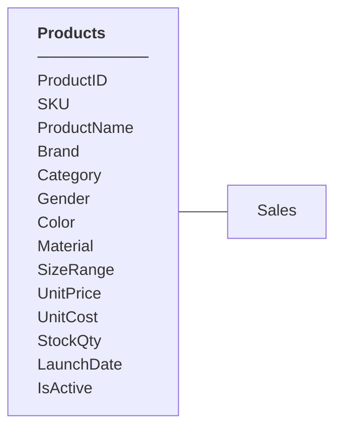

[← Shoe Company Overview](../index.md) · [BEAM✲ Annotations](../beam-annotations.md) · [How to Read This Wiki](../how-to-read.md)

# Products

<table style="border-collapse:collapse;margin:8px 0;">
<tr><th scope="row" align="left" style="text-align:left;vertical-align:top;white-space:nowrap;font-weight:600;padding:6px 16px 6px 0;border-bottom:1px solid rgba(128,128,128,.4);">Description</th><td style="text-align:left;vertical-align:top;padding:6px 0;border-bottom:1px solid rgba(128,128,128,.4);">A shoe the company sells, in a particular colour and material, with its brand, intended wearer, selling price, what it costs the company and the quantity in stock.</td></tr>
<tr><th scope="row" align="left" style="text-align:left;vertical-align:top;white-space:nowrap;font-weight:600;padding:6px 16px 6px 0;border-bottom:1px solid rgba(128,128,128,.4);">Grain</th><td style="text-align:left;vertical-align:top;padding:6px 0;border-bottom:1px solid rgba(128,128,128,.4);">One row for each shoe model in a particular colour and material</td></tr>
<tr><th scope="row" align="left" style="text-align:left;vertical-align:top;white-space:nowrap;font-weight:600;padding:6px 16px 6px 0;border-bottom:1px solid rgba(128,128,128,.4);">BEAM✲</th><td style="text-align:left;vertical-align:top;padding:6px 0;border-bottom:1px solid rgba(128,128,128,.4);"><a href="../beam-annotations.md#t-cv">[CV]</a> <i>(suggested by AI)</i></td></tr>
<tr><th scope="row" align="left" style="text-align:left;vertical-align:top;white-space:nowrap;font-weight:600;padding:6px 16px 6px 0;border-bottom:1px solid rgba(128,128,128,.4);">Why <a href="../beam-annotations.md#t-cv">[CV]</a></th><td style="text-align:left;vertical-align:top;padding:6px 0;border-bottom:1px solid rgba(128,128,128,.4);">One row per <code>ProductID</code> with no validity dates, version columns or current flag, so only current values are held.</td></tr>
<tr><th scope="row" align="left" style="text-align:left;vertical-align:top;white-space:nowrap;font-weight:600;padding:6px 16px 6px 0;border-bottom:1px solid rgba(128,128,128,.4);">Source</th><td style="text-align:left;vertical-align:top;padding:6px 0;border-bottom:1px solid rgba(128,128,128,.4);"><a href="../beam-annotations.md#t-source">{shoe_company.xlsx: Products}</a> <i>(measured)</i></td></tr>
<tr><th scope="row" align="left" style="text-align:left;vertical-align:top;white-space:nowrap;font-weight:600;padding:6px 16px 6px 0;border-bottom:1px solid rgba(128,128,128,.4);">Sampled Rows</th><td style="text-align:left;vertical-align:top;padding:6px 0;border-bottom:1px solid rgba(128,128,128,.4);">60</td></tr>
<tr><th scope="row" align="left" style="text-align:left;vertical-align:top;white-space:nowrap;font-weight:600;padding:6px 16px 6px 0;border-bottom:1px solid rgba(128,128,128,.4);">Columns</th><td style="text-align:left;vertical-align:top;padding:6px 0;border-bottom:1px solid rgba(128,128,128,.4);">14</td></tr>
<tr><th scope="row" align="left" style="text-align:left;vertical-align:top;white-space:nowrap;font-weight:600;padding:6px 16px 6px 0;border-bottom:1px solid rgba(128,128,128,.4);">Description Source</th><td style="text-align:left;vertical-align:top;padding:6px 0;border-bottom:1px solid rgba(128,128,128,.4);">Written by AI from the data. Check before relying on it.</td></tr>
<tr><th scope="row" align="left" style="text-align:left;vertical-align:top;white-space:nowrap;font-weight:600;padding:6px 16px 6px 0;border-bottom:1px solid rgba(128,128,128,.4);">Confidence</th><td style="text-align:left;vertical-align:top;padding:6px 0;border-bottom:1px solid rgba(128,128,128,.4);">medium</td></tr>
</table>

## Columns

<div style="overflow-x:auto;max-width:100%;">
<table style="border-collapse:separate;border-spacing:0;border:1px solid rgba(128,128,128,.4);border-width:1px 0 0 1px;font-size:90%;">
<tr><th colspan="2" style="position:sticky;left:0;z-index:2;background:#eef0f2;color:#1f2328;border:0 solid rgba(128,128,128,.4);border-width:0 1px 1px 0;padding:3px 8px;white-space:nowrap;text-align:left;vertical-align:top;font-weight:600;">Column Name</th><th style="border:0 solid rgba(128,128,128,.4);border-width:0 1px 1px 0;padding:3px 8px;white-space:nowrap;text-align:left;vertical-align:top;font-weight:600;">ProductID</th><th style="border:0 solid rgba(128,128,128,.4);border-width:0 1px 1px 0;padding:3px 8px;white-space:nowrap;text-align:left;vertical-align:top;font-weight:600;">SKU</th><th style="border:0 solid rgba(128,128,128,.4);border-width:0 1px 1px 0;padding:3px 8px;white-space:nowrap;text-align:left;vertical-align:top;font-weight:600;">ProductName</th><th style="border:0 solid rgba(128,128,128,.4);border-width:0 1px 1px 0;padding:3px 8px;white-space:nowrap;text-align:left;vertical-align:top;font-weight:600;">Brand</th><th style="border:0 solid rgba(128,128,128,.4);border-width:0 1px 1px 0;padding:3px 8px;white-space:nowrap;text-align:left;vertical-align:top;font-weight:600;">Category</th><th style="border:0 solid rgba(128,128,128,.4);border-width:0 1px 1px 0;padding:3px 8px;white-space:nowrap;text-align:left;vertical-align:top;font-weight:600;">Gender</th><th style="border:0 solid rgba(128,128,128,.4);border-width:0 1px 1px 0;padding:3px 8px;white-space:nowrap;text-align:left;vertical-align:top;font-weight:600;">Color</th><th style="border:0 solid rgba(128,128,128,.4);border-width:0 1px 1px 0;padding:3px 8px;white-space:nowrap;text-align:left;vertical-align:top;font-weight:600;">Material</th><th style="border:0 solid rgba(128,128,128,.4);border-width:0 1px 1px 0;padding:3px 8px;white-space:nowrap;text-align:left;vertical-align:top;font-weight:600;">SizeRange</th><th style="border:0 solid rgba(128,128,128,.4);border-width:0 1px 1px 0;padding:3px 8px;white-space:nowrap;text-align:left;vertical-align:top;font-weight:600;">UnitPrice</th><th style="border:0 solid rgba(128,128,128,.4);border-width:0 1px 1px 0;padding:3px 8px;white-space:nowrap;text-align:left;vertical-align:top;font-weight:600;">UnitCost</th><th style="border:0 solid rgba(128,128,128,.4);border-width:0 1px 1px 0;padding:3px 8px;white-space:nowrap;text-align:left;vertical-align:top;font-weight:600;">StockQty</th><th style="border:0 solid rgba(128,128,128,.4);border-width:0 1px 1px 0;padding:3px 8px;white-space:nowrap;text-align:left;vertical-align:top;font-weight:600;">LaunchDate</th><th style="border:0 solid rgba(128,128,128,.4);border-width:0 1px 1px 0;padding:3px 8px;white-space:nowrap;text-align:left;vertical-align:top;font-weight:600;">IsActive</th></tr>
<tr><td colspan="2" style="position:sticky;left:0;z-index:2;background:#eef0f2;color:#1f2328;border:0 solid rgba(128,128,128,.4);border-width:0 1px 1px 0;padding:3px 8px;white-space:nowrap;text-align:left;vertical-align:top;font-weight:600;">Data Type</td><td style="border:0 solid rgba(128,128,128,.4);border-width:0 1px 1px 0;padding:3px 8px;white-space:nowrap;text-align:left;vertical-align:top;"><a href="../beam-annotations.md#c-c">C5</a> text</td><td style="border:0 solid rgba(128,128,128,.4);border-width:0 1px 1px 0;padding:3px 8px;white-space:nowrap;text-align:left;vertical-align:top;"><a href="../beam-annotations.md#c-c">C10</a> text</td><td style="border:0 solid rgba(128,128,128,.4);border-width:0 1px 1px 0;padding:3px 8px;white-space:nowrap;text-align:left;vertical-align:top;"><a href="../beam-annotations.md#c-c">C27</a> text</td><td style="border:0 solid rgba(128,128,128,.4);border-width:0 1px 1px 0;padding:3px 8px;white-space:nowrap;text-align:left;vertical-align:top;"><a href="../beam-annotations.md#c-c">C10</a> text</td><td style="border:0 solid rgba(128,128,128,.4);border-width:0 1px 1px 0;padding:3px 8px;white-space:nowrap;text-align:left;vertical-align:top;"><a href="../beam-annotations.md#c-c">C10</a> text</td><td style="border:0 solid rgba(128,128,128,.4);border-width:0 1px 1px 0;padding:3px 8px;white-space:nowrap;text-align:left;vertical-align:top;"><a href="../beam-annotations.md#c-c">C6</a> text</td><td style="border:0 solid rgba(128,128,128,.4);border-width:0 1px 1px 0;padding:3px 8px;white-space:nowrap;text-align:left;vertical-align:top;"><a href="../beam-annotations.md#c-c">C5</a> text</td><td style="border:0 solid rgba(128,128,128,.4);border-width:0 1px 1px 0;padding:3px 8px;white-space:nowrap;text-align:left;vertical-align:top;"><a href="../beam-annotations.md#c-c">C9</a> text</td><td style="border:0 solid rgba(128,128,128,.4);border-width:0 1px 1px 0;padding:3px 8px;white-space:nowrap;text-align:left;vertical-align:top;"><a href="../beam-annotations.md#c-c">C4</a> text</td><td style="border:0 solid rgba(128,128,128,.4);border-width:0 1px 1px 0;padding:3px 8px;white-space:nowrap;text-align:left;vertical-align:top;"><a href="../beam-annotations.md#c-n">N5.2</a> number</td><td style="border:0 solid rgba(128,128,128,.4);border-width:0 1px 1px 0;padding:3px 8px;white-space:nowrap;text-align:left;vertical-align:top;"><a href="../beam-annotations.md#c-n">N5.2</a> number</td><td style="border:0 solid rgba(128,128,128,.4);border-width:0 1px 1px 0;padding:3px 8px;white-space:nowrap;text-align:left;vertical-align:top;"><a href="../beam-annotations.md#c-i">I</a> whole number</td><td style="border:0 solid rgba(128,128,128,.4);border-width:0 1px 1px 0;padding:3px 8px;white-space:nowrap;text-align:left;vertical-align:top;"><a href="../beam-annotations.md#c-d">D</a> date</td><td style="border:0 solid rgba(128,128,128,.4);border-width:0 1px 1px 0;padding:3px 8px;white-space:nowrap;text-align:left;vertical-align:top;">yes/no</td></tr>
<tr><td colspan="2" style="position:sticky;left:0;z-index:2;background:#eef0f2;color:#1f2328;border:0 solid rgba(128,128,128,.4);border-width:0 1px 1px 0;padding:3px 8px;white-space:nowrap;text-align:left;vertical-align:top;font-weight:600;">BEAM✲</td><td style="border:0 solid rgba(128,128,128,.4);border-width:0 1px 1px 0;padding:3px 8px;white-space:nowrap;text-align:left;vertical-align:top;"><a href="../beam-annotations.md#c-nd">ND</a> <i><a href="../beam-annotations.md#c-bk">BK</a></i> <i><a href="../beam-annotations.md#c-md">MD</a></i></td><td style="border:0 solid rgba(128,128,128,.4);border-width:0 1px 1px 0;padding:3px 8px;white-space:nowrap;text-align:left;vertical-align:top;"><a href="../beam-annotations.md#c-nd">ND</a> <i><a href="../beam-annotations.md#c-nk">NK</a></i> <i><a href="../beam-annotations.md#c-md">MD</a></i></td><td style="border:0 solid rgba(128,128,128,.4);border-width:0 1px 1px 0;padding:3px 8px;white-space:nowrap;text-align:left;vertical-align:top;"><i><a href="../beam-annotations.md#c-md">MD</a></i></td><td style="border:0 solid rgba(128,128,128,.4);border-width:0 1px 1px 0;padding:3px 8px;white-space:nowrap;text-align:left;vertical-align:top;"></td><td style="border:0 solid rgba(128,128,128,.4);border-width:0 1px 1px 0;padding:3px 8px;white-space:nowrap;text-align:left;vertical-align:top;"></td><td style="border:0 solid rgba(128,128,128,.4);border-width:0 1px 1px 0;padding:3px 8px;white-space:nowrap;text-align:left;vertical-align:top;"></td><td style="border:0 solid rgba(128,128,128,.4);border-width:0 1px 1px 0;padding:3px 8px;white-space:nowrap;text-align:left;vertical-align:top;"></td><td style="border:0 solid rgba(128,128,128,.4);border-width:0 1px 1px 0;padding:3px 8px;white-space:nowrap;text-align:left;vertical-align:top;"></td><td style="border:0 solid rgba(128,128,128,.4);border-width:0 1px 1px 0;padding:3px 8px;white-space:nowrap;text-align:left;vertical-align:top;"></td><td style="border:0 solid rgba(128,128,128,.4);border-width:0 1px 1px 0;padding:3px 8px;white-space:nowrap;text-align:left;vertical-align:top;"><i><a href="../beam-annotations.md#c-na">NA</a></i> <i><a href="../beam-annotations.md#c-suspect">?</a></i></td><td style="border:0 solid rgba(128,128,128,.4);border-width:0 1px 1px 0;padding:3px 8px;white-space:nowrap;text-align:left;vertical-align:top;"><i><a href="../beam-annotations.md#c-na">NA</a></i> <i><a href="../beam-annotations.md#c-suspect">?</a></i></td><td style="border:0 solid rgba(128,128,128,.4);border-width:0 1px 1px 0;padding:3px 8px;white-space:nowrap;text-align:left;vertical-align:top;"><i><a href="../beam-annotations.md#c-sa">SA</a></i></td><td style="border:0 solid rgba(128,128,128,.4);border-width:0 1px 1px 0;padding:3px 8px;white-space:nowrap;text-align:left;vertical-align:top;"><i><a href="../beam-annotations.md#c-fv">FV</a></i></td><td style="border:0 solid rgba(128,128,128,.4);border-width:0 1px 1px 0;padding:3px 8px;white-space:nowrap;text-align:left;vertical-align:top;"></td></tr>
<tr><td rowspan="9" style="position:sticky;left:0;z-index:2;background:#eef0f2;color:#1f2328;box-sizing:border-box;width:34px;min-width:34px;max-width:34px;border:0 solid rgba(128,128,128,.4);border-width:0 1px 1px 0;padding:4px 0;text-align:center;vertical-align:middle;"><div style="writing-mode:vertical-rl;transform:rotate(180deg);white-space:nowrap;margin:0 auto;font-weight:600;">Data Profiling Results</div></td><td style="position:sticky;left:34px;z-index:2;background:#eef0f2;color:#1f2328;border:0 solid rgba(128,128,128,.4);border-width:0 1px 1px 0;padding:3px 8px;white-space:nowrap;text-align:left;vertical-align:top;font-weight:600;">Sample Count</td><td style="border:0 solid rgba(128,128,128,.4);border-width:0 1px 1px 0;padding:3px 8px;white-space:nowrap;text-align:right;vertical-align:top;">60</td><td style="border:0 solid rgba(128,128,128,.4);border-width:0 1px 1px 0;padding:3px 8px;white-space:nowrap;text-align:right;vertical-align:top;">60</td><td style="border:0 solid rgba(128,128,128,.4);border-width:0 1px 1px 0;padding:3px 8px;white-space:nowrap;text-align:right;vertical-align:top;">60</td><td style="border:0 solid rgba(128,128,128,.4);border-width:0 1px 1px 0;padding:3px 8px;white-space:nowrap;text-align:right;vertical-align:top;">60</td><td style="border:0 solid rgba(128,128,128,.4);border-width:0 1px 1px 0;padding:3px 8px;white-space:nowrap;text-align:right;vertical-align:top;">60</td><td style="border:0 solid rgba(128,128,128,.4);border-width:0 1px 1px 0;padding:3px 8px;white-space:nowrap;text-align:right;vertical-align:top;">60</td><td style="border:0 solid rgba(128,128,128,.4);border-width:0 1px 1px 0;padding:3px 8px;white-space:nowrap;text-align:right;vertical-align:top;">60</td><td style="border:0 solid rgba(128,128,128,.4);border-width:0 1px 1px 0;padding:3px 8px;white-space:nowrap;text-align:right;vertical-align:top;">60</td><td style="border:0 solid rgba(128,128,128,.4);border-width:0 1px 1px 0;padding:3px 8px;white-space:nowrap;text-align:right;vertical-align:top;">60</td><td style="border:0 solid rgba(128,128,128,.4);border-width:0 1px 1px 0;padding:3px 8px;white-space:nowrap;text-align:right;vertical-align:top;">60</td><td style="border:0 solid rgba(128,128,128,.4);border-width:0 1px 1px 0;padding:3px 8px;white-space:nowrap;text-align:right;vertical-align:top;">60</td><td style="border:0 solid rgba(128,128,128,.4);border-width:0 1px 1px 0;padding:3px 8px;white-space:nowrap;text-align:right;vertical-align:top;">60</td><td style="border:0 solid rgba(128,128,128,.4);border-width:0 1px 1px 0;padding:3px 8px;white-space:nowrap;text-align:right;vertical-align:top;">60</td><td style="border:0 solid rgba(128,128,128,.4);border-width:0 1px 1px 0;padding:3px 8px;white-space:nowrap;text-align:right;vertical-align:top;">60</td></tr>
<tr><td style="position:sticky;left:34px;z-index:2;background:#eef0f2;color:#1f2328;border:0 solid rgba(128,128,128,.4);border-width:0 1px 1px 0;padding:3px 8px;white-space:nowrap;text-align:left;vertical-align:top;font-weight:600;">Missing</td><td style="border:0 solid rgba(128,128,128,.4);border-width:0 1px 1px 0;padding:3px 8px;white-space:nowrap;text-align:left;vertical-align:top;">0 (0%)</td><td style="border:0 solid rgba(128,128,128,.4);border-width:0 1px 1px 0;padding:3px 8px;white-space:nowrap;text-align:left;vertical-align:top;">0 (0%)</td><td style="border:0 solid rgba(128,128,128,.4);border-width:0 1px 1px 0;padding:3px 8px;white-space:nowrap;text-align:left;vertical-align:top;">0 (0%)</td><td style="border:0 solid rgba(128,128,128,.4);border-width:0 1px 1px 0;padding:3px 8px;white-space:nowrap;text-align:left;vertical-align:top;">0 (0%)</td><td style="border:0 solid rgba(128,128,128,.4);border-width:0 1px 1px 0;padding:3px 8px;white-space:nowrap;text-align:left;vertical-align:top;">0 (0%)</td><td style="border:0 solid rgba(128,128,128,.4);border-width:0 1px 1px 0;padding:3px 8px;white-space:nowrap;text-align:left;vertical-align:top;">0 (0%)</td><td style="border:0 solid rgba(128,128,128,.4);border-width:0 1px 1px 0;padding:3px 8px;white-space:nowrap;text-align:left;vertical-align:top;">0 (0%)</td><td style="border:0 solid rgba(128,128,128,.4);border-width:0 1px 1px 0;padding:3px 8px;white-space:nowrap;text-align:left;vertical-align:top;">0 (0%)</td><td style="border:0 solid rgba(128,128,128,.4);border-width:0 1px 1px 0;padding:3px 8px;white-space:nowrap;text-align:left;vertical-align:top;">0 (0%)</td><td style="border:0 solid rgba(128,128,128,.4);border-width:0 1px 1px 0;padding:3px 8px;white-space:nowrap;text-align:left;vertical-align:top;">0 (0%)</td><td style="border:0 solid rgba(128,128,128,.4);border-width:0 1px 1px 0;padding:3px 8px;white-space:nowrap;text-align:left;vertical-align:top;">0 (0%)</td><td style="border:0 solid rgba(128,128,128,.4);border-width:0 1px 1px 0;padding:3px 8px;white-space:nowrap;text-align:left;vertical-align:top;">0 (0%)</td><td style="border:0 solid rgba(128,128,128,.4);border-width:0 1px 1px 0;padding:3px 8px;white-space:nowrap;text-align:left;vertical-align:top;">0 (0%)</td><td style="border:0 solid rgba(128,128,128,.4);border-width:0 1px 1px 0;padding:3px 8px;white-space:nowrap;text-align:left;vertical-align:top;">0 (0%)</td></tr>
<tr><td style="position:sticky;left:34px;z-index:2;background:#eef0f2;color:#1f2328;border:0 solid rgba(128,128,128,.4);border-width:0 1px 1px 0;padding:3px 8px;white-space:nowrap;text-align:left;vertical-align:top;font-weight:600;">Unique Values</td><td style="border:0 solid rgba(128,128,128,.4);border-width:0 1px 1px 0;padding:3px 8px;white-space:nowrap;text-align:left;vertical-align:top;">60 (100%)</td><td style="border:0 solid rgba(128,128,128,.4);border-width:0 1px 1px 0;padding:3px 8px;white-space:nowrap;text-align:left;vertical-align:top;">60 (100%)</td><td style="border:0 solid rgba(128,128,128,.4);border-width:0 1px 1px 0;padding:3px 8px;white-space:nowrap;text-align:left;vertical-align:top;">58 (96.7%)</td><td style="border:0 solid rgba(128,128,128,.4);border-width:0 1px 1px 0;padding:3px 8px;white-space:nowrap;text-align:left;vertical-align:top;">8 (13.3%)</td><td style="border:0 solid rgba(128,128,128,.4);border-width:0 1px 1px 0;padding:3px 8px;white-space:nowrap;text-align:left;vertical-align:top;">8 (13.3%)</td><td style="border:0 solid rgba(128,128,128,.4);border-width:0 1px 1px 0;padding:3px 8px;white-space:nowrap;text-align:left;vertical-align:top;">4 (6.67%)</td><td style="border:0 solid rgba(128,128,128,.4);border-width:0 1px 1px 0;padding:3px 8px;white-space:nowrap;text-align:left;vertical-align:top;">9 (15%)</td><td style="border:0 solid rgba(128,128,128,.4);border-width:0 1px 1px 0;padding:3px 8px;white-space:nowrap;text-align:left;vertical-align:top;">6 (10%)</td><td style="border:0 solid rgba(128,128,128,.4);border-width:0 1px 1px 0;padding:3px 8px;white-space:nowrap;text-align:left;vertical-align:top;">3 (5%)</td><td style="border:0 solid rgba(128,128,128,.4);border-width:0 1px 1px 0;padding:3px 8px;white-space:nowrap;text-align:left;vertical-align:top;">51 (85%)</td><td style="border:0 solid rgba(128,128,128,.4);border-width:0 1px 1px 0;padding:3px 8px;white-space:nowrap;text-align:left;vertical-align:top;">60 (100%)</td><td style="border:0 solid rgba(128,128,128,.4);border-width:0 1px 1px 0;padding:3px 8px;white-space:nowrap;text-align:left;vertical-align:top;">56 (93.3%)</td><td style="border:0 solid rgba(128,128,128,.4);border-width:0 1px 1px 0;padding:3px 8px;white-space:nowrap;text-align:left;vertical-align:top;">57 (95%)</td><td style="border:0 solid rgba(128,128,128,.4);border-width:0 1px 1px 0;padding:3px 8px;white-space:nowrap;text-align:left;vertical-align:top;">2 (3.33%)</td></tr>
<tr><td style="position:sticky;left:34px;z-index:2;background:#eef0f2;color:#1f2328;border:0 solid rgba(128,128,128,.4);border-width:0 1px 1px 0;padding:3px 8px;white-space:nowrap;text-align:left;vertical-align:top;font-weight:600;">Min Value</td><td style="border:0 solid rgba(128,128,128,.4);border-width:0 1px 1px 0;padding:3px 8px;white-space:nowrap;text-align:left;vertical-align:top;">P0001</td><td style="border:0 solid rgba(128,128,128,.4);border-width:0 1px 1px 0;padding:3px 8px;white-space:nowrap;text-align:left;vertical-align:top;">SKU-109767</td><td style="border:0 solid rgba(128,128,128,.4);border-width:0 1px 1px 0;padding:3px 8px;white-space:nowrap;text-align:left;vertical-align:top;">Kicko Edge Boots</td><td style="border:0 solid rgba(128,128,128,.4);border-width:0 1px 1px 0;padding:3px 8px;white-space:nowrap;text-align:left;vertical-align:top;">Kicko</td><td style="border:0 solid rgba(128,128,128,.4);border-width:0 1px 1px 0;padding:3px 8px;white-space:nowrap;text-align:left;vertical-align:top;">Basketball</td><td style="border:0 solid rgba(128,128,128,.4);border-width:0 1px 1px 0;padding:3px 8px;white-space:nowrap;text-align:left;vertical-align:top;">Kids</td><td style="border:0 solid rgba(128,128,128,.4);border-width:0 1px 1px 0;padding:3px 8px;white-space:nowrap;text-align:left;vertical-align:top;">Beige</td><td style="border:0 solid rgba(128,128,128,.4);border-width:0 1px 1px 0;padding:3px 8px;white-space:nowrap;text-align:left;vertical-align:top;">Canvas</td><td style="border:0 solid rgba(128,128,128,.4);border-width:0 1px 1px 0;padding:3px 8px;white-space:nowrap;text-align:left;vertical-align:top;">1-7</td><td style="border:0 solid rgba(128,128,128,.4);border-width:0 1px 1px 0;padding:3px 8px;white-space:nowrap;text-align:left;vertical-align:top;">22.99</td><td style="border:0 solid rgba(128,128,128,.4);border-width:0 1px 1px 0;padding:3px 8px;white-space:nowrap;text-align:left;vertical-align:top;">8.23</td><td style="border:0 solid rgba(128,128,128,.4);border-width:0 1px 1px 0;padding:3px 8px;white-space:nowrap;text-align:left;vertical-align:top;">4</td><td style="border:0 solid rgba(128,128,128,.4);border-width:0 1px 1px 0;padding:3px 8px;white-space:nowrap;text-align:left;vertical-align:top;">2020-02-23</td><td style="border:0 solid rgba(128,128,128,.4);border-width:0 1px 1px 0;padding:3px 8px;white-space:nowrap;text-align:left;vertical-align:top;">False</td></tr>
<tr><td style="position:sticky;left:34px;z-index:2;background:#eef0f2;color:#1f2328;border:0 solid rgba(128,128,128,.4);border-width:0 1px 1px 0;padding:3px 8px;white-space:nowrap;text-align:left;vertical-align:top;font-weight:600;">Min Count</td><td style="border:0 solid rgba(128,128,128,.4);border-width:0 1px 1px 0;padding:3px 8px;white-space:nowrap;text-align:left;vertical-align:top;">1 (1.67%)</td><td style="border:0 solid rgba(128,128,128,.4);border-width:0 1px 1px 0;padding:3px 8px;white-space:nowrap;text-align:left;vertical-align:top;">1 (1.67%)</td><td style="border:0 solid rgba(128,128,128,.4);border-width:0 1px 1px 0;padding:3px 8px;white-space:nowrap;text-align:left;vertical-align:top;">1 (1.67%)</td><td style="border:0 solid rgba(128,128,128,.4);border-width:0 1px 1px 0;padding:3px 8px;white-space:nowrap;text-align:left;vertical-align:top;">6 (10%)</td><td style="border:0 solid rgba(128,128,128,.4);border-width:0 1px 1px 0;padding:3px 8px;white-space:nowrap;text-align:left;vertical-align:top;">6 (10%)</td><td style="border:0 solid rgba(128,128,128,.4);border-width:0 1px 1px 0;padding:3px 8px;white-space:nowrap;text-align:left;vertical-align:top;">9 (15%)</td><td style="border:0 solid rgba(128,128,128,.4);border-width:0 1px 1px 0;padding:3px 8px;white-space:nowrap;text-align:left;vertical-align:top;">7 (11.7%)</td><td style="border:0 solid rgba(128,128,128,.4);border-width:0 1px 1px 0;padding:3px 8px;white-space:nowrap;text-align:left;vertical-align:top;">7 (11.7%)</td><td style="border:0 solid rgba(128,128,128,.4);border-width:0 1px 1px 0;padding:3px 8px;white-space:nowrap;text-align:left;vertical-align:top;">9 (15%)</td><td style="border:0 solid rgba(128,128,128,.4);border-width:0 1px 1px 0;padding:3px 8px;white-space:nowrap;text-align:left;vertical-align:top;">1 (1.67%)</td><td style="border:0 solid rgba(128,128,128,.4);border-width:0 1px 1px 0;padding:3px 8px;white-space:nowrap;text-align:left;vertical-align:top;">1 (1.67%)</td><td style="border:0 solid rgba(128,128,128,.4);border-width:0 1px 1px 0;padding:3px 8px;white-space:nowrap;text-align:left;vertical-align:top;">1 (1.67%)</td><td style="border:0 solid rgba(128,128,128,.4);border-width:0 1px 1px 0;padding:3px 8px;white-space:nowrap;text-align:left;vertical-align:top;">1 (1.67%)</td><td style="border:0 solid rgba(128,128,128,.4);border-width:0 1px 1px 0;padding:3px 8px;white-space:nowrap;text-align:left;vertical-align:top;">6 (10%)</td></tr>
<tr><td style="position:sticky;left:34px;z-index:2;background:#eef0f2;color:#1f2328;border:0 solid rgba(128,128,128,.4);border-width:0 1px 1px 0;padding:3px 8px;white-space:nowrap;text-align:left;vertical-align:top;font-weight:600;">Max Value</td><td style="border:0 solid rgba(128,128,128,.4);border-width:0 1px 1px 0;padding:3px 8px;white-space:nowrap;text-align:left;vertical-align:top;">P0060</td><td style="border:0 solid rgba(128,128,128,.4);border-width:0 1px 1px 0;padding:3px 8px;white-space:nowrap;text-align:left;vertical-align:top;">SKU-994905</td><td style="border:0 solid rgba(128,128,128,.4);border-width:0 1px 1px 0;padding:3px 8px;white-space:nowrap;text-align:left;vertical-align:top;">Velora Summit Sandals</td><td style="border:0 solid rgba(128,128,128,.4);border-width:0 1px 1px 0;padding:3px 8px;white-space:nowrap;text-align:left;vertical-align:top;">Velora</td><td style="border:0 solid rgba(128,128,128,.4);border-width:0 1px 1px 0;padding:3px 8px;white-space:nowrap;text-align:left;vertical-align:top;">Sandals</td><td style="border:0 solid rgba(128,128,128,.4);border-width:0 1px 1px 0;padding:3px 8px;white-space:nowrap;text-align:left;vertical-align:top;">Women</td><td style="border:0 solid rgba(128,128,128,.4);border-width:0 1px 1px 0;padding:3px 8px;white-space:nowrap;text-align:left;vertical-align:top;">White</td><td style="border:0 solid rgba(128,128,128,.4);border-width:0 1px 1px 0;padding:3px 8px;white-space:nowrap;text-align:left;vertical-align:top;">Synthetic</td><td style="border:0 solid rgba(128,128,128,.4);border-width:0 1px 1px 0;padding:3px 8px;white-space:nowrap;text-align:left;vertical-align:top;">7-14</td><td style="border:0 solid rgba(128,128,128,.4);border-width:0 1px 1px 0;padding:3px 8px;white-space:nowrap;text-align:left;vertical-align:top;">227.99</td><td style="border:0 solid rgba(128,128,128,.4);border-width:0 1px 1px 0;padding:3px 8px;white-space:nowrap;text-align:left;vertical-align:top;">117.92</td><td style="border:0 solid rgba(128,128,128,.4);border-width:0 1px 1px 0;padding:3px 8px;white-space:nowrap;text-align:left;vertical-align:top;">498</td><td style="border:0 solid rgba(128,128,128,.4);border-width:0 1px 1px 0;padding:3px 8px;white-space:nowrap;text-align:left;vertical-align:top;">2026-11-19</td><td style="border:0 solid rgba(128,128,128,.4);border-width:0 1px 1px 0;padding:3px 8px;white-space:nowrap;text-align:left;vertical-align:top;">True</td></tr>
<tr><td style="position:sticky;left:34px;z-index:2;background:#eef0f2;color:#1f2328;border:0 solid rgba(128,128,128,.4);border-width:0 1px 1px 0;padding:3px 8px;white-space:nowrap;text-align:left;vertical-align:top;font-weight:600;">Max Count</td><td style="border:0 solid rgba(128,128,128,.4);border-width:0 1px 1px 0;padding:3px 8px;white-space:nowrap;text-align:left;vertical-align:top;">1 (1.67%)</td><td style="border:0 solid rgba(128,128,128,.4);border-width:0 1px 1px 0;padding:3px 8px;white-space:nowrap;text-align:left;vertical-align:top;">1 (1.67%)</td><td style="border:0 solid rgba(128,128,128,.4);border-width:0 1px 1px 0;padding:3px 8px;white-space:nowrap;text-align:left;vertical-align:top;">1 (1.67%)</td><td style="border:0 solid rgba(128,128,128,.4);border-width:0 1px 1px 0;padding:3px 8px;white-space:nowrap;text-align:left;vertical-align:top;">7 (11.7%)</td><td style="border:0 solid rgba(128,128,128,.4);border-width:0 1px 1px 0;padding:3px 8px;white-space:nowrap;text-align:left;vertical-align:top;">10 (16.7%)</td><td style="border:0 solid rgba(128,128,128,.4);border-width:0 1px 1px 0;padding:3px 8px;white-space:nowrap;text-align:left;vertical-align:top;">19 (31.7%)</td><td style="border:0 solid rgba(128,128,128,.4);border-width:0 1px 1px 0;padding:3px 8px;white-space:nowrap;text-align:left;vertical-align:top;">13 (21.7%)</td><td style="border:0 solid rgba(128,128,128,.4);border-width:0 1px 1px 0;padding:3px 8px;white-space:nowrap;text-align:left;vertical-align:top;">7 (11.7%)</td><td style="border:0 solid rgba(128,128,128,.4);border-width:0 1px 1px 0;padding:3px 8px;white-space:nowrap;text-align:left;vertical-align:top;">32 (53.3%)</td><td style="border:0 solid rgba(128,128,128,.4);border-width:0 1px 1px 0;padding:3px 8px;white-space:nowrap;text-align:left;vertical-align:top;">1 (1.67%)</td><td style="border:0 solid rgba(128,128,128,.4);border-width:0 1px 1px 0;padding:3px 8px;white-space:nowrap;text-align:left;vertical-align:top;">1 (1.67%)</td><td style="border:0 solid rgba(128,128,128,.4);border-width:0 1px 1px 0;padding:3px 8px;white-space:nowrap;text-align:left;vertical-align:top;">1 (1.67%)</td><td style="border:0 solid rgba(128,128,128,.4);border-width:0 1px 1px 0;padding:3px 8px;white-space:nowrap;text-align:left;vertical-align:top;">1 (1.67%)</td><td style="border:0 solid rgba(128,128,128,.4);border-width:0 1px 1px 0;padding:3px 8px;white-space:nowrap;text-align:left;vertical-align:top;">54 (90%)</td></tr>
<tr><td style="position:sticky;left:34px;z-index:2;background:#eef0f2;color:#1f2328;border:0 solid rgba(128,128,128,.4);border-width:0 1px 1px 0;padding:3px 8px;white-space:nowrap;text-align:left;vertical-align:top;font-weight:600;">Min Length</td><td style="border:0 solid rgba(128,128,128,.4);border-width:0 1px 1px 0;padding:3px 8px;white-space:nowrap;text-align:right;vertical-align:top;">5</td><td style="border:0 solid rgba(128,128,128,.4);border-width:0 1px 1px 0;padding:3px 8px;white-space:nowrap;text-align:right;vertical-align:top;">10</td><td style="border:0 solid rgba(128,128,128,.4);border-width:0 1px 1px 0;padding:3px 8px;white-space:nowrap;text-align:right;vertical-align:top;">14</td><td style="border:0 solid rgba(128,128,128,.4);border-width:0 1px 1px 0;padding:3px 8px;white-space:nowrap;text-align:right;vertical-align:top;">4</td><td style="border:0 solid rgba(128,128,128,.4);border-width:0 1px 1px 0;padding:3px 8px;white-space:nowrap;text-align:right;vertical-align:top;">4</td><td style="border:0 solid rgba(128,128,128,.4);border-width:0 1px 1px 0;padding:3px 8px;white-space:nowrap;text-align:right;vertical-align:top;">3</td><td style="border:0 solid rgba(128,128,128,.4);border-width:0 1px 1px 0;padding:3px 8px;white-space:nowrap;text-align:right;vertical-align:top;">3</td><td style="border:0 solid rgba(128,128,128,.4);border-width:0 1px 1px 0;padding:3px 8px;white-space:nowrap;text-align:right;vertical-align:top;">4</td><td style="border:0 solid rgba(128,128,128,.4);border-width:0 1px 1px 0;padding:3px 8px;white-space:nowrap;text-align:right;vertical-align:top;">3</td><td style="border:0 solid rgba(128,128,128,.4);border-width:0 1px 1px 0;padding:3px 8px;white-space:nowrap;text-align:right;vertical-align:top;">—</td><td style="border:0 solid rgba(128,128,128,.4);border-width:0 1px 1px 0;padding:3px 8px;white-space:nowrap;text-align:right;vertical-align:top;">—</td><td style="border:0 solid rgba(128,128,128,.4);border-width:0 1px 1px 0;padding:3px 8px;white-space:nowrap;text-align:right;vertical-align:top;">—</td><td style="border:0 solid rgba(128,128,128,.4);border-width:0 1px 1px 0;padding:3px 8px;white-space:nowrap;text-align:right;vertical-align:top;">—</td><td style="border:0 solid rgba(128,128,128,.4);border-width:0 1px 1px 0;padding:3px 8px;white-space:nowrap;text-align:right;vertical-align:top;">—</td></tr>
<tr><td style="position:sticky;left:34px;z-index:2;background:#eef0f2;color:#1f2328;border:0 solid rgba(128,128,128,.4);border-width:0 1px 1px 0;padding:3px 8px;white-space:nowrap;text-align:left;vertical-align:top;font-weight:600;">Max Length</td><td style="border:0 solid rgba(128,128,128,.4);border-width:0 1px 1px 0;padding:3px 8px;white-space:nowrap;text-align:right;vertical-align:top;">5</td><td style="border:0 solid rgba(128,128,128,.4);border-width:0 1px 1px 0;padding:3px 8px;white-space:nowrap;text-align:right;vertical-align:top;">10</td><td style="border:0 solid rgba(128,128,128,.4);border-width:0 1px 1px 0;padding:3px 8px;white-space:nowrap;text-align:right;vertical-align:top;">27</td><td style="border:0 solid rgba(128,128,128,.4);border-width:0 1px 1px 0;padding:3px 8px;white-space:nowrap;text-align:right;vertical-align:top;">10</td><td style="border:0 solid rgba(128,128,128,.4);border-width:0 1px 1px 0;padding:3px 8px;white-space:nowrap;text-align:right;vertical-align:top;">10</td><td style="border:0 solid rgba(128,128,128,.4);border-width:0 1px 1px 0;padding:3px 8px;white-space:nowrap;text-align:right;vertical-align:top;">6</td><td style="border:0 solid rgba(128,128,128,.4);border-width:0 1px 1px 0;padding:3px 8px;white-space:nowrap;text-align:right;vertical-align:top;">5</td><td style="border:0 solid rgba(128,128,128,.4);border-width:0 1px 1px 0;padding:3px 8px;white-space:nowrap;text-align:right;vertical-align:top;">9</td><td style="border:0 solid rgba(128,128,128,.4);border-width:0 1px 1px 0;padding:3px 8px;white-space:nowrap;text-align:right;vertical-align:top;">4</td><td style="border:0 solid rgba(128,128,128,.4);border-width:0 1px 1px 0;padding:3px 8px;white-space:nowrap;text-align:right;vertical-align:top;">—</td><td style="border:0 solid rgba(128,128,128,.4);border-width:0 1px 1px 0;padding:3px 8px;white-space:nowrap;text-align:right;vertical-align:top;">—</td><td style="border:0 solid rgba(128,128,128,.4);border-width:0 1px 1px 0;padding:3px 8px;white-space:nowrap;text-align:right;vertical-align:top;">—</td><td style="border:0 solid rgba(128,128,128,.4);border-width:0 1px 1px 0;padding:3px 8px;white-space:nowrap;text-align:right;vertical-align:top;">—</td><td style="border:0 solid rgba(128,128,128,.4);border-width:0 1px 1px 0;padding:3px 8px;white-space:nowrap;text-align:right;vertical-align:top;">—</td></tr>
<tr><td rowspan="6" style="position:sticky;left:0;z-index:2;background:#eef0f2;color:#1f2328;box-sizing:border-box;width:34px;min-width:34px;max-width:34px;border:0 solid rgba(128,128,128,.4);border-width:0 1px 1px 0;padding:4px 0;text-align:center;vertical-align:middle;"><div style="writing-mode:vertical-rl;transform:rotate(180deg);white-space:nowrap;margin:0 auto;font-weight:600;">Variation</div></td><td style="position:sticky;left:34px;z-index:2;background:#eef0f2;color:#1f2328;border:0 solid rgba(128,128,128,.4);border-width:0 1px 1px 0;padding:3px 8px;white-space:nowrap;text-align:left;vertical-align:top;font-weight:600;">Typical</td><td style="border:0 solid rgba(128,128,128,.4);border-width:0 1px 1px 0;padding:3px 8px;white-space:nowrap;text-align:left;vertical-align:top;">P0001</td><td style="border:0 solid rgba(128,128,128,.4);border-width:0 1px 1px 0;padding:3px 8px;white-space:nowrap;text-align:left;vertical-align:top;">SKU-639131</td><td style="border:0 solid rgba(128,128,128,.4);border-width:0 1px 1px 0;padding:3px 8px;white-space:nowrap;text-align:left;vertical-align:top;">Velora Glide Boots</td><td style="border:0 solid rgba(128,128,128,.4);border-width:0 1px 1px 0;padding:3px 8px;white-space:nowrap;text-align:left;vertical-align:top;">Luma</td><td style="border:0 solid rgba(128,128,128,.4);border-width:0 1px 1px 0;padding:3px 8px;white-space:nowrap;text-align:left;vertical-align:top;">Sandals</td><td style="border:0 solid rgba(128,128,128,.4);border-width:0 1px 1px 0;padding:3px 8px;white-space:nowrap;text-align:left;vertical-align:top;">Women</td><td style="border:0 solid rgba(128,128,128,.4);border-width:0 1px 1px 0;padding:3px 8px;white-space:nowrap;text-align:left;vertical-align:top;">White</td><td style="border:0 solid rgba(128,128,128,.4);border-width:0 1px 1px 0;padding:3px 8px;white-space:nowrap;text-align:left;vertical-align:top;">Rubber</td><td style="border:0 solid rgba(128,128,128,.4);border-width:0 1px 1px 0;padding:3px 8px;white-space:nowrap;text-align:left;vertical-align:top;">7-14</td><td style="border:0 solid rgba(128,128,128,.4);border-width:0 1px 1px 0;padding:3px 8px;white-space:nowrap;text-align:left;vertical-align:top;">143.99</td><td style="border:0 solid rgba(128,128,128,.4);border-width:0 1px 1px 0;padding:3px 8px;white-space:nowrap;text-align:left;vertical-align:top;">8.23</td><td style="border:0 solid rgba(128,128,128,.4);border-width:0 1px 1px 0;padding:3px 8px;white-space:nowrap;text-align:left;vertical-align:top;">61</td><td style="border:0 solid rgba(128,128,128,.4);border-width:0 1px 1px 0;padding:3px 8px;white-space:nowrap;text-align:left;vertical-align:top;">2024-10-08</td><td style="border:0 solid rgba(128,128,128,.4);border-width:0 1px 1px 0;padding:3px 8px;white-space:nowrap;text-align:left;vertical-align:top;">True</td></tr>
<tr><td style="position:sticky;left:34px;z-index:2;background:#eef0f2;color:#1f2328;border:0 solid rgba(128,128,128,.4);border-width:0 1px 1px 0;padding:3px 8px;white-space:nowrap;text-align:left;vertical-align:top;font-weight:600;">Different</td><td style="border:0 solid rgba(128,128,128,.4);border-width:0 1px 1px 0;padding:3px 8px;white-space:nowrap;text-align:left;vertical-align:top;">P0002</td><td style="border:0 solid rgba(128,128,128,.4);border-width:0 1px 1px 0;padding:3px 8px;white-space:nowrap;text-align:left;vertical-align:top;">SKU-109767</td><td style="border:0 solid rgba(128,128,128,.4);border-width:0 1px 1px 0;padding:3px 8px;white-space:nowrap;text-align:left;vertical-align:top;">Kicko Edge Boots</td><td style="border:0 solid rgba(128,128,128,.4);border-width:0 1px 1px 0;padding:3px 8px;white-space:nowrap;text-align:left;vertical-align:top;">PeakRun</td><td style="border:0 solid rgba(128,128,128,.4);border-width:0 1px 1px 0;padding:3px 8px;white-space:nowrap;text-align:left;vertical-align:top;">Casual</td><td style="border:0 solid rgba(128,128,128,.4);border-width:0 1px 1px 0;padding:3px 8px;white-space:nowrap;text-align:left;vertical-align:top;">Kids</td><td style="border:0 solid rgba(128,128,128,.4);border-width:0 1px 1px 0;padding:3px 8px;white-space:nowrap;text-align:left;vertical-align:top;">Black</td><td style="border:0 solid rgba(128,128,128,.4);border-width:0 1px 1px 0;padding:3px 8px;white-space:nowrap;text-align:left;vertical-align:top;">Canvas</td><td style="border:0 solid rgba(128,128,128,.4);border-width:0 1px 1px 0;padding:3px 8px;white-space:nowrap;text-align:left;vertical-align:top;">1-7</td><td style="border:0 solid rgba(128,128,128,.4);border-width:0 1px 1px 0;padding:3px 8px;white-space:nowrap;text-align:left;vertical-align:top;">102.99</td><td style="border:0 solid rgba(128,128,128,.4);border-width:0 1px 1px 0;padding:3px 8px;white-space:nowrap;text-align:left;vertical-align:top;">105.45</td><td style="border:0 solid rgba(128,128,128,.4);border-width:0 1px 1px 0;padding:3px 8px;white-space:nowrap;text-align:left;vertical-align:top;">108</td><td style="border:0 solid rgba(128,128,128,.4);border-width:0 1px 1px 0;padding:3px 8px;white-space:nowrap;text-align:left;vertical-align:top;">2020-02-23</td><td style="border:0 solid rgba(128,128,128,.4);border-width:0 1px 1px 0;padding:3px 8px;white-space:nowrap;text-align:left;vertical-align:top;">False</td></tr>
<tr><td style="position:sticky;left:34px;z-index:2;background:#eef0f2;color:#1f2328;border:0 solid rgba(128,128,128,.4);border-width:0 1px 1px 0;padding:3px 8px;white-space:nowrap;text-align:left;vertical-align:top;font-weight:600;">Repeat</td><td style="border:0 solid rgba(128,128,128,.4);border-width:0 1px 1px 0;padding:3px 8px;white-space:nowrap;text-align:left;vertical-align:top;">no repeats</td><td style="border:0 solid rgba(128,128,128,.4);border-width:0 1px 1px 0;padding:3px 8px;white-space:nowrap;text-align:left;vertical-align:top;">no repeats</td><td style="border:0 solid rgba(128,128,128,.4);border-width:0 1px 1px 0;padding:3px 8px;white-space:nowrap;text-align:left;vertical-align:top;">Velora Glide Boots ×3</td><td style="border:0 solid rgba(128,128,128,.4);border-width:0 1px 1px 0;padding:3px 8px;white-space:nowrap;text-align:left;vertical-align:top;">Northfield ×9</td><td style="border:0 solid rgba(128,128,128,.4);border-width:0 1px 1px 0;padding:3px 8px;white-space:nowrap;text-align:left;vertical-align:top;">Kids ×9</td><td style="border:0 solid rgba(128,128,128,.4);border-width:0 1px 1px 0;padding:3px 8px;white-space:nowrap;text-align:left;vertical-align:top;">Unisex ×17</td><td style="border:0 solid rgba(128,128,128,.4);border-width:0 1px 1px 0;padding:3px 8px;white-space:nowrap;text-align:left;vertical-align:top;">Green ×9</td><td style="border:0 solid rgba(128,128,128,.4);border-width:0 1px 1px 0;padding:3px 8px;white-space:nowrap;text-align:left;vertical-align:top;">Leather ×12</td><td style="border:0 solid rgba(128,128,128,.4);border-width:0 1px 1px 0;padding:3px 8px;white-space:nowrap;text-align:left;vertical-align:top;">6-12 ×19</td><td style="border:0 solid rgba(128,128,128,.4);border-width:0 1px 1px 0;padding:3px 8px;white-space:nowrap;text-align:left;vertical-align:top;">32.99 ×2</td><td style="border:0 solid rgba(128,128,128,.4);border-width:0 1px 1px 0;padding:3px 8px;white-space:nowrap;text-align:left;vertical-align:top;">no repeats</td><td style="border:0 solid rgba(128,128,128,.4);border-width:0 1px 1px 0;padding:3px 8px;white-space:nowrap;text-align:left;vertical-align:top;">460 ×2</td><td style="border:0 solid rgba(128,128,128,.4);border-width:0 1px 1px 0;padding:3px 8px;white-space:nowrap;text-align:left;vertical-align:top;">2023-06-11 ×2</td><td style="border:0 solid rgba(128,128,128,.4);border-width:0 1px 1px 0;padding:3px 8px;white-space:nowrap;text-align:left;vertical-align:top;">False ×6</td></tr>
<tr><td style="position:sticky;left:34px;z-index:2;background:#eef0f2;color:#1f2328;border:0 solid rgba(128,128,128,.4);border-width:0 1px 1px 0;padding:3px 8px;white-space:nowrap;text-align:left;vertical-align:top;font-weight:600;">Missing</td><td style="border:0 solid rgba(128,128,128,.4);border-width:0 1px 1px 0;padding:3px 8px;white-space:nowrap;text-align:left;vertical-align:top;">—</td><td style="border:0 solid rgba(128,128,128,.4);border-width:0 1px 1px 0;padding:3px 8px;white-space:nowrap;text-align:left;vertical-align:top;">—</td><td style="border:0 solid rgba(128,128,128,.4);border-width:0 1px 1px 0;padding:3px 8px;white-space:nowrap;text-align:left;vertical-align:top;">—</td><td style="border:0 solid rgba(128,128,128,.4);border-width:0 1px 1px 0;padding:3px 8px;white-space:nowrap;text-align:left;vertical-align:top;">—</td><td style="border:0 solid rgba(128,128,128,.4);border-width:0 1px 1px 0;padding:3px 8px;white-space:nowrap;text-align:left;vertical-align:top;">—</td><td style="border:0 solid rgba(128,128,128,.4);border-width:0 1px 1px 0;padding:3px 8px;white-space:nowrap;text-align:left;vertical-align:top;">—</td><td style="border:0 solid rgba(128,128,128,.4);border-width:0 1px 1px 0;padding:3px 8px;white-space:nowrap;text-align:left;vertical-align:top;">—</td><td style="border:0 solid rgba(128,128,128,.4);border-width:0 1px 1px 0;padding:3px 8px;white-space:nowrap;text-align:left;vertical-align:top;">—</td><td style="border:0 solid rgba(128,128,128,.4);border-width:0 1px 1px 0;padding:3px 8px;white-space:nowrap;text-align:left;vertical-align:top;">—</td><td style="border:0 solid rgba(128,128,128,.4);border-width:0 1px 1px 0;padding:3px 8px;white-space:nowrap;text-align:left;vertical-align:top;">—</td><td style="border:0 solid rgba(128,128,128,.4);border-width:0 1px 1px 0;padding:3px 8px;white-space:nowrap;text-align:left;vertical-align:top;">—</td><td style="border:0 solid rgba(128,128,128,.4);border-width:0 1px 1px 0;padding:3px 8px;white-space:nowrap;text-align:left;vertical-align:top;">—</td><td style="border:0 solid rgba(128,128,128,.4);border-width:0 1px 1px 0;padding:3px 8px;white-space:nowrap;text-align:left;vertical-align:top;">—</td><td style="border:0 solid rgba(128,128,128,.4);border-width:0 1px 1px 0;padding:3px 8px;white-space:nowrap;text-align:left;vertical-align:top;">—</td></tr>
<tr><td style="position:sticky;left:34px;z-index:2;background:#eef0f2;color:#1f2328;border:0 solid rgba(128,128,128,.4);border-width:0 1px 1px 0;padding:3px 8px;white-space:nowrap;text-align:left;vertical-align:top;font-weight:600;">Range</td><td style="border:0 solid rgba(128,128,128,.4);border-width:0 1px 1px 0;padding:3px 8px;white-space:nowrap;text-align:left;vertical-align:top;">P0001 → P0060</td><td style="border:0 solid rgba(128,128,128,.4);border-width:0 1px 1px 0;padding:3px 8px;white-space:nowrap;text-align:left;vertical-align:top;">SKU-109767 → SKU-994905</td><td style="border:0 solid rgba(128,128,128,.4);border-width:0 1px 1px 0;padding:3px 8px;white-space:nowrap;text-align:left;vertical-align:top;">Kicko Edge Boots → Velora Summit Sandals</td><td style="border:0 solid rgba(128,128,128,.4);border-width:0 1px 1px 0;padding:3px 8px;white-space:nowrap;text-align:left;vertical-align:top;">Kicko → Velora</td><td style="border:0 solid rgba(128,128,128,.4);border-width:0 1px 1px 0;padding:3px 8px;white-space:nowrap;text-align:left;vertical-align:top;">Basketball → Sandals</td><td style="border:0 solid rgba(128,128,128,.4);border-width:0 1px 1px 0;padding:3px 8px;white-space:nowrap;text-align:left;vertical-align:top;">Kids → Women</td><td style="border:0 solid rgba(128,128,128,.4);border-width:0 1px 1px 0;padding:3px 8px;white-space:nowrap;text-align:left;vertical-align:top;">Beige → White</td><td style="border:0 solid rgba(128,128,128,.4);border-width:0 1px 1px 0;padding:3px 8px;white-space:nowrap;text-align:left;vertical-align:top;">Canvas → Synthetic</td><td style="border:0 solid rgba(128,128,128,.4);border-width:0 1px 1px 0;padding:3px 8px;white-space:nowrap;text-align:left;vertical-align:top;">1-7 → 7-14</td><td style="border:0 solid rgba(128,128,128,.4);border-width:0 1px 1px 0;padding:3px 8px;white-space:nowrap;text-align:left;vertical-align:top;">22.99 → 227.99</td><td style="border:0 solid rgba(128,128,128,.4);border-width:0 1px 1px 0;padding:3px 8px;white-space:nowrap;text-align:left;vertical-align:top;">8.23 → 117.92</td><td style="border:0 solid rgba(128,128,128,.4);border-width:0 1px 1px 0;padding:3px 8px;white-space:nowrap;text-align:left;vertical-align:top;">4 → 498</td><td style="border:0 solid rgba(128,128,128,.4);border-width:0 1px 1px 0;padding:3px 8px;white-space:nowrap;text-align:left;vertical-align:top;">2020-02-23 → 2026-11-19</td><td style="border:0 solid rgba(128,128,128,.4);border-width:0 1px 1px 0;padding:3px 8px;white-space:nowrap;text-align:left;vertical-align:top;">False → True</td></tr>
<tr><td style="position:sticky;left:34px;z-index:2;background:#eef0f2;color:#1f2328;border:0 solid rgba(128,128,128,.4);border-width:0 1px 1px 0;padding:3px 8px;white-space:nowrap;text-align:left;vertical-align:top;font-weight:600;">Change</td><td style="border:0 solid rgba(128,128,128,.4);border-width:0 1px 1px 0;padding:3px 8px;white-space:nowrap;text-align:left;vertical-align:top;">—</td><td style="border:0 solid rgba(128,128,128,.4);border-width:0 1px 1px 0;padding:3px 8px;white-space:nowrap;text-align:left;vertical-align:top;">—</td><td style="border:0 solid rgba(128,128,128,.4);border-width:0 1px 1px 0;padding:3px 8px;white-space:nowrap;text-align:left;vertical-align:top;">—</td><td style="border:0 solid rgba(128,128,128,.4);border-width:0 1px 1px 0;padding:3px 8px;white-space:nowrap;text-align:left;vertical-align:top;">—</td><td style="border:0 solid rgba(128,128,128,.4);border-width:0 1px 1px 0;padding:3px 8px;white-space:nowrap;text-align:left;vertical-align:top;">—</td><td style="border:0 solid rgba(128,128,128,.4);border-width:0 1px 1px 0;padding:3px 8px;white-space:nowrap;text-align:left;vertical-align:top;">—</td><td style="border:0 solid rgba(128,128,128,.4);border-width:0 1px 1px 0;padding:3px 8px;white-space:nowrap;text-align:left;vertical-align:top;">—</td><td style="border:0 solid rgba(128,128,128,.4);border-width:0 1px 1px 0;padding:3px 8px;white-space:nowrap;text-align:left;vertical-align:top;">—</td><td style="border:0 solid rgba(128,128,128,.4);border-width:0 1px 1px 0;padding:3px 8px;white-space:nowrap;text-align:left;vertical-align:top;">—</td><td style="border:0 solid rgba(128,128,128,.4);border-width:0 1px 1px 0;padding:3px 8px;white-space:nowrap;text-align:left;vertical-align:top;">—</td><td style="border:0 solid rgba(128,128,128,.4);border-width:0 1px 1px 0;padding:3px 8px;white-space:nowrap;text-align:left;vertical-align:top;">—</td><td style="border:0 solid rgba(128,128,128,.4);border-width:0 1px 1px 0;padding:3px 8px;white-space:nowrap;text-align:left;vertical-align:top;">—</td><td style="border:0 solid rgba(128,128,128,.4);border-width:0 1px 1px 0;padding:3px 8px;white-space:nowrap;text-align:left;vertical-align:top;">—</td><td style="border:0 solid rgba(128,128,128,.4);border-width:0 1px 1px 0;padding:3px 8px;white-space:nowrap;text-align:left;vertical-align:top;">—</td></tr>
<tr><td rowspan="5" style="position:sticky;left:0;z-index:2;background:#eef0f2;color:#1f2328;box-sizing:border-box;width:34px;min-width:34px;max-width:34px;border:0 solid rgba(128,128,128,.4);border-width:0 1px 1px 0;padding:4px 0;text-align:center;vertical-align:middle;"><div style="writing-mode:vertical-rl;transform:rotate(180deg);white-space:nowrap;margin:0 auto;font-weight:600;">Sample Data</div></td><td style="position:sticky;left:34px;z-index:2;background:#eef0f2;color:#1f2328;border:0 solid rgba(128,128,128,.4);border-width:0 1px 1px 0;padding:3px 8px;white-space:nowrap;text-align:left;vertical-align:top;font-weight:600;"></td><td style="border:0 solid rgba(128,128,128,.4);border-width:0 1px 1px 0;padding:3px 8px;white-space:nowrap;text-align:left;vertical-align:top;">P0003</td><td style="border:0 solid rgba(128,128,128,.4);border-width:0 1px 1px 0;padding:3px 8px;white-space:nowrap;text-align:left;vertical-align:top;">SKU-522179</td><td style="border:0 solid rgba(128,128,128,.4);border-width:0 1px 1px 0;padding:3px 8px;white-space:nowrap;text-align:left;vertical-align:top;">Stridex Breeze Running</td><td style="border:0 solid rgba(128,128,128,.4);border-width:0 1px 1px 0;padding:3px 8px;white-space:nowrap;text-align:left;vertical-align:top;">Stridex</td><td style="border:0 solid rgba(128,128,128,.4);border-width:0 1px 1px 0;padding:3px 8px;white-space:nowrap;text-align:left;vertical-align:top;">Running</td><td style="border:0 solid rgba(128,128,128,.4);border-width:0 1px 1px 0;padding:3px 8px;white-space:nowrap;text-align:left;vertical-align:top;">Men</td><td style="border:0 solid rgba(128,128,128,.4);border-width:0 1px 1px 0;padding:3px 8px;white-space:nowrap;text-align:left;vertical-align:top;">Brown</td><td style="border:0 solid rgba(128,128,128,.4);border-width:0 1px 1px 0;padding:3px 8px;white-space:nowrap;text-align:left;vertical-align:top;">Leather</td><td style="border:0 solid rgba(128,128,128,.4);border-width:0 1px 1px 0;padding:3px 8px;white-space:nowrap;text-align:left;vertical-align:top;">7-14</td><td style="border:0 solid rgba(128,128,128,.4);border-width:0 1px 1px 0;padding:3px 8px;white-space:nowrap;text-align:left;vertical-align:top;">143.99</td><td style="border:0 solid rgba(128,128,128,.4);border-width:0 1px 1px 0;padding:3px 8px;white-space:nowrap;text-align:left;vertical-align:top;">85.82</td><td style="border:0 solid rgba(128,128,128,.4);border-width:0 1px 1px 0;padding:3px 8px;white-space:nowrap;text-align:left;vertical-align:top;">127</td><td style="border:0 solid rgba(128,128,128,.4);border-width:0 1px 1px 0;padding:3px 8px;white-space:nowrap;text-align:left;vertical-align:top;">2021-04-18</td><td style="border:0 solid rgba(128,128,128,.4);border-width:0 1px 1px 0;padding:3px 8px;white-space:nowrap;text-align:left;vertical-align:top;">True</td></tr>
<tr><td style="position:sticky;left:34px;z-index:2;background:#eef0f2;color:#1f2328;border:0 solid rgba(128,128,128,.4);border-width:0 1px 1px 0;padding:3px 8px;white-space:nowrap;text-align:left;vertical-align:top;font-weight:600;"></td><td style="border:0 solid rgba(128,128,128,.4);border-width:0 1px 1px 0;padding:3px 8px;white-space:nowrap;text-align:left;vertical-align:top;">P0034</td><td style="border:0 solid rgba(128,128,128,.4);border-width:0 1px 1px 0;padding:3px 8px;white-space:nowrap;text-align:left;vertical-align:top;">SKU-309044</td><td style="border:0 solid rgba(128,128,128,.4);border-width:0 1px 1px 0;padding:3px 8px;white-space:nowrap;text-align:left;vertical-align:top;">UrbanSole Aero Casual</td><td style="border:0 solid rgba(128,128,128,.4);border-width:0 1px 1px 0;padding:3px 8px;white-space:nowrap;text-align:left;vertical-align:top;">UrbanSole</td><td style="border:0 solid rgba(128,128,128,.4);border-width:0 1px 1px 0;padding:3px 8px;white-space:nowrap;text-align:left;vertical-align:top;">Casual</td><td style="border:0 solid rgba(128,128,128,.4);border-width:0 1px 1px 0;padding:3px 8px;white-space:nowrap;text-align:left;vertical-align:top;">Men</td><td style="border:0 solid rgba(128,128,128,.4);border-width:0 1px 1px 0;padding:3px 8px;white-space:nowrap;text-align:left;vertical-align:top;">Navy</td><td style="border:0 solid rgba(128,128,128,.4);border-width:0 1px 1px 0;padding:3px 8px;white-space:nowrap;text-align:left;vertical-align:top;">Mesh</td><td style="border:0 solid rgba(128,128,128,.4);border-width:0 1px 1px 0;padding:3px 8px;white-space:nowrap;text-align:left;vertical-align:top;">7-14</td><td style="border:0 solid rgba(128,128,128,.4);border-width:0 1px 1px 0;padding:3px 8px;white-space:nowrap;text-align:left;vertical-align:top;">103.99</td><td style="border:0 solid rgba(128,128,128,.4);border-width:0 1px 1px 0;padding:3px 8px;white-space:nowrap;text-align:left;vertical-align:top;">53.34</td><td style="border:0 solid rgba(128,128,128,.4);border-width:0 1px 1px 0;padding:3px 8px;white-space:nowrap;text-align:left;vertical-align:top;">64</td><td style="border:0 solid rgba(128,128,128,.4);border-width:0 1px 1px 0;padding:3px 8px;white-space:nowrap;text-align:left;vertical-align:top;">2023-11-04</td><td style="border:0 solid rgba(128,128,128,.4);border-width:0 1px 1px 0;padding:3px 8px;white-space:nowrap;text-align:left;vertical-align:top;">True</td></tr>
<tr><td style="position:sticky;left:34px;z-index:2;background:#eef0f2;color:#1f2328;border:0 solid rgba(128,128,128,.4);border-width:0 1px 1px 0;padding:3px 8px;white-space:nowrap;text-align:left;vertical-align:top;font-weight:600;"></td><td style="border:0 solid rgba(128,128,128,.4);border-width:0 1px 1px 0;padding:3px 8px;white-space:nowrap;text-align:left;vertical-align:top;">P0041</td><td style="border:0 solid rgba(128,128,128,.4);border-width:0 1px 1px 0;padding:3px 8px;white-space:nowrap;text-align:left;vertical-align:top;">SKU-612311</td><td style="border:0 solid rgba(128,128,128,.4);border-width:0 1px 1px 0;padding:3px 8px;white-space:nowrap;text-align:left;vertical-align:top;">Luma Volt Running</td><td style="border:0 solid rgba(128,128,128,.4);border-width:0 1px 1px 0;padding:3px 8px;white-space:nowrap;text-align:left;vertical-align:top;">Luma</td><td style="border:0 solid rgba(128,128,128,.4);border-width:0 1px 1px 0;padding:3px 8px;white-space:nowrap;text-align:left;vertical-align:top;">Running</td><td style="border:0 solid rgba(128,128,128,.4);border-width:0 1px 1px 0;padding:3px 8px;white-space:nowrap;text-align:left;vertical-align:top;">Men</td><td style="border:0 solid rgba(128,128,128,.4);border-width:0 1px 1px 0;padding:3px 8px;white-space:nowrap;text-align:left;vertical-align:top;">Grey</td><td style="border:0 solid rgba(128,128,128,.4);border-width:0 1px 1px 0;padding:3px 8px;white-space:nowrap;text-align:left;vertical-align:top;">Rubber</td><td style="border:0 solid rgba(128,128,128,.4);border-width:0 1px 1px 0;padding:3px 8px;white-space:nowrap;text-align:left;vertical-align:top;">7-14</td><td style="border:0 solid rgba(128,128,128,.4);border-width:0 1px 1px 0;padding:3px 8px;white-space:nowrap;text-align:left;vertical-align:top;">126.99</td><td style="border:0 solid rgba(128,128,128,.4);border-width:0 1px 1px 0;padding:3px 8px;white-space:nowrap;text-align:left;vertical-align:top;">50.51</td><td style="border:0 solid rgba(128,128,128,.4);border-width:0 1px 1px 0;padding:3px 8px;white-space:nowrap;text-align:left;vertical-align:top;">243</td><td style="border:0 solid rgba(128,128,128,.4);border-width:0 1px 1px 0;padding:3px 8px;white-space:nowrap;text-align:left;vertical-align:top;">2025-12-16</td><td style="border:0 solid rgba(128,128,128,.4);border-width:0 1px 1px 0;padding:3px 8px;white-space:nowrap;text-align:left;vertical-align:top;">True</td></tr>
<tr><td style="position:sticky;left:34px;z-index:2;background:#eef0f2;color:#1f2328;border:0 solid rgba(128,128,128,.4);border-width:0 1px 1px 0;padding:3px 8px;white-space:nowrap;text-align:left;vertical-align:top;font-weight:600;"></td><td style="border:0 solid rgba(128,128,128,.4);border-width:0 1px 1px 0;padding:3px 8px;white-space:nowrap;text-align:left;vertical-align:top;">P0042</td><td style="border:0 solid rgba(128,128,128,.4);border-width:0 1px 1px 0;padding:3px 8px;white-space:nowrap;text-align:left;vertical-align:top;">SKU-421080</td><td style="border:0 solid rgba(128,128,128,.4);border-width:0 1px 1px 0;padding:3px 8px;white-space:nowrap;text-align:left;vertical-align:top;">UrbanSole Trail Running</td><td style="border:0 solid rgba(128,128,128,.4);border-width:0 1px 1px 0;padding:3px 8px;white-space:nowrap;text-align:left;vertical-align:top;">UrbanSole</td><td style="border:0 solid rgba(128,128,128,.4);border-width:0 1px 1px 0;padding:3px 8px;white-space:nowrap;text-align:left;vertical-align:top;">Running</td><td style="border:0 solid rgba(128,128,128,.4);border-width:0 1px 1px 0;padding:3px 8px;white-space:nowrap;text-align:left;vertical-align:top;">Unisex</td><td style="border:0 solid rgba(128,128,128,.4);border-width:0 1px 1px 0;padding:3px 8px;white-space:nowrap;text-align:left;vertical-align:top;">Brown</td><td style="border:0 solid rgba(128,128,128,.4);border-width:0 1px 1px 0;padding:3px 8px;white-space:nowrap;text-align:left;vertical-align:top;">Suede</td><td style="border:0 solid rgba(128,128,128,.4);border-width:0 1px 1px 0;padding:3px 8px;white-space:nowrap;text-align:left;vertical-align:top;">7-14</td><td style="border:0 solid rgba(128,128,128,.4);border-width:0 1px 1px 0;padding:3px 8px;white-space:nowrap;text-align:left;vertical-align:top;">79.99</td><td style="border:0 solid rgba(128,128,128,.4);border-width:0 1px 1px 0;padding:3px 8px;white-space:nowrap;text-align:left;vertical-align:top;">32.43</td><td style="border:0 solid rgba(128,128,128,.4);border-width:0 1px 1px 0;padding:3px 8px;white-space:nowrap;text-align:left;vertical-align:top;">283</td><td style="border:0 solid rgba(128,128,128,.4);border-width:0 1px 1px 0;padding:3px 8px;white-space:nowrap;text-align:left;vertical-align:top;">2024-06-14</td><td style="border:0 solid rgba(128,128,128,.4);border-width:0 1px 1px 0;padding:3px 8px;white-space:nowrap;text-align:left;vertical-align:top;">True</td></tr>
<tr><td style="position:sticky;left:34px;z-index:2;background:#eef0f2;color:#1f2328;border:0 solid rgba(128,128,128,.4);border-width:0 1px 1px 0;padding:3px 8px;white-space:nowrap;text-align:left;vertical-align:top;font-weight:600;"></td><td style="border:0 solid rgba(128,128,128,.4);border-width:0 1px 1px 0;padding:3px 8px;white-space:nowrap;text-align:left;vertical-align:top;">P0045</td><td style="border:0 solid rgba(128,128,128,.4);border-width:0 1px 1px 0;padding:3px 8px;white-space:nowrap;text-align:left;vertical-align:top;">SKU-831295</td><td style="border:0 solid rgba(128,128,128,.4);border-width:0 1px 1px 0;padding:3px 8px;white-space:nowrap;text-align:left;vertical-align:top;">TerraTrek Summit Boots</td><td style="border:0 solid rgba(128,128,128,.4);border-width:0 1px 1px 0;padding:3px 8px;white-space:nowrap;text-align:left;vertical-align:top;">TerraTrek</td><td style="border:0 solid rgba(128,128,128,.4);border-width:0 1px 1px 0;padding:3px 8px;white-space:nowrap;text-align:left;vertical-align:top;">Boots</td><td style="border:0 solid rgba(128,128,128,.4);border-width:0 1px 1px 0;padding:3px 8px;white-space:nowrap;text-align:left;vertical-align:top;">Unisex</td><td style="border:0 solid rgba(128,128,128,.4);border-width:0 1px 1px 0;padding:3px 8px;white-space:nowrap;text-align:left;vertical-align:top;">Blue</td><td style="border:0 solid rgba(128,128,128,.4);border-width:0 1px 1px 0;padding:3px 8px;white-space:nowrap;text-align:left;vertical-align:top;">Leather</td><td style="border:0 solid rgba(128,128,128,.4);border-width:0 1px 1px 0;padding:3px 8px;white-space:nowrap;text-align:left;vertical-align:top;">7-14</td><td style="border:0 solid rgba(128,128,128,.4);border-width:0 1px 1px 0;padding:3px 8px;white-space:nowrap;text-align:left;vertical-align:top;">133.99</td><td style="border:0 solid rgba(128,128,128,.4);border-width:0 1px 1px 0;padding:3px 8px;white-space:nowrap;text-align:left;vertical-align:top;">79.53</td><td style="border:0 solid rgba(128,128,128,.4);border-width:0 1px 1px 0;padding:3px 8px;white-space:nowrap;text-align:left;vertical-align:top;">446</td><td style="border:0 solid rgba(128,128,128,.4);border-width:0 1px 1px 0;padding:3px 8px;white-space:nowrap;text-align:left;vertical-align:top;">2020-10-10</td><td style="border:0 solid rgba(128,128,128,.4);border-width:0 1px 1px 0;padding:3px 8px;white-space:nowrap;text-align:left;vertical-align:top;">True</td></tr>
</table>
</div>

_BEAM✲ codes in plain text are measured from the data; codes in italics are suggested by AI. Change can't be seen in a single snapshot of the data. [What do the codes mean?](../beam-annotations.md)_

## Relationships (Measured)



## Additional Context (Written by AI)

`UnitPrice` here is the current list price; `Sales.UnitPrice` equals it on all 2,535 sales rows (checked separately), so either prices never changed or the sales rows copy the current price. `StockQty` is a single snapshot of stock on hand. `LaunchDate` runs 2020-02-23 to 2026-11-19, and no sale is dated before its product's launch (checked separately). 8 of the 60 products never appear in `Sales`, and none of the 6 inactive products was sold (checked separately).

## Open Questions for the Data Owner

- What does `IsActive` = False mean: discontinued, paused or hidden from sale?
- As of which date is `StockQty` measured, and is it stock across all shops or a central warehouse?
- In which currency are `UnitPrice` and `UnitCost` stated, and does `UnitCost` include freight and duties?

---

## Metadata

_Machine-readable facts about this page, for tools and AI agents._

```yaml
bijoe: "data-story"
schema_version: 2
dataset: "Shoe company"
table: "Products"
grain: "One row for each shoe model in a particular colour and material"
sampled_rows: 60
columns: 14
description_source: "inferred"
confidence: "medium"
beam_table_codes:
  - "[CV]"
beam_source: "{shoe_company.xlsx: Products}"
beam_reasons:
  - "[CV]: One row per `ProductID` with no validity dates, version columns or current flag, so only current values are held."
  - "ProductID BK MD: The identifier that tells one product row from another; filled and unique across 60 rows."
  - "SKU NK MD: A stock-keeping code like SKU-639131 that people use in the real world to identify the product; unique and always filled."
  - "ProductName MD: Every product needs a name."
  - "LaunchDate FV: The date a product was launched should not change."
  - "UnitPrice NA ?: A unit price is never summed. The currency is not stated."
  - "UnitCost NA ?: A unit cost is a per-item rate, not summable. The currency is not stated."
  - "StockQty SA: Stock on hand is a level at one point in time, so it can be summed across products but not over time."
evidence:
  - "`ProductID` unique, 0% missing, 60 rows; `SKU` also unique (format SKU-639131)"
  - "`ProductName` has 58 distinct values in 60 rows; 'Velora Glide Boots' appears 3 times, with different `Color`/`Material` (Grey Suede, Green Suede, Blue Leather) and different `UnitPrice` (98.99, 113.99, 139.99). Checked separately: the combination `ProductName` + `Color` + `Material` is unique across all 60 rows"
  - "`SizeRange` has 3 values (7-14: 32, 6-12: 19, 1-7: 9), so a row is not one size"
  - "`UnitCost` is below `UnitPrice` on all 60 rows (checked separately)"
  - "`Gender` values Women (19), Unisex (17), Men (15), Kids (9); `Category` Kids (9) always pairs with `Gender` Kids (checked separately)"
  - "`StockQty` 4 to 498; `IsActive` True (54), False (6)"
  - "`Sales.ProductID` matches `Products.ProductID` 100% (measured relationship)"
relationships:
  - "Sales.ProductID -> Products.ProductID: 2535/2535 values found (100%)"
generated_at: "2026-11-22T12:26:25+00:00"
```
