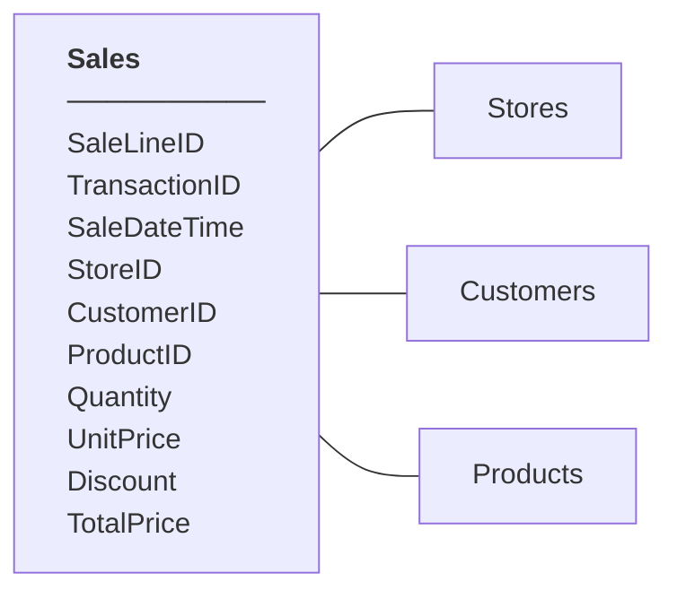

[← Shoe Company Overview](../index.md) · [BEAM✲ Annotations](../beam-annotations.md) · [How to Read This Wiki](../how-to-read.md)

# Sales

<table style="border-collapse:collapse;margin:8px 0;">
<tr><th scope="row" align="left" style="text-align:left;vertical-align:top;white-space:nowrap;font-weight:600;padding:6px 16px 6px 0;border-bottom:1px solid rgba(128,128,128,.4);">Description</th><td style="text-align:left;vertical-align:top;padding:6px 0;border-bottom:1px solid rgba(128,128,128,.4);">One product line rung up in a shop on a customer's purchase: which shoe, how many, the price, any discount and the amount charged. A purchase can have several lines.</td></tr>
<tr><th scope="row" align="left" style="text-align:left;vertical-align:top;white-space:nowrap;font-weight:600;padding:6px 16px 6px 0;border-bottom:1px solid rgba(128,128,128,.4);">Grain</th><td style="text-align:left;vertical-align:top;padding:6px 0;border-bottom:1px solid rgba(128,128,128,.4);">One row for each product line on a purchase</td></tr>
<tr><th scope="row" align="left" style="text-align:left;vertical-align:top;white-space:nowrap;font-weight:600;padding:6px 16px 6px 0;border-bottom:1px solid rgba(128,128,128,.4);">BEAM✲</th><td style="text-align:left;vertical-align:top;padding:6px 0;border-bottom:1px solid rgba(128,128,128,.4);"><a href="../beam-annotations.md#t-de">[DE]</a> <i>(suggested by AI)</i></td></tr>
<tr><th scope="row" align="left" style="text-align:left;vertical-align:top;white-space:nowrap;font-weight:600;padding:6px 16px 6px 0;border-bottom:1px solid rgba(128,128,128,.4);">Why <a href="../beam-annotations.md#t-de">[DE]</a></th><td style="text-align:left;vertical-align:top;padding:6px 0;border-bottom:1px solid rgba(128,128,128,.4);">Each row is a sale line that happens at one moment (<code>SaleDateTime</code>) and is finished once rung up; there are no later milestone dates.</td></tr>
<tr><th scope="row" align="left" style="text-align:left;vertical-align:top;white-space:nowrap;font-weight:600;padding:6px 16px 6px 0;border-bottom:1px solid rgba(128,128,128,.4);">Source</th><td style="text-align:left;vertical-align:top;padding:6px 0;border-bottom:1px solid rgba(128,128,128,.4);"><a href="../beam-annotations.md#t-source">{shoe_company.xlsx: Sales}</a> <i>(measured)</i></td></tr>
<tr><th scope="row" align="left" style="text-align:left;vertical-align:top;white-space:nowrap;font-weight:600;padding:6px 16px 6px 0;border-bottom:1px solid rgba(128,128,128,.4);">Sampled Rows</th><td style="text-align:left;vertical-align:top;padding:6px 0;border-bottom:1px solid rgba(128,128,128,.4);">2,535</td></tr>
<tr><th scope="row" align="left" style="text-align:left;vertical-align:top;white-space:nowrap;font-weight:600;padding:6px 16px 6px 0;border-bottom:1px solid rgba(128,128,128,.4);">Columns</th><td style="text-align:left;vertical-align:top;padding:6px 0;border-bottom:1px solid rgba(128,128,128,.4);">10</td></tr>
<tr><th scope="row" align="left" style="text-align:left;vertical-align:top;white-space:nowrap;font-weight:600;padding:6px 16px 6px 0;border-bottom:1px solid rgba(128,128,128,.4);">Description Source</th><td style="text-align:left;vertical-align:top;padding:6px 0;border-bottom:1px solid rgba(128,128,128,.4);">Written by AI from the data. Check before relying on it.</td></tr>
<tr><th scope="row" align="left" style="text-align:left;vertical-align:top;white-space:nowrap;font-weight:600;padding:6px 16px 6px 0;border-bottom:1px solid rgba(128,128,128,.4);">Confidence</th><td style="text-align:left;vertical-align:top;padding:6px 0;border-bottom:1px solid rgba(128,128,128,.4);">high</td></tr>
</table>

## Columns

<div style="overflow-x:auto;max-width:100%;">
<table style="border-collapse:separate;border-spacing:0;border:1px solid rgba(128,128,128,.4);border-width:1px 0 0 1px;font-size:90%;">
<tr><th colspan="2" style="position:sticky;left:0;z-index:2;background:#eef0f2;color:#1f2328;border:0 solid rgba(128,128,128,.4);border-width:0 1px 1px 0;padding:3px 8px;white-space:nowrap;text-align:left;vertical-align:top;font-weight:600;">Column Name</th><th style="border:0 solid rgba(128,128,128,.4);border-width:0 1px 1px 0;padding:3px 8px;white-space:nowrap;text-align:left;vertical-align:top;font-weight:600;">SaleLineID</th><th style="border:0 solid rgba(128,128,128,.4);border-width:0 1px 1px 0;padding:3px 8px;white-space:nowrap;text-align:left;vertical-align:top;font-weight:600;">TransactionID</th><th style="border:0 solid rgba(128,128,128,.4);border-width:0 1px 1px 0;padding:3px 8px;white-space:nowrap;text-align:left;vertical-align:top;font-weight:600;">SaleDateTime</th><th style="border:0 solid rgba(128,128,128,.4);border-width:0 1px 1px 0;padding:3px 8px;white-space:nowrap;text-align:left;vertical-align:top;font-weight:600;">StoreID</th><th style="border:0 solid rgba(128,128,128,.4);border-width:0 1px 1px 0;padding:3px 8px;white-space:nowrap;text-align:left;vertical-align:top;font-weight:600;">CustomerID</th><th style="border:0 solid rgba(128,128,128,.4);border-width:0 1px 1px 0;padding:3px 8px;white-space:nowrap;text-align:left;vertical-align:top;font-weight:600;">ProductID</th><th style="border:0 solid rgba(128,128,128,.4);border-width:0 1px 1px 0;padding:3px 8px;white-space:nowrap;text-align:left;vertical-align:top;font-weight:600;">Quantity</th><th style="border:0 solid rgba(128,128,128,.4);border-width:0 1px 1px 0;padding:3px 8px;white-space:nowrap;text-align:left;vertical-align:top;font-weight:600;">UnitPrice</th><th style="border:0 solid rgba(128,128,128,.4);border-width:0 1px 1px 0;padding:3px 8px;white-space:nowrap;text-align:left;vertical-align:top;font-weight:600;">Discount</th><th style="border:0 solid rgba(128,128,128,.4);border-width:0 1px 1px 0;padding:3px 8px;white-space:nowrap;text-align:left;vertical-align:top;font-weight:600;">TotalPrice</th></tr>
<tr><td colspan="2" style="position:sticky;left:0;z-index:2;background:#eef0f2;color:#1f2328;border:0 solid rgba(128,128,128,.4);border-width:0 1px 1px 0;padding:3px 8px;white-space:nowrap;text-align:left;vertical-align:top;font-weight:600;">Data Type</td><td style="border:0 solid rgba(128,128,128,.4);border-width:0 1px 1px 0;padding:3px 8px;white-space:nowrap;text-align:left;vertical-align:top;"><a href="../beam-annotations.md#c-c">C7</a> text</td><td style="border:0 solid rgba(128,128,128,.4);border-width:0 1px 1px 0;padding:3px 8px;white-space:nowrap;text-align:left;vertical-align:top;"><a href="../beam-annotations.md#c-c">C7</a> text</td><td style="border:0 solid rgba(128,128,128,.4);border-width:0 1px 1px 0;padding:3px 8px;white-space:nowrap;text-align:left;vertical-align:top;"><a href="../beam-annotations.md#c-dt">DT</a> date/time</td><td style="border:0 solid rgba(128,128,128,.4);border-width:0 1px 1px 0;padding:3px 8px;white-space:nowrap;text-align:left;vertical-align:top;"><a href="../beam-annotations.md#c-c">C4</a> text</td><td style="border:0 solid rgba(128,128,128,.4);border-width:0 1px 1px 0;padding:3px 8px;white-space:nowrap;text-align:left;vertical-align:top;"><a href="../beam-annotations.md#c-c">C6</a> text</td><td style="border:0 solid rgba(128,128,128,.4);border-width:0 1px 1px 0;padding:3px 8px;white-space:nowrap;text-align:left;vertical-align:top;"><a href="../beam-annotations.md#c-c">C5</a> text</td><td style="border:0 solid rgba(128,128,128,.4);border-width:0 1px 1px 0;padding:3px 8px;white-space:nowrap;text-align:left;vertical-align:top;"><a href="../beam-annotations.md#c-i">I</a> whole number</td><td style="border:0 solid rgba(128,128,128,.4);border-width:0 1px 1px 0;padding:3px 8px;white-space:nowrap;text-align:left;vertical-align:top;"><a href="../beam-annotations.md#c-n">N5.2</a> number</td><td style="border:0 solid rgba(128,128,128,.4);border-width:0 1px 1px 0;padding:3px 8px;white-space:nowrap;text-align:left;vertical-align:top;"><a href="../beam-annotations.md#c-n">N5.2</a> number</td><td style="border:0 solid rgba(128,128,128,.4);border-width:0 1px 1px 0;padding:3px 8px;white-space:nowrap;text-align:left;vertical-align:top;"><a href="../beam-annotations.md#c-n">N5.2</a> number</td></tr>
<tr><td colspan="2" style="position:sticky;left:0;z-index:2;background:#eef0f2;color:#1f2328;border:0 solid rgba(128,128,128,.4);border-width:0 1px 1px 0;padding:3px 8px;white-space:nowrap;text-align:left;vertical-align:top;font-weight:600;">BEAM✲</td><td style="border:0 solid rgba(128,128,128,.4);border-width:0 1px 1px 0;padding:3px 8px;white-space:nowrap;text-align:left;vertical-align:top;"><a href="../beam-annotations.md#c-nd">ND</a> <i><a href="../beam-annotations.md#c-bk">BK</a></i> <i><a href="../beam-annotations.md#c-md">MD</a></i></td><td style="border:0 solid rgba(128,128,128,.4);border-width:0 1px 1px 0;padding:3px 8px;white-space:nowrap;text-align:left;vertical-align:top;"><i><a href="../beam-annotations.md#c-dd">DD</a></i> <i><a href="../beam-annotations.md#w-how">[how]</a></i> <i><a href="../beam-annotations.md#c-md">MD</a></i></td><td style="border:0 solid rgba(128,128,128,.4);border-width:0 1px 1px 0;padding:3px 8px;white-space:nowrap;text-align:left;vertical-align:top;"><i><a href="../beam-annotations.md#w-when">[when]</a></i> <i><a href="../beam-annotations.md#c-md">MD</a></i></td><td style="border:0 solid rgba(128,128,128,.4);border-width:0 1px 1px 0;padding:3px 8px;white-space:nowrap;text-align:left;vertical-align:top;"><a href="../beam-annotations.md#c-fk">FK</a> <i><a href="../beam-annotations.md#w-where">[where]</a></i> <i><a href="../beam-annotations.md#c-dim">[Stores]</a></i> <i><a href="../beam-annotations.md#c-md">MD</a></i></td><td style="border:0 solid rgba(128,128,128,.4);border-width:0 1px 1px 0;padding:3px 8px;white-space:nowrap;text-align:left;vertical-align:top;"><a href="../beam-annotations.md#c-fk">FK</a> <i><a href="../beam-annotations.md#w-who">[who]</a></i> <i><a href="../beam-annotations.md#c-dim">[Customers]</a></i></td><td style="border:0 solid rgba(128,128,128,.4);border-width:0 1px 1px 0;padding:3px 8px;white-space:nowrap;text-align:left;vertical-align:top;"><a href="../beam-annotations.md#c-fk">FK</a> <i><a href="../beam-annotations.md#w-what">[what]</a></i> <i><a href="../beam-annotations.md#c-dim">[Products]</a></i> <i><a href="../beam-annotations.md#c-md">MD</a></i></td><td style="border:0 solid rgba(128,128,128,.4);border-width:0 1px 1px 0;padding:3px 8px;white-space:nowrap;text-align:left;vertical-align:top;"><i><a href="../beam-annotations.md#c-fa">FA</a></i></td><td style="border:0 solid rgba(128,128,128,.4);border-width:0 1px 1px 0;padding:3px 8px;white-space:nowrap;text-align:left;vertical-align:top;"><i><a href="../beam-annotations.md#c-na">NA</a></i> <i><a href="../beam-annotations.md#c-suspect">?</a></i></td><td style="border:0 solid rgba(128,128,128,.4);border-width:0 1px 1px 0;padding:3px 8px;white-space:nowrap;text-align:left;vertical-align:top;"><i><a href="../beam-annotations.md#c-fa">FA</a></i> <i><a href="../beam-annotations.md#c-suspect">?</a></i></td><td style="border:0 solid rgba(128,128,128,.4);border-width:0 1px 1px 0;padding:3px 8px;white-space:nowrap;text-align:left;vertical-align:top;"><i><a href="../beam-annotations.md#c-fa">FA</a></i> <i><a href="../beam-annotations.md#c-df">DF=Quantity*UnitPrice-Discount</a></i> <i><a href="../beam-annotations.md#c-important">!</a></i> <i><a href="../beam-annotations.md#c-suspect">?</a></i></td></tr>
<tr><td rowspan="9" style="position:sticky;left:0;z-index:2;background:#eef0f2;color:#1f2328;box-sizing:border-box;width:34px;min-width:34px;max-width:34px;border:0 solid rgba(128,128,128,.4);border-width:0 1px 1px 0;padding:4px 0;text-align:center;vertical-align:middle;"><div style="writing-mode:vertical-rl;transform:rotate(180deg);white-space:nowrap;margin:0 auto;font-weight:600;">Data Profiling Results</div></td><td style="position:sticky;left:34px;z-index:2;background:#eef0f2;color:#1f2328;border:0 solid rgba(128,128,128,.4);border-width:0 1px 1px 0;padding:3px 8px;white-space:nowrap;text-align:left;vertical-align:top;font-weight:600;">Sample Count</td><td style="border:0 solid rgba(128,128,128,.4);border-width:0 1px 1px 0;padding:3px 8px;white-space:nowrap;text-align:right;vertical-align:top;">2,535</td><td style="border:0 solid rgba(128,128,128,.4);border-width:0 1px 1px 0;padding:3px 8px;white-space:nowrap;text-align:right;vertical-align:top;">2,535</td><td style="border:0 solid rgba(128,128,128,.4);border-width:0 1px 1px 0;padding:3px 8px;white-space:nowrap;text-align:right;vertical-align:top;">2,535</td><td style="border:0 solid rgba(128,128,128,.4);border-width:0 1px 1px 0;padding:3px 8px;white-space:nowrap;text-align:right;vertical-align:top;">2,535</td><td style="border:0 solid rgba(128,128,128,.4);border-width:0 1px 1px 0;padding:3px 8px;white-space:nowrap;text-align:right;vertical-align:top;">2,535</td><td style="border:0 solid rgba(128,128,128,.4);border-width:0 1px 1px 0;padding:3px 8px;white-space:nowrap;text-align:right;vertical-align:top;">2,535</td><td style="border:0 solid rgba(128,128,128,.4);border-width:0 1px 1px 0;padding:3px 8px;white-space:nowrap;text-align:right;vertical-align:top;">2,535</td><td style="border:0 solid rgba(128,128,128,.4);border-width:0 1px 1px 0;padding:3px 8px;white-space:nowrap;text-align:right;vertical-align:top;">2,535</td><td style="border:0 solid rgba(128,128,128,.4);border-width:0 1px 1px 0;padding:3px 8px;white-space:nowrap;text-align:right;vertical-align:top;">2,535</td><td style="border:0 solid rgba(128,128,128,.4);border-width:0 1px 1px 0;padding:3px 8px;white-space:nowrap;text-align:right;vertical-align:top;">2,535</td></tr>
<tr><td style="position:sticky;left:34px;z-index:2;background:#eef0f2;color:#1f2328;border:0 solid rgba(128,128,128,.4);border-width:0 1px 1px 0;padding:3px 8px;white-space:nowrap;text-align:left;vertical-align:top;font-weight:600;">Missing</td><td style="border:0 solid rgba(128,128,128,.4);border-width:0 1px 1px 0;padding:3px 8px;white-space:nowrap;text-align:left;vertical-align:top;">0 (0%)</td><td style="border:0 solid rgba(128,128,128,.4);border-width:0 1px 1px 0;padding:3px 8px;white-space:nowrap;text-align:left;vertical-align:top;">0 (0%)</td><td style="border:0 solid rgba(128,128,128,.4);border-width:0 1px 1px 0;padding:3px 8px;white-space:nowrap;text-align:left;vertical-align:top;">0 (0%)</td><td style="border:0 solid rgba(128,128,128,.4);border-width:0 1px 1px 0;padding:3px 8px;white-space:nowrap;text-align:left;vertical-align:top;">0 (0%)</td><td style="border:0 solid rgba(128,128,128,.4);border-width:0 1px 1px 0;padding:3px 8px;white-space:nowrap;text-align:left;vertical-align:top;">891 (35.1%)</td><td style="border:0 solid rgba(128,128,128,.4);border-width:0 1px 1px 0;padding:3px 8px;white-space:nowrap;text-align:left;vertical-align:top;">0 (0%)</td><td style="border:0 solid rgba(128,128,128,.4);border-width:0 1px 1px 0;padding:3px 8px;white-space:nowrap;text-align:left;vertical-align:top;">0 (0%)</td><td style="border:0 solid rgba(128,128,128,.4);border-width:0 1px 1px 0;padding:3px 8px;white-space:nowrap;text-align:left;vertical-align:top;">0 (0%)</td><td style="border:0 solid rgba(128,128,128,.4);border-width:0 1px 1px 0;padding:3px 8px;white-space:nowrap;text-align:left;vertical-align:top;">0 (0%)</td><td style="border:0 solid rgba(128,128,128,.4);border-width:0 1px 1px 0;padding:3px 8px;white-space:nowrap;text-align:left;vertical-align:top;">0 (0%)</td></tr>
<tr><td style="position:sticky;left:34px;z-index:2;background:#eef0f2;color:#1f2328;border:0 solid rgba(128,128,128,.4);border-width:0 1px 1px 0;padding:3px 8px;white-space:nowrap;text-align:left;vertical-align:top;font-weight:600;">Unique Values</td><td style="border:0 solid rgba(128,128,128,.4);border-width:0 1px 1px 0;padding:3px 8px;white-space:nowrap;text-align:left;vertical-align:top;">2,535 (100%)</td><td style="border:0 solid rgba(128,128,128,.4);border-width:0 1px 1px 0;padding:3px 8px;white-space:nowrap;text-align:left;vertical-align:top;">1,600 (63.1%)</td><td style="border:0 solid rgba(128,128,128,.4);border-width:0 1px 1px 0;padding:3px 8px;white-space:nowrap;text-align:left;vertical-align:top;">1,600 (63.1%)</td><td style="border:0 solid rgba(128,128,128,.4);border-width:0 1px 1px 0;padding:3px 8px;white-space:nowrap;text-align:left;vertical-align:top;">15 (0.592%)</td><td style="border:0 solid rgba(128,128,128,.4);border-width:0 1px 1px 0;padding:3px 8px;white-space:nowrap;text-align:left;vertical-align:top;">191 (7.53%)</td><td style="border:0 solid rgba(128,128,128,.4);border-width:0 1px 1px 0;padding:3px 8px;white-space:nowrap;text-align:left;vertical-align:top;">52 (2.05%)</td><td style="border:0 solid rgba(128,128,128,.4);border-width:0 1px 1px 0;padding:3px 8px;white-space:nowrap;text-align:left;vertical-align:top;">3 (0.118%)</td><td style="border:0 solid rgba(128,128,128,.4);border-width:0 1px 1px 0;padding:3px 8px;white-space:nowrap;text-align:left;vertical-align:top;">43 (1.7%)</td><td style="border:0 solid rgba(128,128,128,.4);border-width:0 1px 1px 0;padding:3px 8px;white-space:nowrap;text-align:left;vertical-align:top;">196 (7.73%)</td><td style="border:0 solid rgba(128,128,128,.4);border-width:0 1px 1px 0;padding:3px 8px;white-space:nowrap;text-align:left;vertical-align:top;">439 (17.3%)</td></tr>
<tr><td style="position:sticky;left:34px;z-index:2;background:#eef0f2;color:#1f2328;border:0 solid rgba(128,128,128,.4);border-width:0 1px 1px 0;padding:3px 8px;white-space:nowrap;text-align:left;vertical-align:top;font-weight:600;">Min Value</td><td style="border:0 solid rgba(128,128,128,.4);border-width:0 1px 1px 0;padding:3px 8px;white-space:nowrap;text-align:left;vertical-align:top;">L000001</td><td style="border:0 solid rgba(128,128,128,.4);border-width:0 1px 1px 0;padding:3px 8px;white-space:nowrap;text-align:left;vertical-align:top;">T000001</td><td style="border:0 solid rgba(128,128,128,.4);border-width:0 1px 1px 0;padding:3px 8px;white-space:nowrap;text-align:left;vertical-align:top;">2025-01-01 12:18:13</td><td style="border:0 solid rgba(128,128,128,.4);border-width:0 1px 1px 0;padding:3px 8px;white-space:nowrap;text-align:left;vertical-align:top;">S001</td><td style="border:0 solid rgba(128,128,128,.4);border-width:0 1px 1px 0;padding:3px 8px;white-space:nowrap;text-align:left;vertical-align:top;">C00001</td><td style="border:0 solid rgba(128,128,128,.4);border-width:0 1px 1px 0;padding:3px 8px;white-space:nowrap;text-align:left;vertical-align:top;">P0001</td><td style="border:0 solid rgba(128,128,128,.4);border-width:0 1px 1px 0;padding:3px 8px;white-space:nowrap;text-align:left;vertical-align:top;">1</td><td style="border:0 solid rgba(128,128,128,.4);border-width:0 1px 1px 0;padding:3px 8px;white-space:nowrap;text-align:left;vertical-align:top;">22.99</td><td style="border:0 solid rgba(128,128,128,.4);border-width:0 1px 1px 0;padding:3px 8px;white-space:nowrap;text-align:left;vertical-align:top;">0</td><td style="border:0 solid rgba(128,128,128,.4);border-width:0 1px 1px 0;padding:3px 8px;white-space:nowrap;text-align:left;vertical-align:top;">11.99</td></tr>
<tr><td style="position:sticky;left:34px;z-index:2;background:#eef0f2;color:#1f2328;border:0 solid rgba(128,128,128,.4);border-width:0 1px 1px 0;padding:3px 8px;white-space:nowrap;text-align:left;vertical-align:top;font-weight:600;">Min Count</td><td style="border:0 solid rgba(128,128,128,.4);border-width:0 1px 1px 0;padding:3px 8px;white-space:nowrap;text-align:left;vertical-align:top;">1 (0.0394%)</td><td style="border:0 solid rgba(128,128,128,.4);border-width:0 1px 1px 0;padding:3px 8px;white-space:nowrap;text-align:left;vertical-align:top;">3 (0.118%)</td><td style="border:0 solid rgba(128,128,128,.4);border-width:0 1px 1px 0;padding:3px 8px;white-space:nowrap;text-align:left;vertical-align:top;">1 (0.0394%)</td><td style="border:0 solid rgba(128,128,128,.4);border-width:0 1px 1px 0;padding:3px 8px;white-space:nowrap;text-align:left;vertical-align:top;">184 (7.26%)</td><td style="border:0 solid rgba(128,128,128,.4);border-width:0 1px 1px 0;padding:3px 8px;white-space:nowrap;text-align:left;vertical-align:top;">4 (0.158%)</td><td style="border:0 solid rgba(128,128,128,.4);border-width:0 1px 1px 0;padding:3px 8px;white-space:nowrap;text-align:left;vertical-align:top;">46 (1.81%)</td><td style="border:0 solid rgba(128,128,128,.4);border-width:0 1px 1px 0;padding:3px 8px;white-space:nowrap;text-align:left;vertical-align:top;">2,151 (84.9%)</td><td style="border:0 solid rgba(128,128,128,.4);border-width:0 1px 1px 0;padding:3px 8px;white-space:nowrap;text-align:left;vertical-align:top;">46 (1.81%)</td><td style="border:0 solid rgba(128,128,128,.4);border-width:0 1px 1px 0;padding:3px 8px;white-space:nowrap;text-align:left;vertical-align:top;">1,674 (66%)</td><td style="border:0 solid rgba(128,128,128,.4);border-width:0 1px 1px 0;padding:3px 8px;white-space:nowrap;text-align:left;vertical-align:top;">8 (0.316%)</td></tr>
<tr><td style="position:sticky;left:34px;z-index:2;background:#eef0f2;color:#1f2328;border:0 solid rgba(128,128,128,.4);border-width:0 1px 1px 0;padding:3px 8px;white-space:nowrap;text-align:left;vertical-align:top;font-weight:600;">Max Value</td><td style="border:0 solid rgba(128,128,128,.4);border-width:0 1px 1px 0;padding:3px 8px;white-space:nowrap;text-align:left;vertical-align:top;">L002535</td><td style="border:0 solid rgba(128,128,128,.4);border-width:0 1px 1px 0;padding:3px 8px;white-space:nowrap;text-align:left;vertical-align:top;">T001600</td><td style="border:0 solid rgba(128,128,128,.4);border-width:0 1px 1px 0;padding:3px 8px;white-space:nowrap;text-align:left;vertical-align:top;">2026-10-31 10:34:00</td><td style="border:0 solid rgba(128,128,128,.4);border-width:0 1px 1px 0;padding:3px 8px;white-space:nowrap;text-align:left;vertical-align:top;">S015</td><td style="border:0 solid rgba(128,128,128,.4);border-width:0 1px 1px 0;padding:3px 8px;white-space:nowrap;text-align:left;vertical-align:top;">C00200</td><td style="border:0 solid rgba(128,128,128,.4);border-width:0 1px 1px 0;padding:3px 8px;white-space:nowrap;text-align:left;vertical-align:top;">P0060</td><td style="border:0 solid rgba(128,128,128,.4);border-width:0 1px 1px 0;padding:3px 8px;white-space:nowrap;text-align:left;vertical-align:top;">3</td><td style="border:0 solid rgba(128,128,128,.4);border-width:0 1px 1px 0;padding:3px 8px;white-space:nowrap;text-align:left;vertical-align:top;">227.99</td><td style="border:0 solid rgba(128,128,128,.4);border-width:0 1px 1px 0;padding:3px 8px;white-space:nowrap;text-align:left;vertical-align:top;">131.99</td><td style="border:0 solid rgba(128,128,128,.4);border-width:0 1px 1px 0;padding:3px 8px;white-space:nowrap;text-align:left;vertical-align:top;">683.97</td></tr>
<tr><td style="position:sticky;left:34px;z-index:2;background:#eef0f2;color:#1f2328;border:0 solid rgba(128,128,128,.4);border-width:0 1px 1px 0;padding:3px 8px;white-space:nowrap;text-align:left;vertical-align:top;font-weight:600;">Max Count</td><td style="border:0 solid rgba(128,128,128,.4);border-width:0 1px 1px 0;padding:3px 8px;white-space:nowrap;text-align:left;vertical-align:top;">1 (0.0394%)</td><td style="border:0 solid rgba(128,128,128,.4);border-width:0 1px 1px 0;padding:3px 8px;white-space:nowrap;text-align:left;vertical-align:top;">1 (0.0394%)</td><td style="border:0 solid rgba(128,128,128,.4);border-width:0 1px 1px 0;padding:3px 8px;white-space:nowrap;text-align:left;vertical-align:top;">2 (0.0789%)</td><td style="border:0 solid rgba(128,128,128,.4);border-width:0 1px 1px 0;padding:3px 8px;white-space:nowrap;text-align:left;vertical-align:top;">185 (7.3%)</td><td style="border:0 solid rgba(128,128,128,.4);border-width:0 1px 1px 0;padding:3px 8px;white-space:nowrap;text-align:left;vertical-align:top;">8 (0.316%)</td><td style="border:0 solid rgba(128,128,128,.4);border-width:0 1px 1px 0;padding:3px 8px;white-space:nowrap;text-align:left;vertical-align:top;">46 (1.81%)</td><td style="border:0 solid rgba(128,128,128,.4);border-width:0 1px 1px 0;padding:3px 8px;white-space:nowrap;text-align:left;vertical-align:top;">67 (2.64%)</td><td style="border:0 solid rgba(128,128,128,.4);border-width:0 1px 1px 0;padding:3px 8px;white-space:nowrap;text-align:left;vertical-align:top;">46 (1.81%)</td><td style="border:0 solid rgba(128,128,128,.4);border-width:0 1px 1px 0;padding:3px 8px;white-space:nowrap;text-align:left;vertical-align:top;">1 (0.0394%)</td><td style="border:0 solid rgba(128,128,128,.4);border-width:0 1px 1px 0;padding:3px 8px;white-space:nowrap;text-align:left;vertical-align:top;">2 (0.0789%)</td></tr>
<tr><td style="position:sticky;left:34px;z-index:2;background:#eef0f2;color:#1f2328;border:0 solid rgba(128,128,128,.4);border-width:0 1px 1px 0;padding:3px 8px;white-space:nowrap;text-align:left;vertical-align:top;font-weight:600;">Min Length</td><td style="border:0 solid rgba(128,128,128,.4);border-width:0 1px 1px 0;padding:3px 8px;white-space:nowrap;text-align:right;vertical-align:top;">7</td><td style="border:0 solid rgba(128,128,128,.4);border-width:0 1px 1px 0;padding:3px 8px;white-space:nowrap;text-align:right;vertical-align:top;">7</td><td style="border:0 solid rgba(128,128,128,.4);border-width:0 1px 1px 0;padding:3px 8px;white-space:nowrap;text-align:right;vertical-align:top;">—</td><td style="border:0 solid rgba(128,128,128,.4);border-width:0 1px 1px 0;padding:3px 8px;white-space:nowrap;text-align:right;vertical-align:top;">4</td><td style="border:0 solid rgba(128,128,128,.4);border-width:0 1px 1px 0;padding:3px 8px;white-space:nowrap;text-align:right;vertical-align:top;">6</td><td style="border:0 solid rgba(128,128,128,.4);border-width:0 1px 1px 0;padding:3px 8px;white-space:nowrap;text-align:right;vertical-align:top;">5</td><td style="border:0 solid rgba(128,128,128,.4);border-width:0 1px 1px 0;padding:3px 8px;white-space:nowrap;text-align:right;vertical-align:top;">—</td><td style="border:0 solid rgba(128,128,128,.4);border-width:0 1px 1px 0;padding:3px 8px;white-space:nowrap;text-align:right;vertical-align:top;">—</td><td style="border:0 solid rgba(128,128,128,.4);border-width:0 1px 1px 0;padding:3px 8px;white-space:nowrap;text-align:right;vertical-align:top;">—</td><td style="border:0 solid rgba(128,128,128,.4);border-width:0 1px 1px 0;padding:3px 8px;white-space:nowrap;text-align:right;vertical-align:top;">—</td></tr>
<tr><td style="position:sticky;left:34px;z-index:2;background:#eef0f2;color:#1f2328;border:0 solid rgba(128,128,128,.4);border-width:0 1px 1px 0;padding:3px 8px;white-space:nowrap;text-align:left;vertical-align:top;font-weight:600;">Max Length</td><td style="border:0 solid rgba(128,128,128,.4);border-width:0 1px 1px 0;padding:3px 8px;white-space:nowrap;text-align:right;vertical-align:top;">7</td><td style="border:0 solid rgba(128,128,128,.4);border-width:0 1px 1px 0;padding:3px 8px;white-space:nowrap;text-align:right;vertical-align:top;">7</td><td style="border:0 solid rgba(128,128,128,.4);border-width:0 1px 1px 0;padding:3px 8px;white-space:nowrap;text-align:right;vertical-align:top;">—</td><td style="border:0 solid rgba(128,128,128,.4);border-width:0 1px 1px 0;padding:3px 8px;white-space:nowrap;text-align:right;vertical-align:top;">4</td><td style="border:0 solid rgba(128,128,128,.4);border-width:0 1px 1px 0;padding:3px 8px;white-space:nowrap;text-align:right;vertical-align:top;">6</td><td style="border:0 solid rgba(128,128,128,.4);border-width:0 1px 1px 0;padding:3px 8px;white-space:nowrap;text-align:right;vertical-align:top;">5</td><td style="border:0 solid rgba(128,128,128,.4);border-width:0 1px 1px 0;padding:3px 8px;white-space:nowrap;text-align:right;vertical-align:top;">—</td><td style="border:0 solid rgba(128,128,128,.4);border-width:0 1px 1px 0;padding:3px 8px;white-space:nowrap;text-align:right;vertical-align:top;">—</td><td style="border:0 solid rgba(128,128,128,.4);border-width:0 1px 1px 0;padding:3px 8px;white-space:nowrap;text-align:right;vertical-align:top;">—</td><td style="border:0 solid rgba(128,128,128,.4);border-width:0 1px 1px 0;padding:3px 8px;white-space:nowrap;text-align:right;vertical-align:top;">—</td></tr>
<tr><td rowspan="6" style="position:sticky;left:0;z-index:2;background:#eef0f2;color:#1f2328;box-sizing:border-box;width:34px;min-width:34px;max-width:34px;border:0 solid rgba(128,128,128,.4);border-width:0 1px 1px 0;padding:4px 0;text-align:center;vertical-align:middle;"><div style="writing-mode:vertical-rl;transform:rotate(180deg);white-space:nowrap;margin:0 auto;font-weight:600;">Variation</div></td><td style="position:sticky;left:34px;z-index:2;background:#eef0f2;color:#1f2328;border:0 solid rgba(128,128,128,.4);border-width:0 1px 1px 0;padding:3px 8px;white-space:nowrap;text-align:left;vertical-align:top;font-weight:600;">Typical</td><td style="border:0 solid rgba(128,128,128,.4);border-width:0 1px 1px 0;padding:3px 8px;white-space:nowrap;text-align:left;vertical-align:top;">L000001</td><td style="border:0 solid rgba(128,128,128,.4);border-width:0 1px 1px 0;padding:3px 8px;white-space:nowrap;text-align:left;vertical-align:top;">T000010</td><td style="border:0 solid rgba(128,128,128,.4);border-width:0 1px 1px 0;padding:3px 8px;white-space:nowrap;text-align:left;vertical-align:top;">2025-04-11 20:45:50</td><td style="border:0 solid rgba(128,128,128,.4);border-width:0 1px 1px 0;padding:3px 8px;white-space:nowrap;text-align:left;vertical-align:top;">S007</td><td style="border:0 solid rgba(128,128,128,.4);border-width:0 1px 1px 0;padding:3px 8px;white-space:nowrap;text-align:left;vertical-align:top;">C00079</td><td style="border:0 solid rgba(128,128,128,.4);border-width:0 1px 1px 0;padding:3px 8px;white-space:nowrap;text-align:left;vertical-align:top;">P0022</td><td style="border:0 solid rgba(128,128,128,.4);border-width:0 1px 1px 0;padding:3px 8px;white-space:nowrap;text-align:left;vertical-align:top;">1</td><td style="border:0 solid rgba(128,128,128,.4);border-width:0 1px 1px 0;padding:3px 8px;white-space:nowrap;text-align:left;vertical-align:top;">142.99</td><td style="border:0 solid rgba(128,128,128,.4);border-width:0 1px 1px 0;padding:3px 8px;white-space:nowrap;text-align:left;vertical-align:top;">0</td><td style="border:0 solid rgba(128,128,128,.4);border-width:0 1px 1px 0;padding:3px 8px;white-space:nowrap;text-align:left;vertical-align:top;">143.99</td></tr>
<tr><td style="position:sticky;left:34px;z-index:2;background:#eef0f2;color:#1f2328;border:0 solid rgba(128,128,128,.4);border-width:0 1px 1px 0;padding:3px 8px;white-space:nowrap;text-align:left;vertical-align:top;font-weight:600;">Different</td><td style="border:0 solid rgba(128,128,128,.4);border-width:0 1px 1px 0;padding:3px 8px;white-space:nowrap;text-align:left;vertical-align:top;">L000002</td><td style="border:0 solid rgba(128,128,128,.4);border-width:0 1px 1px 0;padding:3px 8px;white-space:nowrap;text-align:left;vertical-align:top;">T000002</td><td style="border:0 solid rgba(128,128,128,.4);border-width:0 1px 1px 0;padding:3px 8px;white-space:nowrap;text-align:left;vertical-align:top;">2025-01-01 12:18:13</td><td style="border:0 solid rgba(128,128,128,.4);border-width:0 1px 1px 0;padding:3px 8px;white-space:nowrap;text-align:left;vertical-align:top;">S004</td><td style="border:0 solid rgba(128,128,128,.4);border-width:0 1px 1px 0;padding:3px 8px;white-space:nowrap;text-align:left;vertical-align:top;">C00019</td><td style="border:0 solid rgba(128,128,128,.4);border-width:0 1px 1px 0;padding:3px 8px;white-space:nowrap;text-align:left;vertical-align:top;">P0051</td><td style="border:0 solid rgba(128,128,128,.4);border-width:0 1px 1px 0;padding:3px 8px;white-space:nowrap;text-align:left;vertical-align:top;">3</td><td style="border:0 solid rgba(128,128,128,.4);border-width:0 1px 1px 0;padding:3px 8px;white-space:nowrap;text-align:left;vertical-align:top;">155.99</td><td style="border:0 solid rgba(128,128,128,.4);border-width:0 1px 1px 0;padding:3px 8px;white-space:nowrap;text-align:left;vertical-align:top;">105.74</td><td style="border:0 solid rgba(128,128,128,.4);border-width:0 1px 1px 0;padding:3px 8px;white-space:nowrap;text-align:left;vertical-align:top;">103.19</td></tr>
<tr><td style="position:sticky;left:34px;z-index:2;background:#eef0f2;color:#1f2328;border:0 solid rgba(128,128,128,.4);border-width:0 1px 1px 0;padding:3px 8px;white-space:nowrap;text-align:left;vertical-align:top;font-weight:600;">Repeat</td><td style="border:0 solid rgba(128,128,128,.4);border-width:0 1px 1px 0;padding:3px 8px;white-space:nowrap;text-align:left;vertical-align:top;">no repeats</td><td style="border:0 solid rgba(128,128,128,.4);border-width:0 1px 1px 0;padding:3px 8px;white-space:nowrap;text-align:left;vertical-align:top;">T000055 ×4</td><td style="border:0 solid rgba(128,128,128,.4);border-width:0 1px 1px 0;padding:3px 8px;white-space:nowrap;text-align:left;vertical-align:top;">2025-05-20 19:53:54 ×4</td><td style="border:0 solid rgba(128,128,128,.4);border-width:0 1px 1px 0;padding:3px 8px;white-space:nowrap;text-align:left;vertical-align:top;">S015 ×185</td><td style="border:0 solid rgba(128,128,128,.4);border-width:0 1px 1px 0;padding:3px 8px;white-space:nowrap;text-align:left;vertical-align:top;">C00155 ×23</td><td style="border:0 solid rgba(128,128,128,.4);border-width:0 1px 1px 0;padding:3px 8px;white-space:nowrap;text-align:left;vertical-align:top;">P0008 ×69</td><td style="border:0 solid rgba(128,128,128,.4);border-width:0 1px 1px 0;padding:3px 8px;white-space:nowrap;text-align:left;vertical-align:top;">2 ×317</td><td style="border:0 solid rgba(128,128,128,.4);border-width:0 1px 1px 0;padding:3px 8px;white-space:nowrap;text-align:left;vertical-align:top;">143.99 ×114</td><td style="border:0 solid rgba(128,128,128,.4);border-width:0 1px 1px 0;padding:3px 8px;white-space:nowrap;text-align:left;vertical-align:top;">5 ×99</td><td style="border:0 solid rgba(128,128,128,.4);border-width:0 1px 1px 0;padding:3px 8px;white-space:nowrap;text-align:left;vertical-align:top;">142.99 ×70</td></tr>
<tr><td style="position:sticky;left:34px;z-index:2;background:#eef0f2;color:#1f2328;border:0 solid rgba(128,128,128,.4);border-width:0 1px 1px 0;padding:3px 8px;white-space:nowrap;text-align:left;vertical-align:top;font-weight:600;">Missing</td><td style="border:0 solid rgba(128,128,128,.4);border-width:0 1px 1px 0;padding:3px 8px;white-space:nowrap;text-align:left;vertical-align:top;">—</td><td style="border:0 solid rgba(128,128,128,.4);border-width:0 1px 1px 0;padding:3px 8px;white-space:nowrap;text-align:left;vertical-align:top;">—</td><td style="border:0 solid rgba(128,128,128,.4);border-width:0 1px 1px 0;padding:3px 8px;white-space:nowrap;text-align:left;vertical-align:top;">—</td><td style="border:0 solid rgba(128,128,128,.4);border-width:0 1px 1px 0;padding:3px 8px;white-space:nowrap;text-align:left;vertical-align:top;">—</td><td style="border:0 solid rgba(128,128,128,.4);border-width:0 1px 1px 0;padding:3px 8px;white-space:nowrap;text-align:left;vertical-align:top;">empty ×891</td><td style="border:0 solid rgba(128,128,128,.4);border-width:0 1px 1px 0;padding:3px 8px;white-space:nowrap;text-align:left;vertical-align:top;">—</td><td style="border:0 solid rgba(128,128,128,.4);border-width:0 1px 1px 0;padding:3px 8px;white-space:nowrap;text-align:left;vertical-align:top;">—</td><td style="border:0 solid rgba(128,128,128,.4);border-width:0 1px 1px 0;padding:3px 8px;white-space:nowrap;text-align:left;vertical-align:top;">—</td><td style="border:0 solid rgba(128,128,128,.4);border-width:0 1px 1px 0;padding:3px 8px;white-space:nowrap;text-align:left;vertical-align:top;">—</td><td style="border:0 solid rgba(128,128,128,.4);border-width:0 1px 1px 0;padding:3px 8px;white-space:nowrap;text-align:left;vertical-align:top;">—</td></tr>
<tr><td style="position:sticky;left:34px;z-index:2;background:#eef0f2;color:#1f2328;border:0 solid rgba(128,128,128,.4);border-width:0 1px 1px 0;padding:3px 8px;white-space:nowrap;text-align:left;vertical-align:top;font-weight:600;">Range</td><td style="border:0 solid rgba(128,128,128,.4);border-width:0 1px 1px 0;padding:3px 8px;white-space:nowrap;text-align:left;vertical-align:top;">L000001 → L002535</td><td style="border:0 solid rgba(128,128,128,.4);border-width:0 1px 1px 0;padding:3px 8px;white-space:nowrap;text-align:left;vertical-align:top;">T000001 → T001600</td><td style="border:0 solid rgba(128,128,128,.4);border-width:0 1px 1px 0;padding:3px 8px;white-space:nowrap;text-align:left;vertical-align:top;">2025-01-01 12:18:13 → 2026-10-31 10:34:00</td><td style="border:0 solid rgba(128,128,128,.4);border-width:0 1px 1px 0;padding:3px 8px;white-space:nowrap;text-align:left;vertical-align:top;">S001 → S015</td><td style="border:0 solid rgba(128,128,128,.4);border-width:0 1px 1px 0;padding:3px 8px;white-space:nowrap;text-align:left;vertical-align:top;">C00001 → C00200</td><td style="border:0 solid rgba(128,128,128,.4);border-width:0 1px 1px 0;padding:3px 8px;white-space:nowrap;text-align:left;vertical-align:top;">P0001 → P0060</td><td style="border:0 solid rgba(128,128,128,.4);border-width:0 1px 1px 0;padding:3px 8px;white-space:nowrap;text-align:left;vertical-align:top;">1 → 3</td><td style="border:0 solid rgba(128,128,128,.4);border-width:0 1px 1px 0;padding:3px 8px;white-space:nowrap;text-align:left;vertical-align:top;">22.99 → 227.99</td><td style="border:0 solid rgba(128,128,128,.4);border-width:0 1px 1px 0;padding:3px 8px;white-space:nowrap;text-align:left;vertical-align:top;">0 → 131.99</td><td style="border:0 solid rgba(128,128,128,.4);border-width:0 1px 1px 0;padding:3px 8px;white-space:nowrap;text-align:left;vertical-align:top;">11.99 → 683.97</td></tr>
<tr><td style="position:sticky;left:34px;z-index:2;background:#eef0f2;color:#1f2328;border:0 solid rgba(128,128,128,.4);border-width:0 1px 1px 0;padding:3px 8px;white-space:nowrap;text-align:left;vertical-align:top;font-weight:600;">Change</td><td style="border:0 solid rgba(128,128,128,.4);border-width:0 1px 1px 0;padding:3px 8px;white-space:nowrap;text-align:left;vertical-align:top;">—</td><td style="border:0 solid rgba(128,128,128,.4);border-width:0 1px 1px 0;padding:3px 8px;white-space:nowrap;text-align:left;vertical-align:top;">—</td><td style="border:0 solid rgba(128,128,128,.4);border-width:0 1px 1px 0;padding:3px 8px;white-space:nowrap;text-align:left;vertical-align:top;">—</td><td style="border:0 solid rgba(128,128,128,.4);border-width:0 1px 1px 0;padding:3px 8px;white-space:nowrap;text-align:left;vertical-align:top;">—</td><td style="border:0 solid rgba(128,128,128,.4);border-width:0 1px 1px 0;padding:3px 8px;white-space:nowrap;text-align:left;vertical-align:top;">—</td><td style="border:0 solid rgba(128,128,128,.4);border-width:0 1px 1px 0;padding:3px 8px;white-space:nowrap;text-align:left;vertical-align:top;">—</td><td style="border:0 solid rgba(128,128,128,.4);border-width:0 1px 1px 0;padding:3px 8px;white-space:nowrap;text-align:left;vertical-align:top;">—</td><td style="border:0 solid rgba(128,128,128,.4);border-width:0 1px 1px 0;padding:3px 8px;white-space:nowrap;text-align:left;vertical-align:top;">—</td><td style="border:0 solid rgba(128,128,128,.4);border-width:0 1px 1px 0;padding:3px 8px;white-space:nowrap;text-align:left;vertical-align:top;">—</td><td style="border:0 solid rgba(128,128,128,.4);border-width:0 1px 1px 0;padding:3px 8px;white-space:nowrap;text-align:left;vertical-align:top;">—</td></tr>
<tr><td rowspan="5" style="position:sticky;left:0;z-index:2;background:#eef0f2;color:#1f2328;box-sizing:border-box;width:34px;min-width:34px;max-width:34px;border:0 solid rgba(128,128,128,.4);border-width:0 1px 1px 0;padding:4px 0;text-align:center;vertical-align:middle;"><div style="writing-mode:vertical-rl;transform:rotate(180deg);white-space:nowrap;margin:0 auto;font-weight:600;">Sample Data</div></td><td style="position:sticky;left:34px;z-index:2;background:#eef0f2;color:#1f2328;border:0 solid rgba(128,128,128,.4);border-width:0 1px 1px 0;padding:3px 8px;white-space:nowrap;text-align:left;vertical-align:top;font-weight:600;"></td><td style="border:0 solid rgba(128,128,128,.4);border-width:0 1px 1px 0;padding:3px 8px;white-space:nowrap;text-align:left;vertical-align:top;">L000005</td><td style="border:0 solid rgba(128,128,128,.4);border-width:0 1px 1px 0;padding:3px 8px;white-space:nowrap;text-align:left;vertical-align:top;">T000003</td><td style="border:0 solid rgba(128,128,128,.4);border-width:0 1px 1px 0;padding:3px 8px;white-space:nowrap;text-align:left;vertical-align:top;">2026-01-21T17:40:04</td><td style="border:0 solid rgba(128,128,128,.4);border-width:0 1px 1px 0;padding:3px 8px;white-space:nowrap;text-align:left;vertical-align:top;">S012</td><td style="border:0 solid rgba(128,128,128,.4);border-width:0 1px 1px 0;padding:3px 8px;white-space:nowrap;text-align:left;vertical-align:top;">C00118</td><td style="border:0 solid rgba(128,128,128,.4);border-width:0 1px 1px 0;padding:3px 8px;white-space:nowrap;text-align:left;vertical-align:top;">P0037</td><td style="border:0 solid rgba(128,128,128,.4);border-width:0 1px 1px 0;padding:3px 8px;white-space:nowrap;text-align:left;vertical-align:top;">1</td><td style="border:0 solid rgba(128,128,128,.4);border-width:0 1px 1px 0;padding:3px 8px;white-space:nowrap;text-align:left;vertical-align:top;">198.99</td><td style="border:0 solid rgba(128,128,128,.4);border-width:0 1px 1px 0;padding:3px 8px;white-space:nowrap;text-align:left;vertical-align:top;">0</td><td style="border:0 solid rgba(128,128,128,.4);border-width:0 1px 1px 0;padding:3px 8px;white-space:nowrap;text-align:left;vertical-align:top;">198.99</td></tr>
<tr><td style="position:sticky;left:34px;z-index:2;background:#eef0f2;color:#1f2328;border:0 solid rgba(128,128,128,.4);border-width:0 1px 1px 0;padding:3px 8px;white-space:nowrap;text-align:left;vertical-align:top;font-weight:600;"></td><td style="border:0 solid rgba(128,128,128,.4);border-width:0 1px 1px 0;padding:3px 8px;white-space:nowrap;text-align:left;vertical-align:top;">L000849</td><td style="border:0 solid rgba(128,128,128,.4);border-width:0 1px 1px 0;padding:3px 8px;white-space:nowrap;text-align:left;vertical-align:top;">T000553</td><td style="border:0 solid rgba(128,128,128,.4);border-width:0 1px 1px 0;padding:3px 8px;white-space:nowrap;text-align:left;vertical-align:top;">2026-07-05T13:14:36</td><td style="border:0 solid rgba(128,128,128,.4);border-width:0 1px 1px 0;padding:3px 8px;white-space:nowrap;text-align:left;vertical-align:top;">S010</td><td style="border:0 solid rgba(128,128,128,.4);border-width:0 1px 1px 0;padding:3px 8px;white-space:nowrap;text-align:left;vertical-align:top;">C00101</td><td style="border:0 solid rgba(128,128,128,.4);border-width:0 1px 1px 0;padding:3px 8px;white-space:nowrap;text-align:left;vertical-align:top;">P0049</td><td style="border:0 solid rgba(128,128,128,.4);border-width:0 1px 1px 0;padding:3px 8px;white-space:nowrap;text-align:left;vertical-align:top;">1</td><td style="border:0 solid rgba(128,128,128,.4);border-width:0 1px 1px 0;padding:3px 8px;white-space:nowrap;text-align:left;vertical-align:top;">32.99</td><td style="border:0 solid rgba(128,128,128,.4);border-width:0 1px 1px 0;padding:3px 8px;white-space:nowrap;text-align:left;vertical-align:top;">0</td><td style="border:0 solid rgba(128,128,128,.4);border-width:0 1px 1px 0;padding:3px 8px;white-space:nowrap;text-align:left;vertical-align:top;">32.99</td></tr>
<tr><td style="position:sticky;left:34px;z-index:2;background:#eef0f2;color:#1f2328;border:0 solid rgba(128,128,128,.4);border-width:0 1px 1px 0;padding:3px 8px;white-space:nowrap;text-align:left;vertical-align:top;font-weight:600;"></td><td style="border:0 solid rgba(128,128,128,.4);border-width:0 1px 1px 0;padding:3px 8px;white-space:nowrap;text-align:left;vertical-align:top;">L001883</td><td style="border:0 solid rgba(128,128,128,.4);border-width:0 1px 1px 0;padding:3px 8px;white-space:nowrap;text-align:left;vertical-align:top;">T001212</td><td style="border:0 solid rgba(128,128,128,.4);border-width:0 1px 1px 0;padding:3px 8px;white-space:nowrap;text-align:left;vertical-align:top;">2026-05-03T15:00:15</td><td style="border:0 solid rgba(128,128,128,.4);border-width:0 1px 1px 0;padding:3px 8px;white-space:nowrap;text-align:left;vertical-align:top;">S014</td><td style="border:0 solid rgba(128,128,128,.4);border-width:0 1px 1px 0;padding:3px 8px;white-space:nowrap;text-align:left;vertical-align:top;">C00155</td><td style="border:0 solid rgba(128,128,128,.4);border-width:0 1px 1px 0;padding:3px 8px;white-space:nowrap;text-align:left;vertical-align:top;">P0008</td><td style="border:0 solid rgba(128,128,128,.4);border-width:0 1px 1px 0;padding:3px 8px;white-space:nowrap;text-align:left;vertical-align:top;">1</td><td style="border:0 solid rgba(128,128,128,.4);border-width:0 1px 1px 0;padding:3px 8px;white-space:nowrap;text-align:left;vertical-align:top;">75.99</td><td style="border:0 solid rgba(128,128,128,.4);border-width:0 1px 1px 0;padding:3px 8px;white-space:nowrap;text-align:left;vertical-align:top;">0</td><td style="border:0 solid rgba(128,128,128,.4);border-width:0 1px 1px 0;padding:3px 8px;white-space:nowrap;text-align:left;vertical-align:top;">75.99</td></tr>
<tr><td style="position:sticky;left:34px;z-index:2;background:#eef0f2;color:#1f2328;border:0 solid rgba(128,128,128,.4);border-width:0 1px 1px 0;padding:3px 8px;white-space:nowrap;text-align:left;vertical-align:top;font-weight:600;"></td><td style="border:0 solid rgba(128,128,128,.4);border-width:0 1px 1px 0;padding:3px 8px;white-space:nowrap;text-align:left;vertical-align:top;">L002210</td><td style="border:0 solid rgba(128,128,128,.4);border-width:0 1px 1px 0;padding:3px 8px;white-space:nowrap;text-align:left;vertical-align:top;">T001406</td><td style="border:0 solid rgba(128,128,128,.4);border-width:0 1px 1px 0;padding:3px 8px;white-space:nowrap;text-align:left;vertical-align:top;">2026-09-28T10:34:23</td><td style="border:0 solid rgba(128,128,128,.4);border-width:0 1px 1px 0;padding:3px 8px;white-space:nowrap;text-align:left;vertical-align:top;">S011</td><td style="border:0 solid rgba(128,128,128,.4);border-width:0 1px 1px 0;padding:3px 8px;white-space:nowrap;text-align:left;vertical-align:top;"></td><td style="border:0 solid rgba(128,128,128,.4);border-width:0 1px 1px 0;padding:3px 8px;white-space:nowrap;text-align:left;vertical-align:top;">P0030</td><td style="border:0 solid rgba(128,128,128,.4);border-width:0 1px 1px 0;padding:3px 8px;white-space:nowrap;text-align:left;vertical-align:top;">1</td><td style="border:0 solid rgba(128,128,128,.4);border-width:0 1px 1px 0;padding:3px 8px;white-space:nowrap;text-align:left;vertical-align:top;">161.99</td><td style="border:0 solid rgba(128,128,128,.4);border-width:0 1px 1px 0;padding:3px 8px;white-space:nowrap;text-align:left;vertical-align:top;">24.3</td><td style="border:0 solid rgba(128,128,128,.4);border-width:0 1px 1px 0;padding:3px 8px;white-space:nowrap;text-align:left;vertical-align:top;">137.69</td></tr>
<tr><td style="position:sticky;left:34px;z-index:2;background:#eef0f2;color:#1f2328;border:0 solid rgba(128,128,128,.4);border-width:0 1px 1px 0;padding:3px 8px;white-space:nowrap;text-align:left;vertical-align:top;font-weight:600;"></td><td style="border:0 solid rgba(128,128,128,.4);border-width:0 1px 1px 0;padding:3px 8px;white-space:nowrap;text-align:left;vertical-align:top;">L002252</td><td style="border:0 solid rgba(128,128,128,.4);border-width:0 1px 1px 0;padding:3px 8px;white-space:nowrap;text-align:left;vertical-align:top;">T001432</td><td style="border:0 solid rgba(128,128,128,.4);border-width:0 1px 1px 0;padding:3px 8px;white-space:nowrap;text-align:left;vertical-align:top;">2025-11-17T17:08:20</td><td style="border:0 solid rgba(128,128,128,.4);border-width:0 1px 1px 0;padding:3px 8px;white-space:nowrap;text-align:left;vertical-align:top;">S001</td><td style="border:0 solid rgba(128,128,128,.4);border-width:0 1px 1px 0;padding:3px 8px;white-space:nowrap;text-align:left;vertical-align:top;"></td><td style="border:0 solid rgba(128,128,128,.4);border-width:0 1px 1px 0;padding:3px 8px;white-space:nowrap;text-align:left;vertical-align:top;">P0011</td><td style="border:0 solid rgba(128,128,128,.4);border-width:0 1px 1px 0;padding:3px 8px;white-space:nowrap;text-align:left;vertical-align:top;">1</td><td style="border:0 solid rgba(128,128,128,.4);border-width:0 1px 1px 0;padding:3px 8px;white-space:nowrap;text-align:left;vertical-align:top;">209.99</td><td style="border:0 solid rgba(128,128,128,.4);border-width:0 1px 1px 0;padding:3px 8px;white-space:nowrap;text-align:left;vertical-align:top;">0</td><td style="border:0 solid rgba(128,128,128,.4);border-width:0 1px 1px 0;padding:3px 8px;white-space:nowrap;text-align:left;vertical-align:top;">209.99</td></tr>
</table>
</div>

_BEAM✲ codes in plain text are measured from the data; codes in italics are suggested by AI. Change can't be seen in a single snapshot of the data. [What do the codes mean?](../beam-annotations.md)_

## Relationships (Measured)



## Additional Context (Written by AI)

`CustomerID` is empty on 35.15% of rows. `UnitPrice` equals `Products.UnitPrice` on every row (checked separately). `TotalPrice` is `Quantity` x `UnitPrice` - `Discount` with no tax column, so it is probably before tax (not confirmed). `Discount` values include whole amounts (5, 10, 15, 20) and cent-level amounts (e.g. 2.3, 3.45), up to 131.99. No sale is before the customer's sign-up date or the product's launch date, and no inactive product was sold (checked separately).

## Open Questions for the Data Owner

- Why is `CustomerID` empty on 35.15% of sale lines: customers who did not identify themselves or did not join the loyalty programme?
- Is `TotalPrice` before or after tax, and in which currency are `UnitPrice`, `Discount` and `TotalPrice` stated?
- How is `Discount` decided (promotion, loyalty tier, manual markdown)? No column says why.

---

## Metadata

_Machine-readable facts about this page, for tools and AI agents._

```yaml
bijoe: "data-story"
schema_version: 2
dataset: "Shoe company"
table: "Sales"
grain: "One row for each product line on a purchase"
sampled_rows: 2535
columns: 10
description_source: "inferred"
confidence: "high"
beam_table_codes:
  - "[DE]"
beam_source: "{shoe_company.xlsx: Sales}"
beam_reasons:
  - "[DE]: Each row is a sale line that happens at one moment (`SaleDateTime`) and is finished once rung up; there are no later milestone dates."
  - "SaleLineID BK MD: The identifier that tells one sale line from another; filled and unique across 2,535 rows."
  - "TransactionID DD [how] MD: A purchase number shared by up to 4 lines, with no table of its own (no measured relationship from it)."
  - "SaleDateTime [when] MD: The moment the purchase was rung up; filled on every row."
  - "StoreID [where] [Stores] MD: The shop where the sale happened; measured relationship to `Stores.StoreID` 100%."
  - "CustomerID [who] [Customers]: The customer the purchase is linked to; measured relationship to `Customers.CustomerID` for 100% of filled values. Not suggested as mandatory: 35.15% are empty."
  - "ProductID [what] [Products] MD: The shoe sold; measured relationship to `Products.ProductID` 100%."
  - "Quantity FA: Number of items sold on the line, summable across all lines. The unit is not stated in the data."
  - "UnitPrice NA ?: A unit price is never summed. The currency is not stated."
  - "Discount FA ?: A money amount taken off the line, summable (`TotalPrice` = `Quantity` x `UnitPrice` - `Discount` on all rows). Currency not stated."
  - "TotalPrice FA DF=Quantity*UnitPrice-Discount ! ?: Amount charged for the line. Checked separately: the formula holds on all 2,535 rows. Central to any sales analysis. Currency not stated."
evidence:
  - "`SaleLineID` unique, 0% missing, 2,535 rows"
  - "`TransactionID` has 1,600 distinct values in 2,535 rows, at most 4 rows each; `SaleDateTime`, `StoreID` and `CustomerID` are identical within each `TransactionID` (checked separately), so `TransactionID` is the purchase and a row is a line on it"
  - "`SaleDateTime` min 2025-01-01 12:18:13, max 2026-10-31 10:34:00, one value per purchase (1,600 distinct)"
  - "`Quantity` 1 (2,151), 2 (317), 3 (67)"
  - "`TotalPrice` = `Quantity` x `UnitPrice` - `Discount` on all 2,535 rows (checked separately), so `Discount` is an amount, not a percentage; `Discount` is 0 on 1,674 rows"
  - "`StoreID`, `ProductID` and `CustomerID` match `Stores.StoreID`, `Products.ProductID` and `Customers.CustomerID` for 100% of filled values (measured relationships)"
  - "`CustomerID` is missing on 891 of 2,535 rows (35.15%)"
relationships:
  - "Sales.StoreID -> Stores.StoreID: 2535/2535 values found (100%)"
  - "Sales.CustomerID -> Customers.CustomerID: 1644/1644 values found (100%)"
  - "Sales.ProductID -> Products.ProductID: 2535/2535 values found (100%)"
generated_at: "2026-11-22T12:26:25+00:00"
```
