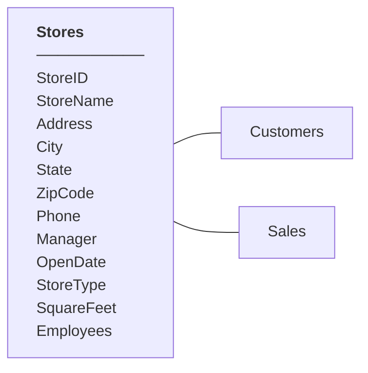

[← Shoe Company Overview](../index.md) · [BEAM✲ Annotations](../beam-annotations.md) · [How to Read This Wiki](../how-to-read.md)

# Stores

<table style="border-collapse:collapse;margin:8px 0;">
<tr><th scope="row" align="left" style="text-align:left;vertical-align:top;white-space:nowrap;font-weight:600;padding:6px 16px 6px 0;border-bottom:1px solid rgba(128,128,128,.4);">Description</th><td style="text-align:left;vertical-align:top;padding:6px 0;border-bottom:1px solid rgba(128,128,128,.4);">A shop where the company sells shoes to customers, with its address, manager, size, number of staff and the date it opened.</td></tr>
<tr><th scope="row" align="left" style="text-align:left;vertical-align:top;white-space:nowrap;font-weight:600;padding:6px 16px 6px 0;border-bottom:1px solid rgba(128,128,128,.4);">Grain</th><td style="text-align:left;vertical-align:top;padding:6px 0;border-bottom:1px solid rgba(128,128,128,.4);">One row for each shop</td></tr>
<tr><th scope="row" align="left" style="text-align:left;vertical-align:top;white-space:nowrap;font-weight:600;padding:6px 16px 6px 0;border-bottom:1px solid rgba(128,128,128,.4);">BEAM✲</th><td style="text-align:left;vertical-align:top;padding:6px 0;border-bottom:1px solid rgba(128,128,128,.4);"><a href="../beam-annotations.md#t-cv">[CV]</a> <i>(suggested by AI)</i></td></tr>
<tr><th scope="row" align="left" style="text-align:left;vertical-align:top;white-space:nowrap;font-weight:600;padding:6px 16px 6px 0;border-bottom:1px solid rgba(128,128,128,.4);">Why <a href="../beam-annotations.md#t-cv">[CV]</a></th><td style="text-align:left;vertical-align:top;padding:6px 0;border-bottom:1px solid rgba(128,128,128,.4);">One row per <code>StoreID</code> with no validity dates, version columns or current flag, so only current values are held.</td></tr>
<tr><th scope="row" align="left" style="text-align:left;vertical-align:top;white-space:nowrap;font-weight:600;padding:6px 16px 6px 0;border-bottom:1px solid rgba(128,128,128,.4);">Source</th><td style="text-align:left;vertical-align:top;padding:6px 0;border-bottom:1px solid rgba(128,128,128,.4);"><a href="../beam-annotations.md#t-source">{shoe_company.xlsx: Stores}</a> <i>(measured)</i></td></tr>
<tr><th scope="row" align="left" style="text-align:left;vertical-align:top;white-space:nowrap;font-weight:600;padding:6px 16px 6px 0;border-bottom:1px solid rgba(128,128,128,.4);">Sampled Rows</th><td style="text-align:left;vertical-align:top;padding:6px 0;border-bottom:1px solid rgba(128,128,128,.4);">15</td></tr>
<tr><th scope="row" align="left" style="text-align:left;vertical-align:top;white-space:nowrap;font-weight:600;padding:6px 16px 6px 0;border-bottom:1px solid rgba(128,128,128,.4);">Columns</th><td style="text-align:left;vertical-align:top;padding:6px 0;border-bottom:1px solid rgba(128,128,128,.4);">12</td></tr>
<tr><th scope="row" align="left" style="text-align:left;vertical-align:top;white-space:nowrap;font-weight:600;padding:6px 16px 6px 0;border-bottom:1px solid rgba(128,128,128,.4);">Description Source</th><td style="text-align:left;vertical-align:top;padding:6px 0;border-bottom:1px solid rgba(128,128,128,.4);">Written by AI from the data. Check before relying on it.</td></tr>
<tr><th scope="row" align="left" style="text-align:left;vertical-align:top;white-space:nowrap;font-weight:600;padding:6px 16px 6px 0;border-bottom:1px solid rgba(128,128,128,.4);">Confidence</th><td style="text-align:left;vertical-align:top;padding:6px 0;border-bottom:1px solid rgba(128,128,128,.4);">medium</td></tr>
</table>

## Columns

<div style="overflow-x:auto;max-width:100%;">
<table style="border-collapse:separate;border-spacing:0;border:1px solid rgba(128,128,128,.4);border-width:1px 0 0 1px;font-size:90%;">
<tr><th colspan="2" style="position:sticky;left:0;z-index:2;background:#eef0f2;color:#1f2328;border:0 solid rgba(128,128,128,.4);border-width:0 1px 1px 0;padding:3px 8px;white-space:nowrap;text-align:left;vertical-align:top;font-weight:600;">Column Name</th><th style="border:0 solid rgba(128,128,128,.4);border-width:0 1px 1px 0;padding:3px 8px;white-space:nowrap;text-align:left;vertical-align:top;font-weight:600;">StoreID</th><th style="border:0 solid rgba(128,128,128,.4);border-width:0 1px 1px 0;padding:3px 8px;white-space:nowrap;text-align:left;vertical-align:top;font-weight:600;">StoreName</th><th style="border:0 solid rgba(128,128,128,.4);border-width:0 1px 1px 0;padding:3px 8px;white-space:nowrap;text-align:left;vertical-align:top;font-weight:600;">Address</th><th style="border:0 solid rgba(128,128,128,.4);border-width:0 1px 1px 0;padding:3px 8px;white-space:nowrap;text-align:left;vertical-align:top;font-weight:600;">City</th><th style="border:0 solid rgba(128,128,128,.4);border-width:0 1px 1px 0;padding:3px 8px;white-space:nowrap;text-align:left;vertical-align:top;font-weight:600;">State</th><th style="border:0 solid rgba(128,128,128,.4);border-width:0 1px 1px 0;padding:3px 8px;white-space:nowrap;text-align:left;vertical-align:top;font-weight:600;">ZipCode</th><th style="border:0 solid rgba(128,128,128,.4);border-width:0 1px 1px 0;padding:3px 8px;white-space:nowrap;text-align:left;vertical-align:top;font-weight:600;">Phone</th><th style="border:0 solid rgba(128,128,128,.4);border-width:0 1px 1px 0;padding:3px 8px;white-space:nowrap;text-align:left;vertical-align:top;font-weight:600;">Manager</th><th style="border:0 solid rgba(128,128,128,.4);border-width:0 1px 1px 0;padding:3px 8px;white-space:nowrap;text-align:left;vertical-align:top;font-weight:600;">OpenDate</th><th style="border:0 solid rgba(128,128,128,.4);border-width:0 1px 1px 0;padding:3px 8px;white-space:nowrap;text-align:left;vertical-align:top;font-weight:600;">StoreType</th><th style="border:0 solid rgba(128,128,128,.4);border-width:0 1px 1px 0;padding:3px 8px;white-space:nowrap;text-align:left;vertical-align:top;font-weight:600;">SquareFeet</th><th style="border:0 solid rgba(128,128,128,.4);border-width:0 1px 1px 0;padding:3px 8px;white-space:nowrap;text-align:left;vertical-align:top;font-weight:600;">Employees</th></tr>
<tr><td colspan="2" style="position:sticky;left:0;z-index:2;background:#eef0f2;color:#1f2328;border:0 solid rgba(128,128,128,.4);border-width:0 1px 1px 0;padding:3px 8px;white-space:nowrap;text-align:left;vertical-align:top;font-weight:600;">Data Type</td><td style="border:0 solid rgba(128,128,128,.4);border-width:0 1px 1px 0;padding:3px 8px;white-space:nowrap;text-align:left;vertical-align:top;"><a href="../beam-annotations.md#c-c">C4</a> text</td><td style="border:0 solid rgba(128,128,128,.4);border-width:0 1px 1px 0;padding:3px 8px;white-space:nowrap;text-align:left;vertical-align:top;"><a href="../beam-annotations.md#c-c">C26</a> text</td><td style="border:0 solid rgba(128,128,128,.4);border-width:0 1px 1px 0;padding:3px 8px;white-space:nowrap;text-align:left;vertical-align:top;"><a href="../beam-annotations.md#c-c">C12</a> text</td><td style="border:0 solid rgba(128,128,128,.4);border-width:0 1px 1px 0;padding:3px 8px;white-space:nowrap;text-align:left;vertical-align:top;"><a href="../beam-annotations.md#c-c">C8</a> text</td><td style="border:0 solid rgba(128,128,128,.4);border-width:0 1px 1px 0;padding:3px 8px;white-space:nowrap;text-align:left;vertical-align:top;"><a href="../beam-annotations.md#c-c">C2</a> text</td><td style="border:0 solid rgba(128,128,128,.4);border-width:0 1px 1px 0;padding:3px 8px;white-space:nowrap;text-align:left;vertical-align:top;"><a href="../beam-annotations.md#c-i">I</a> whole number</td><td style="border:0 solid rgba(128,128,128,.4);border-width:0 1px 1px 0;padding:3px 8px;white-space:nowrap;text-align:left;vertical-align:top;"><a href="../beam-annotations.md#c-c">C14</a> text</td><td style="border:0 solid rgba(128,128,128,.4);border-width:0 1px 1px 0;padding:3px 8px;white-space:nowrap;text-align:left;vertical-align:top;"><a href="../beam-annotations.md#c-c">C17</a> text</td><td style="border:0 solid rgba(128,128,128,.4);border-width:0 1px 1px 0;padding:3px 8px;white-space:nowrap;text-align:left;vertical-align:top;"><a href="../beam-annotations.md#c-d">D</a> date</td><td style="border:0 solid rgba(128,128,128,.4);border-width:0 1px 1px 0;padding:3px 8px;white-space:nowrap;text-align:left;vertical-align:top;"><a href="../beam-annotations.md#c-c">C8</a> text</td><td style="border:0 solid rgba(128,128,128,.4);border-width:0 1px 1px 0;padding:3px 8px;white-space:nowrap;text-align:left;vertical-align:top;"><a href="../beam-annotations.md#c-i">I</a> whole number</td><td style="border:0 solid rgba(128,128,128,.4);border-width:0 1px 1px 0;padding:3px 8px;white-space:nowrap;text-align:left;vertical-align:top;"><a href="../beam-annotations.md#c-i">I</a> whole number</td></tr>
<tr><td colspan="2" style="position:sticky;left:0;z-index:2;background:#eef0f2;color:#1f2328;border:0 solid rgba(128,128,128,.4);border-width:0 1px 1px 0;padding:3px 8px;white-space:nowrap;text-align:left;vertical-align:top;font-weight:600;">BEAM✲</td><td style="border:0 solid rgba(128,128,128,.4);border-width:0 1px 1px 0;padding:3px 8px;white-space:nowrap;text-align:left;vertical-align:top;"><a href="../beam-annotations.md#c-nd">ND</a> <i><a href="../beam-annotations.md#c-bk">BK</a></i> <i><a href="../beam-annotations.md#c-md">MD</a></i></td><td style="border:0 solid rgba(128,128,128,.4);border-width:0 1px 1px 0;padding:3px 8px;white-space:nowrap;text-align:left;vertical-align:top;"><i><a href="../beam-annotations.md#c-md">MD</a></i></td><td style="border:0 solid rgba(128,128,128,.4);border-width:0 1px 1px 0;padding:3px 8px;white-space:nowrap;text-align:left;vertical-align:top;"><a href="../beam-annotations.md#c-nd">ND</a></td><td style="border:0 solid rgba(128,128,128,.4);border-width:0 1px 1px 0;padding:3px 8px;white-space:nowrap;text-align:left;vertical-align:top;"></td><td style="border:0 solid rgba(128,128,128,.4);border-width:0 1px 1px 0;padding:3px 8px;white-space:nowrap;text-align:left;vertical-align:top;"></td><td style="border:0 solid rgba(128,128,128,.4);border-width:0 1px 1px 0;padding:3px 8px;white-space:nowrap;text-align:left;vertical-align:top;"><a href="../beam-annotations.md#c-nd">ND</a></td><td style="border:0 solid rgba(128,128,128,.4);border-width:0 1px 1px 0;padding:3px 8px;white-space:nowrap;text-align:left;vertical-align:top;"><a href="../beam-annotations.md#c-nd">ND</a></td><td style="border:0 solid rgba(128,128,128,.4);border-width:0 1px 1px 0;padding:3px 8px;white-space:nowrap;text-align:left;vertical-align:top;"><a href="../beam-annotations.md#c-nd">ND</a></td><td style="border:0 solid rgba(128,128,128,.4);border-width:0 1px 1px 0;padding:3px 8px;white-space:nowrap;text-align:left;vertical-align:top;"><i><a href="../beam-annotations.md#c-fv">FV</a></i></td><td style="border:0 solid rgba(128,128,128,.4);border-width:0 1px 1px 0;padding:3px 8px;white-space:nowrap;text-align:left;vertical-align:top;"></td><td style="border:0 solid rgba(128,128,128,.4);border-width:0 1px 1px 0;padding:3px 8px;white-space:nowrap;text-align:left;vertical-align:top;"><a href="../beam-annotations.md#c-nd">ND</a> <i><a href="../beam-annotations.md#c-uom">[sq ft]</a></i></td><td style="border:0 solid rgba(128,128,128,.4);border-width:0 1px 1px 0;padding:3px 8px;white-space:nowrap;text-align:left;vertical-align:top;"><i><a href="../beam-annotations.md#c-sa">SA</a></i></td></tr>
<tr><td rowspan="9" style="position:sticky;left:0;z-index:2;background:#eef0f2;color:#1f2328;box-sizing:border-box;width:34px;min-width:34px;max-width:34px;border:0 solid rgba(128,128,128,.4);border-width:0 1px 1px 0;padding:4px 0;text-align:center;vertical-align:middle;"><div style="writing-mode:vertical-rl;transform:rotate(180deg);white-space:nowrap;margin:0 auto;font-weight:600;">Data Profiling Results</div></td><td style="position:sticky;left:34px;z-index:2;background:#eef0f2;color:#1f2328;border:0 solid rgba(128,128,128,.4);border-width:0 1px 1px 0;padding:3px 8px;white-space:nowrap;text-align:left;vertical-align:top;font-weight:600;">Sample Count</td><td style="border:0 solid rgba(128,128,128,.4);border-width:0 1px 1px 0;padding:3px 8px;white-space:nowrap;text-align:right;vertical-align:top;">15</td><td style="border:0 solid rgba(128,128,128,.4);border-width:0 1px 1px 0;padding:3px 8px;white-space:nowrap;text-align:right;vertical-align:top;">15</td><td style="border:0 solid rgba(128,128,128,.4);border-width:0 1px 1px 0;padding:3px 8px;white-space:nowrap;text-align:right;vertical-align:top;">15</td><td style="border:0 solid rgba(128,128,128,.4);border-width:0 1px 1px 0;padding:3px 8px;white-space:nowrap;text-align:right;vertical-align:top;">15</td><td style="border:0 solid rgba(128,128,128,.4);border-width:0 1px 1px 0;padding:3px 8px;white-space:nowrap;text-align:right;vertical-align:top;">15</td><td style="border:0 solid rgba(128,128,128,.4);border-width:0 1px 1px 0;padding:3px 8px;white-space:nowrap;text-align:right;vertical-align:top;">15</td><td style="border:0 solid rgba(128,128,128,.4);border-width:0 1px 1px 0;padding:3px 8px;white-space:nowrap;text-align:right;vertical-align:top;">15</td><td style="border:0 solid rgba(128,128,128,.4);border-width:0 1px 1px 0;padding:3px 8px;white-space:nowrap;text-align:right;vertical-align:top;">15</td><td style="border:0 solid rgba(128,128,128,.4);border-width:0 1px 1px 0;padding:3px 8px;white-space:nowrap;text-align:right;vertical-align:top;">15</td><td style="border:0 solid rgba(128,128,128,.4);border-width:0 1px 1px 0;padding:3px 8px;white-space:nowrap;text-align:right;vertical-align:top;">15</td><td style="border:0 solid rgba(128,128,128,.4);border-width:0 1px 1px 0;padding:3px 8px;white-space:nowrap;text-align:right;vertical-align:top;">15</td><td style="border:0 solid rgba(128,128,128,.4);border-width:0 1px 1px 0;padding:3px 8px;white-space:nowrap;text-align:right;vertical-align:top;">15</td></tr>
<tr><td style="position:sticky;left:34px;z-index:2;background:#eef0f2;color:#1f2328;border:0 solid rgba(128,128,128,.4);border-width:0 1px 1px 0;padding:3px 8px;white-space:nowrap;text-align:left;vertical-align:top;font-weight:600;">Missing</td><td style="border:0 solid rgba(128,128,128,.4);border-width:0 1px 1px 0;padding:3px 8px;white-space:nowrap;text-align:left;vertical-align:top;">0 (0%)</td><td style="border:0 solid rgba(128,128,128,.4);border-width:0 1px 1px 0;padding:3px 8px;white-space:nowrap;text-align:left;vertical-align:top;">0 (0%)</td><td style="border:0 solid rgba(128,128,128,.4);border-width:0 1px 1px 0;padding:3px 8px;white-space:nowrap;text-align:left;vertical-align:top;">0 (0%)</td><td style="border:0 solid rgba(128,128,128,.4);border-width:0 1px 1px 0;padding:3px 8px;white-space:nowrap;text-align:left;vertical-align:top;">0 (0%)</td><td style="border:0 solid rgba(128,128,128,.4);border-width:0 1px 1px 0;padding:3px 8px;white-space:nowrap;text-align:left;vertical-align:top;">0 (0%)</td><td style="border:0 solid rgba(128,128,128,.4);border-width:0 1px 1px 0;padding:3px 8px;white-space:nowrap;text-align:left;vertical-align:top;">0 (0%)</td><td style="border:0 solid rgba(128,128,128,.4);border-width:0 1px 1px 0;padding:3px 8px;white-space:nowrap;text-align:left;vertical-align:top;">0 (0%)</td><td style="border:0 solid rgba(128,128,128,.4);border-width:0 1px 1px 0;padding:3px 8px;white-space:nowrap;text-align:left;vertical-align:top;">0 (0%)</td><td style="border:0 solid rgba(128,128,128,.4);border-width:0 1px 1px 0;padding:3px 8px;white-space:nowrap;text-align:left;vertical-align:top;">0 (0%)</td><td style="border:0 solid rgba(128,128,128,.4);border-width:0 1px 1px 0;padding:3px 8px;white-space:nowrap;text-align:left;vertical-align:top;">0 (0%)</td><td style="border:0 solid rgba(128,128,128,.4);border-width:0 1px 1px 0;padding:3px 8px;white-space:nowrap;text-align:left;vertical-align:top;">0 (0%)</td><td style="border:0 solid rgba(128,128,128,.4);border-width:0 1px 1px 0;padding:3px 8px;white-space:nowrap;text-align:left;vertical-align:top;">0 (0%)</td></tr>
<tr><td style="position:sticky;left:34px;z-index:2;background:#eef0f2;color:#1f2328;border:0 solid rgba(128,128,128,.4);border-width:0 1px 1px 0;padding:3px 8px;white-space:nowrap;text-align:left;vertical-align:top;font-weight:600;">Unique Values</td><td style="border:0 solid rgba(128,128,128,.4);border-width:0 1px 1px 0;padding:3px 8px;white-space:nowrap;text-align:left;vertical-align:top;">15 (100%)</td><td style="border:0 solid rgba(128,128,128,.4);border-width:0 1px 1px 0;padding:3px 8px;white-space:nowrap;text-align:left;vertical-align:top;">14 (93.3%)</td><td style="border:0 solid rgba(128,128,128,.4);border-width:0 1px 1px 0;padding:3px 8px;white-space:nowrap;text-align:left;vertical-align:top;">15 (100%)</td><td style="border:0 solid rgba(128,128,128,.4);border-width:0 1px 1px 0;padding:3px 8px;white-space:nowrap;text-align:left;vertical-align:top;">9 (60%)</td><td style="border:0 solid rgba(128,128,128,.4);border-width:0 1px 1px 0;padding:3px 8px;white-space:nowrap;text-align:left;vertical-align:top;">8 (53.3%)</td><td style="border:0 solid rgba(128,128,128,.4);border-width:0 1px 1px 0;padding:3px 8px;white-space:nowrap;text-align:left;vertical-align:top;">15 (100%)</td><td style="border:0 solid rgba(128,128,128,.4);border-width:0 1px 1px 0;padding:3px 8px;white-space:nowrap;text-align:left;vertical-align:top;">15 (100%)</td><td style="border:0 solid rgba(128,128,128,.4);border-width:0 1px 1px 0;padding:3px 8px;white-space:nowrap;text-align:left;vertical-align:top;">15 (100%)</td><td style="border:0 solid rgba(128,128,128,.4);border-width:0 1px 1px 0;padding:3px 8px;white-space:nowrap;text-align:left;vertical-align:top;">15 (100%)</td><td style="border:0 solid rgba(128,128,128,.4);border-width:0 1px 1px 0;padding:3px 8px;white-space:nowrap;text-align:left;vertical-align:top;">4 (26.7%)</td><td style="border:0 solid rgba(128,128,128,.4);border-width:0 1px 1px 0;padding:3px 8px;white-space:nowrap;text-align:left;vertical-align:top;">15 (100%)</td><td style="border:0 solid rgba(128,128,128,.4);border-width:0 1px 1px 0;padding:3px 8px;white-space:nowrap;text-align:left;vertical-align:top;">14 (93.3%)</td></tr>
<tr><td style="position:sticky;left:34px;z-index:2;background:#eef0f2;color:#1f2328;border:0 solid rgba(128,128,128,.4);border-width:0 1px 1px 0;padding:3px 8px;white-space:nowrap;text-align:left;vertical-align:top;font-weight:600;">Min Value</td><td style="border:0 solid rgba(128,128,128,.4);border-width:0 1px 1px 0;padding:3px 8px;white-space:nowrap;text-align:left;vertical-align:top;">S001</td><td style="border:0 solid rgba(128,128,128,.4);border-width:0 1px 1px 0;padding:3px 8px;white-space:nowrap;text-align:left;vertical-align:top;">StepUp Airport Houston</td><td style="border:0 solid rgba(128,128,128,.4);border-width:0 1px 1px 0;padding:3px 8px;white-space:nowrap;text-align:left;vertical-align:top;">133 Pine St</td><td style="border:0 solid rgba(128,128,128,.4);border-width:0 1px 1px 0;padding:3px 8px;white-space:nowrap;text-align:left;vertical-align:top;">Atlanta</td><td style="border:0 solid rgba(128,128,128,.4);border-width:0 1px 1px 0;padding:3px 8px;white-space:nowrap;text-align:left;vertical-align:top;">AZ</td><td style="border:0 solid rgba(128,128,128,.4);border-width:0 1px 1px 0;padding:3px 8px;white-space:nowrap;text-align:left;vertical-align:top;">10425</td><td style="border:0 solid rgba(128,128,128,.4);border-width:0 1px 1px 0;padding:3px 8px;white-space:nowrap;text-align:left;vertical-align:top;">(555) 165-6539</td><td style="border:0 solid rgba(128,128,128,.4);border-width:0 1px 1px 0;padding:3px 8px;white-space:nowrap;text-align:left;vertical-align:top;">Ariel King</td><td style="border:0 solid rgba(128,128,128,.4);border-width:0 1px 1px 0;padding:3px 8px;white-space:nowrap;text-align:left;vertical-align:top;">2010-10-14</td><td style="border:0 solid rgba(128,128,128,.4);border-width:0 1px 1px 0;padding:3px 8px;white-space:nowrap;text-align:left;vertical-align:top;">Flagship</td><td style="border:0 solid rgba(128,128,128,.4);border-width:0 1px 1px 0;padding:3px 8px;white-space:nowrap;text-align:left;vertical-align:top;">853</td><td style="border:0 solid rgba(128,128,128,.4);border-width:0 1px 1px 0;padding:3px 8px;white-space:nowrap;text-align:left;vertical-align:top;">8</td></tr>
<tr><td style="position:sticky;left:34px;z-index:2;background:#eef0f2;color:#1f2328;border:0 solid rgba(128,128,128,.4);border-width:0 1px 1px 0;padding:3px 8px;white-space:nowrap;text-align:left;vertical-align:top;font-weight:600;">Min Count</td><td style="border:0 solid rgba(128,128,128,.4);border-width:0 1px 1px 0;padding:3px 8px;white-space:nowrap;text-align:left;vertical-align:top;">1 (6.67%)</td><td style="border:0 solid rgba(128,128,128,.4);border-width:0 1px 1px 0;padding:3px 8px;white-space:nowrap;text-align:left;vertical-align:top;">1 (6.67%)</td><td style="border:0 solid rgba(128,128,128,.4);border-width:0 1px 1px 0;padding:3px 8px;white-space:nowrap;text-align:left;vertical-align:top;">1 (6.67%)</td><td style="border:0 solid rgba(128,128,128,.4);border-width:0 1px 1px 0;padding:3px 8px;white-space:nowrap;text-align:left;vertical-align:top;">1 (6.67%)</td><td style="border:0 solid rgba(128,128,128,.4);border-width:0 1px 1px 0;padding:3px 8px;white-space:nowrap;text-align:left;vertical-align:top;">3 (20%)</td><td style="border:0 solid rgba(128,128,128,.4);border-width:0 1px 1px 0;padding:3px 8px;white-space:nowrap;text-align:left;vertical-align:top;">1 (6.67%)</td><td style="border:0 solid rgba(128,128,128,.4);border-width:0 1px 1px 0;padding:3px 8px;white-space:nowrap;text-align:left;vertical-align:top;">1 (6.67%)</td><td style="border:0 solid rgba(128,128,128,.4);border-width:0 1px 1px 0;padding:3px 8px;white-space:nowrap;text-align:left;vertical-align:top;">1 (6.67%)</td><td style="border:0 solid rgba(128,128,128,.4);border-width:0 1px 1px 0;padding:3px 8px;white-space:nowrap;text-align:left;vertical-align:top;">1 (6.67%)</td><td style="border:0 solid rgba(128,128,128,.4);border-width:0 1px 1px 0;padding:3px 8px;white-space:nowrap;text-align:left;vertical-align:top;">4 (26.7%)</td><td style="border:0 solid rgba(128,128,128,.4);border-width:0 1px 1px 0;padding:3px 8px;white-space:nowrap;text-align:left;vertical-align:top;">1 (6.67%)</td><td style="border:0 solid rgba(128,128,128,.4);border-width:0 1px 1px 0;padding:3px 8px;white-space:nowrap;text-align:left;vertical-align:top;">1 (6.67%)</td></tr>
<tr><td style="position:sticky;left:34px;z-index:2;background:#eef0f2;color:#1f2328;border:0 solid rgba(128,128,128,.4);border-width:0 1px 1px 0;padding:3px 8px;white-space:nowrap;text-align:left;vertical-align:top;font-weight:600;">Max Value</td><td style="border:0 solid rgba(128,128,128,.4);border-width:0 1px 1px 0;padding:3px 8px;white-space:nowrap;text-align:left;vertical-align:top;">S015</td><td style="border:0 solid rgba(128,128,128,.4);border-width:0 1px 1px 0;padding:3px 8px;white-space:nowrap;text-align:left;vertical-align:top;">StepUp Westside Phoenix</td><td style="border:0 solid rgba(128,128,128,.4);border-width:0 1px 1px 0;padding:3px 8px;white-space:nowrap;text-align:left;vertical-align:top;">903 River Rd</td><td style="border:0 solid rgba(128,128,128,.4);border-width:0 1px 1px 0;padding:3px 8px;white-space:nowrap;text-align:left;vertical-align:top;">Portland</td><td style="border:0 solid rgba(128,128,128,.4);border-width:0 1px 1px 0;padding:3px 8px;white-space:nowrap;text-align:left;vertical-align:top;">TX</td><td style="border:0 solid rgba(128,128,128,.4);border-width:0 1px 1px 0;padding:3px 8px;white-space:nowrap;text-align:left;vertical-align:top;">94259</td><td style="border:0 solid rgba(128,128,128,.4);border-width:0 1px 1px 0;padding:3px 8px;white-space:nowrap;text-align:left;vertical-align:top;">(555) 941-1525</td><td style="border:0 solid rgba(128,128,128,.4);border-width:0 1px 1px 0;padding:3px 8px;white-space:nowrap;text-align:left;vertical-align:top;">Zoe Smith</td><td style="border:0 solid rgba(128,128,128,.4);border-width:0 1px 1px 0;padding:3px 8px;white-space:nowrap;text-align:left;vertical-align:top;">2024-02-28</td><td style="border:0 solid rgba(128,128,128,.4);border-width:0 1px 1px 0;padding:3px 8px;white-space:nowrap;text-align:left;vertical-align:top;">Standard</td><td style="border:0 solid rgba(128,128,128,.4);border-width:0 1px 1px 0;padding:3px 8px;white-space:nowrap;text-align:left;vertical-align:top;">5745</td><td style="border:0 solid rgba(128,128,128,.4);border-width:0 1px 1px 0;padding:3px 8px;white-space:nowrap;text-align:left;vertical-align:top;">40</td></tr>
<tr><td style="position:sticky;left:34px;z-index:2;background:#eef0f2;color:#1f2328;border:0 solid rgba(128,128,128,.4);border-width:0 1px 1px 0;padding:3px 8px;white-space:nowrap;text-align:left;vertical-align:top;font-weight:600;">Max Count</td><td style="border:0 solid rgba(128,128,128,.4);border-width:0 1px 1px 0;padding:3px 8px;white-space:nowrap;text-align:left;vertical-align:top;">1 (6.67%)</td><td style="border:0 solid rgba(128,128,128,.4);border-width:0 1px 1px 0;padding:3px 8px;white-space:nowrap;text-align:left;vertical-align:top;">1 (6.67%)</td><td style="border:0 solid rgba(128,128,128,.4);border-width:0 1px 1px 0;padding:3px 8px;white-space:nowrap;text-align:left;vertical-align:top;">1 (6.67%)</td><td style="border:0 solid rgba(128,128,128,.4);border-width:0 1px 1px 0;padding:3px 8px;white-space:nowrap;text-align:left;vertical-align:top;">2 (13.3%)</td><td style="border:0 solid rgba(128,128,128,.4);border-width:0 1px 1px 0;padding:3px 8px;white-space:nowrap;text-align:left;vertical-align:top;">5 (33.3%)</td><td style="border:0 solid rgba(128,128,128,.4);border-width:0 1px 1px 0;padding:3px 8px;white-space:nowrap;text-align:left;vertical-align:top;">1 (6.67%)</td><td style="border:0 solid rgba(128,128,128,.4);border-width:0 1px 1px 0;padding:3px 8px;white-space:nowrap;text-align:left;vertical-align:top;">1 (6.67%)</td><td style="border:0 solid rgba(128,128,128,.4);border-width:0 1px 1px 0;padding:3px 8px;white-space:nowrap;text-align:left;vertical-align:top;">1 (6.67%)</td><td style="border:0 solid rgba(128,128,128,.4);border-width:0 1px 1px 0;padding:3px 8px;white-space:nowrap;text-align:left;vertical-align:top;">1 (6.67%)</td><td style="border:0 solid rgba(128,128,128,.4);border-width:0 1px 1px 0;padding:3px 8px;white-space:nowrap;text-align:left;vertical-align:top;">2 (13.3%)</td><td style="border:0 solid rgba(128,128,128,.4);border-width:0 1px 1px 0;padding:3px 8px;white-space:nowrap;text-align:left;vertical-align:top;">1 (6.67%)</td><td style="border:0 solid rgba(128,128,128,.4);border-width:0 1px 1px 0;padding:3px 8px;white-space:nowrap;text-align:left;vertical-align:top;">1 (6.67%)</td></tr>
<tr><td style="position:sticky;left:34px;z-index:2;background:#eef0f2;color:#1f2328;border:0 solid rgba(128,128,128,.4);border-width:0 1px 1px 0;padding:3px 8px;white-space:nowrap;text-align:left;vertical-align:top;font-weight:600;">Min Length</td><td style="border:0 solid rgba(128,128,128,.4);border-width:0 1px 1px 0;padding:3px 8px;white-space:nowrap;text-align:right;vertical-align:top;">4</td><td style="border:0 solid rgba(128,128,128,.4);border-width:0 1px 1px 0;padding:3px 8px;white-space:nowrap;text-align:right;vertical-align:top;">18</td><td style="border:0 solid rgba(128,128,128,.4);border-width:0 1px 1px 0;padding:3px 8px;white-space:nowrap;text-align:right;vertical-align:top;">11</td><td style="border:0 solid rgba(128,128,128,.4);border-width:0 1px 1px 0;padding:3px 8px;white-space:nowrap;text-align:right;vertical-align:top;">5</td><td style="border:0 solid rgba(128,128,128,.4);border-width:0 1px 1px 0;padding:3px 8px;white-space:nowrap;text-align:right;vertical-align:top;">2</td><td style="border:0 solid rgba(128,128,128,.4);border-width:0 1px 1px 0;padding:3px 8px;white-space:nowrap;text-align:right;vertical-align:top;">—</td><td style="border:0 solid rgba(128,128,128,.4);border-width:0 1px 1px 0;padding:3px 8px;white-space:nowrap;text-align:right;vertical-align:top;">14</td><td style="border:0 solid rgba(128,128,128,.4);border-width:0 1px 1px 0;padding:3px 8px;white-space:nowrap;text-align:right;vertical-align:top;">9</td><td style="border:0 solid rgba(128,128,128,.4);border-width:0 1px 1px 0;padding:3px 8px;white-space:nowrap;text-align:right;vertical-align:top;">—</td><td style="border:0 solid rgba(128,128,128,.4);border-width:0 1px 1px 0;padding:3px 8px;white-space:nowrap;text-align:right;vertical-align:top;">5</td><td style="border:0 solid rgba(128,128,128,.4);border-width:0 1px 1px 0;padding:3px 8px;white-space:nowrap;text-align:right;vertical-align:top;">—</td><td style="border:0 solid rgba(128,128,128,.4);border-width:0 1px 1px 0;padding:3px 8px;white-space:nowrap;text-align:right;vertical-align:top;">—</td></tr>
<tr><td style="position:sticky;left:34px;z-index:2;background:#eef0f2;color:#1f2328;border:0 solid rgba(128,128,128,.4);border-width:0 1px 1px 0;padding:3px 8px;white-space:nowrap;text-align:left;vertical-align:top;font-weight:600;">Max Length</td><td style="border:0 solid rgba(128,128,128,.4);border-width:0 1px 1px 0;padding:3px 8px;white-space:nowrap;text-align:right;vertical-align:top;">4</td><td style="border:0 solid rgba(128,128,128,.4);border-width:0 1px 1px 0;padding:3px 8px;white-space:nowrap;text-align:right;vertical-align:top;">26</td><td style="border:0 solid rgba(128,128,128,.4);border-width:0 1px 1px 0;padding:3px 8px;white-space:nowrap;text-align:right;vertical-align:top;">12</td><td style="border:0 solid rgba(128,128,128,.4);border-width:0 1px 1px 0;padding:3px 8px;white-space:nowrap;text-align:right;vertical-align:top;">8</td><td style="border:0 solid rgba(128,128,128,.4);border-width:0 1px 1px 0;padding:3px 8px;white-space:nowrap;text-align:right;vertical-align:top;">2</td><td style="border:0 solid rgba(128,128,128,.4);border-width:0 1px 1px 0;padding:3px 8px;white-space:nowrap;text-align:right;vertical-align:top;">—</td><td style="border:0 solid rgba(128,128,128,.4);border-width:0 1px 1px 0;padding:3px 8px;white-space:nowrap;text-align:right;vertical-align:top;">14</td><td style="border:0 solid rgba(128,128,128,.4);border-width:0 1px 1px 0;padding:3px 8px;white-space:nowrap;text-align:right;vertical-align:top;">17</td><td style="border:0 solid rgba(128,128,128,.4);border-width:0 1px 1px 0;padding:3px 8px;white-space:nowrap;text-align:right;vertical-align:top;">—</td><td style="border:0 solid rgba(128,128,128,.4);border-width:0 1px 1px 0;padding:3px 8px;white-space:nowrap;text-align:right;vertical-align:top;">8</td><td style="border:0 solid rgba(128,128,128,.4);border-width:0 1px 1px 0;padding:3px 8px;white-space:nowrap;text-align:right;vertical-align:top;">—</td><td style="border:0 solid rgba(128,128,128,.4);border-width:0 1px 1px 0;padding:3px 8px;white-space:nowrap;text-align:right;vertical-align:top;">—</td></tr>
<tr><td rowspan="6" style="position:sticky;left:0;z-index:2;background:#eef0f2;color:#1f2328;box-sizing:border-box;width:34px;min-width:34px;max-width:34px;border:0 solid rgba(128,128,128,.4);border-width:0 1px 1px 0;padding:4px 0;text-align:center;vertical-align:middle;"><div style="writing-mode:vertical-rl;transform:rotate(180deg);white-space:nowrap;margin:0 auto;font-weight:600;">Variation</div></td><td style="position:sticky;left:34px;z-index:2;background:#eef0f2;color:#1f2328;border:0 solid rgba(128,128,128,.4);border-width:0 1px 1px 0;padding:3px 8px;white-space:nowrap;text-align:left;vertical-align:top;font-weight:600;">Typical</td><td style="border:0 solid rgba(128,128,128,.4);border-width:0 1px 1px 0;padding:3px 8px;white-space:nowrap;text-align:left;vertical-align:top;">S001</td><td style="border:0 solid rgba(128,128,128,.4);border-width:0 1px 1px 0;padding:3px 8px;white-space:nowrap;text-align:left;vertical-align:top;">StepUp Northpoint Houston</td><td style="border:0 solid rgba(128,128,128,.4);border-width:0 1px 1px 0;padding:3px 8px;white-space:nowrap;text-align:left;vertical-align:top;">35 Cedar Ln</td><td style="border:0 solid rgba(128,128,128,.4);border-width:0 1px 1px 0;padding:3px 8px;white-space:nowrap;text-align:left;vertical-align:top;">Houston</td><td style="border:0 solid rgba(128,128,128,.4);border-width:0 1px 1px 0;padding:3px 8px;white-space:nowrap;text-align:left;vertical-align:top;">TX</td><td style="border:0 solid rgba(128,128,128,.4);border-width:0 1px 1px 0;padding:3px 8px;white-space:nowrap;text-align:left;vertical-align:top;">42098</td><td style="border:0 solid rgba(128,128,128,.4);border-width:0 1px 1px 0;padding:3px 8px;white-space:nowrap;text-align:left;vertical-align:top;">(555) 328-3286</td><td style="border:0 solid rgba(128,128,128,.4);border-width:0 1px 1px 0;padding:3px 8px;white-space:nowrap;text-align:left;vertical-align:top;">Ava Brown</td><td style="border:0 solid rgba(128,128,128,.4);border-width:0 1px 1px 0;padding:3px 8px;white-space:nowrap;text-align:left;vertical-align:top;">2010-10-14</td><td style="border:0 solid rgba(128,128,128,.4);border-width:0 1px 1px 0;padding:3px 8px;white-space:nowrap;text-align:left;vertical-align:top;">Outlet</td><td style="border:0 solid rgba(128,128,128,.4);border-width:0 1px 1px 0;padding:3px 8px;white-space:nowrap;text-align:left;vertical-align:top;">1044</td><td style="border:0 solid rgba(128,128,128,.4);border-width:0 1px 1px 0;padding:3px 8px;white-space:nowrap;text-align:left;vertical-align:top;">15</td></tr>
<tr><td style="position:sticky;left:34px;z-index:2;background:#eef0f2;color:#1f2328;border:0 solid rgba(128,128,128,.4);border-width:0 1px 1px 0;padding:3px 8px;white-space:nowrap;text-align:left;vertical-align:top;font-weight:600;">Different</td><td style="border:0 solid rgba(128,128,128,.4);border-width:0 1px 1px 0;padding:3px 8px;white-space:nowrap;text-align:left;vertical-align:top;">S002</td><td style="border:0 solid rgba(128,128,128,.4);border-width:0 1px 1px 0;padding:3px 8px;white-space:nowrap;text-align:left;vertical-align:top;">StepUp Airport Houston</td><td style="border:0 solid rgba(128,128,128,.4);border-width:0 1px 1px 0;padding:3px 8px;white-space:nowrap;text-align:left;vertical-align:top;">133 Pine St</td><td style="border:0 solid rgba(128,128,128,.4);border-width:0 1px 1px 0;padding:3px 8px;white-space:nowrap;text-align:left;vertical-align:top;">Atlanta</td><td style="border:0 solid rgba(128,128,128,.4);border-width:0 1px 1px 0;padding:3px 8px;white-space:nowrap;text-align:left;vertical-align:top;">CO</td><td style="border:0 solid rgba(128,128,128,.4);border-width:0 1px 1px 0;padding:3px 8px;white-space:nowrap;text-align:left;vertical-align:top;">10425</td><td style="border:0 solid rgba(128,128,128,.4);border-width:0 1px 1px 0;padding:3px 8px;white-space:nowrap;text-align:left;vertical-align:top;">(555) 165-6539</td><td style="border:0 solid rgba(128,128,128,.4);border-width:0 1px 1px 0;padding:3px 8px;white-space:nowrap;text-align:left;vertical-align:top;">Ariel King</td><td style="border:0 solid rgba(128,128,128,.4);border-width:0 1px 1px 0;padding:3px 8px;white-space:nowrap;text-align:left;vertical-align:top;">2021-04-15</td><td style="border:0 solid rgba(128,128,128,.4);border-width:0 1px 1px 0;padding:3px 8px;white-space:nowrap;text-align:left;vertical-align:top;">Standard</td><td style="border:0 solid rgba(128,128,128,.4);border-width:0 1px 1px 0;padding:3px 8px;white-space:nowrap;text-align:left;vertical-align:top;">853</td><td style="border:0 solid rgba(128,128,128,.4);border-width:0 1px 1px 0;padding:3px 8px;white-space:nowrap;text-align:left;vertical-align:top;">10</td></tr>
<tr><td style="position:sticky;left:34px;z-index:2;background:#eef0f2;color:#1f2328;border:0 solid rgba(128,128,128,.4);border-width:0 1px 1px 0;padding:3px 8px;white-space:nowrap;text-align:left;vertical-align:top;font-weight:600;">Repeat</td><td style="border:0 solid rgba(128,128,128,.4);border-width:0 1px 1px 0;padding:3px 8px;white-space:nowrap;text-align:left;vertical-align:top;">no repeats</td><td style="border:0 solid rgba(128,128,128,.4);border-width:0 1px 1px 0;padding:3px 8px;white-space:nowrap;text-align:left;vertical-align:top;">StepUp Northpoint Houston ×2</td><td style="border:0 solid rgba(128,128,128,.4);border-width:0 1px 1px 0;padding:3px 8px;white-space:nowrap;text-align:left;vertical-align:top;">no repeats</td><td style="border:0 solid rgba(128,128,128,.4);border-width:0 1px 1px 0;padding:3px 8px;white-space:nowrap;text-align:left;vertical-align:top;">Phoenix ×3</td><td style="border:0 solid rgba(128,128,128,.4);border-width:0 1px 1px 0;padding:3px 8px;white-space:nowrap;text-align:left;vertical-align:top;">AZ ×3</td><td style="border:0 solid rgba(128,128,128,.4);border-width:0 1px 1px 0;padding:3px 8px;white-space:nowrap;text-align:left;vertical-align:top;">no repeats</td><td style="border:0 solid rgba(128,128,128,.4);border-width:0 1px 1px 0;padding:3px 8px;white-space:nowrap;text-align:left;vertical-align:top;">no repeats</td><td style="border:0 solid rgba(128,128,128,.4);border-width:0 1px 1px 0;padding:3px 8px;white-space:nowrap;text-align:left;vertical-align:top;">no repeats</td><td style="border:0 solid rgba(128,128,128,.4);border-width:0 1px 1px 0;padding:3px 8px;white-space:nowrap;text-align:left;vertical-align:top;">no repeats</td><td style="border:0 solid rgba(128,128,128,.4);border-width:0 1px 1px 0;padding:3px 8px;white-space:nowrap;text-align:left;vertical-align:top;">Flagship ×4</td><td style="border:0 solid rgba(128,128,128,.4);border-width:0 1px 1px 0;padding:3px 8px;white-space:nowrap;text-align:left;vertical-align:top;">no repeats</td><td style="border:0 solid rgba(128,128,128,.4);border-width:0 1px 1px 0;padding:3px 8px;white-space:nowrap;text-align:left;vertical-align:top;">15 ×2</td></tr>
<tr><td style="position:sticky;left:34px;z-index:2;background:#eef0f2;color:#1f2328;border:0 solid rgba(128,128,128,.4);border-width:0 1px 1px 0;padding:3px 8px;white-space:nowrap;text-align:left;vertical-align:top;font-weight:600;">Missing</td><td style="border:0 solid rgba(128,128,128,.4);border-width:0 1px 1px 0;padding:3px 8px;white-space:nowrap;text-align:left;vertical-align:top;">—</td><td style="border:0 solid rgba(128,128,128,.4);border-width:0 1px 1px 0;padding:3px 8px;white-space:nowrap;text-align:left;vertical-align:top;">—</td><td style="border:0 solid rgba(128,128,128,.4);border-width:0 1px 1px 0;padding:3px 8px;white-space:nowrap;text-align:left;vertical-align:top;">—</td><td style="border:0 solid rgba(128,128,128,.4);border-width:0 1px 1px 0;padding:3px 8px;white-space:nowrap;text-align:left;vertical-align:top;">—</td><td style="border:0 solid rgba(128,128,128,.4);border-width:0 1px 1px 0;padding:3px 8px;white-space:nowrap;text-align:left;vertical-align:top;">—</td><td style="border:0 solid rgba(128,128,128,.4);border-width:0 1px 1px 0;padding:3px 8px;white-space:nowrap;text-align:left;vertical-align:top;">—</td><td style="border:0 solid rgba(128,128,128,.4);border-width:0 1px 1px 0;padding:3px 8px;white-space:nowrap;text-align:left;vertical-align:top;">—</td><td style="border:0 solid rgba(128,128,128,.4);border-width:0 1px 1px 0;padding:3px 8px;white-space:nowrap;text-align:left;vertical-align:top;">—</td><td style="border:0 solid rgba(128,128,128,.4);border-width:0 1px 1px 0;padding:3px 8px;white-space:nowrap;text-align:left;vertical-align:top;">—</td><td style="border:0 solid rgba(128,128,128,.4);border-width:0 1px 1px 0;padding:3px 8px;white-space:nowrap;text-align:left;vertical-align:top;">—</td><td style="border:0 solid rgba(128,128,128,.4);border-width:0 1px 1px 0;padding:3px 8px;white-space:nowrap;text-align:left;vertical-align:top;">—</td><td style="border:0 solid rgba(128,128,128,.4);border-width:0 1px 1px 0;padding:3px 8px;white-space:nowrap;text-align:left;vertical-align:top;">—</td></tr>
<tr><td style="position:sticky;left:34px;z-index:2;background:#eef0f2;color:#1f2328;border:0 solid rgba(128,128,128,.4);border-width:0 1px 1px 0;padding:3px 8px;white-space:nowrap;text-align:left;vertical-align:top;font-weight:600;">Range</td><td style="border:0 solid rgba(128,128,128,.4);border-width:0 1px 1px 0;padding:3px 8px;white-space:nowrap;text-align:left;vertical-align:top;">S001 → S015</td><td style="border:0 solid rgba(128,128,128,.4);border-width:0 1px 1px 0;padding:3px 8px;white-space:nowrap;text-align:left;vertical-align:top;">StepUp Airport Houston → StepUp Westside Phoenix</td><td style="border:0 solid rgba(128,128,128,.4);border-width:0 1px 1px 0;padding:3px 8px;white-space:nowrap;text-align:left;vertical-align:top;">133 Pine St → 903 River Rd</td><td style="border:0 solid rgba(128,128,128,.4);border-width:0 1px 1px 0;padding:3px 8px;white-space:nowrap;text-align:left;vertical-align:top;">Atlanta → Portland</td><td style="border:0 solid rgba(128,128,128,.4);border-width:0 1px 1px 0;padding:3px 8px;white-space:nowrap;text-align:left;vertical-align:top;">AZ → TX</td><td style="border:0 solid rgba(128,128,128,.4);border-width:0 1px 1px 0;padding:3px 8px;white-space:nowrap;text-align:left;vertical-align:top;">10425 → 94259</td><td style="border:0 solid rgba(128,128,128,.4);border-width:0 1px 1px 0;padding:3px 8px;white-space:nowrap;text-align:left;vertical-align:top;">(555) 165-6539 → (555) 941-1525</td><td style="border:0 solid rgba(128,128,128,.4);border-width:0 1px 1px 0;padding:3px 8px;white-space:nowrap;text-align:left;vertical-align:top;">Ariel King → Zoe Smith</td><td style="border:0 solid rgba(128,128,128,.4);border-width:0 1px 1px 0;padding:3px 8px;white-space:nowrap;text-align:left;vertical-align:top;">2010-10-14 → 2024-02-28</td><td style="border:0 solid rgba(128,128,128,.4);border-width:0 1px 1px 0;padding:3px 8px;white-space:nowrap;text-align:left;vertical-align:top;">Flagship → Standard</td><td style="border:0 solid rgba(128,128,128,.4);border-width:0 1px 1px 0;padding:3px 8px;white-space:nowrap;text-align:left;vertical-align:top;">853 → 5745</td><td style="border:0 solid rgba(128,128,128,.4);border-width:0 1px 1px 0;padding:3px 8px;white-space:nowrap;text-align:left;vertical-align:top;">8 → 40</td></tr>
<tr><td style="position:sticky;left:34px;z-index:2;background:#eef0f2;color:#1f2328;border:0 solid rgba(128,128,128,.4);border-width:0 1px 1px 0;padding:3px 8px;white-space:nowrap;text-align:left;vertical-align:top;font-weight:600;">Change</td><td style="border:0 solid rgba(128,128,128,.4);border-width:0 1px 1px 0;padding:3px 8px;white-space:nowrap;text-align:left;vertical-align:top;">—</td><td style="border:0 solid rgba(128,128,128,.4);border-width:0 1px 1px 0;padding:3px 8px;white-space:nowrap;text-align:left;vertical-align:top;">—</td><td style="border:0 solid rgba(128,128,128,.4);border-width:0 1px 1px 0;padding:3px 8px;white-space:nowrap;text-align:left;vertical-align:top;">—</td><td style="border:0 solid rgba(128,128,128,.4);border-width:0 1px 1px 0;padding:3px 8px;white-space:nowrap;text-align:left;vertical-align:top;">—</td><td style="border:0 solid rgba(128,128,128,.4);border-width:0 1px 1px 0;padding:3px 8px;white-space:nowrap;text-align:left;vertical-align:top;">—</td><td style="border:0 solid rgba(128,128,128,.4);border-width:0 1px 1px 0;padding:3px 8px;white-space:nowrap;text-align:left;vertical-align:top;">—</td><td style="border:0 solid rgba(128,128,128,.4);border-width:0 1px 1px 0;padding:3px 8px;white-space:nowrap;text-align:left;vertical-align:top;">—</td><td style="border:0 solid rgba(128,128,128,.4);border-width:0 1px 1px 0;padding:3px 8px;white-space:nowrap;text-align:left;vertical-align:top;">—</td><td style="border:0 solid rgba(128,128,128,.4);border-width:0 1px 1px 0;padding:3px 8px;white-space:nowrap;text-align:left;vertical-align:top;">—</td><td style="border:0 solid rgba(128,128,128,.4);border-width:0 1px 1px 0;padding:3px 8px;white-space:nowrap;text-align:left;vertical-align:top;">—</td><td style="border:0 solid rgba(128,128,128,.4);border-width:0 1px 1px 0;padding:3px 8px;white-space:nowrap;text-align:left;vertical-align:top;">—</td><td style="border:0 solid rgba(128,128,128,.4);border-width:0 1px 1px 0;padding:3px 8px;white-space:nowrap;text-align:left;vertical-align:top;">—</td></tr>
<tr><td rowspan="5" style="position:sticky;left:0;z-index:2;background:#eef0f2;color:#1f2328;box-sizing:border-box;width:34px;min-width:34px;max-width:34px;border:0 solid rgba(128,128,128,.4);border-width:0 1px 1px 0;padding:4px 0;text-align:center;vertical-align:middle;"><div style="writing-mode:vertical-rl;transform:rotate(180deg);white-space:nowrap;margin:0 auto;font-weight:600;">Sample Data</div></td><td style="position:sticky;left:34px;z-index:2;background:#eef0f2;color:#1f2328;border:0 solid rgba(128,128,128,.4);border-width:0 1px 1px 0;padding:3px 8px;white-space:nowrap;text-align:left;vertical-align:top;font-weight:600;"></td><td style="border:0 solid rgba(128,128,128,.4);border-width:0 1px 1px 0;padding:3px 8px;white-space:nowrap;text-align:left;vertical-align:top;">S002</td><td style="border:0 solid rgba(128,128,128,.4);border-width:0 1px 1px 0;padding:3px 8px;white-space:nowrap;text-align:left;vertical-align:top;">StepUp Airport Houston</td><td style="border:0 solid rgba(128,128,128,.4);border-width:0 1px 1px 0;padding:3px 8px;white-space:nowrap;text-align:left;vertical-align:top;">527 River Rd</td><td style="border:0 solid rgba(128,128,128,.4);border-width:0 1px 1px 0;padding:3px 8px;white-space:nowrap;text-align:left;vertical-align:top;">Houston</td><td style="border:0 solid rgba(128,128,128,.4);border-width:0 1px 1px 0;padding:3px 8px;white-space:nowrap;text-align:left;vertical-align:top;">TX</td><td style="border:0 solid rgba(128,128,128,.4);border-width:0 1px 1px 0;padding:3px 8px;white-space:nowrap;text-align:left;vertical-align:top;">13478</td><td style="border:0 solid rgba(128,128,128,.4);border-width:0 1px 1px 0;padding:3px 8px;white-space:nowrap;text-align:left;vertical-align:top;">(555) 674-4257</td><td style="border:0 solid rgba(128,128,128,.4);border-width:0 1px 1px 0;padding:3px 8px;white-space:nowrap;text-align:left;vertical-align:top;">Ethan Walker</td><td style="border:0 solid rgba(128,128,128,.4);border-width:0 1px 1px 0;padding:3px 8px;white-space:nowrap;text-align:left;vertical-align:top;">2021-04-15</td><td style="border:0 solid rgba(128,128,128,.4);border-width:0 1px 1px 0;padding:3px 8px;white-space:nowrap;text-align:left;vertical-align:top;">Outlet</td><td style="border:0 solid rgba(128,128,128,.4);border-width:0 1px 1px 0;padding:3px 8px;white-space:nowrap;text-align:left;vertical-align:top;">853</td><td style="border:0 solid rgba(128,128,128,.4);border-width:0 1px 1px 0;padding:3px 8px;white-space:nowrap;text-align:left;vertical-align:top;">15</td></tr>
<tr><td style="position:sticky;left:34px;z-index:2;background:#eef0f2;color:#1f2328;border:0 solid rgba(128,128,128,.4);border-width:0 1px 1px 0;padding:3px 8px;white-space:nowrap;text-align:left;vertical-align:top;font-weight:600;"></td><td style="border:0 solid rgba(128,128,128,.4);border-width:0 1px 1px 0;padding:3px 8px;white-space:nowrap;text-align:left;vertical-align:top;">S004</td><td style="border:0 solid rgba(128,128,128,.4);border-width:0 1px 1px 0;padding:3px 8px;white-space:nowrap;text-align:left;vertical-align:top;">StepUp Southside New York</td><td style="border:0 solid rgba(128,128,128,.4);border-width:0 1px 1px 0;padding:3px 8px;white-space:nowrap;text-align:left;vertical-align:top;">480 Hill St</td><td style="border:0 solid rgba(128,128,128,.4);border-width:0 1px 1px 0;padding:3px 8px;white-space:nowrap;text-align:left;vertical-align:top;">New York</td><td style="border:0 solid rgba(128,128,128,.4);border-width:0 1px 1px 0;padding:3px 8px;white-space:nowrap;text-align:left;vertical-align:top;">NY</td><td style="border:0 solid rgba(128,128,128,.4);border-width:0 1px 1px 0;padding:3px 8px;white-space:nowrap;text-align:left;vertical-align:top;">26361</td><td style="border:0 solid rgba(128,128,128,.4);border-width:0 1px 1px 0;padding:3px 8px;white-space:nowrap;text-align:left;vertical-align:top;">(555) 487-2291</td><td style="border:0 solid rgba(128,128,128,.4);border-width:0 1px 1px 0;padding:3px 8px;white-space:nowrap;text-align:left;vertical-align:top;">Sofia Levi</td><td style="border:0 solid rgba(128,128,128,.4);border-width:0 1px 1px 0;padding:3px 8px;white-space:nowrap;text-align:left;vertical-align:top;">2019-10-07</td><td style="border:0 solid rgba(128,128,128,.4);border-width:0 1px 1px 0;padding:3px 8px;white-space:nowrap;text-align:left;vertical-align:top;">Flagship</td><td style="border:0 solid rgba(128,128,128,.4);border-width:0 1px 1px 0;padding:3px 8px;white-space:nowrap;text-align:left;vertical-align:top;">1175</td><td style="border:0 solid rgba(128,128,128,.4);border-width:0 1px 1px 0;padding:3px 8px;white-space:nowrap;text-align:left;vertical-align:top;">19</td></tr>
<tr><td style="position:sticky;left:34px;z-index:2;background:#eef0f2;color:#1f2328;border:0 solid rgba(128,128,128,.4);border-width:0 1px 1px 0;padding:3px 8px;white-space:nowrap;text-align:left;vertical-align:top;font-weight:600;"></td><td style="border:0 solid rgba(128,128,128,.4);border-width:0 1px 1px 0;padding:3px 8px;white-space:nowrap;text-align:left;vertical-align:top;">S005</td><td style="border:0 solid rgba(128,128,128,.4);border-width:0 1px 1px 0;padding:3px 8px;white-space:nowrap;text-align:left;vertical-align:top;">StepUp Mall Phoenix</td><td style="border:0 solid rgba(128,128,128,.4);border-width:0 1px 1px 0;padding:3px 8px;white-space:nowrap;text-align:left;vertical-align:top;">885 Pine St</td><td style="border:0 solid rgba(128,128,128,.4);border-width:0 1px 1px 0;padding:3px 8px;white-space:nowrap;text-align:left;vertical-align:top;">Phoenix</td><td style="border:0 solid rgba(128,128,128,.4);border-width:0 1px 1px 0;padding:3px 8px;white-space:nowrap;text-align:left;vertical-align:top;">AZ</td><td style="border:0 solid rgba(128,128,128,.4);border-width:0 1px 1px 0;padding:3px 8px;white-space:nowrap;text-align:left;vertical-align:top;">23238</td><td style="border:0 solid rgba(128,128,128,.4);border-width:0 1px 1px 0;padding:3px 8px;white-space:nowrap;text-align:left;vertical-align:top;">(555) 489-5554</td><td style="border:0 solid rgba(128,128,128,.4);border-width:0 1px 1px 0;padding:3px 8px;white-space:nowrap;text-align:left;vertical-align:top;">Daniel Walker</td><td style="border:0 solid rgba(128,128,128,.4);border-width:0 1px 1px 0;padding:3px 8px;white-space:nowrap;text-align:left;vertical-align:top;">2019-03-12</td><td style="border:0 solid rgba(128,128,128,.4);border-width:0 1px 1px 0;padding:3px 8px;white-space:nowrap;text-align:left;vertical-align:top;">Outlet</td><td style="border:0 solid rgba(128,128,128,.4);border-width:0 1px 1px 0;padding:3px 8px;white-space:nowrap;text-align:left;vertical-align:top;">2516</td><td style="border:0 solid rgba(128,128,128,.4);border-width:0 1px 1px 0;padding:3px 8px;white-space:nowrap;text-align:left;vertical-align:top;">22</td></tr>
<tr><td style="position:sticky;left:34px;z-index:2;background:#eef0f2;color:#1f2328;border:0 solid rgba(128,128,128,.4);border-width:0 1px 1px 0;padding:3px 8px;white-space:nowrap;text-align:left;vertical-align:top;font-weight:600;"></td><td style="border:0 solid rgba(128,128,128,.4);border-width:0 1px 1px 0;padding:3px 8px;white-space:nowrap;text-align:left;vertical-align:top;">S012</td><td style="border:0 solid rgba(128,128,128,.4);border-width:0 1px 1px 0;padding:3px 8px;white-space:nowrap;text-align:left;vertical-align:top;">StepUp Harbor Chicago</td><td style="border:0 solid rgba(128,128,128,.4);border-width:0 1px 1px 0;padding:3px 8px;white-space:nowrap;text-align:left;vertical-align:top;">790 Maple Dr</td><td style="border:0 solid rgba(128,128,128,.4);border-width:0 1px 1px 0;padding:3px 8px;white-space:nowrap;text-align:left;vertical-align:top;">Chicago</td><td style="border:0 solid rgba(128,128,128,.4);border-width:0 1px 1px 0;padding:3px 8px;white-space:nowrap;text-align:left;vertical-align:top;">IL</td><td style="border:0 solid rgba(128,128,128,.4);border-width:0 1px 1px 0;padding:3px 8px;white-space:nowrap;text-align:left;vertical-align:top;">80697</td><td style="border:0 solid rgba(128,128,128,.4);border-width:0 1px 1px 0;padding:3px 8px;white-space:nowrap;text-align:left;vertical-align:top;">(555) 897-9689</td><td style="border:0 solid rgba(128,128,128,.4);border-width:0 1px 1px 0;padding:3px 8px;white-space:nowrap;text-align:left;vertical-align:top;">Zoe Smith</td><td style="border:0 solid rgba(128,128,128,.4);border-width:0 1px 1px 0;padding:3px 8px;white-space:nowrap;text-align:left;vertical-align:top;">2018-08-01</td><td style="border:0 solid rgba(128,128,128,.4);border-width:0 1px 1px 0;padding:3px 8px;white-space:nowrap;text-align:left;vertical-align:top;">Flagship</td><td style="border:0 solid rgba(128,128,128,.4);border-width:0 1px 1px 0;padding:3px 8px;white-space:nowrap;text-align:left;vertical-align:top;">3773</td><td style="border:0 solid rgba(128,128,128,.4);border-width:0 1px 1px 0;padding:3px 8px;white-space:nowrap;text-align:left;vertical-align:top;">24</td></tr>
<tr><td style="position:sticky;left:34px;z-index:2;background:#eef0f2;color:#1f2328;border:0 solid rgba(128,128,128,.4);border-width:0 1px 1px 0;padding:3px 8px;white-space:nowrap;text-align:left;vertical-align:top;font-weight:600;"></td><td style="border:0 solid rgba(128,128,128,.4);border-width:0 1px 1px 0;padding:3px 8px;white-space:nowrap;text-align:left;vertical-align:top;">S015</td><td style="border:0 solid rgba(128,128,128,.4);border-width:0 1px 1px 0;padding:3px 8px;white-space:nowrap;text-align:left;vertical-align:top;">StepUp Riverside Miami</td><td style="border:0 solid rgba(128,128,128,.4);border-width:0 1px 1px 0;padding:3px 8px;white-space:nowrap;text-align:left;vertical-align:top;">133 Pine St</td><td style="border:0 solid rgba(128,128,128,.4);border-width:0 1px 1px 0;padding:3px 8px;white-space:nowrap;text-align:left;vertical-align:top;">Miami</td><td style="border:0 solid rgba(128,128,128,.4);border-width:0 1px 1px 0;padding:3px 8px;white-space:nowrap;text-align:left;vertical-align:top;">FL</td><td style="border:0 solid rgba(128,128,128,.4);border-width:0 1px 1px 0;padding:3px 8px;white-space:nowrap;text-align:left;vertical-align:top;">39451</td><td style="border:0 solid rgba(128,128,128,.4);border-width:0 1px 1px 0;padding:3px 8px;white-space:nowrap;text-align:left;vertical-align:top;">(555) 165-6539</td><td style="border:0 solid rgba(128,128,128,.4);border-width:0 1px 1px 0;padding:3px 8px;white-space:nowrap;text-align:left;vertical-align:top;">James Lee</td><td style="border:0 solid rgba(128,128,128,.4);border-width:0 1px 1px 0;padding:3px 8px;white-space:nowrap;text-align:left;vertical-align:top;">2015-10-08</td><td style="border:0 solid rgba(128,128,128,.4);border-width:0 1px 1px 0;padding:3px 8px;white-space:nowrap;text-align:left;vertical-align:top;">Flagship</td><td style="border:0 solid rgba(128,128,128,.4);border-width:0 1px 1px 0;padding:3px 8px;white-space:nowrap;text-align:left;vertical-align:top;">1381</td><td style="border:0 solid rgba(128,128,128,.4);border-width:0 1px 1px 0;padding:3px 8px;white-space:nowrap;text-align:left;vertical-align:top;">8</td></tr>
</table>
</div>

_BEAM✲ codes in plain text are measured from the data; codes in italics are suggested by AI. Change can't be seen in a single snapshot of the data. [What do the codes mean?](../beam-annotations.md)_

## Relationships (Measured)



## Additional Context (Written by AI)

Two shops share the name 'StepUp Northpoint Houston' but differ in `StoreType` (Standard, Outlet) and in address, so the name alone does not identify a shop; `StoreID` does. `Employees` has 14 distinct values from 8 to 40 across 15 shops. No online or warehouse location appears here.

## Open Questions for the Data Owner

- Are the two shops named 'StepUp Northpoint Houston' really two locations, or is one a data-entry duplicate or a renamed shop?
- Does `Employees` count all staff or only current full-time staff, and as of which date?

---

## Metadata

_Machine-readable facts about this page, for tools and AI agents._

```yaml
bijoe: "data-story"
schema_version: 2
dataset: "Shoe company"
table: "Stores"
grain: "One row for each shop"
sampled_rows: 15
columns: 12
description_source: "inferred"
confidence: "medium"
beam_table_codes:
  - "[CV]"
beam_source: "{shoe_company.xlsx: Stores}"
beam_reasons:
  - "[CV]: One row per `StoreID` with no validity dates, version columns or current flag, so only current values are held."
  - "StoreID BK MD: The identifier that tells one shop from another; filled and unique across 15 rows."
  - "StoreName MD: Every shop needs a name."
  - "OpenDate FV: The date a shop opened should not change."
  - "SquareFeet [sq ft]: The column name states square feet, a unit of area."
  - "Employees SA: A head count at a point in time: can be summed across shops, not across time."
evidence:
  - "`StoreID` unique, 0% missing, 15 rows, values S001 onward"
  - "`Address`, `ZipCode`, `Phone`, `Manager` each unique across 15 rows; `OpenDate` 2010-10-14 to 2024-02-28"
  - "`StoreType` values Outlet (6), Flagship (4), Kiosk (3), Standard (2)"
  - "`Sales.StoreID` and `Customers.PreferredStoreID` each match `Stores.StoreID` 100% (measured relationships)"
  - "`StoreName` has 14 distinct values in 15 rows: 'StepUp Northpoint Houston' appears twice (types Standard and Outlet); all names begin with 'StepUp'"
relationships:
  - "Customers.PreferredStoreID -> Stores.StoreID: 200/200 values found (100%)"
  - "Sales.StoreID -> Stores.StoreID: 2535/2535 values found (100%)"
generated_at: "2026-11-22T12:26:25+00:00"
```
