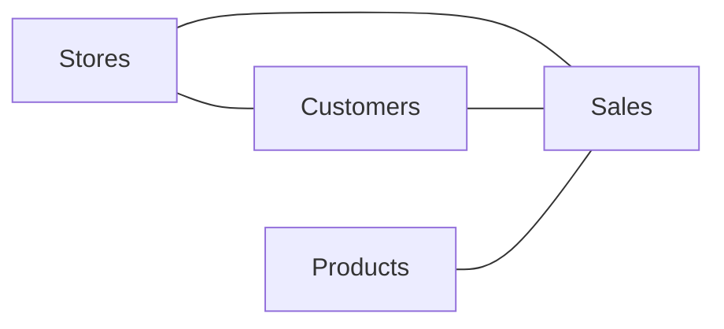

# Shoe Company: Data Profile

## At a Glance

<table style="border-collapse:collapse;margin:8px 0;">
<tr><th scope="row" align="left" style="text-align:left;vertical-align:top;white-space:nowrap;font-weight:600;padding:6px 16px 6px 0;border-bottom:1px solid rgba(128,128,128,.4);">About</th><td style="text-align:left;vertical-align:top;padding:6px 0;border-bottom:1px solid rgba(128,128,128,.4);">Retail sales of footwear through a chain of company-run shops in the United States, covering the people who buy, the shoes on offer and the shops that sell them. Purchases run from January 2025 to October 2026. <i>(written by AI)</i></td></tr>
<tr><th scope="row" align="left" style="text-align:left;vertical-align:top;white-space:nowrap;font-weight:600;padding:6px 16px 6px 0;border-bottom:1px solid rgba(128,128,128,.4);">Source</th><td style="text-align:left;vertical-align:top;padding:6px 0;border-bottom:1px solid rgba(128,128,128,.4);">shoe_company.xlsx (excel)</td></tr>
<tr><th scope="row" align="left" style="text-align:left;vertical-align:top;white-space:nowrap;font-weight:600;padding:6px 16px 6px 0;border-bottom:1px solid rgba(128,128,128,.4);">Tables</th><td style="text-align:left;vertical-align:top;padding:6px 0;border-bottom:1px solid rgba(128,128,128,.4);">4</td></tr>
<tr><th scope="row" align="left" style="text-align:left;vertical-align:top;white-space:nowrap;font-weight:600;padding:6px 16px 6px 0;border-bottom:1px solid rgba(128,128,128,.4);">Sampled Rows</th><td style="text-align:left;vertical-align:top;padding:6px 0;border-bottom:1px solid rgba(128,128,128,.4);">2,810</td></tr>
<tr><th scope="row" align="left" style="text-align:left;vertical-align:top;white-space:nowrap;font-weight:600;padding:6px 16px 6px 0;border-bottom:1px solid rgba(128,128,128,.4);">Profiled</th><td style="text-align:left;vertical-align:top;padding:6px 0;border-bottom:1px solid rgba(128,128,128,.4);">2026-11-22 12:26 UTC</td></tr>
<tr><th scope="row" align="left" style="text-align:left;vertical-align:top;white-space:nowrap;font-weight:600;padding:6px 16px 6px 0;border-bottom:1px solid rgba(128,128,128,.4);">How to Read</th><td style="text-align:left;vertical-align:top;padding:6px 0;border-bottom:1px solid rgba(128,128,128,.4);"><a href="how-to-read.md">How to Read This Wiki</a> · <a href="beam-annotations.md">BEAM✲ Annotations</a></td></tr>
</table>

## Data Stories

_A data story describes one table: what the thing is, what one row is, and what to watch out for._

| Table | BEAM✲ | Grain | Description | Sampled Rows | Columns |
|---|---|---|---|---:|---:|
| [Customers](data-stories/customers.md) | [\[CV\]](beam-annotations.md#t-cv) | One row for each person who has signed up as a customer | A person who has bought from the company at least once and belongs to its loyalty programme, together with the shop they prefer and whether they agreed to receive emails. | 200 | 17 |
| [Products](data-stories/products.md) | [\[CV\]](beam-annotations.md#t-cv) | One row for each shoe model in a particular colour and material | A shoe the company sells, in a particular colour and material, with its brand, intended wearer, selling price, what it costs the company and the quantity in stock. | 60 | 14 |
| [Stores](data-stories/stores.md) | [\[CV\]](beam-annotations.md#t-cv) | One row for each shop | A shop where the company sells shoes to customers, with its address, manager, size, number of staff and the date it opened. | 15 | 12 |
| [Sales](data-stories/sales.md) | [\[DE\]](beam-annotations.md#t-de) | One row for each product line on a purchase | One product line rung up in a shop on a customer's purchase: which shoe, how many, the price, any discount and the amount charged. A purchase can have several lines. | 2,535 | 10 |

## Data Model

_How the tables connect, drawn from the measured relationships._



---

## Metadata

_Machine-readable facts about this page, for tools and AI agents._

```yaml
bijoe: "data-profile-index"
schema_version: 2
dataset: "Shoe company"
source: "shoe_company.xlsx"
source_type: "files"
connector: "excel"
tables: 4
sampled_rows: 2810
relationships: 4
generated_at: "2026-11-22T12:26:25+00:00"
generator: "bi-joe-data-profiler 0.1.0"
```
