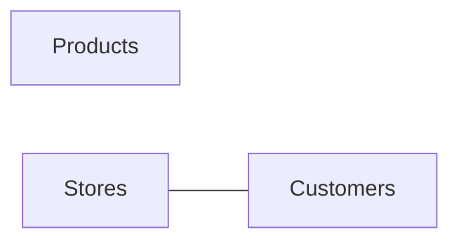

# Shoe company: data profile

## At a glance

| | |
|---|---|
| **About** | Reference data for a shoe retailer trading as StepUp: the people who buy from it, what it sells, and where it sells. It holds no sales or other business events. _(written by AI)_ |
| **Source** | shoe_company.xlsx (excel) |
| **Tables** | 3 |
| **Sampled rows** | 275 |
| **Profiled** | 2026-11-09 16:24 UTC |
| **Purpose** | Build reports and dashboards |
| **How to read** | [How to read this wiki](how-to-read.md) · [BEAM✲ annotations](beam-annotations.md) |

## Data stories

_A data story describes one table: what one row is, what it means in business terms, and what to watch out for._

| Table | BEAM✲ | Grain | Description | Sampled rows | Columns |
|---|---|---|---|---:|---:|
| [Customers](data-stories/customers.md) | [\[CV\]](beam-annotations.md#t-cv) | One row per customer | A customer is a person who has made one or more purchases from the company, identified by `CustomerID`. | 200 | 17 |
| [Products](data-stories/products.md) | [\[CV\]](beam-annotations.md#t-cv) | One row per product | A product is a shoe model in one colour that the company sells or has sold, identified by `ProductID` and `SKU`. | 60 | 14 |
| [Stores](data-stories/stores.md) | [\[CV\]](beam-annotations.md#t-cv) | One row per store | A store is a physical StepUp shop (an outlet, flagship, kiosk or standard store), identified by `StoreID`. | 15 | 12 |

## Data model

_How the tables connect, drawn from the measured relationships._



---

## Metadata

_Machine-readable facts about this page, for tools and AI agents._

```yaml
bijoe: "data-profile-index"
schema_version: 1
dataset: "Shoe company"
source: "shoe_company.xlsx"
source_type: "files"
connector: "excel"
tables: 3
sampled_rows: 275
relationships: 1
generated_at: "2026-11-09T16:24:24+00:00"
generator: "bi-joe-data-profiler 0.1.0"
```
